**Vaporwave** grew out of 2010s internet music and art. It borrows from
shopping-mall ads, early web graphics and the computer desktops of the
1990s. Its look is easy to spot: pastel pink and cyan, marble Greek statues,
palm trees, sunsets cut into stripes, checkerboard floors that run to the
horizon, Japanese text, and grey Windows 95 dialog boxes.

This tutorial uses all of that for a menu for an imaginary noodle bar called
**Udon Utopia**. The joke is in the middle of the page. Helios, the Greek
sun god, gazes at a striped vaporwave sunset, and the sun is really an
overhead photo of a bowl of kitsune udon. The menu itself is two program
windows on a retro desktop, with a taskbar along the bottom.

The menu is 1200 × 1800 px. You'll need two photos, both free to use from
Wikimedia Commons. One is *Head Helios AM Rhodes E49.jpg*, a marble head of
Helios in the Archaeological Museum of Rhodes (public domain). The other is
*Kitsune udon of Nakau.jpg*, a bowl of udon shot from above (CC0). Download
the large versions before you start.

The tools you'll meet along the way:

- the **Lasso** and **Select → Shrink / Feather / Inverse** to cut out a photo
- the **Move** tool's handles to scale, squash and rotate, and its
  **Perspective** mode for the floor
- **Edit → Define Pattern** and **Fill with Pattern** for a checkerboard and
  scanlines
- **group Gradient Maps** to recolour the photos
- **Filter → Halftone**, **Chromatic Aberration**, **Pixel Stretch**,
  **Brightness/Contrast** and **Bloom**
- the **Brush** with **Taper** for palm trees, and the **Pencil** for 3D
  bevels
- **Bodoni Moda**, **Dela Gothic One**, **Noto Serif JP** (as vertical
  text) and the pixel font **VT323**, with per-line colours
- **Stroke**, **Drop Shadow** and **Color Overlay** effects, and the
  **Screen** and **Multiply** blend modes
- **groups**: Duplicate a whole window, move it, then retype it

The palette:

- Sky `#2A1B5C` → `#8E5BD6` → `#FF8FCF` → `#FFD1A8`
- Floor `#1E0E3E` / `#FF4FB8`, floor shade `#6E4C92`, palms `#2A1240`
- Bust map `#2B1660` → `#E25FB8` → `#BFFFF4`
- Sun map `#4A1670` → `#D9408A` → `#FF8A6A` → `#FFD98A` → `#FFF8E6`
- Window grey `#C3C3C3`, bevel shade `#7B7B7B`, title bar `#0A0A84` → `#1C8CD6`
- Title shadow `#3FF2F2`, katakana `#FFF59A`, menu ink `#16102E`
- Descriptions `#8A3FC8`, sub-heads `#E0207F`, sticker `#FFF59A` / `#FF2E93`

## Create the document and paint the sky

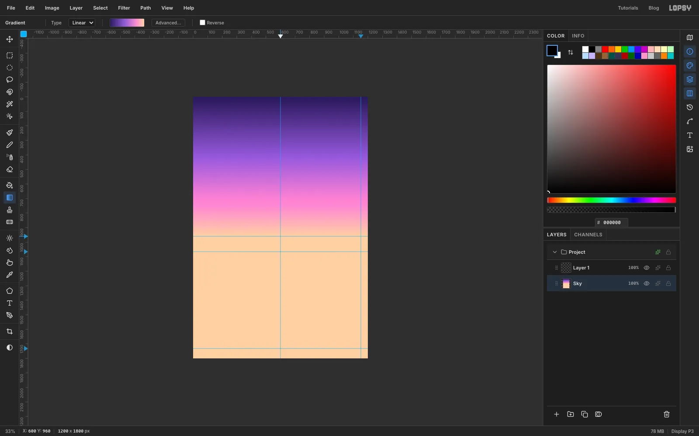

Choose **File → New**, set the unit to **Pixels**, type **1200** × **1800**
and click **Create**. A new document starts with a white *Background* and an
empty *Layer 1*, which you'll delete in a moment.

Drop some guides. Click the top ruler at **600** (the centre) and **1152**.
Click the left ruler at **960** for the horizon, **1066** for the top of the
menu windows and **1732** for the top of the taskbar. The status bar at the
bottom of the window shows the pointer's X and Y, so you can check where you
are before you click. You'll use that readout all through this tutorial.

Double-click *Background*, rename it *Sky*, and pick the **Gradient** tool
from the toolbox (it has no shortcut). Leave **Type** on **Linear**, click
**Advanced…**, and set four stops: `#2A1B5C` at the left end, `#8E5BD6` at
42 %, `#FF8FCF` at 78 % and `#FFD1A8` at the right end. To add a stop,
click the bar that far along it (42 % is a little under halfway), then type
its colour in the **Hex** field. Every later gradient starts from the last
one you set, so open **Advanced…** each time and add or delete stops until
you have the ones a step asks for. Click **Done**, then
drag straight down from the top of the canvas to the horizon guide. Below
the horizon the layer stays peach, which the floor will cover later.

## Turn a black-to-white ramp into halftone dots

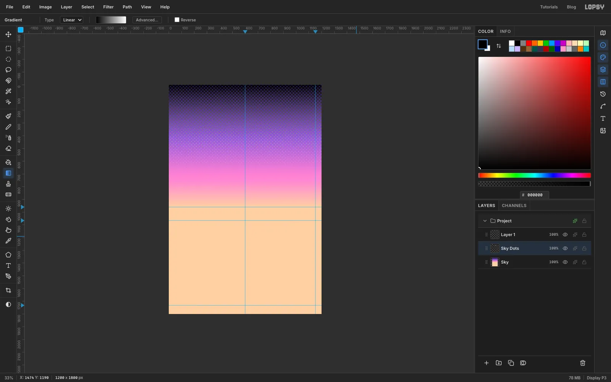

Add a layer with the **+** button and name it *Sky Dots*. Open the
gradient's **Advanced…** editor again, delete the middle stops (click one,
then **Delete**), and set the two ends to black `#000000` and white
`#FFFFFF`. Drag from the top of the canvas down to about **y 700**.

Now choose **Filter → Halftone…** and set **Dot Size** 18, **Angle** 45 and
**Softness** 0.6, and leave **Density** at 1. Click **Apply**. Dark areas
become big dots and white areas print nothing, so the dots shrink to
nothing down the sky.

## Tint the dots pink

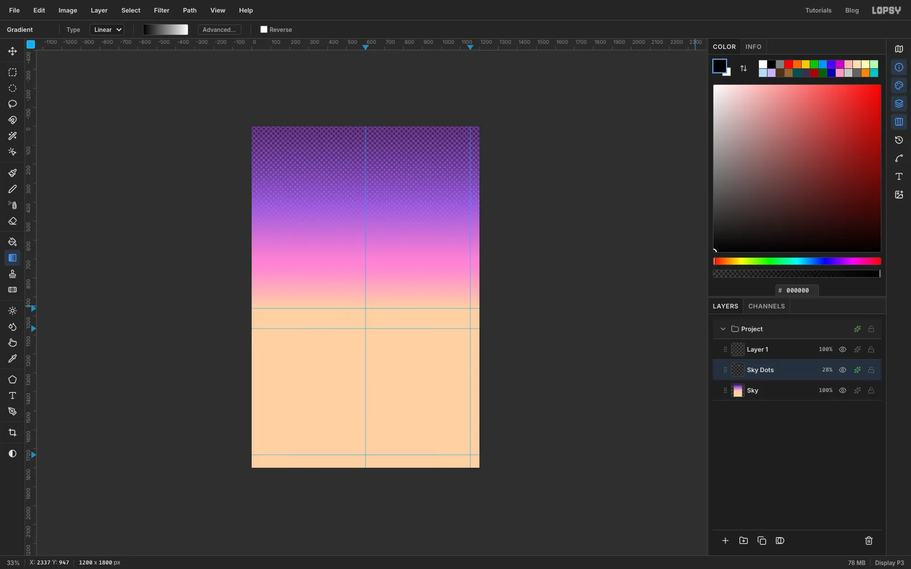

Click the **fx** button on the *Sky Dots* row to open the effects drawer.
Tick **Color Overlay** and set its colour to `#FF8FCF`. Close the drawer,
click the row's opacity percentage and drag it down to **28 %**. You now
have a soft retro dot screen at the top of the sky.

## Drop in the photo of Helios

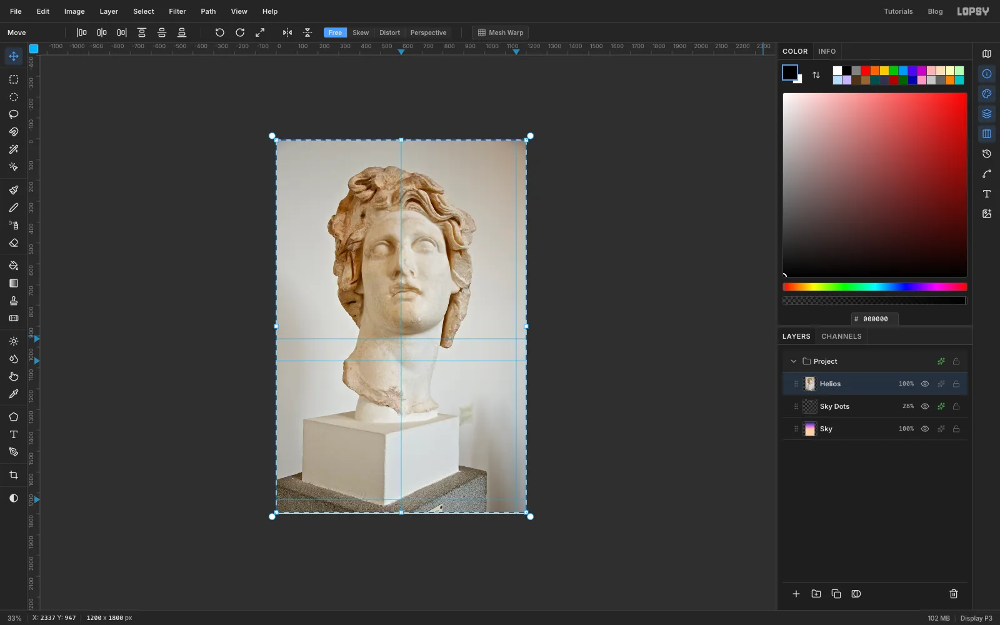

First click the empty *Layer 1* and delete it with the trash button at the
bottom of the Layers panel. Then click *Sky Dots* and drag the Helios photo from your
Downloads folder straight onto the canvas. Lopsy shrinks it to fit the
canvas, puts it on a new layer directly above *Sky Dots*, and selects it.
Rename the layer *Helios* and press [[Cmd+D]] to drop the selection.

## Lasso around the head

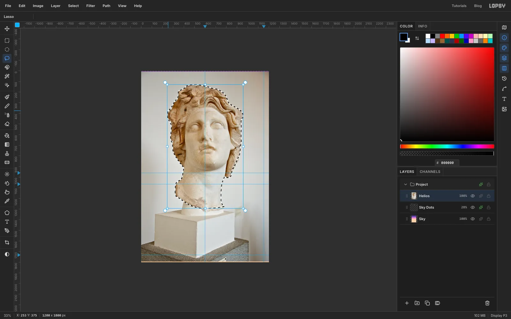

Pick the **Lasso** ([[L]]). Hold the mouse down and trace around the head:
follow the outside of the curls loosely, come down the right side past the
lock of hair that hangs beside the neck, and cut straight across the broken
bottom of the neck, just above the white plinth. Go back up the left side
and finish where you started. You don't have to follow every curl. At the
size the bust ends up, a few pixels either way won't show.

## Cut the head out

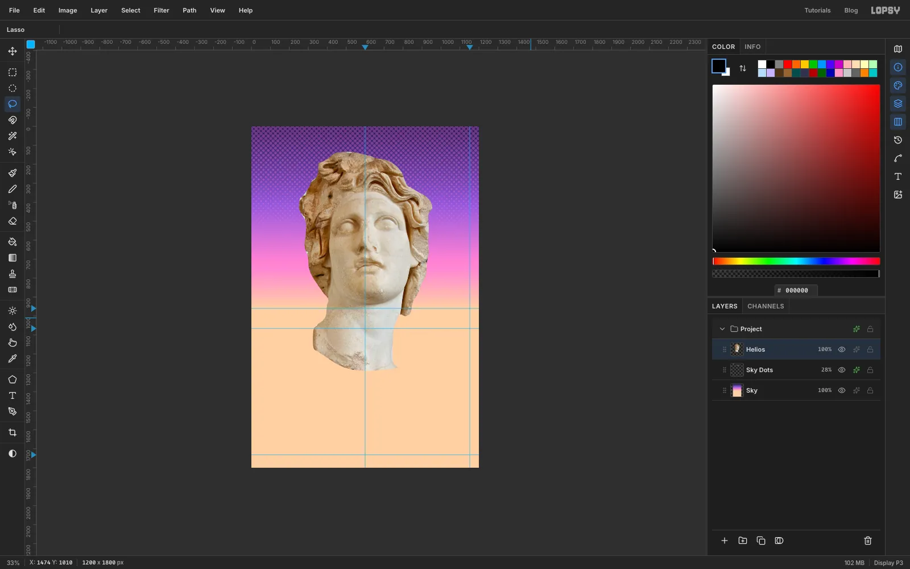

Pull the edge in a touch so no grey wall is left around the hair. Choose
**Select → Shrink…** and enter **5**, then **Select → Feather…** and enter
**1** to soften the edge slightly. Choose **Select → Inverse**
([[Cmd+Shift+I]]) so everything *except* the head is selected, press
[[Delete]], then [[Cmd+D]].

## Scale the head down

Draw a **Rectangular Marquee** ([[M]]) just around the head, then press
[[V]] for the **Move** tool so the transform handles appear. Hold
[[Cmd]] (to keep the proportions) and drag the bottom-right corner handle up
and to the left until the head is about 560 px wide, roughly 78 % of its
size. The left of the hair is at about x 248, so stop when the pointer reads
about **x 805** in the status bar. Press [[Enter]] to apply and [[Cmd+D]] to
deselect.

## Place the bust on the right

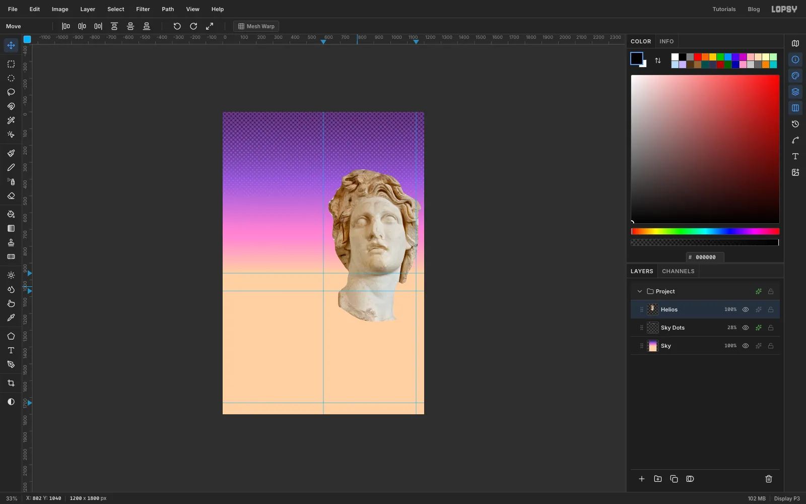

Still on the Move tool, drag the head over to the right. The top of the
hair sits at about **y 340** and its right edge comes almost to the right
edge of the canvas. Helios should look up and to the left, toward the empty
sky where the sun will go. The bottom of the neck can hang below the
horizon, because the menu windows will cover it.

## Tint the bust with a Gradient Map

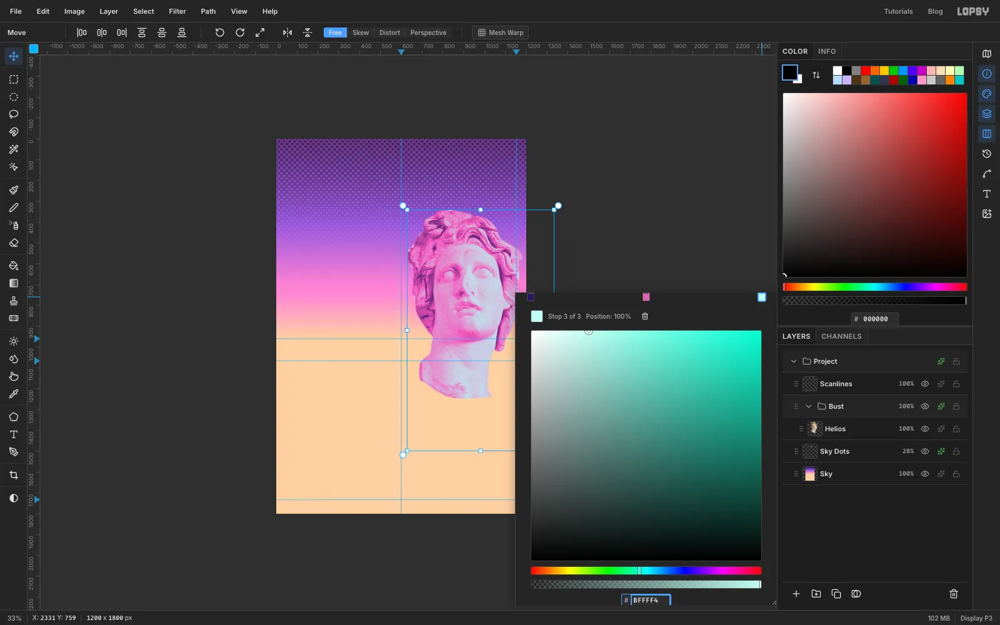

Gradient Maps live on groups, so the bust goes in one. First click the **+**
button to add an empty layer called *Scanlines*. It stays empty until near
the end, but it matters now. A new layer added while a *group* row is
selected goes inside that group, so you'll click *Scanlines* whenever you
want to start something new above the bust.

Click *Helios* again and choose **Layer → Group Layers**. Name the group
*Bust*. Click the group's **fx** button, then **Add Adjustment → Gradient
Map**. Click the middle of the gradient bar to add a third stop, then click
each stop and type its hex: `#2B1660` on the left, `#E25FB8` in the middle,
`#BFFFF4` on the right. Shadows go violet, midtones hot pink and highlights
icy cyan, the classic vaporwave statue.

## Drop in the bowl of udon and circle it

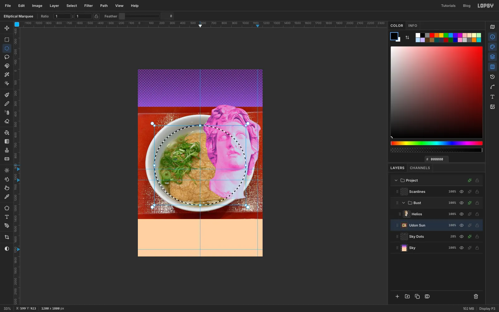

Click *Sky Dots*, so the bowl lands below the bust, and drag the udon photo
onto the canvas. Rename the layer *Udon Sun* and press [[Cmd+D]].

The bowl has a thin blue ring painted just inside its white rim. Pick the
**Elliptical Marquee** and drag an oval that sits just inside that blue line,
so you keep the broth, noodles, tofu and fishcake and lose the red tray and
most of the white rim. Keep the oval a little inside the line, or a sliver
of rim will show at the edge. The bowl was shot from slightly in front, so the ring is a little
wider than it is tall. Follow it, and you'll make it round in a moment.

## Cut out the bowl

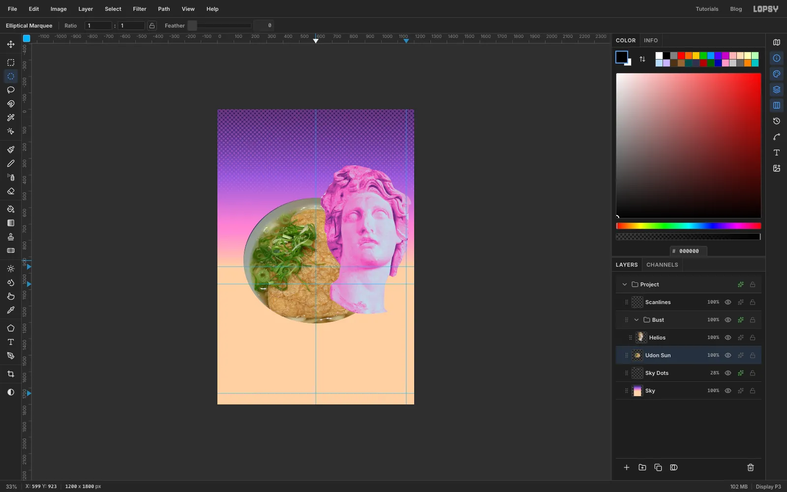

Choose **Select → Inverse**, press [[Delete]] and then [[Cmd+D]]. You're
left with an oval of noodles and fried tofu.

## Squash the oval into a circle

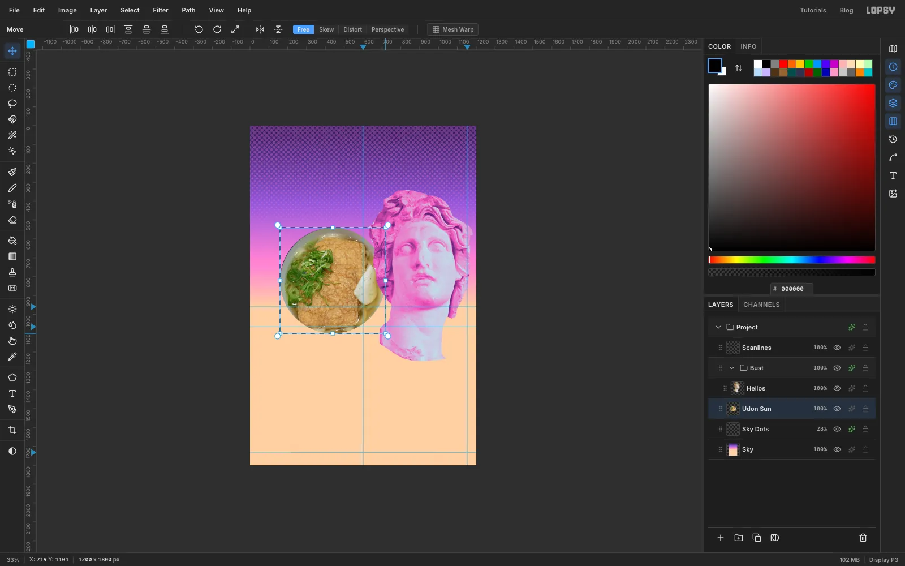

Draw a Rectangular Marquee exactly around the oval. With the default photo
fit it runs from about (159, 541) to (1039, 1306). Press [[V]]. This time
*don't* hold [[Cmd]]: drag the bottom-right handle up and to the left to
about **(719, 1101)**, the top-left corner plus 560 each way, so the box
becomes a **560 × 560** square. The width shrinks a little more
than the height, so the oval becomes a circle. Press [[Enter]], then
[[Cmd+D]].

## Move the sun into place

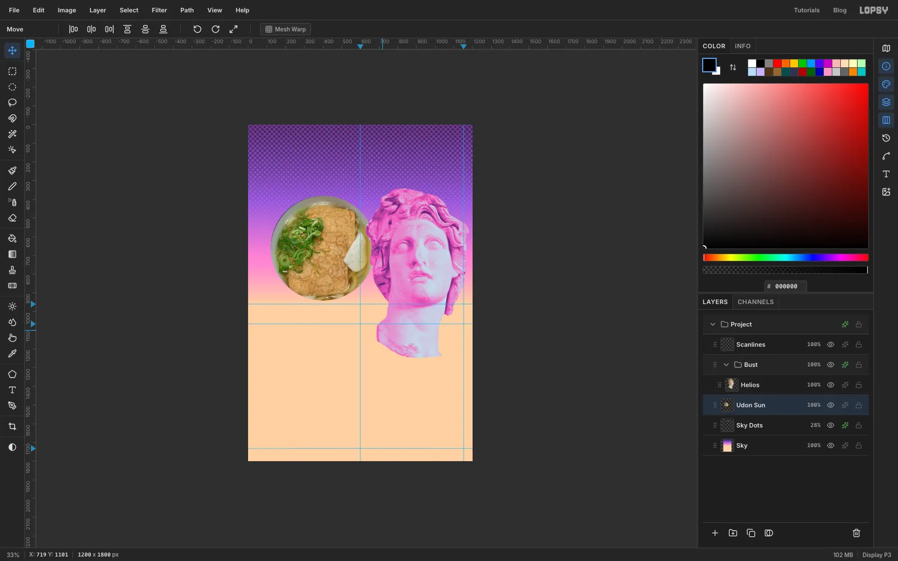

Drag the circle with the Move tool so its centre is at about **(400, 660)**.
Its left edge sits about 120 px in from the side of the canvas, its bottom
stops just above the horizon at about **y 940**, and the bust's hair
overlaps its right edge a little.

## Cut the sunset stripes

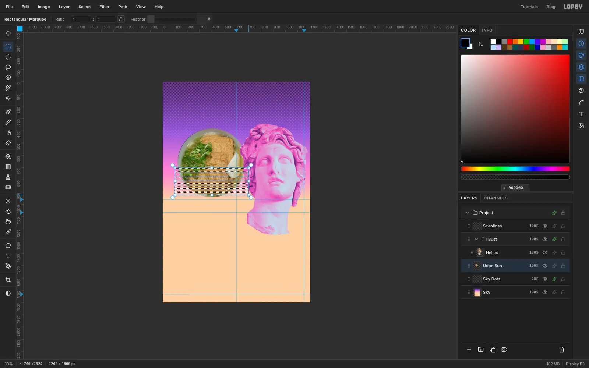

The stripes that cut through a synthwave sun get thicker and closer
together toward the bottom. Zoom to 100 % so you can see single pixels.
With the Rectangular Marquee, drag a band
right across the sun starting at **y 700**, only **5 px** tall. Then hold
[[Shift]] and add seven more bands below it, each 2 px taller than the one
before. Start them at about y 736, 769, 800, 829, 856, 881 and 905. Let
every band run past both sides of the circle. Press [[Delete]] to cut them
out, then [[Cmd+D]].

## Draw one checker tile

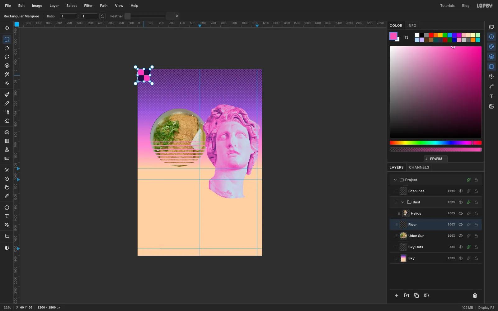

Click *Udon Sun* and add a layer called *Floor*, so it sits above the sun
and below the bust.

Zoom in on the top-left corner. Set the foreground colour to `#1E0E3E` in
the **Color** panel's hex field. Drag a marquee from the corner to
**(120, 120)** and choose **Edit → Fill**. Switch to hot pink `#FF4FB8`,
drag a marquee from the corner to (60, 60), hold [[Shift]] and add a second
square from (60, 60) to (120, 120), then **Edit → Fill** again. Drag a
marquee around the whole 120 px tile and choose **Edit → Define Pattern**.
Press [[Delete]] to clear the tile from the corner.

## Fill the ground with the checkerboard

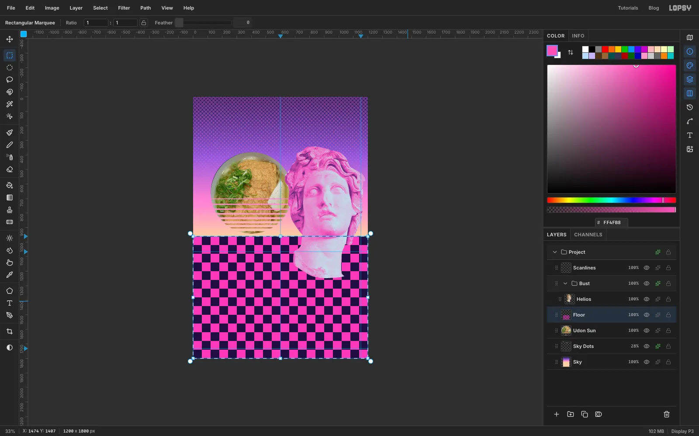

Drag a marquee from the horizon guide at the left edge down to the
bottom-right corner of the canvas. Choose **Edit → Fill with Pattern…**,
click your checker tile, and click **Apply**. Keep the selection, because
the next step transforms it.

## Pull the floor into perspective

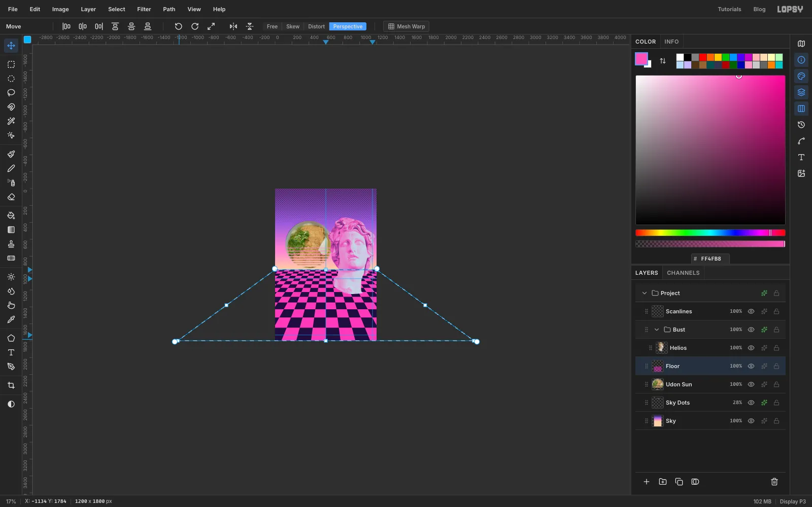

Press [[Cmd+-]] twice, so you're at 25 % and can see well past the sides of
the canvas. Press [[V]], then click **Perspective** in the options bar. In
this mode, dragging a corner moves the opposite corner of the same edge the
other way.

Drag the **bottom-left** corner handle a long way out to the left, to
about **x −1150**. The bottom-right corner swings out to the right at the
same time. Grab the white corner square a few pixels *inside* the corner.
At this zoom the outer half of the square belongs to the rotate handle, and
a rotation does nothing in Perspective mode. Press [[Enter]], then
[[Cmd+D]], and press [[Cmd+0]] to fit the canvas back on screen. The
squares now shrink toward the horizon. The Perspective button stays on, so
the next time you have a selection, click **Free** in the options bar before
you scale anything.

## Add a haze on the horizon

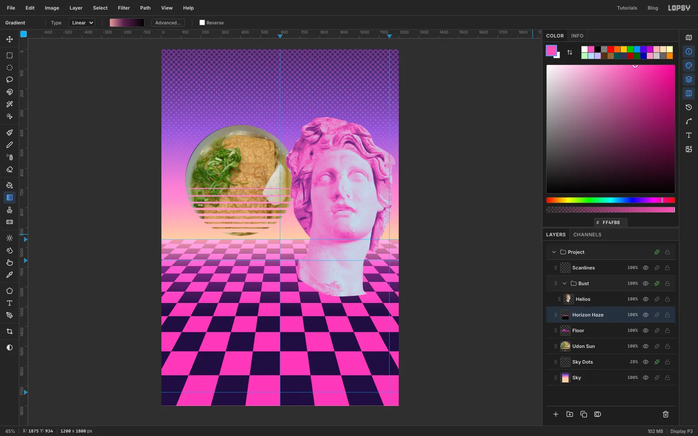

Add a layer called *Horizon Haze* and drag a marquee from the horizon to
the bottom of the canvas. Set the gradient to three stops: `#E89A9A`, then
`#5A2050` at 40 %, then black. Drag from the horizon down to about
**y 1320**. Press [[Cmd+D]], open the layer's effects drawer and set its
**Blend Mode** to **Screen**. In Screen mode black disappears, so only the
warm glow over the far rows shows.

## Shade the near floor

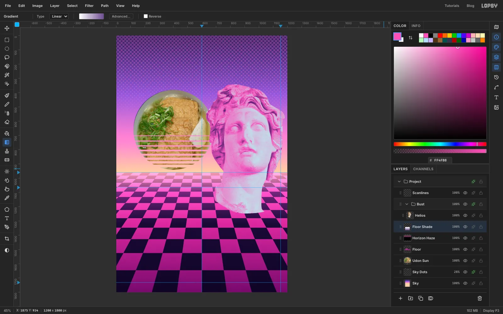

The near rows are big and loud, and the menu will sit on top of them. Add
a layer called *Floor Shade*, select the same area again, and drag a
white-to-`#6E4C92` gradient from about **y 1040** down to the bottom edge.
Press [[Cmd+D]] and set the layer's blend mode to **Multiply**. White
changes nothing and the violet end darkens the checks, so the floor calms
down where the windows will go.

## Paint a palm tree with tapered strokes

Click *Floor Shade* and add a layer called *Palm A*. Set the foreground to
`#2A1240` and pick the **Brush** ([[B]]). Open the **Brushes** panel from
the options bar and, on the **Shape** tab, set **Size** 30, **Hardness**
100 and **Spacing** 2. **Taper** shrinks the brush to nothing over that
many pixels from where the stroke starts, so a stroke starts thick and
ends in a point.

For the trunk, set **Taper** to about **530** and drag from the bottom,
near **(44, 1036)**, curving slightly left and then up to a crown at
about **(78, 742)**. Then draw nine fronds, each one *starting at the crown*
so it tapers out to a point. Arc each frond up and then over, like a
fountain: two point up, three go out to the left and four to the right,
and the lowest on each side droop well down. Set **Taper** to about **140**
for the upright and upper fronds and about **180** for the drooping ones,
so each ends in a point just as it reaches its tip.

## Add the leaflets

Smooth fronds read as a starfish. Palm leaves are made of rows of hanging
leaflets. Set **Size** to 13 and **Taper** to 46. From points along each
frond, drag short strokes about 35 px long that hang down and slightly
outward, eight or nine per frond. When you're done, set **Taper** back to
**0** so it doesn't carry into later brush work.

## Add a second, smaller palm

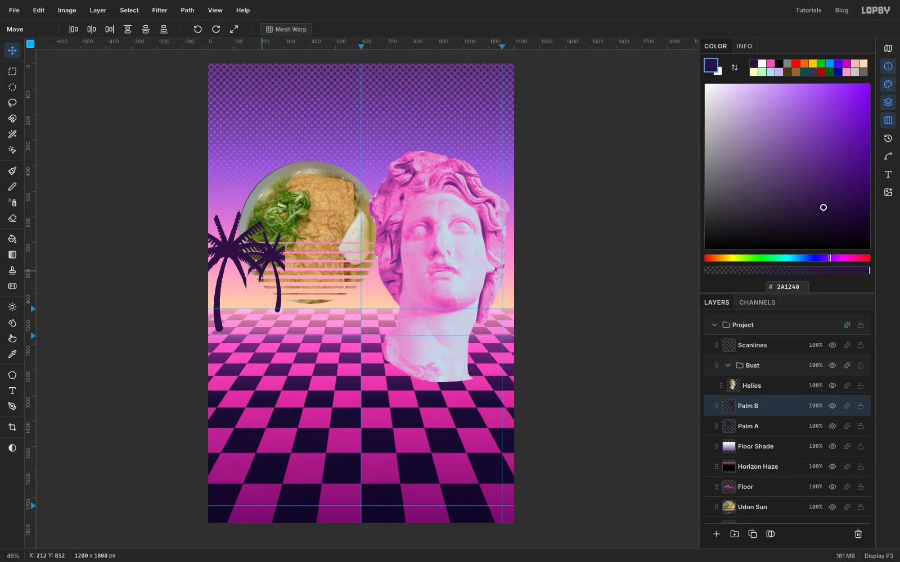

With *Palm A* selected, choose **Layer → Duplicate Layer** and rename the
copy *Palm B*. Choose **Image → Flip Horizontal**, which mirrors it in place.
Draw a marquee around it, press [[V]], hold [[Cmd]] and drag the top-left
handle in until the palm is about two-thirds of its size. Press [[Enter]]
and [[Cmd+D]]. Then drag it up and a little to the right, until its trunk
stands on the horizon at about **x 290**. The big palm starts lower than the small one, so it reads
as nearer.

## Recolour the sun with a Gradient Map

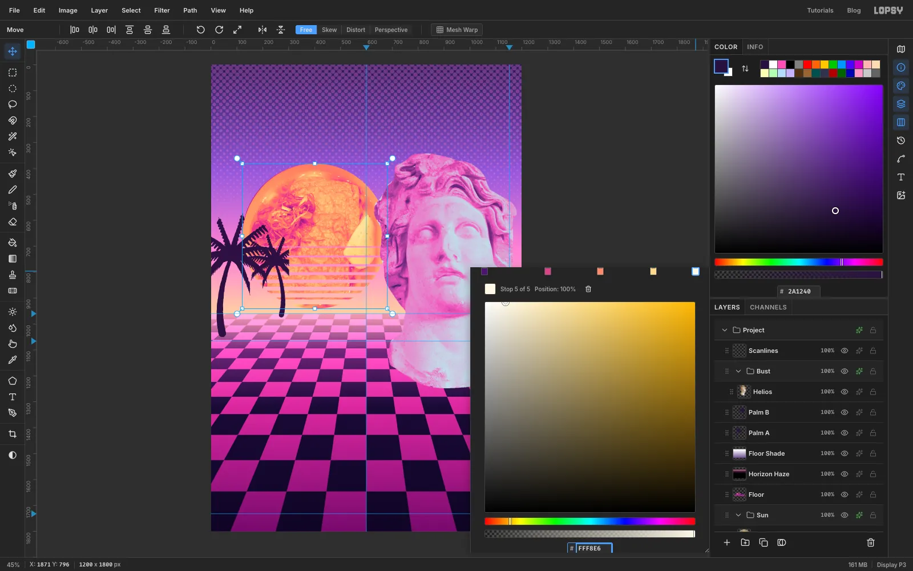

Click *Udon Sun* and choose **Layer → Group Layers**. Name the group *Sun*.
Add a **Gradient Map** to the group as you did for the bust. Click the bar
three times to get five stops, and set them to `#4A1670`, `#D9408A` at
30 %, `#FF8A6A` at 55 %, `#FFD98A` at 80 % and `#FFF8E6` at the right end.
The extra stops keep the noodles, tofu and green onion separate, so it
still reads as a bowl of udon and not an orange blur.

## Make the sun glow

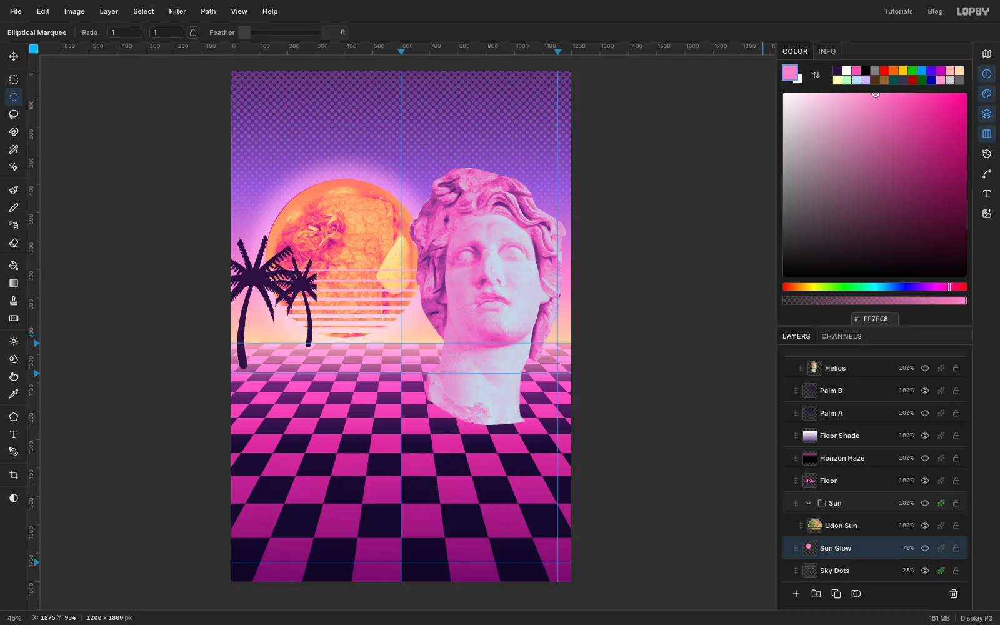

Click *Sky Dots* and add a layer called *Sun Glow*. Pick the **Elliptical
Marquee** and, with nothing selected, click once on the canvas instead of
dragging. A dialog opens where you can type exact corners. Enter From
**(70, 330)** and To **(730, 990)**, a circle 660 px across centred on the
sun. The same click-once dialog works for the Rectangular Marquee, so use it
whenever a step gives you exact corners. Choose
**Select → Feather…** and enter **70**. Fill it with `#FF7FC8`, press
[[Cmd+D]], then set the layer to **Screen** at **70 %** opacity.

## Set the title

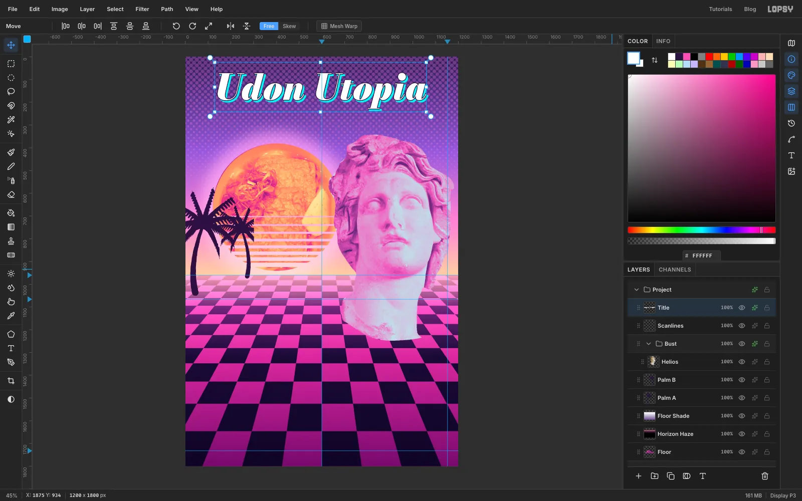

Click *Scanlines*. Pick the **Text** tool ([[T]]) and, in the options bar,
choose **Bodoni Moda**, weight **Black**, style **Italic**, size **156**,
and set the foreground to white. Click in an empty part of the canvas, type
**Udon Utopia** and press [[Tab]] to finish. Rename the layer *Title*. Move
it so it's centred on
the 600 guide with the top of the letters about 70 px from the top.

In its effects drawer, tick **Stroke** with **Width** 3 in `#2A1240`, and
**Drop Shadow** with **Offset X** 7, **Offset Y** 7, **Blur** 0 and
**Opacity** 100 in cyan `#3FF2F2`. Bodoni's thin hairline strokes would
otherwise blur into the shadow. The outline keeps every letter crisp.

## Add the katakana, tagline and vertical kanji

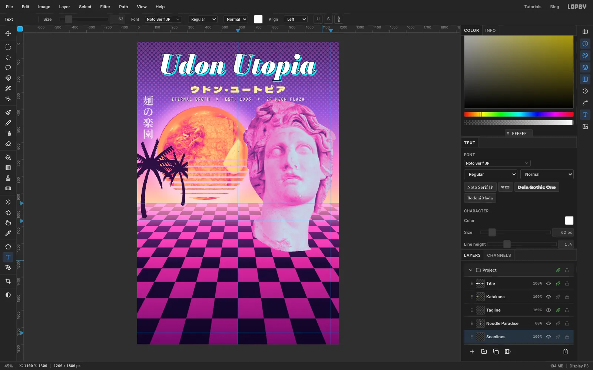

Click *Scanlines* again before each new line of type. If a text layer is
selected, changing the font restyles that layer. Set the weight back to
**Regular** and the style to **Normal**.

1. **Dela Gothic One**, size 54, `#FFF59A`: paste **ウドン・ユートピア**
   ("Udon Utopia" in katakana). In the **Text** panel set **Letter
   spacing** to 14 and centre it about 28 px under the title.
2. **VT323**, size 34, white, letter spacing 4: **ETERNAL BROTH  \*  EST.
   1995  \*  2F NEON PLAZA**. Centre it about 28 px under the katakana and
   give it a **Drop Shadow** of 2 / 2, Blur 0, in `#2A1240` at 90 %, so it
   stays readable where it crosses the bust's hair.
3. **Noto Serif JP**, weight **Bold**, size 62, white, letter spacing 0.
   Click **Toggle
   vertical text** (the stacked AB button) and paste **麺の楽園**
   ("noodle paradise"). Move the column to the left edge, about 35 px in,
   between the tagline and the palm tops, and set the layer to 80 %
   opacity.

Click *Scanlines*, turn vertical text off again and set the weight back to
**Regular**.

## Build a Windows 95 window frame

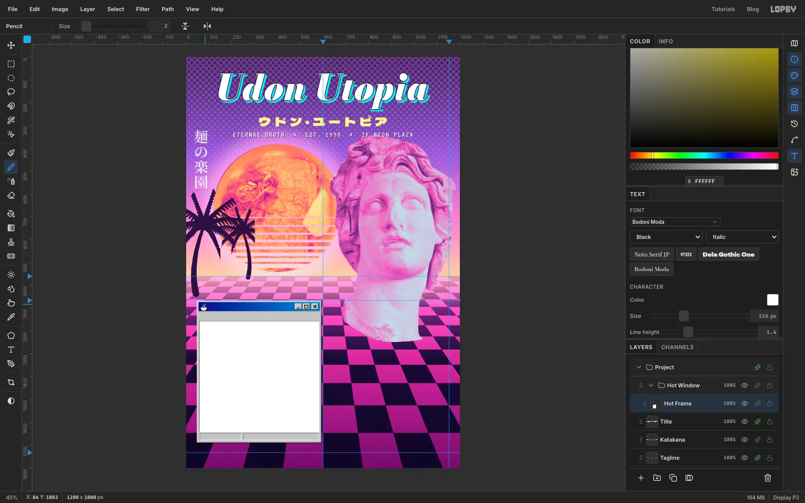

Click *Title*, then click **New Group** in the Layers panel and name it
*Hot Window*. Add a layer inside it called *Hot Frame*.

1. Marquee from **(48, 1066)** to **(594, 1690)** and fill it with
   `#C3C3C3`.
2. Make it look raised. Set the foreground to white and pick the
   **Pencil** ([[N]]) at **Size** 2. Click just inside the bottom-left
   corner, then [[Shift]]-click the top-left corner and the top-right
   corner. Each Shift-click draws a straight line from the last point. Set
   the foreground to `#111111` and draw the bottom and right edges the same
   way.
3. Marquee the title bar from **(55, 1073)** to **(587, 1113)** and drag a
   **Linear** gradient across it from `#0A0A84` on the left to `#1C8CD6`
   on the right (two stops).
4. At the right end of the title bar, add three grey buttons, all from
   y 1079 to 1107: x 477–509, 511–543 and 549–581. Give each the same
   white and black edges. Then, in `#111111` with the Pencil at Size 3,
   draw a short line on the first, a square on the second and an X on the
   third.
5. Marquee a white document area from **(60, 1158)** to **(582, 1640)**.
   Give it a *sunken* edge: `#7B7B7B` along the top and left, white along
   the bottom and right.
6. Add two sunken status panels along the bottom, from y 1648 to 1678:
   one from x 60 to 244 and one from 250 to 582.
7. For the program icon, draw a 26 px circle centred on **(78, 1098)** with
   the Elliptical Marquee. Switch to the **Rectangular Marquee** and
   [[Alt]]-drag a rectangle over the circle's top half to subtract it. Fill
   the bowl shape that's left with `#FFF59A`, and add two short white
   Pencil lines of steam.

Finally, give *Hot Frame* a **Drop Shadow**: Offset 14 / 14, Blur 0,
Opacity 55, in `#1A0830`.

## Type the hot menu

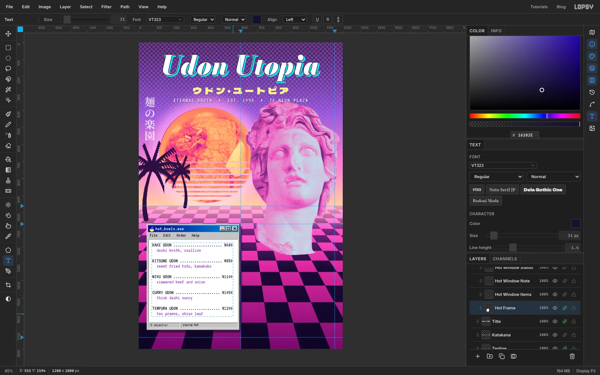

All the window type is **VT323**. Clicking *Title* earlier loaded its
Bodoni settings into the Text tool, so set the font to VT323, the weight to
**Regular** and the style back to **Normal**. Click *Hot Frame* before each
new text layer:

- Caption: **hot_bowls.exe**, size 32, white, next to the bowl icon.
- Menu bar: **File   Edit   Order   Help**, size 28, black, just under the
  title bar.
- Status: **5 object(s)** and **piping hot**, size 23, one in each panel,
  on the same baseline.

For the menu itself, set size **31** and colour `#16102E`, and type each dish
on one line with dot leaders out to the price, then its description on the
next line, indented two spaces, then a blank line. The five dishes are:

- **KAKE UDON** ¥680: dashi broth, scallion
- **KITSUNE UDON** ¥850: sweet fried tofu, kamaboko
- **NIKU UDON** ¥1100: simmered beef and onion
- **CURRY UDON** ¥1050: thick dashi curry
- **TEMPURA UDON** ¥1200: two prawns, shiso leaf

So the first two lines read (38 characters wide) `KAKE UDON ....................... ¥680` and
`  dashi broth, scallion`. VT323 is monospaced, so
if every dish line is the same number of characters (38 here), the prices
line up on the right. In the Text panel set **Line height** to **1**, so
each dish and its description sit tight together and the blank lines
separate the dishes. Place the block 22 px in from the left of the white
area.

Now colour the descriptions. Click into the menu with the Text tool, drag
across a description line to select it, click the **Text color** swatch in
the options bar, and type `#8A3FC8`. Do this for each description, then
press [[Tab]]. Click *Hot Frame* and set **Line height** back to 1.4.

## Duplicate the window and move it across

Collapse the *Hot Window* group, click its row and choose **Layer →
Duplicate Layer**. Rename the copy *Cold Window*. With the Move tool and the
group selected, drag on the canvas to move the whole window 558 px to the
right, until its right edge meets the **1152** guide (its left edge is then
at x 606). The hot window's shadow fills the narrow gap between them.

## Retype the cold menu

Expand *Cold Window* and rename its layers so you can tell them apart. With
the Text tool, click into the copied caption, press [[Cmd+A]], type
**cold+sides.txt** and press [[Tab]]. Do the same for the status panels:
**7 object(s)** and **chill mode**.

Delete the copied menu layer and type a new one the same way:

- **ZARU UDON** ¥750: chilled, tsuyu to dip
- **BUKKAKE UDON** ¥800: grated daikon, lemon
- **-- SIDES --**, then EBI TEMPURA (2) ¥450, ONIGIRI ¥300 and INARI SUSHI
  (2) ¥380 on consecutive lines, then a blank line
- **-- DRINKS --**, then RAMUNE SODA ¥350 and MATCHA FLOAT ¥500 Colour the descriptions
`#8A3FC8` and the two headings `#E0207F`.

## Add a mouse cursor

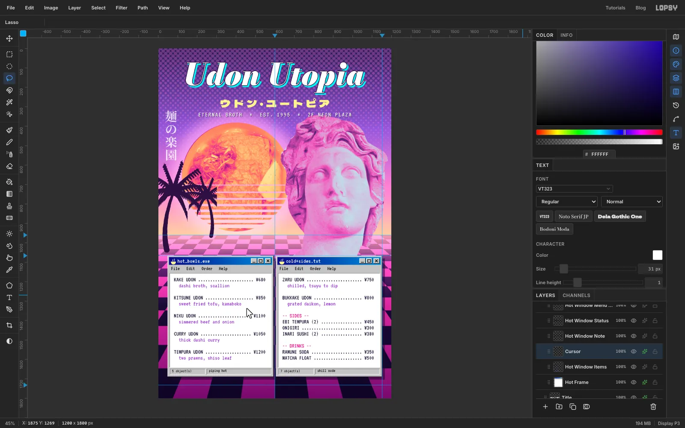

Click the hot menu's text layer and add a layer called *Cursor* (it lands
inside the *Hot Window* group). Zoom in to about 400 %. The classic arrow
pointer is seven straight sides, so draw it with the **Pen** ([[P]]): click
its tip, then the six other corners, about 29 × 49 px in all, and click the
tip again to close the path. In the **Paths** panel click **Path to
Selection**, then delete the path. Put its tip in the blank line just past
the end of the Kitsune description, so the arrow rests on Niku Udon's dot
leaders and doesn't cover any words. Fill it white and give
it a **Stroke** of 3 in `#111111`.

## Make a NEW! sticker

Click *Scanlines*, click **New Group**, and name it *Sticker*. Inside it,
add a layer called *Burst*. Draw a 20-point starburst centred on about
**(1080, 950)** with the **Pen**: click 40 corners in a zig-zag, alternating
between points about 86 px from the centre and dips about 70 px from it,
and close the path on the first corner. Then click **Path to Selection** in
the Paths panel and delete the path. Fill it `#FFF59A`, then give it a **Stroke** of 4 in
`#FF2E93` and a **Drop Shadow** of 6 / 6, Blur 0, 60 % in `#1A0830`.

Click *Burst* before each line. Type **NEW!** in Dela Gothic One, size 38,
`#FF2E93`, then **curry udon** and **¥1050** in VT323 at 28, in `#16102E`.
Centre each one on the star, stacked one under another.

## Tilt the sticker

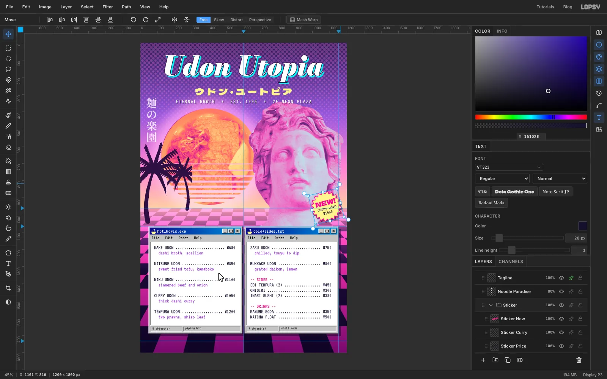

Click the *Sticker* group row and press [[V]]. With nothing selected on the
canvas, the Move tool puts one box around the whole group. Drag just outside
its top-right corner to turn it about **14°** anticlockwise, then press
[[Enter]]. Its shadow should clear the cold window by about 20 px.

## Build the taskbar

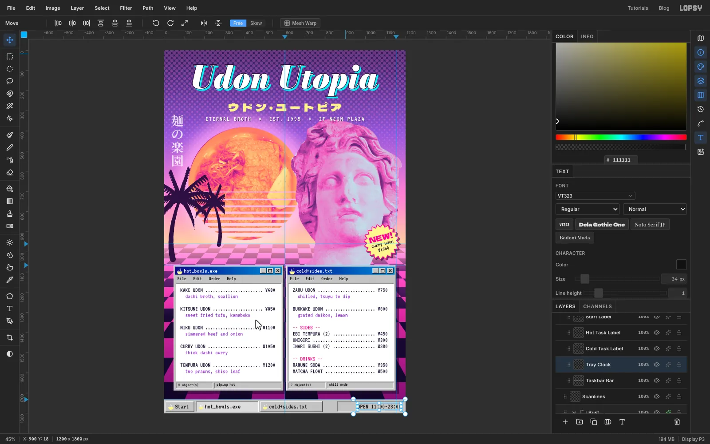

Click *Scanlines*, click **New Group** and name it *Taskbar*. Add a layer
called *Taskbar Bar*. Fill a marquee from the taskbar guide to the bottom of
the canvas with `#C3C3C3` and Pencil a 2 px white line along its top.

Draw four buttons with the same Pencil bevels, all running from y 1741 to
1793: a raised **Start** button (x 8 to 150), a *pressed* button for the
hot window (x 160 to 470, sunken, filled a lighter `#DCDCDC`), a raised one
for the cold window (x 478 to 788), and a sunken tray on the right (x 860
to 1192). Add a little bowl icon to the first three.

Type the labels in VT323 at **34** in `#111111`, clicking *Taskbar Bar*
before each:
**Start**, **hot_bowls.exe**, **cold+sides.txt** and **OPEN 11:00-23:00**.
Line them up on one baseline. Centre *Start* in its button, then use the
arrow keys to nudge each of the others up or down until the bottoms of its
letters sit level with the bottom of *Start* (ignore the underscore).

## Add CRT scanlines

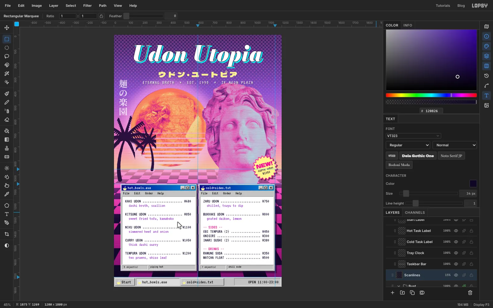

Click the empty *Scanlines* layer. Zoom right in on the top-left corner,
fill a 6 × 3 px marquee with `#120826`, then marquee 6 × 6 px from the
corner and choose **Edit → Define Pattern**. Press [[Delete]].

Marquee everything above the taskbar guide, choose **Edit → Fill with
Pattern…**, pick the new striped tile and click **Apply**. Press [[Cmd+D]],
then set the layer to **Multiply** at **15 %**. *Scanlines* sits above the
bust and below all the type and windows, so it dims the wallpaper and
leaves the menu crisp.

## Glitch the floor and the bust

Click *Floor* and choose **Filter → Chromatic Aberration…** with **Amount**
4 and **Direction** 0. It splits the red and blue edges of every checker
square, like a misaligned old monitor.

Click *Helios*, draw a Rectangular Marquee in a band across the bust's
eyes, from about **(600, 655)** to **(1200, 712)**. Choose **Filter →
Pixel Stretch…** with **Amount** 36, **Bands** 7, **Seed** 12 and **RGB
Split** 0.7. Slices of the band slide sideways, like a tape glitch. Press
[[Cmd+D]].

## Calm the fishcake and bloom the sun

The slice of white fishcake on the right of the bowl is the brightest flat
shape in the sun, and it pulls the eye away from the noodles. Click
*Udon Sun*, lasso around the wedge, and choose **Select → Feather…** with
**6**. Choose **Filter → Brightness/Contrast…** and set **Brightness** −12
and **Contrast** −25. Press [[Cmd+D]].

Then run **Filter → Bloom…** on the whole layer with **Threshold** 88,
**Radius** 18 and **Intensity** 35, for a gentle glow on the highlights.
To judge it, hide and show the *Sun* group with its eye icon.

## Export and save

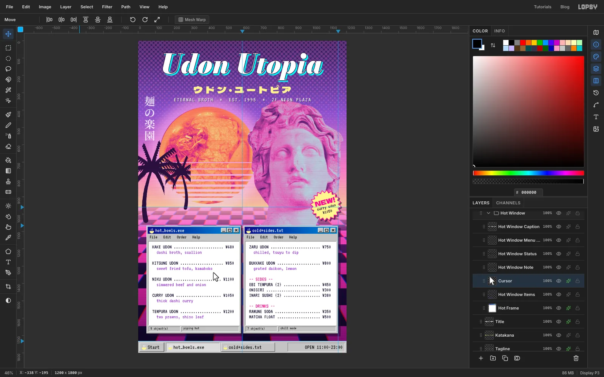

Press [[Cmd+D]] and click an empty part of the window so no handles show.
Choose **File → Quick Export PNG** for the image and **File → Save
Project** to keep every layer, group, effect and live text layer editable.
