*Vernacular* design is the everyday commercial art nobody signs: gas-station
signs, diner menus, bowling-league shirts, and the souvenir patches sold at
the register of a roadside stop. In this tutorial you'll make one of those
patches for a made-up Texas business, **Lone Armadillo**, which sells chili,
bait and cold beer, and show it sewn onto a dark rayon shirt.

The look comes from a few familiar pieces:

- an arched title in sign-painter script with an offset "drop shade"
- a striped half sun setting behind flat-topped buttes
- a mascot, here a real armadillo photo turned into thread colours
- a ribbon banner, a chain-stitched ground line and a stitched edge

The armadillo comes from a public-domain U.S. Fish and Wildlife Service photo,
"Dasypus novemcinctus" by John and Karen Hollingsworth (via Wikimedia
Commons). Any side-on photo of an animal works the same way.

The canvas is 1600 × 1300 px. Along the way you'll use:

- ruler **guides**, the **Elliptical** and **Rectangular Marquee** with add and intersect, **Select → Inverse** and **Grow**
- the **Brush**, the **Gradient** tool and **Rasterize Layer**
- **Mesh Warp** to arch the title and bend the ribbon
- the **Pen** tool with the **Paths** panel's **Path to Selection**, a **layer mask**, and **Convert mask to selection**
- **Motion Blur**, **Surface Blur**, **Oil Paint**, **Brightness/Contrast**, **Posterize**, **Sunburst**, **Add Noise** and **Gaussian Blur**
- a **Gradient Map** adjustment on a group
- **Define Brush** for a chain-stitch brush, the **Clone Stamp**, the **Eyedropper** and **Dodge**
- copy and paste, **Flip Horizontal**, scaling and rotating with the **Move** tool, **Merge Down** and **Group Layers**
- the **Stroke**, **Color Overlay**, **Inner Glow** and **Drop Shadow** effects, and the **Overlay** and **Soft Light** blend modes
- type in **Lobster**, **Alfa Slab One** and **Bungee**

The palette:

- Shirt `#26211F`, felt `#ECDFBF`
- Merrow turquoise `#2E8C88`, deep turquoise `#1F6B68`, merrow stitches `#1A5A57`, merrow glow `#0E3533`
- Sunset `#EFB83C` / `#E57A2C` / `#C9472B`
- Title red `#B23A26`, outline brown `#2A170D`
- Ribbon mustard `#E3A72F`, ribbon tails `#B47B22`, fold `#6E4512`
- Cactus green `#7E9A4A`, tuft teal `#14504D`, chain thread `#8A5A2B`
- Armadillo threads `#2A170D` → `#6E3320` → `#A85A38` → `#CC8A5C` → `#E2B080` → `#EDC79A`
- Leg grey `#4A4A4A` (the Gradient Map recolours it)
- Thread grey `#808080` (texture layers only), sheen `#D8D8D8` → `#3A3A3A`

Blend modes live in each layer's effects drawer: click the ✦ button on the
layer's row and use the **Blend** dropdown at the top. Opacity is the
percentage button on the row. Where things have to line up, I give document
coordinates. Watch **X** and **Y** in the status bar as you move the pointer.

## Make the shirt fabric

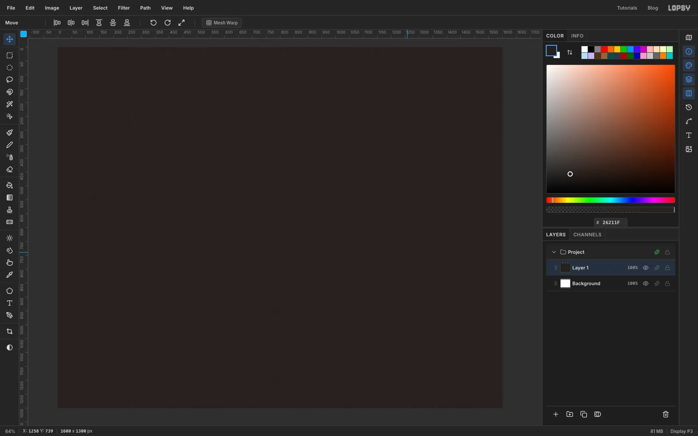

1. Choose **File → New**, set **Width** to `1600` and **Height** to `1300`, and click **Create**.
2. With `Layer 1` selected, set the foreground colour to `#26211F`, press [[Cmd+A]] and choose **Edit → Fill**. Press [[Cmd+D]].
3. Choose **Filter → Add Noise…**, set **Amount** to `30`, pick **Mono** and **Gaussian**, and click **Apply**.
4. Choose **Filter → Motion Blur…** with **Angle** `90` and **Distance** `40`. The noise streaks into the fine vertical weave of a rayon bowling shirt.

## Add guides for the patch

Click the top ruler at `x 160`, `800` and `1440` to drop three vertical
guides. Then click the left ruler at `y 150`, `650`, `830` and `1150`. The
outer guides box in the patch, the middle ones mark its centre, and `y 830`
is the horizon.

## Draw the stitched edge

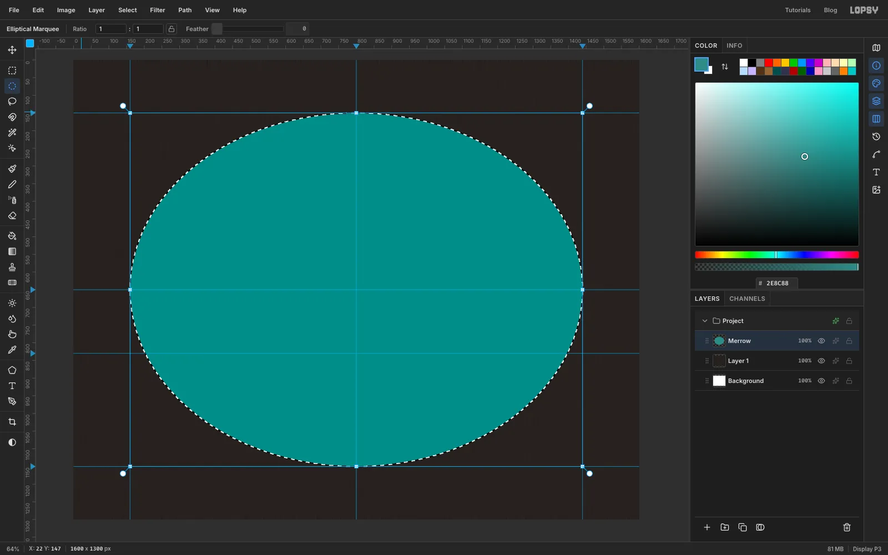

The edge of an embroidered patch is a thick wrapped border called a
*merrow*. Start with it as a solid oval:

1. Click **Add Layer** at the bottom of the Layers panel and double-click the new layer's name to call it `Merrow`.
2. Pick the **Elliptical Marquee** and drag from the top-left guide corner (`160, 150`) to the bottom-right one (`1440, 1150`). The edges snap to the guides.
3. Set the foreground to `#2E8C88` and choose **Edit → Fill**.

## Lay the felt inside it

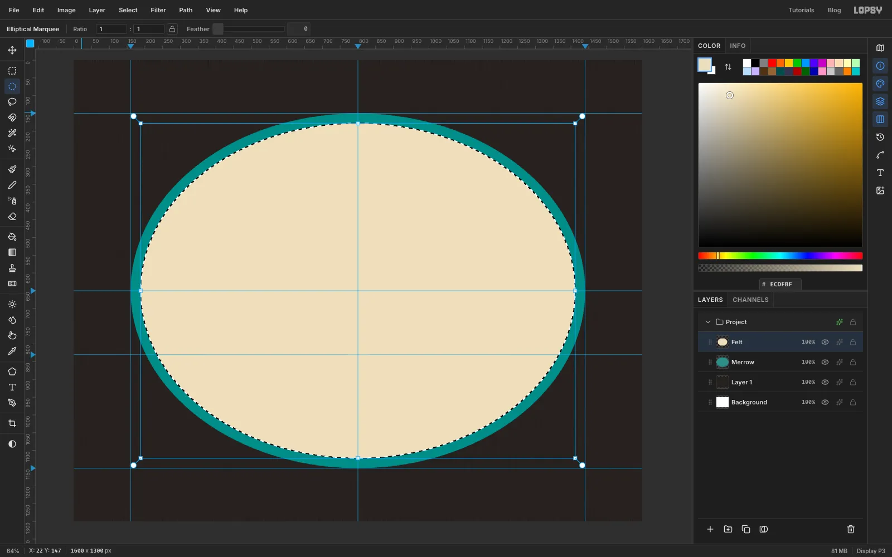

1. Add a layer called `Felt`.
2. Drag a second ellipse 28 px inside the first, from `188, 178` to `1412, 1122`.
3. Fill it with `#ECDFBF` and deselect.

## Type the title in Lobster

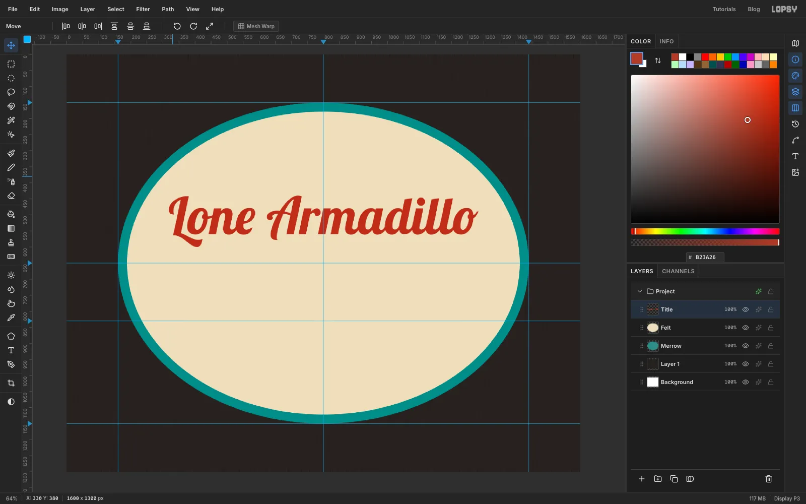

*Lobster* is a sign-painter's script with the bounce of hand lettering on a
shop window.

1. Keep `Felt` selected so the type lands above it. Pick the **Text** tool.
2. In the options bar, set **Size** to `160`, choose **Lobster** from the font list and set the colour to `#B23A26`.
3. Click in the upper part of the felt, type `Lone Armadillo` and press [[Tab]] to commit. Name the layer `Title`.
4. Switch to the **Move** tool and nudge the text with the arrow keys ([[Shift]] moves 10 px) until it's centred on the `x 800` guide, with the tops of its capitals at about `y 440`.
5. Click **Rasterize Layer** at the bottom of the Layers panel. Mesh Warp only works on pixel layers.

## Arch the title with Mesh Warp

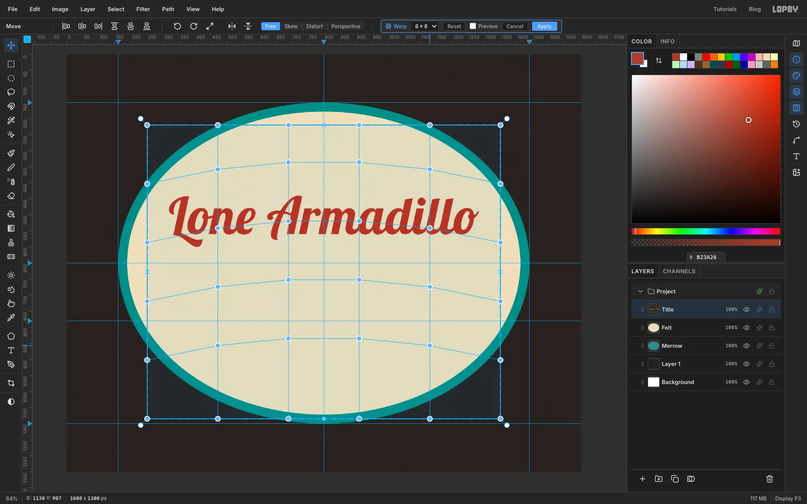

Vintage sign painters often arched a line of lettering while keeping each
letter upright. Mesh Warp does the same:

1. With the **Rectangular Marquee**, drag a tall box from `250, 220` to `1350, 1135`. The extra room above and below gives the grid space to bend.
2. Switch to the **Move** tool and click **Mesh Warp** in the options bar. Set the grid to **6 × 6**.
3. Leave the outside ring of points alone. In each of the four inner rows, drag the two middle points straight up by about `67` px, and the points either side of them up by about `45` px. Watch **Y** in the status bar so every point in a column rises by the same amount. That keeps the letters upright.
4. Click **Apply** and deselect.

## Smooth the arch with a second pass

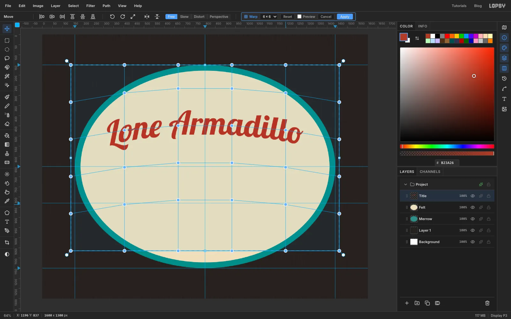

A 6 × 6 grid bends in straight segments, so one strong pass shows small
kinks. A second, gentler pass with its columns in different places smooths
them out.

1. Drag a marquee from `140, 150` to `1460, 1065`.
2. Start **Mesh Warp** again at **6 × 6** and lift the same inner points by the same amounts: `67` px in the middle and `45` px either side.
3. Click **Apply** and deselect.

## Tip the arch level

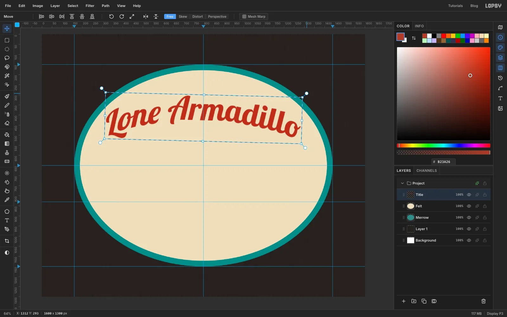

"Lone" begins with a tall L that swoops below the line, so the left end of the
arch reads lower than the right.

1. Drag a marquee snugly around the title.
2. With the **Move** tool, drag the round rotation handle at the top-right corner a little clockwise, about `1.5°`, until both ends of the arch sit the same distance from the turquoise edge.
3. Press [[Enter]] and deselect.

## Outline the letters

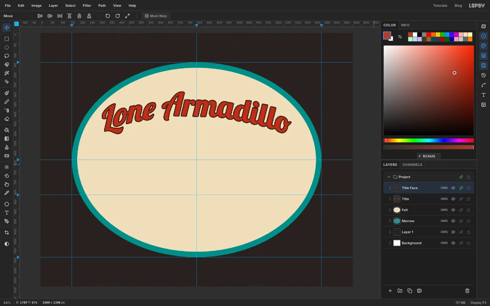

1. Choose **Layer → Duplicate Layer** and name the copy `Title Face`. It should sit exactly over the original. If it lands a few pixels off, nudge it back with the arrow keys.
2. Click the copy's ✦ button, tick **Stroke**, set **Width** to `5`, the colour to `#2A170D` and the position to **outside**. Close the drawer.

## Add the sign painter's drop shade

1. Click `Title`, the lower of the two layers, and rename it `Title Shade`.
2. With the **Move** tool, press [[→]] nine times and [[↓]] nine times.
3. Open its effects and tick **Color Overlay** with `#1F6B68`, then add the same brown **Stroke**: width `5`, outside.

The turquoise copy peeks out from behind the red letters like a painted shade.

## Paint the sunset in flat bands

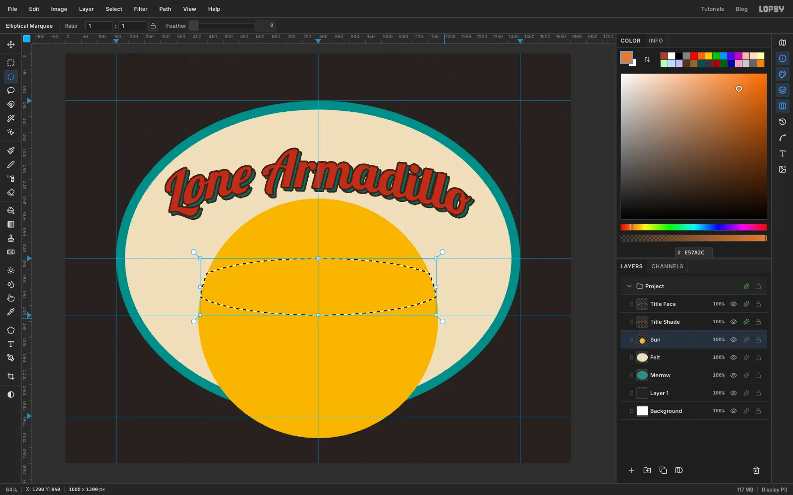

1. Click `Felt` and add a layer called `Sun`.
2. Drag an elliptical marquee from `420, 460` to `1180, 1220`: a circle 760 px across, centred at `800, 840`, just below the horizon guide. Fill it with `#EFB83C`.
3. Still on the **Elliptical Marquee**, hold [[Shift]] and [[Alt]] and drag a wide, flat ellipse from `400, 640` to `1200, 840`. Shift+Alt *intersects*, so only the overlap with the circle stays selected, with a gently arched top. Fill it with `#E57A2C`.
4. [[Cmd]]-click the `Sun` thumbnail to reload the whole circle. Switch to the **Rectangular Marquee** and Shift+Alt-drag from `400, 735` to `1200, 840` for a flat-topped band. Fill it with `#C9472B` and deselect.

Felt patches use flat colours cut from separate pieces, so the bands stay flat
rather than blending into a gradient.

## Cut the sun's stripes

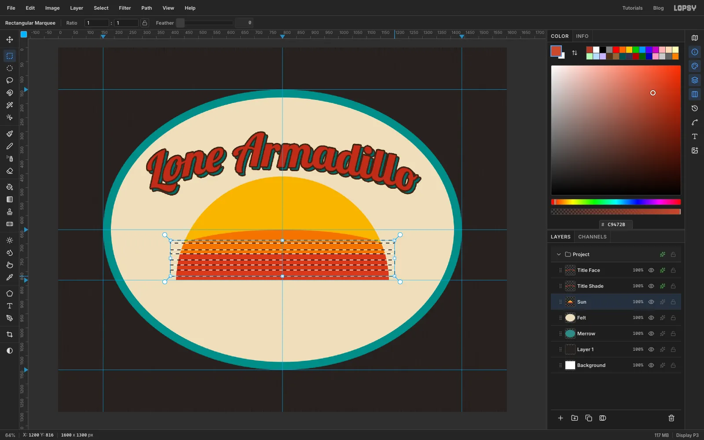

1. Drag a marquee from `400, 830` down past the bottom of the circle and press [[Delete]], so the sun ends at the horizon. Deselect.
2. Drag a thin marquee from `400, 688` to `1200, 698`.
3. Hold [[Shift]] and drag three more full-width bands below it, each a little taller: from `y 722` to `736`, from `758` to `776`, and from `794` to `816`. Shift adds each band to the selection.
4. Press [[Delete]] and deselect. The gaps widen toward the horizon, like a sunset on a motel sign.

## Trace the buttes with the Pen

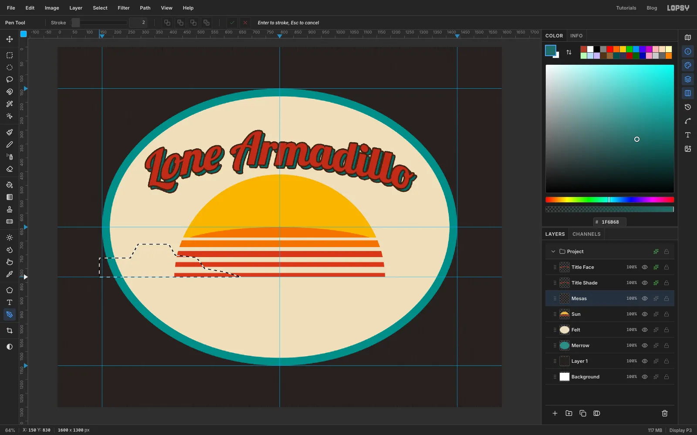

1. Add a layer called `Mesas` and set the foreground to `#1F6B68`.
2. Pick the **Pen** tool. Click a row of corner points for the left butte: start at `150, 830` past the felt's edge, go up to a flat top around `y 712`, step down to a lower shelf around `y 760`, and come back down to the horizon at about `x 660`. Click the first point again to close it.
3. Open the **Paths** panel and click **Path to Selection**, then **Delete Path**. Choose **Edit → Fill**.
4. Do the same for the right butte, from `x 960` out past the right edge at `x 1450`, with its tallest top around `y 700`.

## Clip the buttes to the felt

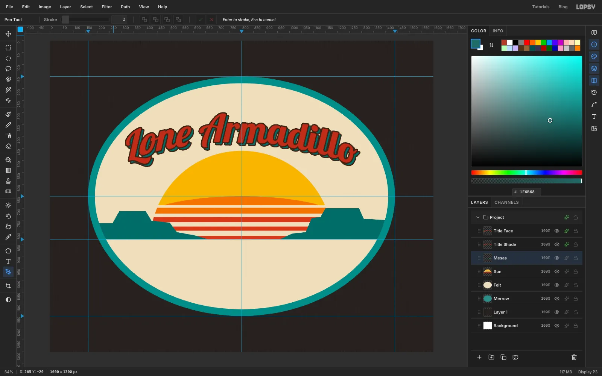

The buttes overshoot the felt on purpose. Trim them so they run cleanly into
the border:

1. [[Cmd]]-click the `Felt` thumbnail to select the felt oval.
2. Choose **Select → Inverse**.
3. Click the `Mesas` row and press [[Delete]]. Deselect.

## Drop in the armadillo photo and scale it

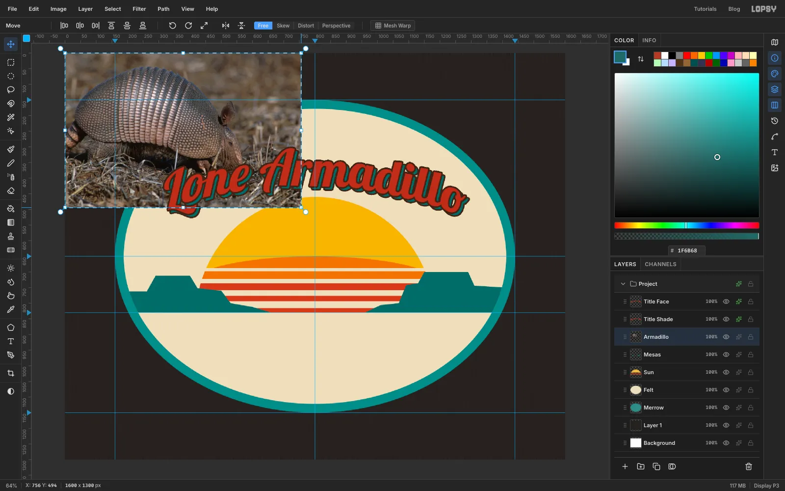

1. Click `Mesas` so the photo lands above it, then drag your photo from the desktop onto the canvas. It comes in at its own size in the top-left corner, already selected. Name the layer `Armadillo`.
2. With the **Move** tool, hold [[Cmd]] and drag the bottom-right corner handle up and to the left until the photo is about 72% of its size (756 × 494 px here). Cmd keeps the proportions. Press [[Enter]].
3. Deselect, then drag the photo so the armadillo sits in front of the sun with its belly about 30 px below the horizon guide (around `y 860`). In this photo, that puts its top-left corner at `495, 486`.

> **Tip:** Get the photo's size and position right *now*, before you mask it. Moving or transforming a masked layer moves its pixels but not its mask.

## Trace around the animal

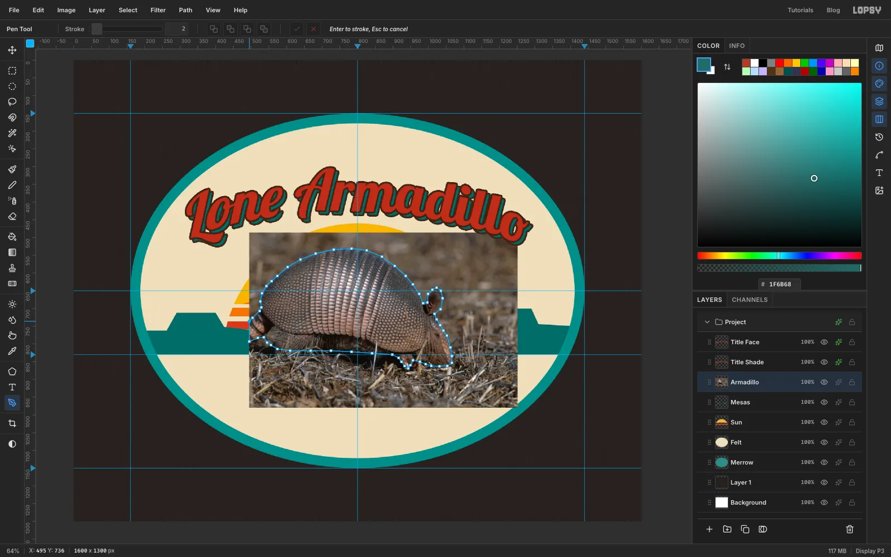

Pick the **Pen** tool and click your way around the armadillo. Use short
steps around the curve of the shell, the ear and the snout, and add a point
wherever the outline changes direction. Follow the underside along the bottom
of the belly. Where the tail runs off the photo's edge, cut straight across
it. Click the first point to close the path.

## Hide the background with a layer mask

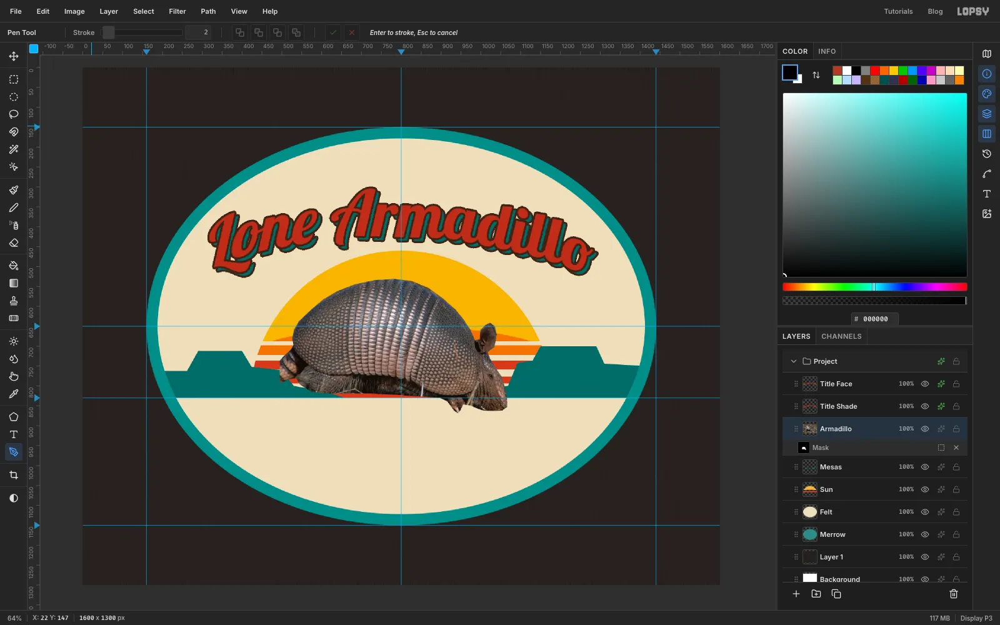

1. In the **Paths** panel, click **Path to Selection** and then **Delete Path**.
2. Choose **Select → Inverse** so everything *except* the armadillo is selected.
3. Click **Add Mask** at the bottom of the Layers panel, then click the new mask thumbnail to edit the mask.
4. Set the foreground to black and choose **Edit → Fill**. Black hides, so the grass disappears.
5. Deselect, then click the `Armadillo` name to go back to editing the layer's pixels.

## Turn the shell into satin bands

A photo has far too much detail to embroider. Satin stitches run in long
parallel threads, and the armadillo's shell bands are already vertical, so
smear along them:

1. **Filter → Motion Blur…**: **Angle** `90`, **Distance** `24`.
2. **Filter → Surface Blur…**: **Radius** `8`, **Threshold** `30`.
3. **Filter → Oil Paint…**: **Radius** `5`, **Sharpness** `1`.
4. **Filter → Brightness/Contrast…**: **Brightness** `15`, **Contrast** `55`.
5. **Filter → Posterize…**: **Levels** `5`.

Don't worry about the odd pinks and olives this leaves. The Gradient Map a
few steps on replaces every colour with thread tones, so all you need now is
clear light and dark bands.

## Clone out a stray grass stalk

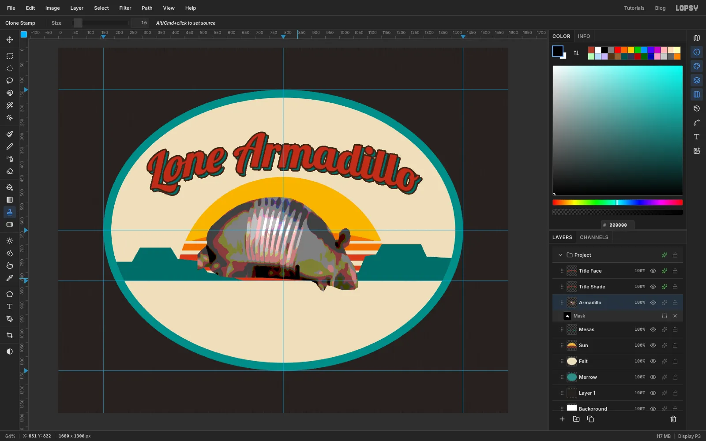

A pale grass stalk from the photo still crosses the belly.

1. Pick the **Clone Stamp** and set **Size** to `16`.
2. [[Alt]]-click a patch of plain dark belly just to the left of the stalk to set the source.
3. Paint down the length of the stalk. The belly tone covers it.

4. Open the layer's effects and add a **Stroke** of `6` px, `#2A170D`, outside. That's the dark outline every embroidered figure gets.

## Finish the tail

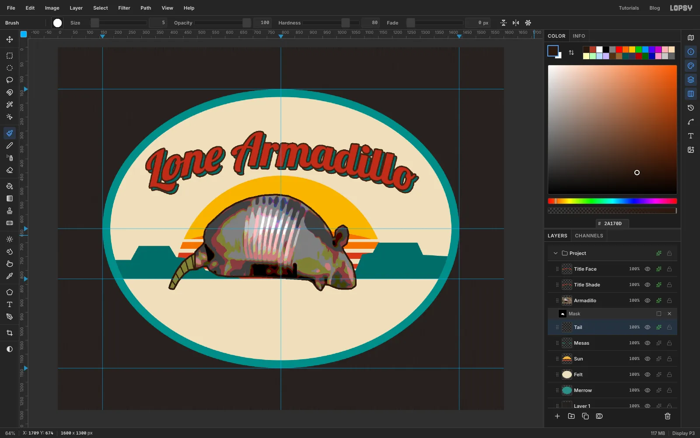

The photo cut the tail off, so draw the rest:

1. With `Armadillo` selected, pick the **Eyedropper** and click the tail stub to pick up its colour.
2. Click `Mesas` and add a layer called `Tail`, so it sits behind the armadillo.
3. With the **Pen**, click a long, tapering shape from the tail stub down to a point on the ground near `x 405`. Use **Path to Selection** and **Edit → Fill**.
4. Keep the selection. Set the foreground to `#2A170D`, pick the **Brush** at **Size** `5`, and draw five short rings across the tail: click on one side, then [[Shift]]-click the other side. The selection keeps the rings inside the tail.
5. Deselect and give the layer the same `6` px brown **Stroke**.

## Add legs and lift the belly shadow

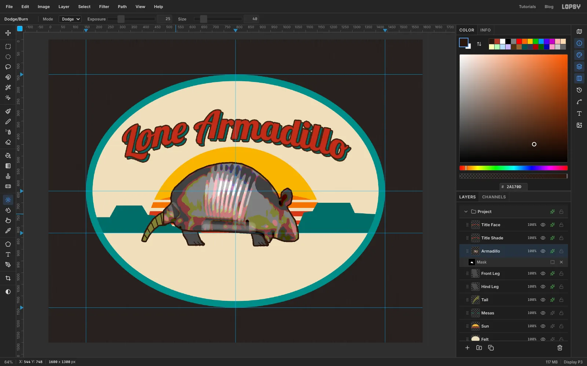

The photo hides the legs in grass, so the armadillo looked as if it was
lying on its chin.

1. Add a layer called `Hind Leg`. With the **Pen**, click the corners of a stubby leg under the rear of the shell, about 60 px wide, reaching down to `y 880`. Use **Path to Selection**, fill it with `#4A4A4A` (the Gradient Map will turn it brown), and give it the brown **Stroke**.
2. On the same layer, draw three short claw lines at the foot with the **Brush** at size `4` in `#2A170D`: click, then [[Shift]]-click.
3. Repeat both steps for a `Front Leg` layer under the chest, just behind the head.
4. The belly is still a nearly black hole. Click `Armadillo`, pick the **Dodge** tool, set it to **Dodge** with **Exposure** `25` and **Size** `40`, and brush twice along the belly and once over the dark crease at the rump.

Both leg layers sit under the photo, so the body overlaps their tops.

## Map the armadillo to thread colours

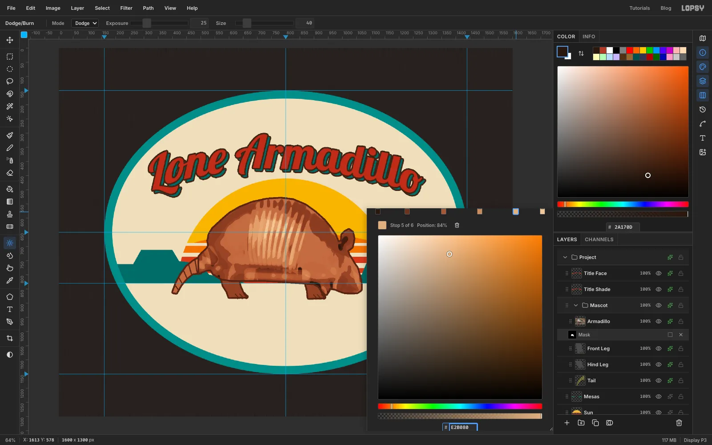

Thread comes in a few fixed colours, so map the whole armadillo onto a short
ramp of them:

1. Click `Armadillo`, then [[Cmd]]-click `Tail`, `Hind Leg` and `Front Leg` so all four are selected. Choose **Layer → Group Layers** and name the group `Mascot`.
2. With the group selected, click its ✦ button. The drawer shows **Adjustments** for a group. Click **Add Adjustment → Gradient Map**.
3. Click the left stop and type `2A170D` into the hex field, then click the right stop and type `EDC79A`. Click the row of stops at about 18%, 40%, 62% and 84% to add four more, and colour them `#6E3320`, `#A85A38`, `#CC8A5C` and `#E2B080`. The readout above the colour picker shows each stop's position, so you can drag one until it reads right.

Dark becomes brown, light becomes pale tan, and the legs and tail fall into
the same palette as the body.

## Make a chain-stitch brush

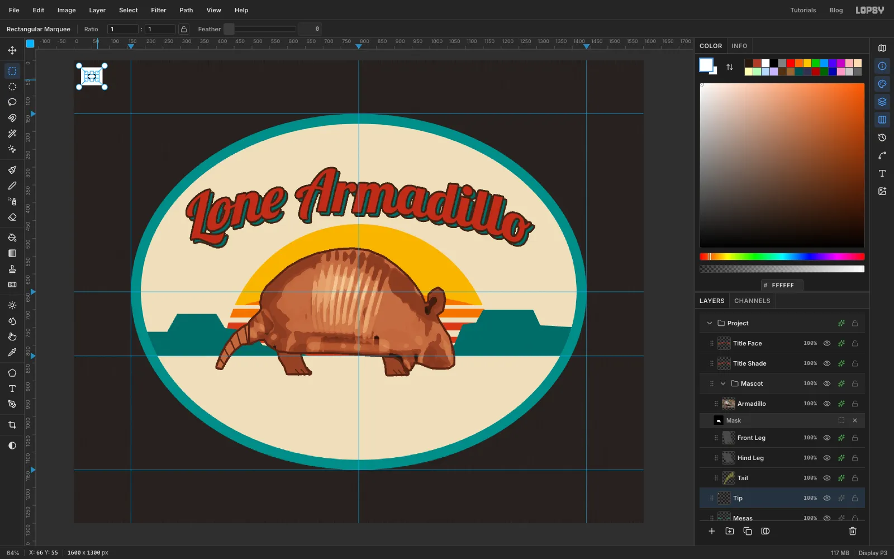

Chain stitch is the looping single line used for bowling-shirt lettering. One
loop makes a brush tip:

1. Click `Mesas`, add a layer called `Tip`, and fill a small white rectangle in an empty corner of the canvas. Define Brush turns dark pixels into paint and white into nothing, so the white backing keeps the tip clean.
2. With the **Elliptical Marquee** and **Edit → Fill**, put a black ellipse 28 × 16 px in the middle of it, then a white ellipse 20 × 10 px inside that to leave a ring.
3. Draw a marquee snugly around the ring and choose **Edit → Define Brush…**. Name it `Chain Stitch`.
4. Deselect and delete the `Tip` layer.

## Stitch the ground line

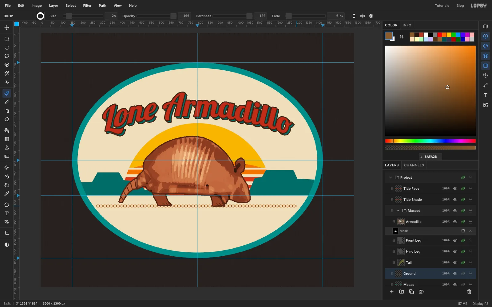

1. Click `Mesas` and add a layer called `Ground`.
2. Pick the **Brush**, click the brush thumbnail in the options bar and, on the **Shape** tab, set **Size** to `24` and **Spacing** to `72` so the loops just touch. Close the panel.
3. Set the foreground to `#8A5A2B`. Click at `292, 884` and [[Shift]]-click at `1308, 884`.

## Add tufts of grass

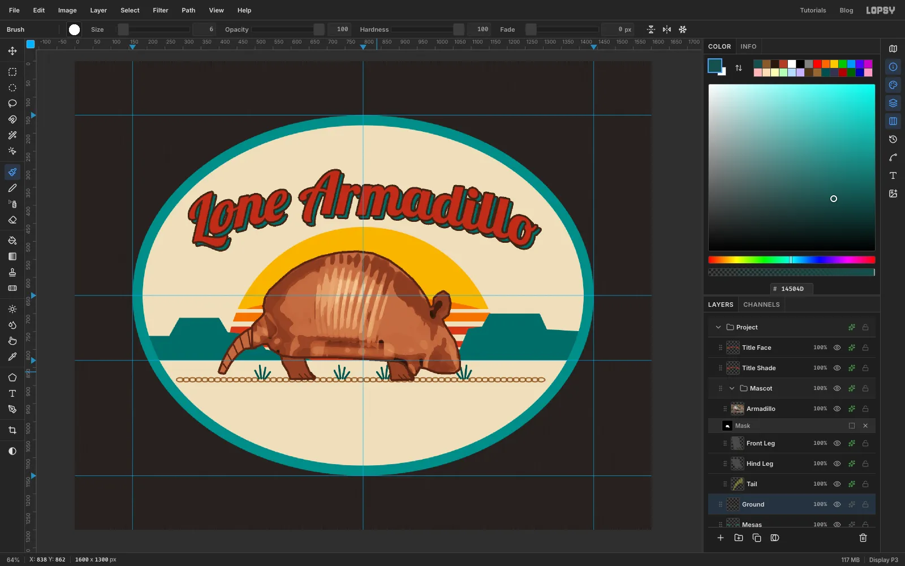

1. Open the brush panel again and click the **Hard Round** preset. Set **Size** to `6` and the foreground to `#14504D`.
2. Draw each tuft as four blades of different lengths. For each blade, click at the ground line and [[Shift]]-click at its tip, fanning the tips out.
3. Put tufts at `x 520` and `740`, and mirror them at `860` and `1080`.

## Grow a prickly pear from one pad

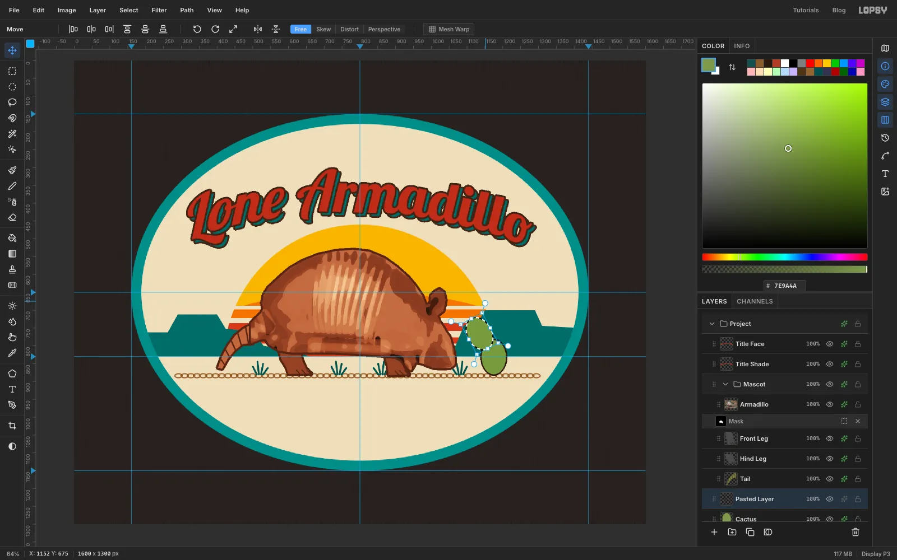

1. Click `Ground` and add a layer called `Cactus`.
2. Draw an oval pad about 68 × 96 px standing on the ground line at `x 1175`, fill it with `#7E9A4A`, and give the layer a `4` px `#2A170D` **Stroke**.
3. Drag a marquee around the pad and press [[Cmd+C]], then [[Cmd+V]]. The copy pastes in place on a new layer, selected and ready to move.
4. With the **Move** tool, drag it up and to the left by about half a pad's width and two-thirds of its height. Then drag a rotation handle to turn it about `28°` anticlockwise. Press [[Enter]].
5. Add the same **Stroke** to the pasted layer and choose **Layer → Merge Down**. The merge bakes in the new pad's outline, so a dark line still shows where the pads overlap.
6. Press [[Cmd+V]] again. Move this pad up and to the right, turn it about `32°` clockwise, add the stroke and merge it down.

## Add the fruit

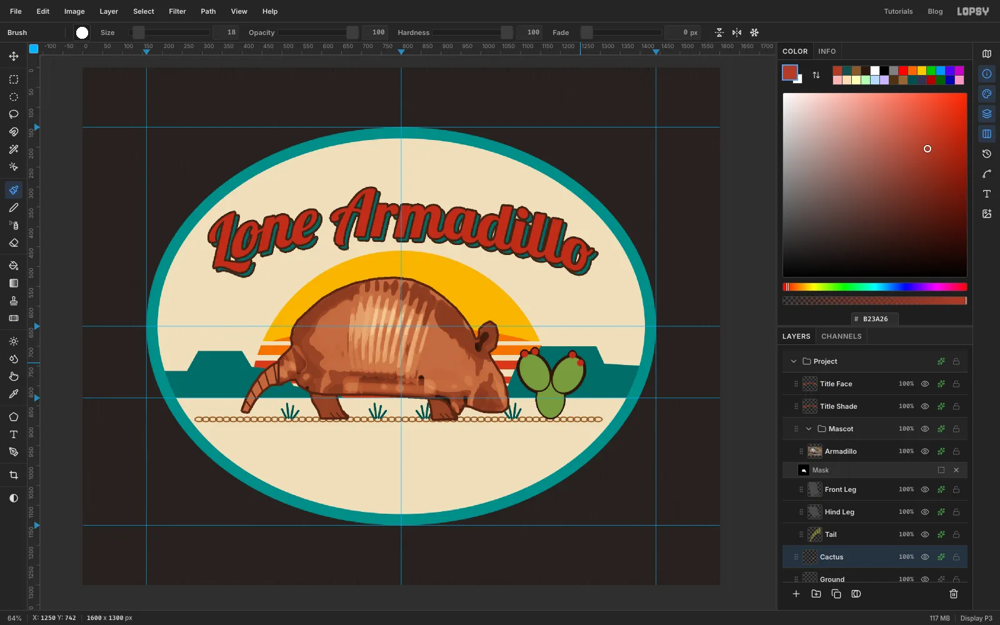

Pick the **Brush** at **Size** `18` with `#B23A26`, and click four times
along the top edges of the two upper pads.

## Mirror a second cactus on the left

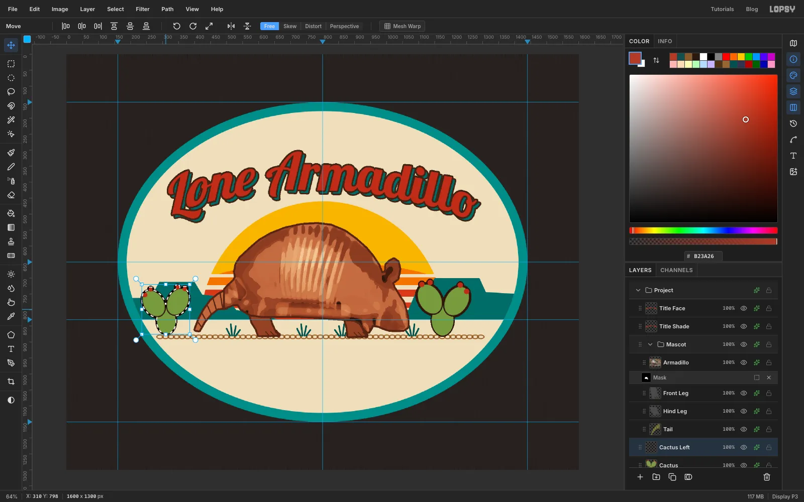

1. Choose **Layer → Duplicate Layer** and name it `Cactus Left`.
2. Drag a marquee around the copy. With the **Move** tool, click **Flip Horizontal** in the options bar.
3. [[Cmd]]-drag a corner handle to shrink it to about 90%. Then drag it across to the left so it stands on the ground line at about `x 310`.
4. Press [[Enter]] and deselect.

## Build the ribbon tails

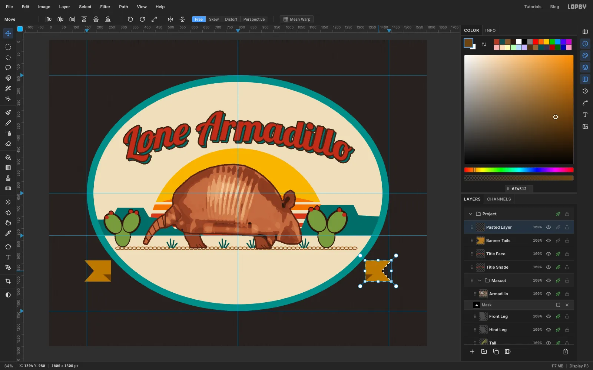

1. Click `Title Face` and add a layer called `Banner Tails`.
2. With the **Pen**, draw a tab about 112 × 90 px off the left side of the patch. Its right edge sits under where the ribbon will end (`x 262`), its top at `y 935`. Cut a V notch about 40 px into its outer end. Close it, use **Path to Selection**, and fill it with `#B47B22`.
3. Draw a small triangle in the tab's top-right corner, 32 px wide, and fill it with the darker fold colour `#6E4512`. It reads as the ribbon folding back.
4. Marquee the tail, copy and paste it, and click **Flip Horizontal**. Drag the copy straight across until its notched end sits at `x 1450`. Press [[Enter]], deselect and **Merge Down**.
5. Add a `5` px `#2A170D` **Stroke**.

## Letter the ribbon

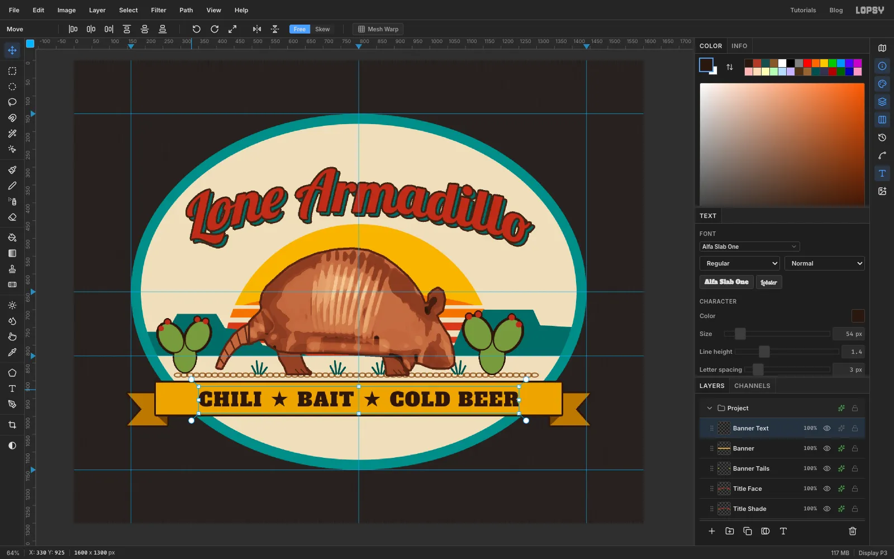

1. Add a layer called `Banner`. Fill a rectangle from `230, 905` to `1370, 995` with `#E3A72F`, and give it the same brown **Stroke**.
2. With `Banner` selected, pick the **Text** tool. Choose **Alfa Slab One** at size `54` in `#2A170D`.
3. Click in empty space on the ribbon and type `CHILI ★ BAIT ★ COLD BEER`. Press [[Tab]] and name the layer `Banner Text`.
4. In the **Text** panel, set **Letter spacing** to `3`.
5. With the **Move** tool, nudge the line so it's centred on the ribbon, at `800, 950`.

## Bend the ribbon into a smile

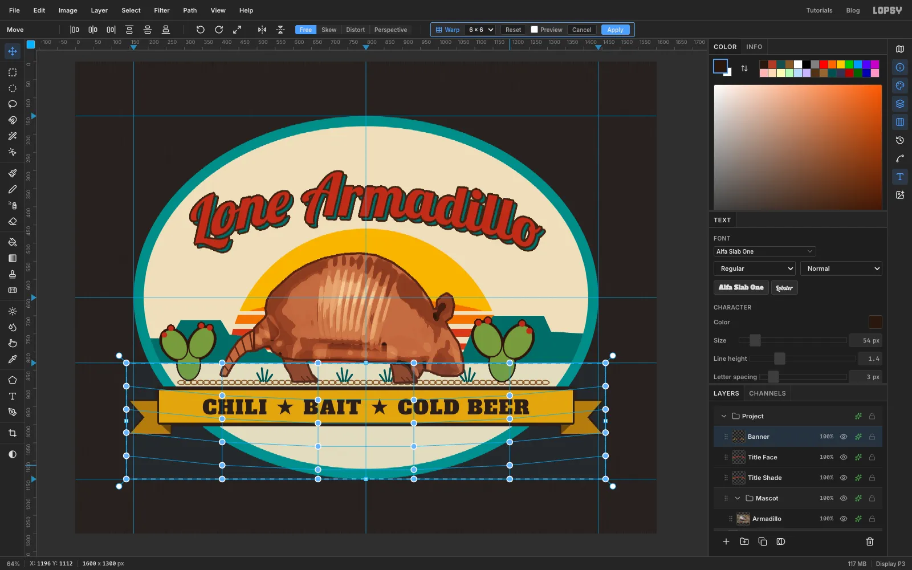

1. Click **Rasterize Layer**, then choose **Layer → Merge Down** twice. That merges the text into the ribbon and the ribbon into its tails. Rename the result `Banner`.
2. Drag a marquee from `140, 840` to `1460, 1140`. Start **Mesh Warp** at **6 × 6**.
3. In the four inner rows, drag the two middle points *down* by `38` px and the points either side down by `26` px. Click **Apply**.

The type bends with the ribbon, because it's part of the same layer now.

## Give the ribbon a merrow edge

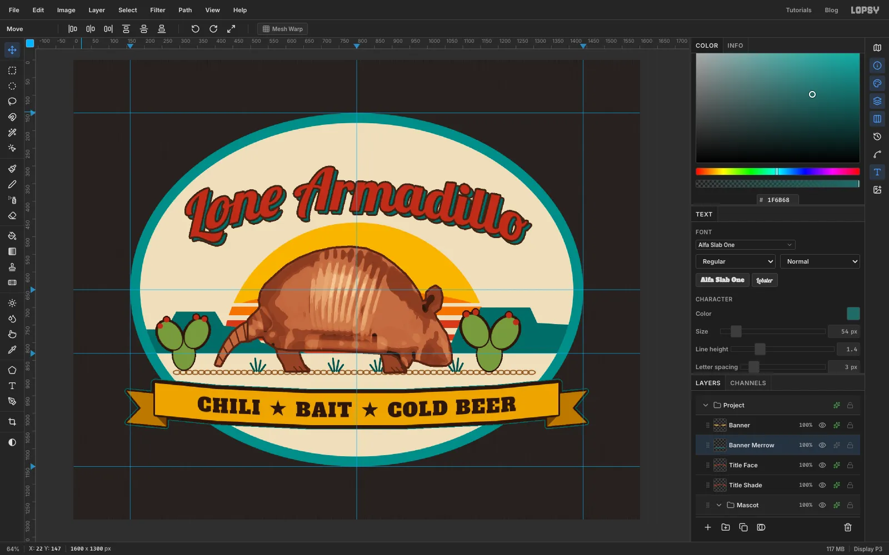

The ribbon hangs off the patch, so it needs its own stitched edge:

1. [[Cmd]]-click the `Banner` thumbnail. Choose **Select → Grow…**, enter `7` and click **Apply**.
2. Click `Title Face` and add a layer called `Banner Merrow`, so it lands just under the ribbon.
3. Fill it with `#1F6B68` and deselect.

A grown selection gives a smooth edge, which suits a wide border better than
the Stroke effect.

## Set the date line

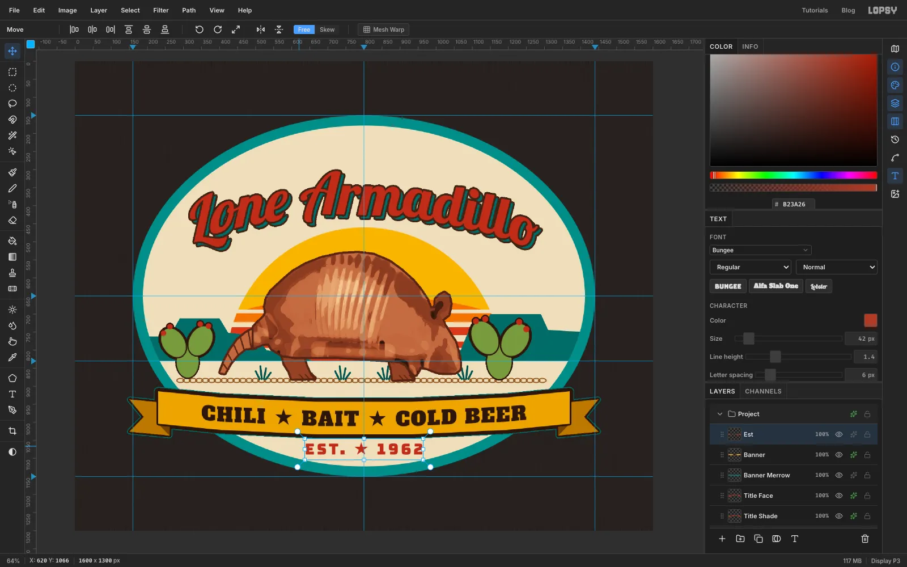

1. Click `Banner`, pick the **Text** tool, and choose **Bungee** at size `42` in `#B23A26`.
2. Click below the ribbon and type `EST. ★ 1962`. Commit with [[Tab]] and name the layer `Est`. In the **Text** panel, set **Letter spacing** to `6`.
3. Nudge it to centre on `800, 1072`, with about the same space above (to the ribbon) and below (to the merrow).

## Add a lone star on each side

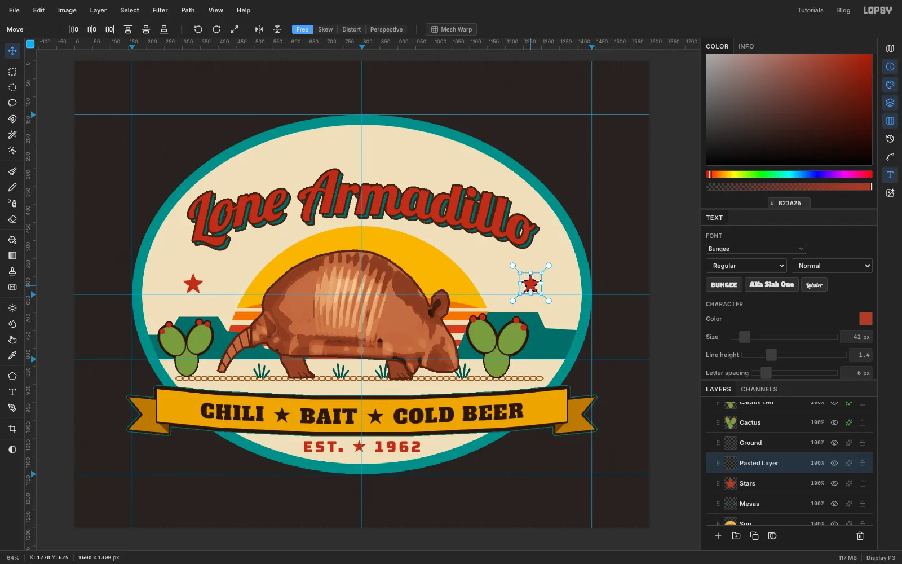

1. Click `Mesas`, add a layer called `Stars` and set the foreground to `#B23A26`.
2. With the **Pen**, click around a five-point star centred near `330, 622`, about 64 px across: the five tips and the five inner corners between them. Then use **Path to Selection** and **Edit → Fill**. A `★` typed in any font and rasterized works just as well.
3. Copy and paste it, and drag the copy straight across to `1270, 622`. Press [[Enter]] and **Merge Down**.

## Stitch the merrow

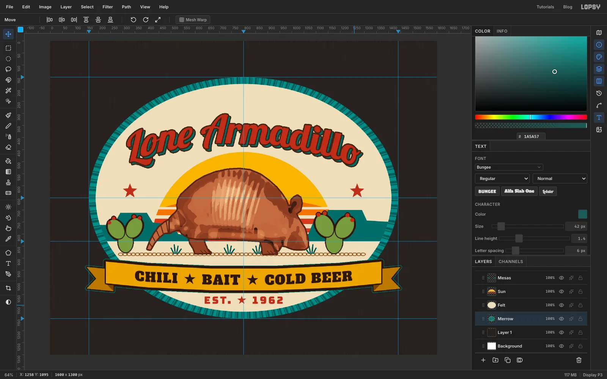

1. Click `Merrow` and [[Cmd]]-click its thumbnail so the filter stays inside the oval.
2. Set the foreground to `#1A5A57` and choose **Filter → Sunburst…**: **Rays** `120`, **Length** `150`, **Width** `30`, **Softness** `40`. Click **Apply**.
3. Run **Sunburst** again with **Width** `14`, **Softness** `20` and **Rotation** `1` to add finer threads between the first ones. Deselect.

The felt covers the middle, so only the border shows the wrapped stripes.

## Lift the patch off the shirt

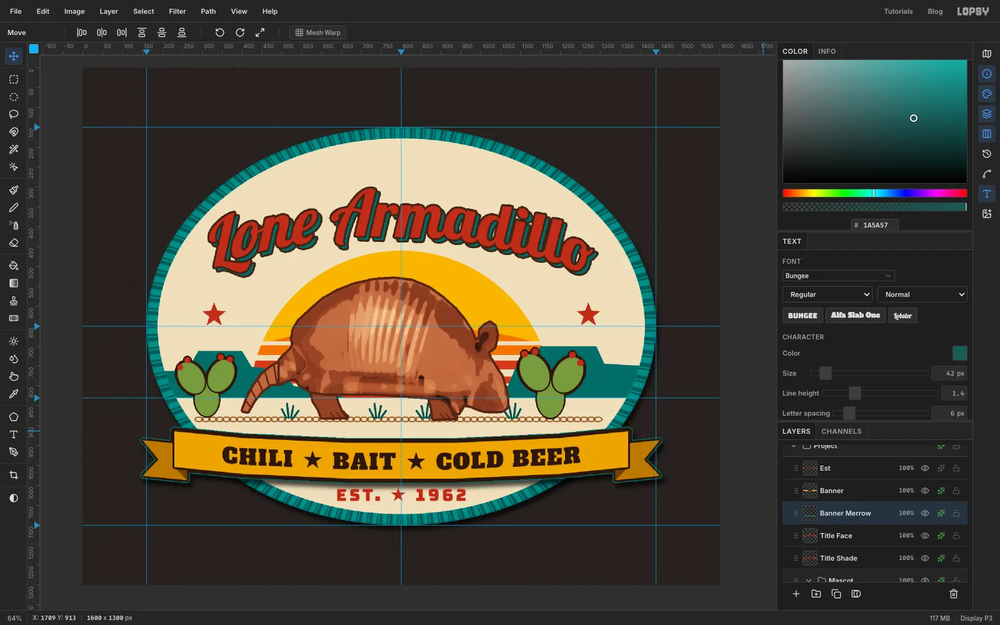

1. On `Merrow`, add an **Inner Glow**: **Size** `10`, **Opacity** `60`, colour `#0E3533`. That rounds the border like a rope.
2. Add a **Drop Shadow**: **Offset X** `6`, **Offset Y** `12`, **Blur** `16`, **Opacity** `70`, black.
3. Give `Banner Merrow` the same drop shadow, because the tails hang off the patch.

## Add satin thread texture

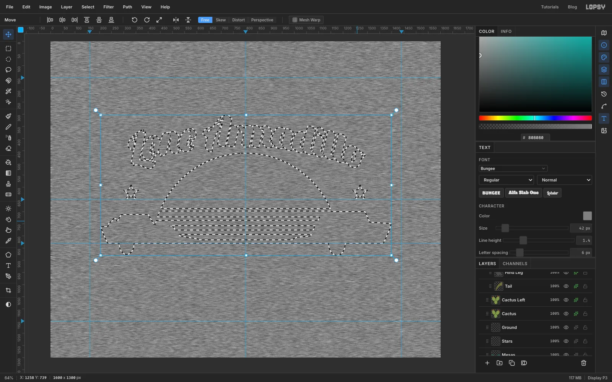

1. Click `Est` and add a layer called `Satin`. Press [[Cmd+A]], fill with `#808080` and deselect.
2. Run **Add Noise** (`100`, **Mono**, **Gaussian**), then **Motion Blur** with **Angle** `0` and **Distance** `14`, then **Brightness/Contrast** with **Contrast** `100` twice. The noise becomes fine horizontal threads.
3. [[Cmd]]-click the `Sun` thumbnail, then [[Shift]]+[[Cmd]]-click `Mesas`, `Title Face`, `Title Shade`, `Cactus`, `Cactus Left` and `Stars` to add them all.
4. Choose **Select → Inverse**, click `Satin` and press [[Delete]]. Deselect.
5. Set `Satin`'s blend mode to **Overlay** and its opacity to `35%`.

## Add vertical satin to the armadillo

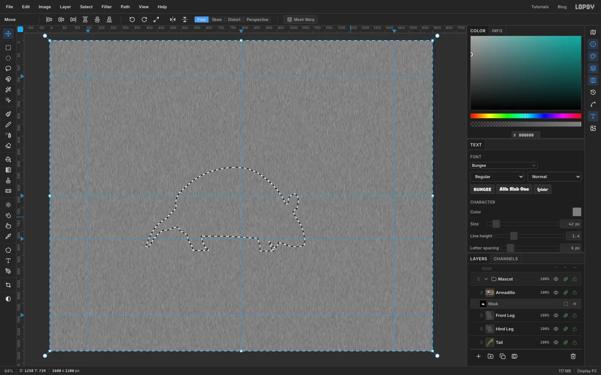

1. Add a layer called `Shell Satin`. Fill it grey, then run **Add Noise** (`100`, **Mono**, **Gaussian**), **Motion Blur** (`90`, `12`) and **Brightness/Contrast** (**Contrast** `100`).
2. On the `Armadillo` row, click **Convert mask to selection**. It selects what the mask *hides*: everything except the armadillo.
3. [[Alt]]+[[Cmd]]-click the `Tail`, `Hind Leg` and `Front Leg` thumbnails to take them out of the selection too.
4. Click `Shell Satin` and press [[Delete]]. Deselect, then set it to **Soft Light** at `60%`.

## Give the felt some nap

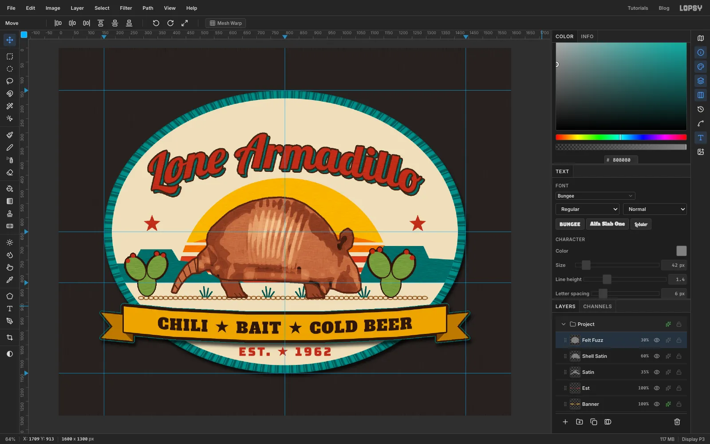

1. Add a layer called `Felt Fuzz`. Fill it grey, then run **Add Noise** at `60` (**Mono**, **Gaussian**) and **Gaussian Blur** at `1`.
2. [[Cmd]]-click `Merrow`, then [[Shift]]+[[Cmd]]-click `Banner Merrow`.
3. **Select → Inverse**, click `Felt Fuzz`, press [[Delete]], and deselect.
4. Set it to **Overlay** at `30%`.

## Group the title and the ribbon

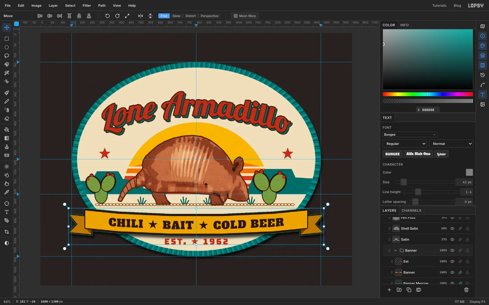

1. Click `Title Face`, [[Shift]]-click `Title Shade`, choose **Layer → Group Layers** and name the group `Title`.
2. Click `Est`, [[Shift]]-click `Banner Merrow`, group them and name the group `Banner`. It now holds `Banner Merrow`, the `Banner` layer and `Est`.
3. Click the `Title` group, switch to the **Move** tool and press [[↓]] six times. The whole title, shade and all, drops a little for more air under the border.

## Light it like a real patch

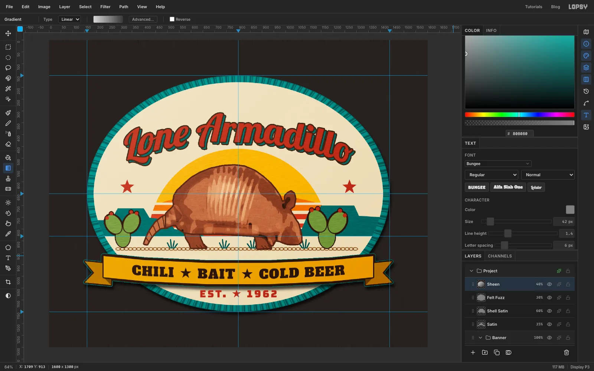

1. Click `Felt Fuzz` and add a layer called `Sheen` above it.
2. [[Cmd]]-click `Merrow`, then [[Shift]]+[[Cmd]]-click `Banner Merrow`.
3. Pick the **Gradient** tool and set it to **Linear**, from `#D8D8D8` to `#3A3A3A`. Drag from the top-left of the patch to the bottom-right. Deselect.
4. Set `Sheen` to **Soft Light** at `40%`.
5. Turn off **View → Show Guides**, then choose **File → Save Project** and **File → Quick Export PNG**.

The light falls from the upper left, so the patch reads as a stitched object
sewn onto the shirt rather than a flat print.
