*Vernacular* design is the design ordinary people make without any training: hand-painted shop signs, hardware-store price tags, menus taped in a window, and the websites small businesses built for themselves around the year 2000. It follows a few loose rules. Everything is loud. Nothing is subtle. The phone number is huge. A starburst shouts the best offer. The links are blue and underlined because that's what links look like. Done with care, it feels warm and trustworthy in a way a polished corporate site doesn't.

In this tutorial you'll make the homepage of *Xeriscape Experts*, a made-up family landscaping crew in Tucson that swaps thirsty lawns for gravel and cactus. The page is a 1280 × 1950 px mockup, the size of a desktop browser window scrolled all the way down. You'll build it section by section, each in its own layer group:

- a **browser bar** and a black **ticker**
- a safety-yellow **header** with a hand-drawn cactus badge and a big phone box
- a row of blue **underlined links**
- a **hero** with a tilted, taped photo print, a starburst sticker and a red button
- three **service cards** with icons and price tags
- **recent jobs** prints, a testimonial bubble and a **hit counter**
- a **hazard-striped footer**

You'll use:

- **guides**, **Show Grid** with its snapping, and **Snap to Guides** switched off for small work
- the **Rectangular** and **Elliptical Marquee**, the **Lasso**, **Select → Inverse**, and [[Shift]] and [[Shift]]+[[Option]] to add and intersect selections
- **Add Noise**, **Voronoi**, **Hue/Saturation** and **Unsharp Mask**
- **Define Pattern** and **Fill with Pattern**, twice
- the **Shape** tool (rectangles with rounded corners, and ellipses), the **Brush**, the **Pencil** and the **Gradient** tool
- dropped photos, scaled and rotated with the Move tool's handles, then cropped
- **Copy**, **Paste**, **Duplicate Layer**, **Merge Down**, **New Group** and a **Soft Light** and a **Multiply** layer
- the layer effects **Drop Shadow**, **Stroke** and **Inner Glow**
- live text in **Anton**, **Bungee**, **Permanent Marker**, **Bowlby One SC**, **Archivo Black**, **Arimo** and **VT323**

The three photos are public-domain or CC0 images from Wikimedia Commons: two shots of drought-tolerant gardens at Los Angeles Air Force Base by the U.S. Air Force, and *Drought-tolerant CV1* by Lights and freedom. Any garden photos will do.

The palette:

- Safety yellow `#FFD21A`, sign red `#D7261E`, ink `#161412`
- Sand `#EADBB8`, pebble `#C9B48A`, cream paper `#FFFCF2`
- Rust band `#B9532C`, tape `#DCC685`
- Link blue `#1F3FD0`, visited purple `#6B2BA8`
- Browser grey `#D8D4CB` / `#B9B4A8`
- Cactus green `#5E7F3C`, rock `#9C8F7E` / `#6E6355`, water `#2C8FD6`, LCD green `#7CFF5A`

> **Tip:** Many steps fill a band between two guides. Drag a marquee from guide to guide, or click once with the **Rectangular Marquee** without dragging: that opens a small dialog where you type the exact corners.

> **Tip:** On a wide-gamut (Display P3) screen, Lopsy reads typed hex codes as P3 colours, so the yellow and red come out a touch hotter than on an sRGB screen. That suits a sign-painter look.

> **Note:** Shortcuts are written for a Mac. On Windows use [[Ctrl]] wherever it says [[Cmd]], and [[Alt]] for [[Option]].

## Set up the page and guides

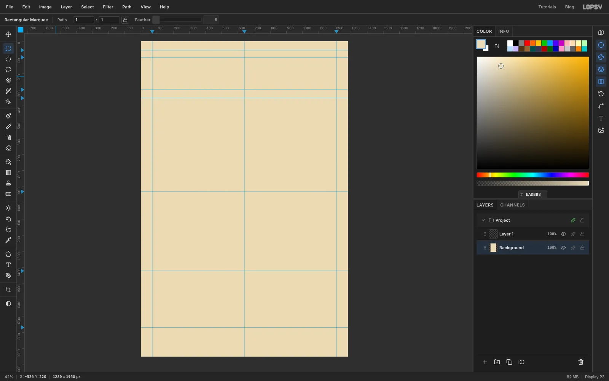

Choose **File → New**, keep the units on **Pixels**, and make the document **1280** wide and **1950** high.

Click the top ruler to drop vertical guides at **70**, **640** and **1210**. The outer two are the page margins and the middle one is the centre line. Then click the left ruler to drop horizontal guides where each section starts: **56** (under the browser bar), **100**, **300**, **352**, **930**, **1420** and **1770**.

Zoom in while you click if you want a guide on an exact number. The ruler shows where the pointer is.

Delete the empty *Layer 1*. Select the *Background* layer, set the foreground colour to sand `#EADBB8`, press [[Cmd]]+[[A]], choose **Edit → Fill**, and press [[Cmd]]+[[D]].

## Make one gravel tile

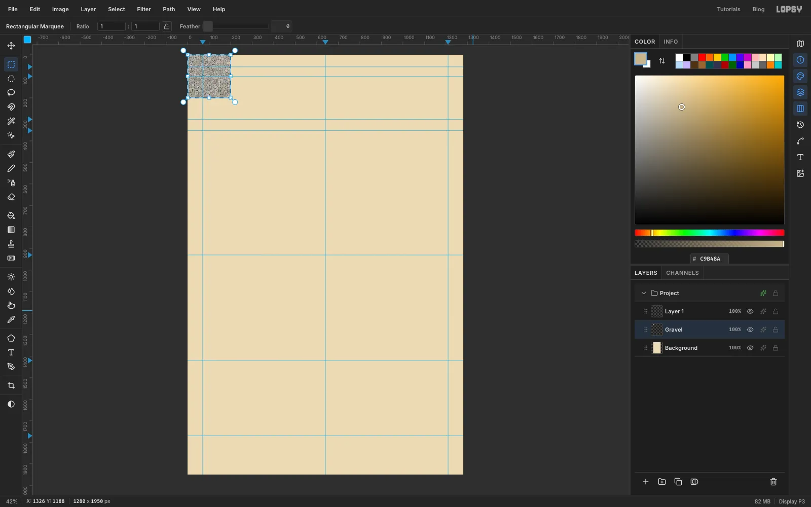

Homemade websites loved a tiled background picture, and a gravel company would obviously use gravel. You'll make one square tile, then repeat it.

Click **Add Layer** and name the layer *Gravel*. With the **Rectangular Marquee**, select a 200 × 200 px square in the top-left corner (click once and type the corners 0, 0 and 200, 200) and fill it with pebble `#C9B48A`. Then, keeping the selection:

1. **Filter → Add Noise**, Amount **100**, **Color**. The square turns to confetti.
2. **Filter → Voronoi**, Cells **190**, Edge width **1**. Each cell takes the colour at its centre, so you get a mosaic of stones in different tones, each with a thin dark joint.
3. **Filter → Hue/Saturation**, Saturation **−80**. That drains the confetti colours back to warm greys and tans.
4. **Filter → Add Noise** again, Amount **12**, **Mono**, for a little grit on each stone.

## Repeat the tile across the page

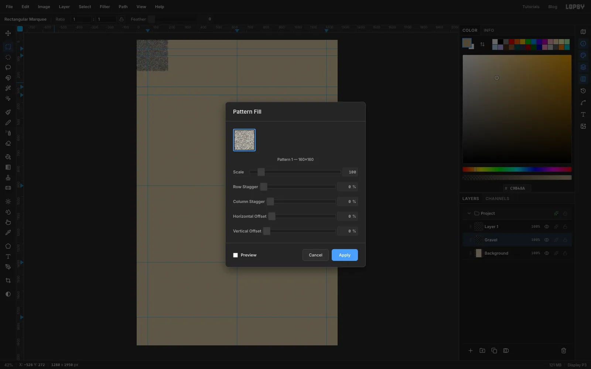

Voronoi keeps the layer's transparency, and the stones along the very edge of your square take their colour from outside it, so the outermost ring of stones comes out transparent. Select a slightly smaller square inside the tile, about 20 px in from each edge, and choose **Edit → Define Pattern**.

Press [[Cmd]]+[[D]] to deselect, then choose **Edit → Fill with Pattern**. Click your new pattern and press **Apply**. With no selection it fills the whole *Gravel* layer.

## Knock the gravel back

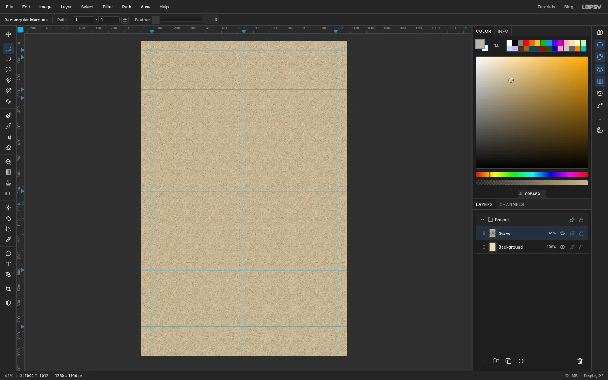

Full-strength gravel would fight every word on the page. Open the *Gravel* layer's effects drawer with the ✦ button on its row, set the blend mode to **Multiply**, then set the layer's opacity to **45%**. The stones now darken the sand only slightly, so text stays readable.

## Draw the browser bar

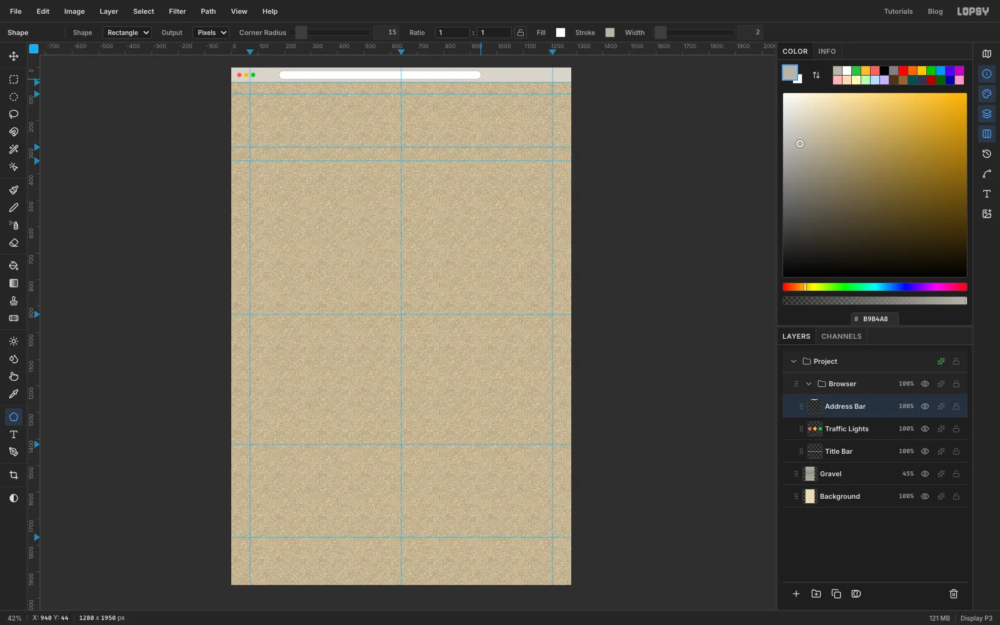

The rest of the work is small shapes near guides, and guides pull shapes towards them. Turn **View → Snap to Guides** off and leave it off.

Select *Gravel*, click **New Group** and name the group *Browser*. Inside it, add a layer called *Title Bar*, select the strip above the first guide and fill it with `#D8D4CB`. With the **Pencil** at size **2** in `#B9B4A8`, click at the left end of the bar's bottom edge and [[Shift]]-click at the right end to draw a hairline.

Add a layer called *Traffic Lights*. Pick the **Shape** tool, set Shape to **Ellipse** and Output to **Pixels**, and click the Fill swatch to set red `#FF5F57`. Shapes grow from where you press, so press in the centre of each dot and drag out about 8 px for a 16 px circle. Make a yellow `#FEBC2E` dot and a green `#28C840` dot beside it.

Add a layer called *Address Bar*. Switch the Shape to **Rectangle**, set the fill to white, add a stroke in `#B9B4A8` at Width **2**, and set Corner Radius to **15**. The field runs from about 180 px to 940 px across and is 32 px tall, so press at its centre (about 560 px across, halfway down the bar) and drag out to its lower-right corner.

## Add the address and the ticker

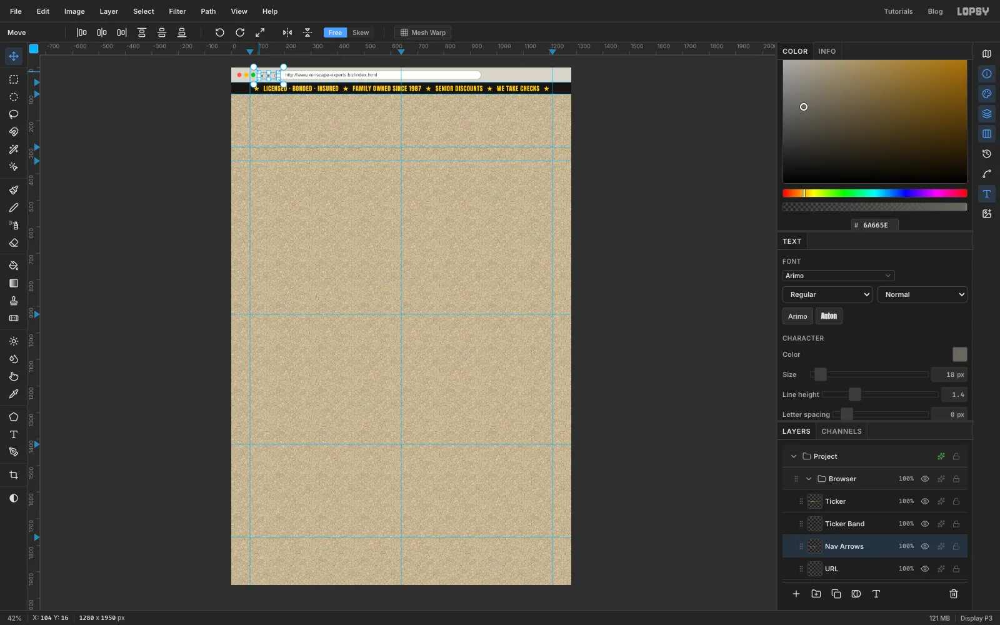

Add a layer called *Ticker Band*, select the strip between the first two guides and fill it with ink `#161412`.

Pick the **Text** tool. Set the font to **Anton**, size **24**, colour safety yellow `#FFD21A`, and Letter spacing **1** in the Text panel, then click on the black band. Type:

**★ LICENSED · BONDED · INSURED ★ FAMILY OWNED SINCE 1987 ★ SENIOR DISCOUNTS ★ WE TAKE CHECKS ★**

Press [[Tab]] to commit, then switch to the **Move** tool and nudge it with the arrow keys until it's centred on the band.

> **Tip:** Clicking inside an existing text box with the Text tool edits that text instead of starting a new one. Click new text into empty space, then move it into place.

Select *Address Bar* and add two more text layers in **Arimo**: the address `http://www.xeriscape-experts.biz/index.html` at size **17** in `#3A3A3A`, inside the white field, and the arrows ◄ ► ↻ at size **18** in `#6A665E`, between the dots and the field.

## Paint the header and draw the badge

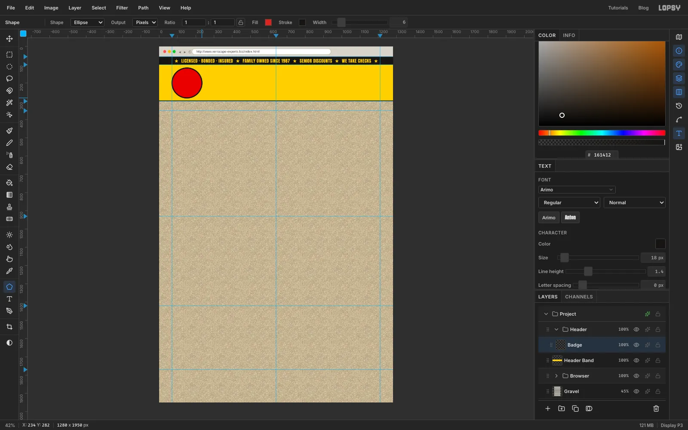

Collapse the *Browser* group, click its row and click **Add Layer**. Because the group is collapsed, the new layer lands beside it rather than inside it. Name it *Header Band*. Fill the space between the **100** and **300** guides with safety yellow, then select a 4 px strip along its bottom edge and fill it with ink.

Click **New Group** and name it *Header*. Inside it, add a layer called *Badge*. With the Shape tool on **Ellipse**, set the fill to sign red `#D7261E` and add an ink stroke at Width **6**. Press at about 152 px across, halfway down the header, and drag out 82 px diagonally. You get a circle about 164 px across whose left edge sits on the 70 px guide.

Add a layer called *Badge Sun*. Click the Stroke swatch and choose **Remove stroke**, set the fill to yellow, and draw a 48 px circle in the upper right of the badge.

## Give the badge a horizon

Add a layer called *Badge Ground*. With the **Elliptical Marquee**, select a circle just inside the badge's black rim. Clicking once without dragging opens the exact-corners dialog: use the badge's box pulled in by 5 px on every side.

Now hold [[Shift]]+[[Option]] and drag a rectangle across the lower quarter of the badge. Holding both keys intersects the two selections, so only the bottom slice of the circle stays selected. Fill it with ink and deselect.

## Brush a saguaro

Add a layer called *Badge Saguaro*. Pick the **Brush**, click the brush preview in the options bar to open the **Brushes** panel, and set Size **17**, Hardness **100** and Taper **0**. Set the colour to ink.

Draw from the ground up, the way the cactus grows:

1. One stroke straight up from the ground for the trunk, stopping well below the rim.
2. The left arm: start partway up the trunk, go left, then curve up.
3. The right arm: start a little higher, go right, then curve up and a bit taller than the left.

The round brush gives every end a soft, rounded tip, just like a real saguaro.

## Add the phone box and the wordmark

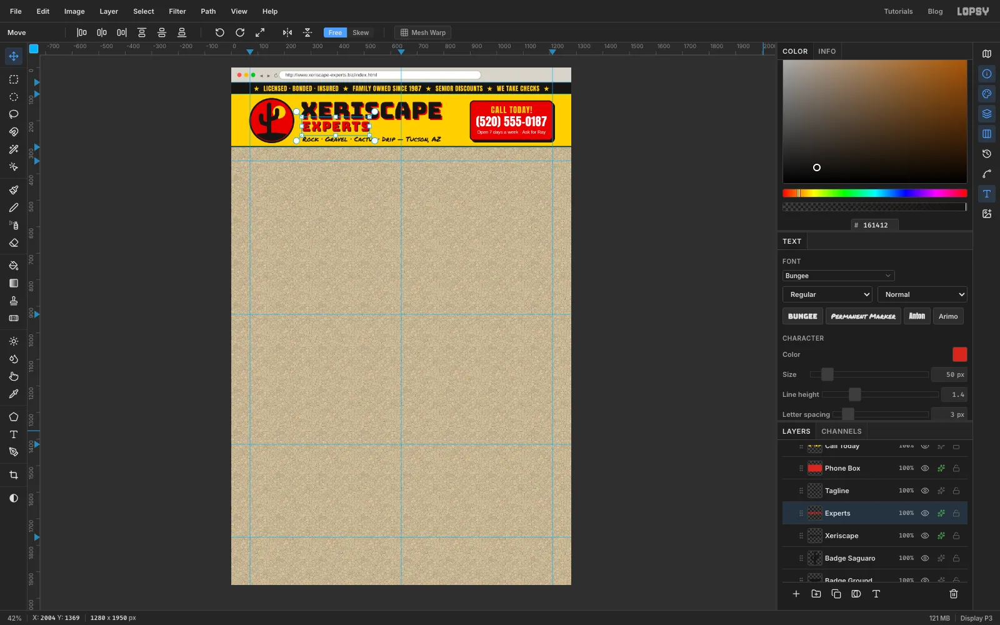

Add a layer called *Phone Box*. With the Shape tool on **Rectangle**, set fill red, stroke ink at Width **4**, and Corner Radius **14**. The box runs from about 900 px across to the right margin and from 126 to 274 px down. Press at its centre (about 1055, 200) and drag out to the lower-right corner. Open its effects and turn on **Drop Shadow**: Offset X **7**, Offset Y **7**, Blur **0**, Spread **0**, Opacity **100**, colour ink. A hard shadow with no blur is the sign-painter's version of depth.

Inside the box, add three centred lines, bottom first so no click lands in a line you've already made:

- `Open 7 days a week · Ask for Ray` in **Arimo** 17, white
- `(520) 555-0187` in **Anton** 43, white, letter spacing 1
- `CALL TODAY!` in **Anton** 30, yellow, letter spacing 2

Then build the name to the right of the badge, again bottom first, with the *Badge Saguaro* layer selected before each one:

- the tagline `Rock · Gravel · Cactus · Drip — Tucson, AZ` in **Permanent Marker** 25, ink
- `EXPERTS` in **Bungee** 50, red, letter spacing 3
- `XERISCAPE` in **Bungee** 88, ink

Give *XERISCAPE* a **Drop Shadow** of 5 / 5 with Blur 0 in red, and *EXPERTS* one of 3 / 3 in ink. Nudge the three lines so they share a left edge about 30 px right of the badge.

## Set the links and stick on a NEW! burst

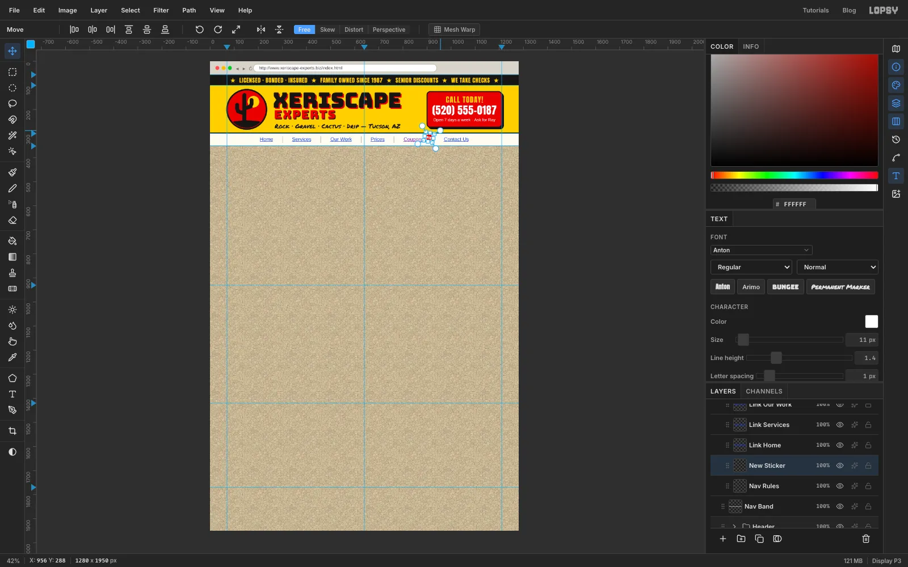

Collapse *Header*, click its row and add a layer called *Nav Band*. Fill the strip between the **300** and **352** guides with cream `#FFFCF2`, and add a 3 px `#B9B4A8` rule along its bottom. Click **New Group**, name it *Nav*, and add a layer called *Nav Rules* for the underlines.

Make six text layers in **Arimo** 21: `Home`, `Services`, `Our Work`, `Prices`, `Coupons!` and `Contact Us`, all in link blue `#1F3FD0` except *Coupons!*, which gets visited purple `#6B2BA8`. That's a little old-web joke. Work right to left, and nudge them so they're evenly spaced about 80 px apart and centred on the page.

On *Nav Rules*, use the Pencil at size **2**: under each word, click at its left end and [[Shift]]-click at its right end, a few pixels below the baseline and in the word's colour. Then draw short vertical bars in `#B9B4A8` halfway between the words.

For the sticker, add a layer called *New Sticker*. With the **Lasso**, drag a small 12-point star about 34 px across just right of *Coupons!*, zigzagging out to a point and back in. Fill it red and add `NEW!` in **Anton** 11, white, on top. Choose **Layer → Merge Down** and draw a marquee round the sticker. Switch to the **Move** tool and drag the round rotation handle outside the marquee's corner to tip it about 14°. Press [[Enter]] to apply.

> **Tip:** If freehand stars come out lumpy, place the points with the **Pen** tool instead, click the first point to close the path, and use **Path to Selection** in the Paths panel. That works for the big starburst later, too.

## Warm up the hero

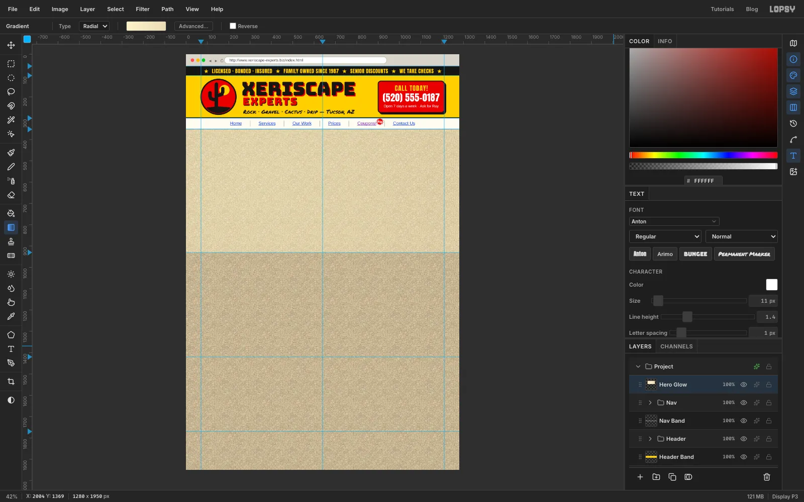

Collapse *Nav*, click its row and add a layer called *Hero Glow*. Select the hero band, from the 352 px guide down to the 930 px guide.

Pick the **Gradient** tool, set it to **Radial**, and use **Advanced…** to make the stops pale cream `#FFF4C8` and sand `#EADBB8`. Drag from the left third of the hero towards its lower right corner. Deselect, and set the layer's blend mode to **Soft Light**. The gravel behind the headline gets a gentle patch of sunlight.

## Drop in the hero photo

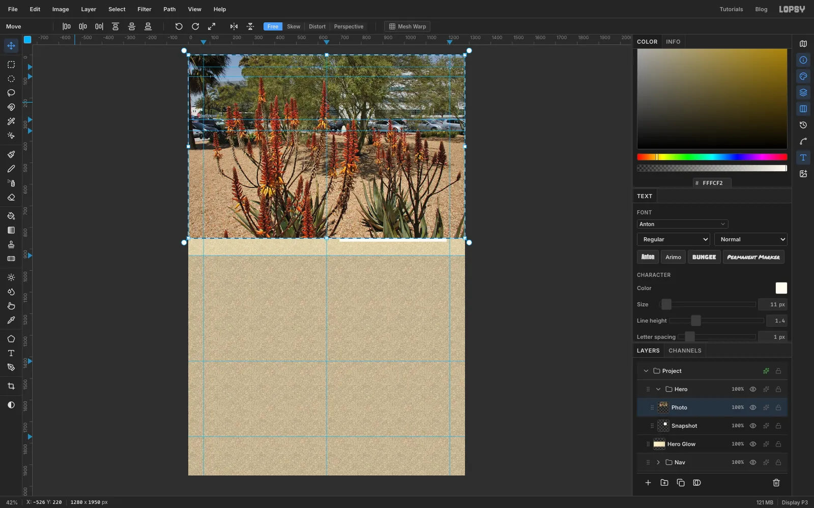

Click **New Group**, name it *Hero*, and add a layer called *Snapshot*. With the Rectangular Marquee, select a box about 500 × 420 px on the right of the hero, starting a little below the nav, and fill it with cream. This is the photo print's white border.

Drag your garden photo from your computer onto the canvas. Lopsy drops it on a new layer at the top-left corner, already selected for transforming. Rename the layer *Photo*.

## Scale the photo down

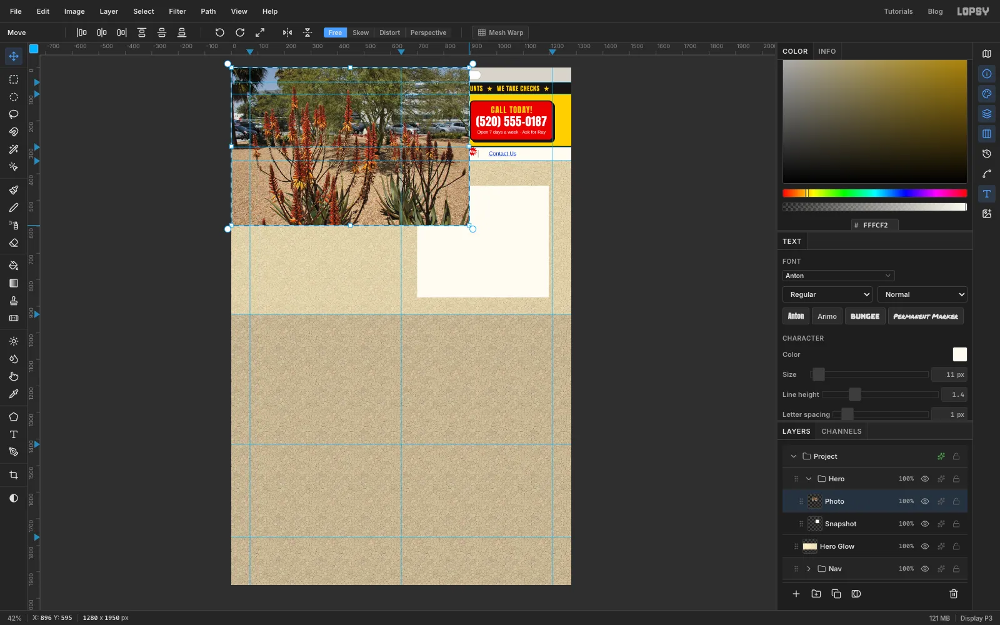

With the **Move** tool, hold [[Cmd]] and drag the bottom-right corner handle up and to the left until the photo is about 70% of its size. [[Cmd]] keeps the proportions. Press [[Enter]].

## Line the photo up with the print

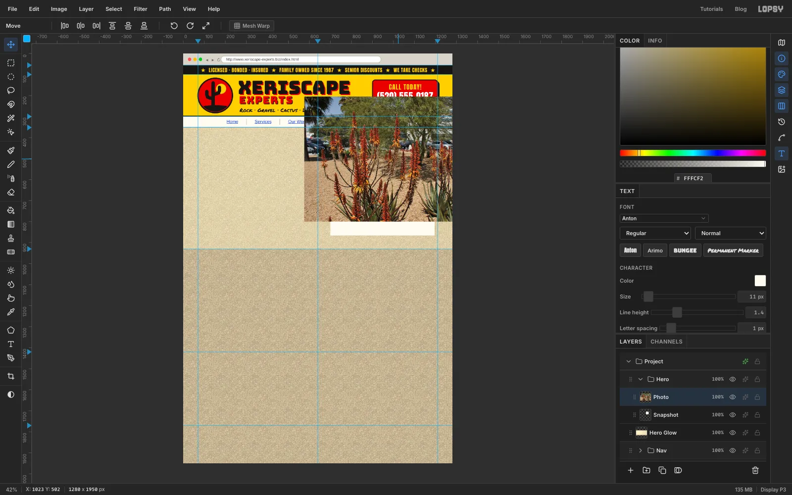

With the **Move** tool, drag the photo over the print. Choose the part you want to show: here the flowers and gravel, with the parked cars and sky in the original pushed up out of the frame.

## Crop it to the print's window

Select the window with the Rectangular Marquee: about 18 px in from the print's left, right and top edges, and about 68 px up from its bottom, leaving a deeper margin for a caption. Choose **Select → Inverse** and press [[Delete]]. Everything outside the window is gone. Deselect.

## Give the photo some punch

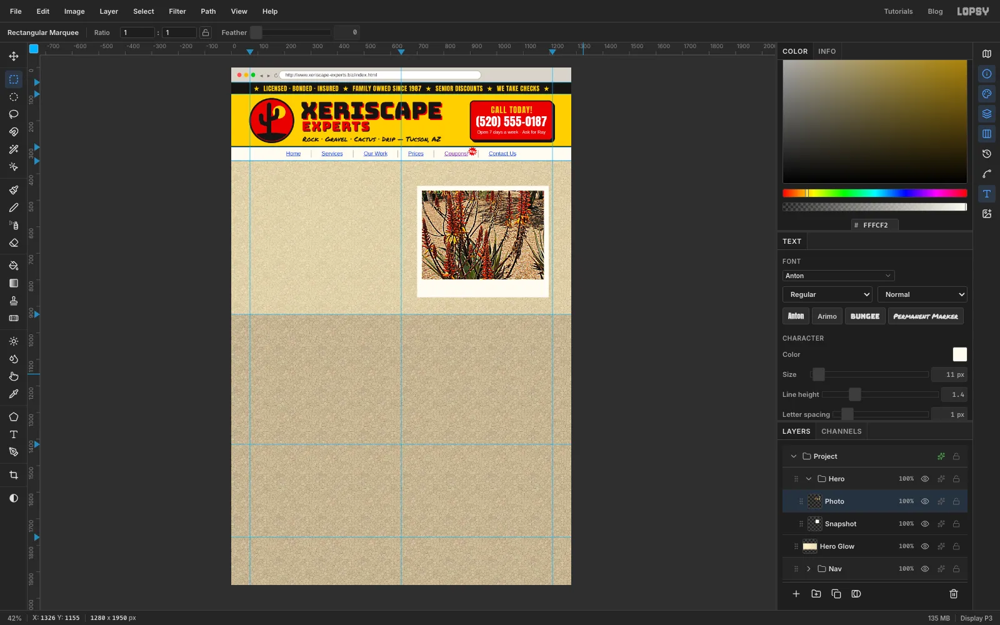

Run **Filter → Hue/Saturation** with Saturation **+18**, then **Filter → Unsharp Mask** at its defaults. Snapshots from a phone look flat once they're small, and this brings the oranges back.

## Caption the print and tilt it

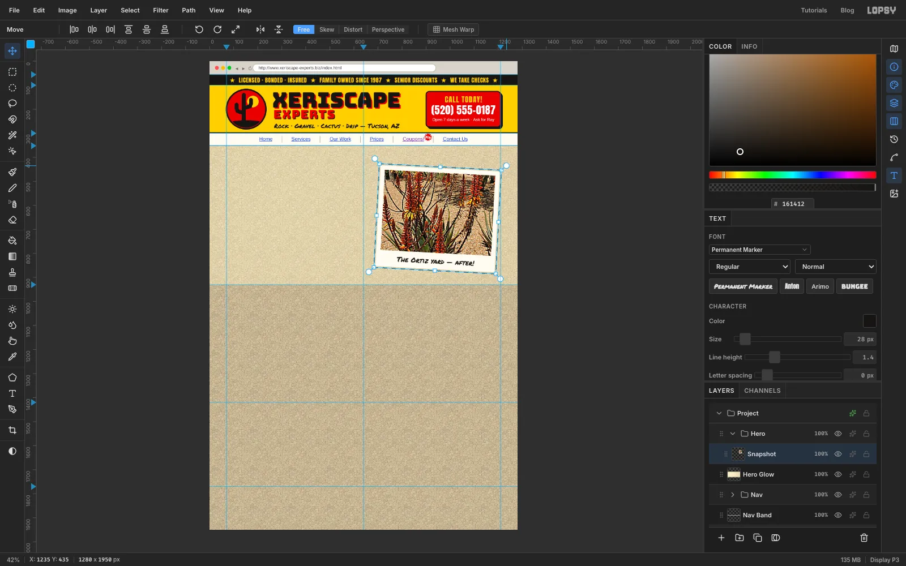

Add `The Ortiz yard — after!` in **Permanent Marker** 28, ink, centred in the print's bottom margin. Choose **Layer → Merge Down** twice so the caption and photo join the *Snapshot* layer.

Draw a marquee a few pixels bigger than the print, switch to the **Move** tool, and drag the rotation handle past the top-right corner to turn the print about **3°** clockwise. Press [[Enter]] and deselect. Add a soft **Drop Shadow**: Offset X **8**, Offset Y **12**, Blur **14**, Opacity **45**, in a dark brown like `#3A2A10`. It reads as a real photo lying on the gravel.

## Tape it down

Add a layer called *Tape*. With the Lasso, draw a strip about 125 × 35 px at a diagonal across the top-right corner, then hold [[Shift]] and draw another across the bottom-left corner. Fill with `#DCC685`, run **Add Noise** at **8**, **Mono**, for a papery texture, deselect, and lower the layer to **85%** opacity.

## Make the starburst sticker

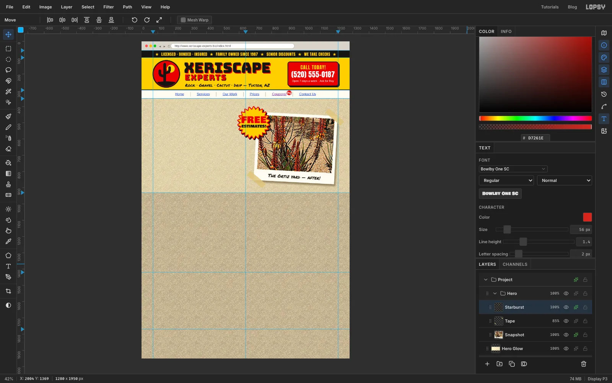

Add a layer called *Starburst*. With the Lasso, drag a 22-point star about 200 px across, centred just off the print's top-left corner, and fill it yellow.

Add `ESTIMATES!` in **Bowlby One SC** 23, ink, just below the burst's centre, and choose **Merge Down**. Then add `FREE` in **Bowlby One SC** 56, red, letter spacing 2, just above the centre, and merge that down too. Merging now means the words turn with the burst in the next step.

Give the layer a **Stroke**, Width **5** in red, and a **Drop Shadow** of 5 / 6 with Blur 0 in ink.

## Tilt the starburst

Draw a square marquee round the burst, switch to the **Move** tool, and drag the rotation handle anticlockwise about **14°**. Press [[Enter]]. Stickers are never put on straight.

## Set the headline and the quote button

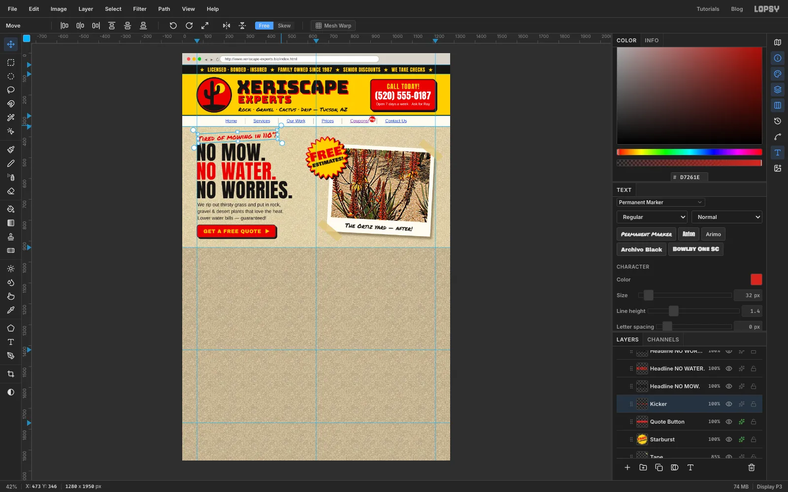

Add a layer called *Quote Button*. With the Shape tool on **Rectangle** (fill red, ink stroke Width **3**, Corner Radius **12**), make a button about 375 × 60 px on the left margin, about 50 px above the bottom of the hero. Press at the centre of where it goes and drag out to its lower-right corner. If you'd rather type the size, click once without dragging and the Shape Size dialog opens. Give it a **Drop Shadow** of 6 / 6 with Blur 0 in ink, and an **Inner Glow** of Size **10**, Opacity **45** in pale pink `#FFB4A0`. The glow gives the button a slightly puffy, clickable edge.

Now the type, bottom first. Select *Quote Button* before each one so new text doesn't restyle the last:

- `GET A FREE QUOTE ►` in **Archivo Black** 24, yellow, letter spacing 1, centred on the button
- three lines of body copy in **Arimo** 23, ink: *We rip out thirsty grass and put in rock, / gravel & desert plants that love the heat. / Lower water bills — guaranteed!* Press [[Enter]] between lines.
- the headline in **Anton** 96 with letter spacing 1, one line per layer on the left margin: `NO WORRIES.` in ink, `NO WATER.` in red above it, `NO MOW.` in ink on top
- the kicker `Tired of mowing in 110°?` in **Permanent Marker** 32, red

Select the kicker, switch to the Move tool and drag the rotation handle beyond its corner to tip it about **3°** anticlockwise. Press [[Enter]].

## Lay out three service cards

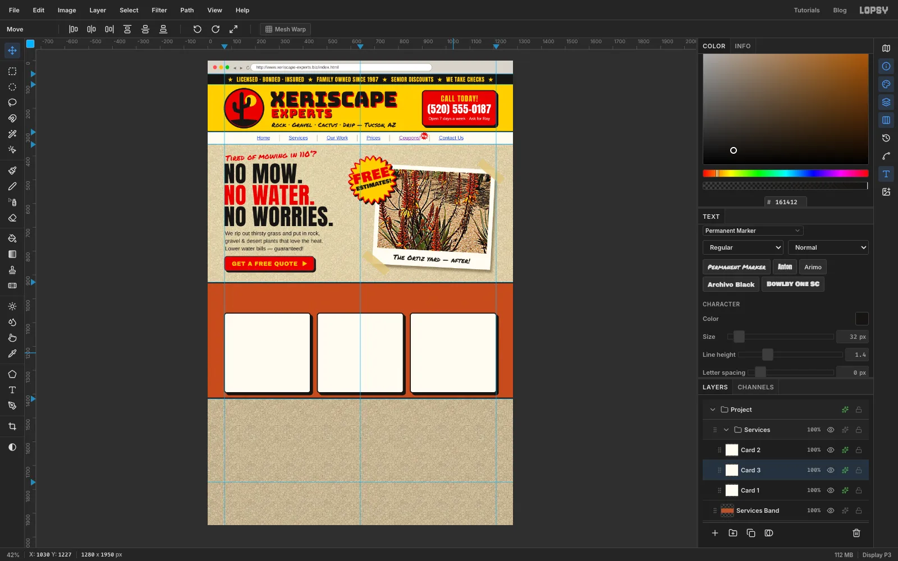

Collapse *Hero*, click its row and add a layer called *Services Band*. Fill the strip between the **930** and **1420** guides with rust `#B9532C`. Then select a 5 px strip along its top, hold [[Shift]] and select another along its bottom, and fill both with ink.

Click **New Group**, name it *Services*, and add a layer called *Card 1*. With the Shape tool on **Rectangle** (fill cream, ink stroke Width **4**, Corner Radius **10**), make a card 360 × 334 px with its left edge on the margin, starting 130 px below the band's top edge, which leaves room for a heading. Press at the card's centre (250 px across) and drag out 180 px right and 167 px down. Give it a **Drop Shadow** of 9 / 9, Blur 0, in ink.

Click **Duplicate Layer** twice. Click each copy's row, rename them *Card 2* and *Card 3*, and drag them with the Move tool so the three cards sit 30 px apart, with the middle one on the centre guide. Duplicates keep the effects, so every card gets the same shadow.

## Draw the rocks, the cactus and a water drop

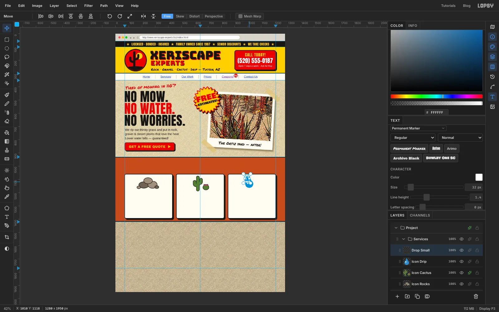

New layers go directly above the selected one, so click the top card row in *Services* first. That's *Card 2*, because the second duplicate was inserted just above *Card 1*, under the first one.

Add a layer called *Icon Rocks*. With the Shape tool on **Ellipse** and an ink stroke at Width **3**, draw five overlapping stones near the top of the first card: three big ones about 70 × 50 px in `#9C8F7E` and `#6E6355`, then two pebbles about 30 × 20 px at the sides.

Add a layer called *Icon Cactus*. Brush a saguaro about 100 px tall in cactus green `#5E7F3C`, the same way as the badge but with a chunkier size **22** brush. Beside it, draw a round barrel cactus about 42 × 36 px in the same green with the Shape tool (no stroke), then click three dots of pink `#E0457B` on its top with a size **9** brush for flowers. Give the layer a **Stroke** of Width **3** in ink. One effect outlines every part on the layer, so it matches the rocks.

Add a layer called *Icon Drip*. With the Lasso, draw a teardrop near the top of the third card, pointed at the top and round at the bottom, and fill it with water blue `#2C8FD6`. With the Elliptical Marquee, add a small white highlight on its upper left.

Marquee the whole drop, press [[Cmd]]+[[C]] and [[Cmd]]+[[V]]. The paste lands in place on its own layer. Draw the same marquee over it, switch to the **Move** tool, hold [[Cmd]] and drag the bottom-right handle in until the copy is half the size. Press [[Enter]].

## Finish the drops

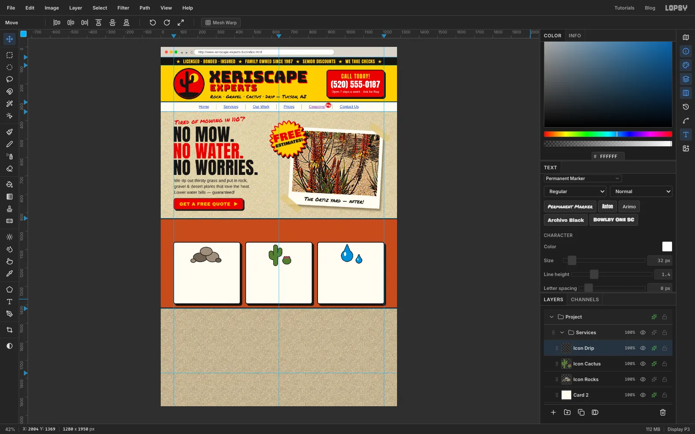

With the Move tool, drag the small drop down to the right of the big one, then choose **Layer → Merge Down** so both drops are on *Icon Drip*. Give that layer the same **Stroke**, Width **3** in ink.

## Make one price tag and paste two more

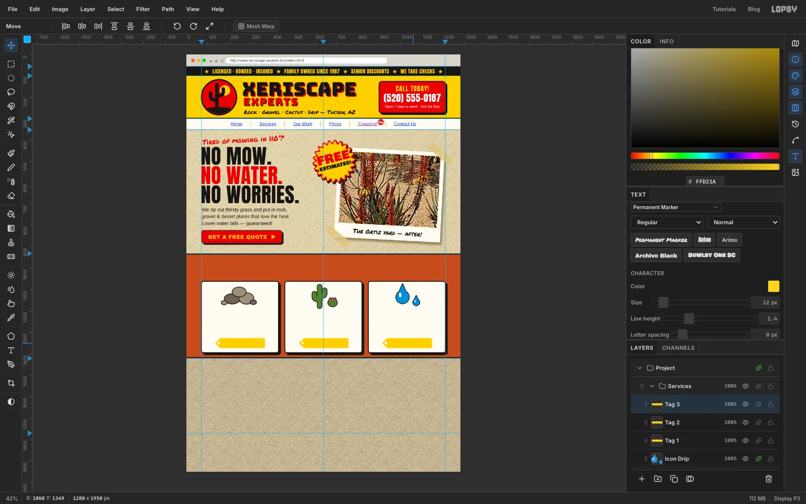

Add a layer called *Tag 1*. With the Lasso, draw a tag about 230 × 46 px at the bottom of the first card: a rectangle with a point on its left end. Fill it yellow. With the Elliptical Marquee, select a 12 px circle near the point and press [[Delete]] to punch the hole.

Marquee the tag, [[Cmd]]+[[C]], then [[Cmd]]+[[V]] twice. Rename the pasted layers *Tag 2* and *Tag 3*, and drag each one to the bottom of the second and third card.

## Price the tags and tilt them

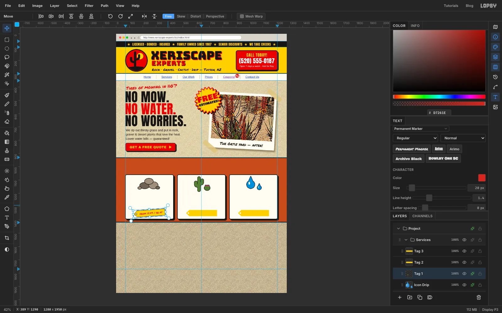

Finish one tag at a time:

1. Select the tag and add its price in **Permanent Marker** 20, red: `from $1.49 / sq ft`, `plants from $12` or `from $450 / zone`. Centre it on the tag's body, to the right of the hole.
2. Choose **Merge Down** so the price joins the tag.
3. Give the tag a thin **Stroke**, Width **2** in ink.
4. Marquee it, switch to the **Move** tool and rotate it slightly with the rotation handle: about −4°, +3° and −2° for the three tags. Press [[Enter]].

Tags that hang at slightly different angles look stapled on by a person.

## Title the cards and the section

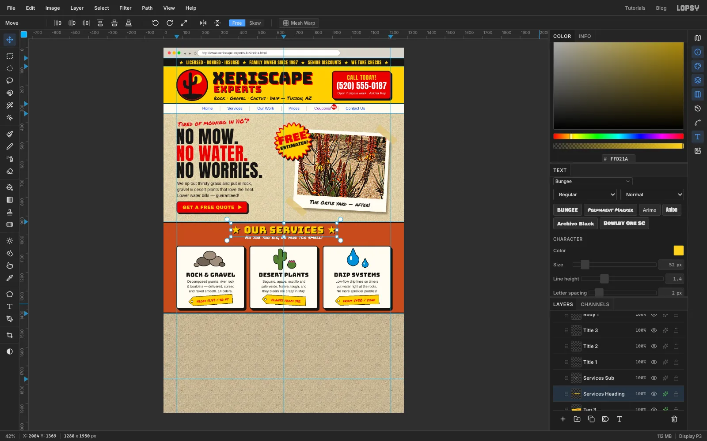

Select *Tag 3* before each new text layer. For each card, from right to left, add three lines of description in **Arimo** 18, `#2A2622`, with Align set to **Center** in the Text options, about 50 px below the icon. Press [[Enter]] between lines:

- *Decomposed granite, river rock / & boulders — delivered, spread / and raked smooth. 14 colors.*
- *Saguaro, agave, ocotillo and / palo verde. Native, tough, and / they bloom like crazy in May.*
- *Low-flow drip lines on timers / put water right at the roots. / No more sprinkler puddles!*

 Then add the card titles above them in **Bungee** 30, ink, letter spacing 1: `ROCK & GRAVEL`, `DESERT PLANTS`, `DRIP SYSTEMS`.

For the section heading, add `No job too big, no yard too small!` in **Permanent Marker** 24, white, centred above the cards. Then add `★ OUR SERVICES ★` in **Bungee** 52, yellow, letter spacing 2, above that, with a **Drop Shadow** of 4 / 4, Blur 0, in ink.

## Make two recent-job prints

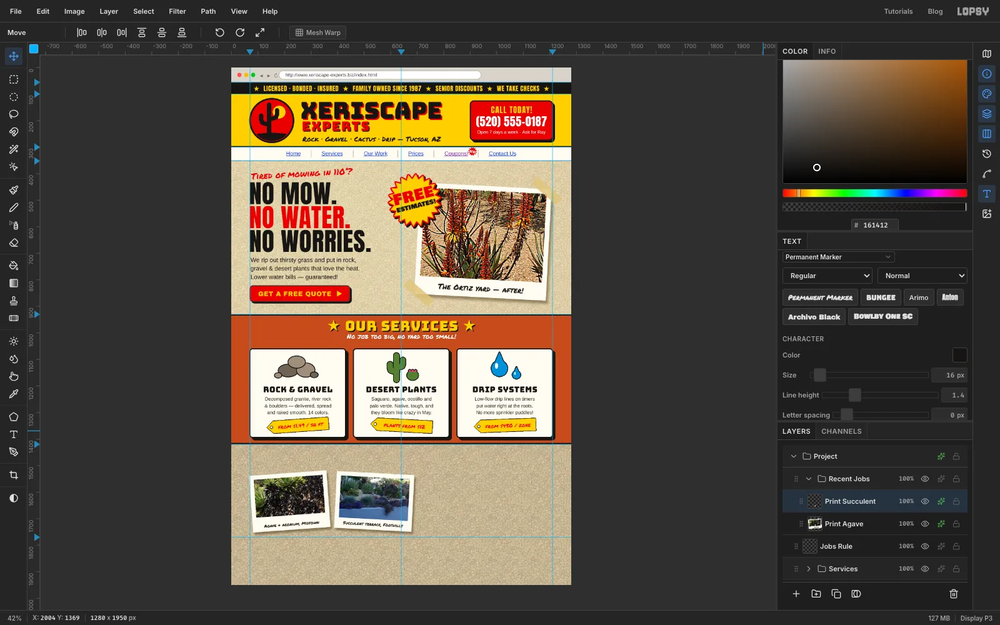

Collapse *Services*, click its row, and add a layer called *Jobs Rule*. **New Group** needs a top-level layer selected to make a top-level group, and this one earns its place later by holding a link underline. Click **New Group** and name it *Recent Jobs*.

The prints sit on the left half of the section, starting about 108 px below the 1420 px guide, which leaves room for a heading. The first starts at the left margin and the second about 26 px to its right.

Make each print the same way as the hero snapshot, only smaller:

1. Add a layer named *Print Agave* (then *Print Succulent* for the second), and fill a 292 × 214 px cream rectangle.
2. Drop in a garden photo, [[Cmd]]-drag its corner handle to shrink it, and move the best part over the print.
3. Select a window 16 px in from the sides and top and 40 px up from the bottom, then **Select → Inverse** and [[Delete]].
4. Add a caption in **Permanent Marker** 16, ink: `Agave & aeonium, Midtown` or `Succulent terrace, Foothills`. Then **Merge Down** twice.
5. Marquee the print, switch to the **Move** tool, rotate it a few degrees with the rotation handle, and press [[Enter]].
6. Add a **Drop Shadow** of 6 / 9 with Blur **10** at 45%, in the same dark brown `#3A2A10` as the hero print.

Tilt the left print anticlockwise and the right one clockwise.

## Add a speech bubble and a grid-snapped counter

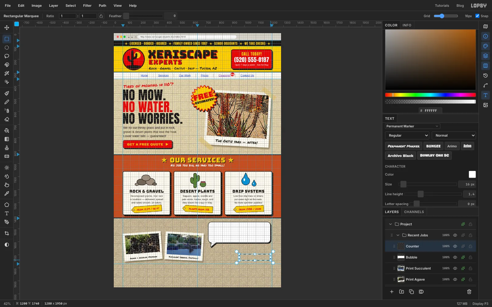

Add a layer called *Bubble*. With the Shape tool on **Rectangle**, white fill, no stroke and Corner Radius **22**, make a bubble about 475 × 155 px whose right edge is on the margin, starting 30 px below the 1420 px guide. Press at its centre and drag out to the lower-right corner. With the Lasso, add a triangle tail pointing down from its lower-left edge and fill it white. Give the layer a **Stroke** of Width **3** in ink and a **Drop Shadow** of 6 / 6 with Blur 0.

For the hit counter, choose **View → Show Grid**. Showing the grid also turns grid snapping on, so marquees click to the grid lines. Add a layer called *Counter*, drag a marquee about 240 × 48 px under the bubble, lined up with its right edge, and fill it with ink. Hide the grid again with **View → Show Grid**.

With the Pencil at size **2** in dark grey `#3A3A3A`, draw six short vertical lines that split the box into seven digit windows.

## Fill in the jobs section text

Select *Counter* before each text layer and work bottom-up:

- `0 0 4 1 2 7 3` in **VT323** 44, LCD green `#7CFF5A`, one digit per window
- `You are visitor #` in **Arimo** 18, ink, to the left of the counter
- `— Gloria R., Oro Valley` in **Permanent Marker** 22, ink, just right of the bubble's tail
- the quote in **Arimo** 19, ink, centred in the bubble over three lines: *"Our water bill went from $212 to $64 a month, / and the yard looks better than it ever did. / These guys showed up on time, every day!"*
- `★★★★★` in **Arimo** 30, yellow, centred at the top of the bubble, with a **Stroke** of 2 in ink
- `click a photo to enlarge` in **Arimo** 16, link blue, under where the heading will go. Underline it on the *Jobs Rule* layer with a 2 px Pencil line.
- `RECENT JOBS` in **Bungee** 40, ink, on the left margin

## Make a hazard-stripe tile

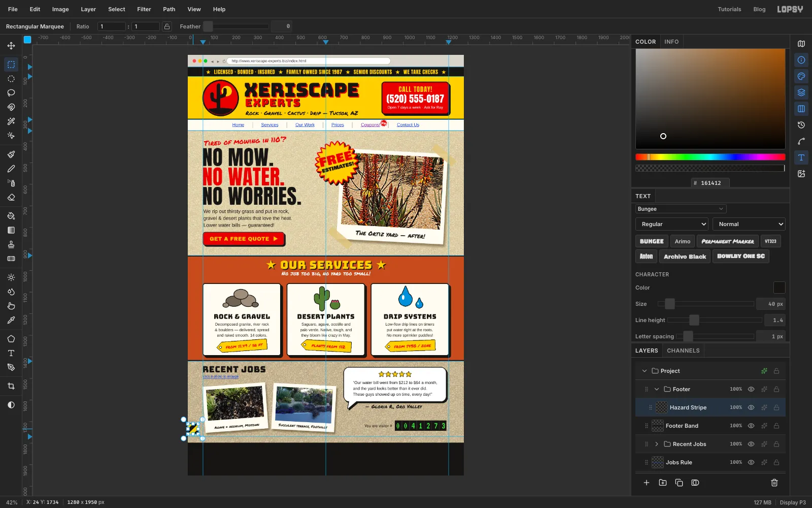

Collapse *Recent Jobs*, click its row and add a layer called *Footer Band*. Fill from 28 px below the last guide to the bottom of the page with ink. The gap is where the stripe goes. Then click **New Group**, name it *Footer*, and add a layer called *Hazard Stripe*.

In an empty corner, select a 48 × 48 px square and fill it yellow. To make a stripe that repeats without a seam, draw two black pieces with the Lasso:

1. A band from the middle of the top edge to the top-right corner, diagonally down to the bottom-left corner, then up to the middle of the left edge.
2. With [[Shift]], the small triangle in the bottom-right corner, from the middle of the right edge to the corner to the middle of the bottom edge.

Fill both with ink. Select the tile square again and choose **Edit → Define Pattern**, then press [[Delete]] to clear the tile.

## Run the stripe across the page

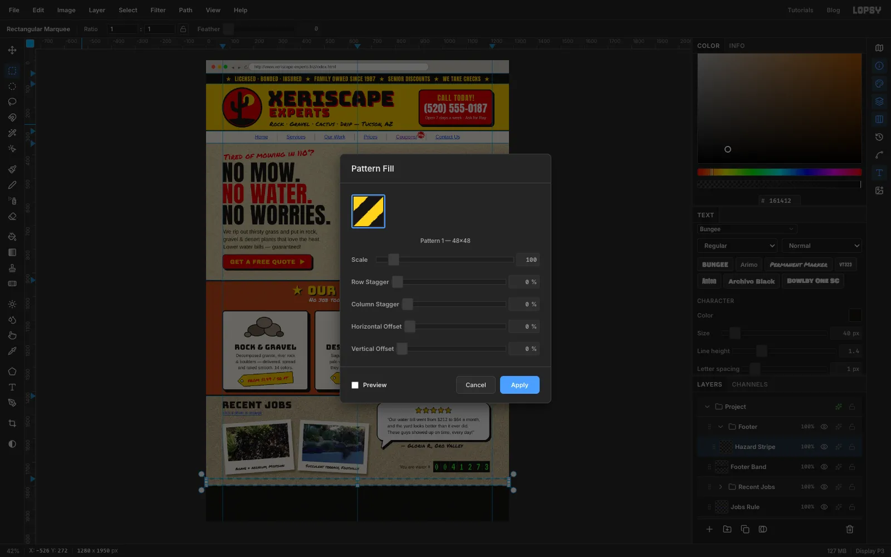

Select the 28 px gap across the full width of the page, between the gravel and the footer band. Choose **Edit → Fill with Pattern**, click the stripe tile and press **Apply**. The fill stays inside the selection, so you get a crisp band of construction-site stripes. Deselect.

## Set the footer type

Select *Hazard Stripe* before each text layer. On the left margin, bottom-up:

- `Mon–Sat 7am–5pm · Licensed · Bonded · Insured` in **Arimo** 16, `#CFCAC0`
- `4410 E. Speedway Blvd · Tucson, AZ 85712 · (520) 555-0187` in **Arimo** 16, white
- `XERISCAPE EXPERTS` in **Bungee** 28, yellow, letter spacing 1

On the right, add three lines in **Arimo** 16, `#C8C2B4`, and nudge each until its right end touches the 1210 px guide: `© 1999–2026 Xeriscape Experts, LLC`, `Best viewed in Netscape Navigator at 800 × 600` and `Site by our nephew Danny :)`. Nudge each so it sits on the same baseline as the left-hand line beside it. The two columns then read as one grid instead of two piles of text.

Save with **File → Save Project**, and export with **File → Quick Export PNG**.

> **Tip:** Vernacular doesn't mean careless. Everything here is loud, but the margins are consistent, every line of type sits squarely in its box, and each section has the same rhythm. That care is what makes it feel charming rather than broken.
