All over South Texas and Mexico, small shops advertise with **rótulos**: signs painted straight onto the wall by a local sign painter. A taquería, a tire shop or a laundromat gets its name in fat brush lettering, a cheerful picture of what it sells, a starburst for the special, and a painted wainscot along the bottom of the wall. The lettering has a white keyline and a hard black "shade", the colours are bright enamel, and then the Texas sun gets to work. The paint fades, chips off the stucco and picks up grime.

In this tutorial you'll paint one as a party invitation. **Wanda's Washateria**, a fictional family laundromat in San Antonio, is turning 40, and the whole neighbourhood is invited. It's 1200 × 1500 px, a 4:5 portrait that prints well and works on a phone, and it has:

- a sun-faded **turquoise stucco wall** with a red **wainscot** (the *zócalo*) and a yellow pinstripe
- **Wanda's** in sign-painter script with a keyline and a shade, and **WASHATERIA** arched along a Pen curve
- a naive **washing machine** with laundry swirled by **Liquify**, and a stream of soap bubbles
- a **40 AÑOS starburst**, a cream sign board with the party details, and bilingual copy
- real weathering: **paint chips** that show bare plaster, grime streaks, stucco relief and a bleached top

The tools you'll use:

- **guides**, the **grid** with Snap, the Rectangular and Elliptical Marquees and the **Lasso**, with [[Shift]] to add and [[Option]] to subtract
- the **Shape** tool (rectangles and ellipses with fill, stroke and corner radius) and the **Pen** tool
- **Text** in Shrikhand, Ultra, Anton, Alfa Slab One and Kaushan Script, and **text on a path**
- the **Brush**, **Spray**, **Gradient** and **Edit → Fill**
- **Copy**, **Cut**, **Paste**, the Move tool's **scale** and **rotate** handles, **Duplicate Layer** and **Merge Down**
- **Quick Mask**, [[Cmd]]-clicking a layer thumbnail, **Select → Shrink** and **Inverse**
- **Liquify**, **Add Noise**, **Gaussian Blur**, **Emboss** and **Clouds**
- **Stroke**, **Drop Shadow** and **Color Overlay**, **Rasterize Layer Style**
- the **Overlay**, **Soft Light** and **Multiply** blend modes, **groups**, and a group **Hue / Saturation** adjustment

The palette:

- Wall `#58ADA4`, bare plaster `#D8CDB8`
- Wainscot red `#A8202B`, pinstripe `#FFD43B`, board cream `#FFF3D9`
- Rosa mexicano `#DE3A80`, sign-painter black `#1B1A1F`
- WASHATERIA `#F9DC4A` → `#FFC93A` → `#FF8A1F`
- Starburst red `#CC2A2E`, porthole teal `#17606A`
- Chrome `#9AA7AE` / `#D3DADD`, washer enamel `#F4F1E6`
- Streaks `#5B4A3A`, grime `#4E3B28`, script yellow `#F3D77A`
- Coin slot `#B9C3C9`, glass edge `#0E3F45`, date shade `#7A1820`

> **Tip:** On a wide-gamut (Display P3) screen, Lopsy reads typed hex codes as P3 colours, so these come out a little more vivid than on an sRGB screen. The final Hue / Saturation step tones everything down anyway.

> **Tip:** Positions are given in document pixels. The **X / Y** readout at the bottom left of the window shows where the pointer is, so you can find a spot before you click.

> **Note:** Shortcuts are written for a Mac. On Windows use [[Ctrl]] wherever it says [[Cmd]], and [[Alt]] for [[Option]].

## Start the document and paint the wall

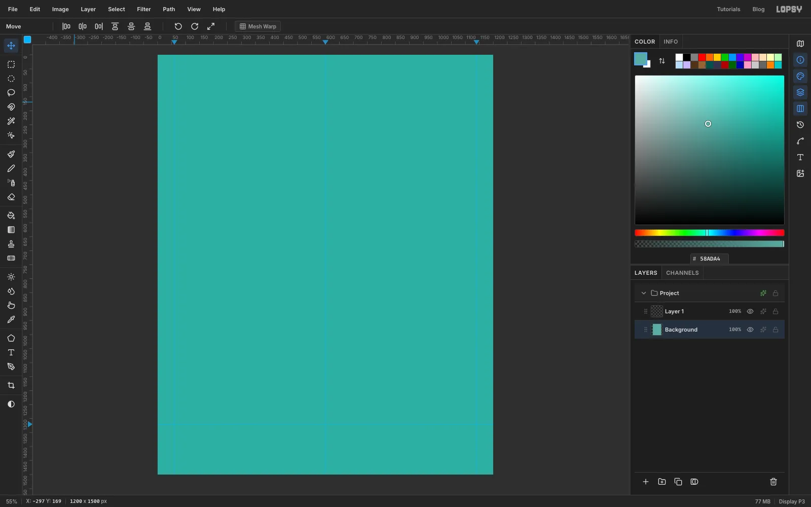

Choose **File → New** and make a document **1200** wide and **1500** high, in pixels. Every layer you add lives inside **Project**, the group at the top of the Layers panel that each new document starts with.

Drop guides by clicking the rulers. Click the top ruler at **60**, **600** and **1140** for the two side margins and the centre line. Click the left ruler at **1320**: that's where the red wainscot will start.

Set the foreground colour to the wall turquoise `#58ADA4`, select the **Background** layer and choose **Edit → Fill**.

## Give the wall a plaster grain

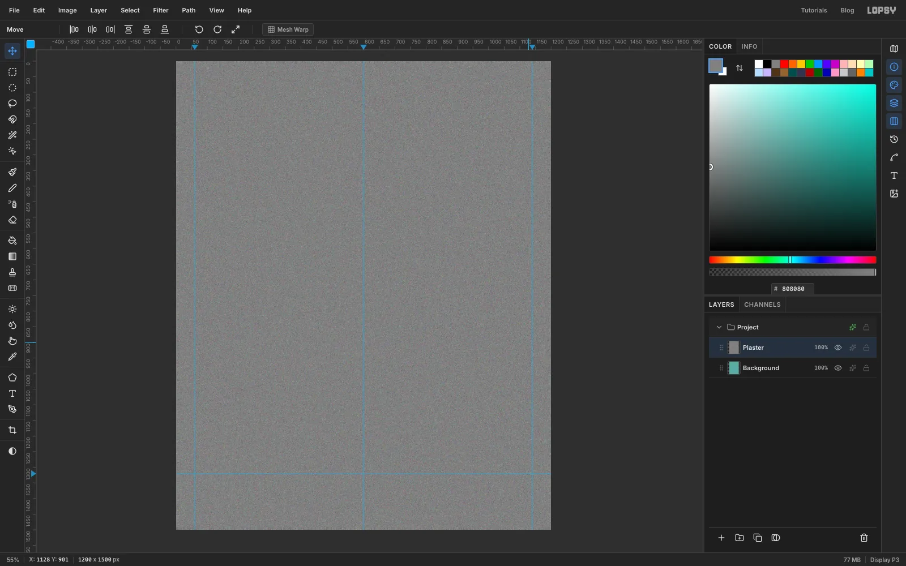

A painted wall is never flat. Rename the empty **Layer 1** to **Plaster** and fill it with mid-grey `#808080`.

Run three filters on it, in this order:

1. **Filter → Add Noise…** with **Amount 45**
2. **Filter → Gaussian Blur…** with **Radius 1.5**, which turns the pixel noise into little lumps
3. **Filter → Emboss…** with **Angle 135** and **Strength 70**, which lights the lumps from the top left

## Fade the paint unevenly

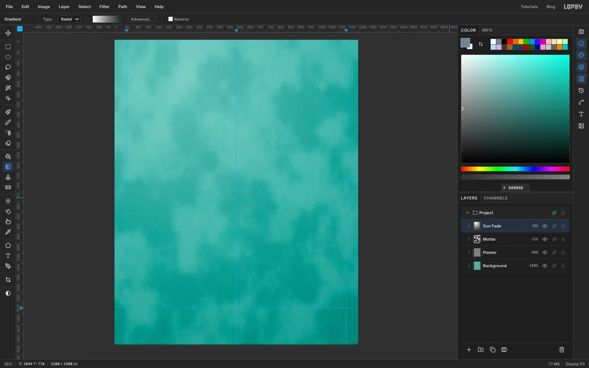

Open the **Plaster** layer's effects (the ✦ button on its row), set the blend mode to **Overlay**, and set the layer opacity to **60%**. Mid-grey disappears in Overlay, so only the grain shows on the wall.

Add a layer called **Mottle** and fill it with mid-grey too. Run **Filter → Clouds…** at **Scale 10**, then **Gaussian Blur** at **6**. Set it to **Soft Light** at **22%**. These soft patches look like a wall that's been touched up in slightly different batches of paint.

Add a layer called **Sun Fade**. Pick the **Gradient** tool, choose **Radial**, and use **Advanced…** to set three stops: white `#FFFFFF`, mid-grey `#808080` at the middle and dark grey `#202020` at the end. Drag from the upper left of the wall, about a quarter of the way in, to the bottom-right corner. Set it to **Soft Light** at **70%**. The wall is now lighter where the sun hits it and darker toward the corners.

## Mark out the wainscot on the grid

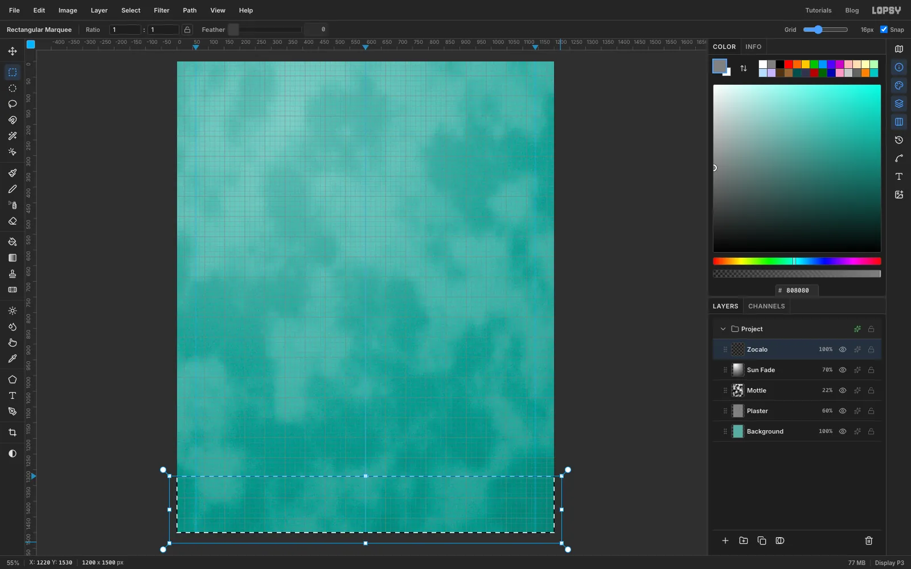

Add a layer called **Zocalo**. Choose **View → Show Grid**. This also turns on **Snap**, so the marquee edges lock to the grid and to your guide.

With the **Rectangular Marquee**, drag from just outside the left edge of the canvas, on the **1320** guide, down past the bottom-right corner. The top edge snaps to the guide.

## Paint the wainscot and its pinstripe

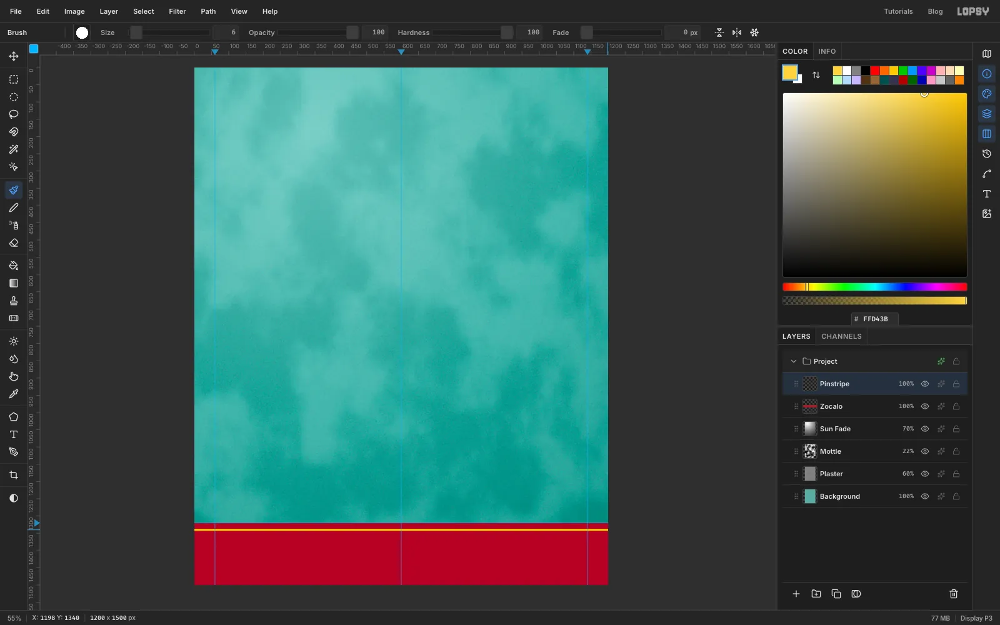

Set the foreground to wainscot red `#A8202B` and choose **Edit → Fill**. Press [[Cmd]]+[[D]] to deselect, then turn the grid off again with **View → Show Grid**, and untick **Snap** in the options bar.

Add a layer called **Pinstripe**. Pick the **Brush**, open the brush settings and set **Size 6**, **Hardness 100**. Choose pinstripe yellow `#FFD43B`. Click at the left edge, **20 px** below the top of the red, hold [[Shift]] and click at the right edge. You get a straight line, like a sign painter running a striping brush along a straightedge.

## Paint the sign board

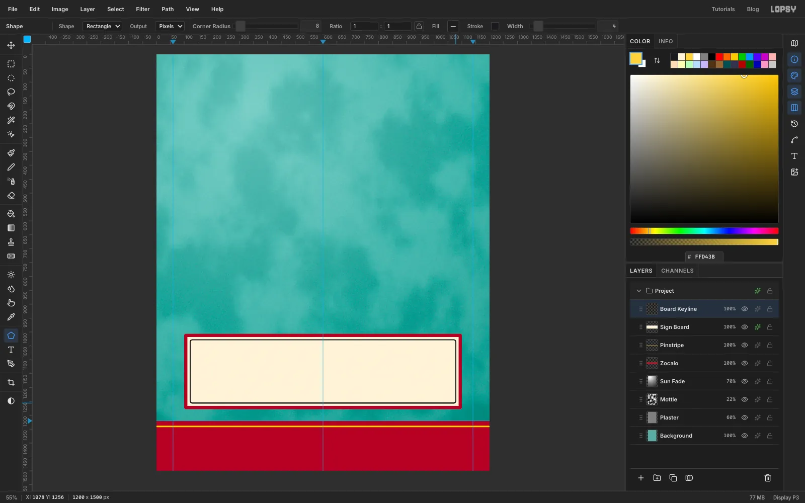

Add a layer called **Sign Board**. Pick the **Shape** tool and set **Shape** to **Rectangle**, **Output** to **Pixels** and **Corner Radius** to **6**. Click the **Fill** swatch and type board cream `#FFF3D9`, and remove the stroke.

The board is 1000 × 272 px, centred on the middle guide, with its bottom edge about 40 px above the wainscot. Shapes grow out from the point where you press, so start at the board's centre: press on the centre guide at about **y 1142**, and drag out until the corner reaches **x 1100, y 1278**. That leaves a 100 px margin on each side.

Open the effects drawer, tick **Stroke**, set **Width 12**, colour `#A8202B` and position **inside**. That's the red frame.

Add a layer called **Board Keyline**. Draw another rectangle from the same centre point, with **no fill**, a **4 px** stroke in sign-painter black `#1B1A1F` and **Corner Radius 8**. Stop when it sits about 10 px inside the red frame all round, about 956 × 228 px.

## Letter "Wanda's" in brush script

Select the **Board Keyline** layer so the new text lands above it. Pick the **Text** tool, choose **Shrikhand** at size **200** and rosa mexicano `#DE3A80`, click in an empty part of the wall and type `Wanda’s`. Use a curly apostrophe (’), as a sign painter would. Press [[Tab]] to finish, then double-click the layer name and call it **Wandas**.

Switch to the **Move** tool and nudge it with the arrow keys until it's centred on the middle guide, with the middle of the word about **224 px** down from the top.

> **Note:** The Text tool's font, size and colour apply to the *selected* text layer. If a live text layer is selected when you change them, you restyle it instead of setting up the next one. In this tutorial every line gets rasterized as soon as it's in place, so that never happens.

## Add the keyline and the shade

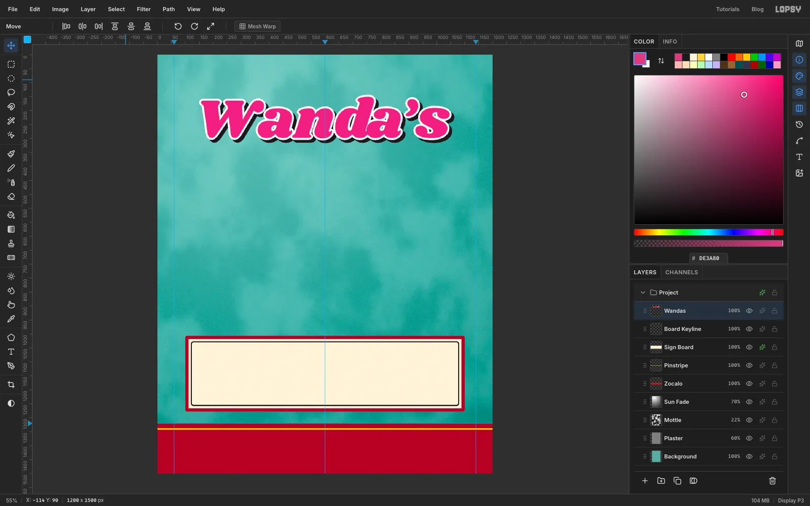

Rótulo lettering is built in layers of paint: the letter, a thin outline called a keyline, and a solid "shade" that makes it pop off the wall.

1. Click **Rasterize Layer** at the foot of the Layers panel. From here on it's paint.
2. In the effects drawer, add a **Stroke** of **7** in white, **outside**, then click **Rasterize Layer Style**.
3. Click **Duplicate Layer**. Check that the copy lines up exactly with the original (a duplicate can land 10 px down and to the right); if it moved, nudge it back with the arrow keys.
4. Select the **original** layer underneath. Add a **Color Overlay** in black `#1B1A1F` and rasterize its style. With the Move tool, press [[Right]] ten times and [[Down]] ten times (or [[Shift]]+arrow once each) to push it 10 px down and to the right.
5. Select the copy and choose **Layer → Merge Down**.

Now letter, keyline and shade are one layer.

## Tilt the name

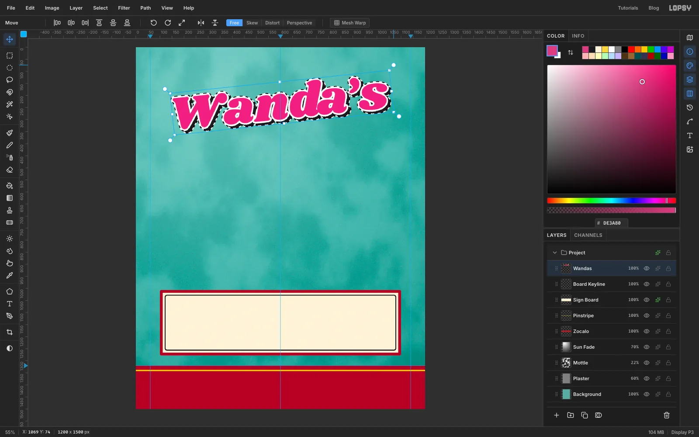

Hand-painted names often climb a little toward the right. [[Cmd]]-click the **Wandas** layer thumbnail to select its outline. With the **Move** tool, drag the round rotation handle just outside the top-right corner upward until the word is turned about **6°** anticlockwise. Press [[Cmd]]+[[D]]: deselecting applies the rotation.

## Draw the arch with the Pen

The arch needs just three points. Pick the **Pen** tool and click once near the left margin, a little below the bottom of Wanda's (about **x 110, y 543**). On the centre guide, about 100 px higher than that, press and drag straight out to the right about 220 px to pull out smooth handles; that makes the top of the arch round instead of pointed. Then click near the right margin at the same height as your first point. Click the **✓** (*Commit path*) button in the options bar.

## Put WASHATERIA on the curve

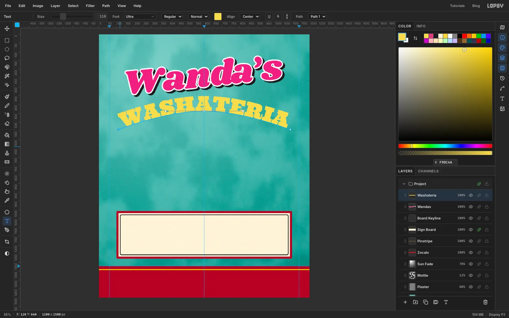

Select the **Wandas** layer. With the **Text** tool, set **Ultra** at size **118** in `#F9DC4A`, click in an empty spot and type `WASHATERIA`. Press [[Tab]] and rename the layer **Washateria**.

With the text layer still selected, open the **Path** dropdown in the options bar and choose **Path 1**, then set **Align** to **Center**. Each letter stands on the curve and tilts to follow it, and the word sits centred on the arch.

## Paint a blend into the letters

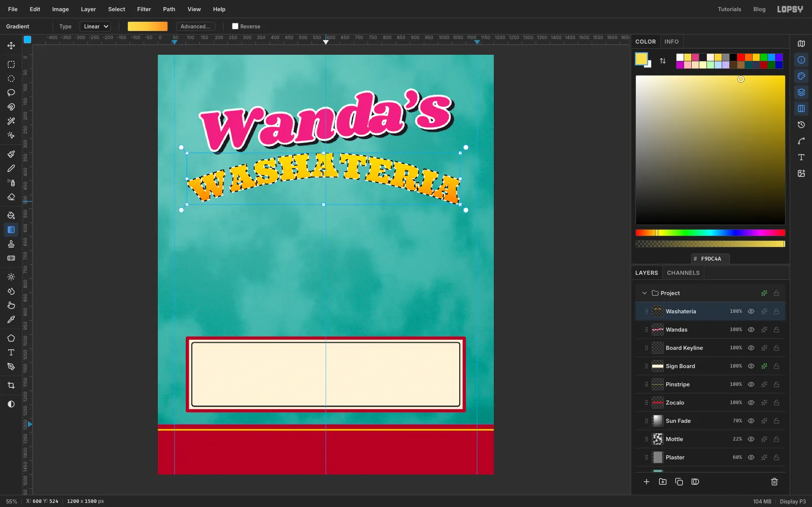

Sign painters love a "blend": two colours wet-blended inside the letters.

Click **Rasterize Layer**, then open the **Paths** panel and click **Delete Path**, since you don't need the curve any more. [[Cmd]]-click the **Washateria** thumbnail to select the letters.

Pick the **Gradient** tool, **Linear**, and in **Advanced…** set yellow `#F9DC4A`, a middle stop at about 45% in `#FFC93A`, and orange `#FF8A1F`. Drag from the top of the letters straight down to their bottom. The gradient only lands inside the selection. Deselect.

## Outline and shade WASHATERIA

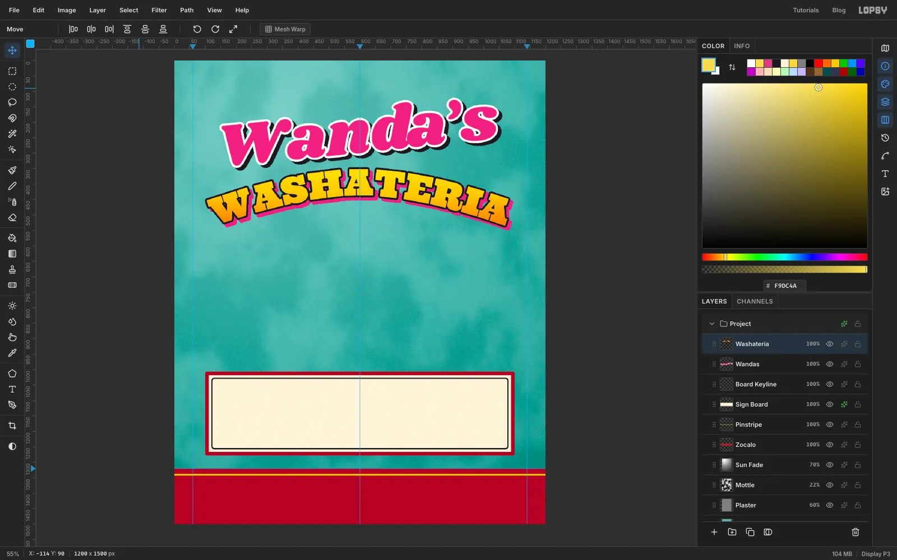

Add a **Stroke** of **6** in black, **outside**, and rasterize the style.

Then build the shade the same way you did for Wanda's: duplicate, put the copy back on top, give the original a **Color Overlay**, rasterize it, nudge it **10 px** right and **10 px** down, and merge the copy down into it. This time make the overlay rosa `#DE3A80`. A coloured shade is a classic rótulo touch, and it keeps the two names from looking alike.

## Paint the washing machine body

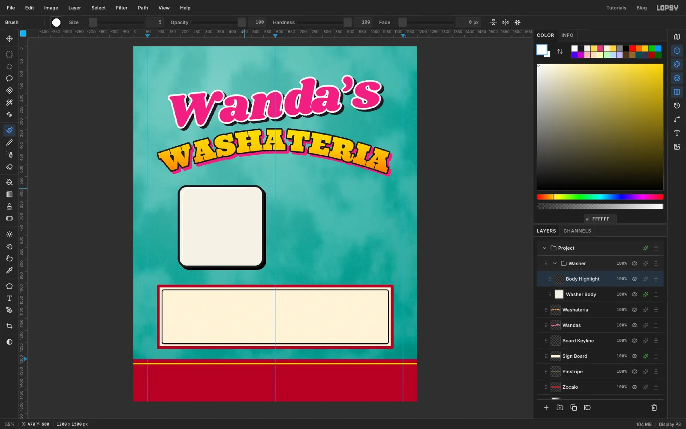

Select **Washateria**, click **New Group** and name it **Washer**. Add a layer inside it called **Washer Body**.

With the **Shape** tool, draw a **Rectangle** with **Corner Radius 34**, fill `#F4F1E6` and an **8 px** black stroke. Make it about 356 × 340 px, sitting a little left of centre in the space under the arch. Remember that it grows from where you press: start at its centre, about **x 370, y 760**, and drag out to about **x 548, y 930**.

Add a **Drop Shadow** with **Offset X 10**, **Offset Y 10**, **Blur 0** and **Opacity 100**. Zero blur gives a hard shade, the same 10 px down and to the right as the lettering.

Add a layer called **Body Highlight**. With the **Brush** at **Size 5** in white, click near the bottom of the body's left side, just inside the outline, then [[Shift]]-click up to the top-left corner, round the corner in two short clicks, and along under the top edge. A painter's highlight on the left and top makes the enamel look rounded.

## Add the controls

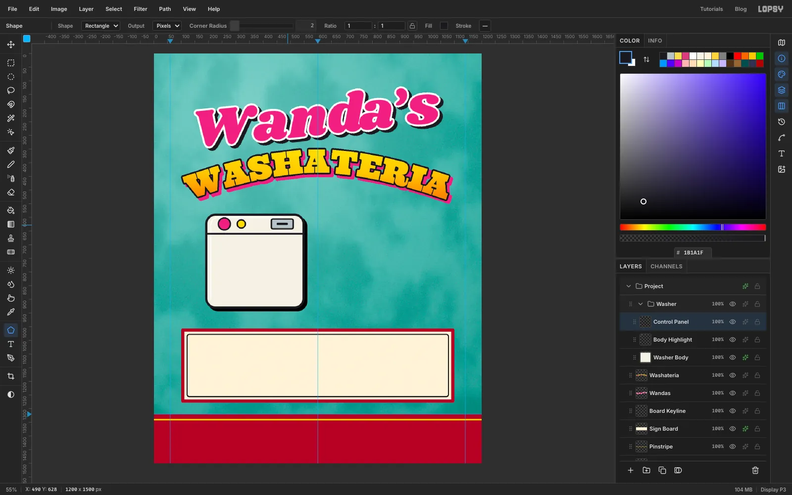

Add a layer called **Control Panel**. With the **Brush** at **Size 7** in black, [[Shift]]-click a line across the body about **70 px** below its top edge.

In the band above it, use the **Shape** tool's **Ellipse**, each with a **5 px** black stroke:

- a pink `#DE3A80` dial about **44 px** across near the left
- a yellow `#F9DC4A` dial about **30 px** across beside it

On the right, draw a **Rectangle**, **80 × 36**, with **Corner Radius 6**, in grey `#B9C3C9` with a 5 px black stroke. For the coin slot, draw a black bar inside it, about **40 × 8**, with **Corner Radius 2** and the stroke removed.

## Paint the porthole

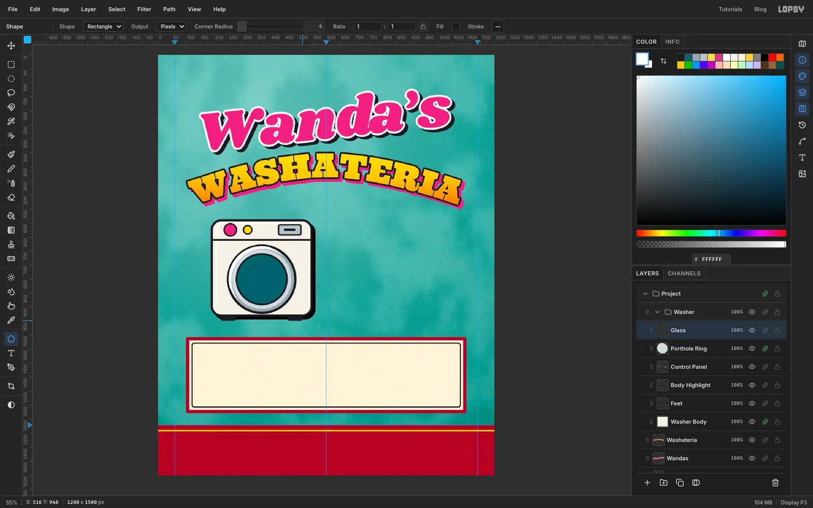

Add a layer called **Porthole Ring**. Draw an **Ellipse** **240 px** across, centred about **40 px** below the middle of the body, in chrome `#9AA7AE` with an **8 px** black stroke.

Real sign painters don't airbrush chrome. They paint it in flat bands:

1. With the **Elliptical Marquee**, drag a circle about **212 px** across on the same centre and fill it with `#D3DADD`.
2. For the highlight, drag a circle **224 px** across, nudged a few pixels up and left of the centre. Hold [[Option]] and drag the same size circle a few pixels down and right to subtract it. A thin crescent is left at the upper left. Fill it with white.

Add a **Stroke** of **6** black, **inside**, to the ring. It doubles up the outer rim so the porthole reads as a heavy bezel from across the street.

Select **Washer Body** and add a layer called **Feet**. Draw two black rectangles, about **52 × 20**, with **Corner Radius 4** and no stroke, under the bottom corners of the washer so they peek out below it.

Select **Porthole Ring** and add a layer called **Glass**. Draw an **Ellipse** **180 px** across on the porthole centre, in porthole teal `#17606A` with a **6 px** black stroke.

## Throw in the laundry

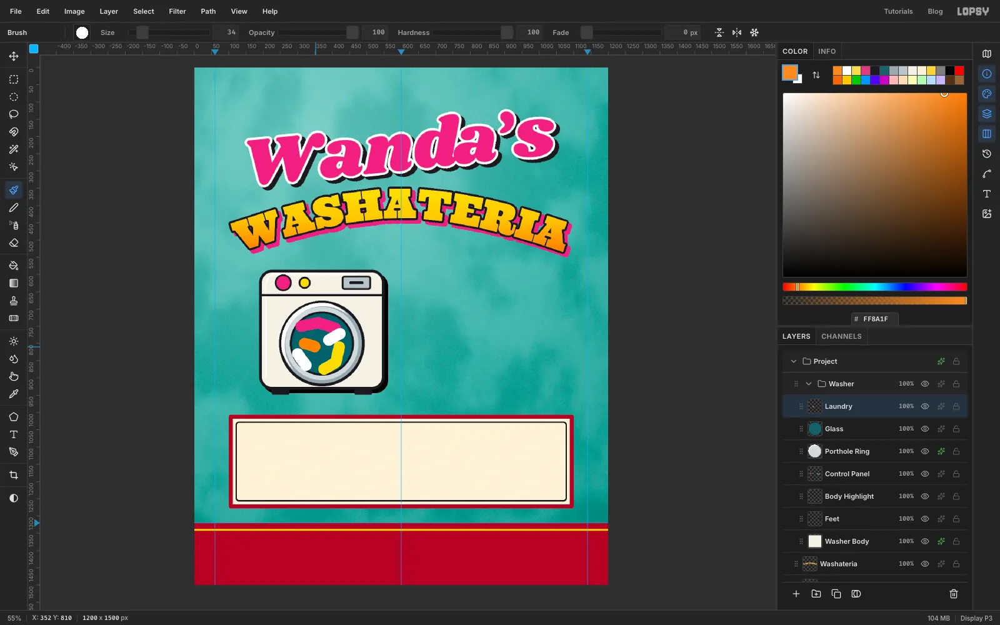

Add a layer called **Laundry**. With the **Brush** at **Size 34**, **Hardness 100**, paint five short fat strokes inside the glass: a pink sock across the top, a yellow one curving down the right side, two short white towels and a small orange one in the middle. Don't worry about spilling over the edge; you'll trim it.

## Spin it with Liquify

Choose **Filter → Liquify…**. Set **Mode** to **Twirl CW**, **Brush Size** to **230** and **Pressure** to **70**.

Put the brush on the middle of the porthole and drag in small circles three or four times without moving off the centre. The laundry spins into a spiral, as if the drum is going. Click **Apply**.

## Trim the laundry to the glass

[[Cmd]]-click the **Glass** thumbnail to select the glass circle. Choose **Select → Shrink…** and shrink it by **4 px**, so the trim stays inside the black edge. Choose **Select → Inverse**. With **Laundry** still the active layer, press [[Delete]]. Deselect.

## Add the glass shine and a painted edge

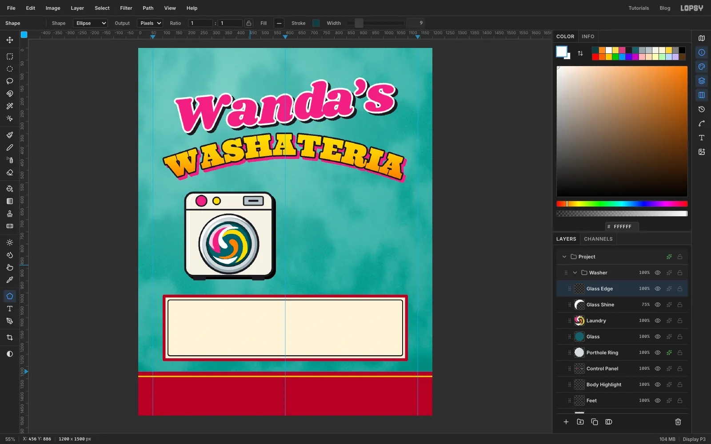

Add a layer called **Glass Shine**. With the **Elliptical Marquee**, drag a circle about **120 px** across over the upper left of the glass. Hold [[Option]] and drag another the same size about 20 px down and to the right to cut it away. Fill the crescent with white and set the layer to **75%**.

Add a layer called **Glass Edge**. Draw an **Ellipse** about **172 px** across on the porthole centre with **no fill** and a **9 px** stroke in dark teal `#0E3F45`. The laundry now looks like it's inside the glass, not stuck on top of it.

## Paint one soap bubble

Select **Washateria** and add a layer called **Bubbles**, so the bubbles sit outside the Washer group.

Draw an **Ellipse** about **68 px** across, with **no fill** and a **5 px** white stroke, just right of the washer's top-right corner. With the **Brush** at **Size 9**, paint a short curved highlight inside its upper left.

## Copy, paste and scale more bubbles

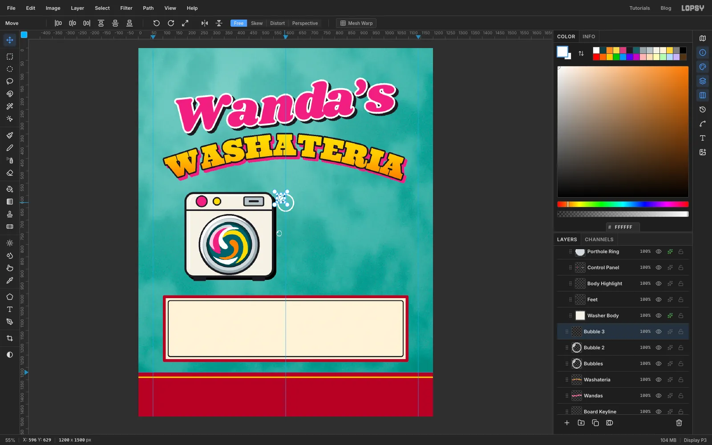

Draw a **Rectangular Marquee** around the bubble, press [[Cmd]]+[[C]] and deselect.

Now make the rest. For each new bubble:

1. Press [[Cmd]]+[[V]]. The copy pastes in place on a new layer called **Pasted Layer**. Rename it straight away (**Bubble 2**, **Bubble 3** and so on), so you can tell them apart.
2. [[Cmd]]-click its thumbnail to select it.
3. With the **Move** tool, hold [[Cmd]] and drag the bottom-right corner handle inward to shrink it evenly.
4. Drag from inside the selection to move it into place, then deselect.

## Make the bubbles rise

Paste eight copies at different sizes, from about a quarter of the original to just under full size. Five go in a loose stream that rises up the right side of the washer and drifts toward the middle of WASHATERIA, getting smaller as they climb. The other three go to the left of the washer, one small, one large and one tiny.

Vary the sizes a lot. Scaling also thins each copy's outline, so the little ones look further away.

Then select each bubble layer in turn, from the top, and choose **Layer → Merge Down** until they're all in **Bubbles**.

## Cut the starburst

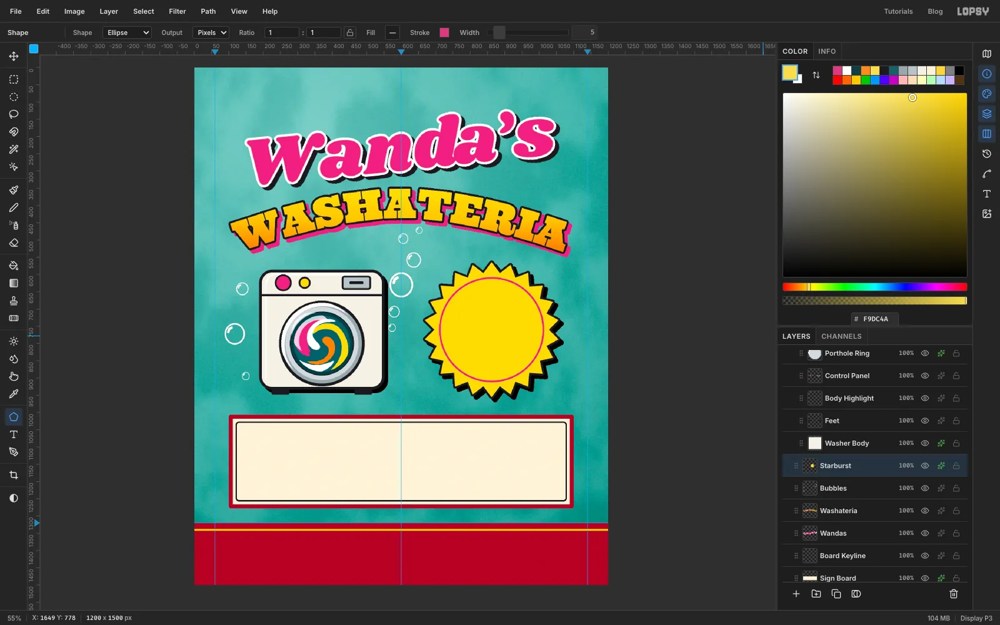

Add a layer called **Starburst** above **Bubbles**. The star is about **390 px** across, to the right of the washer, with its centre level with the middle of the washer (about **x 862, y 760**).

Before you start, click the rulers to drop a vertical and a horizontal guide through that centre; they help keep the points even. With the **Lasso**, start at the top tip and drag in short straight zig-zags around the centre: out to a tip about 195 px from the centre, back in to a valley about 30 px closer, out to the next tip. Make 22 points and finish back where you started. Zoom in and take your time. Hand-cut stars on real signs are never perfect, so small wobbles are fine. Remove the two guides when you're done.

Fill it with yellow `#F9DC4A` and deselect. Draw an **Ellipse** **300 px** across on the star's centre, with **no fill** and a **5 px** rosa stroke.

Add a **Stroke** of **6** black (outside) and a **Drop Shadow** of **10 / 10**, **Blur 0**, **Opacity 100**, then click **Rasterize Layer Style**.

## Set the starburst type

With **Starburst** selected, add three lines of text and centre each one on the star with the Move tool's arrow keys:

- `CELEBRANDO` in **Anton** at **26**, black, with **Letter spacing 3** in the Text panel, about **76 px** above the centre
- `40` in **Alfa Slab One** at **140**, in starburst red `#CC2A2E`, nudged about **6 px** left of the centre so it looks centred
- `AÑOS` in **Anton** at **48**, black, **Letter spacing 4**, about **88 px** below the centre

Name the layers **Celebrando**, **Forty** and **Anos**, and click **Rasterize Layer** on each one as soon as it's centred, before you set up the next. Give the **40** a white **Stroke** of **5** and rasterize its style. Then merge the type down into **Starburst**: select the text layer directly above it, choose **Layer → Merge Down**, and repeat until all three are merged in.

## Tilt the starburst

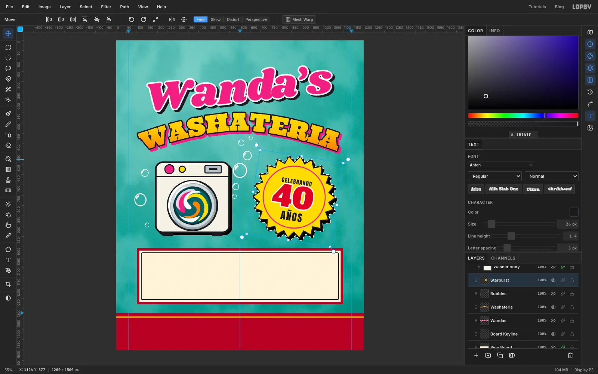

[[Cmd]]-click the **Starburst** thumbnail and drag its rotation handle to turn it about **9°** clockwise, against the tilt of the name. Press [[Cmd]]+[[D]].

## Letter the sign board: the occasion and the date

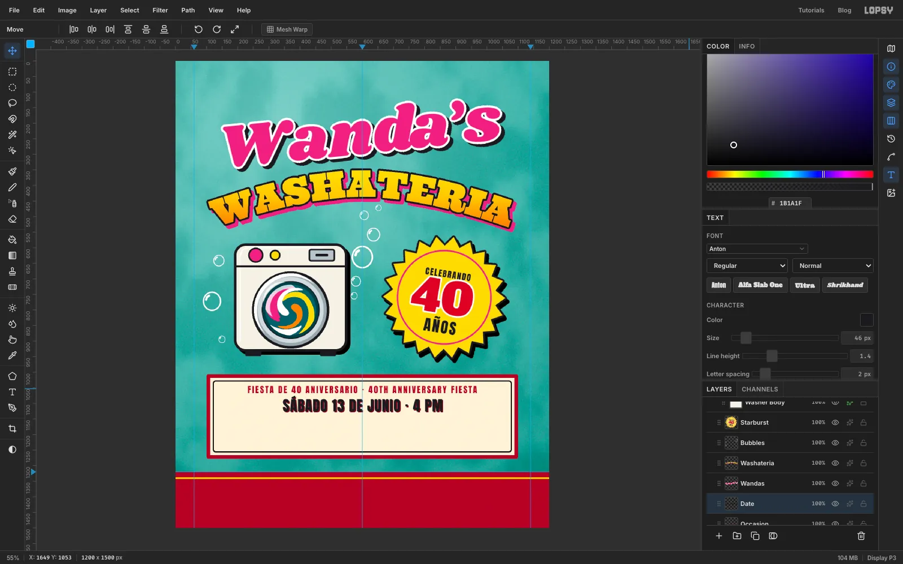

The board copy is stacked from the top. Each line is centred on the middle guide and sits a small, even gap below the one above. As before, name each line and click **Rasterize Layer** as soon as it's in place. Rasterized lines also take part in the weathering at the end.

Select **Board Keyline**, then add:

1. `FIESTA DE 40 ANIVERSARIO · 40TH ANNIVERSARY FIESTA` in **Anton** at **27**, red `#A8202B`, **Letter spacing 4**, named **Occasion**. Tuck it just under the top of the black keyline, about 13 px below its inside edge.
2. `SÁBADO 13 DE JUNIO · 4 PM` in **Anton** at **46**, black, **Letter spacing 2**, named **Date**, about 10 px below. Give it a **Drop Shadow** of **3 / 3**, **Blur 0**, **Opacity 100** in dark red `#7A1820`, and rasterize the style.

## Finish the board copy

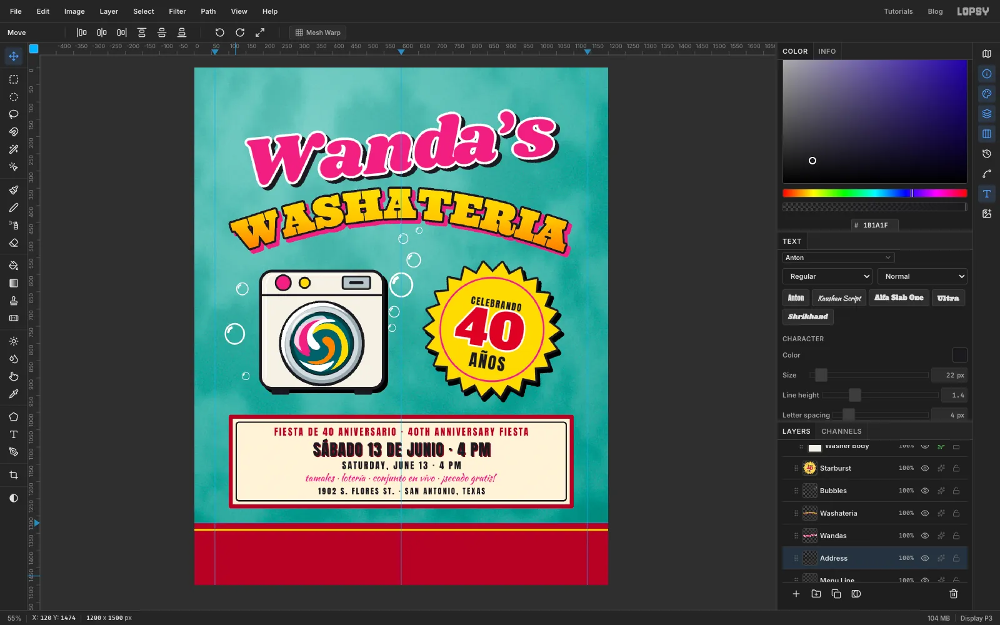

Carry on down, selecting the previous line each time so the new one stacks above it in the Layers panel:

3. `SATURDAY, JUNE 13 · 4 PM` in **Anton** at **26**, black, **Letter spacing 4**, named **Date EN**, about 15 px under the date. The big date gets a little extra air.
4. `tamales · lotería · conjunto en vivo · ¡secado gratis!` in **Kaushan Script** at **28**, rosa, named **Menu Line**, about 10 px below.
5. `1902 S. FLORES ST. · SAN ANTONIO, TEXAS` in **Anton** at **22**, black, **Letter spacing 4**, named **Address**, about 10 px below.

Check the gap above the first line and below the last one. They should match, about 13–15 px from the keyline. If the bottom is tight, nudge the whole stack up a pixel or two.

> **Tip:** Characters like **·**, **á** and **¡** are easiest to paste in. Copy them from this page and press [[Cmd]]+[[V]] while you're typing.

## Add the tagline and the wainscot lettering

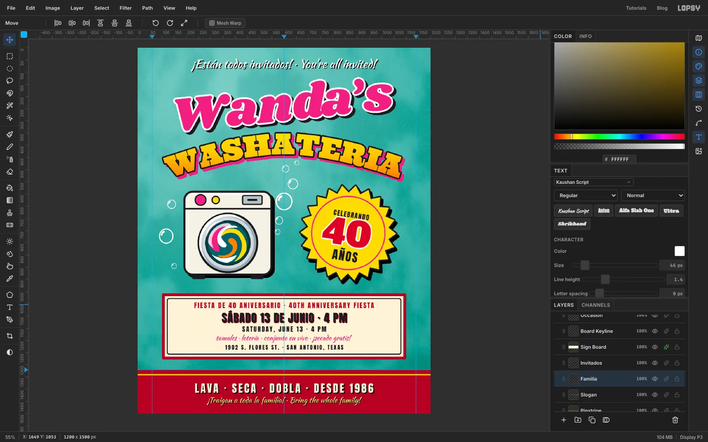

Select **Pinstripe** and add `LAVA · SECA · DOBLA · DESDE 1986` in **Anton** at **44**, cream `#FFF3D9`, **Letter spacing 6**, and name it **Slogan**. Rasterize it, give it a black **Drop Shadow** of **4 / 4**, **Blur 0**, and rasterize the style.

Add `¡Traigan a toda la familia! · Bring the whole family!` in **Kaushan Script** at **31** in script yellow `#F3D77A`, named **Familia**, about 16 px under the slogan. Rasterize it and give it a **2 / 2** black shadow. Then nudge the two lines together so the pair sits centred between the pinstripe and the bottom edge, about 33 px of red above and below.

Last, add `¡Están todos invitados! · You’re all invited!` in **Kaushan Script** at **46** in white, named **Invitados**, centred across the top in the space above Wanda's (its middle about 70 px down). Rasterize it and give it a **3 / 3** black shadow.

## Cut and paste a bubble

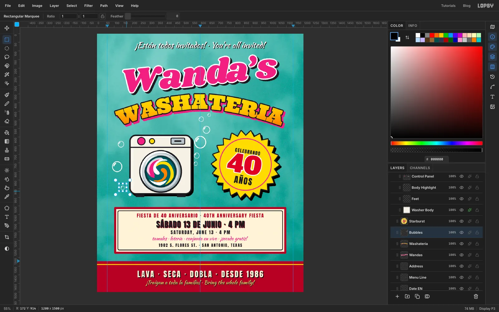

Step back and look at the bubbles. The tiny one low on the left pulls the eye away from the washer, and the stream on the right is thin where it leaves the machine. Move that bubble over. Select **Bubbles**, draw a marquee around that bubble and press [[Cmd]]+[[X]], then [[Cmd]]+[[V]]. It pastes back on its own layer.

Deselect, then drag it with the **Move** tool to the bottom of the bubble stream, just right of the washer, about level with the porthole centre. Merge it back down into **Bubbles**.

## Move the washer as one piece

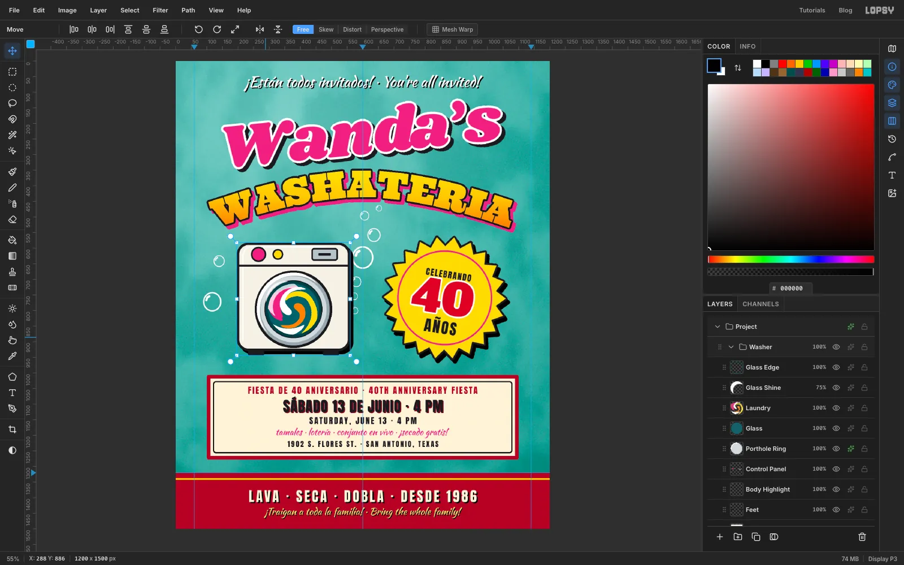

Click the **Washer** group row and drag the washer with the **Move** tool about **8 px** right and **4 px** up, so the gaps to the left edge and to the starburst even out. Everything inside the group moves together: body, shadow, dials, porthole and laundry.

## Lasso the paint chips

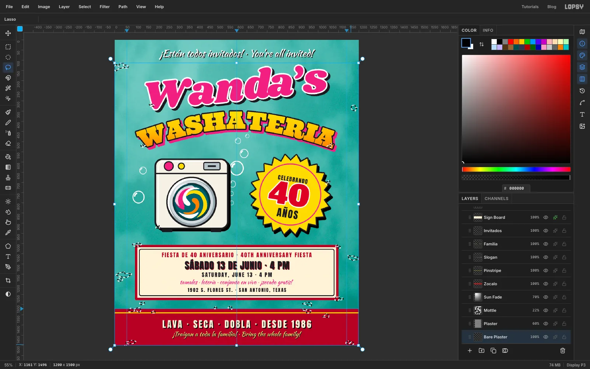

Now age the paint. Select **Background** and add a layer called **Bare Plaster**. It sits just above the wall colour.

With the **Lasso**, draw a small jagged flake, 10–40 px across. Then hold [[Shift]] and draw about forty more, to add them to the selection. Paint comes off where water and knocks get to it, so cluster the chips:

- along the top edge of the wainscot
- at the corners of the sign board
- low on the wall and in the top corners
- at the washer's bottom-left corner and on the tips of the starburst
- at the two ends of WASHATERIA and the bottom of the big W

Vary the sizes and make each flake an irregular shape, not a circle.

## Add flaking along the wainscot edge

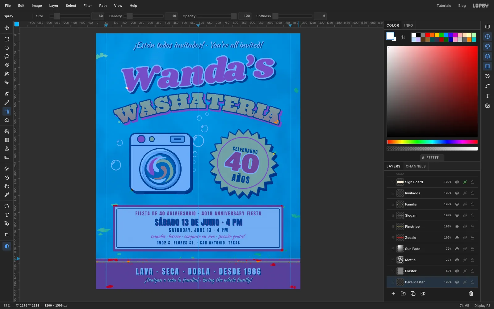

Press [[Q]] to enter **Quick Mask**. The selection turns into a blue overlay that you can paint on.

Pick the **Spray** tool and set **Size 60**, **Density 10**, **Opacity 100** and **Softness 0**. With **white** as the foreground colour (white adds to the selection), spray along the top edge of the wainscot across the left third, and again across the right third. You get a ragged line of tiny flakes where the paint has lifted.

Press [[Q]] again to turn the mask back into a selection.

## Knock the chips out of the paint

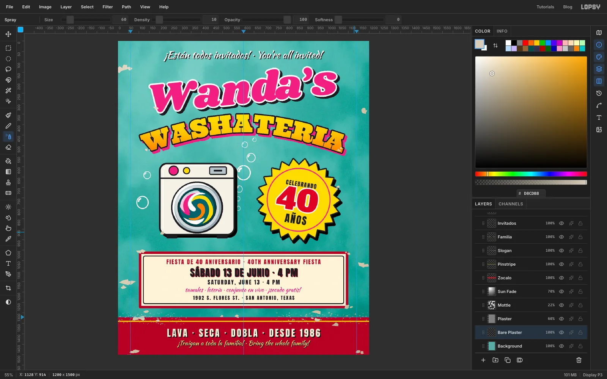

Two layers still have live effects: **Sign Board** (its red Stroke) and **Washer Body** (its Drop Shadow). Select each one and click **Rasterize Layer Style**. Otherwise the effects would draw a new red ring and a new shadow around every hole.

Keeping the selection, click each painted layer and press [[Delete]]: **Sign Board**, **Board Keyline**, **Zocalo**, **Pinstripe**, **Slogan**, **Wandas**, **Washateria**, **Starburst**, **Washer Body** and **Feet**.

Select **Bare Plaster**, set the foreground to `#D8CDB8`, choose **Edit → Fill**, and run **Add Noise** at **10** for a little grit. Deselect. The holes now show chalky plaster instead of turquoise.

## Run grime down from the board

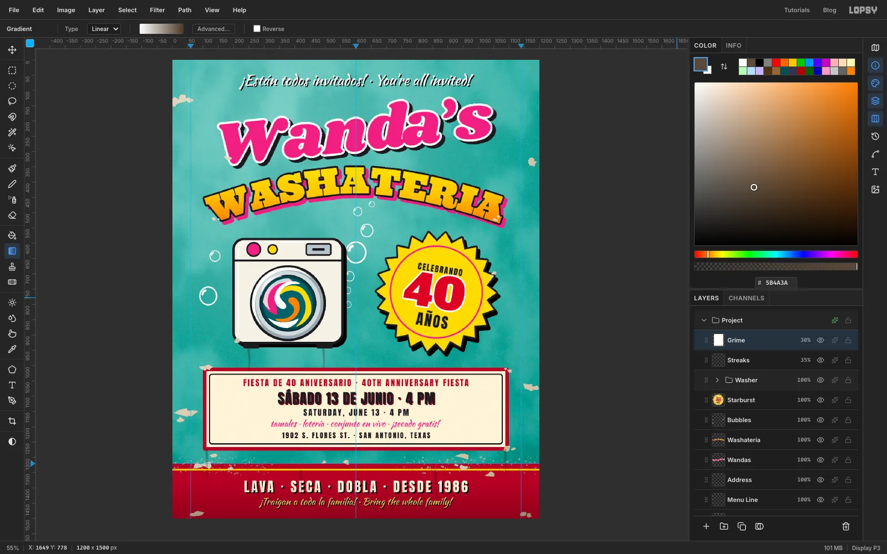

Click the arrow on the **Washer** group to collapse it, then select the group row. A new layer will now go above the group rather than inside it, at the top of the stack. Add a layer called **Streaks**.

Open the **Brush** settings dialog (the brush preset button in the options bar) and set **Size 12**, **Hardness 35** and, on the same Shape tab, **Taper 100**. Use streak brown `#5B4A3A`. Drag short streaks straight down: from each bottom corner of the sign board (about 150 px and 120 px long), under each washer foot, and down from the pinstripe in two places. Taper narrows each streak along its length, so it reads as a drip rather than a painted line. Run **Gaussian Blur** at **2**, then set the layer to **Multiply** at **35%**.

Add a layer called **Grime**. Draw a **Linear** gradient from white to `#4E3B28`, from about 120 px above the bottom edge down to the bottom. Set it to **Multiply** at **30%**. It reads as splash-back dirt from the sidewalk.

## Press stucco into everything

Add a layer called **Stucco** at the top and fill it with mid-grey. Run **Add Noise** at **40**, **Gaussian Blur** at **2.5** and **Emboss** at **Angle 135**, **Strength 100**. Set it to **Overlay** at **50%**.

This is the step that makes it look painted onto the wall. The bumps now show through every letter, the board and the washer, not just the turquoise.

## Bleach the top of the wall

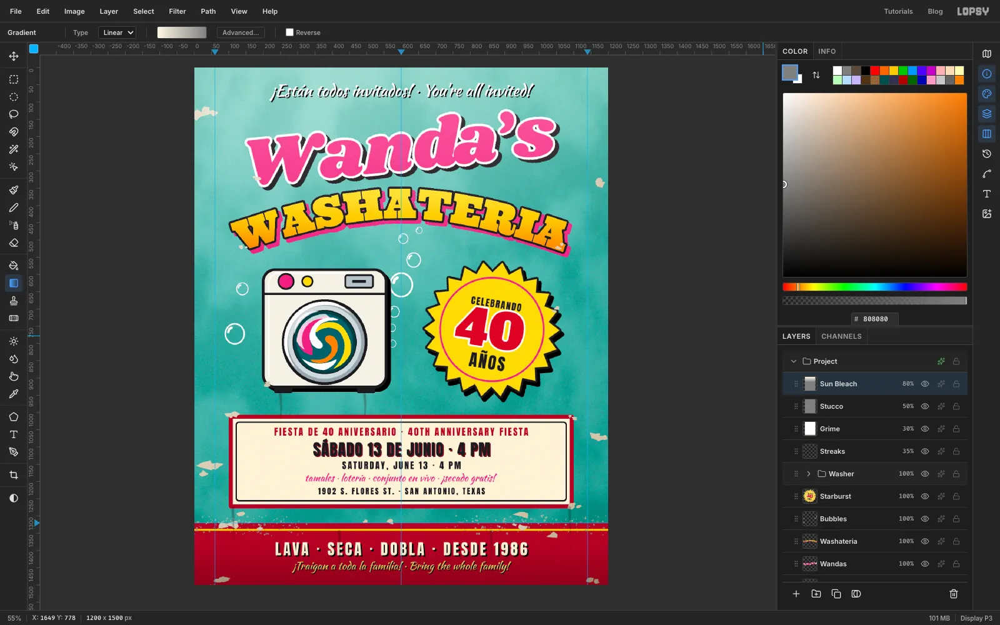

Add a layer called **Sun Bleach**. Draw a **Linear** gradient from warm white `#FFF6E4` at the top edge down to mid-grey `#808080` at about **y 560**. Set it to **Soft Light** at **80%**. The grey end does nothing in Soft Light, so only the top of the wall and the names get sun-bleached.

## Fade the whole sign

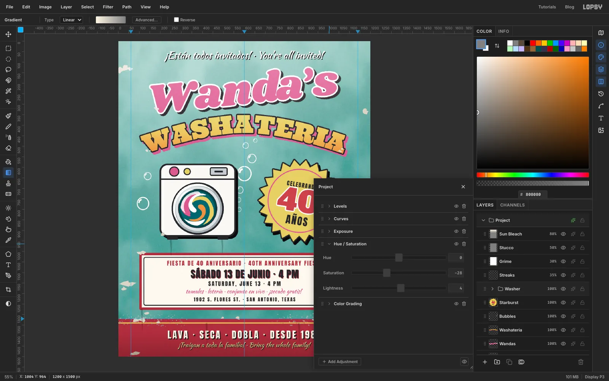

Scroll to the top of the Layers panel, click the **Project** group row and open its effects. For a group this shows the **Adjustments** list, which starts with a few neutral adjustments already in it. Expand **Hue / Saturation** and set **Saturation** to **−28** and **Lightness** to **4**. Everything inside the group fades together, like enamel after a few Texas summers.

Choose **File → Save Project** to keep the layers, and **File → Quick Export PNG** for the finished invitation.
