Vernacular design is the stuff nobody went to design school to make: the hand-lettered sign on the tire shop, the marker price tag in the grocery window, the mural the owner's cousin painted in 1984. It's sincere, a little crooked and very direct. It's also a great antidote to templated websites, so in this tutorial you'll mock up a desktop homepage as if a local sign painter had painted it straight onto the shop wall.

The shop is **Big Ed's Tire Mountain**, which is invented. The joke drives the whole design: a real photo of an enormous tire pile gets cut into a mountain peak with a painted snowcap, and the man standing at its foot becomes Ed.

Under the paint it's still a normal web layout, with a nav bar, a hero with a headline and button, three price cards, an info row and a footer. The pieces are:

- a cinder-block wall built from one block, tiled and embossed, so the mortar lines run through all the paint
- a blue mural with sun rays
- a photo tire pile cut into a peak, with a painted snowcap and a hand-tinted Ed
- a headline with an arched top, hand-wobbled letters, a block shade and a cream outline
- fluorescent poster-board signs and a plywood hours board fixed to the wall on top of the relief
- paint runs, flecks and dry-brush edges to weather it all

You'll need one public-domain photo from Wikimedia Commons, from the U.S. National Archives:

- **As this big pile of used auto tires indicates, the United States with its many passenger cars has in discarded tires... - NARA - 535587.tif**. Download the 1,920 px-wide JPEG version.

Along the way you'll use:

- **Define Pattern**, **Fill with Pattern**, **Emboss**, **Add Noise** and **Clouds** for the wall
- the **Lasso**, **Elliptical Marquee**, **Gradient** tool and **Sunburst** for the mural
- dropping in a photo, scaling with the **Move** tool, **Clone Stamp**, **Cel Shading** and **Brightness/Contrast**
- combining selections with **Shift** and **Shift+Alt**
- **Mesh Warp**, **Liquify**, **Duplicate Layer** and **Merge Down** for the lettering
- live text in **Luckiest Guy**, **Oleo Script**, **Knewave** and **Permanent Marker**
- **Drop Shadow** and **Stroke** effects, and the **Hard Light**, **Multiply**, **Color** and **Soft Light** blend modes
- groups, rotating whole groups with the handles, **Brush** Taper and Scatter, and **Spray**

The palette:

- Whitewash `#E7E0CD`, darker coat `#CFC4AB`, lighter coat `#F6F2E6`
- Sky `#1C7BBC` → `#9ADAE6`, rays `#5CB2DA`, sun `#F7C52B`
- Sign red `#D5261C`, sign yellow `#FFD22E`, cream `#FBF3DC`, ink `#14110F`
- Ground `#C4923F`, plywood `#C99F66`
- Snow `#F8F6EE`, snow shadow `#8EA9D8`, tire tint `#6E4A3C`
- Ed's jacket `#B5412E`, hat `#A8926A`, skin `#D9A583`, trousers `#47678F`, boots `#5A3D28`
- Poster orange `#FF7F1E`, poster yellow `#F7EF2F`, poster green `#84EA45`, tape `#EAD9A4`

> **Note:** Shortcuts are written for a Mac. On Windows use [[Ctrl]] wherever it says [[Cmd]].

Positions are given in document pixels as `x, y` wherever things need to line up. The status bar at the bottom of the window shows the pointer's **X** and **Y**. Everything drawn freehand only needs to be roughly right, and a shaky line helps here because it looks hand-cut.

A few habits save trouble with text. Before you start a new piece of text, click a raster layer (each step says which one), because with a text layer selected, changing the font, size or colour restyles that layer instead. Start the text in an empty patch of canvas: a click on existing text edits it. Set the foreground colour first, because new text takes its colour from it. A step that names a font means the **Text** tool, so pick that before you look for the font controls. When a step says to centre or nudge something, commit the text with [[Tab]], pick the **Move** tool, and use the arrow keys ([[Shift]]+arrow moves ten pixels). The arrows only nudge with the Move tool active.

Close the effects drawer whenever you've finished with an effect, or your next canvas click may land on it. In the **Brushes** window, **Size**, **Spacing**, **Hardness** and **Taper** are on the **Shape** tab, and **Scatter** and **Size Jitter** are on **Dynamics**.

Double-click a layer's name to rename it. The names below are the ones the steps refer back to.

## Lay out the page and draw one block

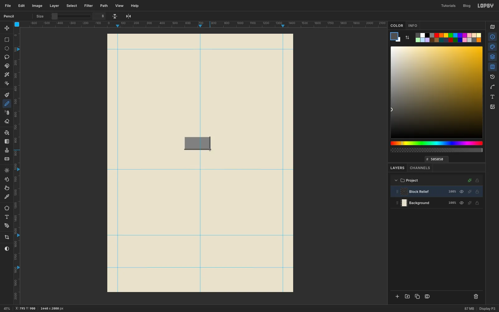

1. Choose **File → New** and make a **1440 × 2000** px document.
2. Click the top ruler at `x 80`, `720` and `1360` to drop vertical guides. These are the page margins and the centre line.
3. Click the left ruler at `y 120` (the bottom of the nav), `1050` (the bottom of the hero), `1560` (the bottom of the price cards) and `1810` (the top of the footer).
4. Click **Background**, set the foreground colour to `#E7E0CD` and choose **Edit → Fill**.
5. Click **Layer 1** and rename it `Block Relief`.
6. Pick the **Rectangular Marquee** and click once in the canvas without dragging. That opens the exact-corners dialog. Enter **From** `600, 800` and **To** `800, 900`, then click **Select**.
7. Set the foreground to `#808080` and choose **Edit → Fill**. Press [[Cmd+D]] to deselect.
8. Set the foreground to `#505050`, pick the **Pencil** and set **Size** to `8`.
9. Click at `600, 895`, then hold [[Shift]] and click at `800, 895`. That's the bed of mortar along the bottom.
10. Click at `795, 800`, then hold [[Shift]] and click at `795, 900`. That's the joint on the right.

## Tile the block across the wall

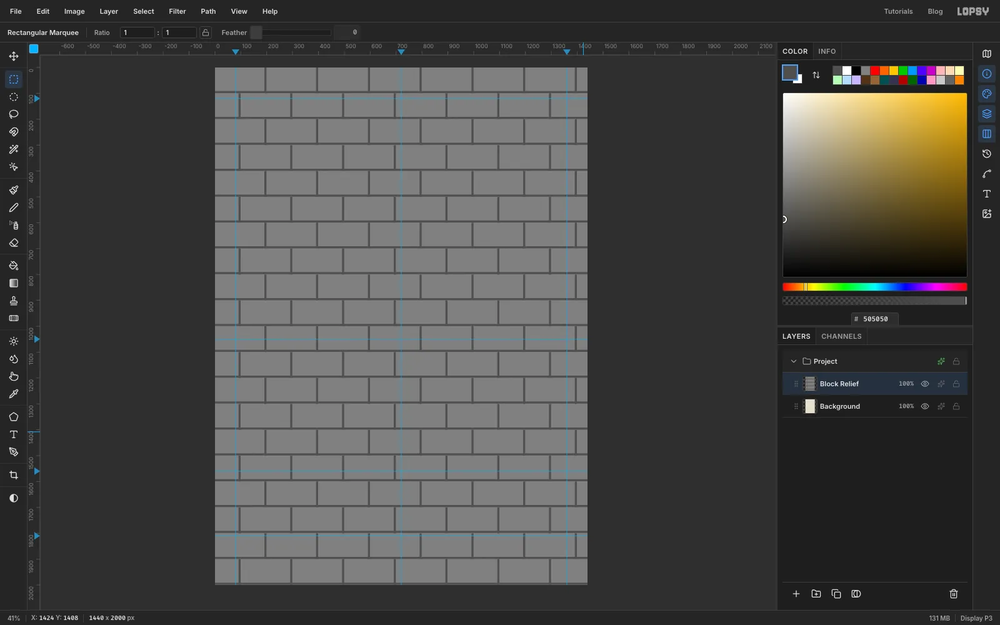

1. Make the same exact selection again: **Rectangular Marquee**, click once, **From** `600, 800`, **To** `800, 900`.
2. Choose **Edit → Define Pattern**, then press [[Cmd+D]].
3. Choose **Edit → Fill with Pattern…** and pick your new pattern.
4. Set **Row Stagger** to `50` and click **Apply**. Stagger offsets every other row by half a block, which is how real blocks are laid.

## Turn the blocks into relief

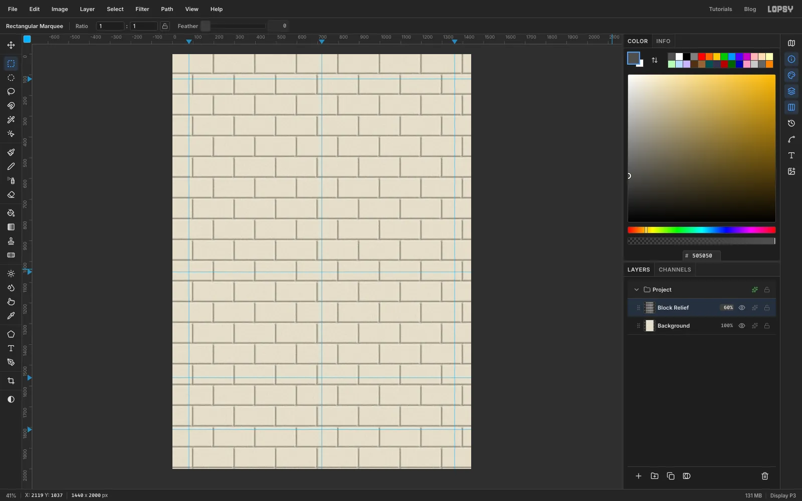

1. With `Block Relief` still selected, choose **Filter → Gaussian Blur…** with **Radius** `1.5` to soften the mortar edges, then click **Apply**.
2. Choose **Filter → Add Noise…** with **Amount** `22` and **Mono**, then click **Apply**. This gives the concrete some grit.
3. Choose **Filter → Emboss…** with **Angle** `135` and **Strength** `45`, then click **Apply**.
4. Click the ✦ button on the layer's row, set the blend mode to **Hard Light** and close the drawer. Click the opacity figure on the row and set it to `60%`.

Everything you paint later goes under this layer, so the mortar lines run through the paint just as they would on a real wall.

## Give the whitewash uneven coats

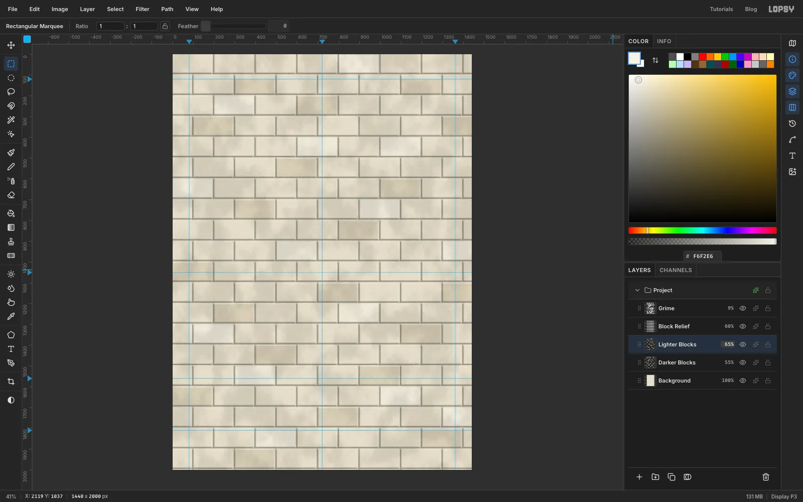

1. With `Block Relief` selected, click **Add Layer** and name it `Grime`. Choose **Filter → Clouds…** with **Scale** `20` and click **Apply**. Set it to **Multiply** at `9%`.
2. Click **Background**, click **Add Layer** and name it `Darker Blocks`.
3. With the **Rectangular Marquee**, drag over one block, just inside its mortar lines. Hold [[Shift]] and drag over another block to add it. Keep going until you've picked about twenty blocks scattered all over the wall.
4. Fill with `#CFC4AB`, deselect, and set the layer to `55%` opacity.
5. Click **Add Layer**, name it `Lighter Blocks` and do the same with about fourteen other blocks, filled with `#F6F2E6` at `65%`.

## Paint the sky

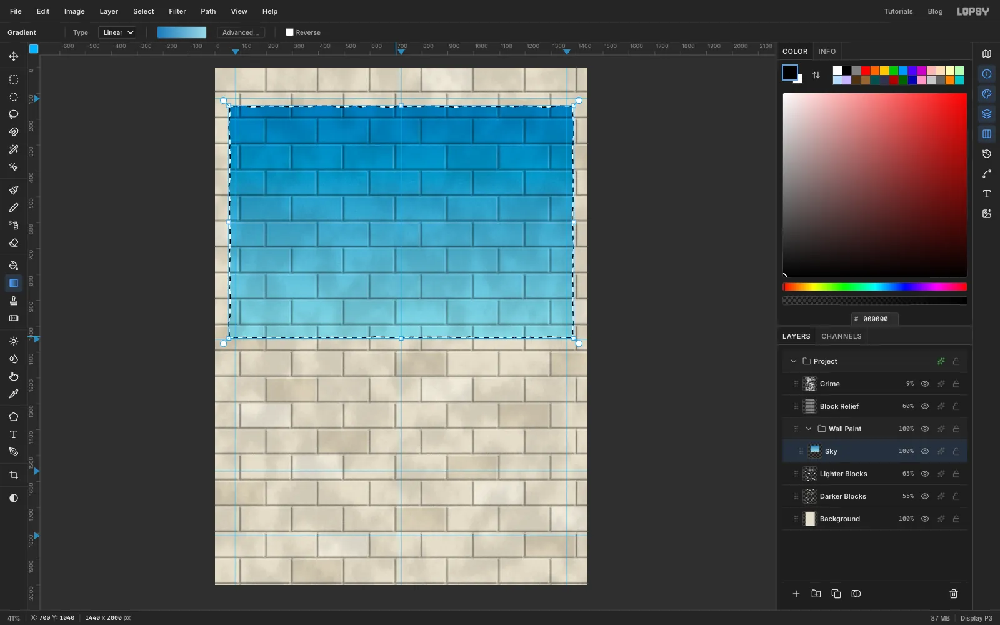

1. Click `Lighter Blocks` and click **New Group**. Name the group `Wall Paint`. All the painted work goes in here.
2. Click **Add Layer** and name it `Sky`.
3. With the **Lasso**, draw a slightly shaky rectangle from about `56, 150` to `1384, 1044`. Don't make it neat, because it's the edge of a mural done with a wide brush.
4. Pick the **Gradient** tool, set it to **Linear** and click **Advanced…**. Set the two stops to `#1C7BBC` and `#9ADAE6` and click **Done**.
5. Drag from the top of the selection to the bottom, then press [[Cmd+D]].

## Add sun rays

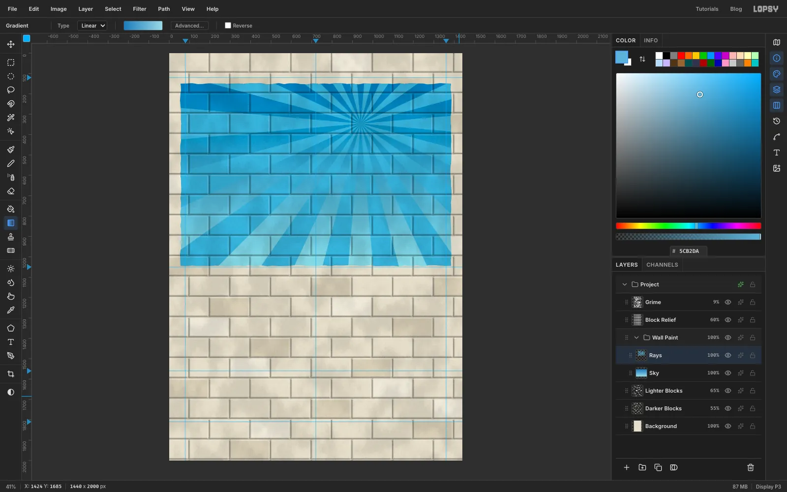

1. Click **Add Layer** and name it `Rays`.
2. Hold [[Cmd]] and click the thumbnail of `Sky` to select its shape.
3. Set the foreground to `#5CB2DA`.
4. Choose **Filter → Sunburst…** and set **Rays** to `18`, **Length** to `130`, **Width** to `50`, **Center X** to `65.3` and **Center Y** to `17.3`. Leave the rest alone and click **Apply**.
5. Press [[Cmd+D]].

## Paint the sun

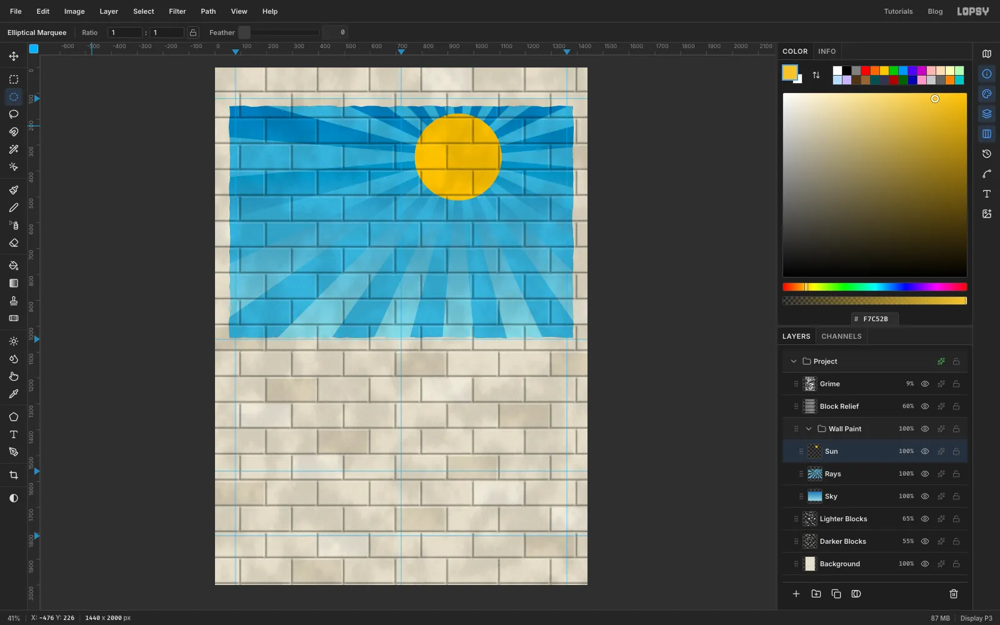

1. Click **Add Layer** and name it `Sun`.
2. Pick the **Elliptical Marquee** and click once without dragging. Enter **From** `772, 178` and **To** `1108, 514`, then click **Select**.
3. Fill with `#F7C52B` and deselect.

## Bring in the tire photo

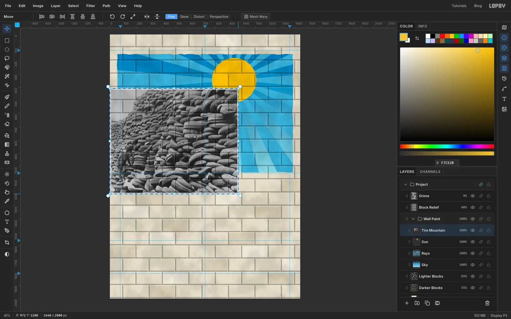

1. Drag the tire photo from your computer onto the canvas. It arrives above `Sun` as a new layer with handles around it. Rename it `Tire Mountain`.
2. Hold [[Cmd]] and drag the bottom-right corner handle up and to the left until the photo is about **972 px** wide. Holding [[Cmd]] keeps the proportions.
3. Press [[Cmd+D]] to commit the scale.
4. With the **Move** tool, drag the photo so its left edge sits at about `x 420` and its bottom edge at about `y 1066`. The top of the photo now lands near `y 268`.

## Lift Ed onto his own layer

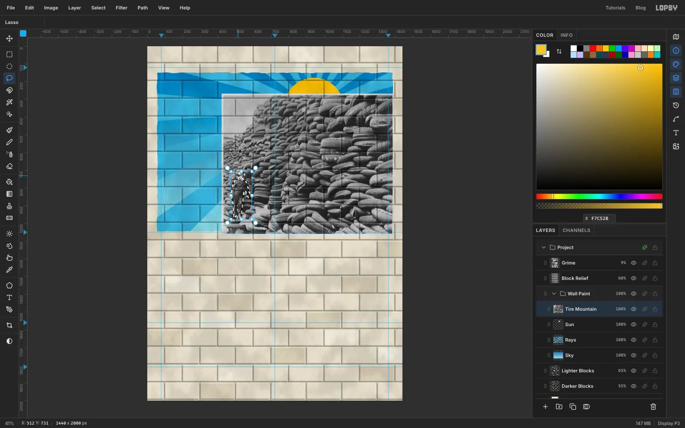

The man in the fedora needs separate treatment later, so copy him out before you touch the pile.

1. He's small at this zoom, so zoom in on him first by holding [[Cmd]] and scrolling. With `Tire Mountain` selected, use the **Lasso** to trace around the man, hat to boots. Include his hand where it rests on the tire to his right. Stay close, but a little background won't matter.
2. Press [[Cmd+C]], then [[Cmd+V]]. The copy lands exactly on top of him. Rename it `Ed` and press [[Cmd+D]]. Choose **View → Fit to Screen** to zoom back out.

## Cut the pile into a mountain

1. Click `Tire Mountain`.
2. With the **Lasso**, start at the bottom left of the photo, just left of Ed. Go up past him to the left of his hat, then up in a long diagonal to a peak at about `926, 280`, in front of the sun. Come down the other side in a similar diagonal to the right edge of the photo at about `y 750`, then down the right edge and along the bottom to where you started.
3. Draw the slopes as a chain of small bumps, one for each tire end, rather than straight lines. That's what makes it look like a heap.
4. Choose **Select → Inverse**, press [[Delete]], then press [[Cmd+D]].

## Clone over the snow

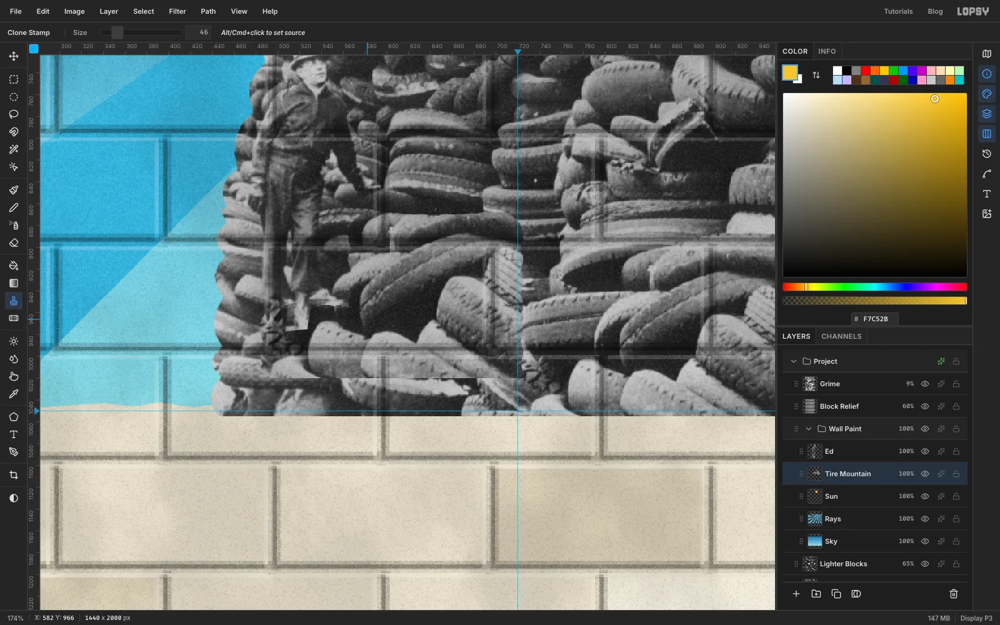

The photo has real snow at the man's feet. It reads as a white blob at this size, so cover it up.

1. Pick the **Clone Stamp** and set **Size** to `46`.
2. Hold [[Alt]] and click on some tires well to the right of the white patch, around `825, 925`.
3. Paint across the white areas in side-to-side strokes. Ed's on his own layer, so you can paint straight behind him.

## Make the photo look painted

1. Choose **Filter → Brightness/Contrast…** with **Brightness** `16` and **Contrast** `14`, and click **Apply**.
2. Choose **Filter → Cel Shading…** with **Color Levels** `7` and **Edge Strength** `16`, and click **Apply**. This flattens the tones and adds fine outlines, so the photo starts to look like a sign painter's copy of one.

## Spread the foot of the pile

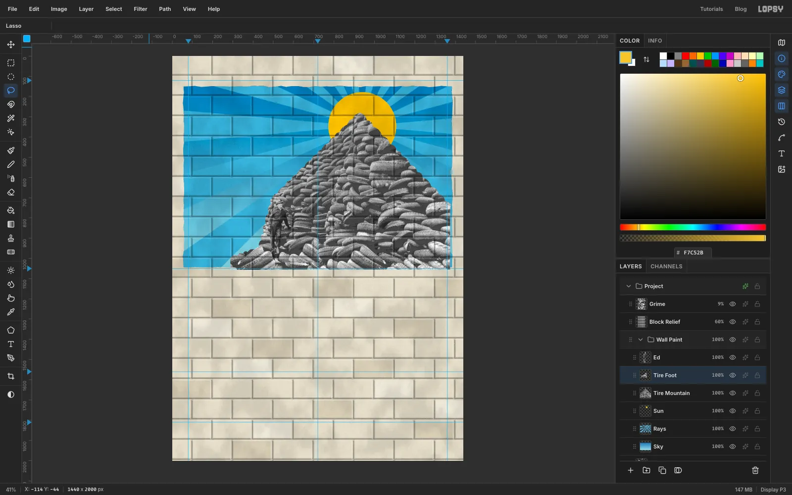

The left side of the pile drops like a cliff, and a real heap would spill outwards. Borrow some tires from the other side.

1. With `Tire Mountain` selected, use the **Lasso** to select a wide band of tires along the bottom, from about `x 720` to `x 1120` and `y 880` to `y 1054`.
2. Press [[Cmd+C]], then [[Cmd+V]]. Rename the new layer `Tire Foot` and press [[Cmd+D]].
3. Choose **Image → Flip Horizontal**.
4. With the **Move** tool, drag it so it's centred around `460, 968`.
5. With the **Lasso**, draw the piece you want to keep: a bumpy slope from `288, 998` up to about `430, 948`, then steeper up to `482, 760`, then down to the bottom at about `x 510` and back along the base. It should tuck in behind Ed and stay well clear of the button you'll add later. Choose **Select → Inverse**, press [[Delete]], then press [[Cmd+D]].

## Warm up the rubber

1. Click **Add Layer** and name it `Tire Tint`.
2. Hold [[Cmd]] and click the thumbnail of `Tire Mountain`. Fill with `#6E4A3C`.
3. Hold [[Cmd]] and click the thumbnail of `Tire Foot`, then choose **Edit → Fill** again. Press [[Cmd+D]].
4. Set the layer to **Color** at `45%`.

## Hand-tint Ed

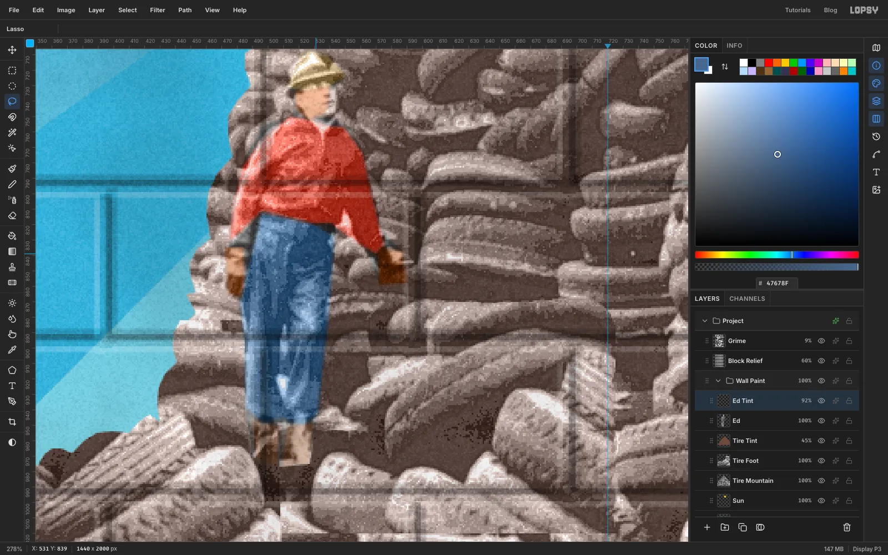

Old photographs were tinted by hand with dyes, and that's the look here.

1. Zoom in on Ed again. Click `Ed`. With the **Lasso**, select his jacket. Hold [[Shift]] and lasso his trousers, then hold [[Shift]] and lasso his hat. His face, hands and boots stay out of the selection so they keep their detail.
2. Choose **Filter → Brightness/Contrast…** with **Brightness** `22` and **Contrast** `18`, and click **Apply**.
3. Choose **Filter → Cel Shading…** with **Color Levels** `7` and **Edge Strength** `14`, and click **Apply**. Press [[Cmd+D]].
4. Click **Add Layer** and name it `Ed Tint`.
5. Lasso each part and fill it on this one layer, deselecting each time: the jacket `#B5412E`, the hat `#A8926A`, the face and both hands `#D9A583`, the boots `#5A3D28`, following their shape, and the trousers `#47678F`.
6. Choose **Filter → Add Noise…** with **Amount** `40` and **Mono**, click **Apply**, then **Filter → Gaussian Blur…** with **Radius** `3`, and click **Apply**. The blotches make the dye look uneven.
7. Set the layer to **Color** at `92%`. Choose **View → Fit to Screen**.

## Paint the ground

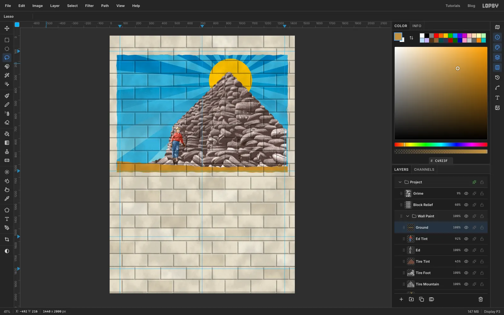

1. Click **Add Layer** and name it `Ground`.
2. Use the **Lasso** to draw a rough band along the bottom of the mural. Its top edge runs from about `56, 975` on the left, down to `440, 1002`, then to `800, 1022` and across to `1384, 1016`. Its bottom edge sits at about `y 1060`.
3. Fill with `#C4923F` and deselect.

## Paint the snowcap

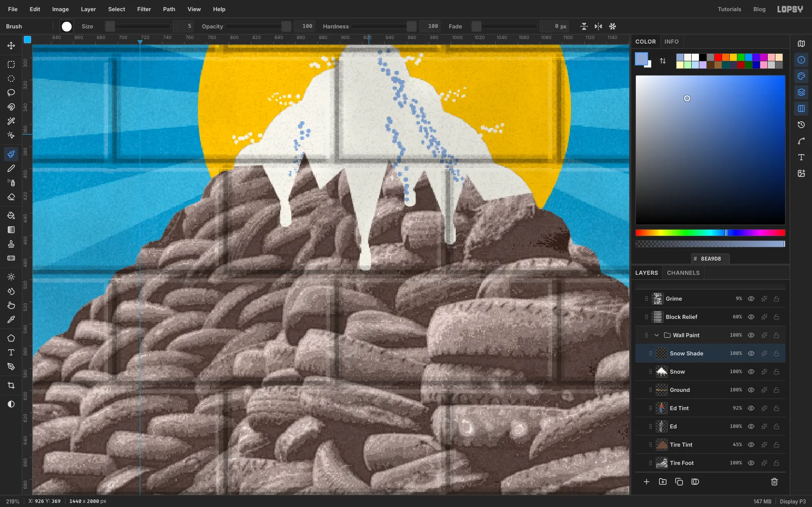

Here you'll use the Shift+Alt combination, which keeps only where two selections overlap.

1. Click **Add Layer** and name it `Snow`.
2. Hold [[Cmd]] and click the thumbnail of `Tire Mountain`, so the snow will follow the tire outline.
3. Pick the **Lasso**, hold [[Shift+Alt]] and draw a jagged cap around the peak. Its lower edge should be a row of uneven teeth, some short and some long, reaching down as far as about `y 475`.
4. Fill with `#F8F6EE`, then press [[Cmd+D]].
5. Pick the **Brush**. Click the brush preview to open **Brushes** and set **Size** `12`, **Hardness** `80` and **Taper** `50`. Taper thins a stroke as it goes, so start each run at its bottom tip and drag up into the snow. The fat start becomes the bead of paint at the tip. Paint three or four short runs off the longest teeth.
6. Now roughen the outline with a nearly dry brush. In **Brushes** set **Size** `5`, **Hardness** `100`, **Taper** `0`, **Spacing** `60`, **Scatter** `70` and **Size Jitter** `60`. Flick about seven short strokes outward across the edge of the cap, on both slopes and at the very top.
7. Click **Add Layer** and name it `Snow Shade`. Hold [[Cmd]] and click the thumbnail of `Snow`, so the shadow stays on the snow. Set the foreground to `#8EA9D8`.
8. With the same dry brush, drag five or six broken strokes down the right-hand side of the peak, and one short stroke on the left. Keep it to about a quarter of the cap. Press [[Cmd+D]].
9. In **Brushes** set **Spacing** to `10` and **Scatter** and **Size Jitter** to `0`.

## Set the headline

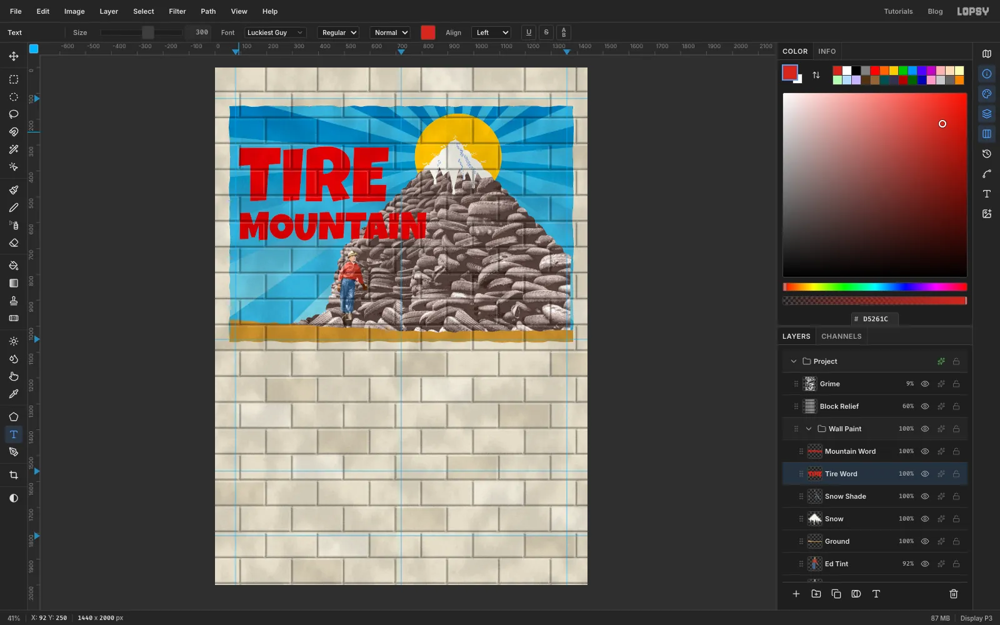

1. Click `Snow Shade` and set the foreground to `#D5261C`.
2. Pick the **Text** tool. In the options bar choose **Luckiest Guy** and set **Size** to `150`.
3. Click at `92, 530`, type `MOUNTAIN` and press [[Tab]] to commit. Rename the layer `Mountain Word`.
4. Click `Snow Shade` again. Set **Size** to `300`, click at `92, 250`, type `TIRE` and press [[Tab]]. Rename it `Tire Word`.
5. With `Tire Word` selected, click **Rasterize Layer** at the foot of the Layers panel. Do the same for `Mountain Word`.

## Arch the top of TIRE

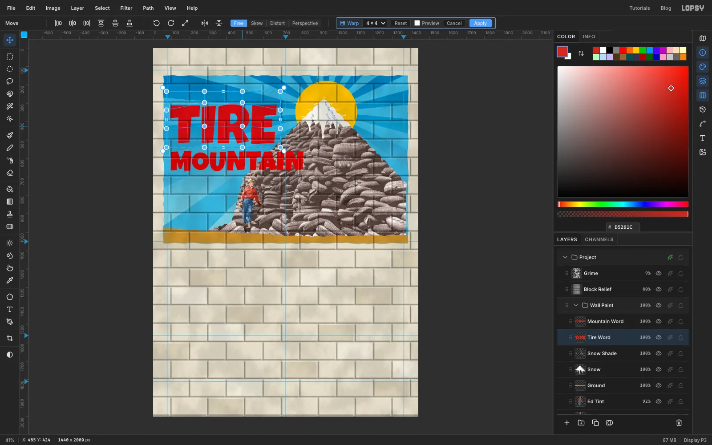

Sign painters rarely letter dead straight. A gentle arch instantly makes TIRE look drawn rather than typed.

1. Click `Tire Word`. With the **Rectangular Marquee**, draw a box around the word, leaving about 70 px above it and 20 px on the other sides.
2. Pick the **Move** tool and click **Mesh Warp** in the options bar. Keep the **4 × 4** grid.
3. Drag the two middle handles of the second row up by about 40 px.
4. Drag the two middle handles of the third row up by about 14 px.
5. Click **Apply**, then press [[Cmd+D]].

## Wobble the letters

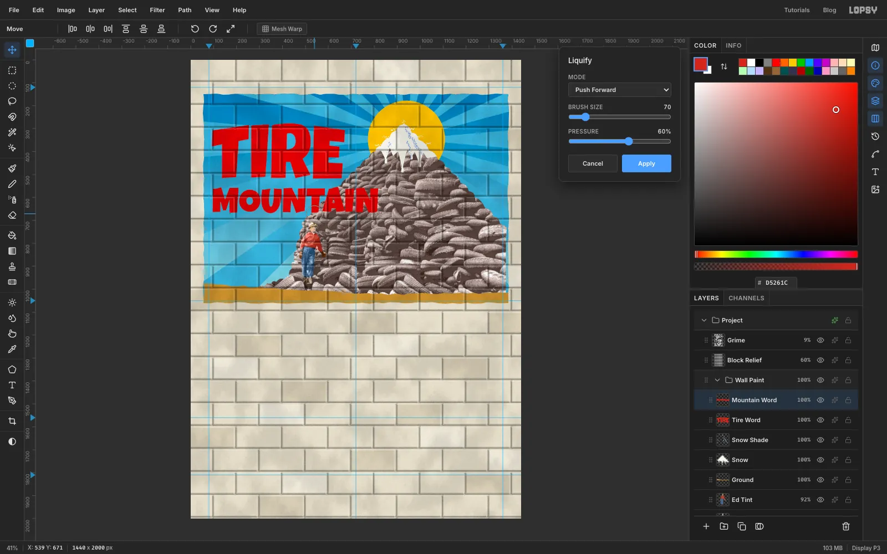

A font's repeated letters are identical, which gives it away. MOUNTAIN has two N's, so make them differ.

1. Click `Mountain Word` and choose **Filter → Liquify…**.
2. Keep **Push Forward**, and set **Brush Size** to `70` and **Pressure** to `60`.
3. Make six very short pushes, about 10 px each: up on the tops of a few letters, including one N, and down on the bottoms of a few others, including the other N.
4. Click **Apply**.

## Build the block shade

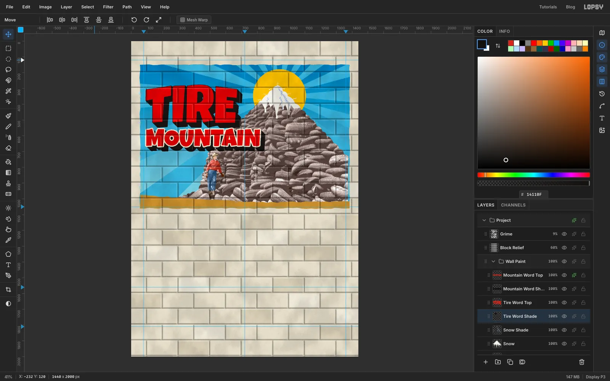

A hard extruded shade is a staple of hand-painted signs. Instead of drawing it, you'll stretch a black copy diagonally by doubling the distance each time. Do this for `Mountain Word` first and then `Tire Word`.

1. Click the word's layer and choose **Layer → Duplicate Layer**. Rename the copy `Mountain Word Top`.
2. Click the original underneath and rename it `Mountain Word Shade`.
3. Hold [[Cmd]] and click its thumbnail. Choose **Select → Grow…**, enter `2` and click **Apply**. Without the Grow, a fill leaves soft red edge pixels that show as a red fringe in the shade.
4. Fill with `#14110F`, then press [[Cmd+D]].
5. Pick the **Move** tool. Choose **Layer → Duplicate Layer**, press the [[Right]] and [[Down]] arrow keys once each, then choose **Layer → Merge Down**.
6. Repeat with two presses of each arrow, then four, then eight, then sixteen, merging down each time. Use [[Shift]]+arrow for ten at a time. You end up with a solid shade about 31 px deep.

## Outline the letters

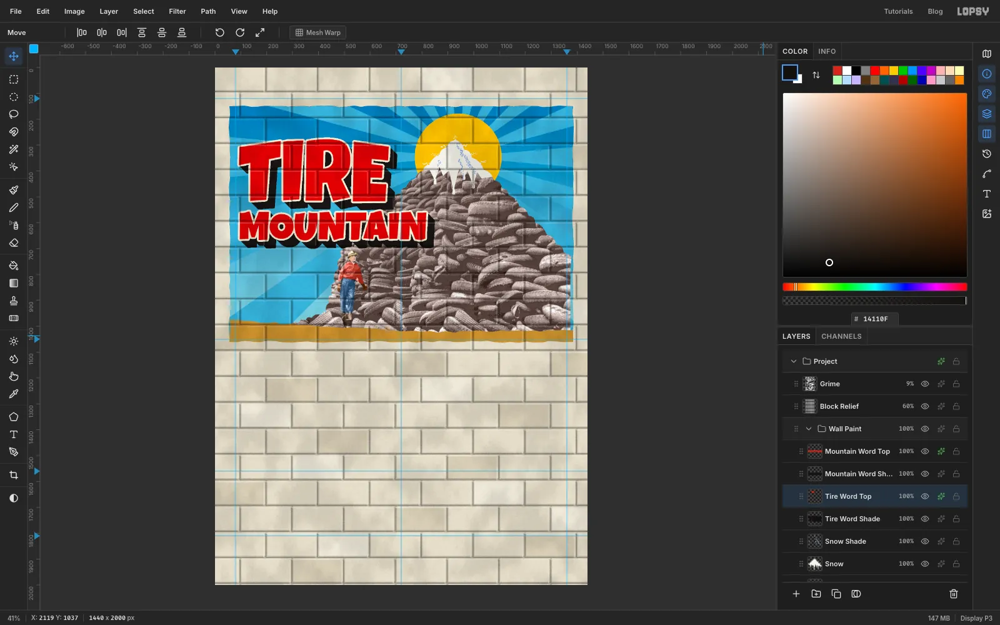

1. Click `Mountain Word Top` and click the ✦ button on its row.
2. Tick **Stroke**, then click its name to show the settings. Set **Width** to `7` and the colour to `#FBF3DC`. Close the drawer.
3. Do the same on `Tire Word Top`.

## Add the script and tilt it live

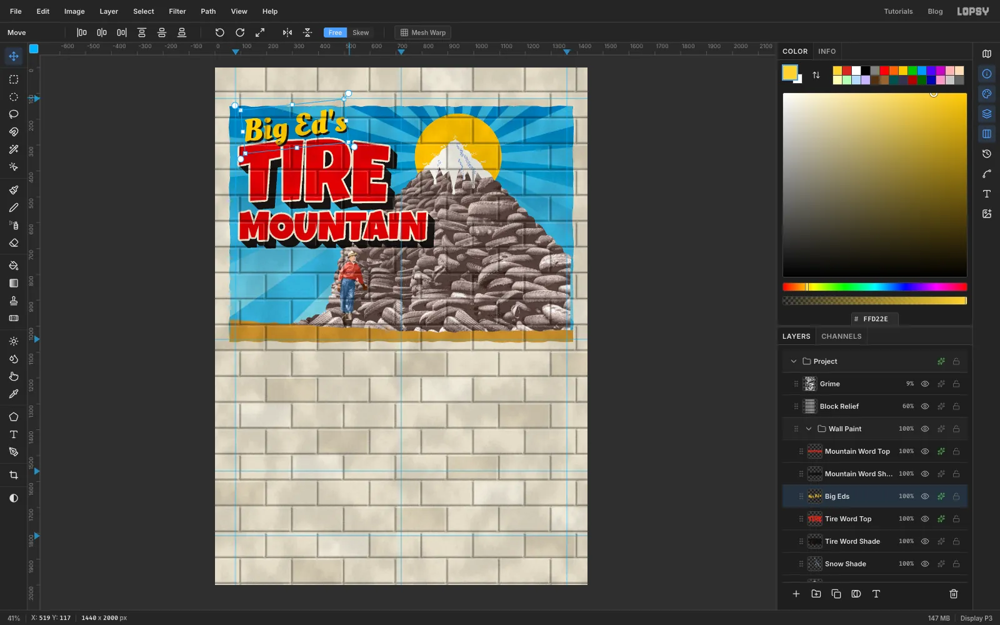

1. Click `Tire Word Top` and set the foreground to `#FFD22E`.
2. Pick the **Text** tool and choose **Oleo Script** with weight **Bold** and **Size** `120`. Click at `110, 172`, type `Big Ed's` and press [[Tab]]. Rename the layer `Big Eds`.
3. Open its effects drawer, tick **Drop Shadow** and set **Offset X** `7`, **Offset Y** `7`, **Blur** `1` and **Opacity** `100`, with the colour `#14110F`.
4. Pick the **Move** tool. Hover just outside the top-right corner of the text's box until the cursor changes to the rotate cursor, and drag to turn it about 6° anticlockwise. Press [[Cmd+D]].

The text stays live and editable after you rotate it.

## Add the tagline and hero button

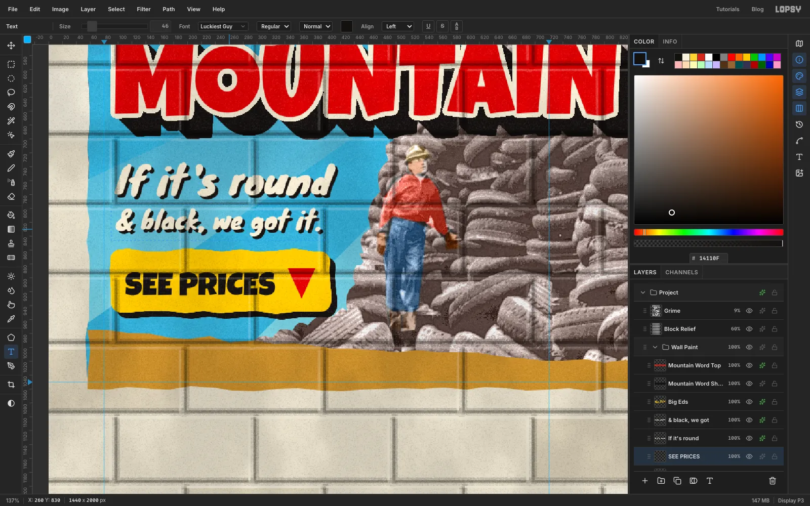

1. Click `Tire Word Top` and set the foreground to `#FBF3DC`. With the **Text** tool, choose **Knewave** at **Size** `36`. Click at `96, 790`, type `& black, we got it.` and press [[Tab]].
2. Click `Tire Word Top` again, set **Size** to `54`, click at `96, 720`, type `If it's round` and press [[Tab]].
3. Give both lines a **Drop Shadow**: **Offset X** `4`, **Offset Y** `4`, **Blur** `1`, **Opacity** `100`, colour `#14110F`.
4. Click `Tire Word Top`, click **Add Layer** and name it `Button Shade`. Lasso a slightly wobbly rectangle from `98, 868` to `414, 958`. Choose **Select → Shrink…** `14`, then **Select → Grow…** `14` to round the corners. Fill with `#14110F` and deselect.
5. Click **Add Layer** and name it `Button`. Do the same from `90, 860` to `406, 950`, this time filled with `#FFD22E`.
6. Lasso a small downward triangle at the right end of the button and fill it with `#D5261C`. Deselect.
7. Click `Button`, set the foreground to `#14110F`, choose **Luckiest Guy** at **Size** `46`, click at `110, 884`, type `SEE PRICES` and press [[Tab]].

## Label Ed

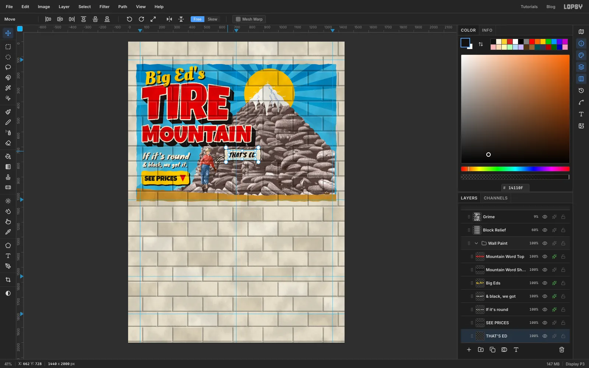

1. Click `Button`, click **Add Layer** and name it `Ed Tag`. Make a rounded plate the same way as the button, from `640, 716` to `880, 788`, filled with `#FBF3DC`. Give it a **Stroke** with **Width** `4` in `#14110F`.
2. Click **Add Layer** and name it `Ed Arrow`. Pick the **Brush**, set **Size** to `13` and the foreground to `#14110F`.
3. Draw a short curved line from the tag's left edge to Ed's elbow, then a short V for the arrowhead.
4. Set **Size** to `6` and the foreground to `#FBF3DC`, and go over the same strokes.
5. Click `Ed Arrow`, set the foreground to `#14110F`, choose **Knewave** at **Size** `40`, click inside the tag, type `THAT'S ED` and press [[Tab]]. With the **Move** tool, use the arrow keys to centre it on the plate.

## Add the summit sign

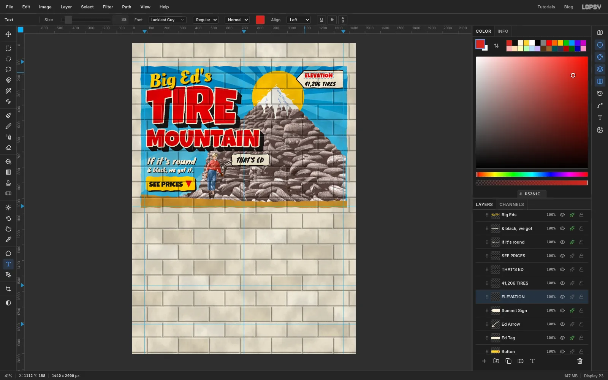

1. Click `Ed Arrow`, click **Add Layer** and name it `Summit Sign`.
2. Lasso an arrow-shaped board with its point at about `1060, 232`, running right to `x 1356` and from `y 178` to `y 286`. Fill with `#FBF3DC`, deselect, and give it a **Stroke** with **Width** `5` in `#14110F`.
3. Click `Summit Sign`, set the foreground to `#14110F`, choose **Knewave** at **Size** `34`, click at `1112, 238`, type `41,206 TIRES` and press [[Tab]].
4. Click `Summit Sign`, set the foreground to `#D5261C`, choose **Luckiest Guy** at **Size** `38`, click at `1112, 188`, type `ELEVATION` and press [[Tab]].

## Build the price burst

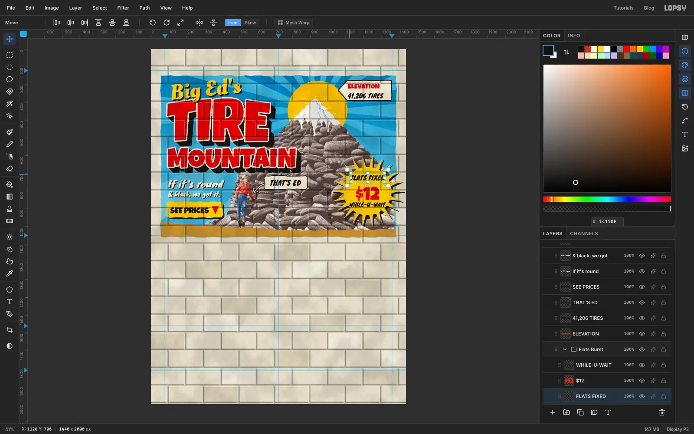

1. Click `Summit Sign`, click **New Group** and name it `Flats Burst`.
2. Click **Add Layer** and name it `Burst Shade`. Set the foreground to `#14110F`.
3. Choose **Filter → Sunburst…** with **Rays** `22`, **Length** `12`, **Width** `100`, **Taper** `100`, **Center X** `85.5` and **Center Y** `40.4`, and click **Apply**.
4. Spikes alone leave too little room for text, so add a disc. With the **Elliptical Marquee**, click once and enter **From** `1096, 678` and **To** `1368, 950`. Fill and deselect.
5. Click **Add Layer** and name it `Burst`. Set the foreground to `#FFD22E` and repeat with **Center X** `84.9`, **Center Y** `40`, and a disc from `1086, 664` to `1358, 936`.

Click `Burst` before each line of text:

- **Knewave** `30` in `#14110F`: click at `1120, 868`, type `WHILE-U-WAIT` and centre it on `1222, 876`
- **Luckiest Guy** `104` in `#D5261C`: click at `1160, 762`, type `$12` and centre it on `1222, 815`
- **Knewave** `36` in `#14110F`: click at `1120, 706`, type `FLATS FIXED` and centre it on `1222, 724`

## Turn the whole burst

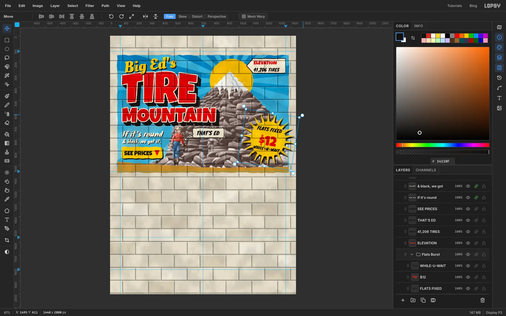

1. Click the `Flats Burst` group's row and press [[Cmd+D]] to make sure nothing is selected.
2. Pick the **Move** tool. Handles appear around everything in the group.
3. Drag the rotate handle just outside a corner to turn the group about 9° clockwise.
4. Press [[Cmd+D]]. The text stays live inside the group.

## Paint the nav band

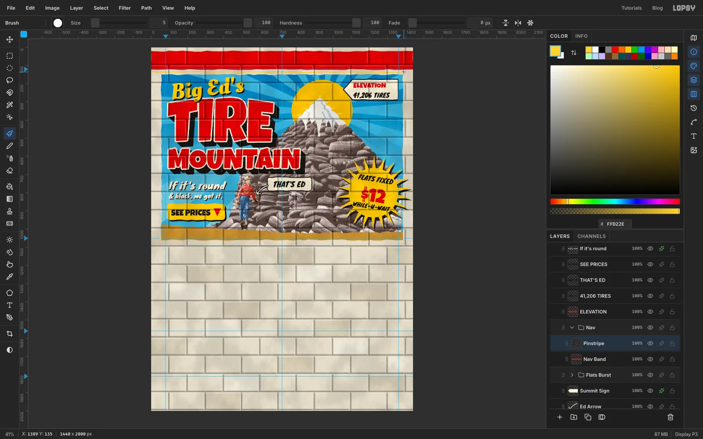

1. Collapse `Flats Burst`, click its row and click **New Group**. Name it `Nav`.
2. Click **Add Layer** and name it `Nav Band`. Lasso a rough band across the full width of the page, from about `y 20` to `y 122`, and fill with `#D5261C`. Deselect.
3. Click **Add Layer** and name it `Pinstripe`. Set the foreground to `#FFD22E`, pick the **Brush** with **Size** `5` and drag slowly across the page at about `y 135`. Let the line wander a little.

## Draw the tire logo

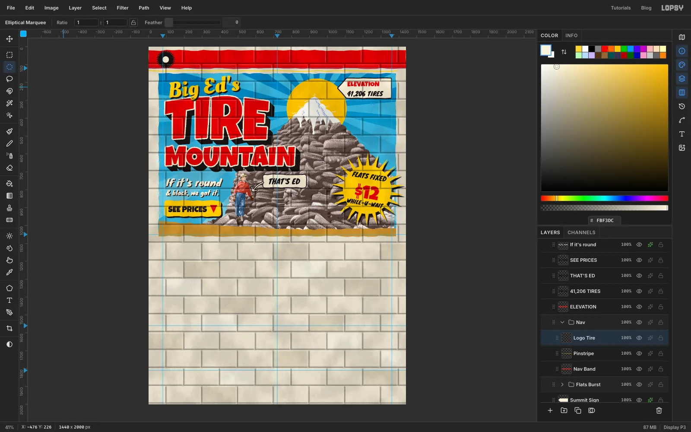

1. Click **Add Layer** and name it `Logo Tire`.
2. Click once with the **Elliptical Marquee** and enter **From** `46, 22` **To** `146, 122`. Set the foreground to `#14110F`.
3. Choose **Filter → Sunburst…** with **Rays** `30`, **Length** `5`, **Width** `55`, **Center X** `6.67` and **Center Y** `3.6`, and click **Apply**. Clipped by the circle, the rays become tread teeth.
4. Press [[Cmd+D]], click once with the **Elliptical Marquee** and enter **From** `54, 30` **To** `138, 114`. Fill with `#14110F`.
5. Press [[Cmd+D]], click once and enter **From** `78, 54` **To** `114, 90`. Fill with `#FBF3DC` and deselect.

## Letter the nav

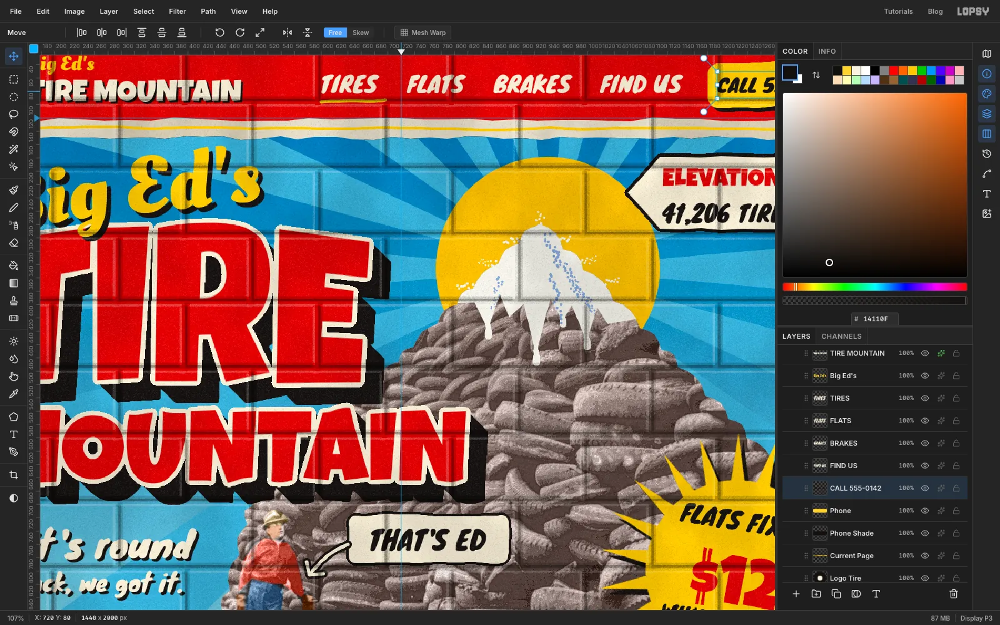

1. Click `Logo Tire`, set the foreground to `#FBF3DC`, choose **Luckiest Guy** at **Size** `46`, click at `157, 53`, type `TIRE MOUNTAIN` and press [[Tab]]. Give it a **Drop Shadow** with **Offset X** and **Y** `3`, **Blur** `1`, **Opacity** `100`, colour `#14110F`.
2. Click `Logo Tire`, set the foreground to `#FFD22E`, choose **Oleo Script** Bold at **Size** `30`, click at `160, 24`, type `Big Ed's` and press [[Tab]].
3. Add the links in **Knewave** `34` in `#FBF3DC`: `TIRES`, `FLATS`, `BRAKES` and `FIND US`. Click `Logo Tire` before each one. Click at about `600, 42` for the first and keep that height for the rest, leaving a gap of about 42 px between words.
4. Click `Logo Tire`, click **Add Layer** and name it `Current Page`. With the **Brush** at **Size** `6` in `#FFD22E`, underline `TIRES` by hand.
5. Click **Add Layer** and name it `Phone Shade`. Make a rounded plate from `1186, 42` to `1416, 110` in `#14110F`, using **Shrink** and **Grow** `16`.
6. Click **Add Layer** and name it `Phone`. Do the same from `1180, 36` to `1410, 104` in `#FFD22E`.
7. Click `Phone`, set the foreground to `#14110F`, choose **Knewave** at **Size** `29`, click inside the button, type `CALL 555-0142` and press [[Tab]]. Centre it with the arrow keys.

## Paint the prices heading

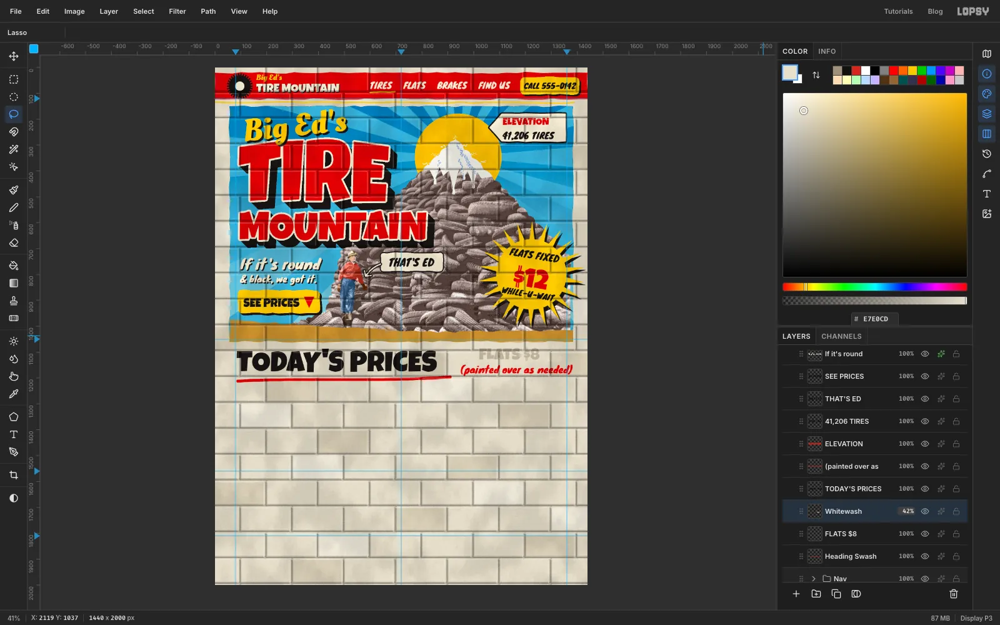

1. Collapse `Nav`, click its row, click **Add Layer** and name it `Heading Swash`.
2. Set the foreground to `#D5261C`, pick the **Brush** with **Size** `12` and draw a long, slightly wavy underline from `88, 1212` to `910, 1196`.
3. Click `Heading Swash` and choose **Knewave** `38` in `#D5261C`. Click at `949, 1135`, type `(painted over as needed)` and press [[Tab]].
4. Click `Heading Swash` and choose **Luckiest Guy** `112` in `#14110F`. Click at `84, 1069`, type `TODAY'S PRICES` and press [[Tab]].
5. Now show the joke. Click `Heading Swash` and choose **Luckiest Guy** `62` in `#9F917A`. Click at `1020, 1074`, type `FLATS $8` and press [[Tab]].
6. Click **Add Layer** and name it `Whitewash`. Lasso a rough patch over the old sign, from about `990, 1060` to `1350, 1138`, fill with `#E7E0CD`, deselect and set it to `42%`. The old price now ghosts through the fresh paint.

## Make the first poster sign

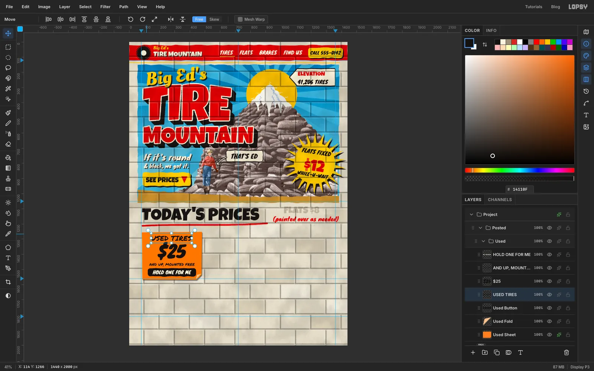

Real paper sits on top of the wall, so this goes above the relief.

1. Click `Grime` and click **New Group**. Name it `Posted`. Click **New Group** again and name it `Used`.
2. Click **Add Layer** and name it `Used Sheet`. Lasso a nearly rectangular sheet from about `84, 1252` to `480, 1568`, and fill with `#FF7F1E`. Deselect.
3. Choose **Filter → Add Noise…** with **Amount** `12` and **Mono**, and click **Apply**.
4. Lasso a small triangle over the bottom-right corner, about 42 px across, and press [[Delete]]. Press [[Cmd+D]]. Add a **Drop Shadow** with **Offset X** `4`, **Offset Y** `6`, **Blur** `7`, **Opacity** `60` and colour `#14110F`.
5. Click **Add Layer** and name it `Used Fold`. Lasso a small triangle to fold over the cut corner and fill with `#FFC08A`. Deselect.
6. Click **Add Layer** and name it `Used Button`. Make a rounded plate in `#14110F`, `40` px in from each side and about 54 px tall, near the bottom of the sheet.

Add the text, clicking `Used Button` first each time. Commit each line and centre it on the sheet with the arrow keys:

- **Knewave** `32` in `#FBF3DC`: click at `144, 1498` and type `HOLD ONE FOR ME`, on the button
- **Permanent Marker** `25` in `#14110F`: click at `114, 1452` and type `AND UP, MOUNTED FREE`, just above the button
- **Knewave** `108` in `#14110F`: click at `194, 1326` and type `$25`, in the middle
- **Permanent Marker** `46` in `#14110F`: click at `114, 1266` and type `USED TIRES`, at the top

## Tape it up and copy the tape

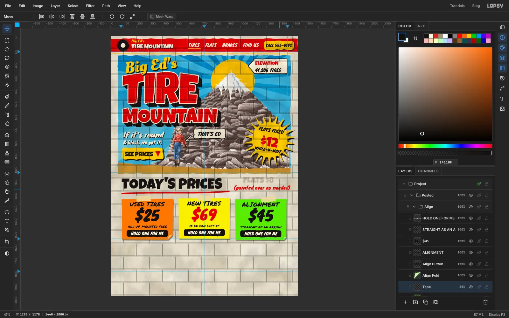

1. Click `Used Sheet`, click **Add Layer** and name it `Tape`. Lasso a short, slightly crooked strip across the top edge of the sheet and fill with `#EAD9A4`. Deselect and set the layer to `86%`.
2. Marquee around the tape and press [[Cmd+C]]. Press [[Cmd+D]]. You'll paste it onto the next two signs.
3. Collapse the `Used` group and click its row. Click **New Group** and name it `New`.
4. Repeat the sheet, noise, Drop Shadow, button and text steps from the last section for the yellow sign, naming the layers `New Sheet` and `New Button`. It runs from about `522, 1246` to `918, 1562`, using `#F7EF2F`, with `$69` in `#D5261C`, and the words `NEW TIRES` and `IF ED CAN LIFT IT`. Skip the dog-ear on this one.
5. Click `New Sheet` and press [[Cmd+V]]. Rename the paste `Tape`, set it to `86%` and drag it to the top of the yellow sign. Marquee around it, pick the **Move** tool again and turn it about 7° with the rotate handle, then press [[Cmd+D]].
6. Collapse `New`, click its row, click **New Group** and name it `Align`. Repeat the same steps for the green sign, naming the layers `Align Sheet`, `Align Fold` and `Align Button`. It runs from about `958, 1254` to `1354, 1570`, using `#84EA45`, with `$45` in `#14110F`, the words `ALIGNMENT` and `STRAIGHT AS AN ARROW`, and a smaller dog-ear about 26 px across with its fold in `#C9F7AC`.
7. Click `Align Sheet` and paste the tape again. Set it to `86%`, drag it to the top of the sheet right of centre, then marquee around it, pick the **Move** tool and turn it about 5° the other way. Press [[Cmd+D]].

## Tilt the signs

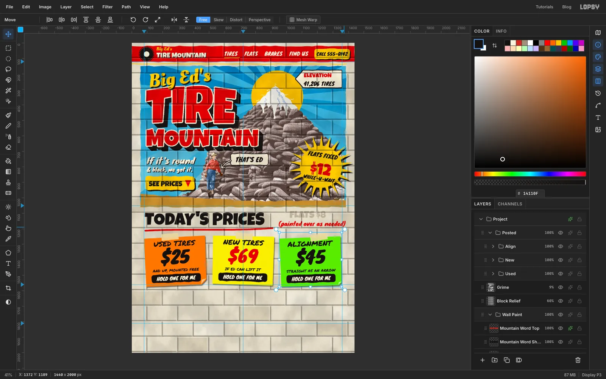

1. Collapse `Align`. Click the collapsed `Used` group, press [[Cmd+D]], pick the **Move** tool and use the rotate handle to turn it about 2.4° anticlockwise. Press [[Cmd+D]].
2. Do the same with `New`, about 1.5° clockwise.
3. Do the same with `Align`, about 1.6° anticlockwise.

## Screw up the hours board

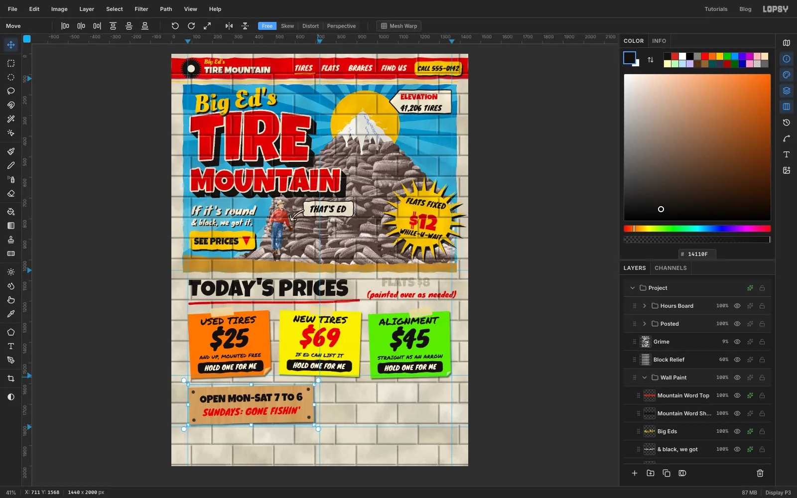

1. Collapse `Posted` and click its row. Click **New Group** and name it `Hours Board`.
2. Click **Add Layer** and name it `Plywood`. Lasso a rough rectangle from `84, 1612` to `690, 1792` and fill with `#C99F66`. Deselect, and add a **Drop Shadow** with **Offset X** `6`, **Offset Y** `8`, **Blur** `12`, **Opacity** `55` and colour `#14110F`.
3. Click **Add Layer** and name it `Grain`. Hold [[Cmd]] and click the thumbnail of `Plywood`. Choose **Filter → Fibers…** with **Variance** `22` and **Strength** `40`, and click **Apply**. Deselect and set it to **Soft Light** at `42%`.
4. Click **Add Layer** and name it `Screws`. Click once with the **Elliptical Marquee** and enter **From** `100, 1626` **To** `116, 1642`. Fill with `#3B3631` and deselect. Repeat for the other three corners, starting from `658, 1626`, `100, 1762` and `658, 1762`.
5. Click `Screws` and add **Knewave** `44` in `#D5261C`: click at `130, 1712`, type `SUNDAYS: GONE FISHIN'` and centre it on `387, 1734`.
6. Click `Screws` and add **Luckiest Guy** `52` in `#14110F`: click at `120, 1632`, type `OPEN MON-SAT 7 TO 6` and centre it on `387, 1668`.
7. Collapse the group, click its row, press [[Cmd+D]] and turn it about 1.4° anticlockwise with the **Move** tool.

## Paint the house rules

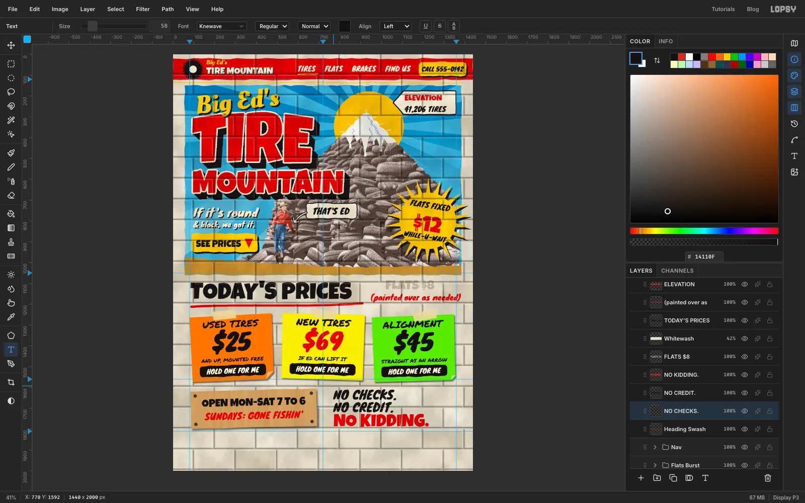

These go on the wall, so they belong in `Wall Paint`, under the relief.

Add the lines from the bottom up, clicking `Heading Swash` first each time:

- **Luckiest Guy** `84` in `#D5261C`: `NO KIDDING.`, at `770, 1712`
- **Knewave** `58` in `#14110F`: `NO CREDIT.`, at `770, 1652`
- **Knewave** `58` in `#14110F`: `NO CHECKS.`, at `770, 1592`

## Paint the footer

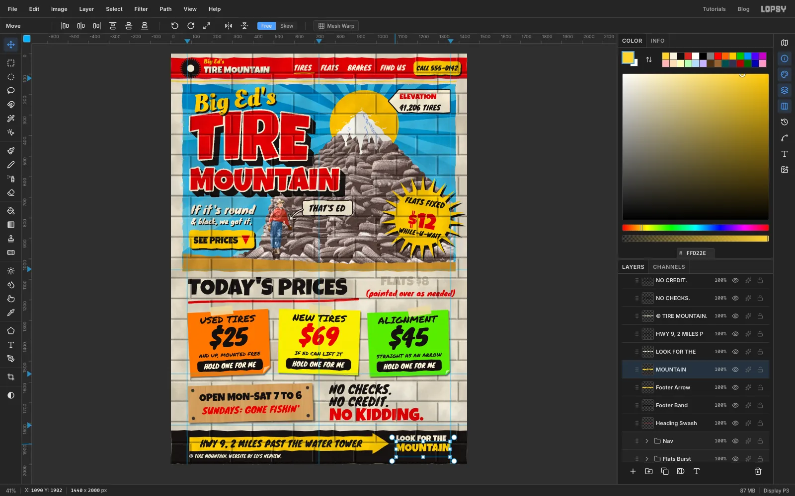

1. Click `Heading Swash`, click **Add Layer** and name it `Footer Band`. Lasso a rough band from about `y 1836` to the bottom of the page and fill with `#14110F`. Deselect.
2. Click **Add Layer** and name it `Footer Arrow`. Lasso a long arrow from `x 90` to its tip at `1060, 1900`, with the shaft from `y 1866` to `y 1934`. Fill with `#FFD22E` and deselect.

Add the text, clicking `Footer Arrow` first each time:

- **Knewave** `22` in `#FBF3DC`: `© TIRE MOUNTAIN. WEBSITE BY ED'S NEPHEW.`, at `88, 1938`
- **Knewave** `44` in `#14110F`: `HWY 9, 2 MILES PAST THE WATER TOWER`, clicked at `118, 1880` and then centred in the shaft
- **Luckiest Guy** `40` in `#FBF3DC`: `LOOK FOR THE`, at `1092, 1849`
- **Luckiest Guy** `54` in `#FFD22E`: `MOUNTAIN`, at `1094, 1888`

## Add paint runs

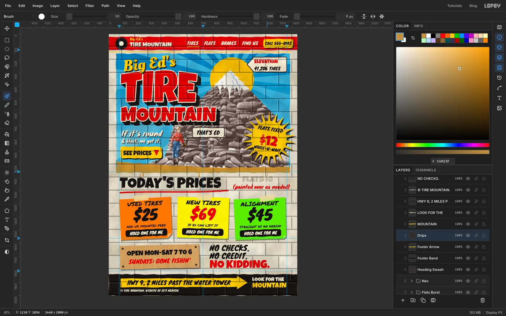

1. Click `Footer Arrow`, click **Add Layer** and name it `Drips`.
2. Pick the **Brush**, open **Brushes** and set **Size** `10`, **Hardness** `100` and **Taper** `70`.
3. Set the foreground to `#C4923F`. Start each run at its bottom tip, below the ground band, and drag straight up into the paint, so the bead sits at the bottom and the run thins as it reaches the band. Make five, in two uneven clusters, from about 25 to 60 px long.
4. Open **Brushes** again and set **Taper** back to `0`.

## Weather the paint

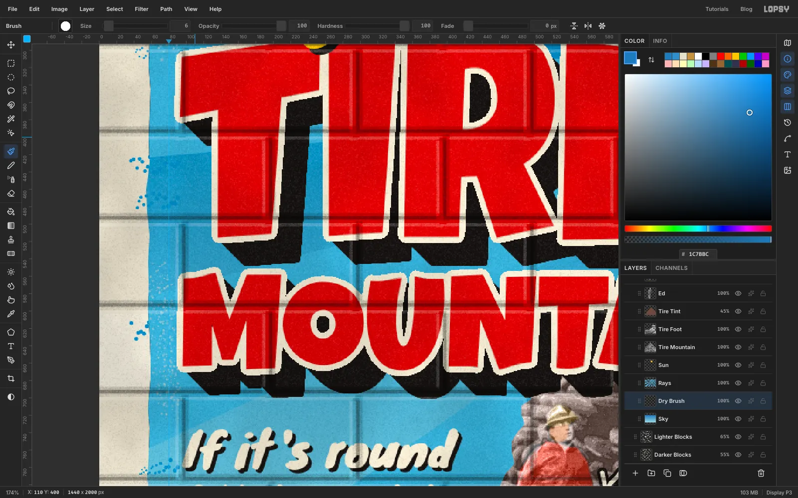

1. Click **Add Layer** and name it `Paint Chips`. Set the foreground to the wall colour, `#E7E0CD`.
2. Pick the **Spray** tool. With **Size** between `34` and `60`, spray short passes along the mural's left and right edges, across the nav band, over a letter or two of TIRE, and along the ground band. Vary the size and leave plenty of gaps, because chips come in clusters.
3. Click `Sky`, click **Add Layer** and name it `Dry Brush`. This puts it behind everything but the sky.
4. Pick the **Brush** and open **Brushes**. Set **Size** `6`, **Spacing** `60`, **Scatter** `90` and **Size Jitter** `70`.
5. Set the foreground to `#2F8FC9` and flick short strokes outward across the mural's left and right edges. Use `#1C7BBC` along the top edge. It looks like a nearly empty brush dragged off the paint.
6. Open **Brushes** and set **Spacing** to `10`, with **Scatter** and **Size Jitter** at `0`.

## Export the homepage

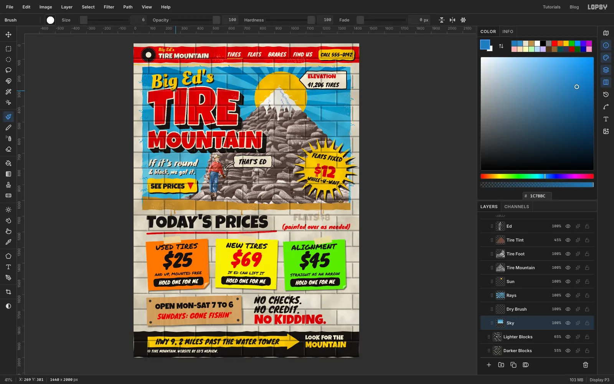

1. Choose **View → Show Guides** to turn the guides off.
2. Choose **File → Save Project** to keep the layered file.
3. Choose **File → Quick Export PNG** for the flat image.

Now that you know the trick, try it with your own local business. The recipe is always a real wall, lettering that isn't quite straight, a joke, and one thing someone painted over.
