Walk through any street market and the best typography is on the stalls: fat capitals with a black outline and a shade knocked off to one side, a script word thrown in at an angle, the produce painted on a white oval, a starburst shouting a number. Nobody chose a grid system. It works because every piece is bold, flat and outlined.

In this tutorial you'll borrow that look for the cover of **Puesto**, a made-up street food quarterly, at 1536 × 2048 px. The cover story is zucchini blossoms, so you'll paint one zucchini with its flower and turn it into a bunch of three.

Along the way you'll use:

- the **grid** with **Snap**, **Define Pattern** and **Fill with Pattern** for the wall and the checker trim
- **Clouds** and **Texture** for a rolled-paint surface
- text in **Bungee**, **Yellowtail**, **Boogaloo**, **Lilita One** and **Libre Barcode 39**, with **Stroke** and **Drop Shadow** effects for the sign-painter outline and shade
- a layer loaded as a selection and intersected with a marquee, for two-tone letters
- the **Lasso**, **Gradient**, **Brush** and **Spray** tools for the illustration
- groups that you duplicate, flip, scale and rotate with the **Move** tool
- the **Shape** tool, **Merge Down**, the **Pen** tool and copy and paste

The palette:

- Wall `#12A19A`, wall shade `#0B6E6A`
- Dado pink `#E8437A`, magenta shade `#A81E55`, maroon shade `#5A0F2E`
- Yellow `#FFD21F`
- Orange `#F58A1F` / `#D9541A`
- Zucchini `#17602A` → `#2F8F3A` → `#9BD15A`
- Cream `#FFF4DC`
- Ink `#17130F`

> **Tip:** Positions are written as `x, y` in document pixels. The status bar at the bottom of the window shows where the cursor is, so hover to find a spot. Key names are Mac keys. On Windows and Linux, use Ctrl for Cmd. Three things about text to remember. If a text layer is selected, changing the font, size or letter spacing restyles that layer, so click a layer that isn't text before you set up a new line. The Text tool keeps the last letter spacing you used, so set it each time. And a text layer is named after what you typed: this tutorial renames each one (double-click its name) so the Layers panel stays readable, and gives the new name in brackets.

## Block in the wall with the grid

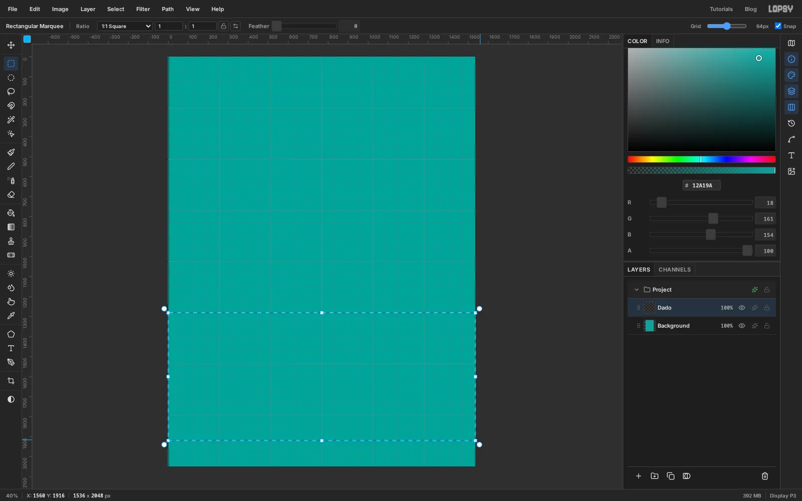

Choose **File → New**, set the size to **1536 × 2048** px and click **Create**. Both numbers divide by 64, which is why the grid will line up with the edges.

Click the `Background` layer, set the foreground to `#12A19A` and choose **Edit → Fill**. That's the upper wall.

Painted walls often have a second colour along the bottom, called a dado. Click `Layer 1` and rename it `Dado` (double-click its name). Choose **View → Show Grid**. A **Grid** slider appears at the right of the options bar: drag it until it reads `64px`, and leave **Snap** ticked.

Pick the **Rectangular Marquee** and drag from the left edge of the canvas, at about `y 1280`, to the right edge at about `y 1920`. You don't have to be accurate. The marquee jumps to the nearest grid lines, and to the canvas edge when you're close to it. Set the foreground to `#E8437A`, choose **Edit → Fill**, and press [[Cmd+D]].

## Add the stripe and draw a checker tile

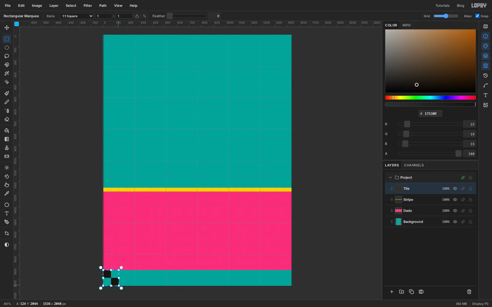

Click **Add Layer** and name the layer `Stripe`. Drag the Grid slider down to `32px`, then marquee a strip one cell tall directly above the pink, from `y 1248` to `y 1280`. Start and finish the drag just outside the canvas so the strip covers the full width. Fill it with `#FFD21F` and deselect. Set the grid back to `64px`.

The bottom strip of the cover is a checkerboard, and you only need to draw one tile of it. Add a layer called `Tile`. The checker strip will be the bottom two rows of the grid. Marquee the single cell at the left end of the upper of those two rows, the one that starts at `0, 1920`. Hold [[Shift]] and marquee the cell diagonally below and to the right of it, which ends in the bottom edge of the canvas. Holding Shift adds to the selection instead of replacing it. Fill both with ink `#17130F`.

Now marquee the whole 2 × 2 block, 128 px square, and choose **Edit → Define Pattern**. Nothing appears to happen, but the pattern is saved. The two empty cells stay transparent in the pattern, so whatever is underneath will show through them.

## Tile the trim with Fill with Pattern

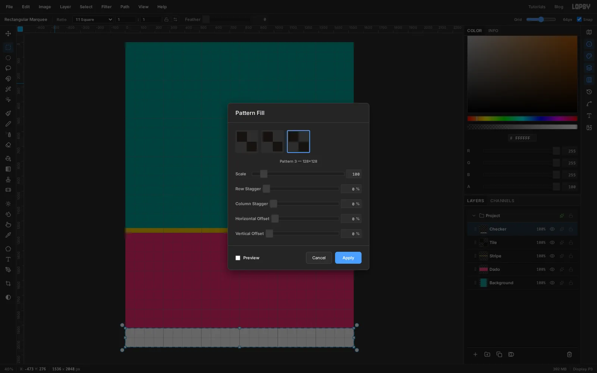

Press [[Cmd+D]]. Add a layer called `Checker` and marquee the bottom two rows of the grid across the full width, from `y 1920` to the bottom edge. Fill the selection with white `#FFFFFF` first. Then choose **Edit → Fill with Pattern…**. Your pattern is already selected, so leave the sliders alone and click **Apply**. The black squares tile across the white.

Deselect, click the `Tile` layer and click **Delete Layer**. Choose **View → Show Grid** again to hide the grid.

## Roll on some paint texture

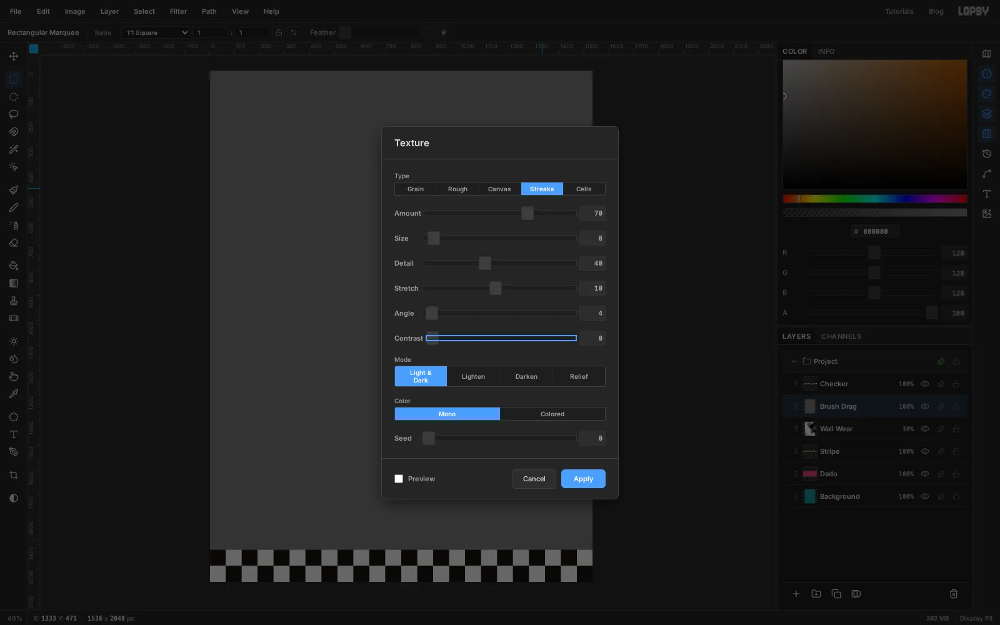

Flat colour looks like vinyl. Two quiet layers make it look like emulsion on plaster.

Click `Stripe`, add a layer called `Wall Wear`, choose **Filter → Clouds…**, set **Scale** `3` and click **Apply**. Open the layer's effects drawer (the **✦** button on its row), set the blend mode to **Soft Light**, close the drawer, and lower the layer's opacity to `30%`. That gives the wall soft patches.

Add another layer called `Brush Drag`. Fill it with mid grey `#808080`, then choose **Filter → Texture…**. Click **Streaks** and set **Amount** `70`, **Size** `8`, **Stretch** `10` and **Angle** `4`, then click **Apply**. Set this layer to **Overlay** at `12%`. The streaks should be barely visible, like the track of a wide brush. If you can see them from across the room, lower the opacity.

## Set the masthead

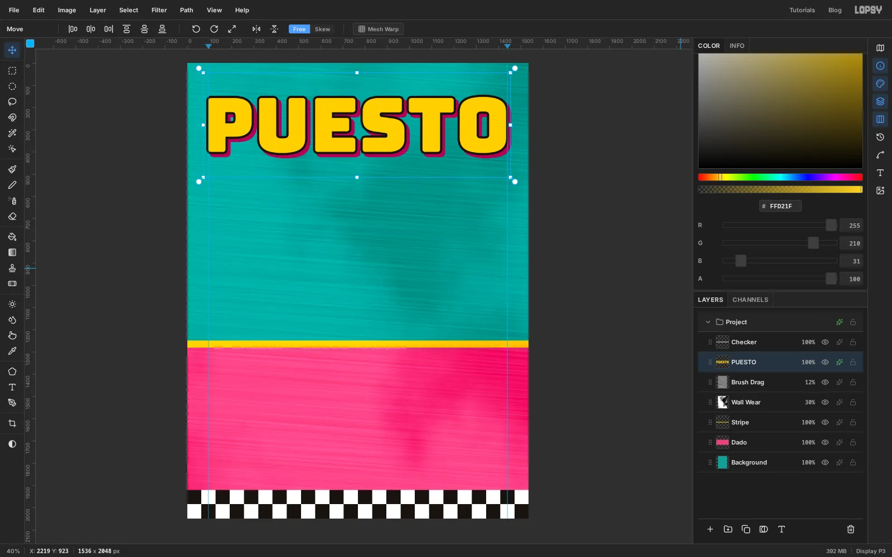

Click the top ruler at `96` and again at `1440` to drop two vertical guides. These are the side margins.

Click `Brush Drag` so a pixel layer is selected. Set the foreground to `#FFD21F`, pick the **Text** tool, choose the font **Bungee** and set **Size** `336`. Click on the wall, type `PUESTO` and press [[Tab]] to commit. The layer is named `PUESTO` after its text. Bungee was drawn for shop signs, so it already has the right weight.

Switch to the **Move** tool and drag the word from the middle of a letter until the P sits on the left guide and the tops of the letters are about 150 px from the top of the canvas. At this size the O finishes just short of the right guide.

Now the outline and shade. Click the **✦** button on the `PUESTO` row. Tick **Stroke**, set **Width** `10` and the colour to `#17130F`. Tick **Drop Shadow** and set **Offset X** `14`, **Offset Y** `14`, **Blur** `0`, **Opacity** `100` and the colour to `#A81E55`. With no blur the shadow is a hard copy of the letters, which is what a sign painter's shade is. Close the drawer.

## Split-shade the letters

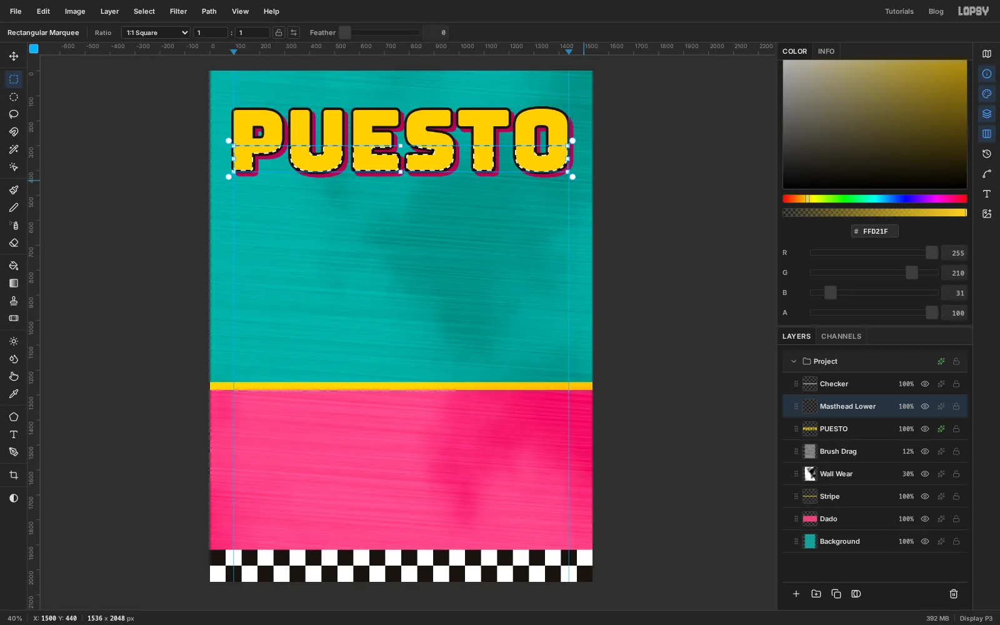

Sign painters often paint the bottom of each letter a darker colour. You can get that by selecting only the lower part of the letters.

With `PUESTO` selected, click **Add Layer** and name the layer `Masthead Lower`. Hold [[Cmd]] and click the thumbnail of the `PUESTO` layer. The letters load as a selection.

Pick the **Rectangular Marquee**, hold [[Shift+Option]], and drag a box that starts left of the P at about `y 300` and ends right of the O below the letters. With both keys held, the selection keeps only the part inside your box, so you're left with the bottom 100 px of each letter.

Set the foreground to `#F58A1F`, choose **Edit → Fill** and deselect. The orange sits inside the black outline because the outline is drawn outside the letters.

## Add the strapline and issue line

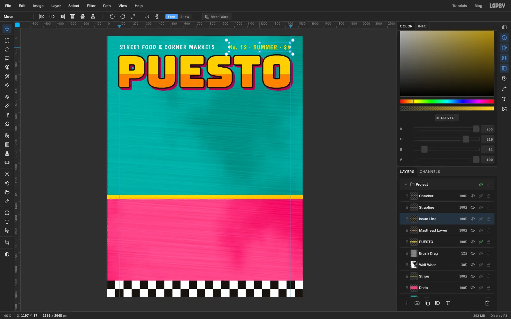

Click `Masthead Lower`. Set the foreground to white, pick the Text tool, choose **Boogaloo** at **Size** `50`, click an empty part of the wall and type `STREET FOOD & CORNER MARKETS`. Press [[Tab]] and rename the layer `Strapline`. Open the Text panel from the panel buttons on the right edge of the window and set **Letter spacing** to `4`.

With the Move tool, drag the line above the masthead so its first letter sits on the left guide and its top is about 65 px from the top of the canvas. That leaves a clear gap above the black outline of the masthead.

Click `Masthead Lower` again, change the foreground to `#FFD21F`, and type `No. 12 · SUMMER · $6` the same way (the middle dot is [[Option+Shift+9]] on a Mac, or copy it from here). Rename the layer `Issue Line`. Move it to the same height with its last character on the right guide.

## Paint the medallion

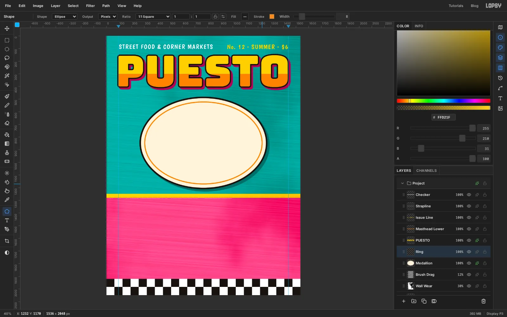

Produce on a market sign is nearly always painted on a pale oval, so it stays readable against a loud wall.

Click `Brush Drag` and add a layer called `Medallion`. Pick the **Shape** tool and choose **Ellipse**. Click the **Fill** swatch and enter `#FFF4DC`. Click the **Stroke** button, enter `#17130F`, and set **Width** `12`.

The Shape tool draws outward from the point where you press. Press at the centre of the oval, on the centre line of the canvas at about `768, 845`, and drag down and right to about `1270, 1205`. In the layer's effects drawer, add a **Drop Shadow** with **Offset X** `18`, **Offset Y** `18`, **Blur** `0`, **Opacity** `100` and the colour `#0B6E6A`.

Add a layer called `Ring`. In the Shape options, click the Fill swatch and choose **Remove fill**, change the stroke to `#F58A1F` and set **Width** `8`. Press at the same centre and drag again, letting go about 35 px short of where you released the first time, so the ring sits evenly inside the black outline.

## Draw the zucchini body

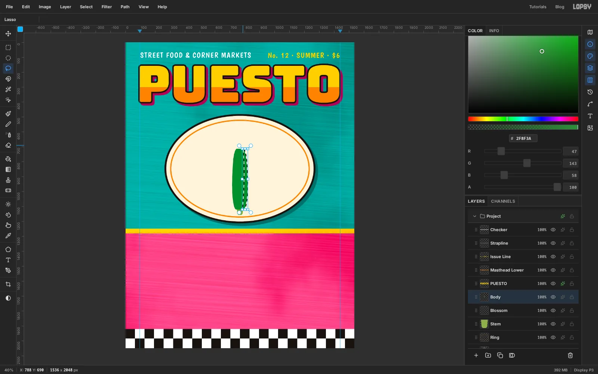

You'll paint one zucchini standing upright, then copy it. Click `Ring` and add three layers, named `Stem`, `Blossom` and `Body` from the bottom up.

Click `Stem`. With the **Lasso**, draw a small stub about 45 px wide and 50 px tall near the bottom of the medallion, centred on `x 768` with its bottom edge at about `y 1155`. Fill it with `#8FB04A` and deselect.

Click `Body`. Lasso a long club shape that sits on top of the stem and rises about 410 px, to roughly `y 710`. Make it about 110 px across at its widest, a little narrower at the top, with rounded ends. Fill it with `#2F8F3A` and deselect.

For the shaded side, hold [[Cmd]] and click the `Body` thumbnail to load the body as a selection. Then hold [[Shift+Option]] and lasso loosely around the right third of the body, going well outside its edge. Only the part of your loop that falls inside the body stays selected, so the outer edge is perfect without any care on your part. Fill with `#17602A` and deselect.

## Add stripes and freckles

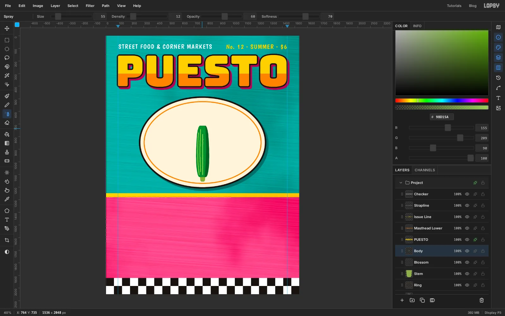

[[Cmd]]-click the `Body` thumbnail again so your painting stays inside the body. Pick the **Brush**, set **Size** `7` and **Hardness** `90`, and set the foreground to `#9BD15A`. Paint three long stripes from near the bottom to near the top, following the curve of the left side. Start and stop them at slightly different heights so they don't look ruled.

Pick the **Spray** tool, set **Size** `55` and **Density** `12`, and make one slow pass up the middle of the body. This leaves the fine pale freckles zucchini skin has. Press [[Cmd+D]].

## Paint the blossom

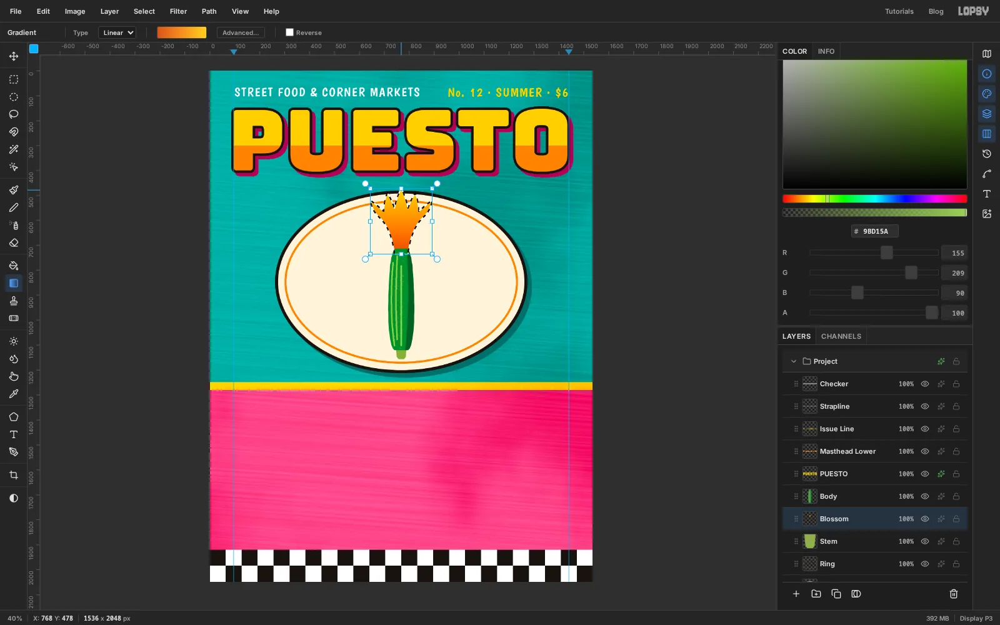

Click the `Blossom` layer. It's under the body, so the base of the flower tucks in behind the fruit.

With the Lasso, draw the flower in one loop. Start inside the top of the body, flare outward like a trumpet for about 150 px, then make five pointed petals across the top: a tall one in the middle, two a little shorter beside it, and two outer ones that curl away to the sides. The middle tip should poke just above the rim of the medallion.

Pick the **Gradient** tool, leave it on **Linear**, and click **Advanced…**. Set three stops: `#D9541A` at the left end, `#F58A1F` a little before the middle, and `#FFD21F` at the right end. Click **Done**, then drag from the base of the flower straight up to the tip of the middle petal.

Keep the selection. With the Brush at **Size** `5` and the colour `#D9541A`, paint four creases from the base up to the notches between the petals. Change to pale yellow `#FFF0A0` at **Size** `6` and paint a short highlight on each petal. Deselect.

## Add the calyx, outline everything and group it

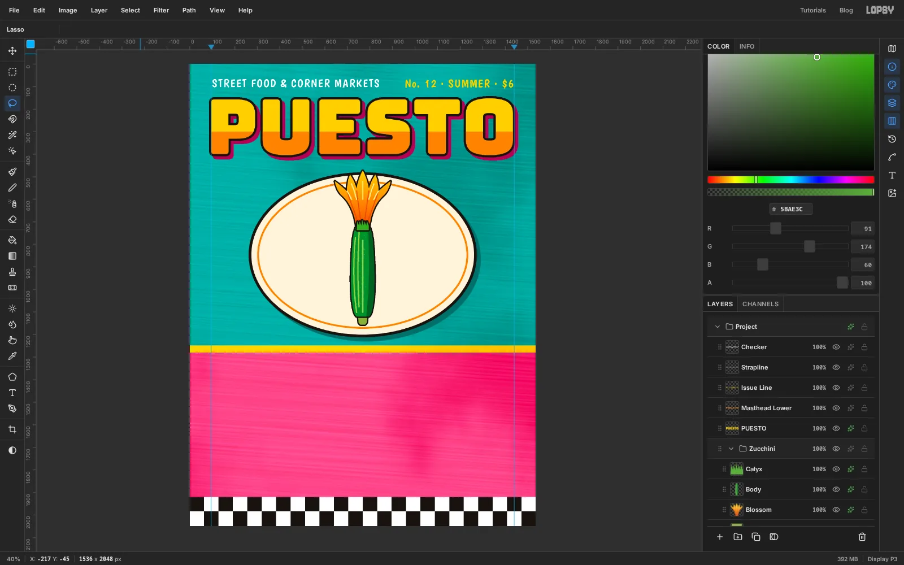

Click `Body` and add a layer called `Calyx`. Lasso a small collar about 55 px wide where the flower meets the fruit, with five little teeth pointing up, fill it with `#5BAE3C` and deselect.

Every part gets the black key line. On each of the four layers in turn, `Stem`, `Blossom`, `Body` and `Calyx`, open the effects drawer, tick **Stroke**, and set **Width** `6` and the colour `#17130F`.

Click `Stem`, hold [[Shift]] and click `Calyx` so all four layers are selected, and choose **Layer → Group Layers**. Name the group `Zucchini`.

## Duplicate the group, flip it and rotate it

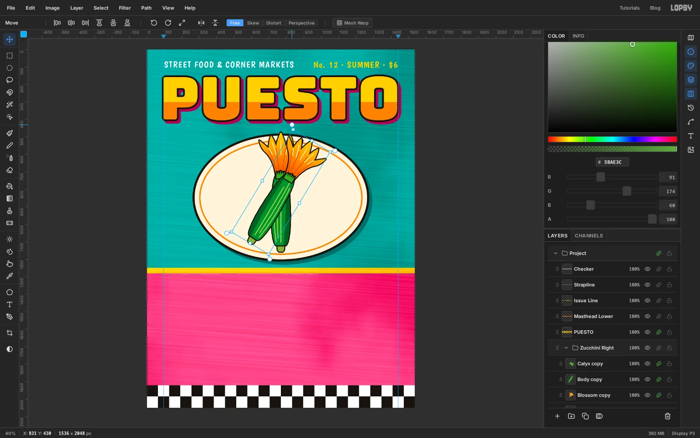

Click the `Zucchini` group and click **Duplicate Layer**. The whole group is copied with its outlines. Name the copy `Zucchini Right`.

With the copy selected, pick the **Move** tool. Click **Flip Horizontal** in the options bar so the shaded flank swaps sides. Three identical zucchini look like clip art, and flipping one is the cheapest way to hide it.

Handles appear around everything in the group. Move the pointer just outside a corner until it becomes a curved arrow, then drag to turn the group about 30° clockwise. Press [[Cmd+D]] to commit.

Now drag the copy, from the middle of its body, right and a little down until its stem sits beside the first stem, almost touching it. The flower should end up crossing the rim of the medallion on the right.

## Make the third one smaller

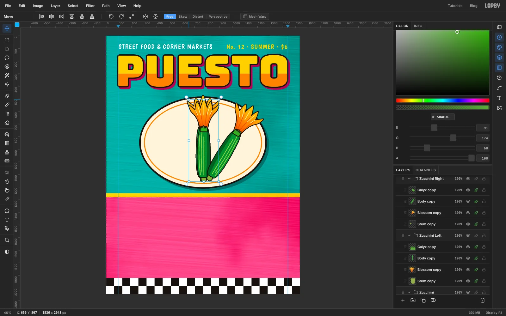

Duplicate `Zucchini` again and name the copy `Zucchini Left`. This one isn't flipped. Instead, hold [[Cmd]] and drag its top left corner handle a short way inward to shrink it to about 95%. Holding Cmd keeps the proportions. Commit with [[Cmd+D]].

Select the group again, rotate it about 30° the other way, commit, and drag it so its stem sits just left of the middle stem. You now have a fan of three with their stems together and their flowers spread across the top of the oval.

> **Tip:** If a transform goes wrong, [[Cmd+Z]] takes it back in one step, even when it moved four layers at once.

## Tie the bunch with twine

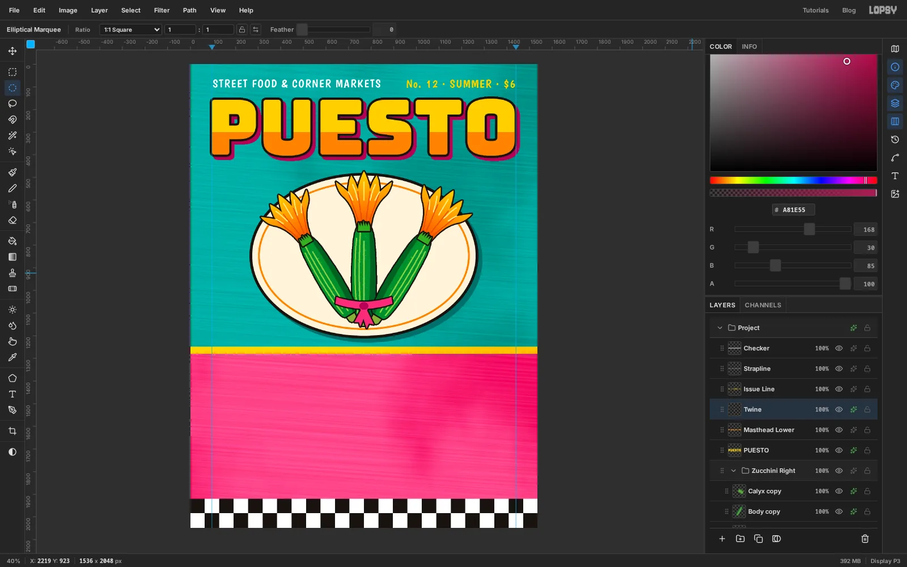

Three stems meeting in one place is the weakest part of the drawing, so cover it. Click `Masthead Lower` so the next layer goes on top of the zucchini groups, and add a layer called `Twine`.

With the Lasso, draw a band about 30 px tall that curves gently across all three zucchini a little above the stems, and fill it with pink `#E8437A`. Lasso two short ribbon tails hanging from the middle of the band, each with a notch cut in its end, and fill them with the same pink. Then pick the **Elliptical Marquee**, drag a small oval over the middle of the band and fill it with `#A81E55` for the knot. Deselect.

Give the layer a **Stroke** of `6` in `#17130F`.

## Letter BLOSSOMS on the dado

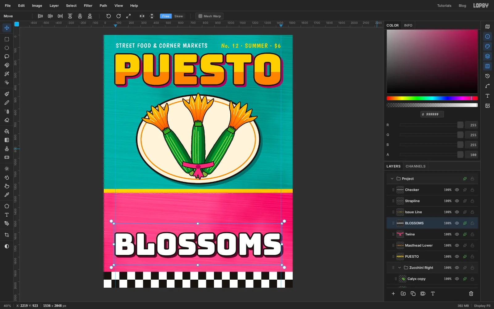

Click `Twine`. Set the foreground to white, pick the Text tool, choose **Bungee** at **Size** `240`, and set **Letter spacing** in the Text panel back to `0`. Click on the wall, type `BLOSSOMS` and commit.

Move it onto the pink so it's centred between the guides, with the tops of the letters a little over 320 px below the yellow stripe. That leaves room for the script word above it. The Move tool's **Align center horizontally** button centres it for you.

Add a **Stroke** of `10` in `#17130F`, and a **Drop Shadow** with offsets of `12`, **Blur** `0`, **Opacity** `100` and the colour `#5A0F2E`. The magenta you used for the masthead shade would disappear on pink, so the shades down here are maroon.

## Add the script word at an angle

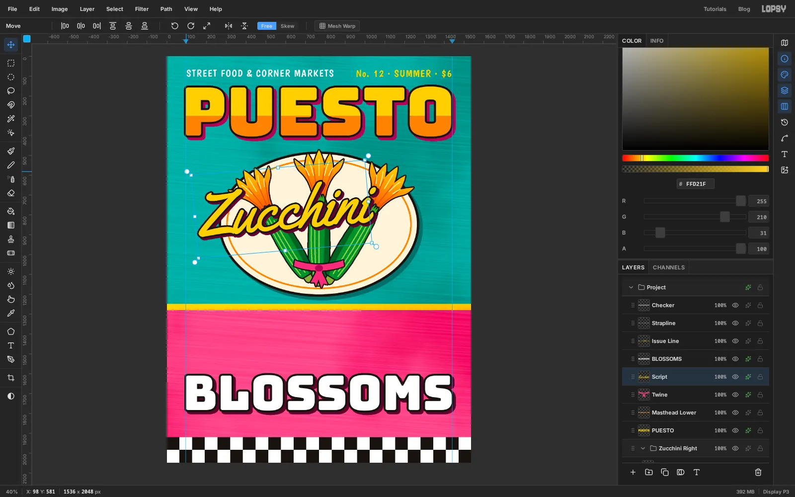

Block capitals paired with one script word is the classic sign-painter combination. Click `Twine`, set the foreground to `#FFD21F`, choose **Yellowtail** at **Size** `300`, click on the wall and type `Zucchini`. Rename the layer `Script`, so it isn't confused with the `Zucchini` group.

Give it a **Stroke** of `8` in `#17130F` and a **Drop Shadow** with offsets of `10`, **Blur** `0`, **Opacity** `100` and the colour `#5A0F2E`.

With the Move tool, drag just outside a corner handle to tilt the word about 5° anticlockwise, so it climbs to the right. Text keeps its rotation and stays editable. Press [[Cmd+D]], then drag the word onto the pink band above BLOSSOMS. Start it about 50 px in from the left guide and set it so the tail of the Z stops a little above the outline of the B. The tall h should stay below the yellow stripe.

## Set the subline

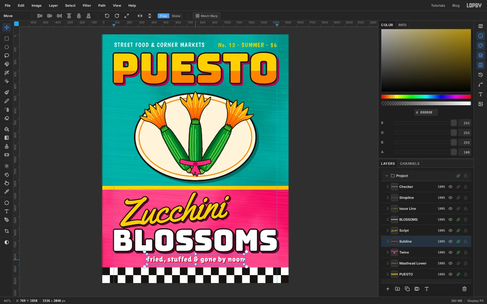

Click `Twine`, set the foreground to white, and choose **Lilita One** at **Size** `60` with **Letter spacing** `2`. Type `fried, stuffed & gone by noon` and rename the layer `Subline`.

Centre it under BLOSSOMS. Leave the same gap above it as below it: the bottom of the `g` and `y` should be as far from the checker strip as the tops of the letters are from the maroon shade above. Add a **Drop Shadow** with offsets of `4`, **Blur** `0`, **Opacity** `100` and the colour `#5A0F2E` so the thin strokes hold up on the pink.

## Build a starburst from three squares

The Shape tool has no star, but three squares turned 30° apart make a twelve-point burst.

Click `BLOSSOMS` and add a layer called `Burst`. Pick the Shape tool, choose **Rectangle**, set the fill to the wall colour `#12A19A` and remove the stroke. In the space to the right of the script, press about 250 px in from the right edge and 165 px below the yellow stripe, hold [[Cmd]] to keep the shape square, and drag out until the square is about 190 px across.

Click **Duplicate Layer** and name the copy `Burst 30`. A single pixel layer on its own has no transform handles: the Move tool just slides it. To turn it, select its pixels first. Pick the Rectangular Marquee and drag a box around the square with a little room to spare. Switch to the Move tool and drag just outside a corner until the copy has turned 30°. Holding [[Cmd]] while you turn snaps the angle to 15° steps, which makes 30° easy to hit. Commit with [[Cmd+D]].

Click the original `Burst` layer, duplicate it again, name this copy `Burst 60`, and turn it 60° the same way. Then click `Burst 30`, the top one of the three, and press [[Cmd+E]] twice to merge all three squares into one layer. If the merged layer has picked up a different name, rename it `Burst`.

Give it a **Stroke** of `8` in `#17130F` and a **Drop Shadow** with offsets of `10`, **Blur** `0`, **Opacity** `100` and the colour `#5A0F2E`.

## Letter the badge and tilt it

Click `Burst`. In **Bungee** at **Size** `116`, colour `#FFD21F`, letter spacing `0`, type `12` on an empty part of the wall and rename the layer `Twelve`. Add a **Stroke** of `6` in `#17130F` and drag it onto the burst, a little above centre.

Click `Burst` again and type `RECIPES` in white Bungee at **Size** `38`, and rename the layer `Recipes`. Put it under the number with a gap of roughly 15 px. Check the pair against the burst: the space above the `12` should match the space below `RECIPES`, and the ends of `RECIPES` should stay well clear of the inner points of the star.

Click `Burst`, then hold [[Cmd]] and click `Twelve` and `Recipes` in the Layers panel so all three are selected. With several layers selected the Move tool does show handles, around all of them at once, so no marquee is needed this time. Rotate them together about 10° clockwise and commit. Because the three turn as one, the type stays seated in the star.

With the three still selected, choose **Layer → Group Layers** and name the group `Badge`.

## Hang a slate tag

A second cover line goes on a chalkboard tag in the gap between the masthead and the left blossom.

Click `Twine` and add a layer called `Slate`. With the Shape tool on **Rectangle**, set the fill to `#17130F`, the stroke to `#FFF4DC` at **Width** `6`, and **Corner Radius** `20`. Press about 140 px to the right of the left guide and 100 px below the masthead's outline, and drag out a tag about 280 px wide and 135 px tall. Its left edge should land on the left guide. The Shape tool snaps to guides, so it will catch when you're close.

Click `Slate`, and type `9 TACO STANDS` in white **Boogaloo** at **Size** `42` with letter spacing `1`, and rename the layer `Tacos`. Click `Slate` again and type `worth the line` in yellow **Yellowtail** at **Size** `50` with letter spacing `0`. Rename that one `Worth`.

Drag both lines onto the tag and take a moment to seat them. Centre each line left to right, so the gap before the `9` matches the gap after the last `S`. Leave roughly 25 px between the top line and the top border, and the same between the script and the bottom border. Measure the script from the bottom of the main letters, not from the top of the tall `h` and `l`.

In the Layers panel click `Slate`, hold [[Shift]] and click the top one of the three layers so all three are selected, then rotate them about 5° anticlockwise with the Move tool and commit. Group them as `Slate Tag`.

## Draw a call-out arrow with the Pen tool

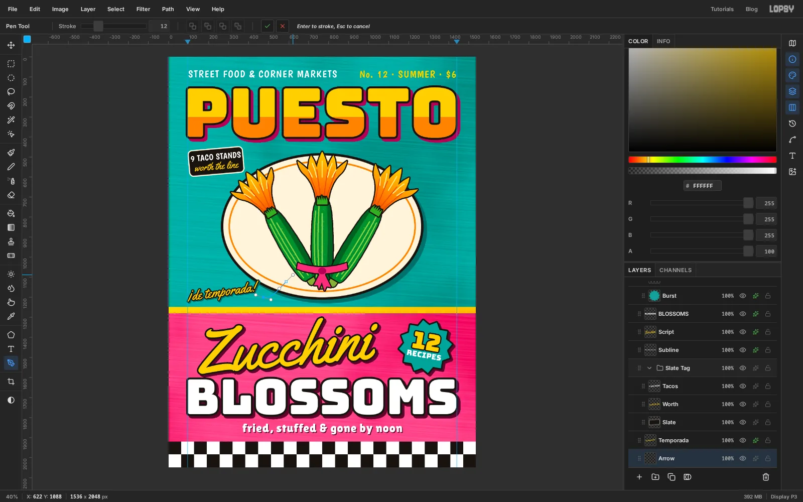

Click `Twine`. In yellow **Yellowtail** at **Size** `68`, type `¡de temporada!`, which means "in season" (the opening ¡ is [[Option+1]] on a Mac, or copy it from here). Rename the layer `Temporada`. Give it a **Stroke** of `5` in `#17130F` and a **Drop Shadow** with offsets of `5`, **Blur** `0`, **Opacity** `100` and the colour `#0B6E6A`. Tilt it about 8° anticlockwise and drag it into the bottom left of the wall, starting on the left guide and sitting a little above the yellow stripe.

Click `Twine` again and add a layer called `Arrow`. Set the foreground to white and pick the **Pen** tool. Press about 20 px past the end of the script and drag a short way right and slightly down. Dragging as you place a point pulls out handles and makes a curve. Then press just inside the rim of the medallion, about 110 px to the right and 80 px up from the first point, and drag up and to the right. You should see a smooth swoop that ends pointing at the twine bow.

Set **Stroke** to `12` in the options bar and press [[Enter]]. The path is painted onto the layer in the foreground colour. To hide the blue path outline afterwards, open the Paths panel and click `Path 1` once to deselect it.

With the Lasso, draw an arrowhead at the end of the stroke, a triangle with a small notch in its back edge, fill it with white and deselect. Add a **Stroke** of `6` in `#17130F` to the layer.

## Scatter sparkles with copy and paste

Click `Twine` and add a layer called `Sparkle`. With the Lasso, draw a four-point sparkle about 100 px wide and 125 px tall at the top right of the wall, near `1385, 525`: four points with sides that curve inward between them. Fill it with `#FFD21F` and deselect.

Marquee around it and press [[Cmd+C]], then [[Cmd+V]]. The copy arrives on a new layer, already selected. With the Move tool, drag it to a new spot, then hold [[Cmd]] and drag a corner handle inward to shrink it. Press [[Cmd+D]].

Paste four more times and place them the same way, so you end up with a big and a small sparkle in each of three places: top right of the wall, bottom right, and left of the medallion. Vary the sizes between about 40% and 80%.

Each paste made its own layer. Click the top `Pasted Layer` and press [[Cmd+E]] five times to merge them all down into `Sparkle`, then add a **Stroke** of `5` in `#17130F`. One effect now outlines all six.

## Add the barcode and export

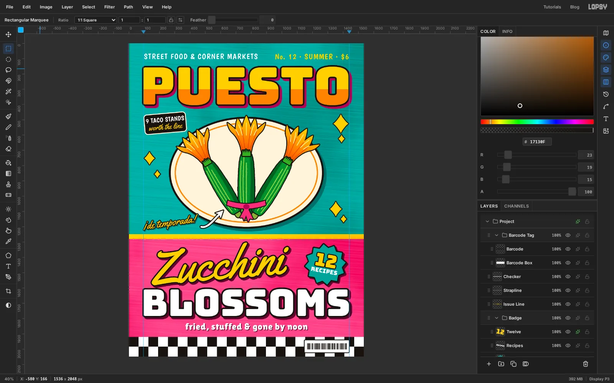

Click `Checker` and add a layer called `Barcode Box`. With the Shape tool on **Rectangle**, set the fill to white, the stroke to `#17130F` at **Width** `5` and **Corner Radius** `6`. Draw a box about 290 px wide and 85 px tall at the bottom right, with its right edge on the guide and the same amount of checker showing above it as below.

Click `Barcode Box`, set the foreground to `#17130F`, and type `PUESTO12` in **Libre Barcode 39** at **Size** `68`. The font turns the letters into bars. Rename the layer `Barcode`. Centre it in the box with an even margin on all four sides, then group the two layers as `Barcode Tag`.

Look over the whole cover once more before you export. Check that nothing touches something it shouldn't: the masthead shade and the middle blossom, the slate and the left blossom, the Z and the B, the subline and the checker.

Choose **File → Save Project** to keep the layered file, then **File → Quick Export PNG**.

To make your own issue, retype the cover lines, repaint the medallion with whatever is in season, and swap the wall and dado colours. The outline and hard shade will hold the cover together with any palette.
