In the 1890s, lake and seaside steamer companies advertised their trips with cheap letterpress **handbills**. A local jobbing printer set them by hand from whatever wood and metal type was in the case. That's why one sheet mixes a fat-face headline, a Tuscan arch, shaded capitals and a little italic. A photo-engraved vignette of the boat sat in the middle, and the whole sheet was printed in one or two inks on cheap buff paper. Today the survivors are foxed, folded and worn, and that wear is half their charm.

This tutorial makes one of those bills for a made-up steamer, the *Sandpiper*. The sheet is 1200 × 1800 px, printed in two inks (Prussian blue and vermilion), and holds:

- an Oxford-rule border with a quatrefoil chain and corner blocks
- an arched wood-type line above a shadowed headline
- a blue oval photo vignette with a halftone screen
- a ruled fares box, a red rubber stamp, and an aged, folded sheet

You'll need one photo: **Nydia (steam yacht).jpg** on Wikimedia Commons, taken in 1892 by the Detroit Publishing Co. It's in the **public domain**, so you can use it freely. It shows a two-masted steam yacht side-on, with a black hull on calm water. Download the 1920 px version.

The tools you'll use:

- the **Rectangular** and **Elliptical Marquee** with their exact-size dialogs, the **Lasso** and the **Magic Wand**
- **Select → Feather / Grow / Shrink / Inverse**, the **Pen** and **Path to Selection**
- **Define Brush** and the **Brush**'s Spacing, Scatter and Jitter settings, plus the **Pencil**, **Spray**, **Eraser** and **Clone Stamp**
- layer masks, **Duplicate Layer**, **Merge Down**, groups and the **Multiply** blend mode
- **Clouds**, **Add Noise**, **Gaussian Blur**, **Threshold** and **Halftone**
- a group's **Gradient Map** and **Levels** adjustments
- live text in six Google fonts, including text on an arch and text round a circle
- the grid with **Snap**, guides, the **Move** tool's rotate handle and arrow-key nudges

The palette is two inks on buff:

- Buff paper `#E6D5AE`, edge burn `#6B4A28`
- Prussian blue `#1F3552`, mid blue `#3E5F8A`
- Vermilion `#B23A2B`
- Foxing `#8A5A2B`, crease shadow `#5C4528`, crease light `#FBF4E2`

> **Tip:** On a wide-gamut (Display P3) screen, Lopsy reads typed hex codes as P3 colours. These codes were picked as P3 values, so they match the finished bill. On an sRGB screen they come out a touch duller.

> **Note:** Positions are in document pixels. Watch the X / Y readout in the status bar at the bottom left as you move the pointer, and zoom in ([[Cmd]]+scroll) for anything small. The marquees' exact-size dialog opens when you click the canvas **with nothing selected**, so press [[Cmd+D]] before each click.

> **Note:** Shortcuts are written for a Mac. On Windows use [[Ctrl]] wherever it says [[Cmd]] and [[Alt]] for [[Option]].

## Set up the sheet and the paper

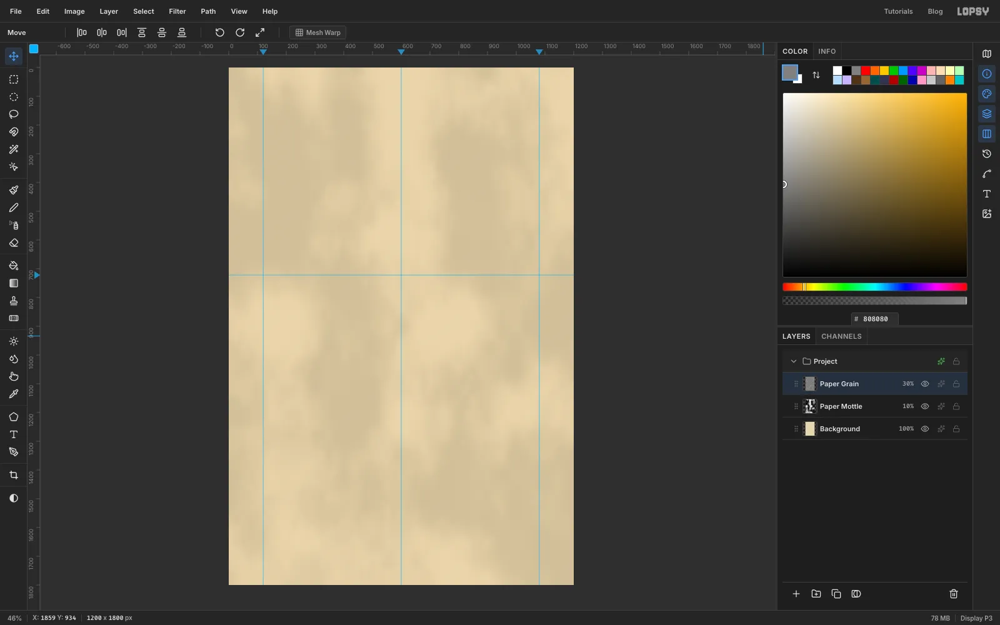

Choose **File → New**, keep the units on **Pixels**, and make the document **1200** wide and **1800** high.

Click the top ruler to drop vertical guides at **120**, **600** and **1080**. The middle guide is the axis that every line of type is centred on. Click the left ruler at **722** for a horizontal guide through the middle of the photo.

Click *Background*, set the foreground to buff `#E6D5AE` and choose **Edit → Fill**.

Click *Layer 1* and rename it *Paper Mottle*. Run **Filter → Clouds…** at **Scale 6**, then **Filter → Gaussian Blur…** at **Radius 10**. Click the effects button on the layer's row to open its effects drawer, set **Blend** to **Multiply** and close it. Then click the opacity number on the row and drag the slider down to **10%**.

Click **Add Layer** and name it *Paper Grain*. Fill it with mid grey `#808080`, then run **Filter → Add Noise…** at **Amount 60** with **Mono** and **Gaussian** on, and **Gaussian Blur** at **Radius 1**. Set it to **Overlay** at **30%**. The paper now has a fine, even tooth with no direction to it.

## Draw the thick outer rule

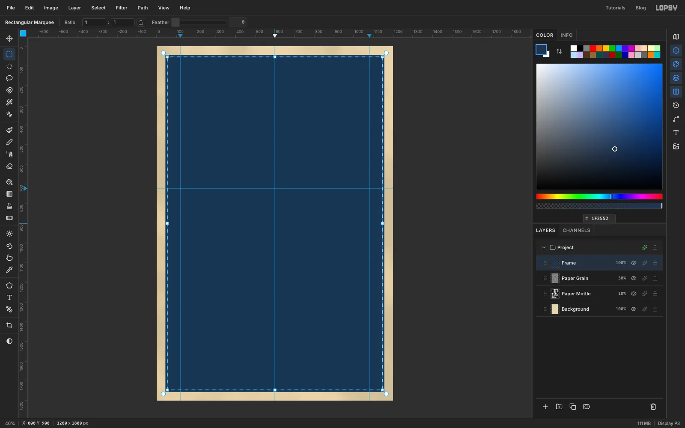

Click **Add Layer** and name it *Frame*. Set the foreground to Prussian blue `#1F3552`.

Pick the **Rectangular Marquee** and click once on the canvas (don't drag) to open the exact-size dialog. Enter **From 44, 44** and **To 1156, 1756**, press [[Enter]], and choose **Edit → Fill**.

Press [[Cmd+D]] and click the canvas again for a second marquee **10 px inside** the first: **From 54, 54** to **1146, 1746**. Press [[Delete]]. That leaves a 10 px rule round the sheet.

## Add two thin rules

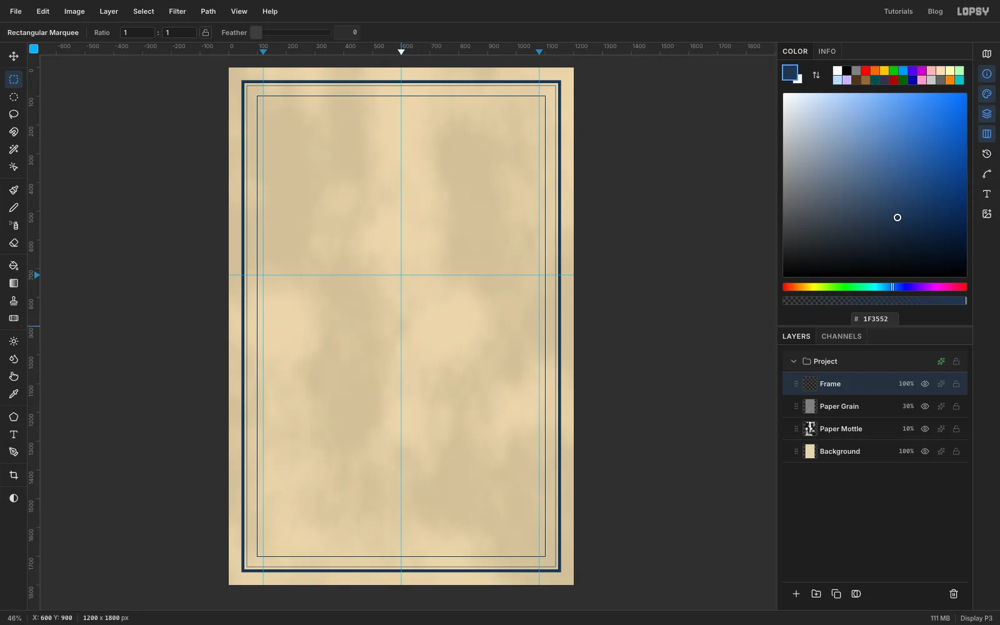

A Victorian Oxford rule pairs a thick line with a thin one. Make each thin rule the same way: marquee, fill, then [[Cmd+D]] and delete a marquee 2 px smaller.

- First rule: fill **62, 62 → 1138, 1738**, then delete **64, 64 → 1136, 1736**.
- Second rule: fill **98, 98 → 1102, 1702**, then delete **100, 100 → 1100, 1700**.

Press [[Cmd+D]] to deselect. The gap between the two thin rules is where the quatrefoil chain goes.

## Draw a quatrefoil

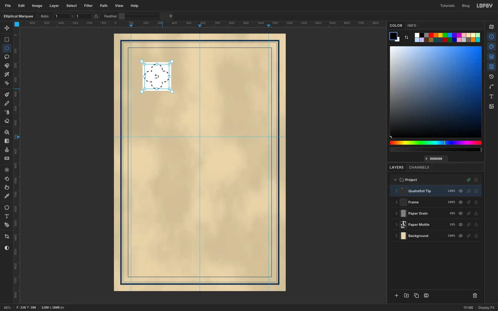

You'll stamp the chain with a custom brush, so first draw the tip. Click **Add Layer** and name it *Quatrefoil Tip*.

Set the foreground to white, open the **Rectangular Marquee** dialog and select a square from **200, 200** to **400, 400**. Fill it. Brush tips are made from dark pixels, and the white gives the black shape something to sit on.

Set the foreground to black and press [[Cmd+D]]. With the **Elliptical Marquee**, click the canvas to open its dialog and make a circle from **214, 262** to **290, 338**. Zoom in on the square, then hold [[Shift]] (which adds to the selection) and drag three more circles of the same size, 76 px across, so they overlap in a plus shape. The size readout next to the pointer helps you hit 76 × 76.

- one to the right, starting at **310, 262**
- one above, starting at **262, 214**
- one below, starting at **262, 310**

Choose **Edit → Fill**.

## Turn it into a brush tip

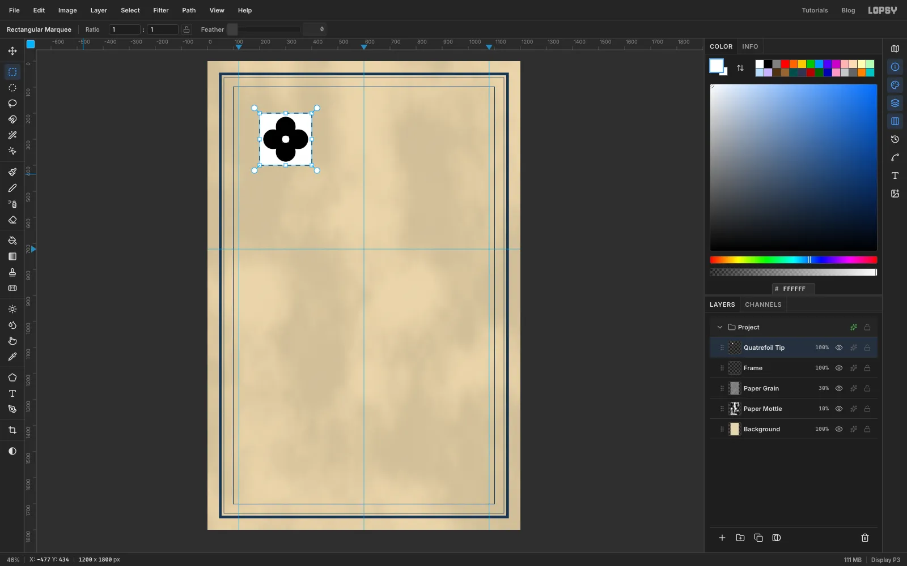

Set the foreground to white, press [[Cmd+D]] and make a small circle in the very centre with the dialog, from **286, 286** to **314, 314**. Fill it to punch a hole through the quatrefoil.

Deselect and marquee the whole white square again (**200, 200 → 400, 400**), choose **Edit → Define Brush…** and name it *Quatrefoil*. Press [[Cmd+D]], then delete the *Quatrefoil Tip* layer. The brush keeps the shape.

## String the quatrefoil chain

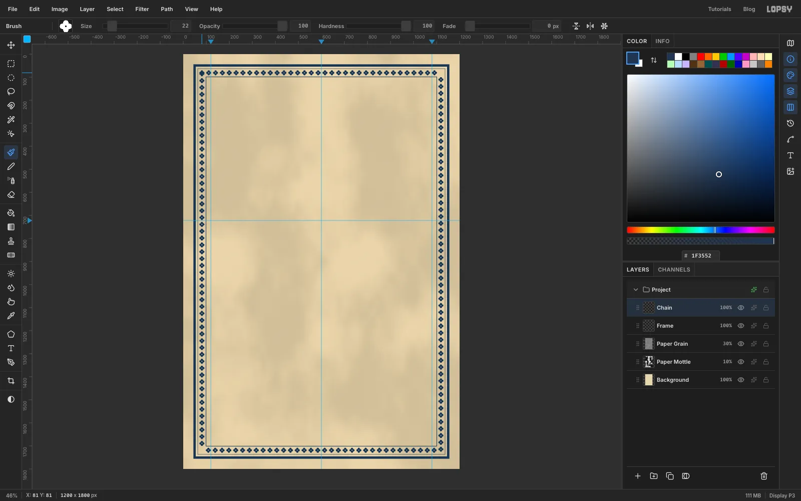

Click *Frame*, then **Add Layer** and name it *Chain*.

Pick the **Brush**, open the brush presets and choose **Quatrefoil**. In the Brushes window set **Size 22**, **Spacing 135%**, **Opacity 100** and **Taper 0**. Spacing above 100% leaves a gap between the stamps, so they read as separate ornaments.

With the foreground on Prussian blue, click at **81, 81** (the top-left corner, midway between the thin rules). Then hold [[Shift]] and click the other three corners in turn, **1119, 81**, **1119, 1719** and **81, 1719**, and finally **81, 81** again. Each [[Shift]]-click stamps a straight row of quatrefoils.

## Make a corner block

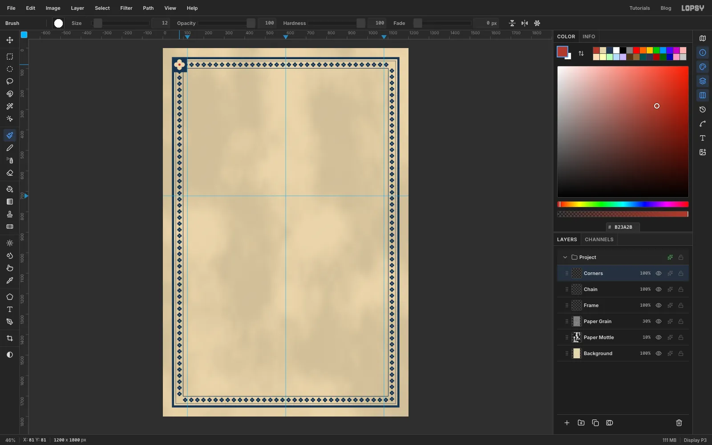

The corners of the chain don't line up perfectly, so cover them with blocks. Click **Add Layer** and name it *Corners*.

Marquee a square from **44, 44** to **118, 118**, fill it with Prussian blue and deselect.

Keep the **Quatrefoil** brush, but set its **Size** to **52**. Switch the foreground to buff `#E6D5AE` and click once in the centre of the block, at **81, 81**.

Then go back to the **Hard Round** preset and set **Size 12**, **Spacing 10%** and **Hardness 100**. Set the foreground to vermilion `#B23A2B` and click the same centre for a red eye.

## Copy the corner round the frame

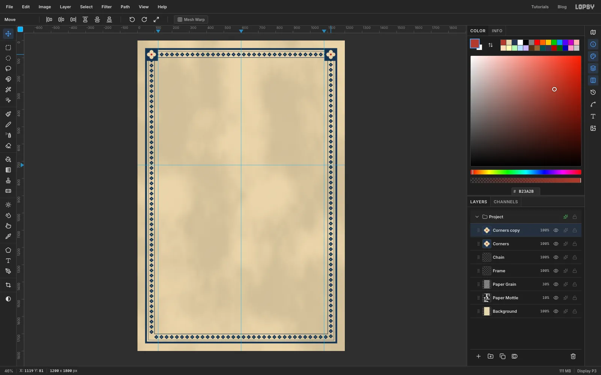

Choose **Layer → Duplicate Layer**. Pick the **Move** tool and drag the copy across to the top-right corner, about 1040 px. Then nudge it with the arrow keys ([[Shift]]+arrow moves 10 px) until the block's right and top edges sit exactly on the outer edge of the thick rule (x 1156, y 44). Choose **Layer → Merge Down**.

Now duplicate *Corners* again. It holds both top blocks, so drag the copy down about 1640 px, nudge it until its bottom edge sits on y 1756, and **Merge Down**. All four corners are done.

## Drop in the photo and scale it

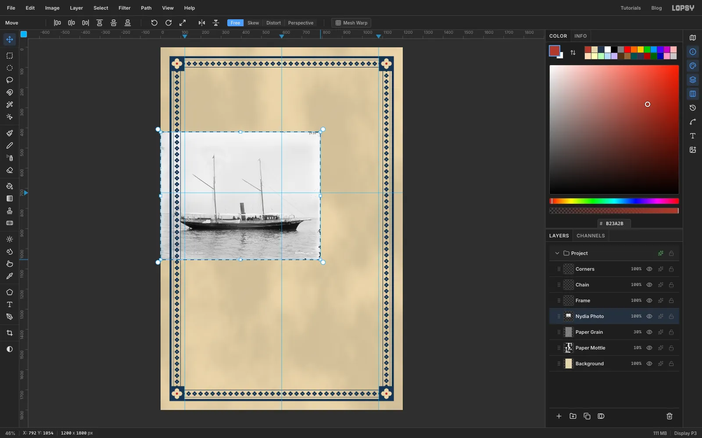

Click *Paper Grain* so the photo lands under the frame. Drag the downloaded photo from your folder onto the canvas. It arrives as a new layer, fitted to the sheet's width and already selected. Rename it *Nydia Photo*.

With the **Move** tool, hold [[Cmd]] and drag the photo's **bottom-right handle** inwards until it's about **66%** of its size (about 790 px wide). Then drag inside the photo so the hull is centred on the middle guide and the waterline sits about 150 px below the horizontal guide. Press [[Cmd+D]] to commit.

## Clone out the stern flag

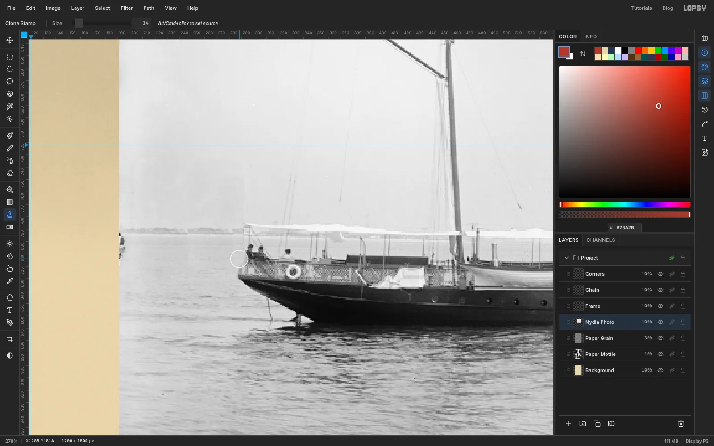

The photo shows an American flag at the stern (the left end of the boat), which would look out of place on a British-style bill priced in shillings. Zoom in on the flag.

Pick the **Clone Stamp** at **Size 14**. [[Option]]-click in the plain sky a little **up and to the left** of the flag, then paint over the flag with short sideways strokes. Sampling up-left balances the sky's two gradients: it gets lighter towards the top and darker towards the left edge of the old glass plate.

The bottom of the flag hangs over the water. For that part, [[Option]]-click in the water just to the **left** of it, at the same height, and paint over the tip.

## Fade the photo into a feathered oval

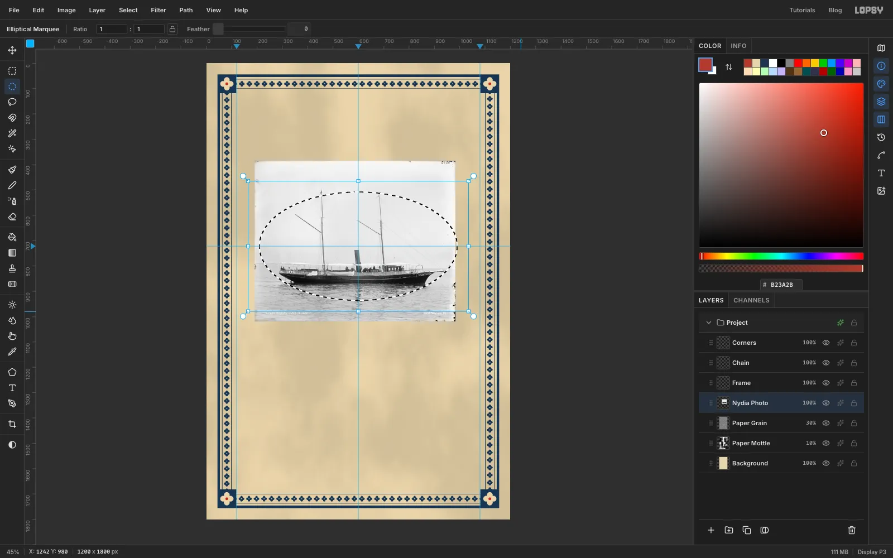

Press [[Cmd+D]], then with the **Elliptical Marquee** click to open the dialog and make an oval from **208, 508** to **992, 936**. Choose **Select → Feather…** at **44**.

Click **Add Mask** in the Layers panel, then click the mask thumbnail to edit the mask. Choose **Select → Inverse**, set the foreground to black and choose **Edit → Fill**. Deselect, then click the layer's name to leave mask editing. The photo now fades softly into the paper, the way a Victorian vignette does.

## Add a halftone screen

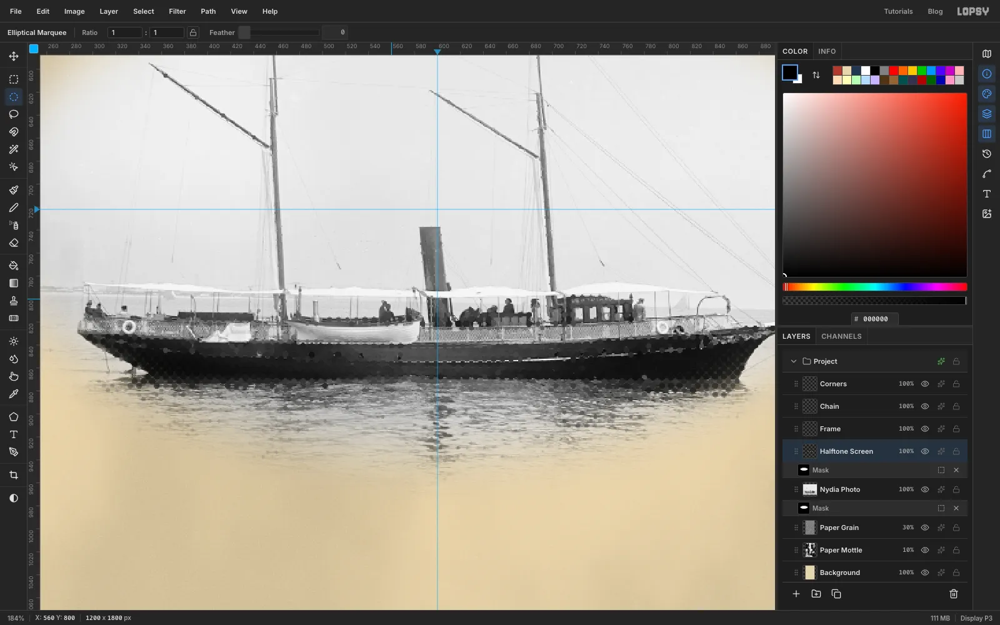

A printer of the 1890s reproduced photos as a halftone: a screen of dots. Choose **Layer → Duplicate Layer** and name the copy *Halftone Screen*. The copy keeps the oval mask.

Run **Gaussian Blur** at **Radius 0.8** on the copy, then **Filter → Halftone…** with **Dot Size 6**, **Density 1.1**, **Angle 45** and **Softness 0.4**.

Halftone leaves the gaps between dots transparent, so the untouched photo below shows through. You get a dot screen across the midtones while the fine rigging lines survive.

## Print it in Prussian blue

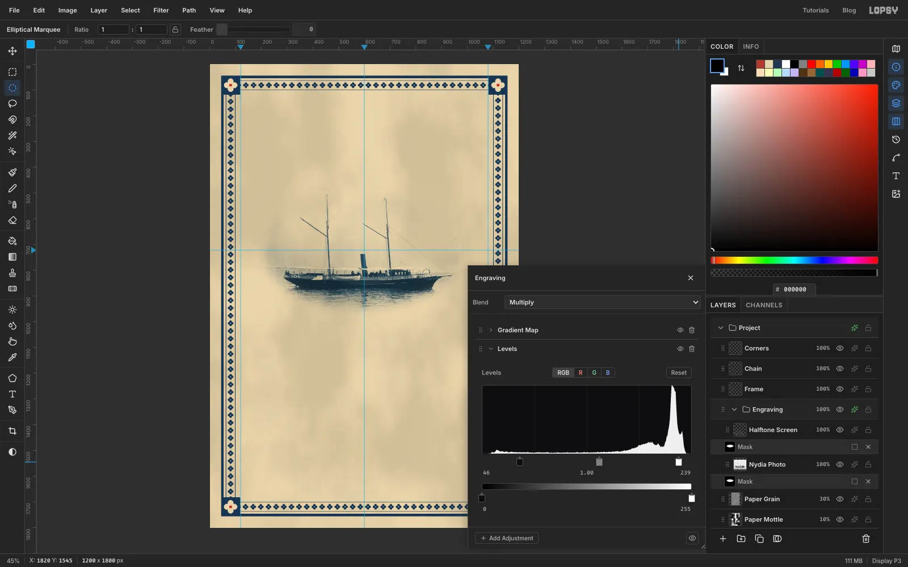

Click *Nydia Photo*, [[Shift]]-click *Halftone Screen*, and choose **Layer → Group Layers**. Name the group *Engraving* and click the effects button on its row to open the group's adjustments.

Click **Add Adjustment → Gradient Map**. Before you touch any colour field, click the gradient bar at about **45%** to add a third stop. Then click each stop and type its hex:

- left: Prussian blue `#1F3552`
- middle: mid blue `#3E5F8A`
- right: white `#FFFFFF`

Click **Add Adjustment → Levels**. Drag the **black** input handle right to about **46** and the **white** handle left to about **239**. The hull goes solid, and the hazy sky goes white.

Finally set the group's **Blend** to **Multiply** and close the drawer. White multiplies to nothing, so the paper shows through the sky, and the darks print as blue ink.

## Frame the oval

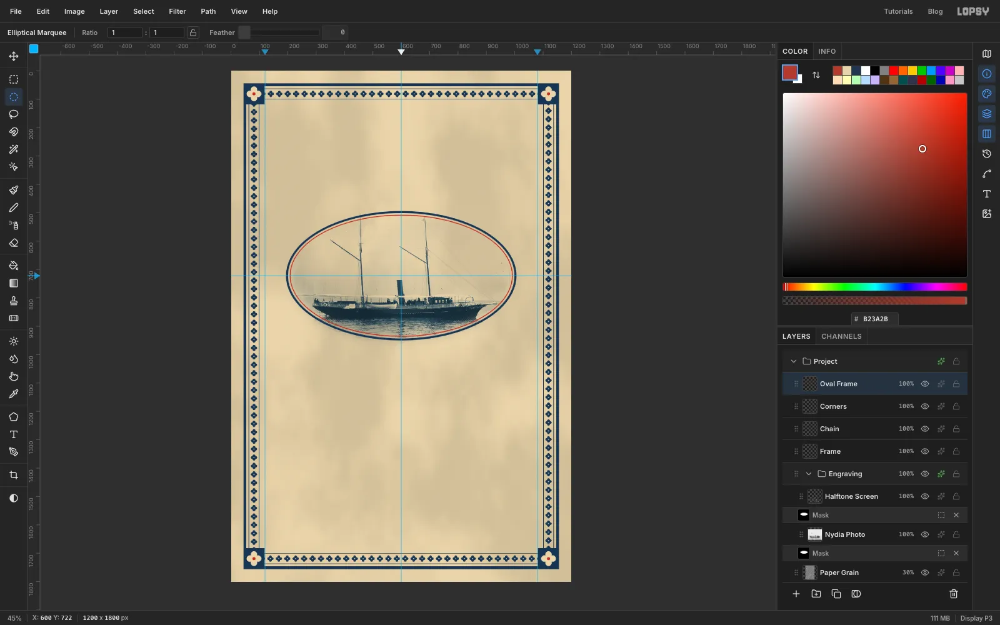

Click *Corners*, then **Add Layer** and name it *Oval Frame*. Draw each ring as a filled ellipse with a smaller ellipse deleted from it, all centred on the guides. Remember [[Cmd+D]] before each dialog.

- Blue ring: fill **194, 494 → 1006, 950** with Prussian blue, then delete **201, 501 → 999, 943**.
- Red ring: fill **207, 507 → 993, 937** with vermilion, then delete **210, 510 → 990, 934**.

Deselect.

## Rule the fares box on the grid

Click **Add Layer** and name it *Rules*. Choose **View → Show Grid** and set the grid size to **32** in the options bar. **Snap** switches on with the grid.

Drag a rectangular marquee from about **225, 1355** to **978, 1500**. It snaps to the nearest grid lines, **216, 1348 → 984, 1508**, so the box lands square and centred. Fill it with Prussian blue and hide the grid again (**View → Show Grid**).

Hollow it out into a double rule with the marquee dialog, pressing [[Cmd+D]] before each one:

- delete **220, 1352 → 980, 1504**
- fill **225, 1357 → 975, 1499**
- delete **227, 1359 → 973, 1497**

For the dotted centre divider, choose the **Hard Round** brush at **Size 4**, **Hardness 100**, and set its **Spacing** to **260%**. Click at **600, 1372** and [[Shift]]-click at **600, 1484**.

## Add a divider with a lozenge

Still on *Rules*, set the foreground to vermilion. Fill a marquee from **240, 1164** to **960, 1170**, then (after [[Cmd+D]]) a thin one from **270, 1175** to **930, 1177**. Deselect.

For the lozenge, pick the **Pen** and click four corners round the centre of the rule: **570, 1168**, **600, 1154**, **630, 1168** and **600, 1182**. Then click the first point again to close the path.

In the **Paths** panel click **Path to Selection**, and delete the path. Choose **Select → Grow…** at **6** and fill with buff to clear a gap in the red rules. Then choose **Select → Shrink…** at **6** and fill with Prussian blue.

## Set the fares and the small print

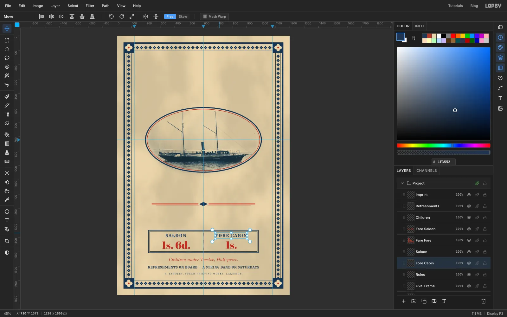

Now the type. Work **from the bottom up**, because a Text click near an existing text layer edits that layer. For each line:

1. Click *Rules* first, so the Text options set up a new layer instead of restyling the last one. New text lands just above *Rules*.
2. Pick the **Text** tool. Set the font, size, colour and style (**Regular** unless the list says Italic).
3. In the Text panel, set the **Letter spacing** (0 unless the list gives a number) and check that **Align** is **Left**. Style, spacing and Align all carry over from the last line.
4. Click below or beside the existing type, type the line and press [[Tab]] to commit.
5. Switch to **Move** ([[V]]) and nudge the line with the arrow keys ([[Shift]] moves 10 px) until it's centred on the middle guide with the middle of its letters at the y given.
6. Double-click the layer's name and rename it as listed, so you can find it later.

The lines, bottom first:

- *S. YARDLEY, STEAM PRINTING WORKS, LAKESIDE.* — **Old Standard TT**, 16 px, blue, spacing 3, at y 1652. Name it *Imprint*.
- *REFRESHMENTS ON BOARD · A STRING BAND ON SATURDAYS* — **Rye**, 22 px, blue, spacing 1, at y 1606. Name it *Refreshments*.
- *Children under Twelve, Half-price.* — Old Standard TT **Italic**, 32 px, vermilion, at y 1556. Name it *Children*.
- *1s. 6d.* — **Abril Fatface**, Regular, 72 px, vermilion, centred on x 408 (the middle of the box's left half) at y 1452. Name it *Fare Saloon*.
- *1s.* — the same, centred on x 792. Name it *Fare Fore*.
- *SALOON* and *FORE CABIN* — Rye, 30 px, blue, spacing 3, on x 408 and x 792 at y 1386.

## Set the display lines

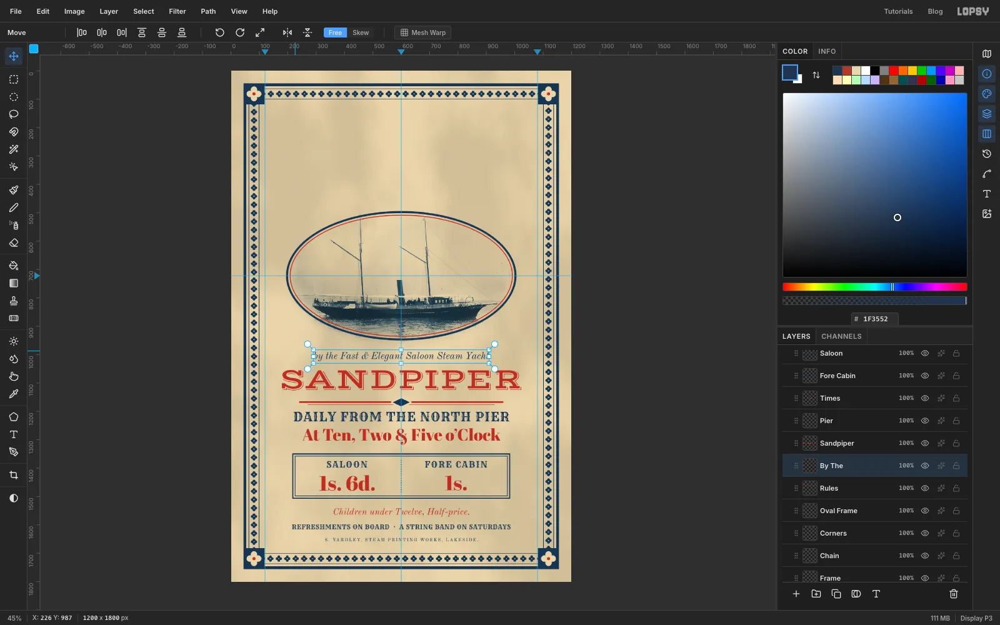

Carry on upwards with the same five steps:

- *At Ten, Two & Five o'Clock* — Abril Fatface, Regular, 58 px, vermilion, spacing 0, at y 1288. Name it *Times*.
- *DAILY FROM THE NORTH PIER* — Rye, 44 px, blue, spacing 2, at y 1218. Name it *Pier*.
- *SANDPIPER* — **Vast Shadow**, 104 px, vermilion, spacing 0, at y 1089. Vast Shadow is a Victorian shaded face, so the cut-in shadow comes with the font.
- *by the Fast & Elegant Saloon Steam Yacht* — Old Standard TT **Italic**, 34 px, blue, spacing 0, at y 1006, about 40 px below the oval frame. Name it *By The*.

Check the gaps by eye: each line should sit a little closer to its partner (DAILY to the times) than to the rule or box beyond.

## Set EXCURSIONS with a printed shadow

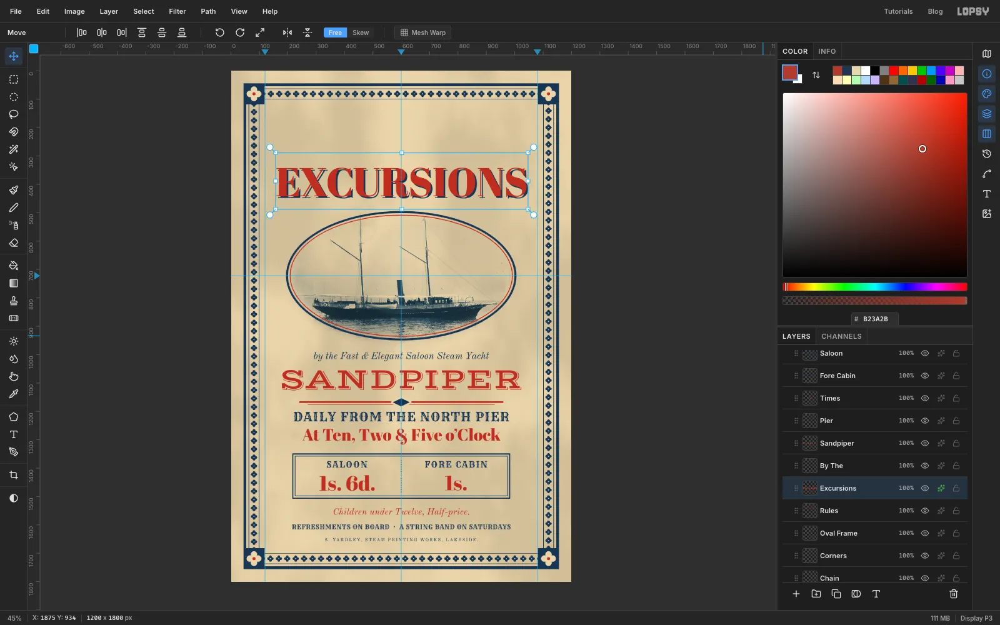

Click *Rules* and set *EXCURSIONS* in **Abril Fatface**, **Regular** (the last line was italic), 142 px, vermilion, spacing 0. Centre it with the middle of its capitals at y 392, so the letters run from about y 340 to 443. That leaves about 60 px to the frame on each side.

Open its effects and turn on **Drop Shadow**:

- **Offset X 6** and **Offset Y 6**
- **Blur 1** and **Spread 0**
- **Opacity 100**
- colour Prussian blue

Victorian printers did this by printing a second block of the same type in the other ink, set slightly off. So it reads as a solid blue shadow, not a soft glow. Close the drawer.

## Draw an arch with the Pen

Pick the **Pen**. Draw a smooth three-point arch that starts at the left end of EXCURSIONS, peaks on the middle guide about 100 px above the word, and comes down at its right end:

1. Press at the top-left corner of EXCURSIONS (about **287, 338**) and drag up and to the right about 110 px to pull out a handle.
2. Press at **600, 242**, on the middle guide, and drag straight right about 110 px.
3. Press at the top-right corner of the word (about **913, 338**) and drag down and to the right about 110 px.

Click the ✓ in the options bar to keep the path without stroking it.

## Bend GRAND PLEASURE onto the arch

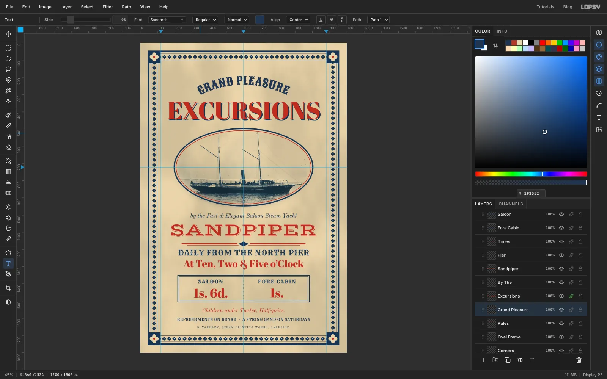

Click *Rules* so the new text lands above it. With the **Text** tool set **Sancreek**, 66 px, blue, letter spacing 2 and Align **Left**, click in an empty part of the sheet (over the photo works) and type *GRAND PLEASURE*. Press [[Tab]].

Name the layer *Grand Pleasure*. With it still active, pick the arch (*Path 1*) in the **Path** dropdown in the Text options bar, then set **Align** to **Center**. The letters jump onto the arch and turn to follow it.

In the **Paths** panel, click the path's row to deselect it so its outline stops drawing. Don't delete the path: the text stays bound to it.

## Add the company line

Click *Rules* and set *THE LAKESIDE STEAM PACKET COMPANY* in Old Standard TT, 24 px, blue, with **letter spacing 5**. Set **Align** back to **Left** first, since it carried over from the arch. Centre it at y 146, about 45 px below the top inner rule, and name it *Kicker*.

## Cut the stamp's rings

The rubber stamp goes in the empty top-right corner. Click the *EXCURSIONS* layer, then **Add Layer** and name it *Stamp*. Set the foreground to vermilion. Every ring is centred on **1004, 236**: fill a circle with the Elliptical Marquee dialog, then delete a smaller one.

- Outer ring: fill **926, 158 → 1082, 314**, delete **932, 164 → 1076, 308**.
- Hairline: fill **937, 169 → 1071, 303**, delete **939, 171 → 1069, 301**.
- Inner ring: fill **975, 207 → 1033, 265**, delete **977, 209 → 1031, 263**.

Press [[Cmd+D]] before each dialog.

## Run text round the stamp

Pick the **Shape** tool. Set **Shape** to **Ellipse** and **Output** to **Path**. Hold [[Cmd]] and drag from the stamp's centre out to a radius of about **46 px**, which draws a circular path.

Click *Stamp*, then use the **Text** tool to set *★ SEASON 1894 ★ FIRST SAILINGS* (with a trailing space) in **Rye**, 13 px, vermilion, letter spacing 1, Align **Left**, somewhere empty. Paste the stars if you can't type them. Bind it to the circle (*Path 2*) with the **Path** dropdown and set **Align** to **Center**. Deselect the path in the Paths panel.

## Centre the date and merge the stamp

Inside the small ring, set the date in **Abril Fatface**, vermilion, letter spacing 0. Click *Stamp* before each word and check that **Align** is back on **Left**. Make *1st* at 20 px first, then *MAY* at 24 px above it. Setting the lower word first keeps the second click from editing the first word. Centre both on the stamp.

Then merge it all into one layer. Click the *MAY* layer and choose **Layer → Merge Down**. Repeat for *1st* and then the ring text, until only *Stamp* is left.

## Wear the stamp

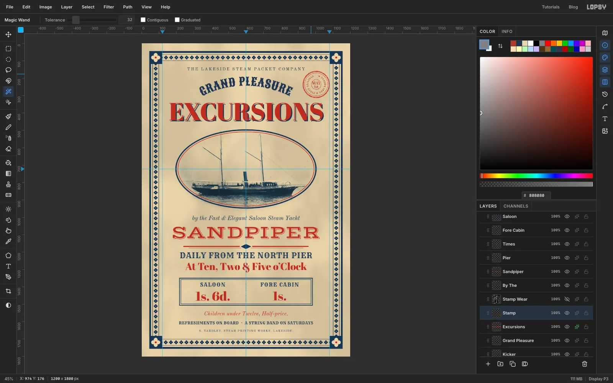

Click **Add Layer** and name it *Stamp Wear*. Fill it with `#808080`, then run:

- **Add Noise** at **100** (Mono, Gaussian)
- **Gaussian Blur** at **1.2**
- **Threshold** at **140**

That leaves scattered white specks on black.

Pick the **Magic Wand**, turn **Contiguous** off and click a white speck to select them all. Hide *Stamp Wear*, click *Stamp* and press [[Delete]], then deselect.

## Rotate the stamp

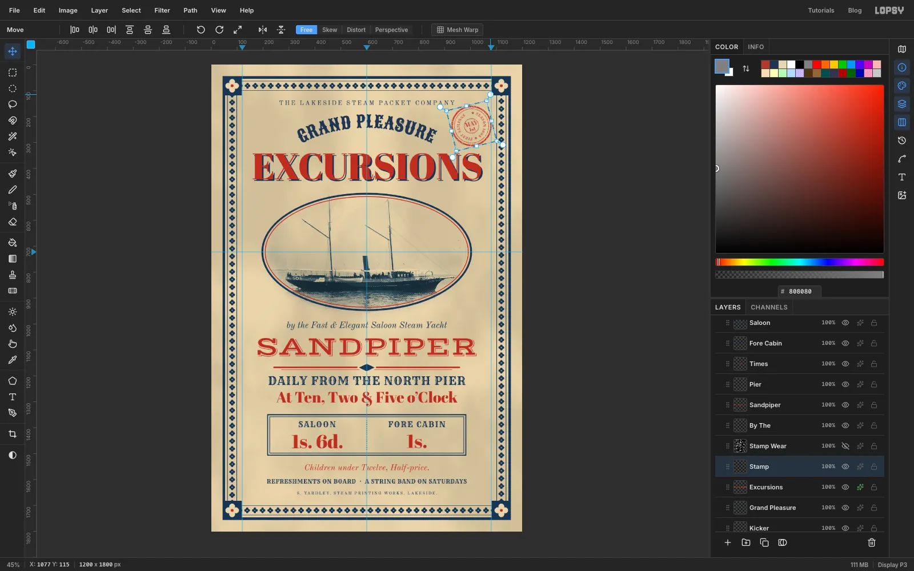

Marquee a square just round the stamp (about **924, 156 → 1084, 316**). With the **Move** tool, drag the rotate handle just outside the top-right corner anticlockwise to about **−14°**. Press [[Cmd+D]] to commit.

Pick the **Eraser** at **Size 12** and drag a short stroke across the outer ring at about one o'clock, to break it like a nicked stamp.

## Give the stamp uneven pressure

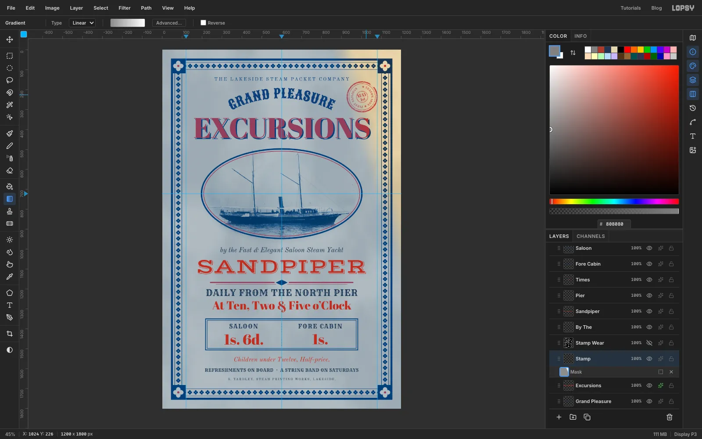

A stamp pressed by hand is rarely even. Click **Add Mask**, then click the mask thumbnail to edit it.

Pick the **Gradient** tool, set it to **Linear**, and in **Advanced…** make a gradient from grey `#8C8C8C` to white `#FFFFFF`. Drag from the stamp's left edge to just right of its centre. The blue tint is only Lopsy showing you're editing the mask.

Click the layer's name to leave mask editing. Set *Stamp* to **Multiply** at **88%** so it sits in the paper like real ink.

## Group the header and the fares

Click the *EXCURSIONS* layer, [[Shift]]-click the company line's layer (it takes in *GRAND PLEASURE* between them) and choose **Layer → Group Layers**. Name the group *Header*. Do the same for the four lines in the fares box: click *Fare Saloon*, [[Shift]]-click *Fore Cabin*, group them and name the group *Fares*.

Heavy figures look lower than they are, so lift the fares a touch. Click the *Fares* group row, pick the **Move** tool and press [[↑]] four times. The whole group moves together.

## Knock the red ink off register

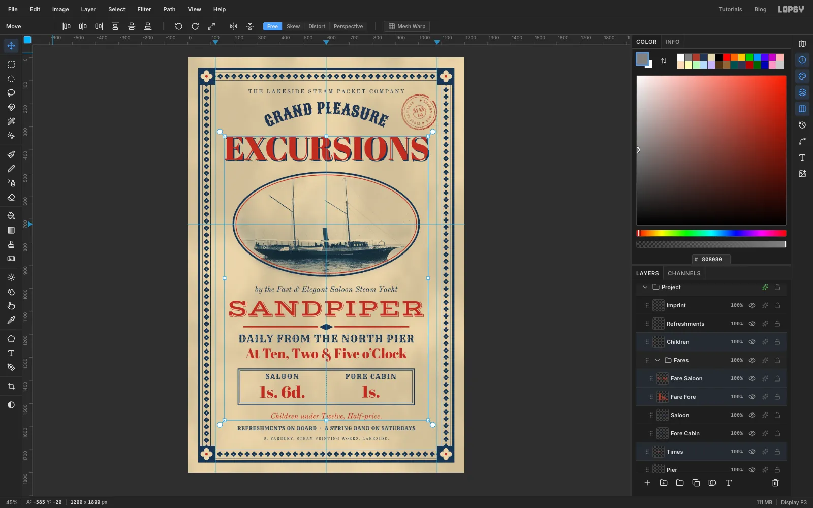

Real two-colour printing never lines up perfectly. Expand both groups with their arrows. Click the *SANDPIPER* layer, then [[Cmd]]-click *Times*, *Children*, *EXCURSIONS*, *Fare Saloon* and *Fare Fore*. [[Cmd]]-click works across groups.

With the **Move** tool, press [[→]] twice and [[↓]] once. Every red layer shifts as one, a hair off the blue. Collapse the groups again.

## Add foxing

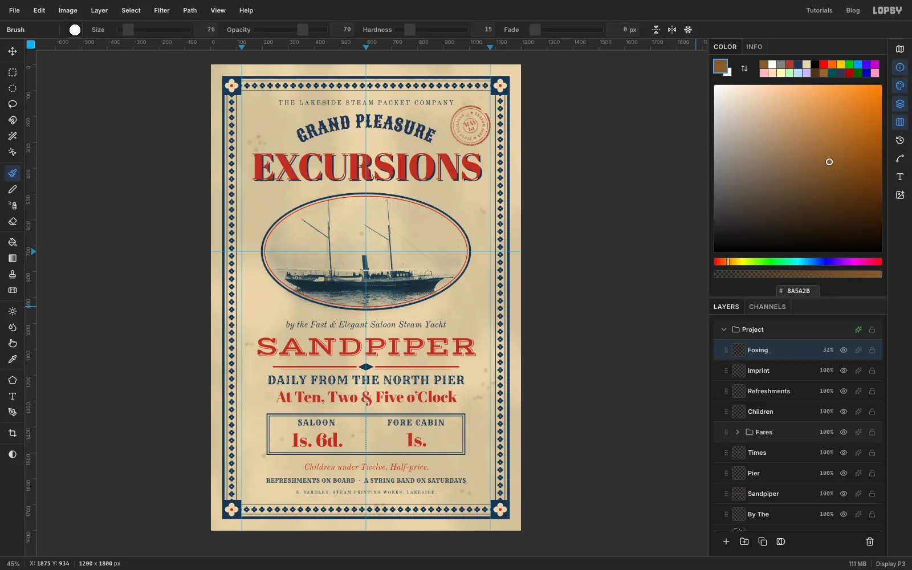

Click the top layer, then **Add Layer** and name it *Foxing*. Set the foreground to foxing brown `#8A5A2B`.

Choose the **Hard Round** brush and set it up in the Brushes window:

- **Size 26**, **Hardness 15**, **Spacing 55%**, **Opacity 70**
- on the Dynamics tab, **Scatter 140**, **Size Jitter 85** and **Opacity Jitter 70**

Make about fifteen short strokes, 15–60 px long, mostly near the edges and where the folds will run. Each one scatters a cluster of spots of different sizes. Set the layer to **Multiply** at **32%**.

## Burn the edges

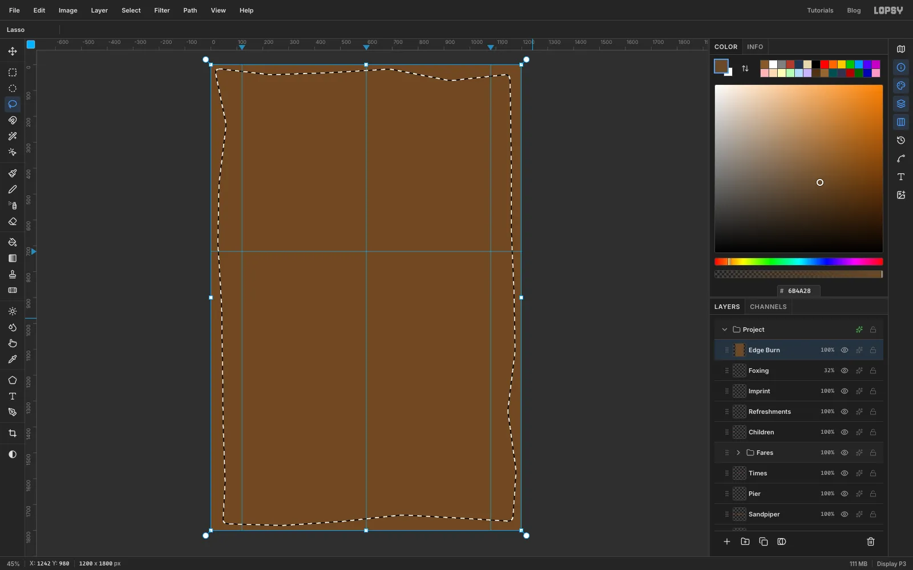

Click **Add Layer** and name it *Edge Burn*. Fill the whole layer with umber `#6B4A28`.

Pick the **Lasso** and draw a loop round the sheet, staying **15–70 px** in from the edges. Let your hand wander so the margin is never even. Choose **Select → Feather…** at **20**, press [[Delete]] and deselect.

Open the Brushes window and click the **Hard Round** preset again, then set **Size 160**, **Hardness 0**, **Spacing 10%**, **Opacity 100**, and **Scatter**, **Size Jitter** and **Opacity Jitter** back to **0** (they carry over from the foxing). With the brush click once on each corner and once at each end of the two folds (the middle of each edge), where paper wears darkest. Run **Gaussian Blur** at **8**, and set the layer to **Multiply** at **32%**.

## Crease the folds

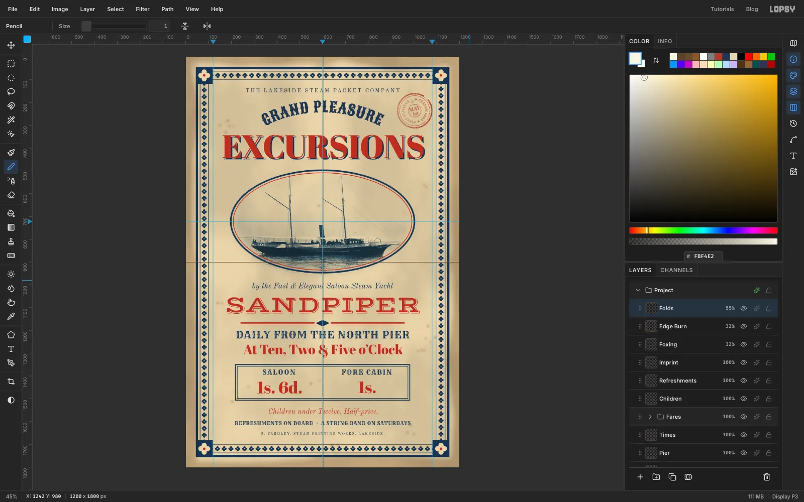

Click **Add Layer** and name it *Folds*. The bill was folded in quarters.

1. Keep the **Hard Round** brush but set **Size 8** (Hardness 0, no scatter or jitter), with the foreground on crease shadow `#5C4528`.
2. Click at the left edge at **y 902** and [[Shift]]-click at the right edge for the horizontal crease.
3. Click at the top at **x 602** and [[Shift]]-click at the bottom for the vertical one.
4. Switch to the **Pencil** at **Size 1** with crease light `#FBF4E2`, and draw two lines the same way, just above and to the left: at **y 899** and **x 599**.

Blur the layer at **0.7** and set it to **55%**. The light edge and soft shadow read as a fold, not a drawn line.

## Wear the ink

Finally, make the type look printed. Click **Add Layer** and name it *Ink Wear*, then make a speck sheet:

- fill it with `#808080`
- **Add Noise** at **100** (Mono, Gaussian)
- **Gaussian Blur** at **2.4**, so the specks clump into larger voids
- **Threshold** at **136**

Magic-wand a white speck with Contiguous off, fill the selection with buff `#E6D5AE`, then **Select → Inverse** and press [[Delete]]. Press [[Cmd+D]], draw the photo's oval again with the dialog (**208, 508 → 992, 936**), press [[Delete]] and deselect, because the halftone already textures the photo.

Spray shares the Brush's tip, so check the Brush is back on **Hard Round**. Then pick the **Spray** with buff as the foreground, **Opacity 90** and **Softness 0**, and drag along the places that wear first:

- the outer rule: **Size 28**, **Density 10**
- the top and bottom edges of EXCURSIONS: **Size 40**, **Density 8**
- a heavier pass across the lower right of EXCURSIONS: **Size 60**, **Density 14**
- a heavier pass across SANDPIPER: **Size 50**, **Density 10**
- along both fold lines: **Size 14**, **Density 12**

Set *Ink Wear* to **72%**. Hide the guides with **View → Show Guides**, and export with **File → Quick Export PNG**.
