Textbook volcano diagrams are a gift to a T-shirt designer. They have one strong silhouette, a hot orange core, and a ring of small labels that reward a closer look. This tutorial turns Mount Vesuvius into a scientific plate on a dark shirt. It has an eruption column shaped like the "umbrella pine" Pliny the Younger described, a cut-open cone of ash and lava beds, and the plumbing underneath. The labels are numbered like an old atlas, and three small roundels come from the hand-coloured plates in Sir William Hamilton's *Campi Phlegraei* (1776).

Almost every shape here is a selection filled with colour. The interesting part is how each one gets its texture:
- The cone's beds are a single Pen path, filled, shrunk and filled again over and over.
- The rocks under the volcano use three map symbols, each made with a different tool: **Voronoi** cracks, **Halftone** dots and a **Define Pattern** brick tile.
- The cloud gets its puffy shading from hard **Drop Shadows** and a mid tone that you nudge up and to the left.

The canvas is **1800 × 2200 px**, and the charcoal background stands in for the shirt. Some steps give a rough position in document pixels. Hover over the canvas and read **X** and **Y** at the bottom left of the window to find it. The main places are:
- **Frame:** a double cream rule 40 px and 54 px in from the edges.
- **Section block:** from x 340 to x 1460, between the ground line at y 1160 and the bottom at y 1590.
- **Crater:** at about (905, 600). Monte Somma's old rim peaks at about (646, 770).
- **Title block:** from y 1658 down to the bottom frame.

Two habits help throughout:
- **Name layers as you go.** Double-click a layer's name to rename it. Later steps refer to layers by name.
- **Exact selections:** with the Rectangular or Elliptical Marquee, a single click on the canvas (no drag) opens a small dialog where you type the **From** and **To** corners.

The two plates used for the roundels are Wellcome Collection scans on Wikimedia Commons, licensed **CC BY 4.0**, so credit them if you publish your version: *Lava, scoriae and pumice from Mount Vesuvius* and *Mount Vesuvius in eruption in 1767, from the mole at Naples*, both coloured etchings after Pietro Fabris. Download each at **1280 px wide** (one of the *Other resolutions* on its Commons page), so it drops into Lopsy at the size the steps assume.

Palette:

- Shirt `#1C1817` (the background, not an ink), cream ink `#EFE3C8`, ochre `#D19A4E`
- Cloud `#6A5E56` → `#A8998A` → `#B3A595` → `#C6B8A6` → `#D9CDB9`, lobe shade `#7E7066`
- Fire `#FF7A1E`, ash grain `#808080` (Overlay)
- Lava `#FFD45C` → `#FF9A2E` → `#D2501E`, magma rim `#C2421C`, magma shadow `#8A2A14`
- Chamber `#FFE27A` → `#FF9A2E` → `#B23A16`, spatter `#FFB45C`
- Beds `#C79A5C` / `#2E2A28` / `#A8998A` / `#D9B884` / `#4E4643`, crust `#3A302C`
- Basement ash `#A8998A`, old lava `#3A3431`, tuff `#C79A5C`, limestone `#D8CCB0`, dolomite `#7D6E5E`
- Voronoi block `#D9D4CC`, halftone grey `#707070`, brick lines `#8E806A`
- Lightning `#FFF4C4`, lightning rim `#E8902A`, bombs `#6E5F55`
- Duotone `#1C1817` → `#B5652A` → `#F4E6C8`, glow `#E8661E` → `#FFF1E0`

## Fill the shirt colour and set up guides

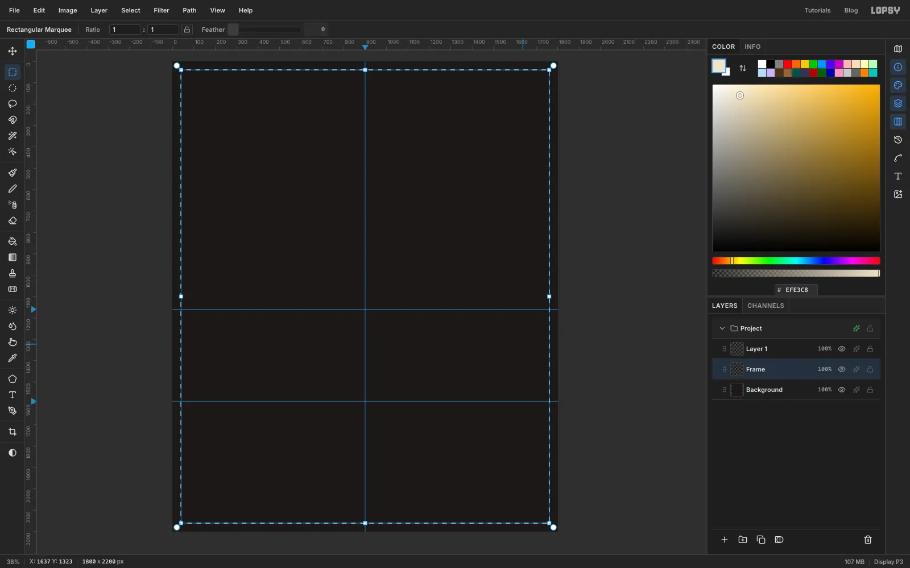

1. Create an **1800 × 2200 px** document.
2. Select **Background**, set the foreground colour to `#1C1817` and choose **Edit → Fill**.
3. Click the top ruler at x **900** to drop a vertical guide down the middle. Click the left ruler at y **1160** (the ground line) and y **1590** (the bottom of the section).
4. Click **Add Layer** and name the new layer `Frame`. Leave the document's empty `Layer 1` where it is for now. You'll delete it before painting the magma. Pick the **Rectangular Marquee**, click once on the canvas, and enter **From** 40, 40 and **To** 1760, 2160.

## Rule a double frame

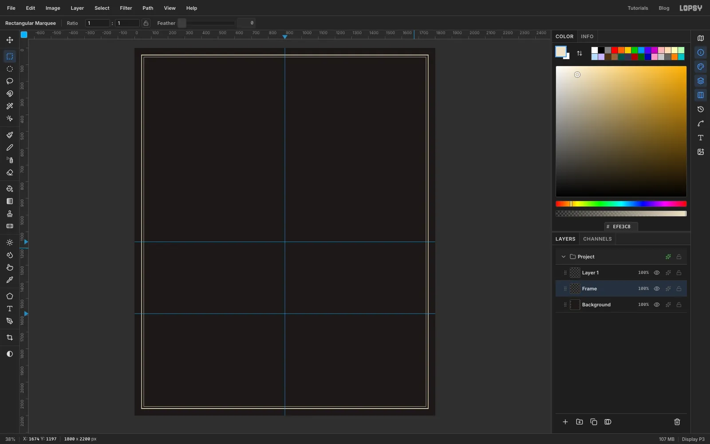

1. Set the foreground colour to cream `#EFE3C8` and choose **Edit → Fill**.
2. Choose **Select → Shrink…** and shrink by **4 px**, then press **Delete**. What's left is a 4 px cream rule.
3. Click with the marquee again and enter **From** 54, 54 and **To** 1746, 2146. Fill it with cream, shrink by **2 px** and press **Delete** for the hairline.
4. Press [[Cmd+D]] to deselect.

## Lasso the eruption column

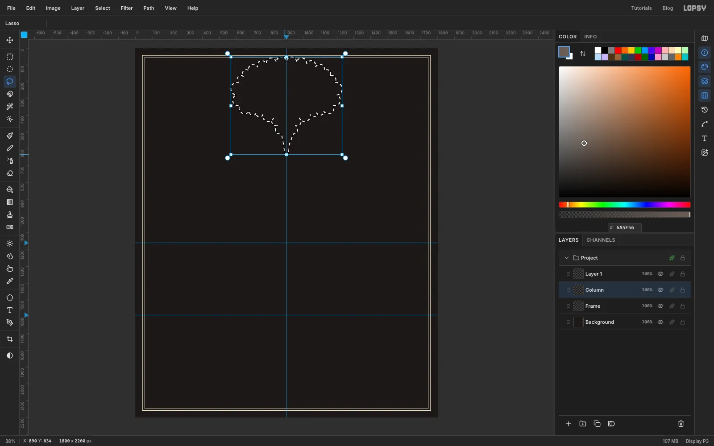

A Plinian eruption column rises as a stem, then spreads into an umbrella. Draw the whole silhouette in one go.

1. Click `Frame`, add a layer and name it `Column`.
2. Pick the **Lasso**. Start at the crater, about (890, 634), with a stem about 30 px wide. Go up the left side, flaring out to about x 820 at y 410.
3. Swing out along the underside of the umbrella to its left tip at about (600, 280). Go over the top, which peaks at about y 80 above the centre, and down to the right tip at about (1200, 280). Come back along the underside and down the right side of the stem.
4. Wiggle the outline as you go, so the umbrella and the upper stem are edged with round bumps about 50 px across. Leave the bottom 60 px of the stem smooth.
5. Set the colour to `#6A5E56` and choose **Edit → Fill**. Keep the selection.

## Shade the bumps with an offset copy

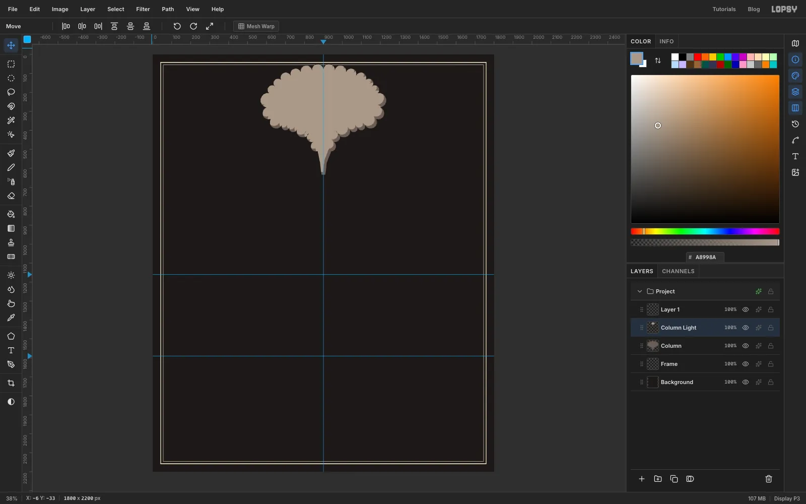

1. Add a layer named `Column Light`. With the same selection still active, fill it with `#A8998A`, then deselect.
2. Pick the **Move** tool and nudge the layer **12 px left** and **14 px up** with the arrow keys. [[Shift]] + arrow moves 10 px at a time.
3. [[Cmd]]-click the `Column` thumbnail to load its shape as a selection, and choose **Select → Inverse**.
4. Click the `Column Light` layer and press **Delete** to trim the overhang, then deselect.

The dark layer underneath now peeks out as a crescent under every bump, as if lit from the top left.

## Stack cauliflower lobes

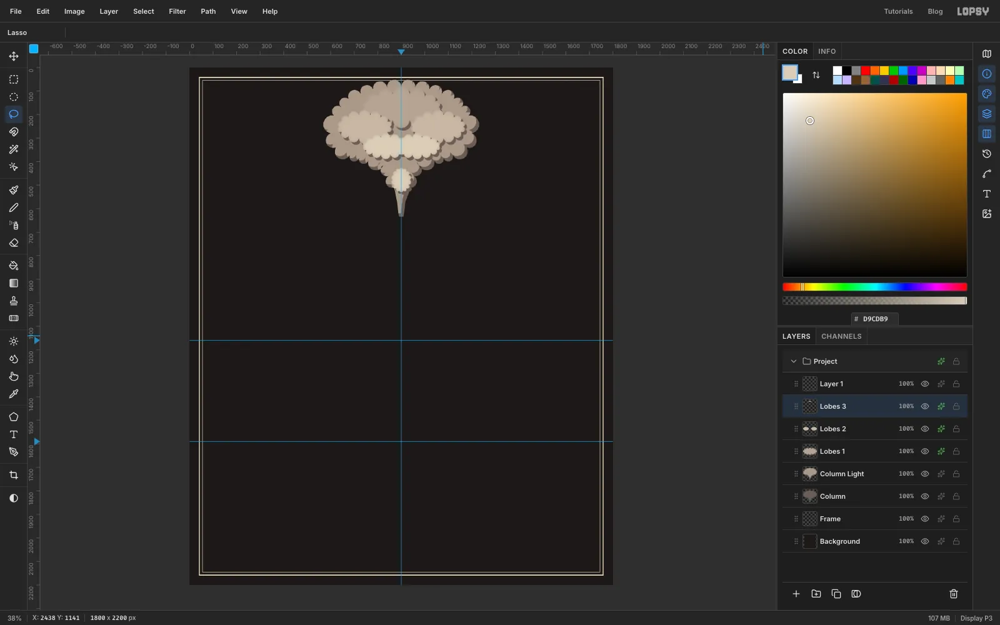

Real ash clouds are lumps on lumps. Build them in three rows, from the back to the front.

1. Add a layer named `Lobes 1`. With the **Lasso**, draw one wide scalloped lobe across the top of the umbrella, about 320 × 110 px and centred near (900, 168). Fill it with `#B3A595`.
2. Open the layer's effects and turn on **Drop Shadow**:
   - Offset X **9**, Offset Y **11**, Blur **0**, Opacity **100**.
   - Colour `#6A5E56`.
3. Turn on **Inner Glow** at Size **22**, Opacity **40**, colour `#7E7066`. This darkens the lobe's edges so it looks rounded.
4. Add `Lobes 2` and draw two lobes, about 220 × 100 px, centred near (744, 252) and (1056, 252). Fill them with `#C6B8A6` and give the layer the same two effects.
5. Add `Lobes 3` and draw two smaller lobes centred near (834, 334) and (968, 334), plus a small puff in the stem at about (900, 478). Fill them with `#D9CDB9` and use the same effects.

Because each row is its own layer, its hard shadow falls on the row behind it.

## Light the underside with fire

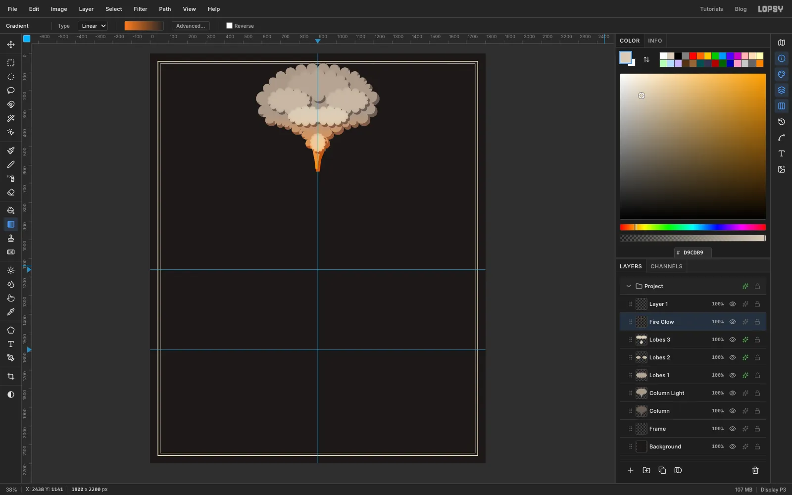

1. Add a layer named `Fire Glow` above `Lobes 3`, and [[Cmd]]-click the `Column` thumbnail.
2. Pick the **Gradient** tool and open the gradient editor:
   - Set both stops to `#FF7A1E`.
   - Drag the right stop's opacity down to **0**.
3. Drag from the crater (about y 630) straight up to y 330.
4. Set the layer's blend mode to **Overlay** and deselect.

## Add ash grain and a cream outline

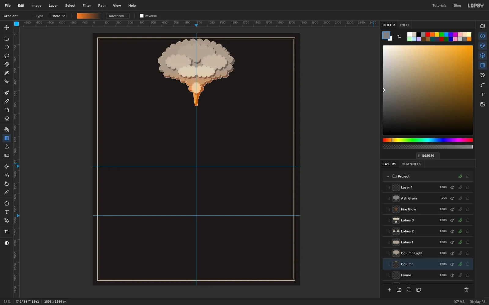

1. Add a layer named `Ash Grain`, [[Cmd]]-click the `Column` thumbnail and fill the selection with mid grey `#808080`.
2. Choose **Filter → Add Noise…** at **45**, **Mono**. Deselect, set the blend mode to **Overlay** and the opacity to **45%**.
3. Select the `Column` layer and add a **Stroke** effect: Width **2**, colour `#EFE3C8`, position **Outside**.

## Draw volcanic lightning

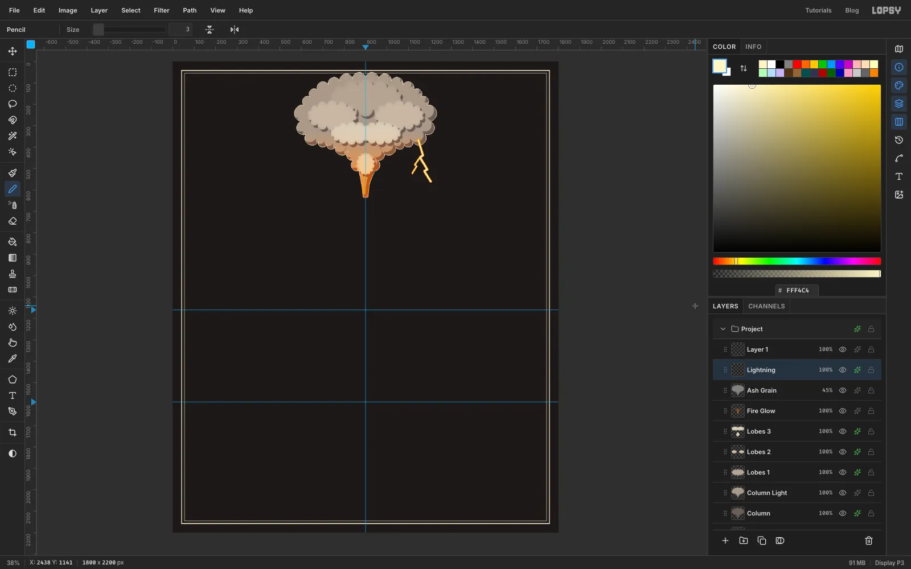

1. Click `Ash Grain` and add a layer above it named `Lightning`.
2. Pick the **Pencil** at **Size 5**, colour `#FFF4C4`. Click just inside the cloud's lower right edge at about (1146, 366), then **Shift+click** a zigzag down to about (1204, 560). Use five or six short segments.
3. At **Size 3**, click on one of the bends and **Shift+click** a shorter branch off to the left.
4. Add a **Stroke** effect: Width **3**, colour `#E8902A`, position **Outside**.

## Dot the bomb trajectories

Volcanic bombs fly on ballistic arcs. Diagrams draw those arcs as dotted lines, and a widely spaced brush draws the dots for you.

1. Add a layer named `Trajectories`.
2. Pick the **Brush** at **Size 6**, Hardness **100**. Open the brush settings from the tip thumbnail in the options bar and set **Spacing** to **200%**.
3. Set the colour to cream. Drag three arcs out of the crater: up, then down to the left. Land one on Monte Somma's rim at about (683, 783), one in the valley at about (785, 810), and one far down the left flank at about (575, 902).

> **Tip:** Each arc is one stroke, so if an arc lands in the wrong place, press [[Cmd+Z]] and drag it again.

## Add the bombs and group the eruption

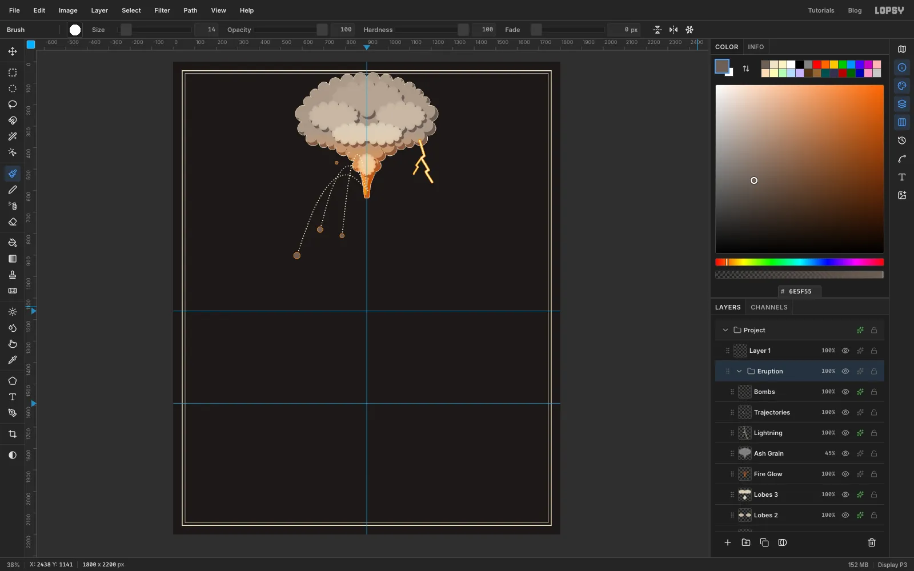

1. Add a layer named `Bombs`. Set the brush **Spacing** to **25%** and the colour to `#6E5F55`.
2. Click once at the end of each arc, at sizes **26**, **20** and **30**. Add one smaller bomb in flight, at size 14, about halfway along the first arc.
3. Add a **Stroke** effect: Width **2**, colour `#FF9A2E`.
4. In the Layers panel, click `Column`, **Shift+click** `Bombs` and click **Group Layers**. Name the group `Eruption` and collapse it.

## Trace the cone with the Pen

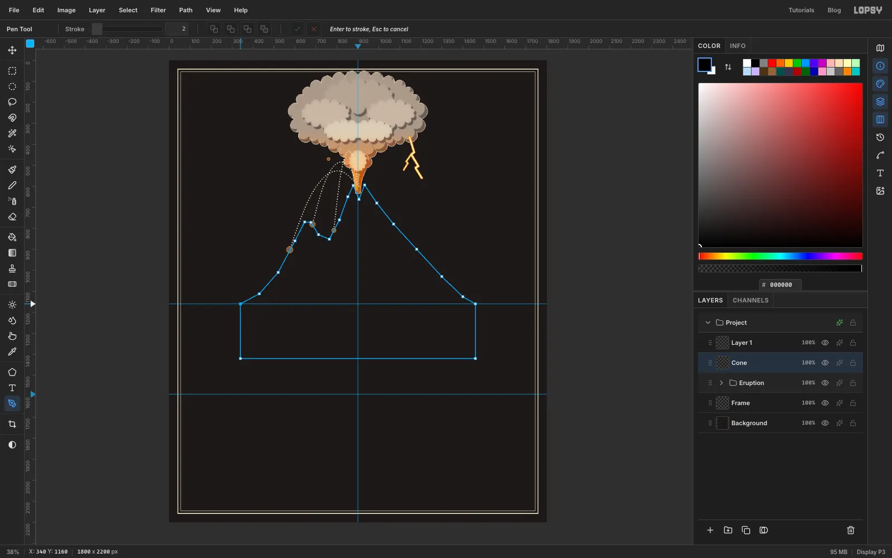

1. With the collapsed `Eruption` group selected, add a layer named `Cone`.
2. Pick the **Pen** tool and click your way round the profile. Add four or five points along each flank so the slopes curve:
   - Start at the left base, (340, 1160), and rise in a gentle curve to the old Monte Somma rim at about (646, 770).
   - Drop into the valley at about (764, 852), then climb the steeper Gran Cono to the crater rim at about (878, 596).
   - Click the crater floor at about (905, 662), then the right rim at about (932, 594).
   - Run down the right flank to the right base at (1460, 1160).
3. Don't close the shape at the ground line. Click on down to (1460, 1420), then across to (340, 1420), and close the path by clicking the first point.

The extra 260 px below the ground line keeps the beds you make next from curling round at the foot of the cone. The basement will cover that part.

## Turn the path into a selection

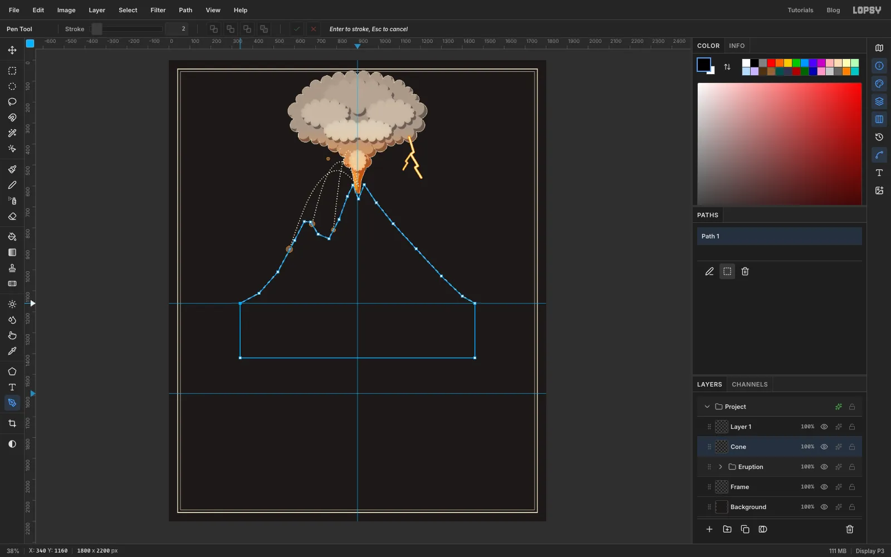

Open the **Paths** panel from the right-hand toolbar and click **Path to Selection**.

## Shrink and fill the beds

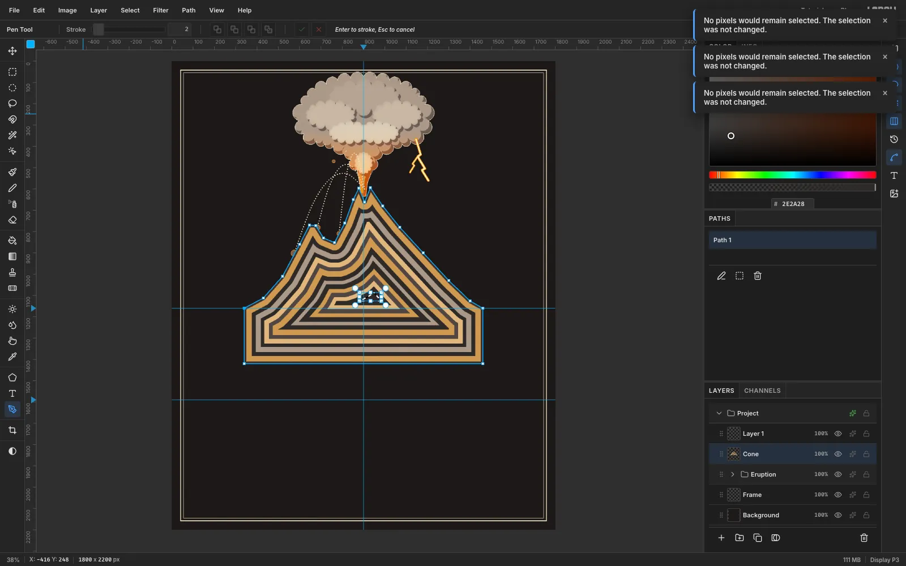

A stratovolcano grows from layer after layer of ash and lava draped over its own slopes. To draw that, fill the selection, shrink it, fill again with the next colour, and repeat.

1. Fill with the crust colour `#3A302C`, then **Select → Shrink…** by **10 px**.
2. Fill with ochre `#C79A5C` and shrink by **26**. Fill with near-black `#2E2A28` and shrink by **18**.
3. Keep going, always putting a light bed next to a dark one:
   - Ash `#A8998A`, then near-black, then pale ochre `#D9B884`, then slate `#4E4643`.
   - Repeat with ochre, near-black and ash until the selection closes up.
4. Vary each shrink between **16** and **26 px**, so the beds don't look ruled.
5. When Lopsy says *No pixels would remain selected*, the selection has closed up at the core. Stop shrinking there.

## Soften the bed edges

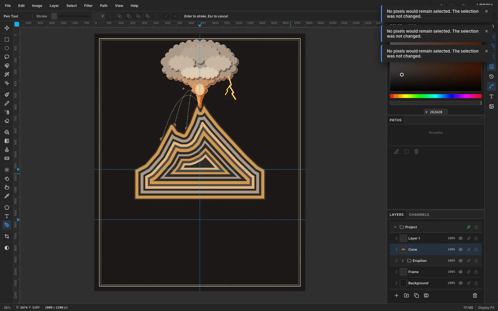

1. Deselect, then choose **Filter → Gaussian Blur…** at **Radius 1**. This softens the stair-stepped edges the Shrink rings leave.
2. In the **Paths** panel, click **Delete Path**.

## Lay the basement beds

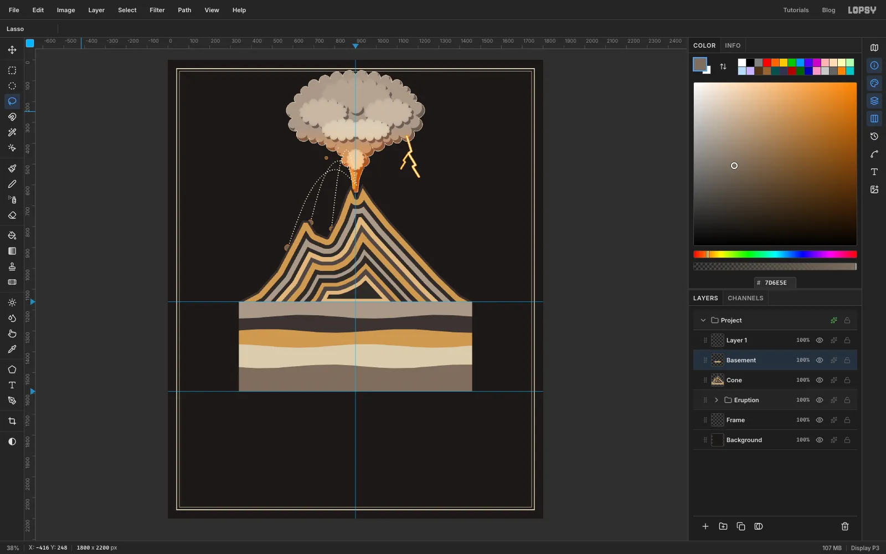

1. Add a layer named `Basement` above `Cone`.
2. Use the **Lasso** for each bed. Start at its top edge on the left side of the block (x 340), wobble across to x 1460, and come back along the bottom of the block at y 1590. Each new bed paints over the one before, so work downward:
   - Ash `#A8998A` from the flat ground line at y 1160.
   - Old lava `#3A3431` from about y 1232.
   - Tuff `#C79A5C` from about y 1300.
   - Limestone `#D8CCB0` from about y 1372.
   - Dolomite `#7D6E5E` from about y 1470.
3. Keep the wobble small, about 10 px up and down.

## Crack the old lava with Voronoi

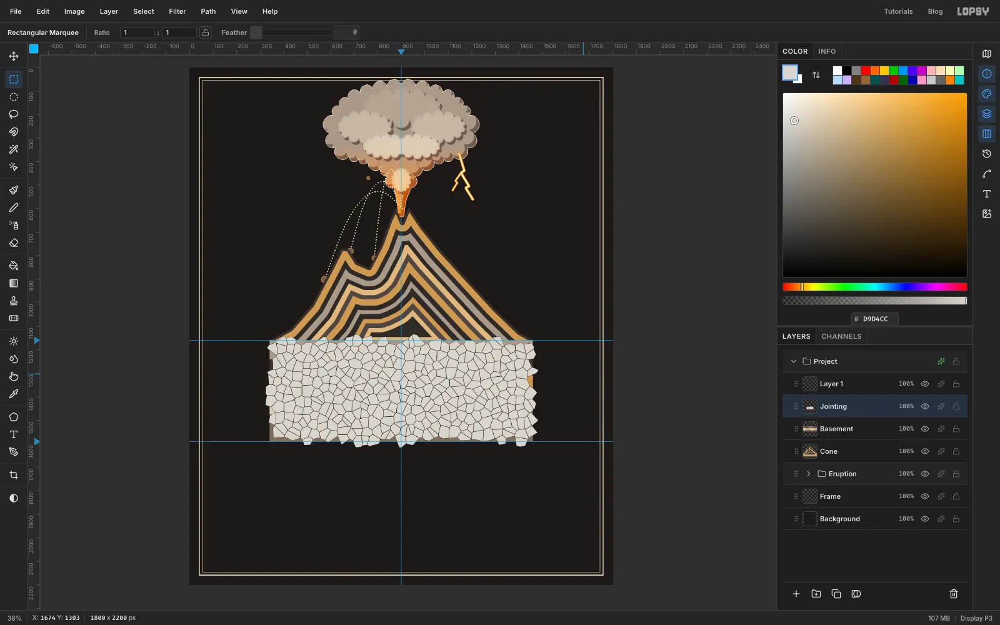

1. Add a layer named `Jointing`. Click with the **Rectangular Marquee** and enter **From** 340, 1160 and **To** 1460, 1590. Fill it with `#D9D4CC` and deselect.
2. Choose **Filter → Voronoi…** with Cells **60**, Edge Width **3** and Seed **7**.
3. Select the `Basement` layer. Pick the **Magic Wand** at **Tolerance 8** and click the dark lava bed.
4. Choose **Select → Inverse**, select `Jointing`, press **Delete** and deselect.
5. Set `Jointing` to **Multiply**. Only the cracks in the lava bed remain.

Voronoi decides each cell's edge from the colour at the cell's centre, so cells spill slightly past a shape's edge. Running it on a plain block and trimming afterwards keeps the bed's outline clean.

## Dot the tuff with Halftone

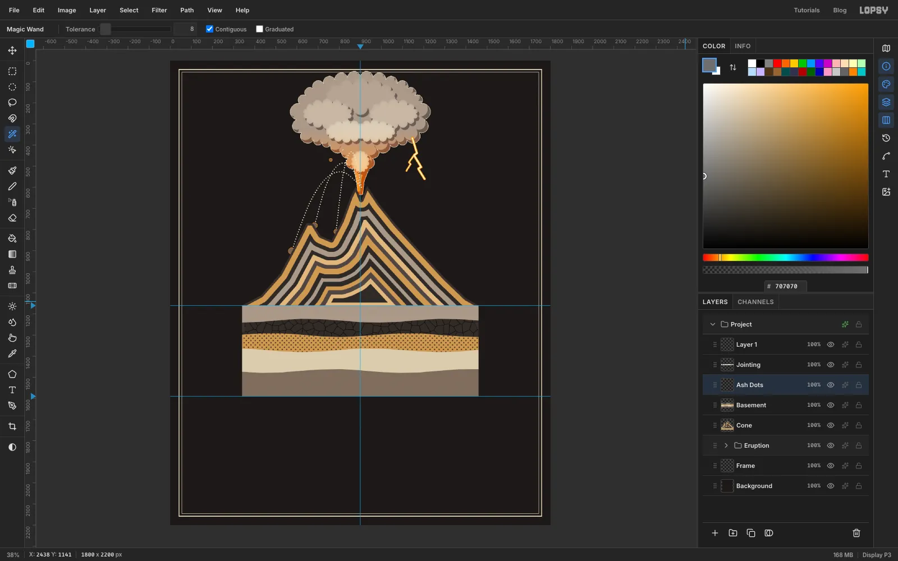

1. Select `Basement`, and click the ochre bed with the **Magic Wand**.
2. Add a layer named `Ash Dots` and fill the selection with `#707070`.
3. Choose **Filter → Halftone…** with Dot Size **12**, Density **0.8** and Angle **45**. Deselect and set the layer to **Multiply**.

## Draw a brick pattern tile

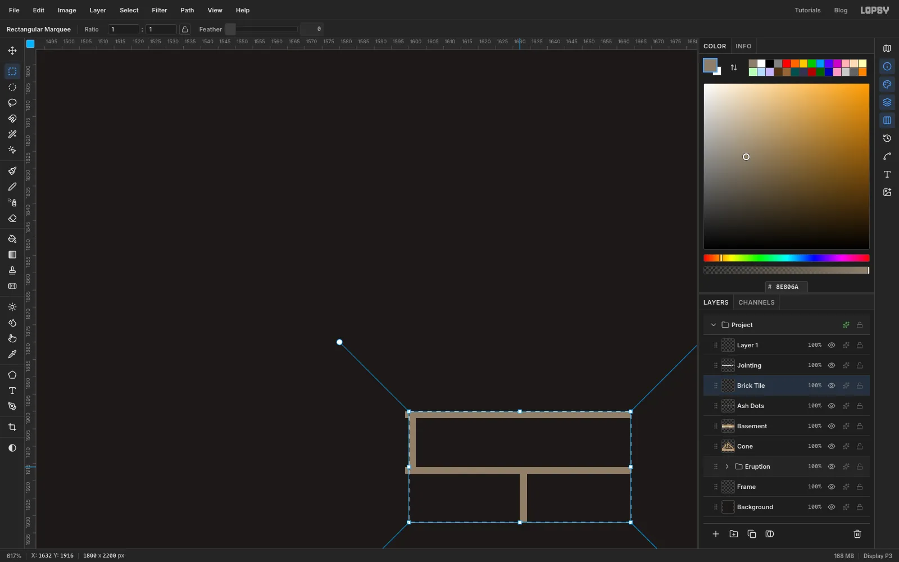

Geologists draw limestone as brickwork. Make one tile and let Lopsy repeat it.

1. Add a layer named `Brick Tile`. Pick the **Pencil** at **Size 2**, colour `#8E806A`, and zoom in on an empty corner of the canvas near (1600, 1900).
2. Draw a 64 × 32 px tile with straight lines (click, then **Shift+click**):
   - One line across the top and one across the middle.
   - A short upright on the left edge of the top row.
   - A short upright in the middle of the bottom row.
3. Click with the **Rectangular Marquee** and enter **From** 1600, 1900 and **To** 1664, 1932. Choose **Edit → Define Pattern**.
4. Deselect and delete the `Brick Tile` layer.

## Fill the limestone with bricks

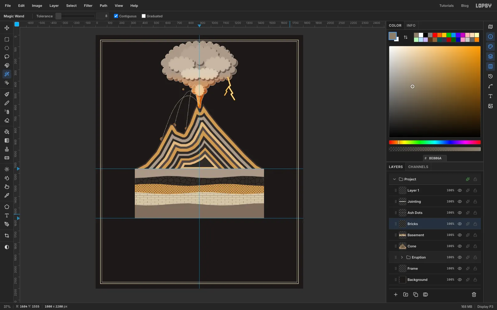

1. Select `Basement` and click the limestone bed with the **Magic Wand**.
2. Add a layer named `Bricks` and choose **Edit → Fill with Pattern…**. Click your tile and click **Apply**.
3. Deselect.

## Lasso the conduit, dike and sill

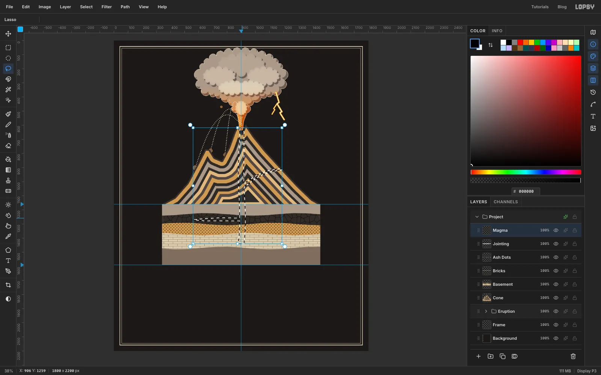

1. Delete the empty `Layer 1` at the top of the stack. Then select `Jointing` and add a layer named `Magma`.
2. With the **Lasso**, draw the **conduit**: a band about 40 px wide, waving gently, from the magma chamber's roof at about y 1440 up to the crater, at about y 618.
3. Hold [[Shift]] and lasso the **dike**. It is a tapering branch about 20 px thick that leaves the conduit at about y 1040 and arcs up and right to the flank vent at about (1190, 910).
4. Hold [[Shift]] again and lasso the **sill**. It is a thin wedge from the conduit at about y 1268, reaching left to x 560.
5. Pick the **Gradient** tool and set three stops: `#FFD45C`, `#FF9A2E` at **55%**, and `#D2501E`. Drag from the crater (y 620) straight down to y 1440, then deselect.

## Throw up a lava fountain

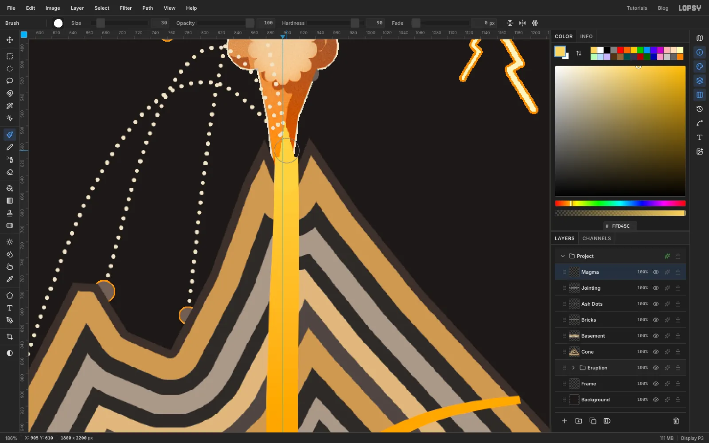

The conduit should run right into the column, not stop under a lid.

1. Stay on the `Magma` layer. Pick the **Brush** at **Size 30**, Hardness **90**. In the brush settings, set **Spacing 10%** and **Taper 70**.
2. With `#FFD45C`, drag one stroke from the crater floor, at about (905, 646), straight up to about (903, 570).

Taper shrinks the stroke from where it starts, so it begins wide in the crater and thins to a point inside the stem.

## Fill the magma chamber

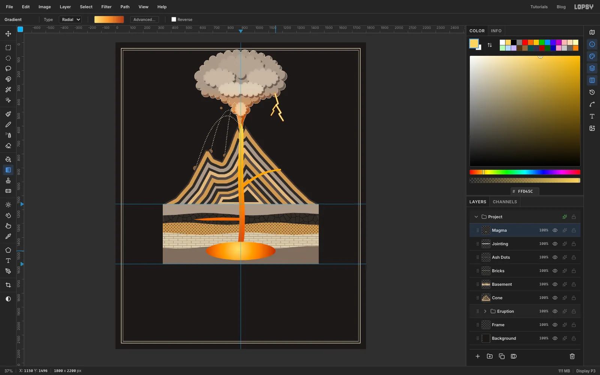

1. Click once with the **Elliptical Marquee** and enter **From** 650, 1430 and **To** 1150, 1562.
2. Set a radial gradient with three stops: `#FFE27A`, `#FF9A2E` at **45%**, and `#B23A16`. Drag from a little left of the centre, at (880, 1480), out to the right end of the chamber.
3. Deselect.

## Stir the chamber with Smudge

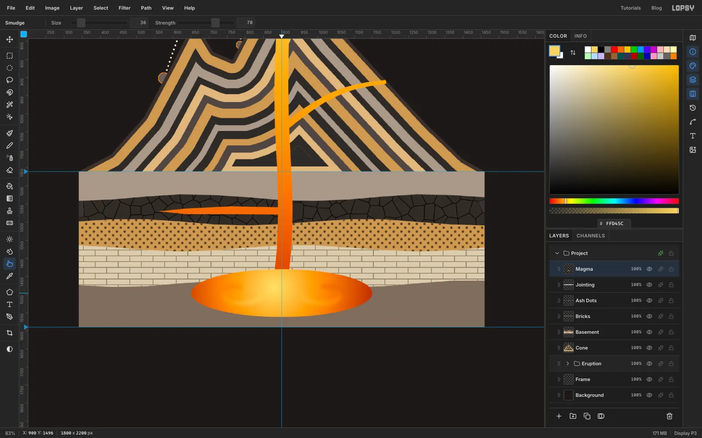

1. Pick the **Smudge** tool at **Size 36**, **Strength 70**.
2. On the left half of the chamber, drag a slow inward spiral that starts wide and tightens. Drag a mirror-image spiral on the right half.

These read as convection currents. If a swirl goes wrong, press [[Cmd+Z]] and try again.

## Rim the magma

Add two effects to the `Magma` layer:
- **Stroke**: Width **5**, colour `#C2421C`, position **Outside**.
- **Inner Glow**: Size **10**, Opacity **70**, colour `#8A2A14`.

A hard rim prints cleanly on a shirt. A soft outer glow would turn into mud in screen printing.

## Pour a lava flow down the flank

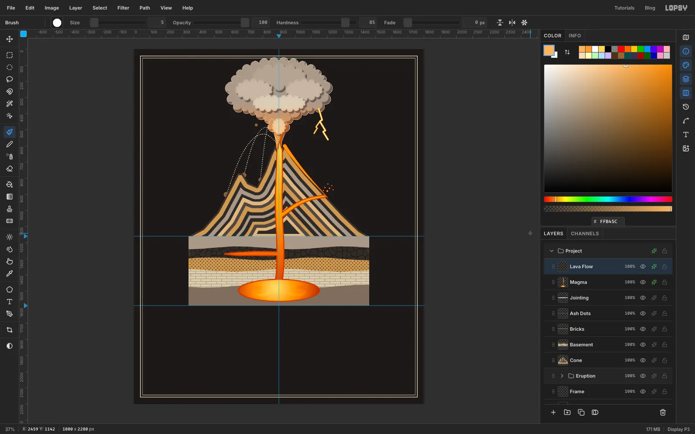

1. Add a layer named `Lava Flow`. Set the **Brush** to **Size 22**, Hardness **85**, and in the brush settings **Taper 420**.
2. With `#FF9A2E`, drag one stroke from the right crater rim down along the right slope, ending at about (1240, 962). It starts thick at the rim and thins out.
3. Set **Taper** back to **0** and switch to `#FFB45C`. Click six or seven droplets above the flank vent at sizes **5** to **9**.
4. Add a **Stroke** effect: Width **2**, colour `#C2421C`, position **Outside**.

## Select the cone and basement together

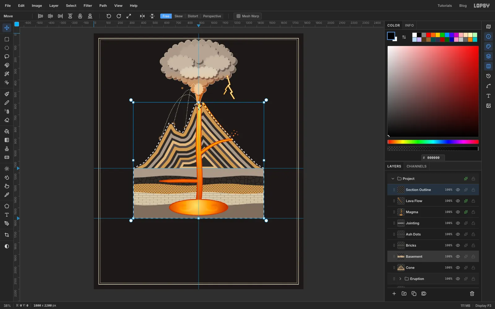

1. Add a layer named `Section Outline` above `Lava Flow`.
2. [[Cmd]]-click the `Cone` thumbnail, then [[Shift+Cmd]]-click the `Basement` thumbnail. The second click adds the block to the selection.

## Ink the outline and open the crater

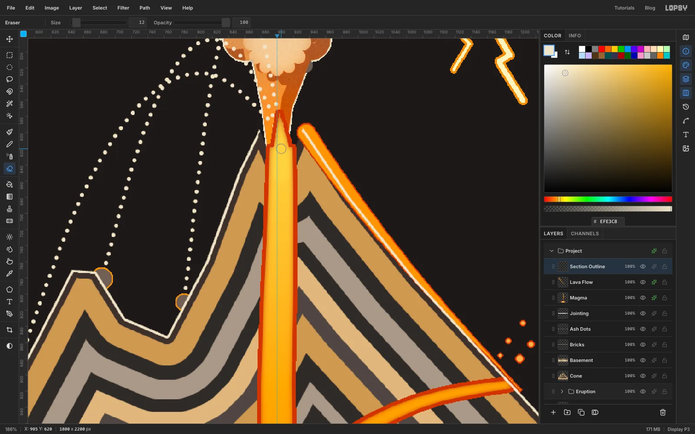

1. Fill the selection with cream `#EFE3C8`. Shrink it by **3 px**, press **Delete** and deselect. That leaves a 3 px outline around the whole section.
2. The outline also runs across the crater notch and caps the lava. Pick the **Eraser** at **Size 12** and drag it down one side of the notch and up the other to open it.

## Draw the leader lines

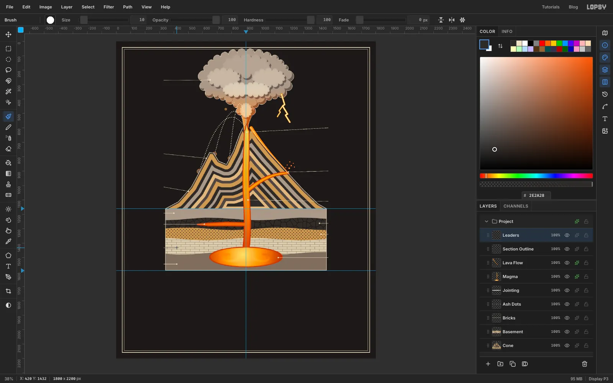

1. Add a layer named `Leaders`. Pick the **Brush** at **Size 2**, Hardness **100**, with **Taper 0** and **Spacing 10%**, in cream.
2. For each feature in the list under the next step, click on it and **Shift+click** at the margin: x **330** on the left or x **1470** on the right. Where a feature sits close to the margin, keep the line level.
3. At **Size 10**, click once on each feature to give it a dot.
4. The limestone leader is cream on cream. Redraw its part inside the block, and its dot, in near-black `#2E2A28`.

## Set the numbered labels

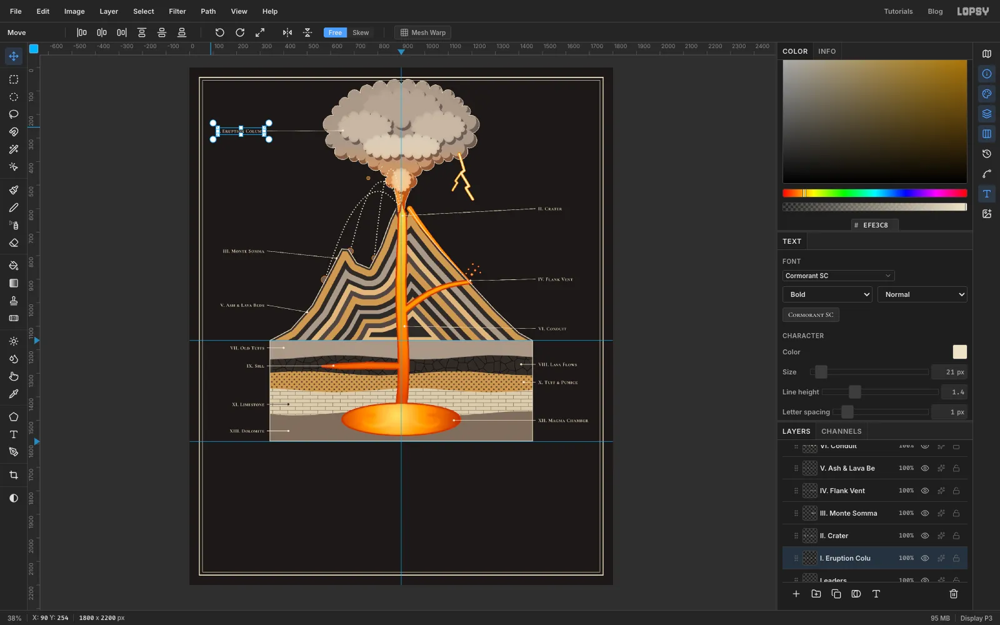

> **Tip:** With a text layer selected, the Text tool's settings change *that* layer. Click the `Leaders` layer before you start each new label.

1. Pick the **Text** tool. Set **Cormorant SC**, weight **Bold**, **21 px**, cream, and **Letter spacing 1** in the Text panel.
2. Type each label, press **Tab** to commit it, then line it up with the **Move** tool and the arrow keys:
   - Left labels end 14 px short of their leader.
   - Right labels start 14 px after theirs.
   - Centre each label on its leader line.
3. Work from the bottom of the page up, so a new click never lands inside a label you've already made.

The labels, top to bottom, with the side and what each leader points at:
- **I. Eruption Column**, left: inside the cloud's left lobe.
- **II. Crater**, right: the lava in the crater.
- **III. Monte Somma**, left: the old rim's outer slope.
- **IV. Flank Vent**, right: where the dike meets the slope.
- **V. Ash & Lava Beds**, left: the cone's left flank.
- **VI. Conduit**, right: the conduit halfway up the cone.
- **VII. Old Tuffs**, left: the pale ash bed under the cone.
- **VIII. Lava Flows**, right: the cracked dark bed.
- **IX. Sill**, left: the tip of the sill.
- **X. Tuff & Pumice**, right: the dotted ochre bed.
- **XI. Limestone**, left: the brick bed.
- **XII. Magma Chamber**, right: the chamber's right end.
- **XIII. Dolomite**, left: the grey bottom bed.

## Run a label along the lava flow

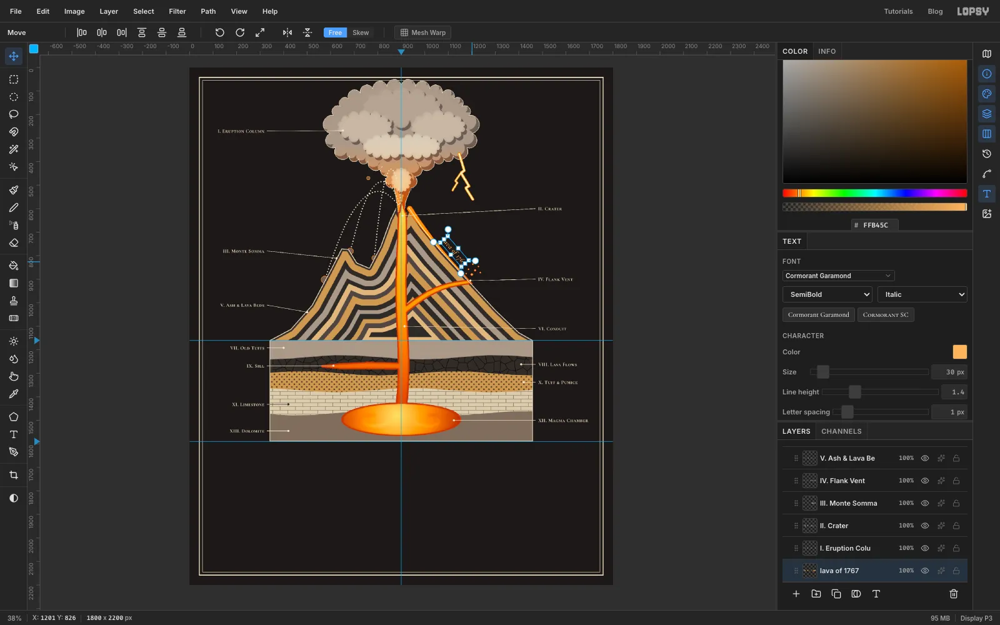

Maps label rivers along their course. Do the same for the lava flow.

1. Click `Leaders`. Type `lava of 1767` in **Cormorant Garamond**, **SemiBold**, **Italic** style, **30 px**, colour `#FFB45C`, and press **Tab**.
2. With the **Move** tool, drag a corner rotation handle clockwise until the words match the slope, about **49°**.
3. Nudge the label until it sits just outside the flow line, clear of the spatter.

## Set the title and subtitle

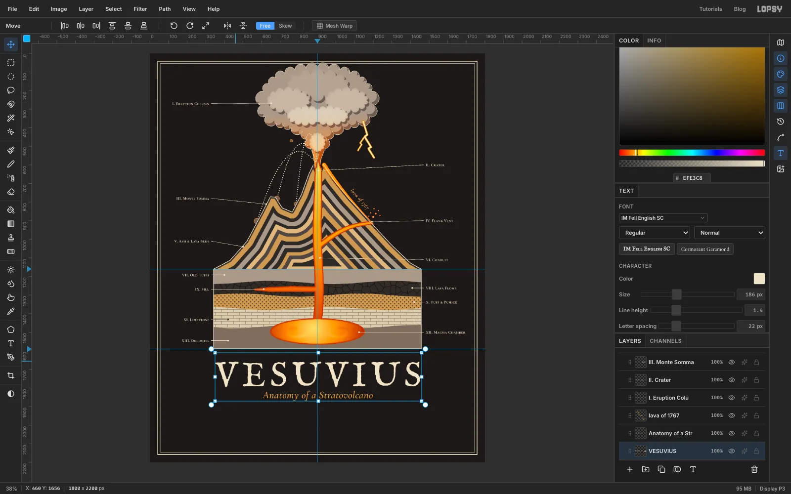

Set the lower line first, so your click for the title doesn't land in the subtitle's box.

1. Click a picture layer, such as `Leaders`. Type `Anatomy of a Stratovolcano` in **Cormorant Garamond** SemiBold Italic, **56 px**, ochre `#D19A4E`. Centre it on the guide at about y 1842.
2. Click a picture layer again. Type `VESUVIUS` in **IM Fell English SC** at **186 px**, cream, with **Letter spacing 22**. Centre it with its top at about y 1658, about 70 px below the section.

## Add rules either side of the subtitle

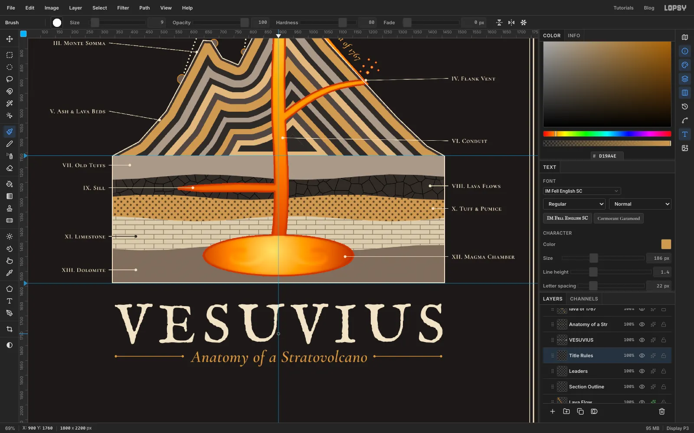

1. Add a layer named `Title Rules`. With the **Pencil** at **Size 2** in ochre, draw a level line through the middle of the subtitle's height:
   - Click at the left edge of the V in VESUVIUS, then **Shift+click** 26 px before the subtitle starts.
   - Draw a matching line on the right.
2. Pick the **Brush** at **Size 9** and click a dot at each end of both lines.

## Cut a specimen from the Fabris plate

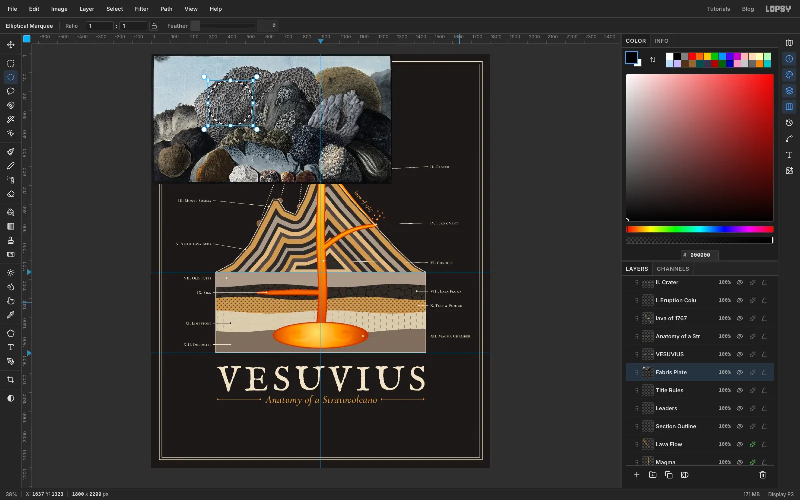

1. Drag the 1280 px *Lava, scoriae and pumice* plate from your computer onto the canvas. It fits inside the canvas, so it lands at the top left at its own size. Name the new layer `Fabris Plate`.
2. Click once with the **Elliptical Marquee** and enter a 240 px circle over the honeycombed grey scoria: **From** 300, 142 and **To** 540, 382.
3. Press [[Cmd+C]] then [[Cmd+V]]. Name the pasted layer `Scoria Specimen` and hide `Fabris Plate`.

## Scale the specimen down

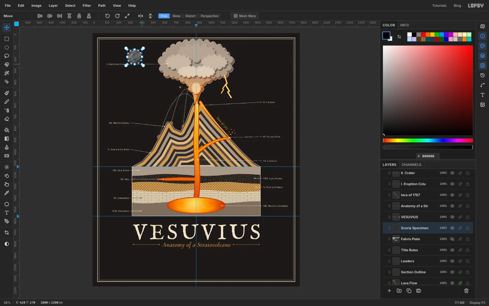

1. [[Cmd]]-click the `Scoria Specimen` thumbnail, then pick the **Move** tool.
2. Hold [[Cmd]] and drag the bottom-right handle in until the disc is about **128 px** across. [[Cmd]] keeps it round.
3. Press [[Cmd+D]] to finish, then nudge the disc so it's centred at about (520, 1990).
4. Add a **Stroke** effect: Width **3**, cream, position **Outside**.

## Add the other two specimens

1. Show `Fabris Plate` again and click it. Cut a circle around the white-speckled leucite lava near the plate's bottom right: **From** 905, 500 and **To** 1065, 660. Copy, paste and name the new layer `Leucite Specimen`.
2. Scale it the same way to about **128 px**, centre it at about (1280, 1990) and give it the same Stroke. Then delete `Fabris Plate`.
3. Drop the 1280 px *Mount Vesuvius in eruption in 1767* plate onto the canvas. Click it and cut an oval around the erupting mountain: **From** 260, 60 and **To** 1140, 600. Copy, paste and name the new layer `1767 Vignette`.
4. Scale the oval to about **208 px** wide, centre it at about (900, 1990), give it the same Stroke, and delete the full plate layer.
5. The night scene is dark, so choose **Filter → Brightness/Contrast…** with Brightness **28** and Contrast **40** before toning it.

## Tone the plates with a Gradient Map

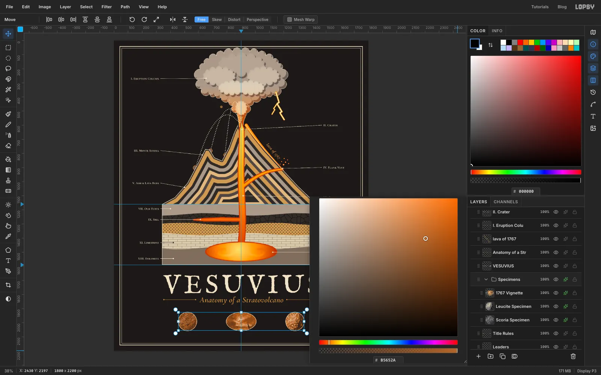

1. Select the three specimen layers and click **Group Layers**. Name the group `Specimens`.
2. Open the group's effects drawer, click **Add Adjustment** and choose **Gradient Map**.
3. Click the left stop and type `#1C1817`, then click the right stop and type `#F4E6C8`. Click the middle of the gradient bar to add a third stop, then type `#B5652A` for it.

The Gradient Map remaps every pixel in the group by brightness. The old watercolours become charcoal, ember and cream, the same inks as the rest of the shirt. The cream rings stay cream.

## Caption the specimens

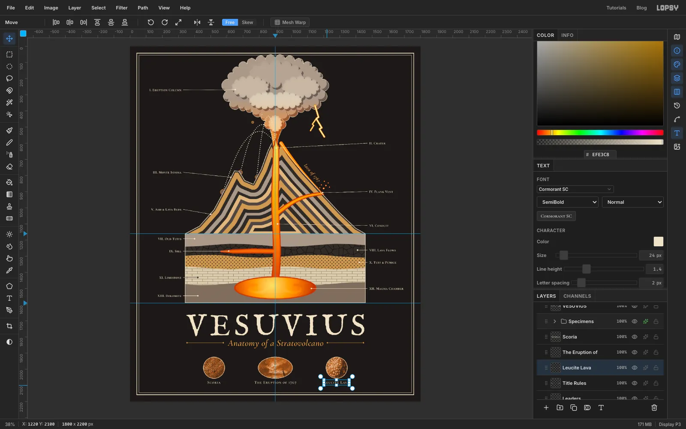

1. Collapse `Specimens` and click `Title Rules`.
2. With **Cormorant SC** SemiBold, **24 px**, cream and **Letter spacing 2**, type `Scoria`, `The Eruption of 1767` and `Leucite Lava`.
3. Centre each one under its roundel, with all three tops at y **2074**. That leaves about 50 px of space above the frame.

## Organise the layers into groups

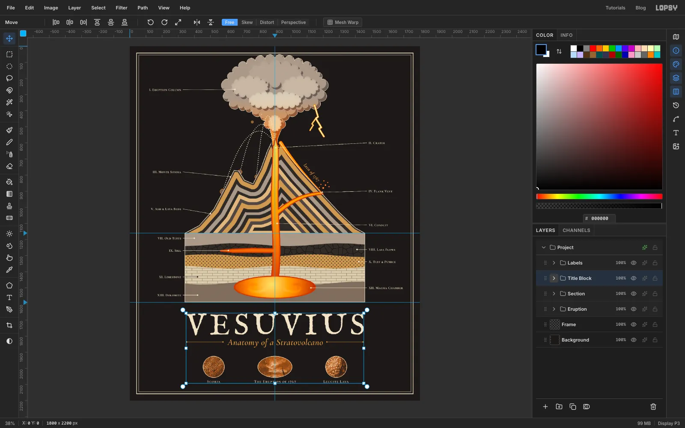

1. [[Cmd]]-click to select `Cone`, `Basement`, `Bricks`, `Ash Dots`, `Jointing`, `Magma`, `Lava Flow` and `Section Outline`. Click **Group Layers** and name the group `Section`.
2. Do the same with `Leaders` and all the label text to make `Labels`. Then group `Title Rules`, the title, subtitle, captions and `Specimens` into `Title Block`.
3. Collapse the groups. With a group selected, the **Move** tool and arrow keys move everything in it together, which is handy if you later want to shift all the labels at once.

## Add a halftone glow behind the crater

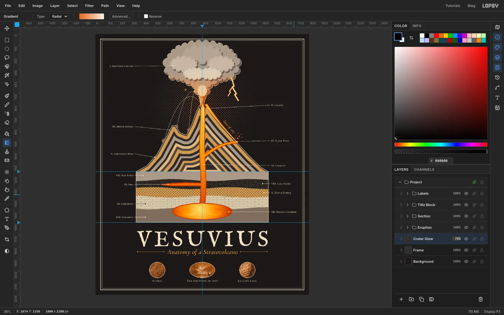

1. Click `Frame` and add a layer named `Crater Glow`, so it sits under everything else.
2. Click once with the **Elliptical Marquee** and enter **From** 435, 130 and **To** 1375, 1070.
3. Set a radial gradient from `#E8661E` to `#FFF1E0` and drag from the crater 470 px out to the right. Deselect.
4. Choose **Filter → Halftone…** with Dot Size **14**, Density **1** and Angle **45**. Set the layer's opacity to **70%**.

Halftone draws darker tones as bigger dots, so the glow becomes large orange dots at the crater fading to specks. A dot pattern like this separates cleanly for a screen-printed shirt. Save with **File → Save Project**, then **File → Quick Export PNG** for the print file.
