Voxel art builds everything from little cubes, like a 3D version of pixel art. It's a favourite for game sites and playful brands because one small isometric scene can carry a whole hero section. This tutorial makes a landing page for an imaginary cabin-rental company, Cozy Embers. The hero is a floating voxel island at night: a log cabin, pine trees, a campfire and a waterfall. The rest of the page (feature cards, a booking widget and a footer) is designed around it.

Nothing here comes from a 3D program. Every cube face is a flat shape filled in Lopsy, and a single pattern tile turns the grass into a voxel checkerboard.

Along the way you'll use:

- the **Lasso** and **Edit → Fill** to draw isometric cube faces
- the **grid**, **ruler guides** and **Shift-added marquees** for a pixel moon and stepped section edges
- **Define Pattern** and **Fill with Pattern** for a voxel checkerboard
- the **Pencil**'s Shift-click lines for voxel seams, log lines and roof shingles
- **Gradients** with transparent stops, **Overlay**, **Screen**, **Soft Light** and **Multiply** layers for night and firelight
- **Outer Glow**, **Drop Shadow**, **Motion Blur**, **Gaussian Blur** and **Add Noise**
- the **Shape** tool's rounded rectangles for buttons, cards and a booking widget
- **Tilt Warp**, **DM Sans** and **Silkscreen** text, coloured ranges, and the **Text** panel's line height
- **Copy**, **Paste in place**, **Merge Down**, scaling and rotating, including two layers at once
- **Image → Canvas Size**, groups, dragging a layer into a group, and moving a whole group

The palette is a deep night blue with ember orange, warm wood and voxel greens, then cream and forest green for the page:

- Night sky `#0B1520` → `#1C3440`, sky glow `#35565E`
- Moon `#F3EBD2`, craters `#D8CDAE`, moon glow `#9FC3D6`, stars `#DCE8F0`
- Grass top `#5E8F55`, grass sides `#4A7543` / `#355636`
- Dirt `#6E4A35` / `#4E3324`, dark dirt voxels `#5C3D2B` / `#3F281B`, seams `#24160E`
- Stone `#4F5562` / `#383D48`
- Logs `#9A6440` / `#6E4630`, log lines `#4E301F`, door `#2E1C12`
- Roof `#C0564A` / `#93392F`, eaves `#5A221C`, shingle lines `#6E2A23`
- Chimney `#A0A6AE` / `#7B808A` / `#5B606B`, smoke `#D7DEE3` / `#B9C4CC` / `#8E99A2`
- Window light `#FFC86E`, glazing bars `#3A2418`
- Pines `#3E7358` / `#2E5C47` / `#1F4234`, trunks `#5E3E2B` / `#432B1E`
- Water `#3E86A8`, deep water `#1F5068`, ripples `#8FD0E4`, banks `#3F2A1D`, waterfall `#5DB1D2`, foam `#DDF2F8`
- Wood `#D9A672` / `#B98457` / `#8A5A3A` / `#7A4B2C` / `#5A3520`, grain `#3E2414`
- Fire stones `#A5ABB2` / `#7F858D` / `#5D636B`
- Flames `#F2662B` / `#C9441E` / `#FFB13D` / `#F08A28` / `#FFE6A0`
- Glows `#FF9A3C` / `#FF8A3D` / `#FF7A2E` / `#FFB347` / `#FFD27A`
- Cream type `#F3E7D3`, link grey `#C9D6D3`, body grey `#B4C6C3`, eyebrow orange `#F29A4A`, headline orange `#FF8A3D`
- Ember buttons `#E8642C`, button text `#1A1410`, nav rule `#22394A`
- Paper `#F2E8D5`, cards `#FBF6EC`, card shadow `#6B4A2E`, icon tiles `#28495A`
- Ink `#1D2B2C`, card text `#55635F`, section eyebrow `#C2531F`
- Forest band `#17322C`, light orange `#FFB066`, widget lines `#D6C5A6`, widget labels `#6B5A48`, note `#8FB0A6`
- Footer `#0D1719`, footer text `#7F9894`, footer links `#A9BBB8`

> **Tip:** Positions are in document pixels, written `x, y`. The status bar at the bottom shows where the pointer is. "Fill" means **Edit → Fill**, which fills the selection with the foreground colour. [[Cmd+D]] deselects.

> **Tip:** Blend modes are in the **Blend** dropdown at the top of a layer's effects drawer (the sparkle icon on its row). To change a layer's opacity, click the `100%` on its row and drag the slider.

## Paint the night sky

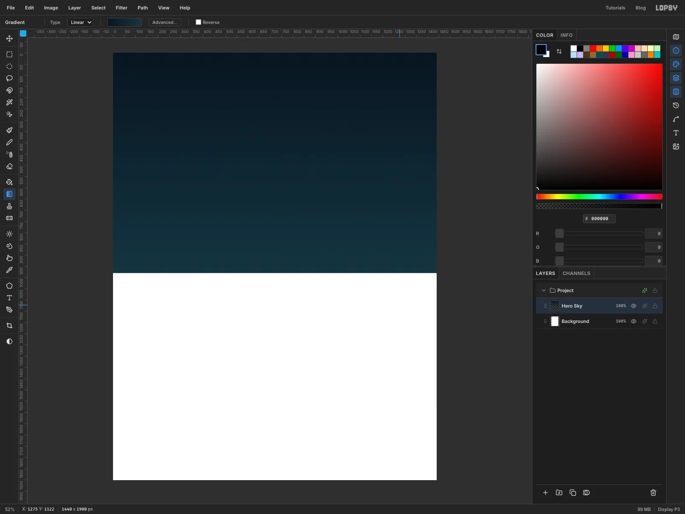

1. Open [Lopsy](/) and create a **1440 × 1900** document with a white background. That's a desktop page width. You'll add a little height at the end.
2. Rename **Layer 1** to `Hero Sky`.
3. With the **Rectangular Marquee**, select the top 980 px of the canvas, the full width.
4. Pick the **Gradient** tool, set it to **Linear**, open **Advanced…** and set the two stops to `#0B1520` and `#1C3440`. Drag from the top of the selection to the bottom.
5. Run **Filter → Add Noise…** with **Amount** `4` and **Mono**. A tiny bit of grain stops large dark gradients from banding.

## Add a glow behind the island

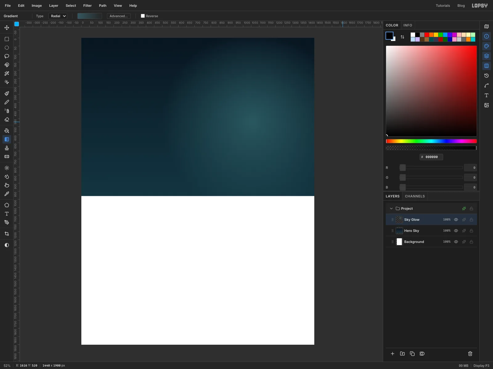

1. Add a layer called `Sky Glow`. Keep the same selection.
2. Switch the Gradient to **Radial** with a `#35565E` stop and a second `#35565E` stop at **0%** opacity.
3. Drag from about `1056, 520`, the centre of where the island will sit, out about 560 px to the right. Deselect.

## Draw a pixel moon on the grid

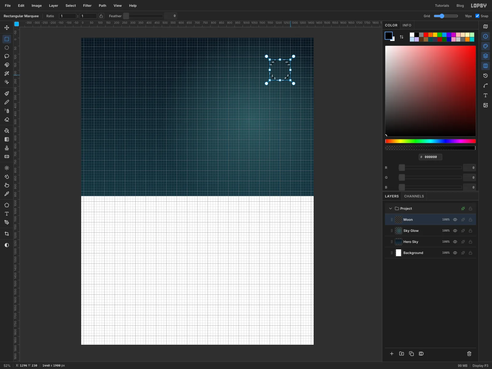

A voxel scene needs a blocky moon, not a smooth one. Three overlapping rectangles make a pixel-art circle.

1. Add a layer called `Moon` and choose **View → Show Grid**. The grid is 16 px, and Snap turns on with it, so marquee corners land on grid lines.
2. With the **Rectangular Marquee**, drag a tall rectangle 4 squares wide and 8 squares tall near the top right, about `1200, 134` to `1264, 262`.
3. Hold [[Shift]] and drag a 6 × 6 square centred on it. Hold [[Shift]] again and drag a rectangle 8 squares wide and 4 tall across the middle. The three add up to a stepped circle.

## Finish the moon

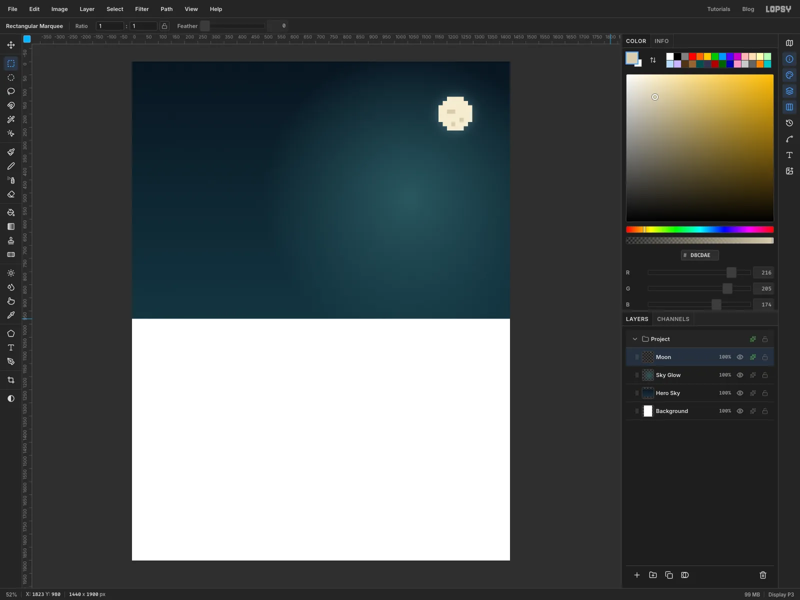

1. Fill the selection with `#F3EBD2` and deselect.
2. For craters, select one 2 × 1 block of squares inside the moon, then hold [[Shift]] and add two single squares. Fill them with `#D8CDAE`.
3. Choose **View → Show Grid** again to hide the grid.
4. Give `Moon` an **Outer Glow** with **Size** `70`, **Opacity** `40` and colour `#9FC3D6`.

## Scatter the stars

1. Add a layer called `Stars` and pick the **Pencil** in `#DCE8F0`.
2. Click about seventy single dots across the sky at **Size** `2`, making every fourth or fifth one size `3`. Keep them out of the area where the island will go, roughly `740` to `1370` across and `170` to `880` down.
3. Set the layer to `80%`. You'll erase the stars behind the text at the end.

## Lay out the page with guides

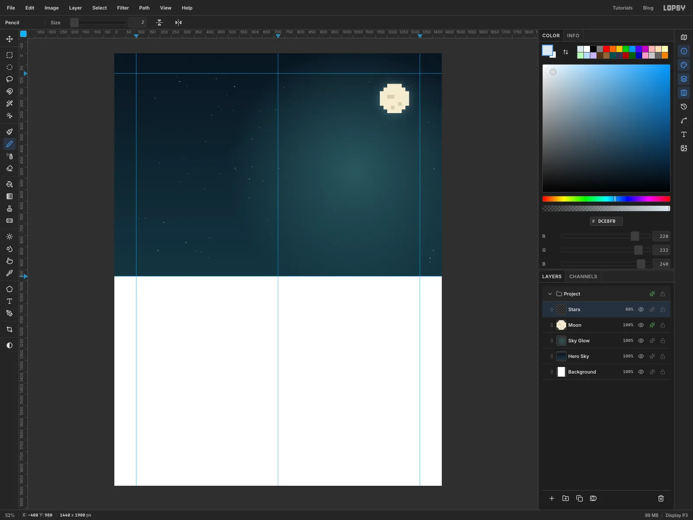

Click once on the top ruler to drop a vertical guide, and once on the left ruler for a horizontal one.

1. Add vertical guides at `x 96` and `x 1344`. These are the page margins, and every left and right edge of the design will sit on them. Add one more at `x 720` for the centre.
2. Add horizontal guides at `y 88` (the bottom of the nav bar) and `y 980` (the end of the hero).

## Draw the island's rock

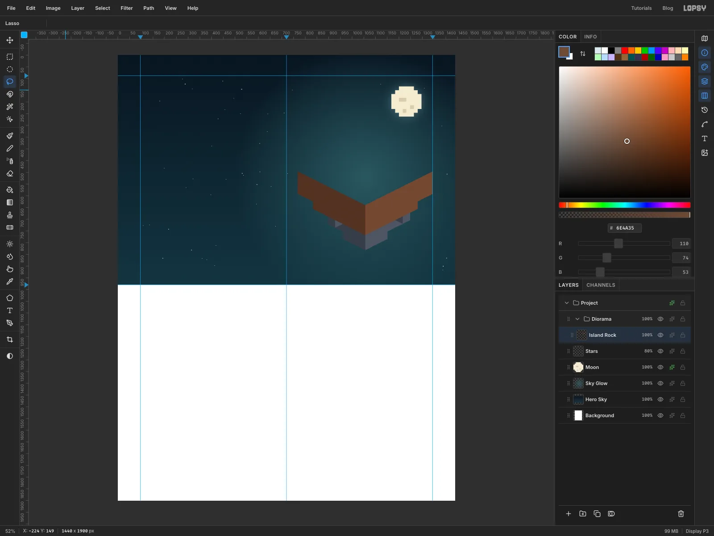

Isometric voxels follow three moves. A voxel is 64 px wide. One voxel towards the bottom right is **32 px right and 16 px down**, one towards the bottom left is **32 px left and 16 px down**, and one voxel up is **32 px straight up**. Every face you draw is a four-sided shape built from those moves. You only ever see three sides of a box: the top, the left side and the right side.

The moon is at the top right, so faces on the right are the lit side and faces on the left are in shadow.

1. Click **New Group** in the Layers panel, name it `Diorama`, and add a layer inside it called `Island Rock`.
2. The island is 9 × 9 voxels. Its top diamond has corners at `1056, 352` (back), `1344, 496` (right), `1056, 640` (front) and `768, 496` (left). You'll fill the top in the next step.
3. With the **Lasso**, draw the left face: from the left corner to the front corner, then 96 px (3 voxels) straight down, then back to 96 px below the left corner. Drag in straight strokes from corner to corner. Fill it with `#4E3324`.
4. Draw the right face the same way, from the front corner to the right corner and 96 px down, and fill it with `#6E4A35`.
5. Underneath, add a 7 × 7 tier in the same two browns, two voxels tall and one voxel in from every edge.
6. Below that, add stone tiers in `#383D48` (left faces) and `#4F5562` (right faces), each one voxel narrower on every side: 5 × 5 and two voxels tall, then 3 × 3 and two voxels tall, then a single voxel.
7. Hang a single stone voxel under the dirt tier on each side, so the underside isn't perfectly symmetrical.

Draw the lowest tier first and work upwards, so each tier above overlaps the one below it. Draw the hanging voxels after the tier they sit in front of.

## Cap it with grass

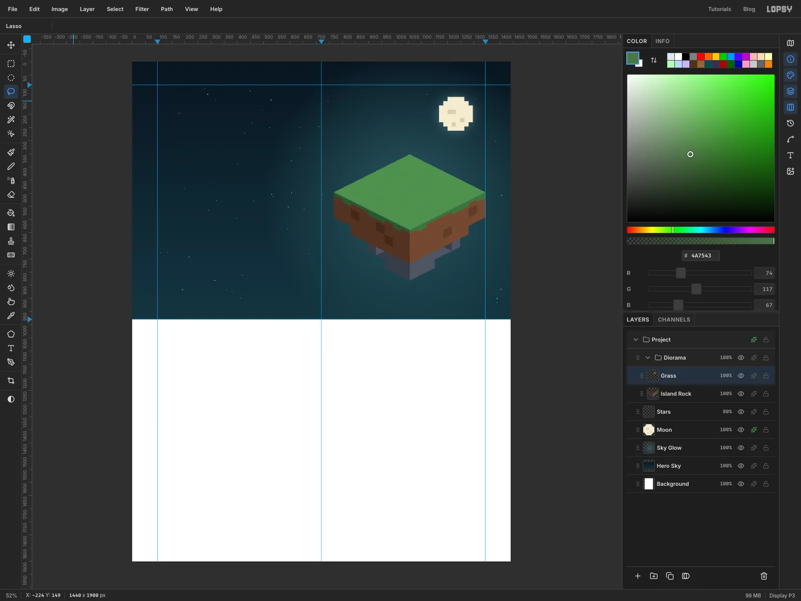

1. On `Island Rock`, fill a few single voxel squares on the cliff faces with darker dirt (`#3F281B` on the left, `#5C3D2B` on the right). They read as buried stones and break up the flat faces.
2. Add a layer called `Grass`.
3. Lasso the top diamond and fill it with `#5E8F55`.
4. Draw a grass lip about 11 px deep (a third of a voxel) along both side faces: `#355636` on the left, `#4A7543` on the right.
5. On a few columns, extend the lip another 11 px down so the grass drips over the edge.

## Add two floating islets

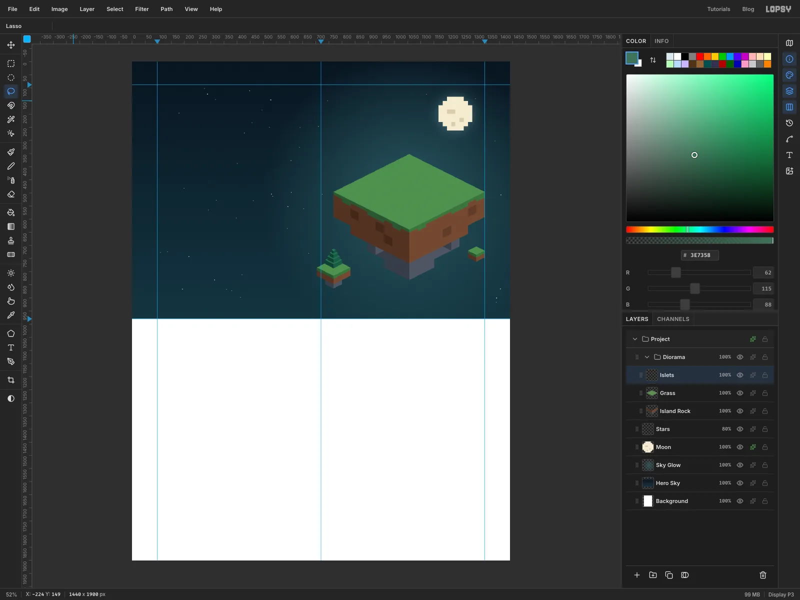

1. Add a layer called `Islets`.
2. Below and to the left of the island, build a 2 × 2 islet: a grass top, a dirt block and one stone voxel underneath. Its top diamond's back corner is at `768, 752`.
3. On the right, add a single grass voxel whose top's back corner is at `1312, 704`. Its right corner lands exactly on the right margin guide.
4. Put a tiny pine on the left islet, at half the size of the recipe below.

> **Tip:** A voxel pine is a short trunk and four stacked boxes, each smaller than the one below. The trunk is about half a voxel wide and 0.8 voxels tall, in `#432B1E` (left) and `#5E3E2B` (right). The four boxes are each about one voxel tall: 2 voxels wide, then 1½, then 1, then ½. Give every box a `#3E7358` top, a `#1F4234` left side and a `#2E5C47` right side.

Leave at least one voxel of empty sky between the islets and the island. If they touch, they look like part of it.

## Make a voxel tile

Real voxel terrain shows each cube's top. A checkerboard of slightly lighter diamonds gives you that, and one tiny tile is enough.

1. Add a temporary layer.
2. Lasso a diamond with corners at `32, 0`, `64, 16`, `32, 32` and `0, 16`, and fill it with white. Leave the corners of the tile transparent.
3. Select the rectangle from `0, 0` to `64, 32` and choose **Edit → Define Pattern**.
4. Deselect and click **Delete Layer**.

## Fill the grass with the pattern

1. Click the `Islets` layer and add a layer above it called `Voxel Checker`.
2. Lasso the island's top diamond. Hold [[Shift]] and lasso the tops of both islets to add them.
3. Choose **Edit → Fill with Pattern…** and click **Apply**.

The pattern tiles from the top-left corner of the canvas. Every voxel corner in this scene sits on a multiple of 32 px across and 16 px down, so the diamonds line up exactly with the voxels.

## Blend the checkerboard

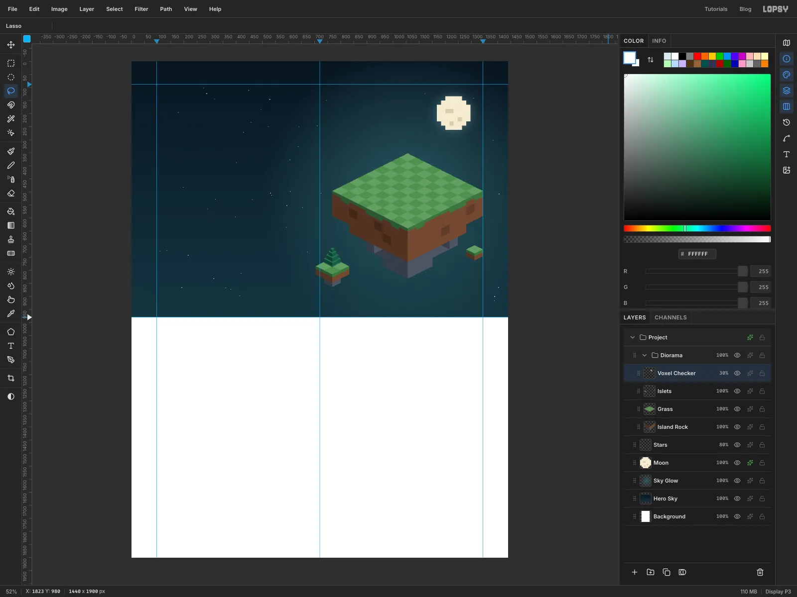

1. Deselect and set `Voxel Checker` to **Soft Light** at `30%`.
2. Click the eye on `Voxel Checker` to compare. Without the pattern the grass is one flat sheet. With it, you can count the cubes.

## Draw the voxel seams

1. Add a layer called `Seams` and pick the **Pencil** at **Size** `2` in `#24160E`.
2. On every side face, draw a line down each voxel boundary. On the left face that's every 32 px to the right of the left corner. Click the top of the line, then [[Shift]]-click the bottom: Shift-click draws a straight line from the last click.
3. Draw the horizontal seams the same way: one line along each voxel row, running parallel to the face's top edge.
4. Do the lower tiers and the islets too, so the grid stays continuous all the way down.
5. Set the layer to **Multiply** at `45%`.

## Sink a pond into the grass

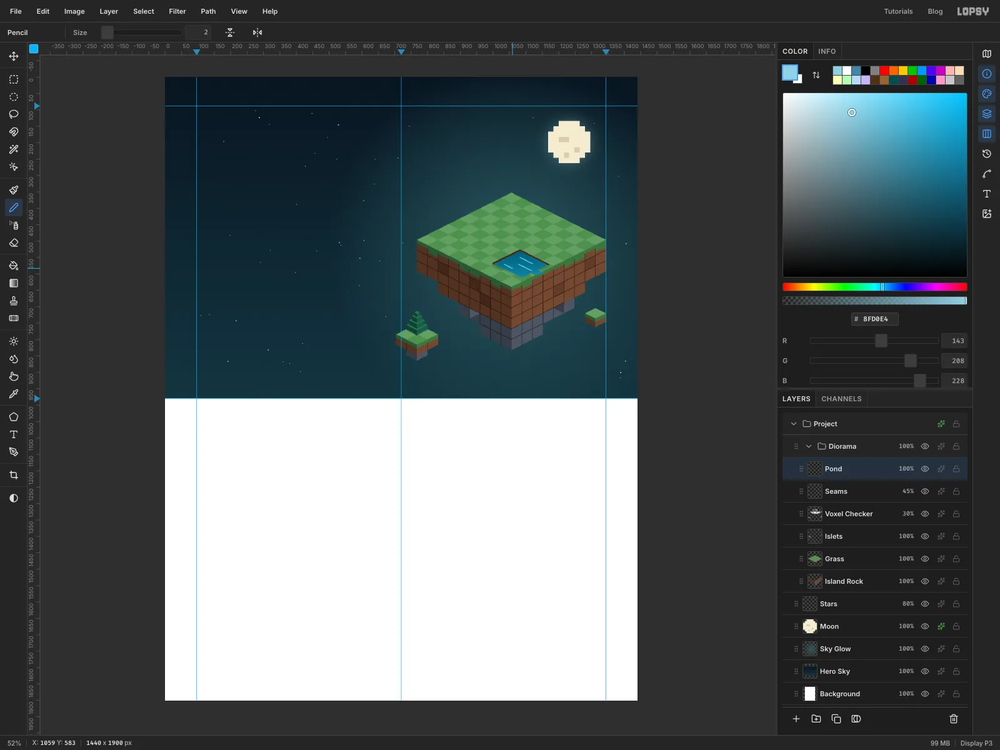

1. Add a layer called `Pond`.
2. Outline a basin about 2½ voxels square in the front-right quarter of the island. Its back corner is near `1082, 526`.
3. Draw the two back banks first: strips about 6 px deep running down from the basin's two back edges, in `#3F2A1D`. They're the walls you see on the far side of the hole.
4. Lasso the water: the same diamond, moved 6 px lower. At the two front edges, though, stop at the basin outline instead of following the lowered diamond, so the grass in front seems to overlap the water. Fill with `#3E86A8`.
5. Add a narrow channel of water from the pond out to the right-hand cliff edge, about 0.8 voxels wide.
6. Lasso the water again and drag a **Linear** gradient from `#1F5068` at 75% opacity to transparent, from the back corner forwards, so the water looks deeper at the back.
7. With the Pencil at size `2` in `#8FD0E4`, Shift-click three short ripple lines across the water. Keep them clear of the channel.

## Pour the waterfall

1. Add a layer called `Waterfall`.
2. Lasso a narrow parallelogram on the right-hand cliff face, as wide as the channel. It starts at the grass edge and runs straight down well past the bottom of the stone tiers. Its top and bottom edges slope with the face.
3. Drag a **Linear** gradient from the top to the bottom of the selection with three stops: `#5DB1D2`, `#5DB1D2` at 85% opacity in the middle, and `#5DB1D2` at 0% opacity at the bottom.

## Add foam and mist

1. Add a layer called `Foam` and pick the Pencil at size `3` in `#DDF2F8`.
2. Shift-click five vertical streaks of different lengths down the waterfall.
3. Run **Filter → Motion Blur…** with **Angle** `90` and **Distance** `24`. The streaks smear into falling water.
4. Shift-click a short foam line across the top of the fall where it leaves the channel.
5. At size `5`, click five mist dots around the bottom where the water fades.
6. Set the layer to `70%`.

## Build the cabin walls

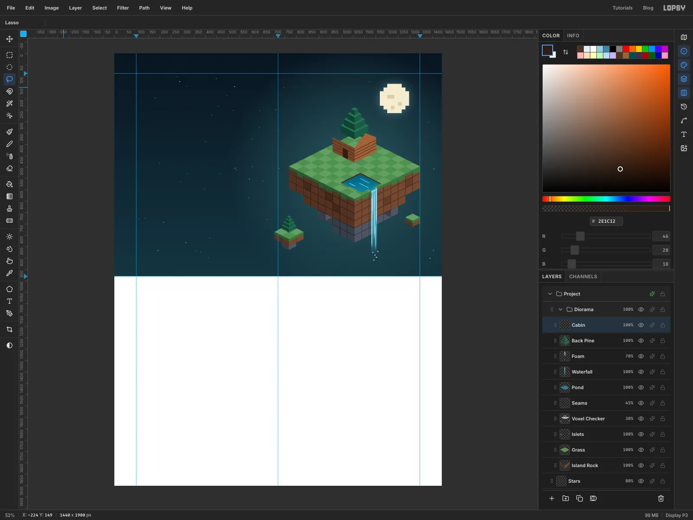

The cabin's footprint is a 3 × 3 voxel diamond near the back of the island, with its back corner at `1056, 384`.

1. Add a layer called `Back Pine` and draw a pine (see the Tip in **Add two floating islets**) standing just behind the cabin's back corner, at about `1056, 371`. Only its top will show over the roof.
2. Add a layer called `Cabin`. The walls are a box on the footprint, 2 voxels (64 px) tall.
3. Fill the front-left wall with `#6E4630` and the right wall with `#9A6440`. On the right wall, add a triangle for the gable end, rising to a peak 42 px above the middle of the wall's top edge.
4. With the Pencil at size `2` in `#4E301F`, Shift-click four log lines across each wall, evenly spaced and parallel to the bottom edge.
5. Fill a door on the front wall in `#2E1C12`, about two-thirds of a voxel wide and a voxel and a quarter tall.

## Put on the roof

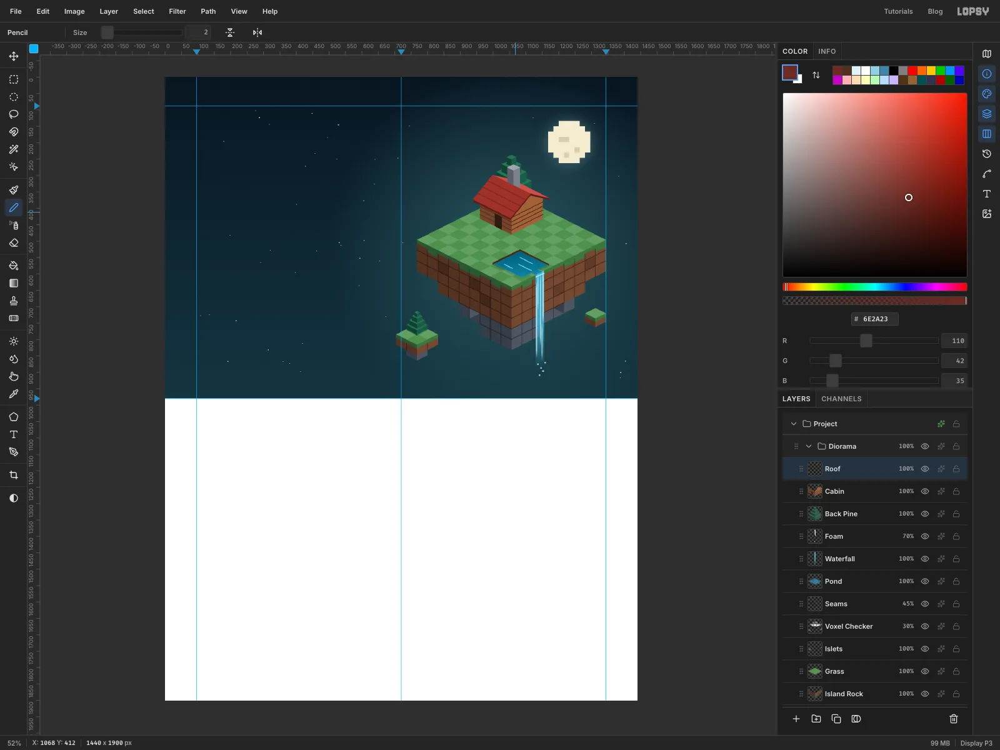

The ridge runs along the length of the cabin, from the back-left wall down to the peak of the gable on the right. It sits 42 px above the wall tops, and the roof overhangs the walls by about a third of a voxel on every side.

1. Add a layer called `Roof`.
2. Fill the back slope first in `#C0564A`: from the ridge back to the rear eave. You see a thin strip of it above the ridge.
3. Draw the thick edge of the roof over the gable end in `#5A221C`: a band about 6 px deep following the two sloped roof edges.
4. Add the chimney poking up through the back slope near its left end: a box about 0.6 voxels square and 64 px taller than the walls, with a `#A0A6AE` top, a `#5B606B` left side and a `#7B808A` right side.
5. Fill the front slope in `#93392F`, from the ridge down to the front eave, then the front eave band below it in `#5A221C`.
6. With the Pencil in `#6E2A23`, Shift-click three shingle lines across the front slope, parallel to the ridge.

Drawing the chimney before the front slope lets the roof cover the bottom of the chimney naturally.

## Light the windows

1. Add a layer called `Windows`.
2. Fill a window on each wall in `#FFC86E`, plus a small attic window in the gable and a tiny lantern cube beside the door.
3. With the Pencil in `#3A2418`, Shift-click a cross of glazing bars over each main window.
4. Give the layer an **Outer Glow** with **Size** `34`, **Opacity** `70` and colour `#FF9A3C`.

## Plant the pines

1. Add a layer called `Pines`.
2. Using the pine recipe, draw a large tree (its bottom box about 2⅓ voxels wide) whose trunk stands at about `1222, 477`, at the back right of the island.
3. Draw a medium tree (bottom box 2 voxels wide) at about `864, 477` on the left.
4. Draw a small tree (bottom box 1½ voxels wide) at about `1210, 531`, in front of the large one.

Draw the trees furthest back first, so the nearer trees overlap them. If a box comes out wrong, press [[Cmd+Z]] and redraw just that box.

## Build the campfire

The fire sits at about `960, 512`, in the front-left quarter of the island.

1. Add a layer called `Props`. Draw a log bench just left of the fire: a box about 2 voxels long and half a voxel thick, lying along the left-hand axis. Give it a `#8A5A3A` top, a pale `#B98457` end and a dark `#5A3520` long side, then Shift-click two `#3E2414` grain lines along the long side.
2. In front of the fire at about `960, 560`, draw a stump about 0.6 voxels square and half a voxel tall, with a `#D9A672` top, `#5A3520` / `#7A4B2C` sides and a darker `#A8743F` ring in the middle of the top.
3. Add two flat stepping stones from the cabin door towards the fire in the fire-stone greys.
4. Add a layer called `Fire Pit`. Around the fire, draw seven small stones in a ring about 40 px out (`#A5ABB2` tops, `#5D636B` left sides, `#7F858D` right sides). Inside, draw two crossed logs in `#B98457` with `#5A3520` / `#7A4B2C` sides.
5. Add a layer called `Flames`. Stack three shrinking boxes in the middle of the ring:
   - an orange one with a `#FFB13D` top and `#F2662B` / `#C9441E` sides
   - a yellow one with a `#FFE6A0` top and `#FFB13D` / `#F08A28` sides
   - a tiny pale tip
6. Add a layer called `Smoke` and draw three tiny cubes rising from the chimney and drifting left, each smaller than the last (`#D7DEE3` tops, `#8E99A2` left sides, `#B9C4CC` right sides). Set it to `75%`.

## Add contact shadows

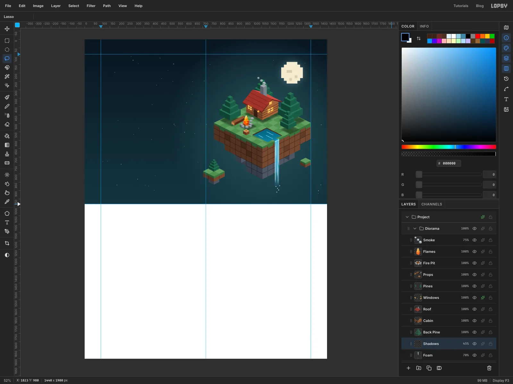

1. Click `Foam` and add a layer above it called `Shadows`. It sits under the cabin and trees.
2. Lasso the cabin's footprint diamond. Then [[Shift]]-lasso a slightly larger diamond under each tree and under the fire ring.
3. Fill with black and deselect.
4. Run **Filter → Gaussian Blur…** at **Radius** `10`, and set the layer to **Multiply** at `45%`.

## Light the grass with the fire

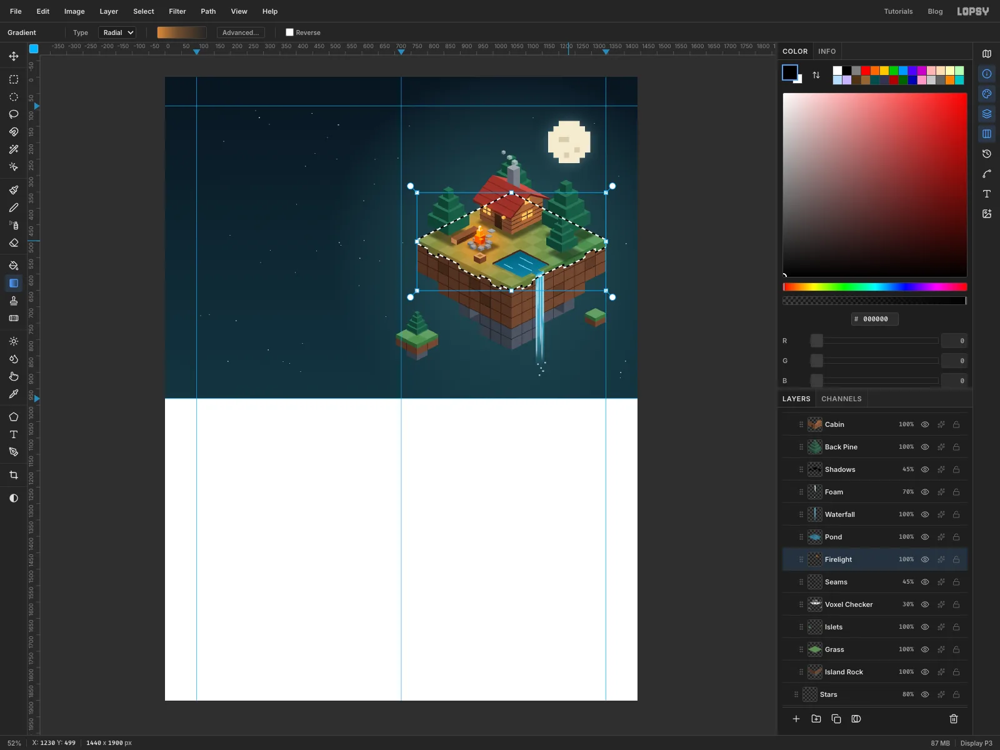

1. Give `Flames` an **Outer Glow** with **Size** `40`, **Opacity** `75` and colour `#FF7A2E`.
2. Click `Seams` and add a layer above it called `Firelight`. It sits under the cabin and trees, so only the ground is lit.
3. [[Cmd]]-click the `Grass` layer's thumbnail to select its shape, then click the `Firelight` row.
4. Drag a **Radial** gradient out from the fire, about 270 px, with three stops: `#FF9A3C` at 85%, `#FF9A3C` at 35% part way out, and transparent at the edge.
5. Deselect and set the layer to **Overlay** at `80%`.

## Spill window light onto the grass

1. Click `Shadows` and add a layer called `Window Spill`.
2. Lasso a trapezoid on the grass in front of the left window, widening away from the wall. Hold [[Shift]] and lasso another in front of the right window.
3. Fill with `#FFC86E`, deselect, and run **Gaussian Blur** at **Radius** `9`.
4. Set the layer to **Overlay** at `70%`.

## Warm the walls facing the fire

1. Click `Props` and add a layer above it called `Fire Bounce`.
2. Lasso the lower part of the cabin's front wall, below the eaves. Hold [[Shift]] and lasso the bench's long side, which faces the fire.
3. Drag a **Radial** gradient from the fire, about 190 px, from `#FF8A3D` at 90% to transparent.
4. Deselect and set it to **Overlay** at `55%`.

## Add a warm haze

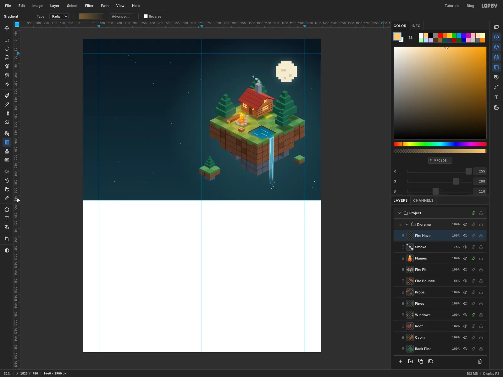

1. Click `Smoke` and add a layer called `Fire Haze`.
2. With no selection, drag a **Radial** gradient from the fire, about 115 px, from `#FFB347` at 40% to transparent.
3. Set it to **Screen**.

## Turn sparks into diamonds

1. Add a layer called `Embers` and pick the Pencil.
2. Click a loose trail of small dots rising from the fire and drifting up and to the left, into the gap between the left pine and the roof. Use sizes `4` to `6`, mixing `#FFB347` and `#FF7A2E`. They drift the same way as the chimney smoke, so the wind agrees.
3. At size `10` in `#FFD27A`, click two bigger sparks along the trail.
4. Draw a small marquee around one spark. With the **Move** tool, hold [[Cmd]] and drag one of the round rotation handles outside the corners. [[Cmd]] snaps to 15° steps, so stop at 45°. Press [[Cmd+D]] to commit, then do the same to the other spark.

## Make the embers glow

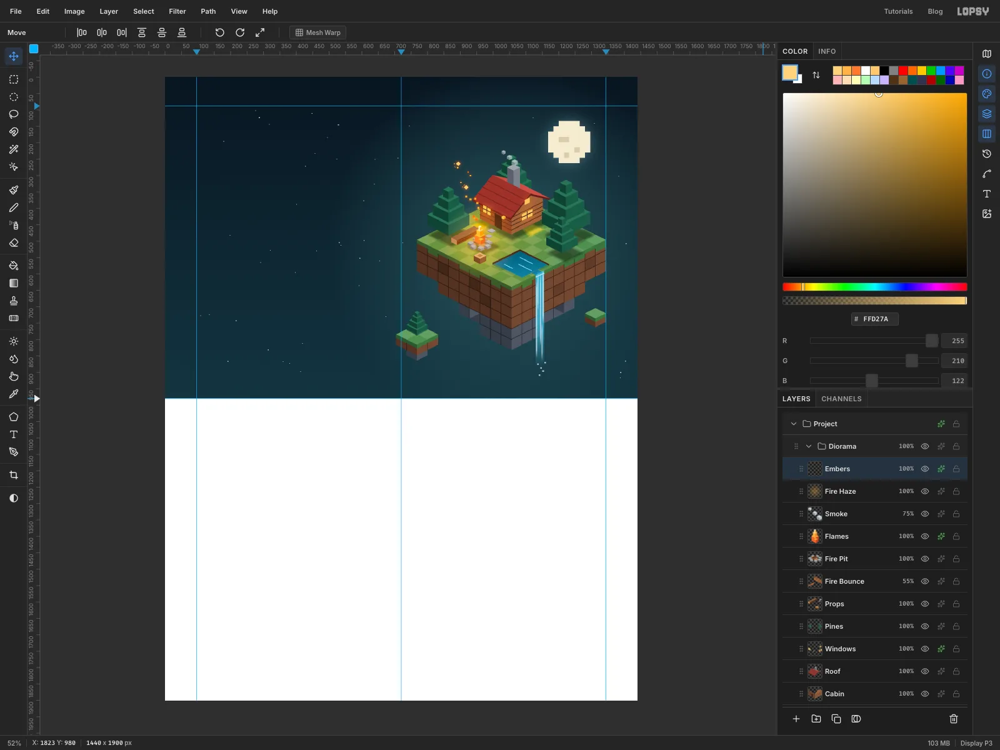

Give `Embers` an **Outer Glow** with **Size** `14`, **Opacity** `80` and colour `#FF6A1F`.

That finishes the diorama. Collapse the `Diorama` group to tidy the Layers panel.

## Start the navigation bar

1. With `Diorama` collapsed, click its row and click **New Group**. Because the group is collapsed, the new group lands beside it rather than inside it. Name it `Nav`.
2. Add a layer called `Nav Rule`. With the Pencil at size `1` in `#22394A`, click at the left edge at `y 88` and Shift-click at the right edge.
3. Add a layer called `Logo Cube`. On the left margin, draw a voxel cube 28 px wide with a `#FFC86E` top, a `#F2662B` left side and a `#C9441E` right side, then a smaller cube sitting on its top face with a `#FFF2C4` top and `#FFB13D` / `#F08A28` sides.

## Set the nav type and button

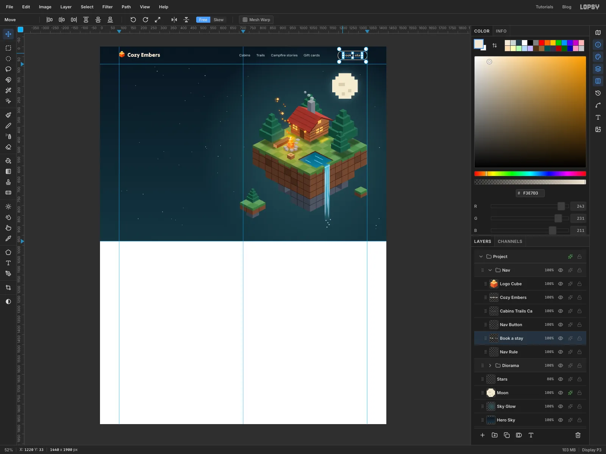

> **Tip:** Changing the font, size or weight while a text layer is active restyles that layer. So before every new piece of type in this tutorial, click a plain (non-text) layer first, then set the font, then click on the canvas.

1. Click `Nav Rule`. With the **Text** tool, choose **Tilt Warp** at size `28` in `#F3E7D3`, and click just right of the cube to type `Cozy Embers`. Press [[Tab]] to commit.
2. Click `Nav Rule` again. Switch to **DM Sans** **Medium** `17` in `#C9D6D3`, and type `Cabins`, `Trails`, `Campfire stories` and `Gift cards` on one line, separated by a few spaces, starting just left of the centre guide.
3. Add a layer called `Nav Button`. Pick the **Shape** tool, set **Shape** to **Rectangle**, **Corner Radius** to `22`, remove the fill, and set the stroke to `#F3E7D3` at **Width** `2`. Shapes grow from where you press, so press at the button's centre, `1270, 44`, and drag to `1344, 66`. That gives a 148 × 44 pill ending on the right margin.
4. Click `Nav Rule`, then type `Book a stay` in DM Sans **SemiBold** `17` inside the pill. Nudge it with the arrow keys until it's centred.

## Draw the hero buttons

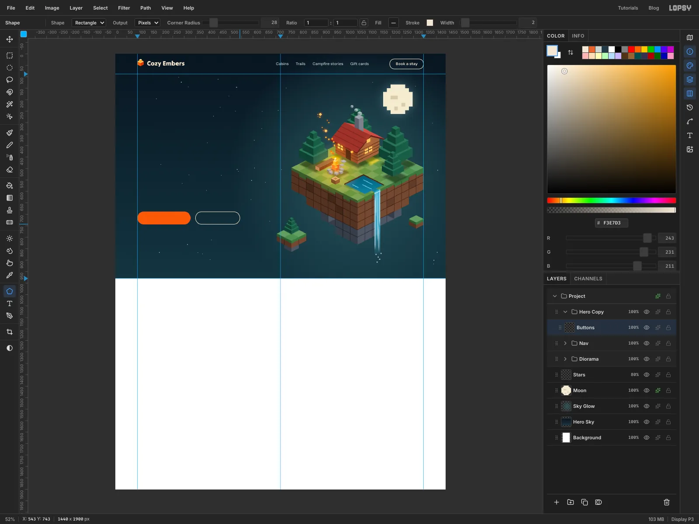

1. Collapse `Nav`, click its row and add a new group called `Hero Copy`, then a layer inside it called `Buttons`.
2. With the Shape tool, set **Corner Radius** to `28`, the fill to `#E8642C` and no stroke. Press at `212, 716` and drag to `328, 744`: a 232 × 56 pill starting on the left margin.
3. Switch to no fill and a `#F3E7D3` stroke of **Width** `2`. Press at `446, 716` and drag to `543, 743`, for a 194 × 54 pill 20 px to the right. A stroke is centred on the shape's edge, so the 2 px stroke adds 1 px all round, and both buttons come out 56 px tall.

## Set the headline

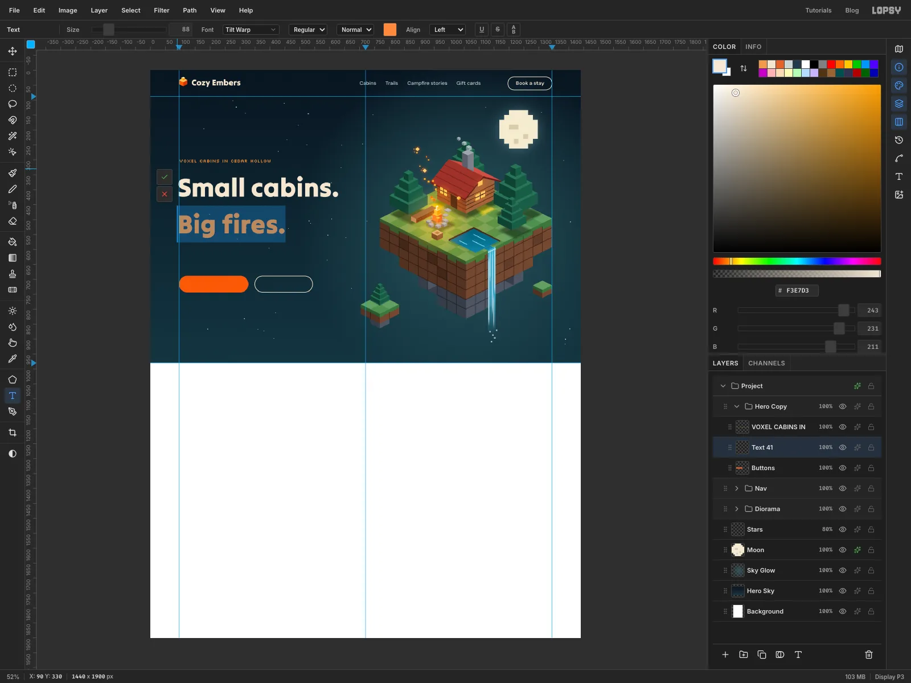

1. Click `Buttons`. In **Silkscreen** **Regular** `16` in `#F29A4A`, type the eyebrow `VOXEL CABINS IN CEDAR HOLLOW` at the left margin, at `y 292`. Silkscreen is a pixel font, so keep it at a multiple of 8 px and at Regular: Bold fills in letters like the W.
2. Click `Buttons` again. In **Tilt Warp** `88` in `#F3E7D3`, click at `90, 330` and type `Small cabins.`, press [[Enter]], and type `Big fires.` Click a few pixels left of the margin, because Tilt Warp's letters start slightly right of the click.
3. While you're still typing, drag across `Big fires.` to select it (or hold [[Shift+Left]] until it's highlighted). Click the **Text color** swatch in the options bar and enter `#FF8A3D`. Close the picker by clicking the swatch again, then press [[Tab]].

## Tighten the headline's leading

The default line height of 1.4 is good for paragraphs but too loose for a big two-line headline.

1. With the headline layer active, open the **Text** panel from the panel toolbar on the right and set **Line height** to `1.12`.
2. That also becomes the default for new text, so click `Buttons` and set it back to `1.4` before typing anything else.

## Finish the hero copy

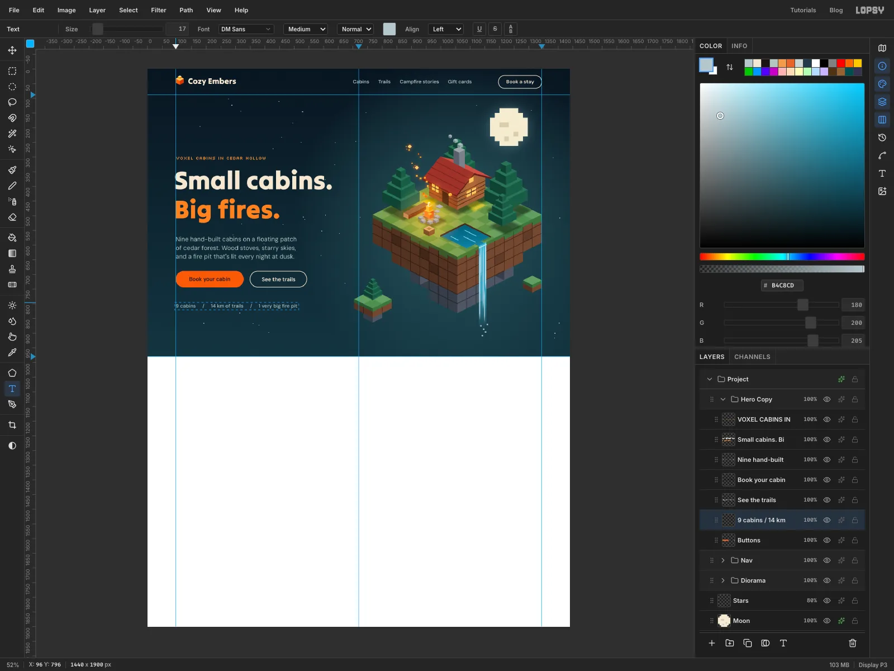

1. Click `Buttons`. In **DM Sans** **Regular** `21` in `#B4C6C3`, type the paragraph at the left margin at `y 566`. Press [[Enter]] to break it into three lines of similar length: `Nine hand-built cabins on a floating patch` / `of cedar forest. Wood stoves, starry skies,` / `and a fire pit that's lit every night at dusk.`
2. Click `Buttons`. In DM Sans **SemiBold** `18`, type `Book your cabin` in `#1A1410` on the orange pill. Click `Buttons` again and type `See the trails` in `#F3E7D3` on the outlined one.
3. Nudge each label with the arrow keys until it's centred in its pill. Zoom in to check that the space on the left matches the right, and the top matches the bottom.
4. Click `Buttons`. In DM Sans **Medium** `17` in `#B4C8CD`, add a stats line at `y 796`: `9 cabins  /  14 km of trails  /  1 very big fire pit`.

## Start the cream section with a stepped edge

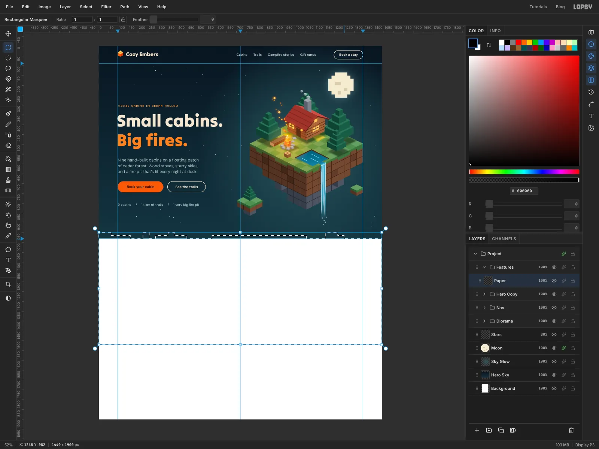

A straight line between sections would be fine, but a stepped edge says "voxel" without another word.

1. Collapse `Hero Copy`, click its row and add a new group called `Features`, then a layer called `Paper`.
2. Select a rectangle across the full width from `y 980` to `y 1520`.
3. Hold [[Shift]] and add blocks 32 to 128 px wide and 16 or 32 px tall sitting on top of that edge, with gaps between them. Neighbouring blocks of the same height merge into longer ledges, which is fine. Just spread them across the whole width so there's no long flat stretch.
4. Fill with `#F2E8D5` and deselect.

## Add the section title and cards

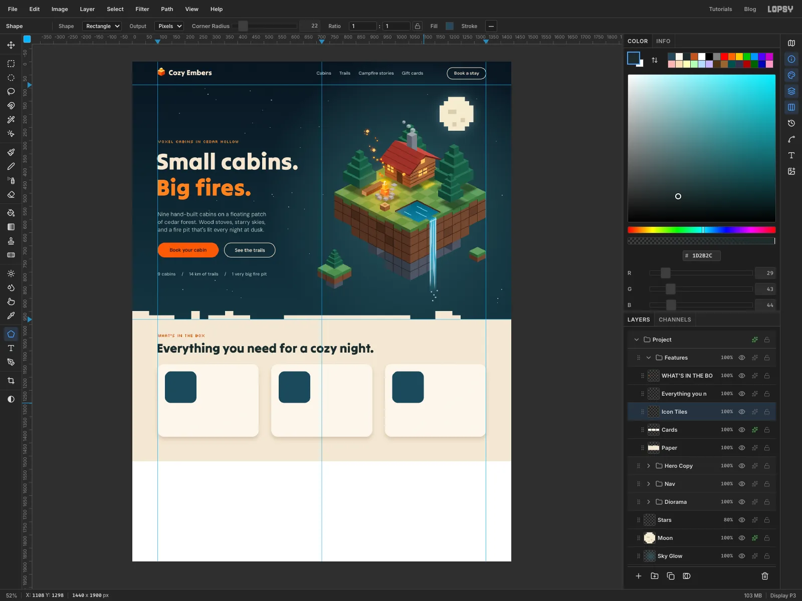

1. Click `Paper`. In **Silkscreen** Regular `16` in `#C2531F`, type `WHAT'S IN THE BOX` at `96, 1030`.
2. Click `Paper` again. In **Tilt Warp** `48` in `#1D2B2C`, type `Everything you need for a cozy night.` at `92, 1056`. Click at least 10 px below the eyebrow's letters: a click close to existing text edits that text instead of starting new type.
3. Add a layer called `Cards`. With the Shape tool at **Corner Radius** `24`, fill `#FBF6EC` and no stroke, draw three 384 × 276 cards. Press at each centre, `288, 1288`, `720, 1288` and `1152, 1288`, and drag 192 px right and 138 px down. The 48 px gaps make the outer edges land on both margins.
4. Give `Cards` a **Drop Shadow** with **Opacity** `22`, **Offset X** `0`, **Offset Y** `10`, **Blur** `26` and colour `#6B4A2E`.
5. Add a layer called `Icon Tiles` and draw a 120 × 120 tile with **Corner Radius** `22` in `#28495A`, 28 px in from the top-left corner of each card. Their centres are at `184, 1238`, `616, 1238` and `1048, 1238`.

## Copy the cabin out of the diorama

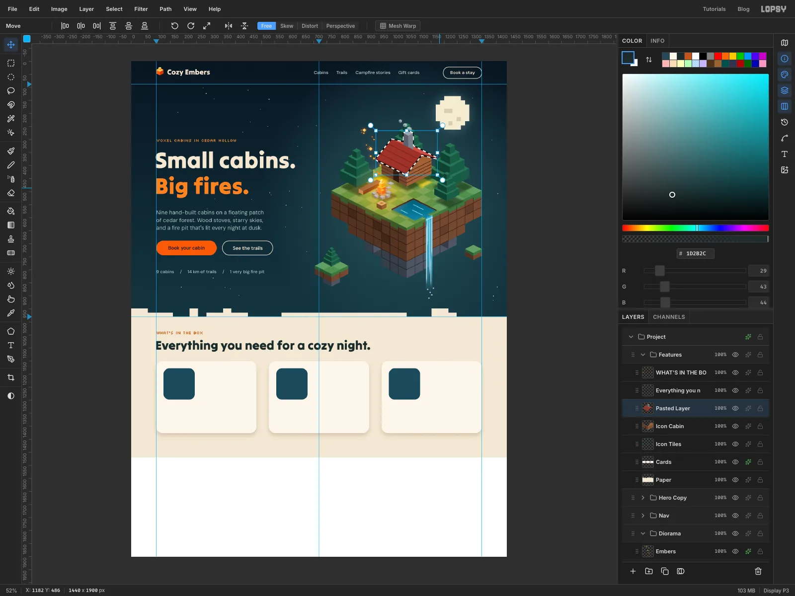

The card icons reuse pieces of the diorama, so they match it exactly.

1. Expand `Diorama`. Click `Cabin`, draw a marquee around the whole cabin and press [[Cmd+C]].
2. Click `Icon Tiles` and press [[Cmd+V]]. Lopsy pastes in place, on a new layer directly above the active one. Rename it `Icon Cabin`.
3. Click `Roof` and press [[Cmd+C]] (the marquee is still there). Click `Icon Cabin` and press [[Cmd+V]], then [[Cmd+E]] to merge the roof down into `Icon Cabin`.
4. Do the same with `Windows`.

## Move and scale the icon

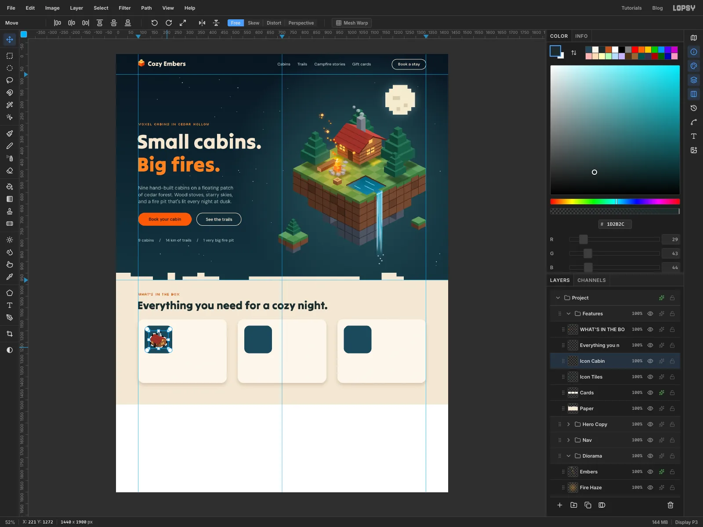

1. [[Cmd]]-click the `Icon Cabin` thumbnail to select its pixels.
2. With the **Move** tool, drag from inside the selection onto the first card's tile.
3. Hold [[Cmd]] and drag the bottom-right corner handle towards the middle to scale it down evenly, to about a third of its size, so the cabin fills about 70% of the tile.
4. Press [[Cmd+D]] to commit.

## Make the other two icons

1. Click `Islets`, marquee the left islet with its little pine and press [[Cmd+C]]. Click `Icon Cabin` and press [[Cmd+V]]. Rename the new layer `Icon Pine`, then move and scale it onto the second tile.
2. Click `Fire Pit`, marquee the fire ring and press [[Cmd+C]]. Click `Icon Pine` and press [[Cmd+V]], and rename the new layer `Icon Fire`.
3. Click `Flames` and copy the same area. Click `Icon Fire`, press [[Cmd+V]] so the flames land above it, then [[Cmd+E]] to merge them down.
4. Move `Icon Fire` onto the third tile. It needs almost no scaling.
5. Size each icon by eye so all three fill their tiles about equally, then collapse `Diorama`.

## Write the card text

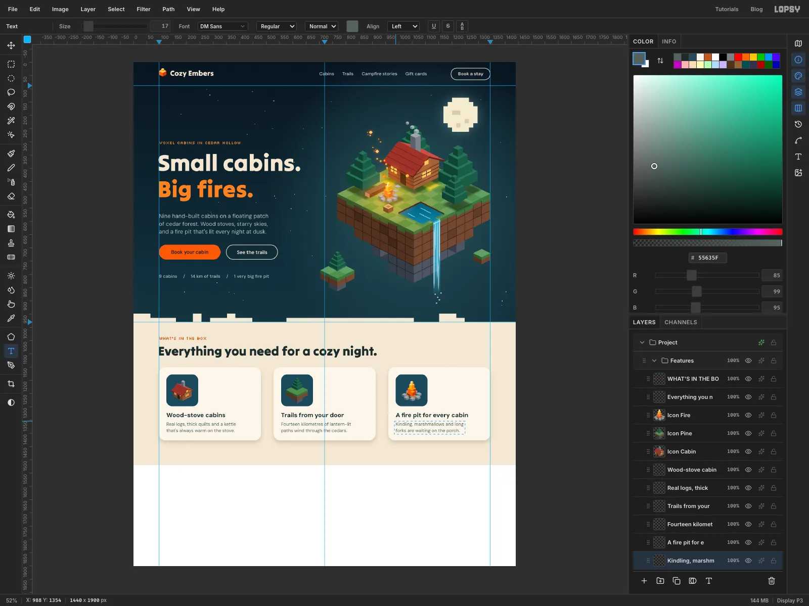

1. Click `Icon Tiles`. In **DM Sans** **Bold** `23` in `#1D2B2C`, type the first card's title 28 px in from the card's left edge at `y 1316`.
2. Click `Icon Tiles`. In DM Sans **Regular** `17` in `#55635F`, type its two-line description at `y 1354`.
3. Repeat for the other two cards, clicking `Icon Tiles` before each new piece of text:
   - `Wood-stove cabins`: `Real logs, thick quilts and a kettle` / `that's always warm on the stove.`
   - `Trails from your door`: `Fourteen kilometres of lantern-lit` / `paths wind through the cedars.`
   - `A fire pit for every cabin`: `Kindling, marshmallows and long` / `forks are waiting on the porch.`

Line the titles and descriptions up at the same heights in all three cards, so the text reads as one row.

## Add a tilted badge

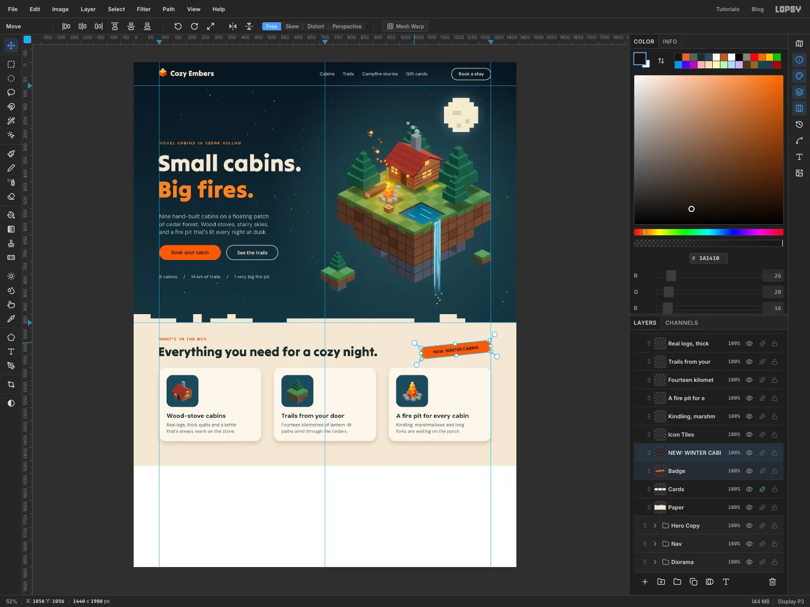

1. Click `Cards` and add a layer called `Badge`. Draw a 264 × 44 orange `#E8642C` pill with **Corner Radius** `22`: press at `1212, 1082` and drag to `1344, 1104`. It ends on the right margin, level with the section heading.
2. With `Badge` active, type `NEW: WINTER CABINS` in DM Sans **Bold** `16` in `#1A1410` and centre it in the pill with the arrow keys.
3. Click the badge text's row, then [[Shift]]-click the `Badge` row to select both layers.
4. With the Move tool and nothing selected on the canvas, the handles frame both layers. Drag a rotation handle a little anticlockwise, to about −6°. The text stays live text. Press [[Cmd+D]].

Use a regular font here rather than Silkscreen. Rotated pixel fonts break into jagged steps.

## Make room with Canvas Size

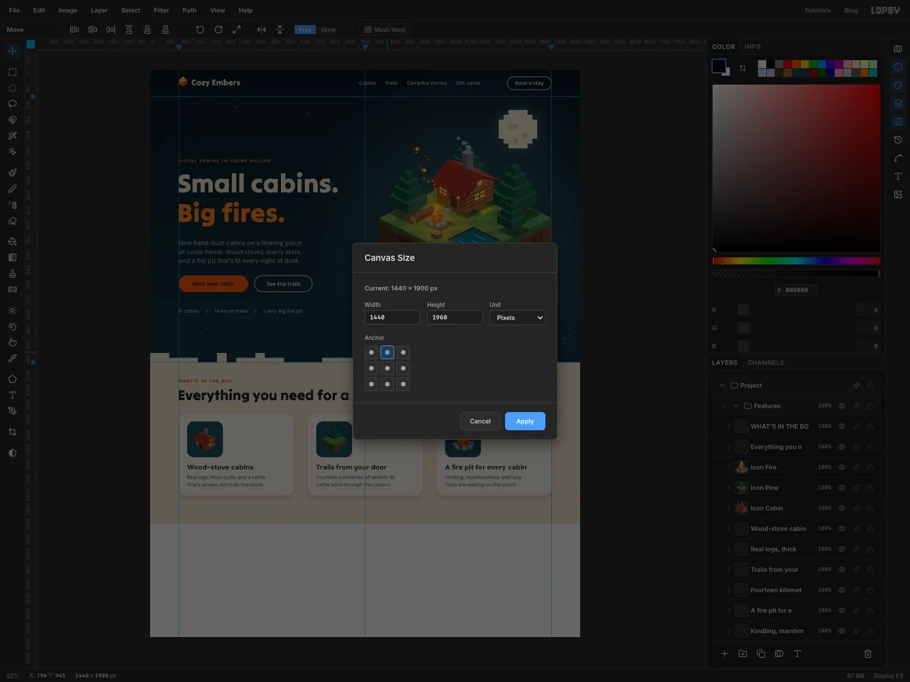

The footer needs another 60 px of breathing room. Rather than squeezing everything up, add it to the canvas.

1. Choose **Image → Canvas Size…**.
2. Change **Height** to `1960`, click the top-centre square in the anchor grid, and click **Apply**. The new 60 px are added at the bottom, and nothing above moves.

## Lay in the booking band and footer

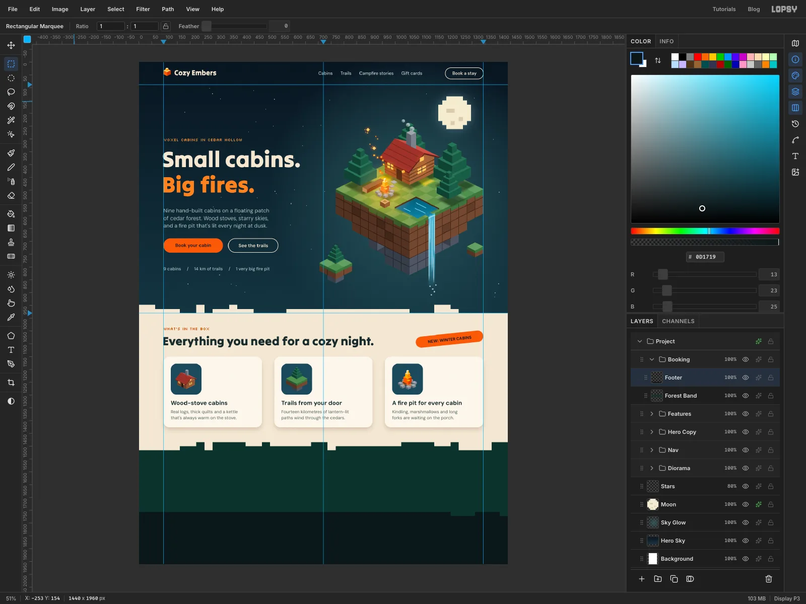

1. Collapse `Features`, click its row and add a new group called `Booking`, then a layer called `Forest Band`.
2. Select from `y 1516` to `y 1772` across the full width and Shift-add stepped blocks along its top edge, as you did for the paper. Fill with `#17322C`.
3. Add a layer called `Footer`. Select from `y 1772` to the bottom of the canvas, Shift-add a few lower steps 16 px tall along the top, and fill with `#0D1719`.

## Build the booking widget

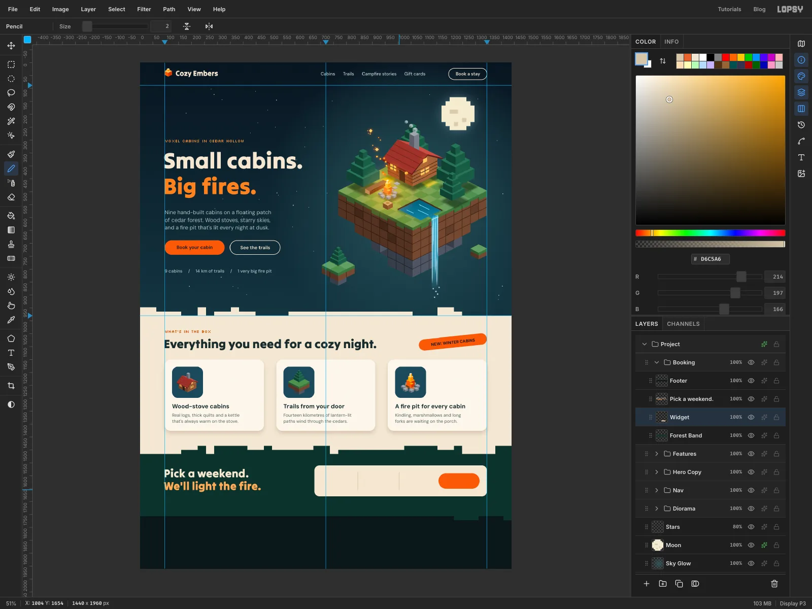

1. Click `Forest Band`. In **Tilt Warp** `44` in `#F3E7D3`, type `Pick a weekend.` [[Enter]] `We'll light the fire.` at `92, 1566`. While still typing, select the second line and colour it `#FFB066`.
2. Set its **Line height** to `1.12` in the Text panel. Then click `Forest Band` and set it back to `1.4`.
3. Add a layer called `Widget`. With the Shape tool at **Corner Radius** `20` in `#F3E7D3` with no stroke, press at `1010, 1620` and drag to `1344, 1680`: a 668 × 120 box ending on the right margin.
4. Switch to `#E8642C` with **Corner Radius** `30`, press at `1236, 1620` and drag to `1316, 1650`. That's a 160 × 60 button with 28 px to the box's right edge, the same as the padding on the left.
5. With the Pencil at size `2` in `#D6C5A6`, Shift-click two short vertical divider lines at `x 844` and `x 1004` to make three fields.

## Fill in the widget

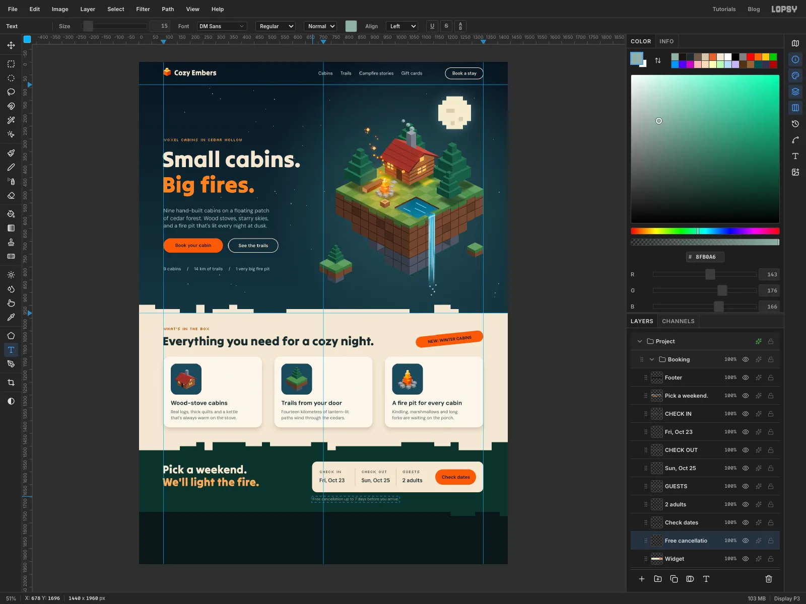

1. Click `Widget`. In **Silkscreen** Regular `16` in `#6B5A48`, type `CHECK IN` 28 px in from the box's left edge, near the top of the first field. Click `Widget` before each one, and type `CHECK OUT` and `GUESTS` in the other two fields.
2. Click `Widget`. In **DM Sans** **SemiBold** `20` in `#1D2B2C`, type `Fri, Oct 23`, `Sun, Oct 25` and `2 adults` under the labels. Leave a clear gap between label and value, or your click will edit the label.
3. Check that each label and value pair is centred vertically in the box.
4. Click `Widget`, type `Check dates` in DM Sans SemiBold `18` in `#1A1410`, and centre it on the button.
5. Click `Widget`. Under the box, type `Free cancellation up to 7 days before you arrive.` in DM Sans **Regular** `15` in `#8FB0A6`.

## Copy the logo into the footer

1. Expand `Nav` and click `Logo Cube`. Marquee around the cube and press [[Cmd+C]].
2. Click `Footer` and press [[Cmd+V]]. Rename the new layer `Footer Cube`.
3. With the Move tool, drag the pasted cube down into the footer until the status bar's **Y** reads about `1824` at its centre. Then nudge it with the arrow keys so it's back on the left margin guide. Press [[Cmd+D]].

## Duplicate the wordmark into the footer group

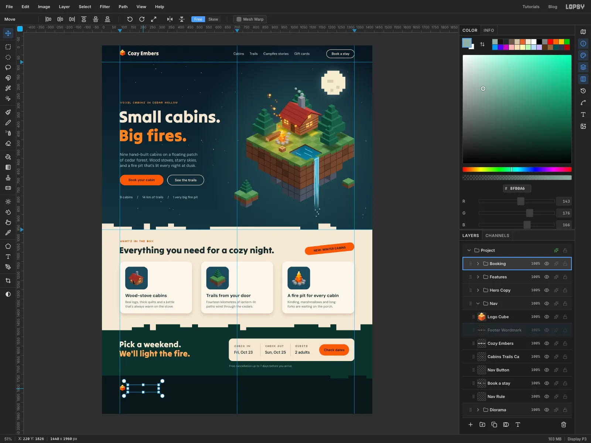

1. Click the `Cozy Embers` text layer and choose **Layer → Duplicate Layer**. Rename the copy `Footer Wordmark`.
2. With the Move tool, drag it straight down beside the footer cube, so it sits next to the cube just as it does in the nav.
3. You can't see it yet. It's still inside the `Nav` group, which is below the `Booking` group, so the footer band covers it. Collapse `Booking`, then drag the `Footer Wordmark` row by its grip and drop it on the middle of the `Booking` row. The group gets an outline, and the layer drops in as the group's top layer.
4. Collapse `Nav` and expand `Booking` again.

## Finish the footer

1. Click `Footer`. Under the wordmark, type `Built block by block in Cedar Hollow.` in DM Sans **Regular** `15` in `#7F9894`.
2. Click `Footer` and set the Text panel's **Line height** to `1.7`. Then type three link columns in DM Sans **Medium** `15` in `#A9BBB8`, one item per line, starting at `x 944`, `1104` and `1264`, clicking `Footer` before each:
   - `Cabins` / `Trails` / `Gift cards`
   - `Journal` / `About us` / `Contact`
   - `Instagram` / `Newsletter` / `Press`

   The last column ends on the right margin. Line the tops of the columns up with the top of the wordmark's capitals.
3. Click `Footer` and set the line height back to `1.4`.
4. In **Silkscreen** Regular `16` in `#7F9894`, type `© 2026 COZY EMBERS CABIN CO.` at the left margin near the bottom. Click `Footer`, type `MADE WITH 1,204 VOXELS`, and nudge it until its right edge sits on the right margin.

## Centre the hero copy against the island

1. Click the `Hero Copy` group's row.
2. With the Move tool, drag anywhere on the canvas straight up. Stop when the space between the eyebrow and the top of the island matches the space between the stats line and the bottom of the island, about 34 px here. The eyebrow, headline, paragraph, buttons and stats all move together.

## Clear stars from behind the copy

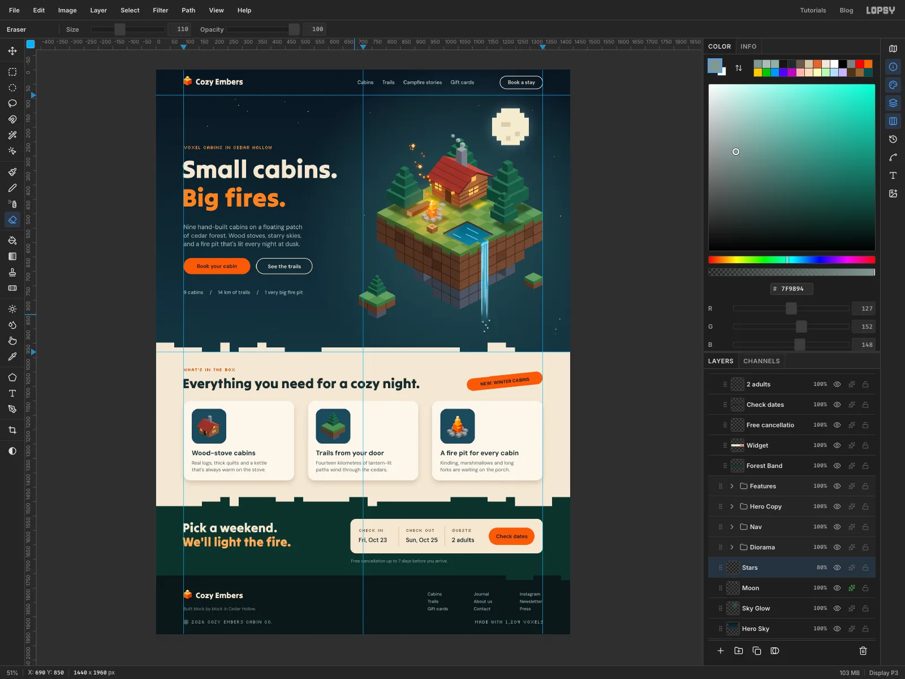

1. Click the `Stars` layer and pick the **Eraser** at **Size** `110`.
2. Sweep it across the left column in horizontal strokes, from just above the eyebrow to below the stats line, from the left edge to about `x 690`.

Stars that cross a letter or sit in a word gap look like stray punctuation. The sky around the island keeps all of its stars.

Save your work with **File → Save Project**, and use **File → Quick Export PNG** to export the finished page.
