**Voxel art** is pixel art in three dimensions: everything is built from identical little cubes. Seen from the classic 2:1 isometric angle, every cube shows the same three faces: a diamond on top, a face on the left and a face on the right. If you keep one light direction and give each kind of face its own shade, any pile of cubes reads as a solid object.

In this tutorial you'll paint a voxel s'mores scene on the front of a hot chocolate tin label, **Cubic Cocoa Co. — Toasted Marshmallow**. It's a 1200 × 1600 px label. You won't need a 3D program. You'll set up isometric graph paper in Lopsy and trace each face of the scene on it with the **Pen**, the way you would on paper. The label has:

- a floating graham-cracker slab with a mug of cocoa, toasted marshmallows, a chocolate bar, a little campfire and rising steam
- seams between the cubes, added in one go with the **Magic Wand** and four home-made **patterns**
- chunky **Bungee** type with a toasted gradient and a solid extrusion
- a rotated badge, a cream pill and small cube icons

The tools you'll use:

- the **Pencil**, **Edit → Define Pattern** and **Edit → Fill with Pattern**
- the **Pen** with the **Paths** panel's **Path to Selection**, and **Edit → Fill**
- the **Magic Wand** with Contiguous off, and Multiply and Overlay blend modes
- the **Brush**, the **Gradient** tool, the **Shape** tool and **Add Noise**
- the **Drop Shadow**, **Outer Glow** and **Stroke** effects
- the **Rectangular Marquee**, **Cut**, **Copy** and **Paste**, the **Move** tool and its rotate handle
- **groups**, **guides** and the **Text** tool

The fonts are free Google Fonts from Lopsy's font picker: **Bungee** for the name and the badge, and **Space Grotesk** for the small type.

Every cube material gets three shades, listed top / left face / right face:

- Label teal `#1E5755` → `#2C7570`, cream `#F6E9D2`, ink `#2A1A12`
- Cracker `#E3AA66` / `#C88A47` / `#A26732`, docking holes `#B47538`
- Mug `#F48A70` / `#DE5E47` / `#B4412E`, inside walls `#A23B2A` / `#8A3123`, cream band `#E9D3B0` / `#C9AD86`
- Chocolate `#7B4229` / `#5D301C` / `#43200F`, grooves `#68361F` / `#4F2817` / `#381A0B`, cocoa `#6E3A22`
- Marshmallow `#D99248` / `#FAF0DE` / `#E6D2B2`, toasted `#B8722F` / `#EFC58D` / `#D6A56C`, charred `#6E3F1E` / `#C9893F` / `#A86D31`
- Wood `#9A6A40` / `#7C512E` / `#5E3A1F`
- Flame core `#FFC93C` / `#F5A623`, flame `#FFB13B` / `#F58A1F` / `#D9661A`, flame tips `#F2683A` / `#D94A2B` / `#B5361F`
- Floating cubes `#FFF8EC` / `#F1E2CA` / `#D8C2A0`, steam `#FFFFFF` / `#E6EEEC` / `#C7D6D3`
- Type coral `#F48A70`, badge `#DE5E47`, extrusion `#3B1D0F`, MARSHMALLOW `#FFF5E4` → `#F8DCAA` → `#E8A256`
- Contact shadow `#5B2E14`, fire glow `#FFA83A`, firelight `#FF9A3C`, drop shadow `#0A2524`, grain grey `#808080`

> **Tip:** One cube is **52 px wide**. Its top is a 52 × 26 diamond and its sides are 26 px tall. Every edge in the scene runs along one of three directions: straight up, or a 1-in-2 slope down to the left or the right. Positions are written as `x, y` in document pixels, and the status bar shows the cursor's position. Key names are Mac keys. On Windows and Linux, use Ctrl for Cmd.

## Set up the label stock

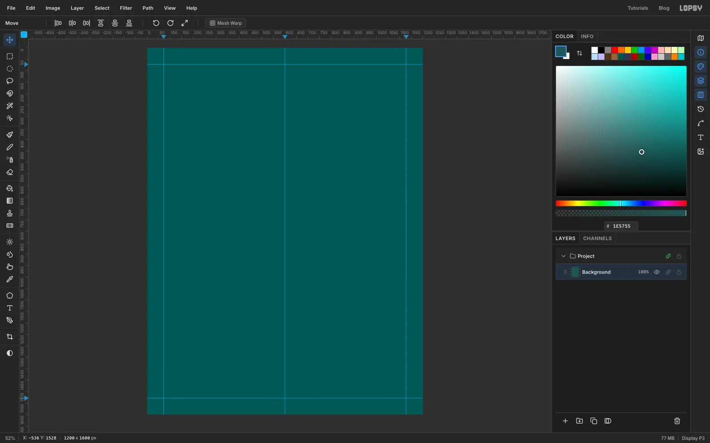

Open [Lopsy](/). In the **New Document** dialog set **Width** to `1200` and **Height** to `1600`, and click **Create**. Delete the empty `Layer 1` with the bin button at the bottom of the Layers panel, so only `Background` is left.

1. Click the **Background** layer, set the foreground colour to `#1E5755` in the Color panel's hex field, and choose **Edit → Fill**.
2. Click the top ruler at **600** to drop a vertical guide down the middle, then at **72** and **1128** for the side margins.
3. Click the left ruler at **72** and **1528** for the top and bottom margins.

The guides are only for lining up type later. The scene gets its own grid in the next steps.

## Draw the isometric tiles with the Pencil

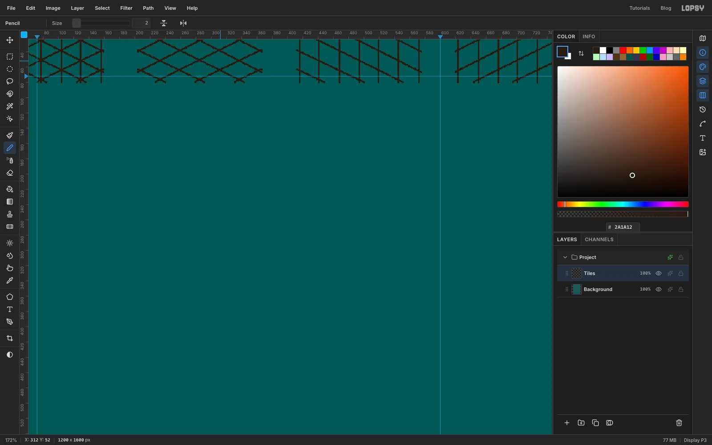

You need four small repeating tiles: one for graph paper and one for the seams on each kind of cube face. You'll draw them along the top edge of the canvas and delete them afterwards.

1. Add a layer with the **+** button and name it `Tiles` (double-click its name).
2. Pick the **Pencil** ([[N]]), set **Size** to `2` and the colour to `#2A1A12`.
3. Draw four blocks, each 156 × 78 px (three tiles across and three down), from y = 0 to 78, starting at x = **0**, **208**, **416** and **624**. Click where a line starts, then **Shift-click** where it ends, and let each line run a few pixels past the block.
   - **Verticals:** one every 26 px across the block, the full 78 px tall.
   - **Falling diagonals:** lines that drop 1 px for every 2 px to the right. Three start on the block's left edge at y = 13, 39 and 65, and three more come in through its top edge at 26, 78 and 130 px from the left.
   - **Rising diagonals:** the mirror image. Three start on the left edge at y = 13, 39 and 65 and rise, and three more come in through the bottom edge at 26, 78 and 130 px from the left.
4. Block 1 (x = 0) gets all three sets: that's the graph paper. Block 2 (x = 208) gets only the two diagonal sets: the diamond seams of top faces. Block 3 (x = 416) gets the verticals and the falling diagonals, for left faces. Block 4 (x = 624) gets the verticals and the rising diagonals, for right faces.

Zoom in with Cmd and the scroll wheel to check that the lines meet at the same points in every block.

## Turn the middle tiles into patterns

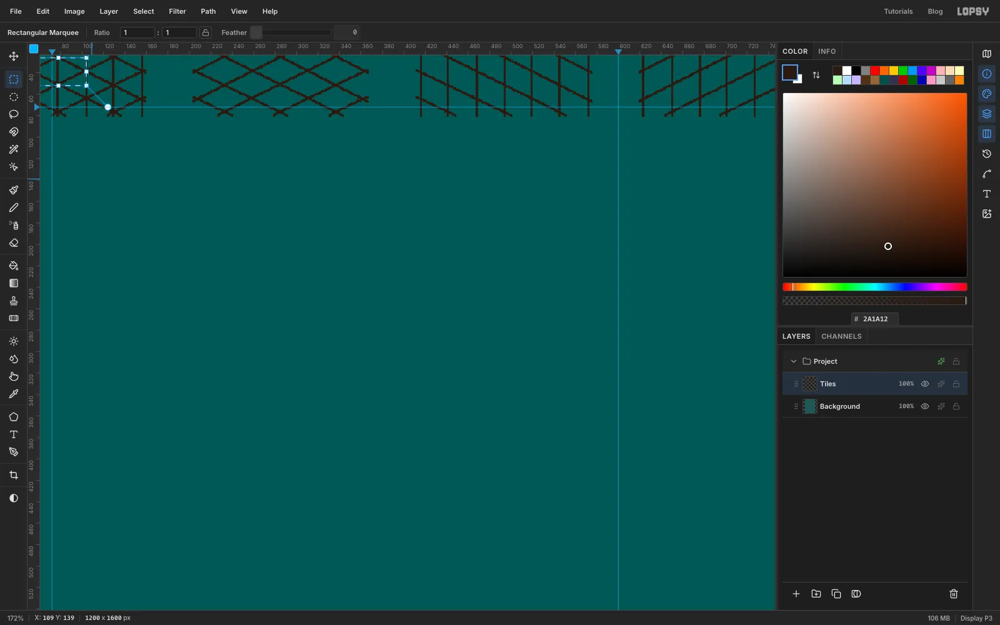

Each pattern is the **middle** tile of its block, so the lines run cleanly across the tile's edges and it repeats without seams.

1. Pick the **Rectangular Marquee** ([[M]]) and click the canvas once without dragging. In the **Rectangular Selection** dialog type **From** `52`, `26` and **To** `104`, `52`, and press Enter.
2. Choose **Edit → Define Pattern**. This is **Pattern 1**, the graph paper.
3. Do the same for the other blocks, from `260, 26` to `312, 52` (**Pattern 2**, tops), from `468, 26` to `520, 52` (**Pattern 3**, left faces) and from `676, 26` to `728, 52` (**Pattern 4**, right faces).

Press [[Cmd+D]] to deselect and delete the `Tiles` layer. Patterns aren't saved in `.lopsy` project files, so define them again if you reopen the project later.

## Fill a layer with isometric graph paper

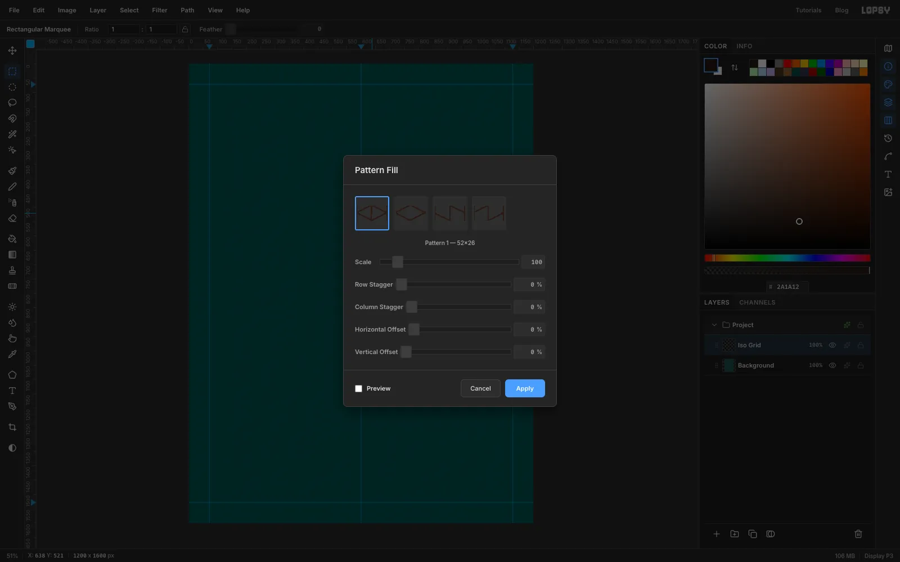

1. Click **Background** and add a layer above it named `Iso Grid`.
2. Choose **Edit → Fill with Pattern…**, click the first pattern (the full triangle grid) and click **Apply**.
3. Click the opacity readout on the layer row and drag it down to **30%**.

The pattern tiles from the canvas's top-left corner, and so does every pattern you'll use later. That's why every cube in this tutorial lines up with this grid.

## Check the grid

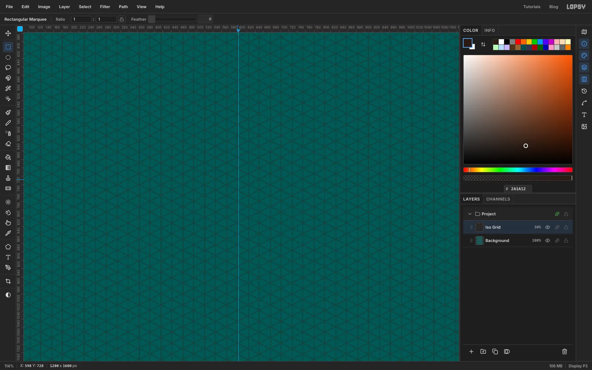

Zoom in and look at the grid. Every small triangle is half a cube face. Two triangles side by side, sharing a vertical line, make a top diamond. Two triangles sharing a slanted line make a left or a right face.

Here's the layout of the scene, measured in cubes:

- The **graham cracker** is a slab 18 cubes along its right edge, 16 along its left and 2 thick. Its top corners are at `598, 520` (back), `1066, 754` (right), `650, 962` (front) and `182, 728` (left).
- The **mug** stands in the middle of the cracker. Its footprint is a stepped circle with rows of 3, 7, 9, 9, 9, 9, 9, 9, 7 and 3 cubes. It's 10 cubes tall with walls one cube thick, and the 5th and 6th layers up are a cream band. A C-shaped handle, 2 cubes thick, sticks out 3 cubes on the right.
- The **cocoa** fills the mug to one cube below the rim. Three 2 × 2 × 2 **marshmallows** float in it, and one of them sticks up above the rim.
- A **chocolate bar**, 7 × 3 cubes, lies at the front left. Its raised squares are split by one-cube grooves.
- Two more marshmallows sit on the cracker in front of the mug.
- A **campfire** sits on the right corner: two crossed logs and a stepped flame. A **marshmallow on a stick** comes in from the right, two cubes above the flame.
- Two wisps of **steam** rise from the cocoa, and five single **floating cubes** hang around the scene.

The footprint rows run parallel to the cracker's back-right edge (from `598, 520` towards `1066, 754`), counted from the back. A few anchors to place things: the centre of the mug's base is at about `611, 683`, the chocolate bar's back corner is at `312, 689`, and the flame stands on the logs at `962, 728`.

Try one cube first, on a spare layer. Pick a grid point `x, y` for its top corner. Its outline is a hexagon: `x, y`, then `x+26, y+13`, `x+26, y+39`, `x, y+52`, `x−26, y+39` and `x−26, y+13`. Fill the hexagon with the right-face colour. Then trace the left face (`x−26, y+13`, `x, y+26`, `x, y+52`, `x−26, y+39`) and fill it, and finally the top diamond (`x, y`, `x+26, y+13`, `x, y+26`, `x−26, y+13`).

For anything bigger, never trace cube by cube. A run of faces that point the same way and share a colour is **one** shape. The whole left side of the cracker is a single long strip, for example. The lines between the cubes come later, all at once.

## Trace the whole scene's outline with the Pen

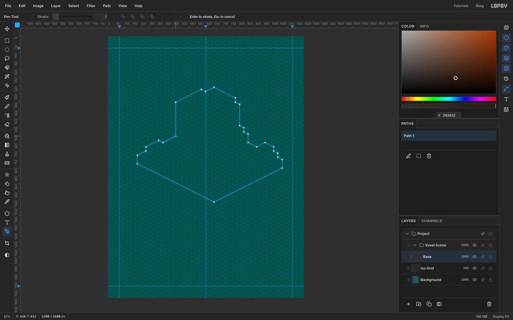

Before the faces, you'll paint a dark outline layer under the whole scene. Where two faces meet, the antialiased edges let a little of the layer below through. A dark layer under everything turns that into a crisp dark line instead of a teal fringe.

1. Click `Iso Grid`, then click the **New Group** button (the folder with a plus) and name the group `Voxel Scene`. Add a layer inside it named `Base`.
2. Pick the **Pen** ([[P]]). Click from corner to corner around the **outside** of the whole scene, following the grid lines, and finish by clicking the first point to close the path.
3. Open the **Paths** panel from the strip on the right edge of the window. With the path selected, click **Path to Selection** (the dotted square), then **Delete Path** (the bin).
4. Set the colour to `#2A1A12` and choose **Edit → Fill**.

Do the same for each floating cube and for the stick, which don't touch the main outline. Leave the steam out: it should stay soft at the edges, without a dark rim.

## Fill the silhouette

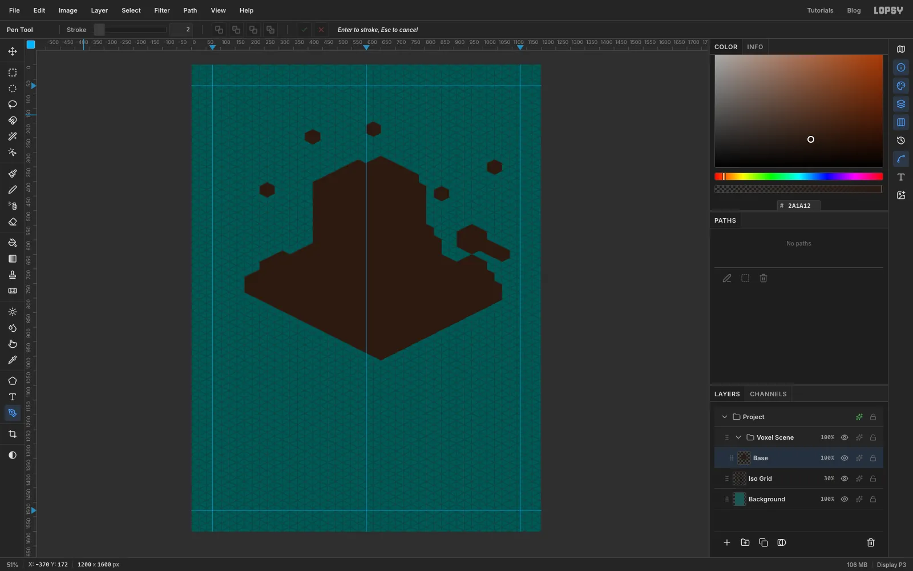

You now have the scene as one dark cut-out. Every face you paint from here goes on top of it. This **Pen → Path to Selection → Delete Path → Fill** loop is how you'll paint every face in the scene, so it's worth getting into a rhythm with it.

## Paint the graham cracker

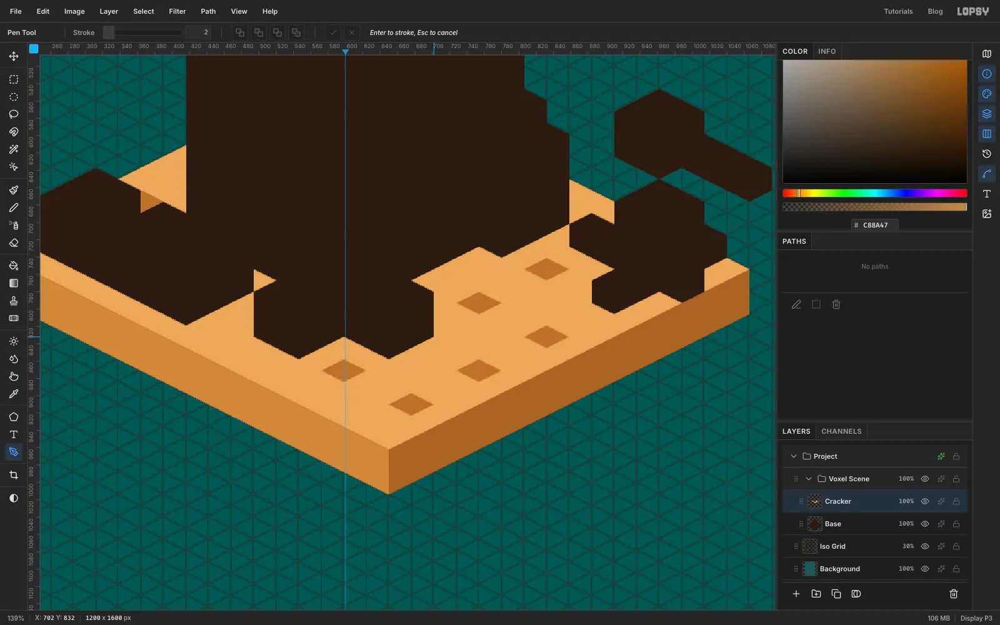

Add a layer named `Cracker` above `Base`. Paint each object darkest first:

1. Trace the cracker's whole visible outline and fill it with the right-face colour, `#A26732`.
2. Trace the **top** surface and fill it with `#E3AA66`. The mug and the other objects hide part of it, so the outline goes around their bases.
3. Trace the **left** side, the strip under the front-left edge, and fill it with `#C88A47`. The dark fill you laid first is already the right side.
4. For the docking holes, trace single top diamonds (one cube every third row and column) and fill them with `#B47538`.

Painting darkest first means that where a lighter face meets a darker one, the edge blends into the darker colour.

## Trace the mug's outline

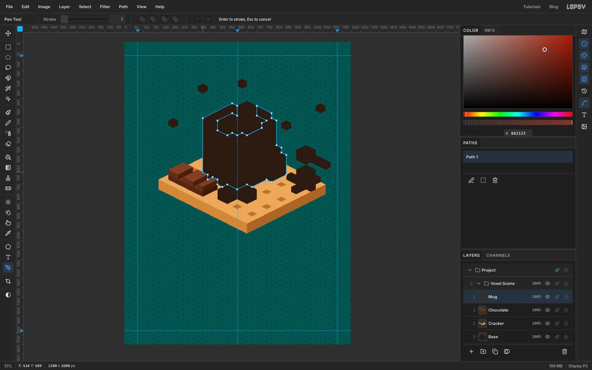

First add a layer named `Chocolate` above `Cracker` and paint the bar the same way. Fill its whole outline with the darkest groove colour `#381A0B`, then the grooves' other faces `#4F2817` and `#68361F`, then the raised squares: right faces `#43200F`, left faces `#5D301C` and tops `#7B4229`.

Then add a layer named `Mug`. Trace the mug's outline in one path: up the stepped left side, along the inside of the rim where the cocoa shows through, down the right side and around the handle.

The mug's sides are made of steps. Each cube in the circular footprint pushes the outline out or in by one cube, so the side of the mug is a run of tall strips, each one cube wide, alternating between left and right faces.

## Fill the mug's dark side

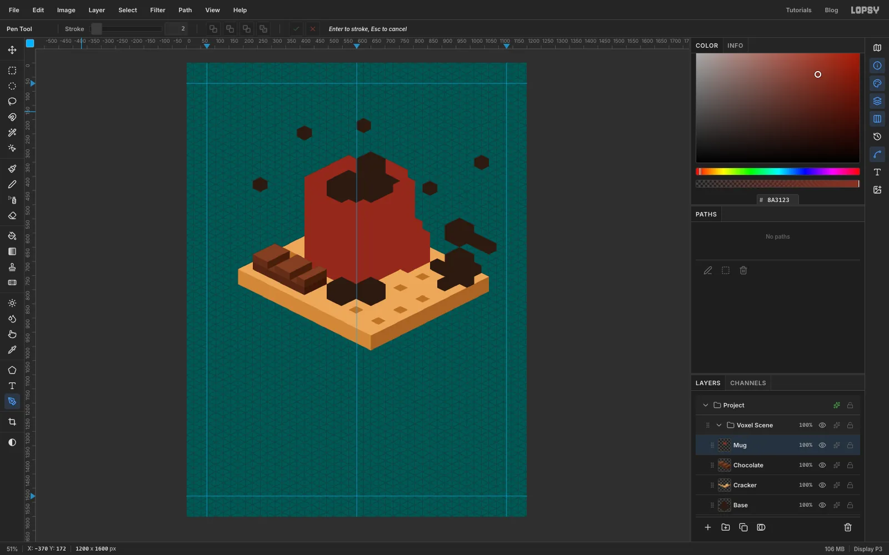

Fill the outline with the darkest colour the mug uses, `#8A3123`, the shadowed inside of the rim. Every other face is lighter, so you only need to add faces on top of it from here.

## Paint the mug's faces

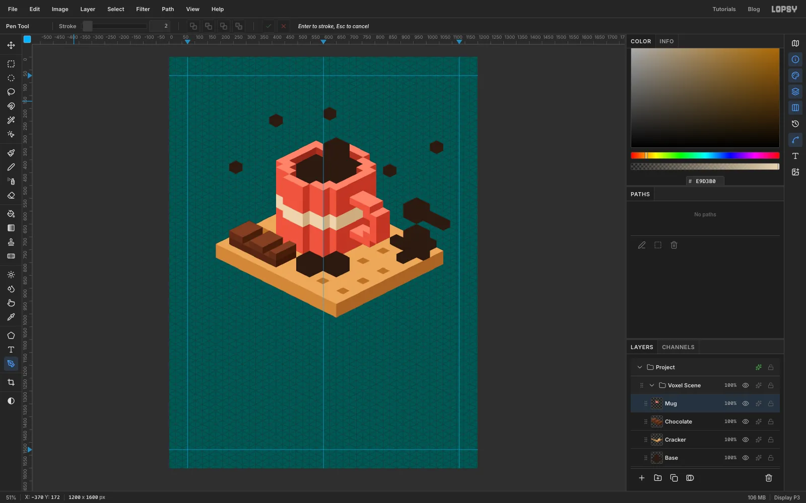

Trace and fill the rest of the mug's faces, darkest first:

1. The left-facing faces **inside** the rim, `#A23B2A`. Like the right-facing ones you just filled, they're in shadow.
2. The right faces of the mug and handle, `#B4412E`.
3. The left faces of the mug, `#DE5E47`. Each strip runs from the rim down to the cracker, broken only by the band.
4. The cream band's right faces `#C9AD86`, then its left faces `#E9D3B0`.
5. The rim and the tops of the handle, `#F48A70`.

## Paint the rest of the scene

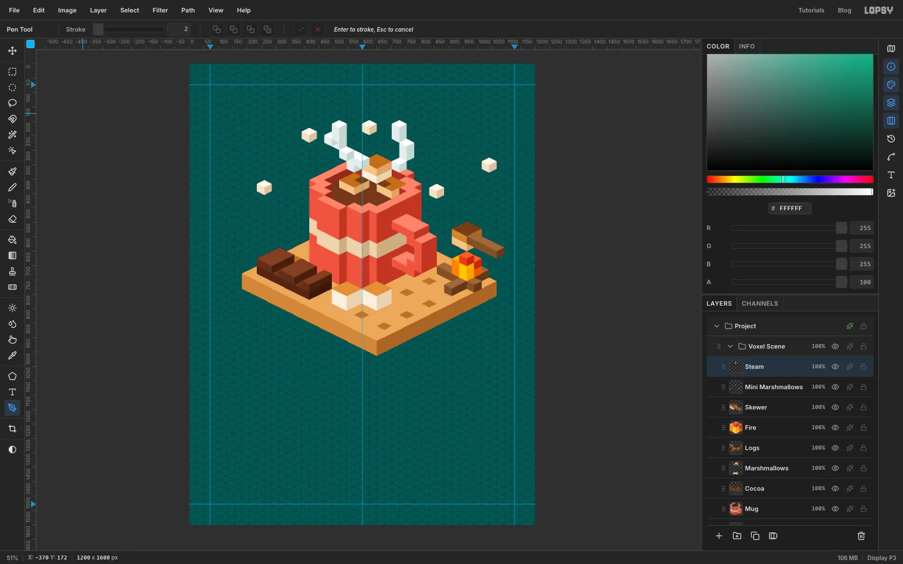

Give each object its own layer above `Mug`, in this order, and paint each one the same way: the whole outline in the darkest colour that object uses, then the lighter faces from dark to light.

- `Cocoa`: the flat surface inside the mug, `#6E3A22`.
- `Marshmallows`: sides `#E6D2B2` and `#FAF0DE` with plain tops `#D99248`. The floating ones have a toasted top layer: `#D6A56C` and `#EFC58D` on the sides and `#B8722F` on top, with a few top diamonds in charred `#6E3F1E`.
- `Logs`: wood `#5E3A1F` / `#7C512E` / `#9A6A40`.
- `Fire`: orange `#D9661A` / `#F58A1F` / `#FFB13B`, with a yellow core `#F5A623` / `#FFC93C` and red at the back and tip `#B5361F` / `#D94A2B` / `#F2683A`.
- `Skewer`: the stick in wood colours, and the marshmallow on the end with toasted sides and a charred top layer: `#A86D31` / `#C9893F` on the sides and `#6E3F1E` on top.
- `Mini Marshmallows`: the five floating cubes, `#D8C2A0` / `#F1E2CA` / `#FFF8EC`.
- `Steam`: two wisps, `#C7D6D3` / `#E6EEEC` / `#FFFFFF`. Keep it fully opaque. See-through steam over the coral rim turns a muddy pink.

Close the Paths panel when you're done.

## Cut a floating cube and move it

One floating cube on the left sits where the badge will go. Move it lower:

1. Click `Mini Marshmallows`. Drag a **Rectangular Marquee** around the cube on the left, about `228, 397` to `292, 461`.
2. Press [[Cmd+X]], then [[Cmd+V]]. Lopsy pastes it into a new layer in the same place, selected, with the **Move** tool active. Name the layer `Mini Drifter`.
3. Drag the cube 26 px left and 143 px down, so it lands between `208, 546` and `260, 598`. Watch the status bar as you drag. On this grid a move of 26 px across has to come with 13 px plus a multiple of 26 px down, or the seams you add next won't line up with its edges.
4. Its dark outline is still on `Base`. Click `Base`, draw the same marquee and press **Delete**. Then [[Cmd+D]].

## Select every top face with the Magic Wand

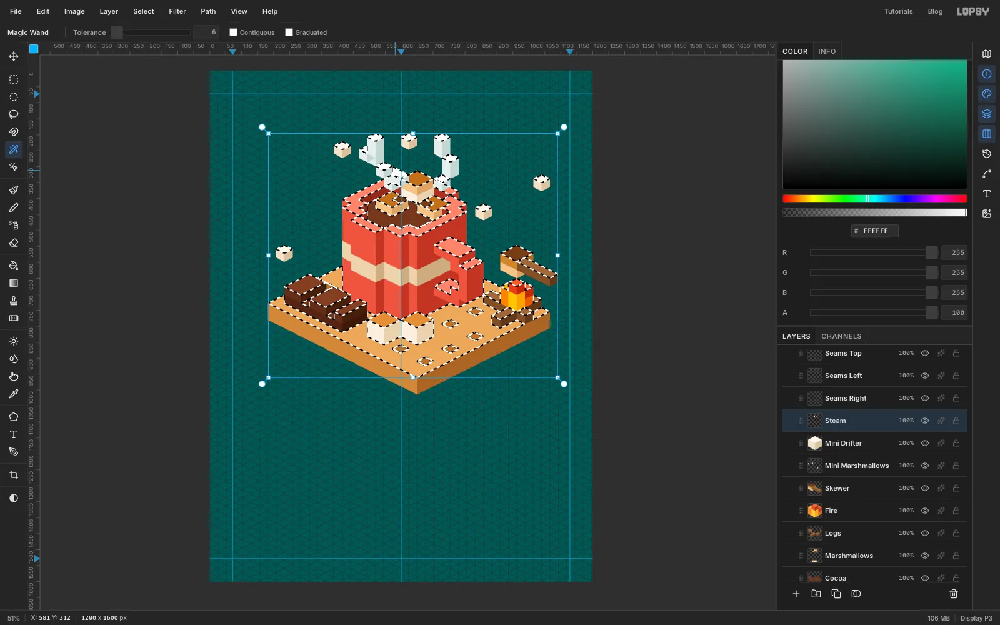

Now for the seams. Each kind of face gets its own pattern, so you need a selection of all the top faces, then all the left faces, then all the right faces.

1. Click `Steam` and add three layers above it: `Seams Right`, `Seams Left` and `Seams Top`.
2. Pick the **Magic Wand** ([[W]]). Set **Tolerance** to `6` and untick **Contiguous**.
3. The wand reads the active layer only. Click `Cracker` and click its top colour. Then hold **Shift** and click each other top colour on that layer, like the docking holes.
4. Click the next object layer and **Shift-click** its top colours, and so on through every layer from `Chocolate` up to `Steam`. Each click adds every pixel of that exact colour on the layer.

The tolerance is low so a top colour doesn't pick up a side colour that's close to it.

## Fill the top seams with a pattern

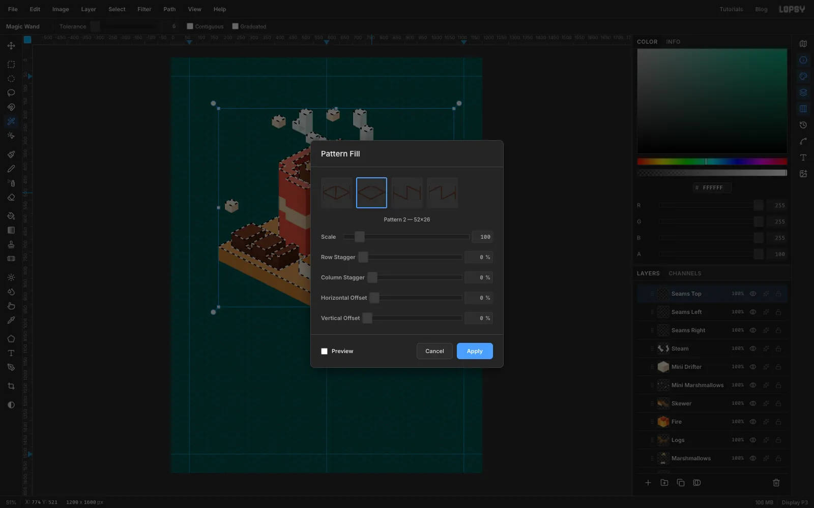

1. Click `Seams Top`. The selection stays.
2. Choose **Edit → Fill with Pattern…**, click the diamond tile (Pattern 2) and click **Apply**.
3. Repeat for the left faces: select them all with the wand (click the first colour without Shift to start a new selection), click `Seams Left` and fill with Pattern 3. Then do the right faces on `Seams Right` with Pattern 4.
4. For each seam layer, open the Effects drawer with the sparkle button on the layer's row and set the blend mode at the top of the drawer to **Multiply**. Lower each one's opacity to **35%**.

## Check the seams up close

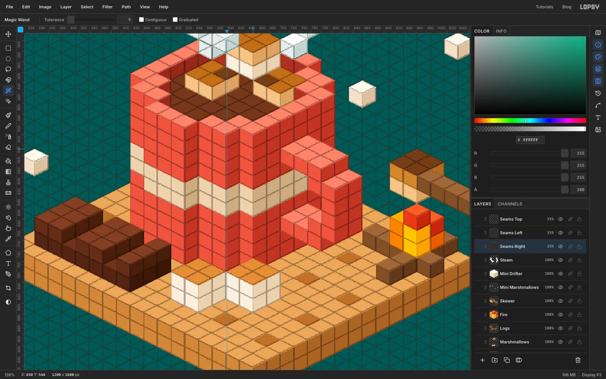

Zoom in. Every seam should sit on a face edge, because the patterns and the faces both line up with the canvas's top-left corner. If seams cross a face halfway, a face was traced one grid line off.

## Paint contact shadows

Where an object stands on the cracker, the corner should be darker.

1. Click `Cracker` and add a layer above it named `Contact Shadows`. It sits under every object, so you can paint loosely.
2. Pick the **Brush** ([[B]]). Set **Size** to `46`, **Hardness** to `0` and **Opacity** to `45%`, and the colour to `#5B2E14`.
3. Paint a ring around the base of the mug, then around the chocolate bar, the two marshmallows on the cracker and the logs. The objects on top hide whatever runs under them.
4. Set the layer to **Multiply**.

## Add the glow, the drop shadow and the firelight

1. Click `Fire`, open its Effects drawer and turn on **Outer Glow**: colour `#FFA83A`, **Size** `46`, **Spread** `4`, **Opacity** `80`.
2. Click `Base` and turn on **Drop Shadow**: colour `#0A2524`, **Offset X** `18`, **Offset Y** `30`, **Blur** `30`, **Spread** `0`, **Opacity** `55`. Give `Mini Drifter` the same shadow. The light comes from the top left, so the shadows fall down and to the right.
3. Click `Seams Top` and add a layer named `Firelight`. With the Brush at **Size** `260`, **Hardness** `0` and **Opacity** `35%`, dab `#FF9A3C` over the fire and the cracker around it. Set the layer to **Overlay**.

## Light the label from behind the scene

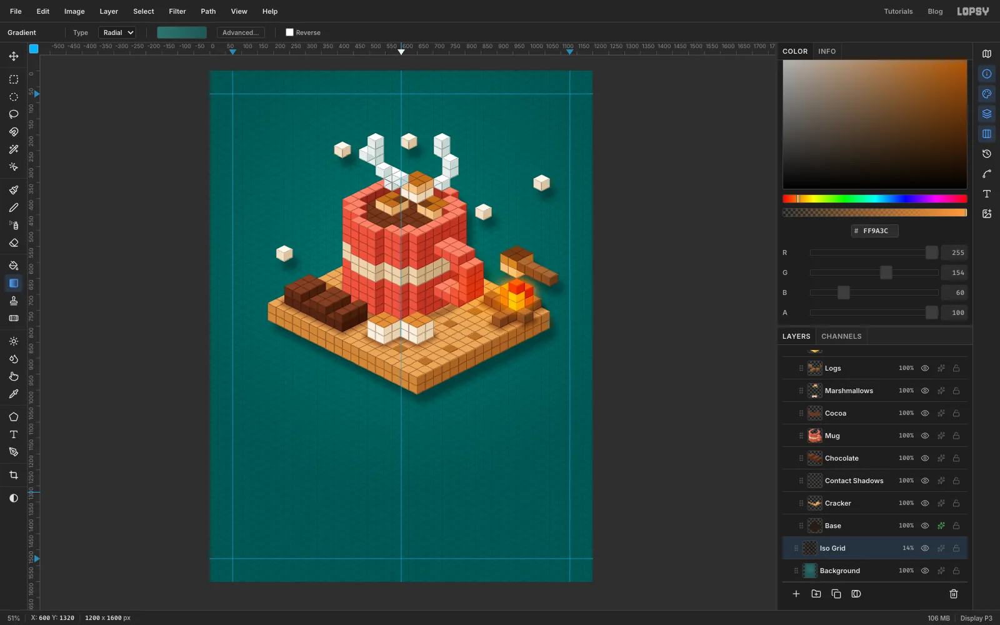

1. Click **Background**. Pick the **Gradient** tool, set **Type** to **Radial** and click **Advanced…**. Make a two-stop gradient from `#2C7570` to `#1E5755` and click **Done**.
2. Drag from `600, 600` straight down to `600, 1320`.
3. Click `Iso Grid` and lower its opacity to **14%**. It stays as a quiet texture.

## Frame the label

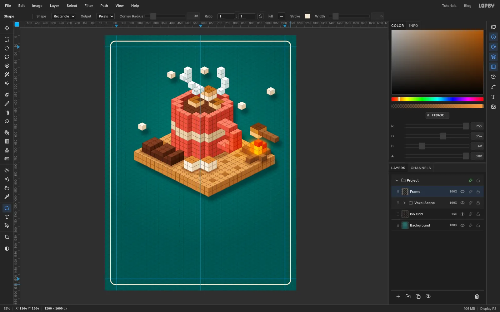

1. Collapse the `Voxel Scene` group with its arrow and click it, so new layers go above it rather than inside. Add a layer named `Frame`.
2. Pick the **Shape** tool ([[U]]). Set **Shape** to **Rectangle**, **Output** to **Pixels** and **Corner Radius** to `30`. Click the **Fill** swatch and choose **Remove fill**, then click the **Stroke** dash and set it to `#F6E9D2`. Set **Width** to `6`.
3. Shapes draw from the centre. Drag from `600, 800` to `1164, 1564`.
4. Add a layer named `Inner Rule` and draw a second rectangle from the same centre to `1148, 1548`, with **Corner Radius** `18` and **Width** `2`. Lower it to **55%** opacity.

## Set the type

1. Click `Inner Rule` and make a **New Group** named `Label Type`. Add a layer named `Pill` and draw a **Rectangle** with the Shape tool: fill `#F6E9D2`, no stroke, **Corner Radius** `32`, dragged from `600, 1388` to `918, 1420`.
2. Pick the **Text** tool ([[T]]). Before each new line of type, click the `Pill` layer so the Text options don't restyle the last text you made. Work from the bottom up, so no click lands inside text you've already set, and name each layer after its words: `Net Weight`, `Servings`, `Tagline`, `Marshmallow`, `Toasted`, `Est` and `Brand`:
   - `NET WT 8 OZ (227 g)`: Space Grotesk SemiBold, 20 px, `#F6E9D2`, letter spacing 3, at the left margin.
   - `12 MUGS PER TIN`: the same, aligned right, at the right margin.
   - `DRINKING CHOCOLATE · 64% CACAO`: Space Grotesk Bold, 24 px, `#2A1A12`, letter spacing 4, centred.
   - `MARSHMALLOW`: Bungee, 120 px, `#F6E9D2`, letter spacing 2, centred.
   - `TOASTED`: Bungee, 84 px, `#F48A70`, letter spacing 10, centred.
   - `EST. 2026 · SMALL BATCH`: Space Grotesk Medium, 16 px, cream, letter spacing 6, centred.
   - `CUBIC COCOA CO.`: Bungee, 38 px, cream, letter spacing 6, centred.

## Line the type up

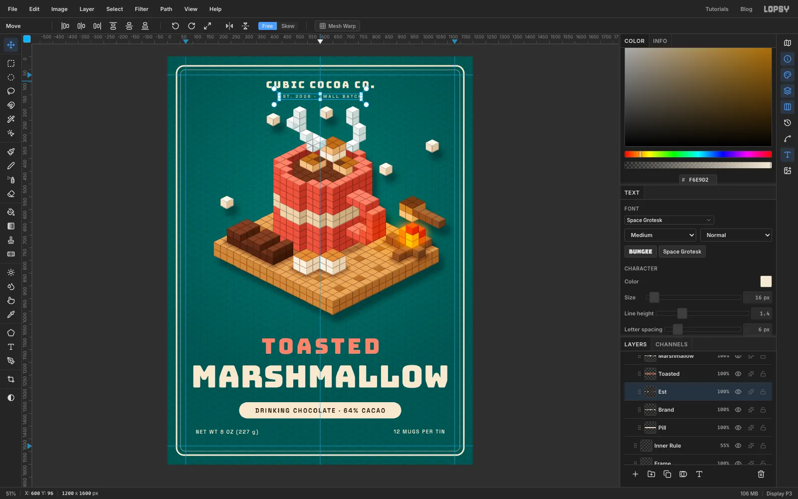

Select each text layer, pick the **Move** tool ([[V]]) and nudge it with the arrow keys (Shift moves 10 px). Don't drag small type with the mouse, because a drag that starts on an edge grabs a scale handle.

- `MARSHMALLOW` spans 102 to 1098, with its cap tops at y = 1210.
- `TOASTED` is centred with its tops at 1104, 90 px under the bottom corner of the cracker.
- The tagline is centred in the pill: 64 px of cream on each side and about 24 px above and below the caps.
- The footer lines sit with their cap tops at 1464, 112 px in from each side.
- `CUBIC COCOA CO.` has its tops at 96, and the small line under it at 150.

That gives an even rhythm down the bottom of the label: about 44 px from TOASTED to MARSHMALLOW, from MARSHMALLOW's extrusion to the pill and from the pill to the footer.

## Toast the big word with a gradient

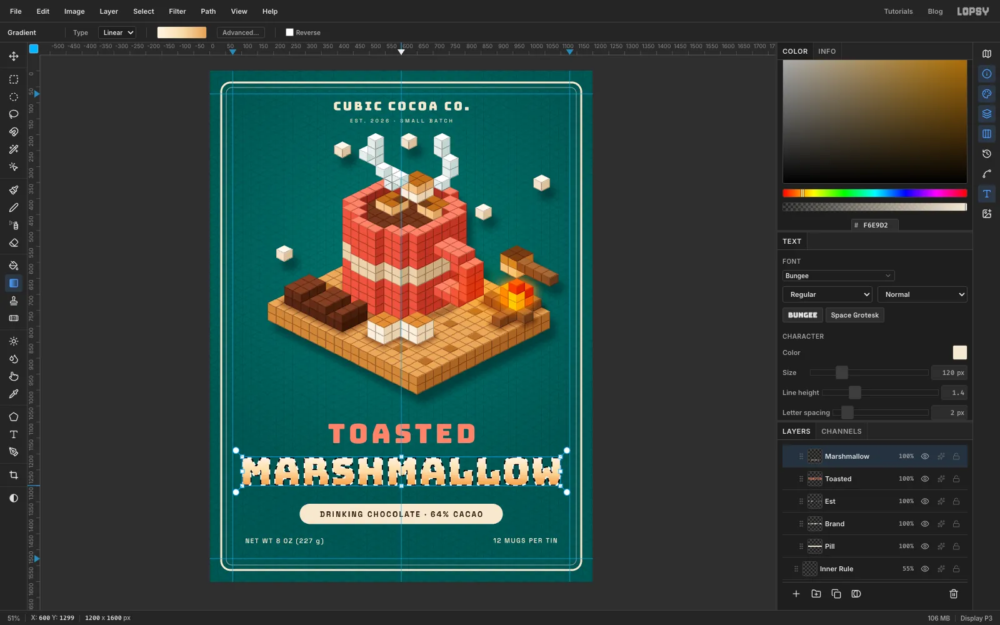

1. Click the `Marshmallow` layer and click **Rasterize Layer** at the bottom of the Layers panel (the T button).
2. **Cmd-click** its thumbnail to select its letters.
3. Pick the **Gradient** tool, set **Type** to **Linear** and in **Advanced…** make three stops: `#FFF5E4`, `#F8DCAA` at 50% and `#E8A256`.
4. Drag straight down from the tops of the letters to their bottoms, then press [[Cmd+D]].

## Extrude the title

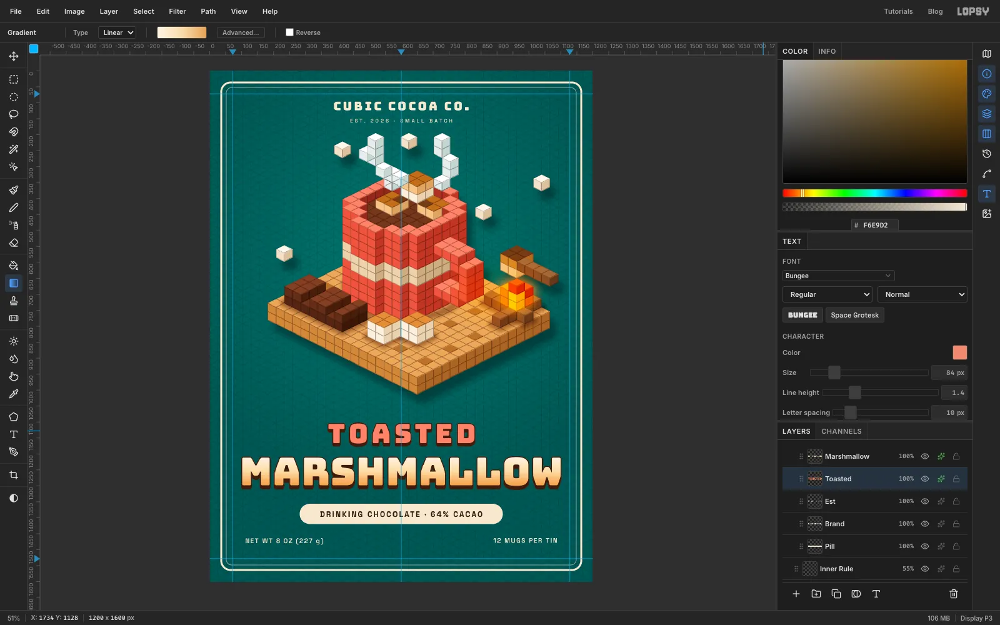

A drop shadow with no blur makes a solid extrusion, like a stack of cubes under each letter.

1. With `Marshmallow` selected, open the Effects drawer. Turn on **Stroke**: **Width** `3`, colour `#3B1D0F`.
2. Turn on **Drop Shadow**: colour `#3B1D0F`, **Offset X** `0`, **Offset Y** `10`, **Blur** `0`, **Spread** `0`, **Opacity** `100`.
3. Do the same on `Toasted` with an **Offset Y** of `8`. It's still live text, so you can fix a typo later.

## Copy the cube icon

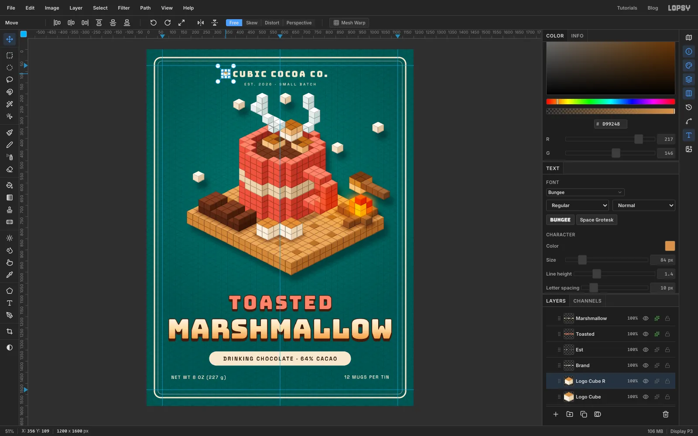

The brand line has a tiny cube at each end.

1. Click `Pill` and add a layer named `Logo Cube`. Draw a cube 30 px wide with the Pen, one face at a time, just like the test cube but at half the size: the right face in `#E6D2B2`, the left face in `#FAF0DE` and the top diamond in `#D99248`.
2. Place it with its centre 34 px left of the `C` in CUBIC and its bottom point on the baseline of the capitals.
3. Draw a marquee just around it, press [[Cmd+C]], then [[Cmd+V]]. The copy lands on top of the original, already selected. Name it `Logo Cube R` and drag it across until it sits 34 px right of the full stop.
4. Press [[Cmd+V]] again for a third copy, name it `Logo Cube Foot` and nudge it to the middle of the footer line, level with the capitals of `12 MUGS PER TIN`.

## Build the badge

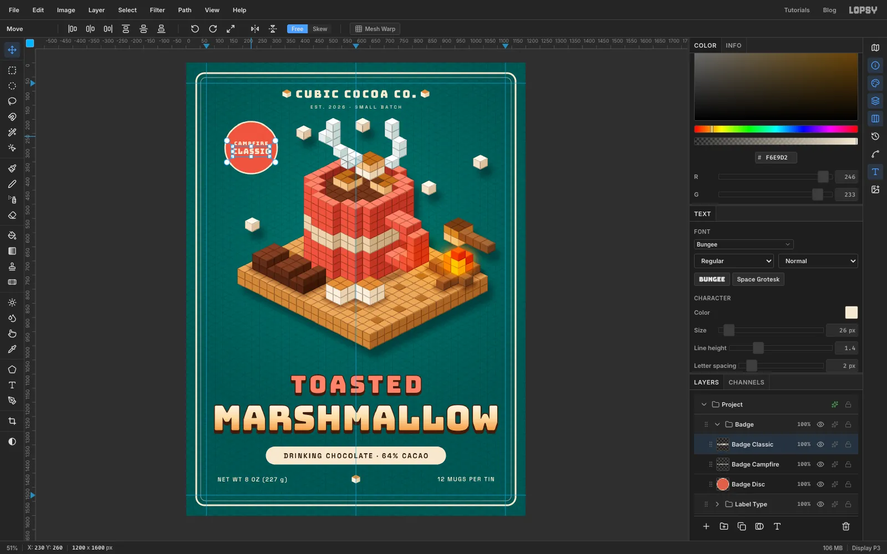

1. Collapse `Label Type`, click it and make a **New Group** named `Badge`. Add a layer named `Badge Disc`.
2. With the **Shape** tool set to **Ellipse**, fill `#DE5E47`, stroke `#F6E9D2` at **Width** `5`, drag from `230, 300` to `322, 392`. That's a circle 184 px across.
3. Click `Badge Disc` and type `CLASSIC` in Bungee, 26 px, cream, letter spacing 2, centred. That makes it about 126 px wide. Click `Badge Disc` again and type `CAMPFIRE` in Bungee, 18 px, letter spacing 3. Name the layers `Badge Classic` and `Badge Campfire`.
4. Nudge both so the two lines sit together in the middle of the circle, 12 px apart. Leave at least 14 px between the ends of `CLASSIC` and the ring.

## Rotate the badge

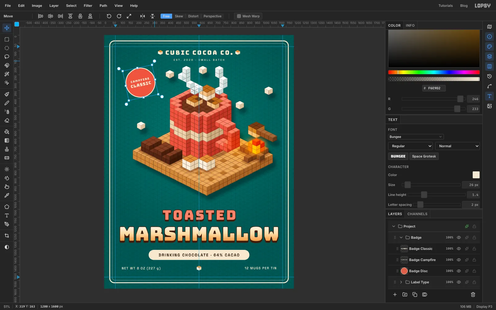

1. Click the `Badge` group row so the Move tool transforms the whole group.
2. With the **Move** tool, hover just outside a corner handle until the cursor turns into a rotate arrow, and drag counter-clockwise by **12°**.
3. Press **Enter** to apply.

The disc and both lines of live text turn together. Press [[Cmd+Z]] and [[Cmd+Shift+Z]] to compare: undo puts the badge back level exactly, and redo tilts it again.

## Add print grain

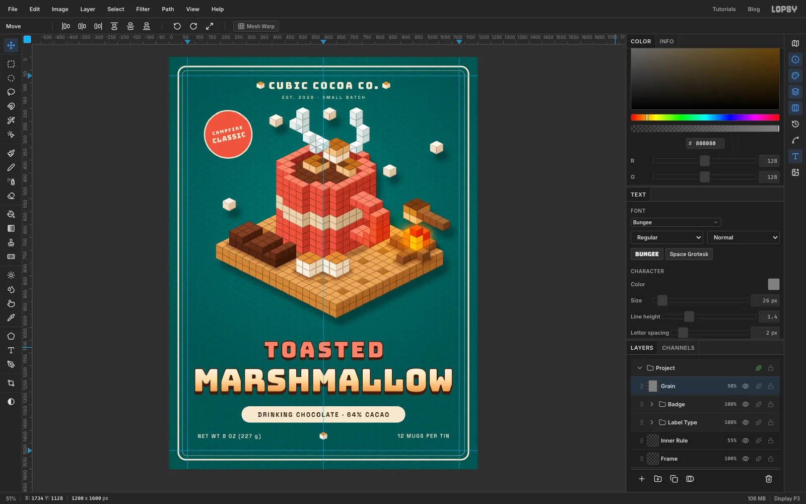

1. Collapse `Badge`, click it and add a layer on top named `Grain`.
2. Fill it with `#808080` using **Edit → Fill**.
3. Choose **Filter → Add Noise…**, set **Amount** to `40` and click **Apply**.
4. Set the layer to **Overlay** at **50%** opacity.

Save the project with **File → Save Project**, then **File → Quick Export PNG** for the label artwork.
