This tutorial builds a roadside billboard for an imaginary burger joint, **UFO Drive-Thru**, in a voxel style: everything in the illustration is made of little isometric cubes. The canvas is 2400 × 800 px, the 3:1 shape of a highway bulletin board.

You don't need a 3D program for voxels. Every cube in the picture is a copy of one cube you draw by hand with the Pen tool. The trick is the shape of that cube. It's 64 px wide, its top is a 64 × 32 diamond and its sides are 32 px tall. So the next cube along one edge sits exactly 32 px across and 16 px down, and the next one up sits 32 px higher. With the grid set to 16 px and snapping on, every Alt-drag copy lands in the right place by itself. To recolour a whole slab of cubes at once, you use the Magic Wand with **Contiguous** off.

Along the way you'll use:

- ruler **guides**, the **grid** with **Snap**, and **groups**
- the **Gradient** tool with transparent stops, the **Spray** tool and the **Pencil** with Shift-click lines
- **Rectangular** and **Elliptical Marquee** with add, subtract and intersect, the **Lasso**, **Magic Wand**, **Select → Inverse** and **Shrink**
- [[Cmd]]-clicking a layer thumbnail to load its pixels as a selection, and the same click with [[Shift]] and [[Alt]] to intersect
- the **Pen** tool with **Path to Selection**
- **Alt-dragging** a selection with the Move tool to stamp copies, **Copy** and **Paste** (which pastes in place), **Copy Merged**, arrow-key nudges, scaling and rotating with the transform handles, and **Flip Horizontal**
- **Define Pattern** and **Fill with Pattern**
- **Pixelate**, **Threshold** and **Gaussian Blur**
- live text with a per-word colour, letter spacing, **Rasterize Layer** and the **Shape** tool's polygon
- **Outer Glow** and **Drop Shadow**, the **Screen** blend mode and layer opacity

The palette:

- Sky `#12082A` → `#3A1466` → `#A32D74` → `#FF7A59`
- Stars `#FFF1D6`, moon `#FFE9B8` / `#F0C27E`
- Mesas `#5B2266`, mesa tops `#B34A86`
- Ground `#2B0D3B`, ground edge `#6E2A6E`, road `#170622`, road dashes `#FFD23F`
- Saucer `#E4E0F4` / `#A59DCB` / `#655C94`, edges `#3B2F63`
- Belly `#8E83BD` / `#4E4380` / `#2E2557`, edges `#1C1438`
- Deck `#FF9BCF` / `#E5579F` / `#A42F6E`, edges `#55103D`
- Glass `#B8FFEA` / `#4FD8BE` / `#22968C`, edges `#0E4B53`
- Portholes `#FFE45C`, glow `#FFA62B`
- Beam `#F2FF8A` → `#B8FF55` → `#5CFFB0`
- Bun `#F6B256` / `#D9852F` / `#A85A1C`, top bun `#FFC977` / `#E8963A` / `#B5641F`, crust edges `#5C2A0A`
- Patty `#94512F` / `#6E3621` / `#4A2214`, edges `#240C05`
- Lettuce `#A6F05E` / `#5DBE35` / `#378A22`, edges `#16420C`
- Sesame `#FFF4D6`
- Cactus `#8CE07A` / `#3FA65A` / `#21704A`, edges `#0E3B2A`, flowers `#FF5FA2`
- Type cream `#FFF1D6`, hot pink `#FF3D8B`, plum `#3A0A3A`, mint `#7CF5D2`, yellow `#FFD23F`

> **Tip:** Positions are given as `x, y` in document pixels. The status bar at the bottom left shows where your cursor is. Mac key names are used; on Windows and Linux use Ctrl for Cmd. The one exception is a drag on the canvas, such as scaling with the transform handles: there, use the Windows (Meta) key in place of Cmd, because Ctrl doesn't work.

> **Tip:** "Fill" means set the foreground colour in the Color panel's hex field, then choose **Edit → Fill**. Press [[Cmd+D]] before you draw a new marquee: pressing inside an existing selection moves the outline instead of starting a new one.

> **Tip:** Each cube colour comes in threes: the top face, the left face and the right face, lightest to darkest. Imagine the light coming from the top left.

## Set up the canvas and paint the sky

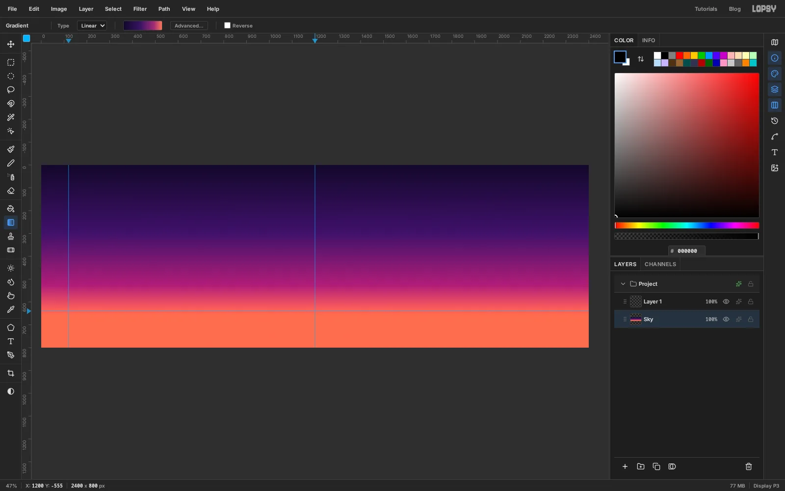

Create a new document `2400` × `800` px with a white background. With the rulers showing, click the top ruler at x `120` and `1200` to drop two vertical guides, and click the left ruler at y `640` for the horizon. The guide at 120 is the left margin for all of the type.

Double-click the `Background` row and rename it `Sky`. Pick the **Gradient** tool, set **Type** to **Linear** and open **Advanced…**. Set four stops: `#12082A` at the left end, `#3A1466` at about 45%, `#A32D74` at about 80% and `#FF7A59` at the right end. Hold [[Shift]] and drag from the top edge straight down to just below the horizon guide.

## Scatter the stars

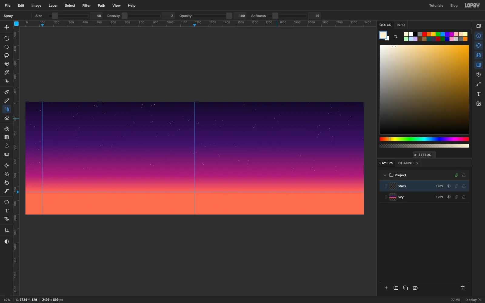

Rename `Layer 1` to `Stars`. Pick the **Spray** tool ([[J]]) and set **Size** `40`, **Density** `2`, **Opacity** `100` and **Softness** `15`, with the foreground colour `#FFF1D6`.

Don't drag, or you'll get strings of dots. Click instead, a few dozen times or more, scattered across the width. Click more often near the top, and stop about two-thirds of the way down, where the sunset glow would wash the stars out.

## Make a blocky moon stencil

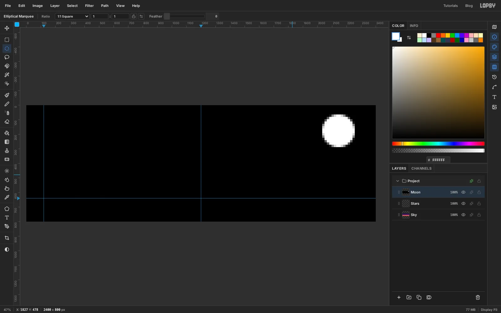

A smooth circle doesn't belong in a voxel picture, so turn one into blocks. Pixelate alone won't do it, because it keeps a shape's outline smooth. Paint the circle on a solid background first, so the blocks along the edge get averaged with that background.

1. Click **Add Layer** and rename the new layer `Moon`.
2. Fill the whole layer with black (`#000000`, no selection).
3. Pick the **Elliptical Marquee** and drag a circle 224 px across, centred near the top right at about `2144, 176`. Fill it with white and press [[Cmd+D]].
4. Choose **Filter → Pixelate…** and set **Block Size** to `16`.

The edge of the circle is now made of grey blocks: light ones where the circle filled most of the block, dark ones where it didn't.

## Cut the moon out with Threshold and the Magic Wand

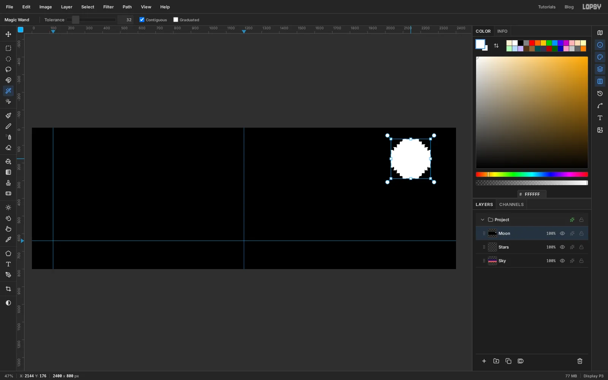

1. Choose **Filter → Threshold…** and set **Level** to `128`. Each grey block becomes pure white or pure black, so the disc gets a clean stepped edge.
2. Pick the **Magic Wand** ([[W]]) with **Contiguous** on and click inside the disc.
3. Choose **Select → Inverse**, press [[Delete]] to clear the black, then choose **Select → Inverse** again to get the disc back.
4. Fill it with `#FFE9B8` and press [[Cmd+D]].

## Shade the moon

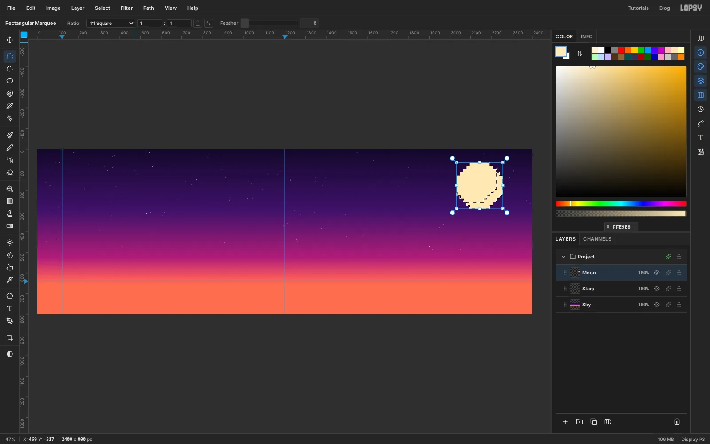

This is a trick you'll use again for the mesas: subtract a shifted copy of a shape from itself to get a rim.

1. [[Cmd]]-click the `Moon` layer's thumbnail to select its pixels.
2. With the **Rectangular Marquee** ([[M]]) active, press [[Shift+Left]] three times and [[Shift+Up]] three times. The outline moves 30 px up and to the left, and the pixels stay where they are.
3. Choose **Select → Inverse**.
4. Hold [[Cmd+Shift+Alt]] and click the `Moon` thumbnail. Holding Shift and Alt as well intersects the selection with the layer's pixels, which leaves only the crescent on the lower right.
5. Fill it with `#F0C27E` and press [[Cmd+D]].

## Build the mesas on the grid

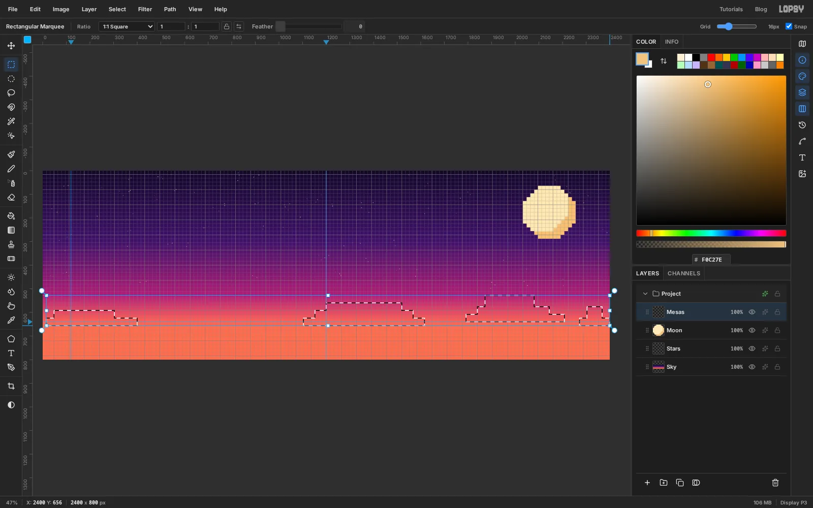

Press [[Cmd+']] to show the grid. The options bar shows **Grid** `16px` with **Snap** ticked, so marquee corners now land on grid lines.

Add a layer named `Mesas`. With the **Rectangular Marquee**, drag the first block of a mesa, then hold [[Shift]] and drag more blocks to add them, building stepped shapes that all end at y `656`, just under the horizon guide. Make three mesas, each two or three blocks stacked like a wedding cake, with every block a little narrower than the one under it:

- a low one at the far left, from the edge to about x `400`, two blocks rising to about y `592`
- a big one around the middle, about x `1100` to `1620`, three blocks rising to y `560`
- a tall one on the right, about x `1790` to `2210`, three blocks rising to y `528`
- a small two-step butte at the right edge, from about x `2270`, rising to y `576`

The exact sizes don't matter. Freehand is fine, as long as every block's corners land on the grid.

Fill the selection with `#5B2266`.

## Light the mesa tops

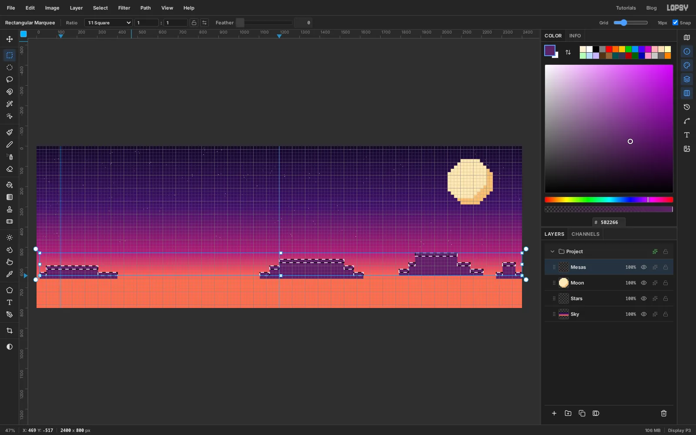

Now the rim trick again, to give every step a lit top edge.

1. [[Cmd]]-click the `Mesas` thumbnail.
2. With the Rectangular Marquee active, press [[Down]] once. With the grid on, an arrow key moves the outline one whole cell, 16 px.
3. Choose **Select → Inverse**, then [[Cmd+Shift+Alt]]-click the `Mesas` thumbnail to intersect.
4. Fill it with `#B34A86` and press [[Cmd+D]].

## Lay the ground and the road

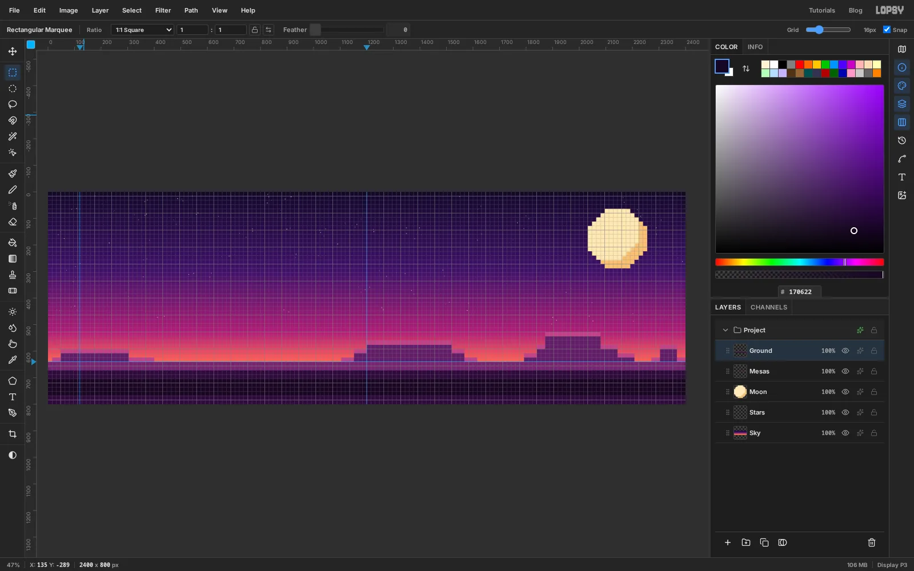

Add a layer named `Ground` and fill three marquees, one after another (press [[Cmd+D]] between them):

1. From `0, 656` to the bottom right corner: `#2B0D3B`.
2. A strip from `0, 656` to `2400, 672`: `#6E2A6E`. That's the lit edge of the ground.
3. A band from `0, 704` to `2400, 768`: `#170622`. That's the road.

## Paint the road dashes with a pattern

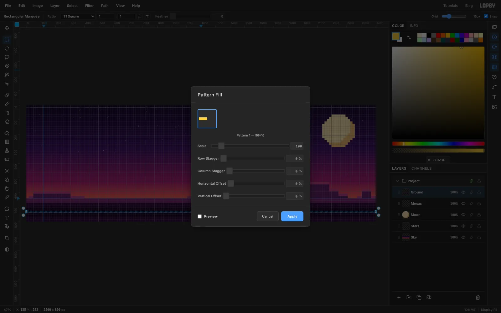

Drawing forty dashes by hand would be tedious, so make one dash and tile it.

1. Add a layer named `Dash Tile`. In the top left corner, drag a marquee 48 × 8 px and fill it with `#FFD23F`.
2. Press [[Cmd+D]], then drag a marquee 96 × 8 px from the same corner, which is the dash plus a gap the same length. Choose **Edit → Define Pattern**.
3. Delete the `Dash Tile` layer and select `Ground`.
4. Drag a thin marquee along the middle of the road, from `0, 728` to `2400, 736`, and choose **Edit → Fill with Pattern…**. Your new pattern is already selected, so click **Apply**, then press [[Cmd+D]].

## Draw one voxel cube with the Pen tool

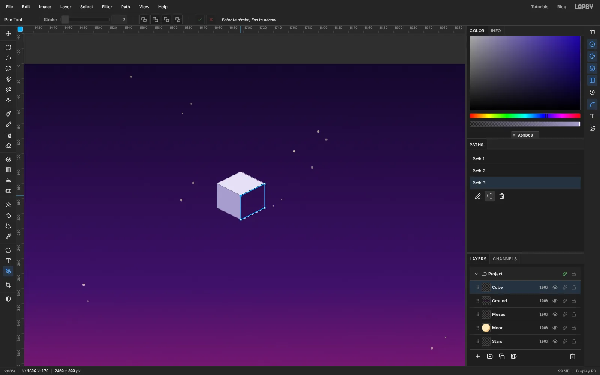

Everything else is built from this cube, so take your time. Add a layer named `Cube`, choose **View → Zoom In** four times (200%), and hold [[Space]] and drag until the area around `1696, 176` is in the middle of the window.

Open the **Paths** panel from the panel toolbar on the far right (the curve icon). Pick the **Pen** tool ([[P]]). For each face, click its four corners, then click the first corner again to close the path. Click **Path to Selection** (the dashed-square button under the path list), fill, and press [[Cmd+D]]:

- **Top:** `1696, 144` → `1728, 160` → `1696, 176` → `1664, 160`. Fill `#E4E0F4`.
- **Left:** `1664, 160` → `1696, 176` → `1696, 208` → `1664, 192`. Fill `#A59DCB`.
- **Right:** `1696, 176` → `1728, 160` → `1728, 192` → `1696, 208`. Fill `#655C94`.

Before you start the second and third faces, click the previous path's row in the Paths panel to deselect it. Otherwise your first click lands on that path's corner anchor and drags it instead of starting a new path.

## Outline the cube with the Pencil

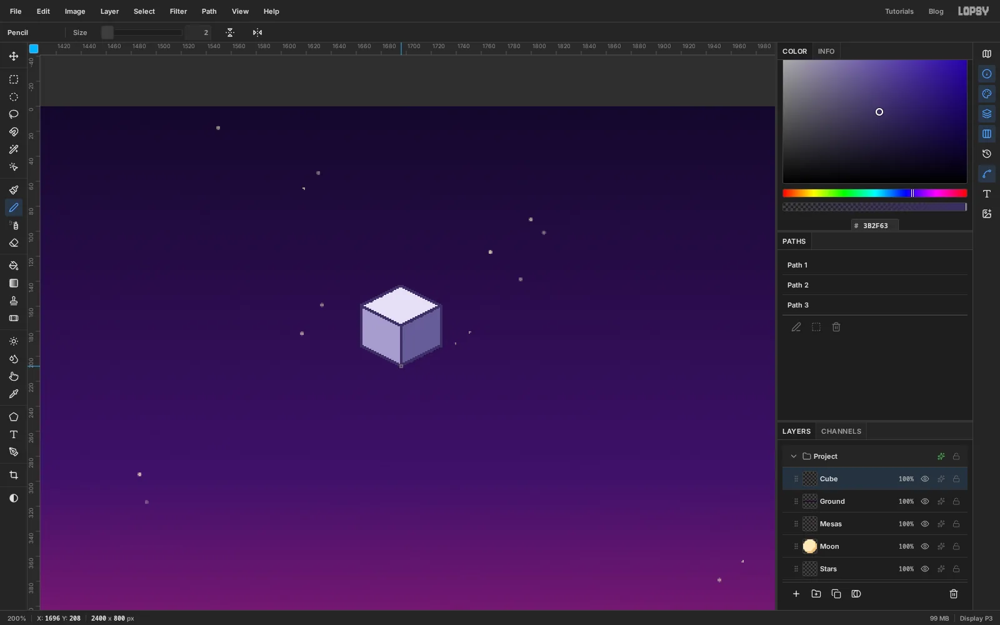

Pick the **Pencil** ([[N]]), set **Size** `2` and the colour `#3B2F63`. Click the top corner of the cube, then hold [[Shift]] and click each corner around the outside to draw straight lines all the way round. Then draw the inner "Y": Shift-click lines from the left corner to the centre point, from the centre to the right corner, and from the centre straight down to the bottom corner.

These lines are what let each cube read separately once they are packed together. Without them, a slab of cubes would merge into one flat shape.

## Stamp a row of cubes with Alt-drag

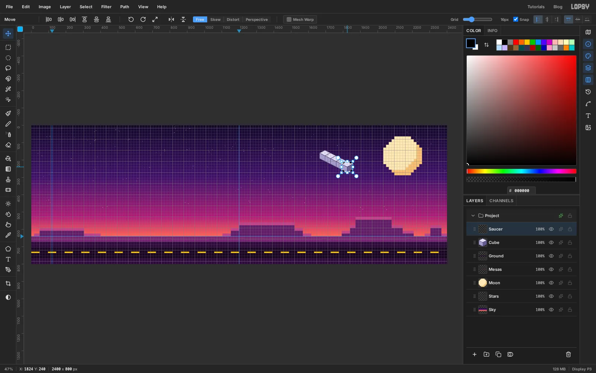

Choose **View → Fit to Screen**. Check that the grid is still on with Snap ticked.

Click **Duplicate Layer** and rename the copy `Saucer`. [[Cmd]]-click its thumbnail to select the cube, then pick the **Move** tool ([[V]]). Hold [[Alt]], press on the cube and drag it 32 px right and 16 px down, which is two grid cells across and one down. With snapping on, the copy lands exactly there.

Do it three more times, each time dragging the newest copy, which is still selected. You get a row of five cubes, each one sitting in front of the one before.

> **Tip:** Every Alt-drag drops the copy *on top of* the layer, so always build from the back towards the front: down-right and down-left, never up-left.

## Turn the row into a 5 × 5 slab

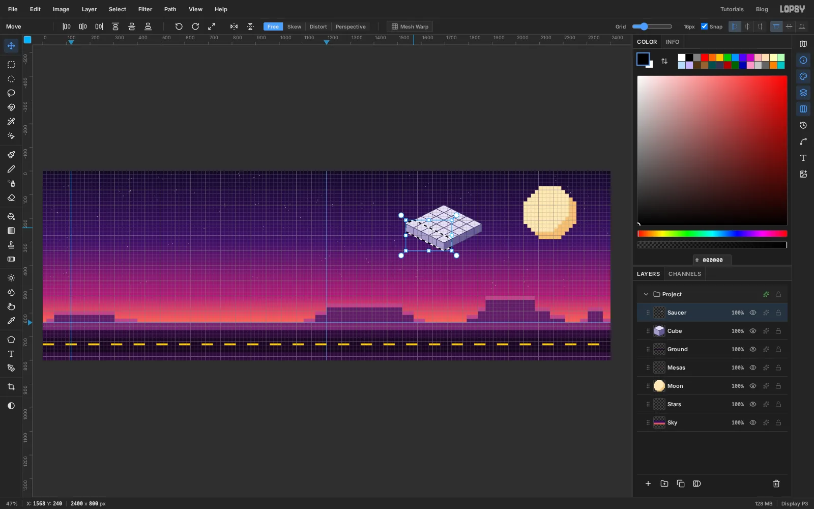

Press [[Cmd+D]], then [[Cmd]]-click the `Saucer` thumbnail again. Now the whole row is selected. Alt-drag it 32 px left and 16 px down, four times, always dragging the newest copy. That's the saucer: a flat 5 × 5 slab.

## Add the belly

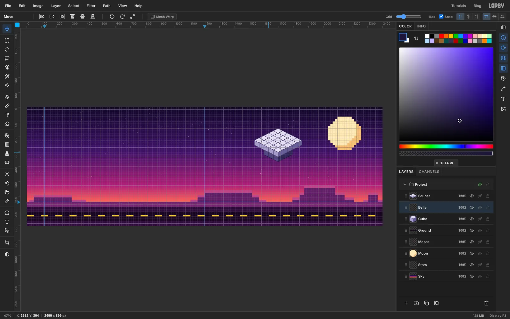

Select the `Cube` layer and click **Duplicate Layer**. Rename the copy `Belly`. It sits under `Saucer` in the stack, which is what you want.

Recolour it with the Magic Wand. Pick the **Magic Wand**, untick **Contiguous** and set **Tolerance** to `12`. Then, for each colour, click the face, fill, and press [[Cmd+D]]: the top face with `#8E83BD`, the left face with `#4E4380`, the right face with `#2E2557`, and any outline with `#1C1438`. With Contiguous off, each click picks up every pixel of that colour on the layer, which matters once there's more than one cube.

Pick the **Move** tool and press [[Down]] to move the layer down six grid cells (96 px, three cubes' worth). With the grid on, each press moves one cell, so the cube stays on the lattice. Then build a 3 × 3 slab exactly as before: two Alt-drags down-right, [[Cmd+D]], [[Cmd]]-click the thumbnail, two Alt-drags down-left. Only the bottom edge of the belly peeks out under the saucer. That's enough to give the ship some weight.

## Stack the deck, dome and cap

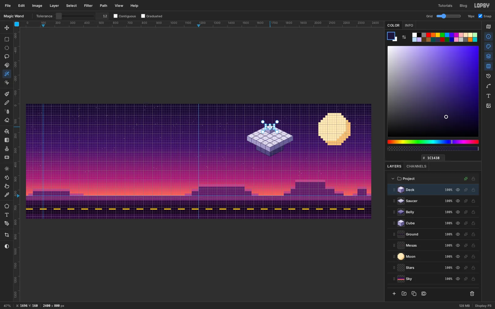

The rest of the ship goes above the saucer, so this time copy and paste rather than duplicate. A paste lands right above the selected layer, in exactly the place it was copied from.

1. Select `Cube`, [[Cmd]]-click its thumbnail, press [[Cmd+C]] and then [[Cmd+D]].
2. Select `Saucer` and press [[Cmd+V]]. Rename the new layer `Deck`, recolour it pink the same way (`#FF9BCF` top, `#E5579F` left, `#A42F6E` right, `#55103D` outlines) and build a 3 × 3 slab. It already sits one level up and centred, so it needs no nudging.
3. Press [[Cmd+V]] again and rename the layer `Dome`. With the Move tool, press [[Up]] once, recolour it as glass (`#B8FFEA`, `#4FD8BE`, `#22968C`, outlines `#0E4B53`) and build a 2 × 2 slab.
4. Press [[Cmd+V]] once more for `Cap`, press [[Up]] twice and recolour it as glass. It's a single cube on top.

## Check the finished ship

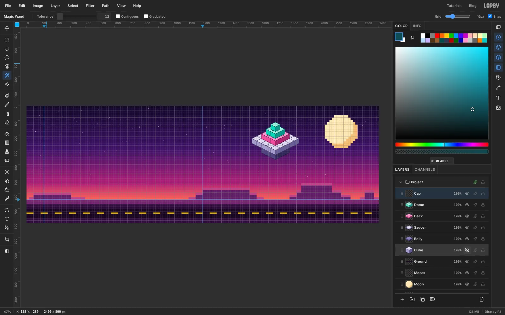

Click the eye on the `Cube` layer to hide it. Keep it, because the burger and the cacti are copied from it too.

The ship is four layers stacked like a ziggurat, and every cube is a copy of the one you drew.

## Light the portholes

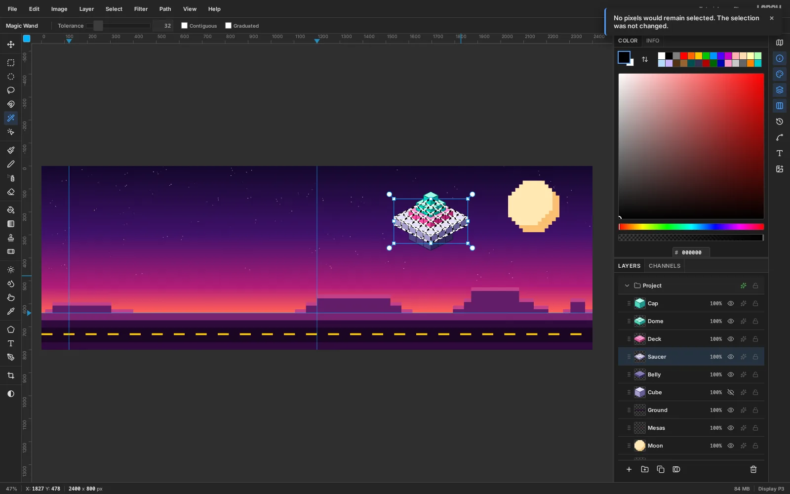

1. Select `Saucer`. With the **Magic Wand** (Contiguous still off), click any left face, then [[Shift]]-click any right face to add it. Every side face of the saucer is now selected.
2. Choose **Select → Shrink…** and shrink by `7` px. Each face becomes a smaller window set inside it.
3. Click **Add Layer**, name it `Lights`, fill with `#FFE45C` and press [[Cmd+D]].
4. Click the effects button (the sparkle icon) on the `Lights` row and turn on **Outer Glow**: **Size** `18`, **Opacity** `85`, colour `#FFA62B`.

## Group the UFO

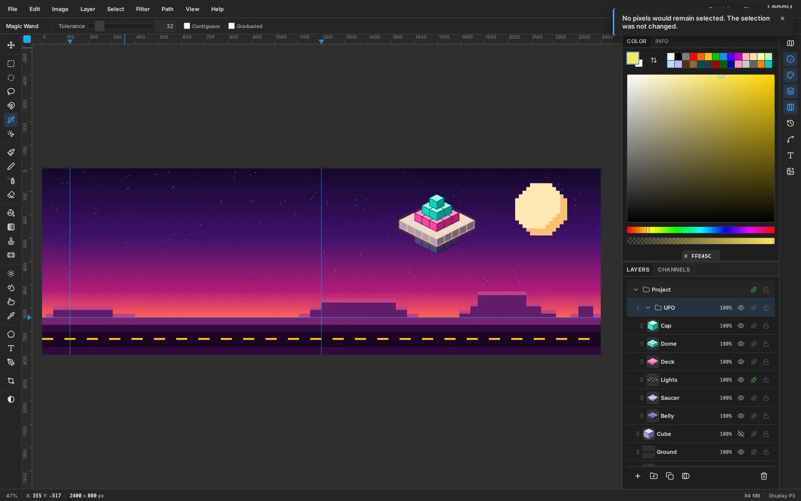

Click `Belly`, [[Shift]]-click `Cap`, and choose **Layer → Group Layers**. Rename the group `UFO`.

## Draw the tractor beam

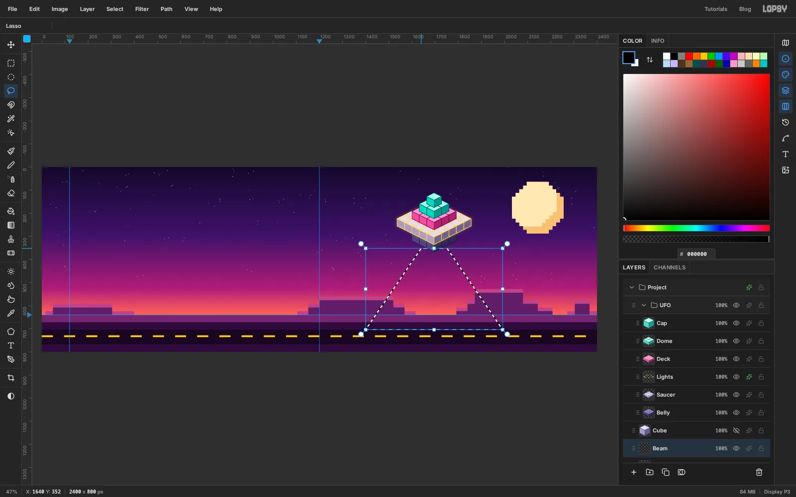

Hide the grid with [[Cmd+']]. Select `Ground` and add a layer named `Beam`, so the beam sits behind the ship.

With the **Lasso** ([[L]]), draw a trapezoid: start under the belly at about `1640, 352`, go across to `1752, 352`, down to the road at `1992, 704`, across to `1400, 704` and back up. Then pick the **Gradient** tool and set three stops in **Advanced…**: `#F2FF8A` at 95% opacity, `#B8FF55` at 50% opacity at about 55% along, and `#5CFFB0` at 12% opacity at the end. [[Shift]]-drag from the top of the beam to the road, press [[Cmd+D]], and set the layer's blend mode to **Screen**.

## Add a pool of light on the road

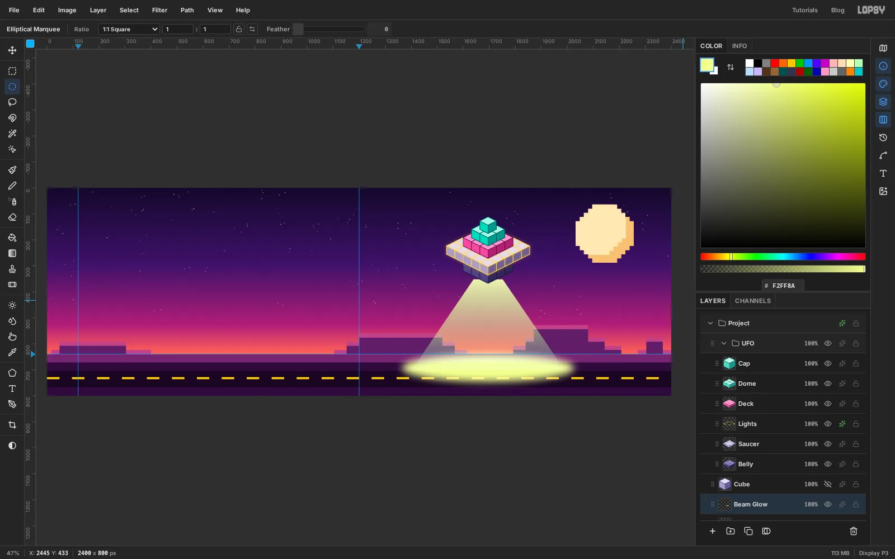

Add a layer named `Beam Glow`. Pick the **Elliptical Marquee**, set **Feather** to `30`, and drag a wide, flat ellipse where the beam touches the road, about 660 × 92 px centred at `1696, 700`. Fill with `#F2FF8A`, press [[Cmd+D]], set the layer to **Screen**, and put **Feather** back to `0` so it doesn't soften your next marquee.

## Build the burger

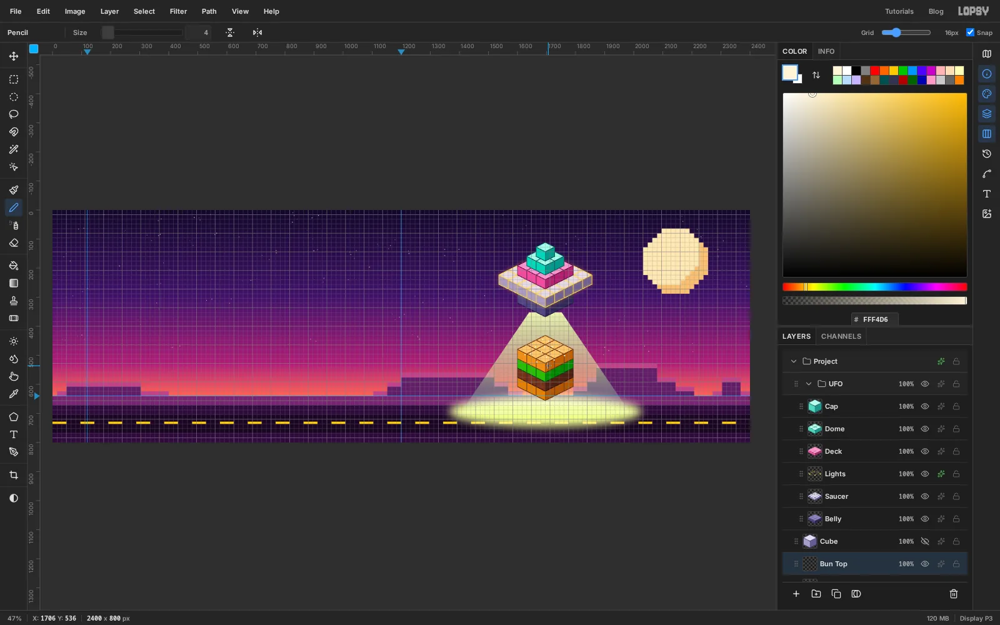

Turn the grid back on. Copy the `Cube` layer's cube again (as before), select `Beam Glow` and paste. Rename the new layer `Bun Bottom`. With the Move tool, hold [[Down]] until the cube has dropped 24 cells (384 px) into the middle of the beam. Recolour it (`#F6B256`, `#D9852F`, `#A85A1C`, outlines `#5C2A0A`) and build a 3 × 3 slab.

Now each layer of the burger is a copy of the one below it, raised one cube:

1. Click **Duplicate Layer**, rename the copy `Patty`, press [[Up]] twice (32 px), and recolour it (`#94512F`, `#6E3621`, `#4A2214`, outlines `#240C05`).
2. Do the same for `Lettuce` (`#A6F05E`, `#5DBE35`, `#378A22`, outlines `#16420C`).
3. And for `Bun Top` (`#FFC977`, `#E8963A`, `#B5641F`, outlines `#5C2A0A`).

When you recolour a duplicate, click the side faces of the *front* cube, the one at the bottom of the diamond. The back cubes' sides are hidden behind their neighbours, so a click there lands on the wrong colour.

Finally, pick the **Pencil** at size `4` with `#FFF4D6` and click a dozen sesame seeds over the top bun.

## Tilt the burger as it's beamed up

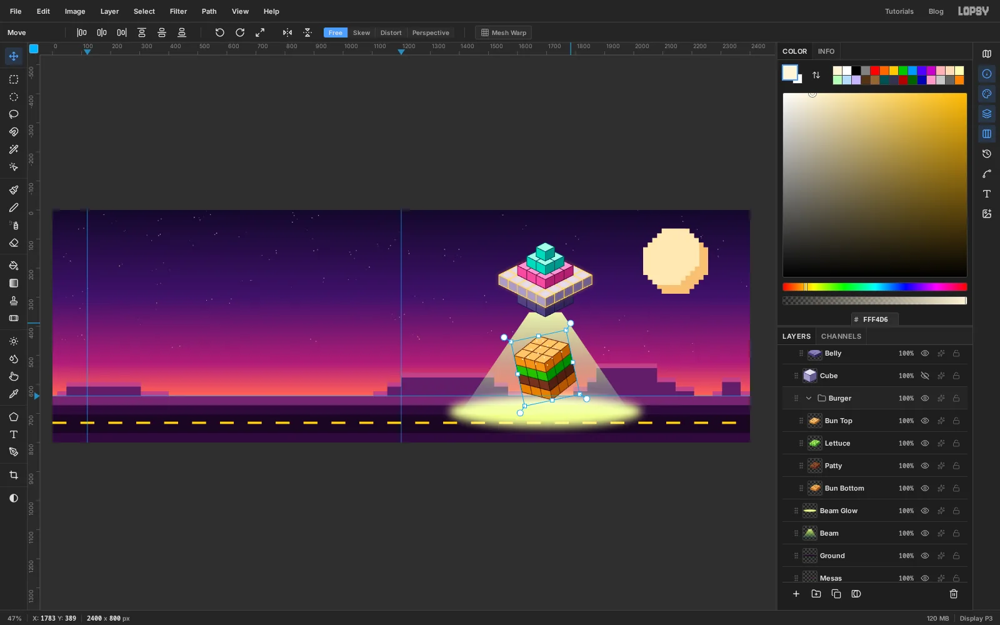

Click `Bun Bottom`, [[Shift]]-click `Bun Top`, choose **Layer → Group Layers** and rename the group `Burger`. Hide the grid, so the rotation isn't snapped to 15° steps.

Pick the **Move** tool. Handles appear around the whole group. Press just outside a corner, where the cursor turns into a rotate arrow, and drag about 12° anticlockwise. Press [[Enter]] to apply it. Rotating the group turns all four layers about one shared centre, so the burger keeps its shape.

## Build a voxel cactus

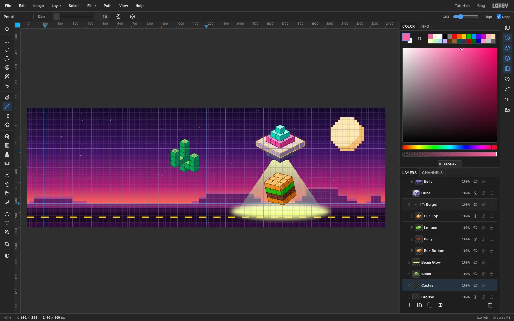

With the grid on, copy the cube again, select `Ground` and paste. Rename the layer `Cactus`. With the Move tool, hold [[Left]] and then [[Down]] to slide it, a cell at a time, into the empty sky between the headline area and the UFO (about 640 px left and 224 px down). You'll build it there at full size where it's easy to see, and shrink it later. Recolour it (`#8CE07A`, `#3FA65A`, `#21704A`, outlines `#0E3B2A`).

[[Cmd]]-click its thumbnail and stamp the rest with Alt-drags. Each drag starts on the newest copy, which is always the selected one:

1. The trunk: five Alt-drags straight up, 32 px each, for a column of six cubes.
2. The right arm: Alt-drag the top cube down so the copy sits one step down-right of the second cube from the bottom. Then add one more copy a step further down-right, and two more straight up from there.
3. The left arm: Alt-drag the last copy across so the new one sits one step down-left of the third cube from the bottom. Then add one more a step further down-left, and two straight up.

Both arms come out towards you and then turn upwards, so the trunk stays visible between them. They are also in front of the trunk, so stamping them after it keeps the back-to-front rule. Press [[Cmd+D]], then use the **Pencil** at size `10` with `#FF5FA2` to dot a flower on top of the trunk and on each arm.

## Shrink the cactus and plant it

Hide the grid. [[Cmd]]-click the `Cactus` thumbnail and pick the **Move** tool. Hold [[Cmd]] (to scale evenly) and drag the bottom right handle in until the cactus is about 70% of its size. Then drag from inside the cactus to stand it on the ground at the left of the beam, with its base just above the road, around x `1235`. Press [[Cmd+D]].

## Add a mirrored twin

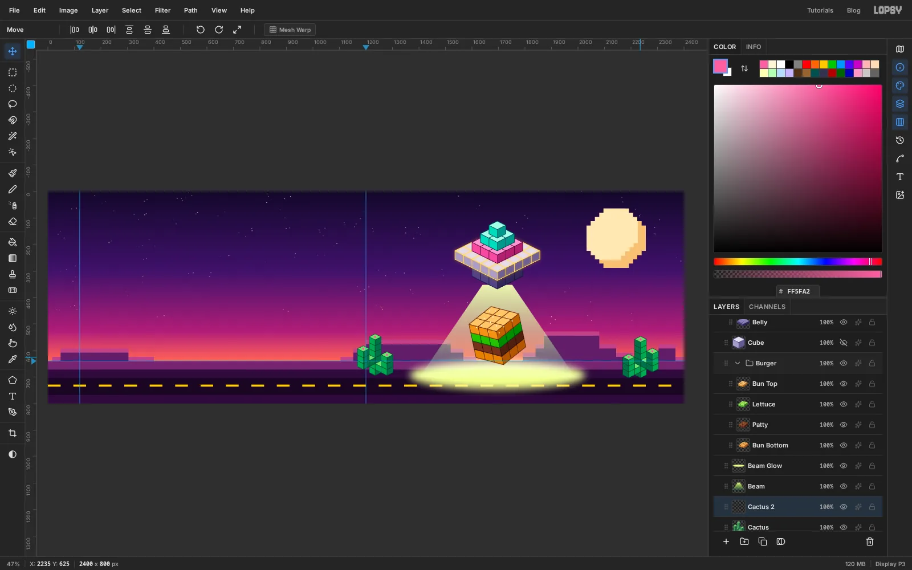

[[Cmd]]-click the thumbnail again, press [[Cmd+C]], [[Cmd+D]] and [[Cmd+V]]. Rename the copy `Cactus 2` and choose **Image → Flip Horizontal**. Select its pixels and drag it to the right-hand side of the board, around x `2235`, setting it a few pixels lower than the first one so the pair doesn't look copy-pasted.

## Set the headline

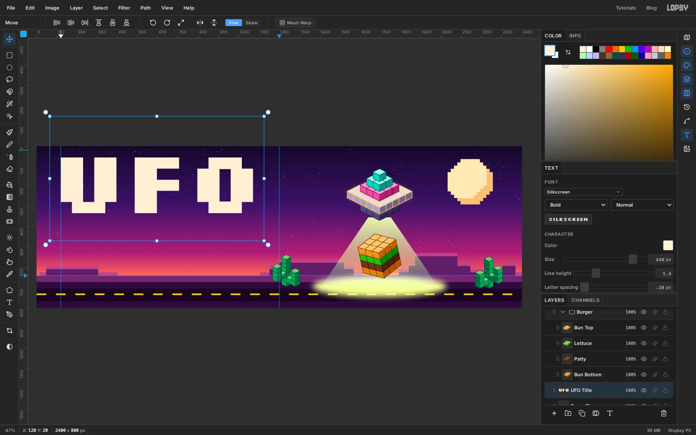

Select `Beam Glow` first. When a text layer is selected, the Text tool's settings restyle that layer, so always start new text from an ordinary layer.

Pick the **Text** tool ([[T]]), choose **Silkscreen**, **Bold**, size `440`, colour `#FFF1D6`. Click near the top left, type `UFO` and press [[Tab]] to commit. Rename the layer `UFO Title`. In the **Text** panel, set **Letter spacing** to `-20` px to pull the letters closer together.

With the Move tool, use the arrow keys to put the left edge of the U on the guide at x `120`, about 56 px from the top.

## Extrude the headline in steps

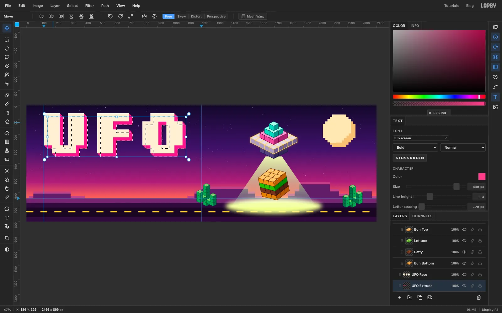

1. Click **Duplicate Layer** and rename the copy `UFO Face`. This is the live text you'll see.
2. Select the original underneath, rename it `UFO Extrude` and click **Rasterize Layer** in the Layers panel toolbar.
3. [[Cmd]]-click its thumbnail and fill the letters with `#FF3D8B`.
4. With the **Move** tool, Alt-drag the pink letters 3 px right and 3 px down, eight times, always dragging the newest copy.
5. Press [[Cmd+D]] and add a **Drop Shadow**: **Offset X** `8`, **Offset Y** `8`, **Blur** `0`, **Opacity** `100`, colour `#3A0A3A`.

Small, hard steps give a staircase edge that matches the cubes, which a smooth blurred shadow wouldn't.

## Add the subtitle and tagline

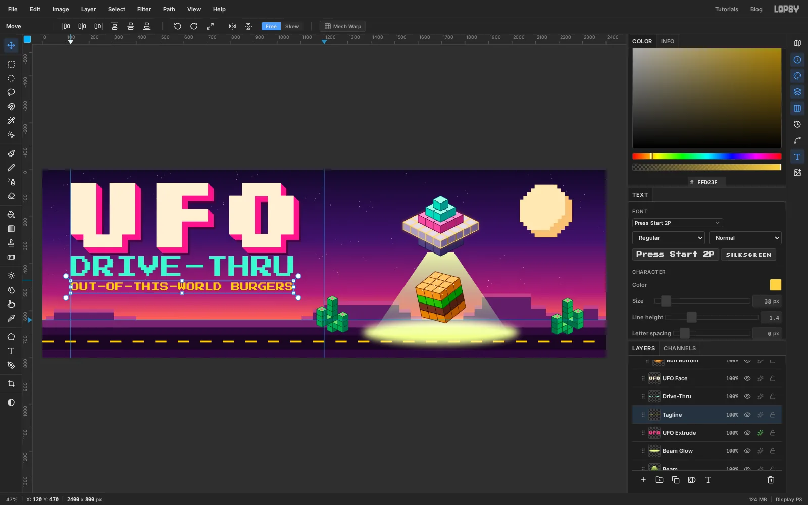

Letter spacing is a Text tool setting, so the next text would start at −20 too. Select `UFO Extrude`, pick the Text tool, and set **Letter spacing** back to `0`.

Choose **Press Start 2P**, size `96`, colour `#7CF5D2`. Click under the headline, type `DRIVE-THRU`, press [[Tab]] and rename the layer `Drive-Thru`. Select `UFO Extrude` again, set size `38` and colour `#FFD23F`, click below, type `OUT-OF-THIS-WORLD BURGERS`, press [[Tab]] and rename it `Tagline`. With the Move tool, nudge both onto the left guide: DRIVE-THRU starting about 368 px from the top, and the tagline about 480 px from the top. At these sizes all three lines end at almost the same point, about x `1067`, so the block reads as one justified unit.

## Make "BURGERS" pop

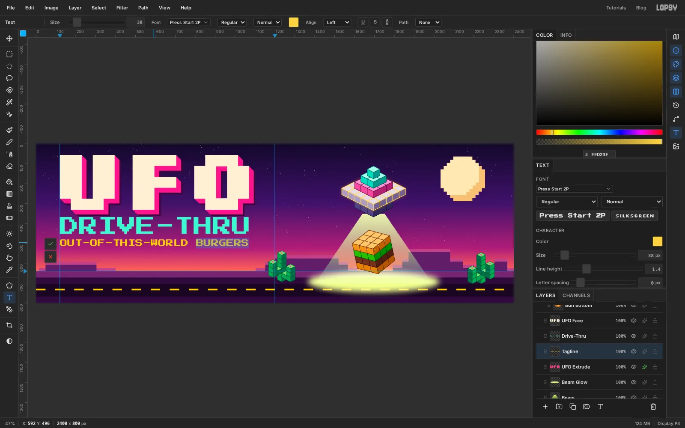

`BURGERS` is the product, but yellow on the sunset doesn't stand out. Click into the tagline with the Text tool, press [[End]], and press [[Shift+Left]] seven times to select the word. Click the **Text color** swatch in the options bar, type `FFFFFF` into its hex field, and click the swatch again to close it. Press [[Tab]] to commit.

Only that word turns white. Give the whole tagline a **Drop Shadow** (`4`, `4`, blur `0`, `#3A0A3A`) so both colours hold up against the bright horizon.

## Add the exit plate

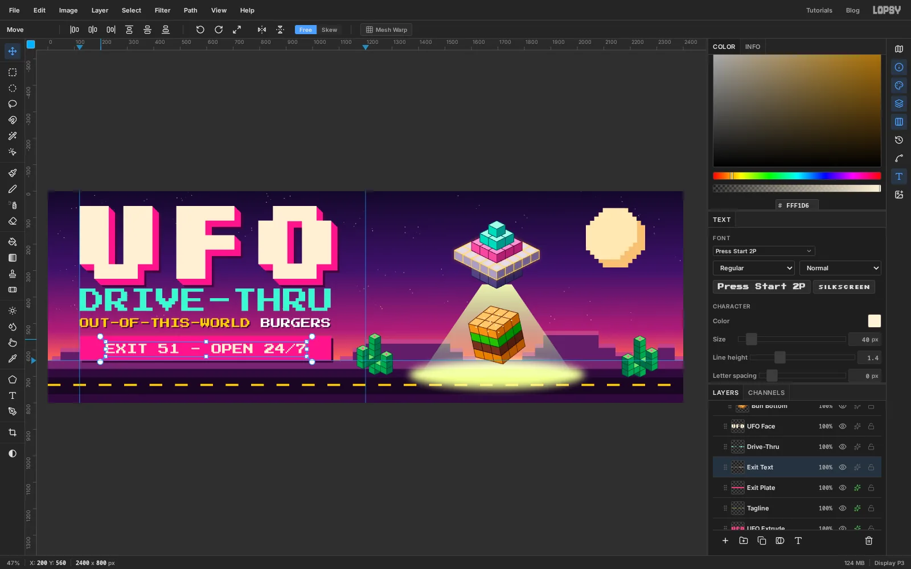

Add a layer named `Exit Plate`. Drag a marquee from `120, 548` to `1070, 640`, so it's as wide as the type above. Fill it with `#FF3D8B` and give it the same hard **Drop Shadow** as the headline (`8`, `8`, blur `0`, `#3A0A3A`).

With `Exit Plate` selected, pick the Text tool and set Press Start 2P, size `40`, colour `#FFF1D6`. Click on the plate, type `EXIT 51 - OPEN 24/7`, press [[Tab]] and rename the layer `Exit Text`. Then nudge it until the gap above the letters matches the gap below (about 29 px each at this size) and the left and right gaps match too. Press Start 2P has no descenders in capitals, so the letters' visible height is the box to centre.

## Draw an octagon sticker

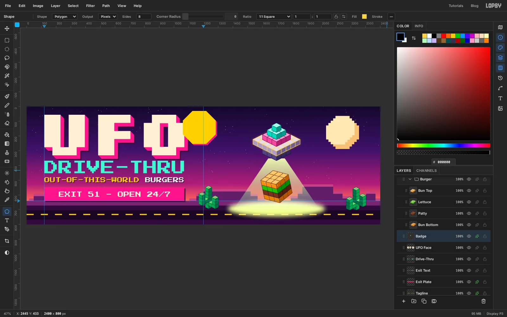

Select `UFO Face` and add a layer named `Badge`, so the sticker sits on top of the headline. Pick the **Shape** tool ([[U]]): **Shape** `Polygon`, **Sides** `8`, **Output** `Pixels`, **Fill** `#FFD23F`, and no stroke.

The Shape tool draws outwards from where you press. Press at about `1172, 142`, over the top right corner of the O, and drag diagonally out until the octagon is about 224 px across. A polygon always comes out regular, so it can't end up stretched. Add a **Drop Shadow** of `8`, `8`, blur `0` in `#FF3D8B`.

## Letter and tilt the sticker

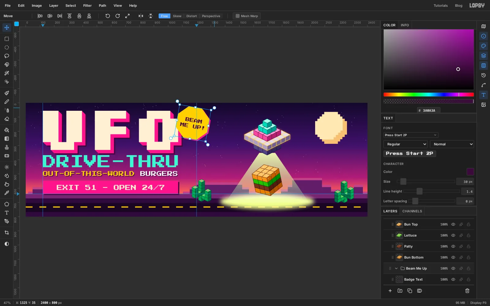

With `Badge` selected, pick the Text tool. Set Press Start 2P at size `30`, **Letter spacing** `0`, **Align** `Center` and colour `#3A0A3A`. Click on the badge, type `BEAM`, press [[Enter]], type `ME UP!` and press [[Tab]]. Rename the layer `Badge Text` and nudge it until it is centred on the octagon. The longer line is about 170 px wide, which leaves even margins inside the flat sides.

Select `Badge` and `Badge Text`, group them as `Beam Me Up`, and rotate the group about 10° clockwise with the Move tool's handles, as you did for the burger.

## Snap the light to the pixel grid

The beam and the pool of light are the only smooth things left. Select `Beam` and choose **Filter → Pixelate…** with **Block Size** `16`, then do the same on `Beam Glow`. The gradients turn into stepped bands and the soft edge of the pool breaks into blocks, matching the cubes.

## Add a glow pass

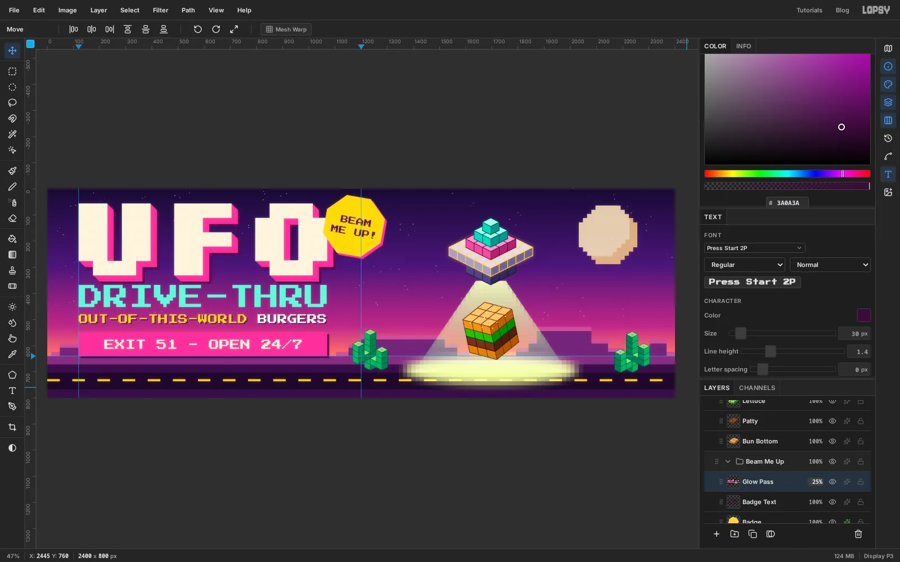

First, select `Moon` and lower its opacity to `82%`. A full-strength moon is the second-brightest shape on the board and pulls the eye away from the UFO.

Then select the top row in the Layers panel (the `Beam Me Up` group), press [[Cmd+A]] and choose **Edit → Copy Merged**. Press [[Cmd+D]], then [[Cmd+V]], and rename the pasted layer `Glow Pass`. It lands at the top of the `Beam Me Up` group, which is still the top of the whole stack, so it sits over everything. Choose **Filter → Gaussian Blur…** with a **Radius** of `18`, set the layer to **Screen**, and lower its opacity to `25%`.

The blurred copy brightens everything a little, mostly around the bright edges, so the portholes, the beam and the type look lit. Export with **File → Quick Export PNG**.
