A Japanese woodblock print (*moku hanga*) is built in layers of ink. The carver cuts one block for the black outlines, called the **key block**, and a separate block for every colour. The printer inks each block, lays the paper on it and rubs it down. The finished print is a stack of flat colours, a few graded bands of colour called *bokashi*, and the grain of the wood showing through the ink.

Lopsy's layers work the same way. In this tutorial every colour of the cover is its own layer, and each layer is one "block". The two fish are traced from a real pond photo with the Pen tool. Their patches come straight out of the photo with the Magic Wand. The fish themselves stay flat, the way a printer would ink them.

The cover is for **AMBER KOI**, a made-up zine for pond keepers. The document is **1200 × 1700 px**, close to the shape of an A5 page.

The reference photo is [Koi fish in pond 1](https://commons.wikimedia.org/wiki/File:Koi_fish_in_pond_1.jpg) on Wikimedia Commons (CC0). Before you start, crop it in any image viewer. The red-and-white kohaku at the lower left of the group should sit near the left edge, with the ferns cut off at the top and the white fish near the bottom, as in the screenshot below. Then resize it to **1100 × 865 px**. Lopsy pastes dropped images at the top left of the canvas, so the photo will sit over the pond while you trace it.

The palette:

- Paper `#ECE1C6`, slips and labels `#EBDFC4`, washi fibres `#9C8862`
- Water `#16253D` → `#24425D` → `#33607A` → `#1E3651`
- Bokashi band `#0D1A3A`
- Current lines `#8FB9C8`, ripples `#A9CCD6`
- Lily pads `#4E7E47`, pad shade `#36603A`, pad veins `#9FC07A`
- Amber koi `#E0891E`, spine stripe `#C96A10`, fins `#E8871E`
- Kohaku `#F2E6CA`, kohaku patches `#C8402A`, scales and fin rays `#C29A66`
- Sumi key lines `#1C1820`, pond-floor shadows `#10304A`
- Seal and the red inset rules `#B23A28`, title misregistration `#DC8A1E`
- Maple leaves `#C4452A`, leaf veins `#7A2416`

Some habits that save trouble throughout:

- **Exact rectangles.** Press [[M]] for the Rectangular Marquee. With nothing selected, click once on the canvas to open the exact-corners dialog, and type the From and To values.
- **Transforms.** Only the Move tool ([[V]]) transforms pixels. `⌘`-click a layer's thumbnail to select its pixels, press [[V]], then use the handles. `⌘`-drag a corner to scale evenly. Drag the circles outside the corners to rotate. Press [[⌘D]] to commit each transform. Enter does not commit one.
- **Blend modes** live in the layer's effects drawer. Click the sparkle icon on the layer's row to open it. To set a layer's opacity, click the percentage on its row.
- **Placing type.** Move drags don't snap to guides. To put text at a given position, drop a temporary guide at that value, drag the text close to it, then nudge it with the arrow keys (`Shift` moves 10 px). To remove the guide afterwards, click the ruler at the same spot (its small triangle marks it).
- **Japanese characters** don't come through when typed. Copy them from this page, press [[T]], click on the canvas and paste with [[⌘V]].
- **Settings carry over.** The foreground colour's opacity (**A**), the Brush size and hardness, the Magic Wand's **Contiguous** box, and the Text panel's letter spacing and line height all stay as you last left them. Each step below gives the values it needs.

## Make the washi paper

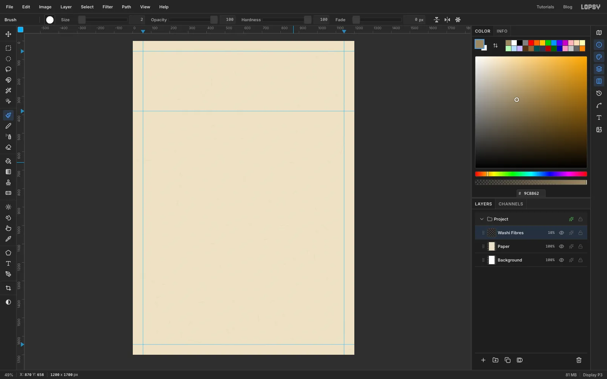

Washi has short fibres and a slight tooth, but no grain. The wood grain belongs inside the inked blocks, which you'll add later.

1. Create a **1200 × 1700** document. Rename **Layer 1** to **Paper**, set the foreground to `#ECE1C6`, and choose **Edit → Fill**.
2. Run **Filter → Add Noise…** with **Amount** 4 and **Mono** on.
3. Drop guides by clicking the rulers. Click the top ruler at **56** and **1144** for the side margins. Click the left ruler at **56** for the top margin, **380** for the top of the picture and **1644** for its bottom.
4. Add a layer called **Washi Fibres**. Press [[B]] and pick a hard round brush at **Size** 2. Set the colour to `#9C8862`, and draw about seventy short, slightly curved flicks, 15 to 40 px long, scattered at random angles across the whole page.
5. Set **Washi Fibres** to **10%** opacity. The fibres should be barely visible.

## Lay the water and the bokashi band

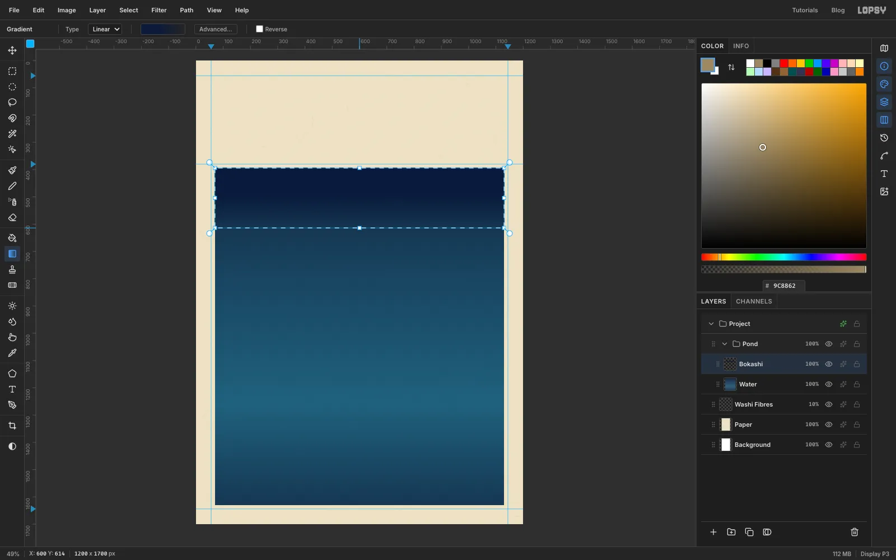

The pond sits inside the guides, 14 px in from each side, to leave room for the key-block frame.

1. Click **New Group** and call it **Pond**. Add a layer called **Water**.
2. Open the exact-corners dialog and select X **70** to **1130**, Y **394** to **1630**.
3. Pick the **Gradient** tool, set **Type** to **Linear** and click **Advanced…**. Set the stops to `#16253D`, `#24425D` at 30%, `#33607A` at 70% and `#1E3651`. Click the gradient bar to add a stop, then type its hex.
4. Drag from the top of the selection straight down to the bottom. Press [[⌘D]].
5. Add a layer called **Bokashi** and select X **70** to **1130**, Y **394** to **614**. This is the *ichimonji bokashi*, a straight band of ink that fades out, printed along the top of the sea in many Hiroshige prints.
6. In **Advanced…**, set three stops, all `#0D1A3A`. The first is at 0% and the second at 41%, both at full opacity. The last is at 100%, with its opacity dragged all the way down on the picker's Opacity bar.
7. Drag from the top of the band to its bottom, press [[⌘D]], and set the layer's blend to **Multiply**.
8. Add a layer called **Wood Grain**, select the whole water area again (X 70 to 1130, Y 394 to 1630), and run **Filter → Fibers…** with **Variance** 40 and **Strength** 10. Press [[⌘D]], set the blend to **Overlay** and the opacity to **12%**. The grain should be just visible in the ink, not streaky like rain.

## Carve the current lines

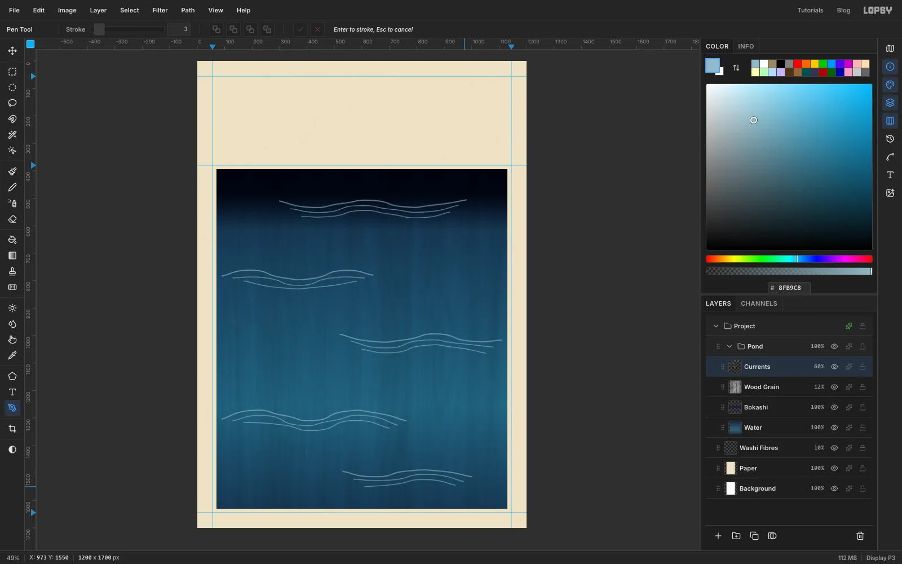

1. Add a layer called **Currents** and set the colour to `#8FB9C8`.
2. Press [[P]] for the Pen, and set **Stroke** in the options bar to **4**. Draw one gentle wave about 600 px long. Press and drag at each anchor to pull out its handles, and space the anchors about 120 px apart. Press **Enter**, which commits the path and strokes it in the foreground colour.
3. In the **Paths** panel, click **Delete Path**. A selected path grabs any Pen click near it, so delete each one before you start the next.
4. Set **Stroke** to **3** and draw two more waves parallel to the first, each about 19 px lower and a little shorter. This makes a band of three.
5. Make five bands in all, at about y 520, 780, 1010, 1290 and 1500. Alternate them between the left and right sides so no band crosses the whole pond. Keep the bottom band right of x 530, where the contents label will go.
6. Set the layer's opacity to **60%**.

## Cut the lily pads

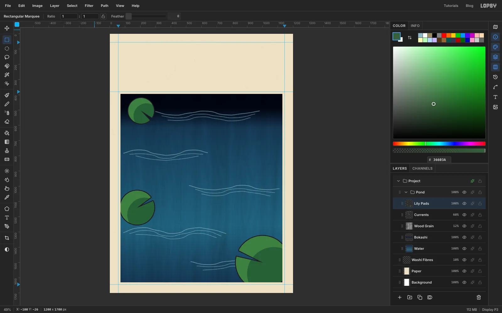

Printed lily pads are two flat greens, not a smooth gradient. Each pad needs one circle for the base and a second, offset circle for the shade.

1. Add a layer called **Lily Pads**. You'll make three pads: a large one centred at (1000, 1500) with a radius of 175, one at (180, 1140) with a radius of 112, and a small one at (205, 505) with a radius of 84.
2. For each pad, pick the **Elliptical Marquee** and use the exact-corners dialog for its circle. For example, the large pad is X 825 to 1175, Y 1325 to 1675. Fill it with `#4E7E47`.
3. Hold `Shift`+`Alt` and drag a second circle of the same size, shifted down and right by about two-fifths of the radius. For the large pad that's roughly from (895, 1395) to (1245, 1745). This keeps only the overlap. Fill it with `#36603A`, which leaves a lighter crescent on the upper left.
4. Press [[L]] for the Lasso and draw a thin V from the centre out past the rim, about 14° wide. Point the large pad's V toward the lower left, the middle one's toward the upper right and the small one's toward the lower right. Press **Delete**, then [[⌘D]].
5. Open the layer's effects and turn on **Stroke**: **Width** 5, position **Outside**, colour `#1C1820`. Click **Rasterize Layer Style** to bake it into the pixels.
6. Select X 70 to 1130, Y 394 to 1630, choose **Select → Inverse** and press **Delete**. This trims the big pad where it runs off the pond. The outline was baked first, so no outline appears along the cut.

## Add the pad veins

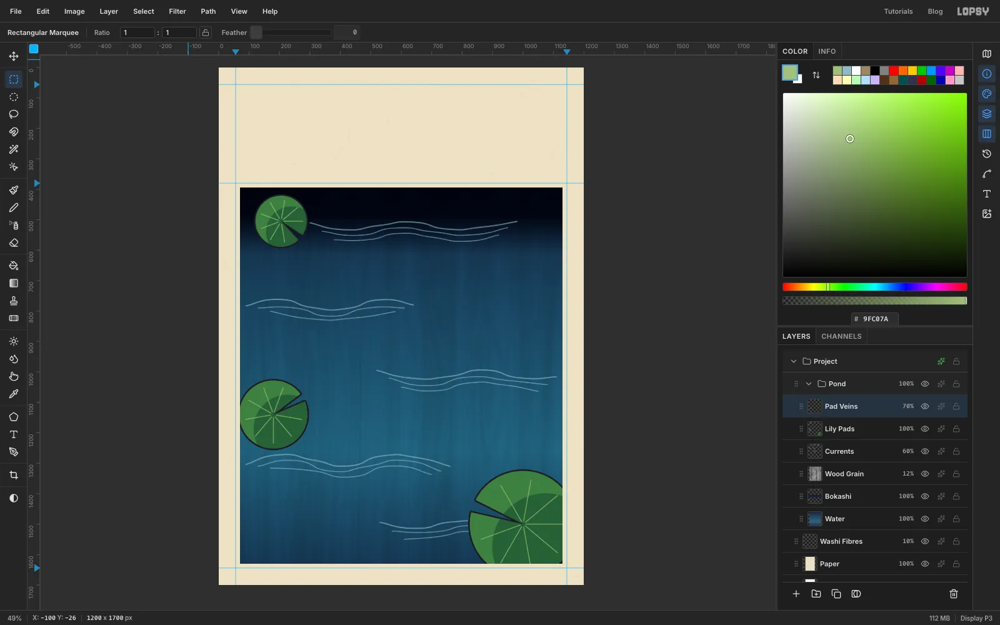

1. Add a layer called **Pad Veins**. Use a hard Brush at **Size** 4 in `#9FC07A`.
2. On each pad, click just off the centre, then `Shift`-click about 85% of the way to the rim. That's a straight vein. Make eight veins per pad, 40° apart, skipping the notch.
3. Trim the layer to the pond the same way as the pads (select the water area, **Select → Inverse**, **Delete**), then set it to **70%** opacity.

## Drop in the reference photo

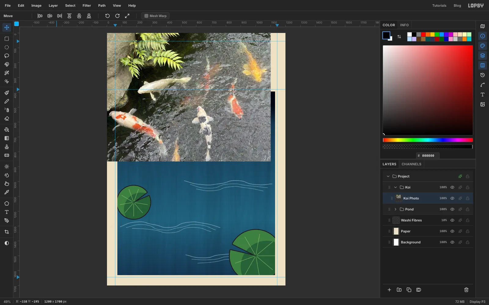

1. Click the arrow on the **Pond** group's row to collapse it, then click the row itself. Click **New Group** and call it **Koi**. It lands above Pond.
2. Drag your cropped photo from the Finder onto the canvas. It becomes a new layer in the top left corner. Rename it **Koi Photo** and press [[⌘D]].

Everything in the next few steps is traced and cut from this photo where it sits. You'll move the fish into the pond later.

## Trace the koi with the Pen

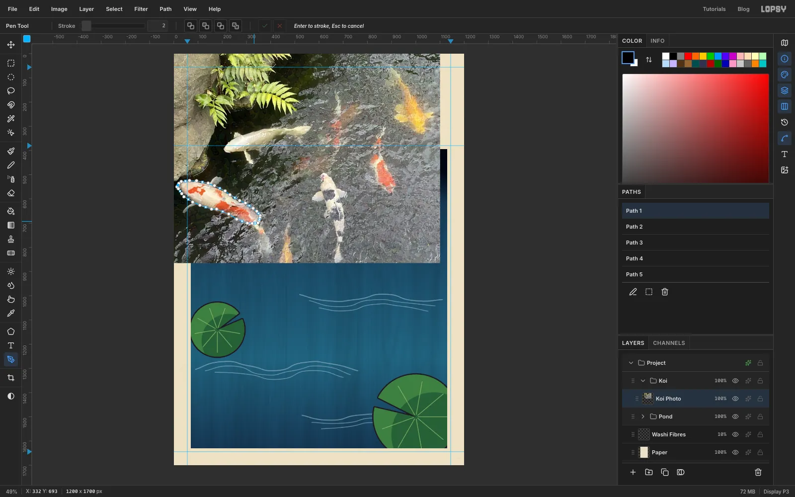

Woodblock fish are simplified. Their fins are clean paddles and their tails are forked fans, so trace the shapes you want, not every ripple of the photo.

1. Press [[P]]. Starting at the nose, press and drag around the kohaku's body with about fourteen anchors. Go round the body and finish at the tail root, the narrow neck just before the tail. Then click the first anchor to close the path.
2. In the **Paths** panel, click the path's row so it's no longer selected. A selected path grabs any new click that lands near it. Do this after every path below.
3. Trace the tail as a separate shape. It should be a forked fan about a quarter of the body's length. Use plain clicks for the two tips, the fork and the two corners at the root, and drag the anchors halfway along each outer edge so the edges bow out a little.
4. Trace the two pectoral fins as rounded paddles, one on each side, just behind the head. Use plain clicks where each fin joins the body and drag the rest.
5. Trace a second, shorter tail, about three-quarters the size of the first, starting from the same root. That one is for the amber koi.

You should end with five paths in the Paths panel: body, tail, lower fin, upper fin and short tail. The screenshot shows the body path selected.

Now make the tile for the fish scales:

1. Add a layer called **Scale Tile** and zoom in on the top left corner of the canvas.
2. Press [[U]] for the Shape tool, choose **Ellipse**, remove the fill, and set the stroke to `#C29A66` at **Width** 3. Hold `⌘` and drag from the point (20, 20) out about 17 px to draw a circle.
3. Select exactly X **0** to **40**, Y **0** to **20** and choose **Edit → Define Pattern**. Only the top half of the circle is inside that box, so the tile is a single arch. Press [[⌘D]] and delete the layer.

Patterns last until you close the page, so finish both fish in the same session.

## Wand the kohaku's patches out of the photo

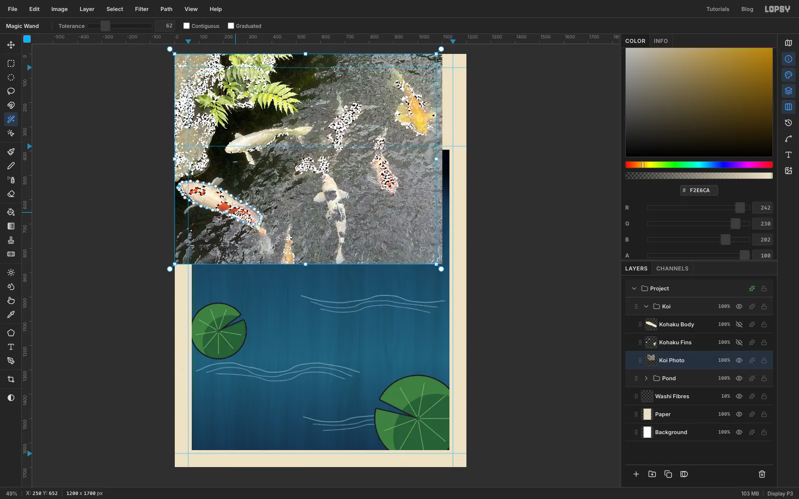

Build the kohaku as one layer per colour, the way a printer cuts one block per ink.

1. Click **Koi Photo** and add a layer called **Kohaku Fins**. In the **Paths** panel, click the tail path and click **Path to Selection**. Set the foreground to `#F2E6CA` with **A** at **85**, and choose **Edit → Fill**. Repeat for both fin paths, then set **A** back to **100**.
2. Add a layer called **Kohaku Body**. Turn the body path into a selection and fill it with `#F2E6CA`. Press [[⌘D]].
3. The cream blocks now cover the photo, so click the eye icons on **Kohaku Fins** and **Kohaku Body** to hide them for a moment.
4. Click **Koi Photo**. Press [[W]] for the Magic Wand, set **Tolerance** to **62** and untick **Contiguous**. Click the red patch on the kohaku's head, then `Shift`-click the red on its back.
5. Show **Kohaku Fins** and **Kohaku Body** again.

The selection also grabs other fish and ferns. You'll trim it to the body next.

## Print the kohaku's colour blocks

1. Choose **Select → Grow…** with 7 px, then **Select → Shrink…** with 6 px. This closes the speckle into bold, carved-looking shapes.
2. Hold `⌘`+`Shift`+`Alt` and click the **Kohaku Body** thumbnail. This intersects the selection with the body, so only the patches inside the fish stay.
3. Click **Kohaku Body**, add a layer called **Kohaku Patches**, and fill with `#C8402A`. Press [[⌘D]].
4. `⌘`-click the **Kohaku Body** thumbnail. Hold `Alt` and lasso around the head, up to just behind where the gill line will go. This takes the head out of the selection, because koi have no scales there.
5. Add a layer called **Kohaku Scales** and choose **Edit → Fill with Pattern…**. Set **Row Stagger** to **50%**, which offsets every other row like bricks, and click **Apply**. Press [[⌘D]], set the blend to **Multiply** and the opacity to **55%**.
6. Click **Kohaku Scales** and add a layer called **Kohaku Lines**. Set the colour to `#1C1820`. In the Paths panel, click the body path's row so it isn't selected. Then, with the Pen at **Stroke** 3, draw the gill: a curve from the back to the belly about a quarter of the way along, bowed toward the tail. Press **Enter**, then delete that path.
7. Click once with a hard Brush at **Size** 8 for the eye.
8. `⌘`-click the **Kohaku Fins** thumbnail. With the Brush at **Size** 2.6 in `#C29A66`, click at each fin's root and `Shift`-click out toward its edge. Draw five rays on the tail and three on each fin. The selection keeps the rays inside the fins. Press [[⌘D]].

## Merge the kohaku into one layer

Merge from the bottom up, so the Multiply scales land on the finished body.

1. Click **Kohaku Body** and choose **Layer → Merge Down**. It merges into **Kohaku Fins**.
2. Click **Kohaku Patches** and choose **Merge Down** again. Then do the same for **Kohaku Scales** and **Kohaku Lines**, clicking each layer's row before you merge it.
3. Rename the result **Kohaku**.

## Print the amber koi

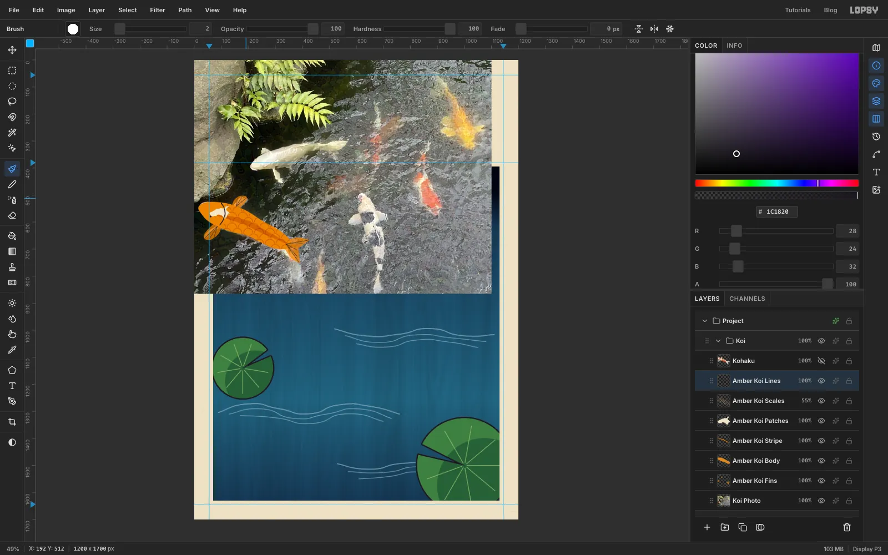

The amber koi uses the same body and fin paths, with its own short tail and different inks. Hide **Kohaku** while you work, so you can see the new blocks.

1. Click **Koi Photo** and add **Amber Koi Fins**. Fill the short tail and both fins with `#E8871E` at **A 72**, then set **A** back to **100**.
2. Add **Amber Koi Body** and fill the body path with `#E0891E`.
3. Add **Amber Koi Stripe**. `⌘`-click the body's thumbnail, then hold `Shift`+`Alt` and lasso a narrow lens along the spine, from behind the gill to the tail root. Make it about 18 px wide at its widest. Fill it with `#C96A10`. Koi are seen from above, so the darker colour runs down the back, not along a belly.
4. Hide the three Amber Koi layers and click **Koi Photo**. Tick **Contiguous** this time, so the wand takes only the patch you click, and click the red patch on the kohaku's head again. Show the layers, then run **Grow** 7 and **Shrink** 6 and `⌘`+`Shift`+`Alt`-click the **Amber Koi Body** thumbnail.
5. Click **Amber Koi Stripe**, add **Amber Koi Patches**, and fill it with `#F2E6CA`. Press [[⌘D]].
6. `⌘`-click the **Amber Koi Body** thumbnail and `Alt`-lasso the head out, as before. Add **Amber Koi Scales**, run **Fill with Pattern…** with **Row Stagger** 50%, press [[⌘D]], and set it to **Multiply** at **55%**.
7. Add **Amber Koi Lines**. Draw the gill with the Pen at **Stroke** 3 in `#1C1820`, press **Enter** and delete the path, then click the eye with the Brush at **Size** 8.
8. `⌘`-click the **Amber Koi Fins** thumbnail and draw the fin rays in `#1C1820` at **Size** 2. Use five on the short tail and three on each fin. Press [[⌘D]].
9. Merge **Body**, **Stripe**, **Patches**, **Scales** and **Lines** down in that order, clicking each one first, and rename the result **Amber Koi**.
10. Hide **Koi Photo**, show **Kohaku** again, and delete all five paths.

## Flip the amber koi

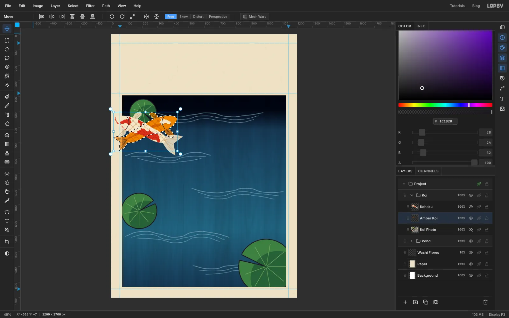

1. Click **Amber Koi** and `⌘`-click its thumbnail. Press [[V]].
2. Click **Flip Horizontal** in the options bar. The fish now swims to the right. Press [[⌘D]].

Flip before you scale or rotate, so the flip doesn't undo the other transforms.

## Scale the amber koi

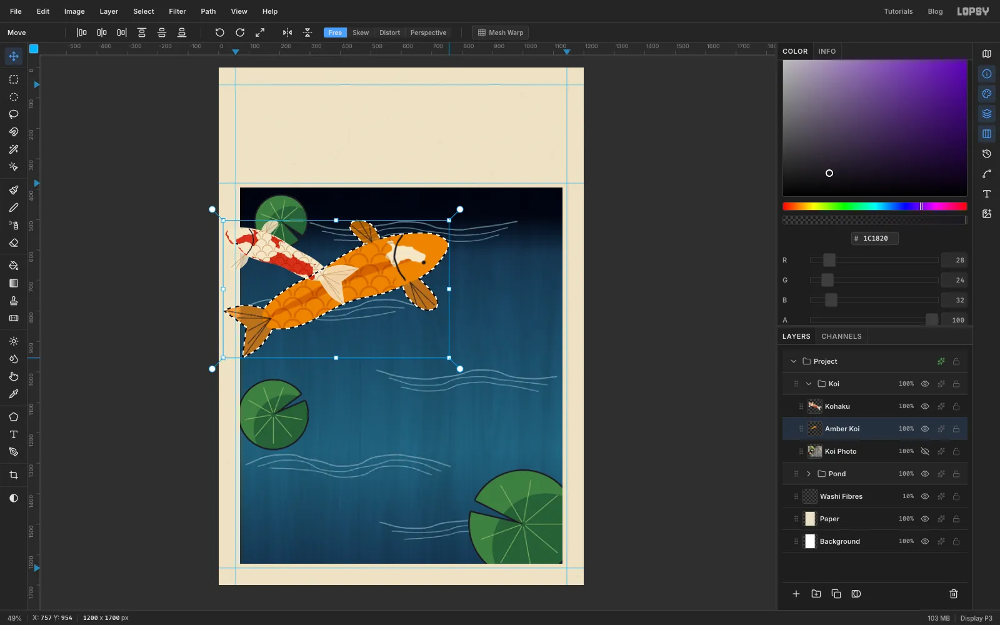

`⌘`-click the thumbnail again. Hold `⌘` and drag the bottom right corner handle outward until the box is about **180%** of its first width. Press [[⌘D]].

## Rotate the amber koi

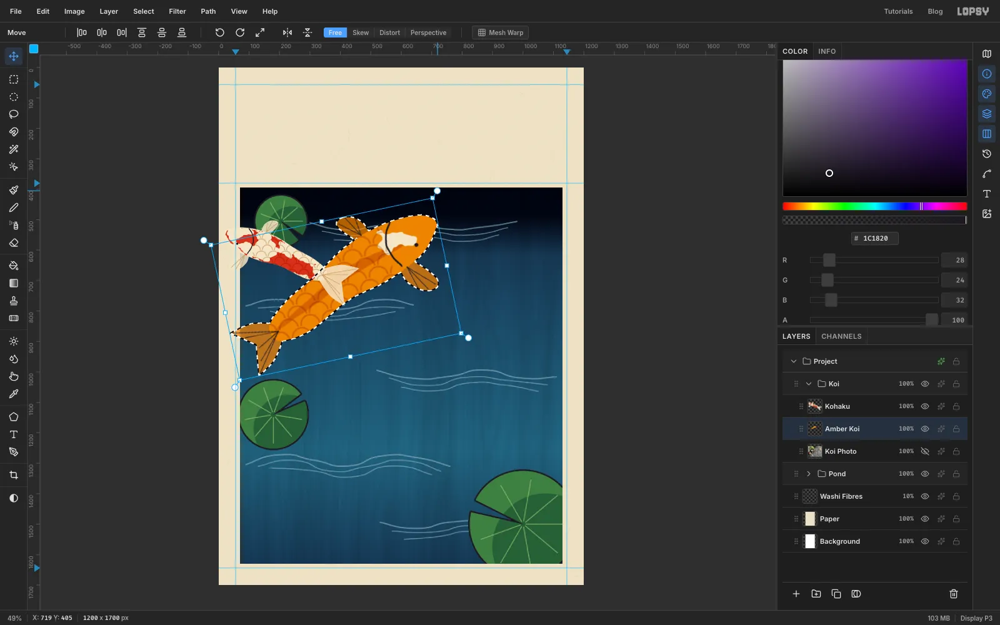

`⌘`-click the thumbnail again. Drag one of the circles outside a corner counter-clockwise by about **12°**, so the head lifts toward the top right. That's a little less than one step if you hold `⌘`, which snaps rotation to 15°, so rotate freely here. Press [[⌘D]].

## Place the two koi

1. With nothing selected, drag the amber koi into the upper half of the pond, a little left of centre, as in the screenshot. Leave at least 80 px between its nose and the right side of the pond, where the title slip will go.
2. Click **Kohaku** and `⌘`-click its thumbnail. Press [[V]] and `⌘`-drag a corner until the box is about one and a half times as wide. Press [[⌘D]].
3. `⌘`-click the thumbnail again. Hold `⌘` and rotate counter-clockwise by three 15° snaps, which is 45°. Press [[⌘D]]. Its nose should point to the lower left.
4. Drag it below the amber koi, centred around x 560. Its lowest fin should end at about y 1380, which leaves room for the contents label under it. Keep at least 60 px of water between the two fish.

## Add key lines and pond-floor shadows

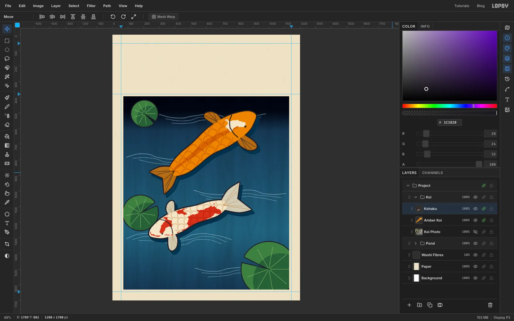

The key block is the darkest, heaviest line in the print, and a soft shadow would give away that it's digital. Use flat shadows with no blur.

1. Open the **Amber Koi** effects. Turn on **Stroke**: **Width** 7, **Outside**, `#1C1820`. It may look heavy, but a thinner line vanishes against the dark water.
2. Turn on **Drop Shadow**: colour `#10304A`, **Offset X** 16, **Offset Y** 20, **Blur** 0, **Spread** 0, **Opacity** 100.
3. Give the **Kohaku** the same two effects.

## Add ripple rings

1. With **Kohaku** active, add a layer called **Ripples**. Press [[U]] for the Shape tool, set it to **Ellipse**, remove the fill, and set the stroke to `#A9CCD6` at **Width** 3.
2. Shapes draw from the centre. Hold `⌘` and drag out three circles just above and ahead of the amber koi's head, with radii of about 28, 52 and 78. Keep the largest ring well clear of where the title slip will go. Draw three smaller ones, with radii of 22, 42 and 62, just ahead of the kohaku's nose.
3. Press [[E]] for the Eraser at **Size** 12 and click once or twice on each ring to break it, the way a carver leaves gaps.
4. `⌘`-click the **Amber Koi** thumbnail and choose **Select → Grow…** with **8** px, so the selection covers the black outline too. Click **Ripples** and press **Delete**. Do the same with **Kohaku**. Then expand **Pond** and do it with **Lily Pads**, without the Grow. Now the rings sit behind the fish and the pads. Press [[⌘D]].
5. Set **Ripples** to **70%** opacity.

## Cut a maple leaf with the Pen

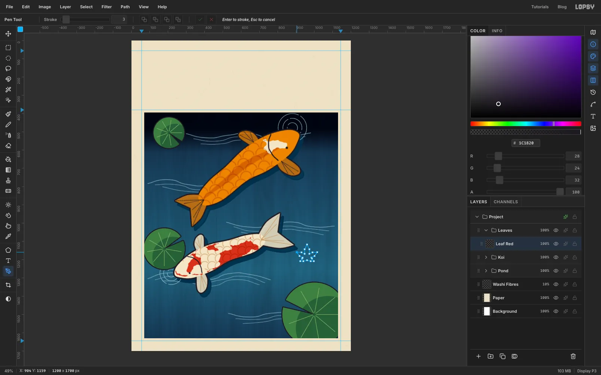

1. Collapse **Koi**, click its row and click **New Group** called **Leaves**. Add a layer called **Leaf Red**.
2. Press [[P]] and use plain clicks only, so every corner stays sharp. Draw a five-lobed maple leaf about 145 px across, to the right of the kohaku's tail. Make the top lobe the longest, the two upper side lobes nearly as long, and the two lower lobes short. Each lobe takes four clicks: shoulder, tip, shoulder, and the notch before the next lobe. Click the first anchor to close the path.

## Fill and vein the leaf

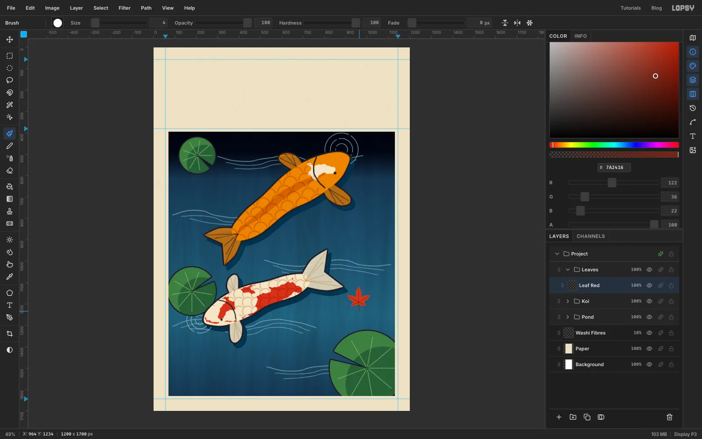

1. In the Paths panel, click **Path to Selection**, then **Delete Path**. Fill with `#C4452A`.
2. With the selection still on, draw the veins with a hard Brush at **Size** 2.6 in `#7A2416`. Click near the base of the leaf and `Shift`-click toward each lobe tip.
3. Press [[⌘D]], set the Brush to **Size** 4, and draw a short stem down from the base.

## Scatter copies of the leaf

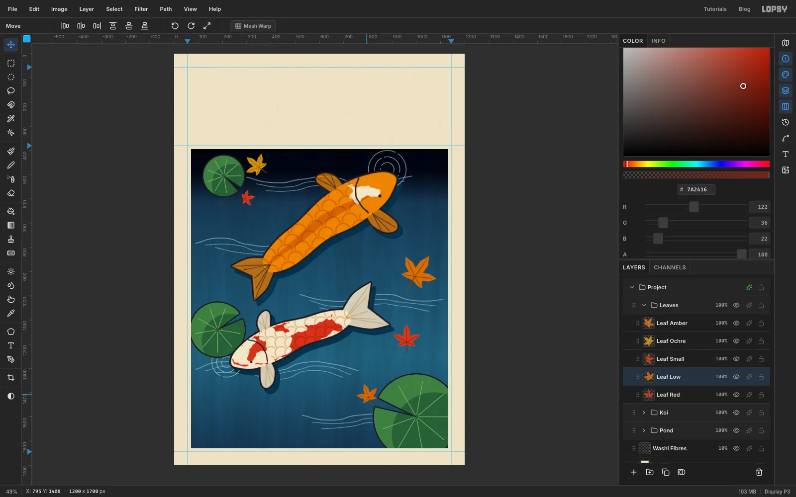

Leaves look fallen when they vary in size and gather in small clusters, rather than spreading out evenly.

1. Click the **Leaf Red** row and `⌘`-click its thumbnail, then press [[⌘C]] and [[⌘V]]. The copy pastes in place on a new layer, selected, with the Move tool active. Rename it and press [[⌘D]].
2. `⌘`-click the copy's own thumbnail and `⌘`-drag a corner to scale it. Press [[⌘D]], `⌘`-click it again, rotate it and press [[⌘D]].
3. Recolour it with **Filter → Hue/Saturation…**, then drag it into place.
4. Go back to **Leaf Red** for each new copy, so the copies don't compound. The four copies:
   - **Leaf Amber**: 140%, rotated 35°, **Hue** +18, **Saturation** +8. Put it on the right side, level with the middle of the amber koi.
   - **Leaf Ochre**: 90%, rotated −50°, **Hue** +30, **Saturation** +8. Put it just right of the top left pad.
   - **Leaf Small**: 60%, rotated 80°, no colour change. Put it just below the ochre leaf, so the two make a cluster.
   - **Leaf Low**: 80%, rotated −20°, **Hue** +16, **Saturation** +8. Put it at the top left edge of the large pad.
5. Rotate the original **Leaf Red** 25° and move it about 60 px left, so the leaves on the right don't line up in a column.

## Outline the leaves

Give every leaf a **Stroke** of **Width** 5, **Outside**, `#1C1820`. Add a **Drop Shadow** in `#10304A` with **Offset X** 6, **Offset Y** 8, **Blur** 0 and **Opacity** 100. The leaves float on the surface, so their shadows are shorter than the fish's.

## Print the key-block frame

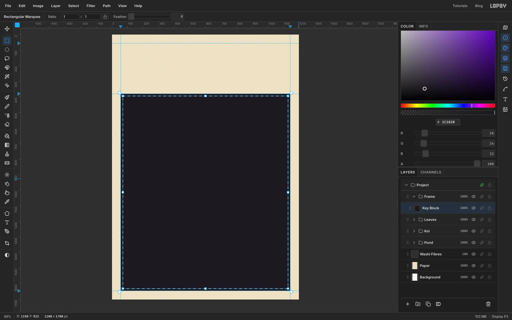

1. Collapse **Leaves**, click its row and add a **New Group** called **Frame**. Add a layer called **Key Block**.
2. Make sure **View → Snap to Guides** is ticked. Drag a marquee from the guide corner at the top left of the picture to the one at its bottom right. The edges snap onto the guides at 56, 380, 1144 and 1644.
3. Fill with `#1C1820`, then choose **Select → Shrink…** with **14** px and press **Delete**. Press [[⌘D]].
4. Press [[N]] for the Pencil at **Size** 3. Click on the left guide at y 128 and `Shift`-click on the right guide to draw the top rule. Draw a second rule at y 348 at **Size** 2.

## Set the title and cut the seal

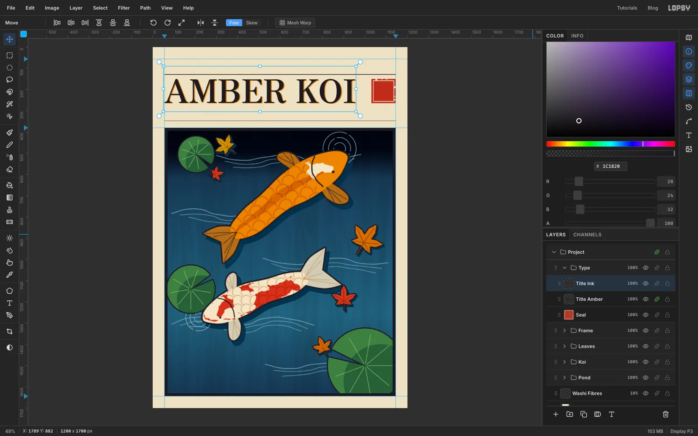

1. Collapse **Frame**, click its row and add a **New Group** called **Type**. Add a layer called **Seal**.
2. Select X **1030** to **1144**, Y **150** to **264** and fill with `#B23A28`. Run **Shrink** 7 and fill `#EBDFC4`, then **Shrink** 3 and fill `#B23A28` again. That leaves a thin cream border inside the seal. Press [[⌘D]].
3. Chip the seal like worn stone. With the Eraser, click six uneven bites on its top and right edges, at sizes from 4 to 11, centred just inside the edge.
4. With **Seal** active, press [[T]] and choose **Zen Antique** at **Size** 153 in `#1C1820`. Click near the top left margin, type `AMBER KOI`, and press [[Tab]]. Press [[V]], drag the title close, then nudge it with the arrow keys until its left edge is on the 56 px guide and the tops of the letters sit about 22 px below the top rule. The cap height should end level with the seal's top.
5. Choose **Layer → Duplicate Layer**. Rename the lower layer **Title Amber**, give it a **Color Overlay** in `#DC8A1E` and set its blend to **Multiply**. Nudge it 4 px right and 2 px down with the arrow keys. This is the slight misregistration of a real print. It should look like the amber block slipped a little, not like a drop shadow.

## Finish the masthead

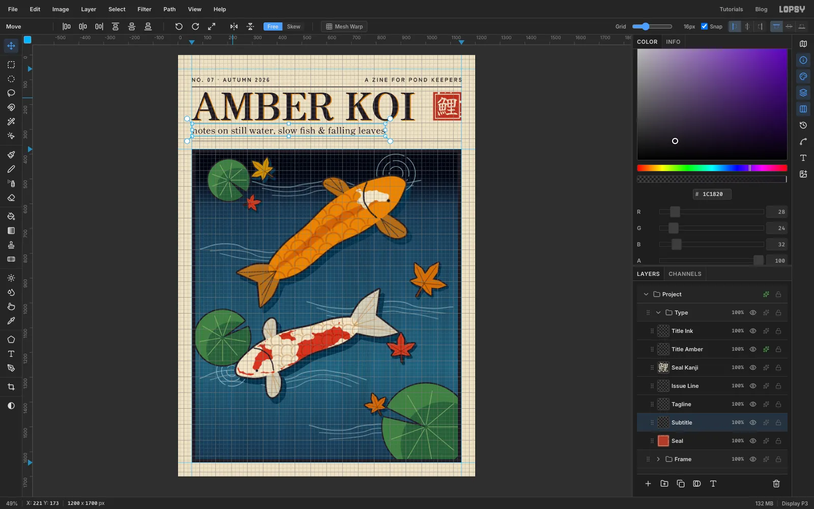

Click **Seal** before each new piece of type, so the text options don't restyle the last text layer.

1. Copy `鯉` from this page. Press [[T]], set **Yuji Syuku** at **Size** 84 in `#EBDFC4`, click on the seal and paste it with [[⌘V]]. Press [[Tab]], then centre it on the seal.
2. Type `NO. 07 · AUTUMN 2026` in **Zen Kaku Gothic New** **Bold** at **22** in `#1C1820`. In the **Text** panel, set **Letter spacing** to **5**. Seat it on the left margin with its top at y 92.
3. Type `A ZINE FOR POND KEEPERS` with the same settings. Move it so its right edge sits on the 1144 guide, level with the issue line.
4. Type `notes on still water, slow fish & falling leaves` in **Shippori Mincho B1** **Medium** at **36**, with **Letter spacing** back at **0**. Seat it on the left margin with its top at y 290, about 30 px above the lower rule.
5. Turn on **View → Show Grid** to check that the left edges line up, then turn it off again.

## Add the title slip

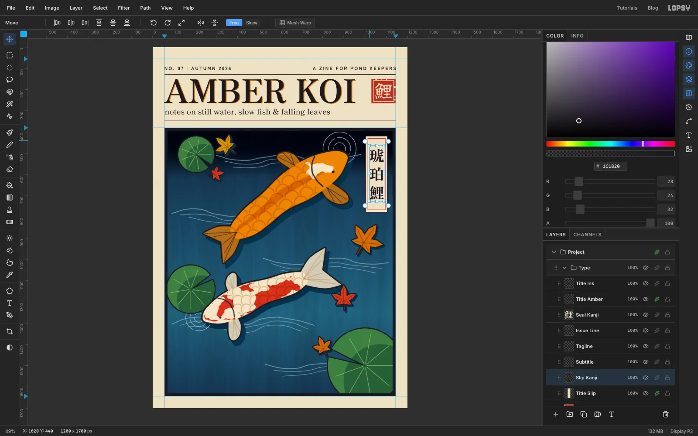

The *tanzaku* slip is where woodblock prints carry their titles.

1. Click **Seal** and add a layer called **Title Slip**. Select X **1004** to **1104**, Y **420** to **776**. Fill it with `#EBDFC4`, **Shrink** 8 and fill `#B23A28`, then **Shrink** 3 and fill `#EBDFC4`. Press [[⌘D]].
2. Add a **Stroke**, **Width** 3, **Outside**, `#1C1820`.
3. Copy `琥珀鯉` from this page. With **Title Slip** active, press [[T]] and set **Zen Antique** at **70** in `#1C1820`. Click inside the slip and paste. Put the caret after `琥` and press **Enter**, then do the same after `珀`, so the three characters stack. Press [[Tab]], set **Line height** to **1.25** in the Text panel, and centre the column in the slip.

## Add the contents label

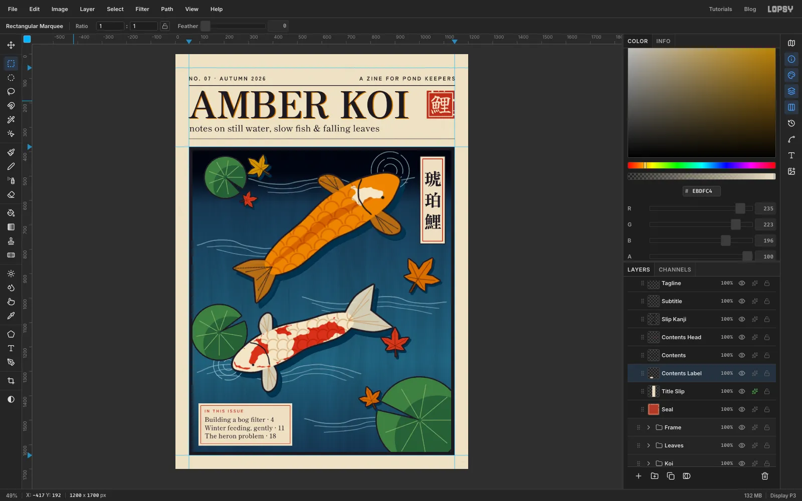

Set the type first, then size the paper to fit it. That way the padding is even all round.

1. Click **Title Slip**, add a layer called **Contents Label**, and keep it active.
2. Type `IN THIS ISSUE` in **Zen Kaku Gothic New** **Bold** at **17** in `#B23A28`, with **Letter spacing** **4**.
3. Click **Contents Label** again. Type three lines in **Shippori Mincho B1** **Medium** at **26** in `#1C1820`, with **Letter spacing** **0** and **Line height** **1.3**: `Building a bog filter · 4`, `Winter feeding, gently · 11`, `The heron problem · 18`.
4. Drop guides at x 121 and y 1579. Move the three lines so their left edge sits on the first guide and the bottom of the last line sits on the second. Put the heading 20 px above them, on the same left edge, then delete both guides.
5. Click **Contents Label** and select X **95** to **479**, Y **1431** to **1605**. That's 25 px in from the frame on the left and at the bottom, and about 26 px of paper around the type.
6. Fill with `#EBDFC4`, **Shrink** 8 and fill `#B23A28`, then **Shrink** 2 and fill `#EBDFC4`. Press [[⌘D]].

## Rotate a credit into the margin

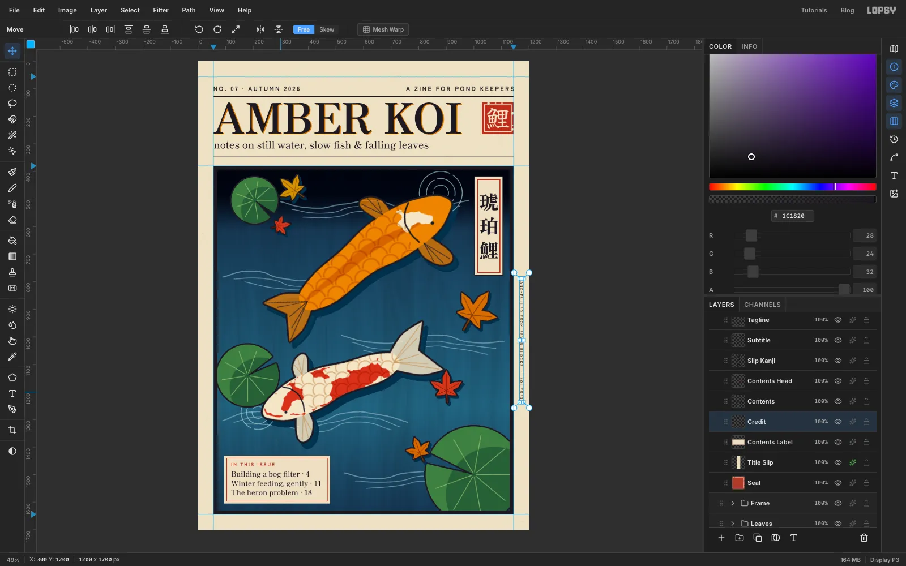

1. Click **Contents Label**. Type `HAND-PULLED FROM SEVEN BLOCKS  ·  KOI PRESS` in **Zen Kaku Gothic New** **Medium** at **12** in `#1C1820`, with **Letter spacing** **4**. Type it somewhere in the middle of the pond, away from other text, so the click doesn't edit another text layer.
2. Press [[V]], make sure nothing is selected, and click **Rotate 90° CW** in the options bar. The text stays editable.
3. Move it into the right margin. Centre it across the margin at about x 1172, and centre it top to bottom on the frame.

## Add the kento marks and grain

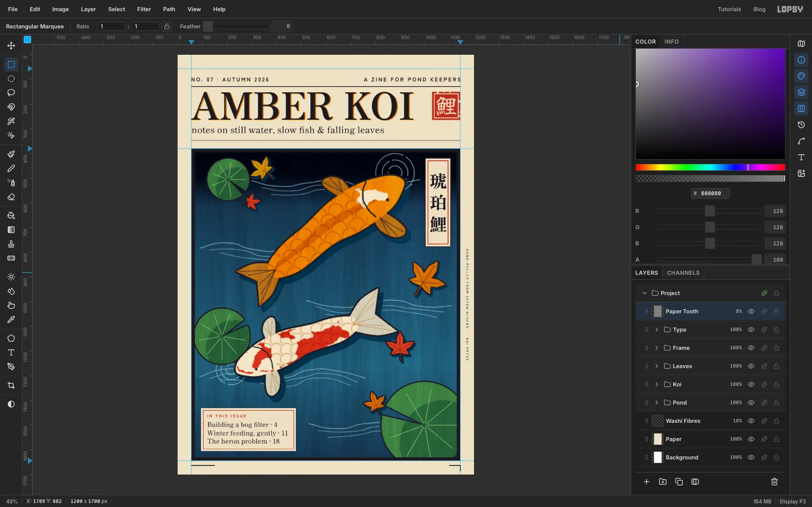

1. Expand **Frame** and click **Key Block**. Add a layer called **Kento**. With the Pencil at **Size** 3 in `#1C1820`, draw the printer's registration marks just below the frame. Make an L at the bottom right corner, from x 1100 to 1144 at y 1664 and then down to 1686, and a straight bar at the bottom left from x 56 to 150.
2. Add a layer called **Block Grain**. Select the pond area (X 70 to 1130, Y 394 to 1630) and run **Fibers…** with **Variance** 48 and **Strength** 14. Press [[⌘D]] and set it to **Overlay** at **14%**. The grain now prints through the fish and leaves too.
3. Collapse **Frame** and **Type**, click **Type**, and add a layer called **Paper Tooth** at the top. Fill it with `#808080`, run **Add Noise…** at **30** with **Mono** and **Gaussian**, and set it to **Overlay** at **8%**.
4. Export with **File → Quick Export PNG**, and save the project with **File → Save Project**.

Try it with another animal from a photo, such as a heron, a crane or a carp leaping a waterfall. Trace the shape with the Pen, wand the markings out of the photo, and give each ink its own layer. Merge each animal only when its blocks are done.
