A woodblock print is carved, inked and pressed one block at a time. A black
**keyblock** carries the outlines, and each colour gets its own block. In
Japanese prints the printer wipes a gradient onto the sky block by hand, a
technique called **bokashi**. The wood grain shows through in big flat areas,
and the blocks never line up perfectly, so a colour sometimes sits a few
pixels off its outline. Mexican woodcut posters add heavy black frames,
gouged highlights and chunky wood type.

In this tutorial you'll fake all of that in Lopsy for a poster for an
imaginary film, **Comet over Xochimilco**. A flower boat (a *trajinera*)
drifts down a canal toward Popocatépetl while a comet crosses the sky and a
giant axolotl swims in the foreground. The axolotl starts as a photo. I used
a free [CC0 axolotl photo from Wikimedia Commons](https://commons.wikimedia.org/wiki/File:Axolotl-2193331_1280.webp),
saved as a JPEG. The poster is **1200 × 1800 px**.

Along the way you'll use:

- **Groups** to keep the sky, horizon, canal, banks, boat, axolotl and title apart
- the **Gradient** tool with a four-stop gradient for the bokashi sky
- **Add Noise**, **Motion Blur** and **Brightness/Contrast** for wood grain, plus **Fibers** and **Clouds** for the paper
- the **Brush** with **Taper** for gouged strokes, and the **Pencil** for strings
- **Sunburst** inside a ring selection for the comet's halo
- the **Lasso**, **Edit → Fill** and the **Stroke** effect for every colour block and its keyline
- **Copy**, **Paste**, the **Move** tool's scale handles and **Image → Flip Horizontal** to plant two rows of trees
- the **Pen** tool and a text layer bound to its path for the boat's name
- **Desaturate**, **Threshold** and the **Magic Wand** to turn the photo into a two-colour print
- intersecting selections with [[Shift]]+[[Alt]], **Copy Merged**, **Flip Vertical** and a **layer mask** for the water
- **Caprasimo** and **League Gothic** type, and a **Color Overlay** for a misregistered title plate

The palette:

- Paper `#EDE3CC`, keyblock ink `#1E1A1C`, cream `#F3E7C9`
- Bokashi sky `#141A3F` → `#2B3D7A` → `#6A5A98` → `#C65F7C`
- Canal `#8A5C8C` → `#33437E` → `#0F1538`, ripples `#9DB2DE`
- Volcanoes `#5D5490` / `#4A3F7E`, steam `#DCD3E6`
- Willows `#24473A`, banks `#21392F`, carving `#7FA486`
- Rosa `#C2386A`, marigold `#E39A2D`, turquoise `#3D9C9A`, coral `#E8705A`, hull `#B8325F`
- Lanterns `#F6C35C`, glints `#F2C46A`
- Axolotl `#EBAFB8` / `#D6788E`, gouges `#F8DCE1`, water over it `#1E2A5E`
- Title shadow navy `#1B2A66`
- Texture grey `#808080` (only used to make grain, fibres and specks)

> **Tip:** Positions are in document pixels, written `x, y`, with `0, 0` at
> the top left. The status bar shows where the pointer is. **Edit → Fill**
> fills the selection with the foreground colour, and [[Cmd+D]] deselects.
> New layers appear above the selected layer. If the selected row is an
> *expanded* group, the new layer goes inside it. Open a layer's effects
> drawer with the sparkle icon on its row; the **Blend** dropdown is in there
> too. Double-click a layer's name to rename it.

> **Tip:** The Lasso draws wherever you drag. For the straight-edged blocks
> (banks, roof, hull, mountains), drag in straight runs from one corner to
> the next and let go back at the start. The corner lists below are where to
> aim; the result doesn't have to be pixel-perfect, which suits a carved print.

> **Tip:** The picture sits in a panel from `36, 36` to `1164, 1356`. Every
> sky, water and grain layer is filled inside that rectangle, and the paper
> below it holds the title.

## Set up the paper, groups and guides

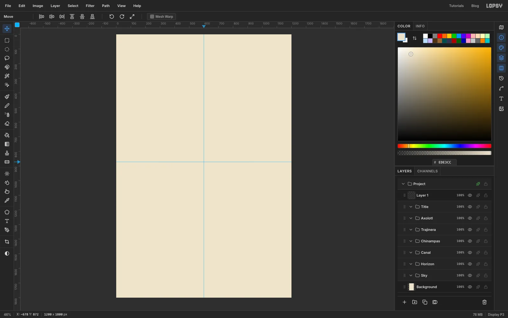

Choose **File → New**, enter **1200 × 1800**, pick a **White** background
and click **Create**. Click the *Background* row, set the foreground to paper
`#EDE3CC` and choose **Edit → Fill**.

Now make the groups. Click *Background*, click the **New Group** button at
the bottom of the Layers panel and name it *Title*. Click *Background* again
and make *Axolotl*, then *Trajinera*, *Chinampas*, *Canal*, *Horizon* and
*Sky* the same way. Each new group lands right above *Background*, so you end
up with *Sky* at the bottom and *Title* at the top, which is the order they
print in. Leave the empty *Layer 1* at the top of the stack; it becomes the
paper texture at the end.

Click the top ruler at `600` for a centre guide, and the left ruler at `872`
for the horizon.

## Wipe on a bokashi sky

Expand *Sky*, click it and add a layer named *Sky Bokashi*. With the
**Rectangular Marquee**, select from `36, 36` to `1164, 892`, a little past
the horizon.

Pick the **Gradient** tool, set the type to **Linear** and click
**Advanced…** to open the Gradient Editor. Set four stops by clicking the
bar and typing each colour into the hex field: `#141A3F` at the left end,
`#2B3D7A` at 50%, `#6A5A98` at 80% and rose `#C65F7C` at the right end. Click
**Done**, then drag from the top of the panel straight down to just above the
horizon. That's the hand-wiped band of colour a printer puts on the sky
block.

## Plane wood grain into the sky

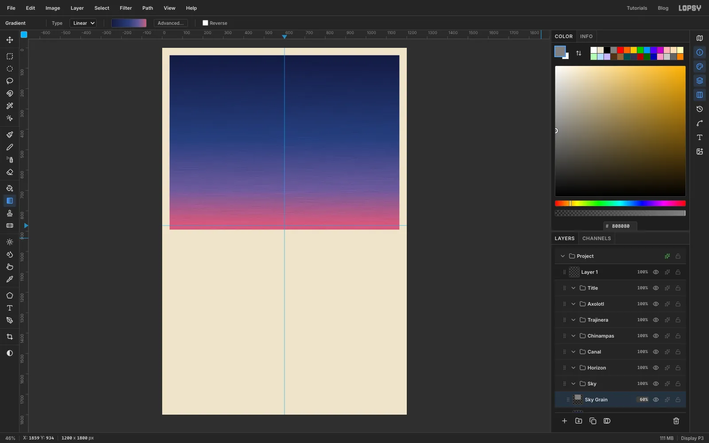

Keep the selection. Add a layer named *Sky Grain*, set the foreground to grey
`#808080` and fill.

1. **Filter → Add Noise…**: **Amount** `100`, **Mono**, **Gaussian**.
2. **Filter → Motion Blur…**: **Angle** `0`, **Distance** `100`. The specks
   stretch into long horizontal streaks.
3. **Filter → Brightness/Contrast…**: **Contrast** `100`. Run it a second time
   with **Contrast** `80` so the streaks get crisp.

Deselect, open the layer's drawer and set **Blend** to **Overlay**, then set
the layer opacity to **60%**. Overlay leaves the grey invisible and only the
light and dark streaks tint the sky, like grain pressed into the paper.

## Carve the stars

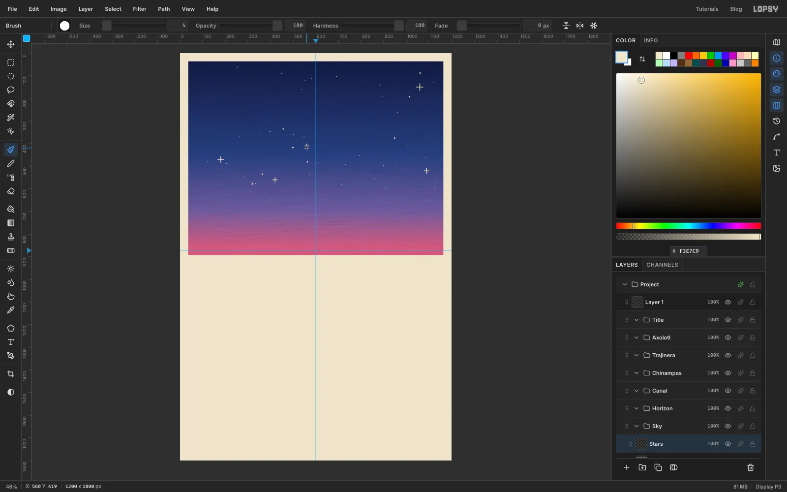

Add a layer named *Stars*. Pick the **Brush**, open the Brushes panel with the brush preview button at
the left of the options bar, and set
**Hardness** `100` and **Spacing** `10`. Set the foreground to cream
`#F3E7C9`.

Click about 45 single stars across the sky with a **Size** of `4`, and a few
at `7`. Keep them out of the upper left, where the comet's tail will go, and
away from a spot around `735, 262`, where its head will sit.

For five brighter stars, set **Size** to `4` and draw small crosses: click at
the left end, then [[Shift]]-click about 26 px to the right to draw a straight
line, then do the same from top to bottom. I put them at `180, 470`,
`1060, 150`, `420, 560`, `1090, 520` and `560, 410`.

## Gouge the comet's tail

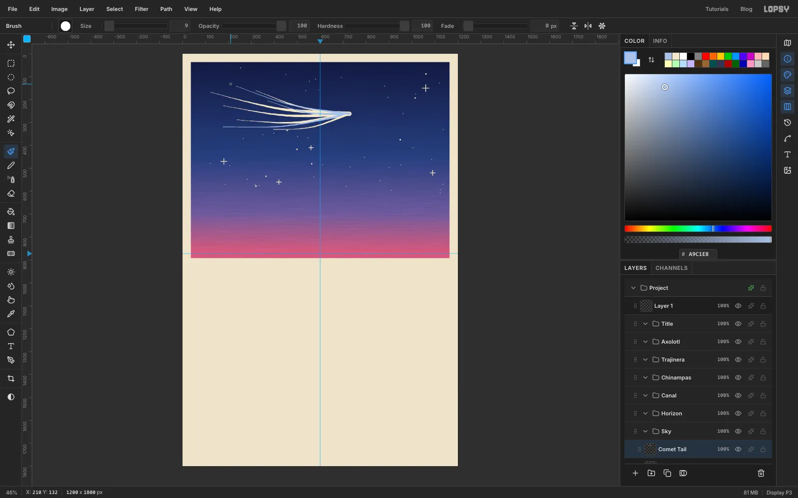

Add a layer named *Comet Tail*. The comet's nucleus is at `735, 262`.

In the Brushes panel, **Taper** shrinks a stroke from where it starts down
to nothing over that many pixels. So start each stroke on the nucleus and
drag outward, and set Taper to about the length of the stroke. You get a fat
gouge at the head that runs out to a hairline.

Draw eight strands from the nucleus out to the upper left, each with a slight
downward bow. Vary their length: end them anywhere between `x 120` and
`x 380`, from `y 130` to `y 340`, and don't let any reach the frame. Use
cream for five strands and pale blue `#A9C1E8` for three. Make the cream ones
**Size** `13`–`20` and the blue ones `9`–`12`, with **Taper** around `400` to
`620`.

## Cut a ring for the halo

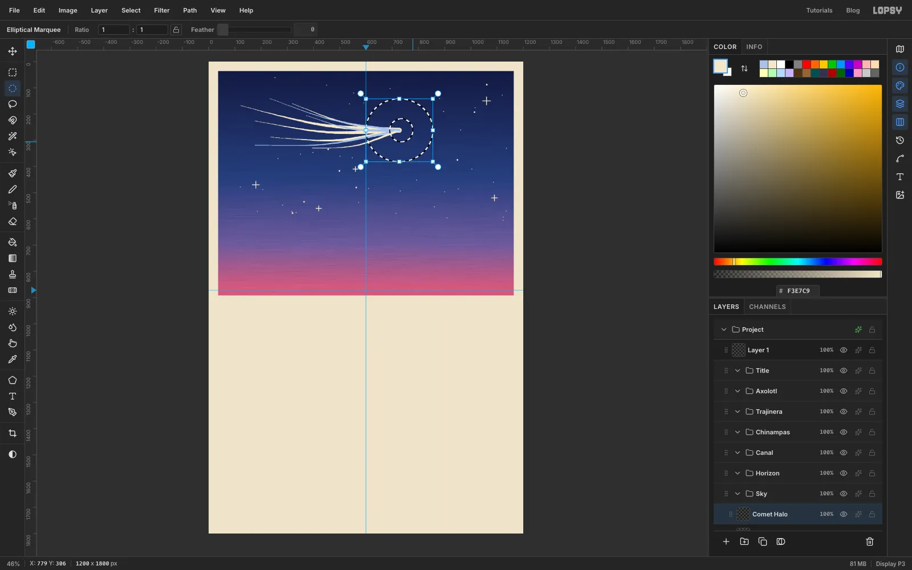

Add a layer named *Comet Halo*. With the **Elliptical Marquee**, drag a circle
of radius `120` around the nucleus, from `615, 142` to `855, 382`. Then hold
[[Alt]] and drag a circle of radius `44`, from `691, 218` to `779, 306`.
[[Alt]] subtracts it, which leaves a ring.

Choose **Filter → Sunburst…** with the cream foreground:

- **Rays** `18`, **Length** `5`, **Width** `40`, **Taper** `100`, **Rotation** `5`
- **Center X** `61.3` and **Center Y** `14.6`, which is the nucleus as a percentage of the page
- **Jitter** `30`, **Seed** `5`, **Fade** and **Softness** `0`, **Opacity** `100`

**Taper** `100` turns each ray into a spike, and the ring trims them to short
carved dashes around the head.

## Set the comet's head

Deselect. On *Comet Halo*, select a circle of radius `36` around the nucleus
(`699, 226` to `771, 298`) and fill it with cream. Select radius `32`
(`703, 230` to `767, 294`) and press [[Delete]], which leaves a thin ring.
Deselect and set the layer to **75%**.

Add a layer named *Comet Head*, select a circle of radius `22`
(`713, 240` to `757, 284`) and fill it with cream. Deselect and turn on
**Outer Glow** in its drawer: **Size** `26`, **Opacity** `55`, colour
`#F2C46A`.

## Lay down the two volcanoes

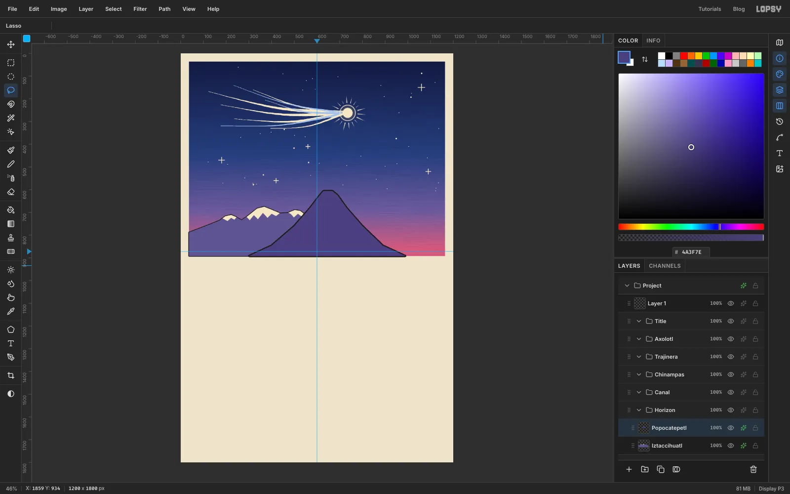

Collapse *Sky*, click *Horizon* and add a layer named *Iztaccihuatl*. Locals
call this mountain the sleeping woman, so give it her profile. Use the
**Lasso** to draw a long ridge across the left side: a head that peaks around
`222, 712`, a dip for the neck, a high chest around `368, 676`, a gentle
belly, knees around `502, 690`, then a slope down to the horizon at
`740, 892`. Close the shape along `y 892`. Fill it with `#5D5490`, deselect
and add a **Stroke** effect: **Width** `3`, colour ink `#1E1A1C`.

Lasso three snow caps on her head, chest and knees, each with a zigzag lower
edge, and fill them with cream on the same layer.

Add a layer named *Popocatepetl*. Lasso a cone that rises from `300, 892` to
a flat crater from `628, 606` to `668, 606`, then falls to `990, 892`. Fill it
with `#4A3F7E` and give it a **Stroke** of **Width** `5`. The nearer mountain
gets the heavier keyline.

## Print the snow off its keyline

Add a layer named *Popo Snow*. Lasso the top of the cone, following its
outline, with a zigzag of drips down the slopes that reach between `y 686`
and `y 756`. Fill it with cream and deselect.

Pick the **Move** tool and press the right arrow key **4** times and the down
arrow key **3** times. The snow block now sits a few pixels off the keyline,
just like a colour block printed out of register.

## Carve a curl of steam

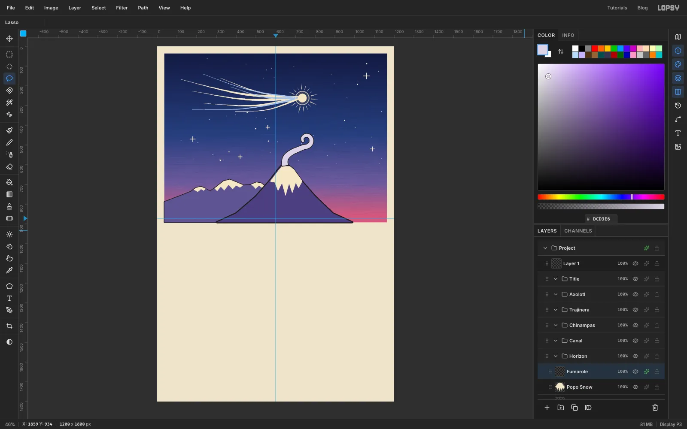

Add a layer named *Fumarole*. With the **Lasso**, draw a ribbon that starts
about 30 px wide in the crater at `648, 604`, curves up and to the right in
an S, and rolls into a spiral around `752, 474`, getting thinner as it goes.
Draw up one edge of the ribbon and back down the other.

Fill it with `#DCD3E6`, deselect and add a **Stroke** of **Width** `3` in ink.

## Fill the canal

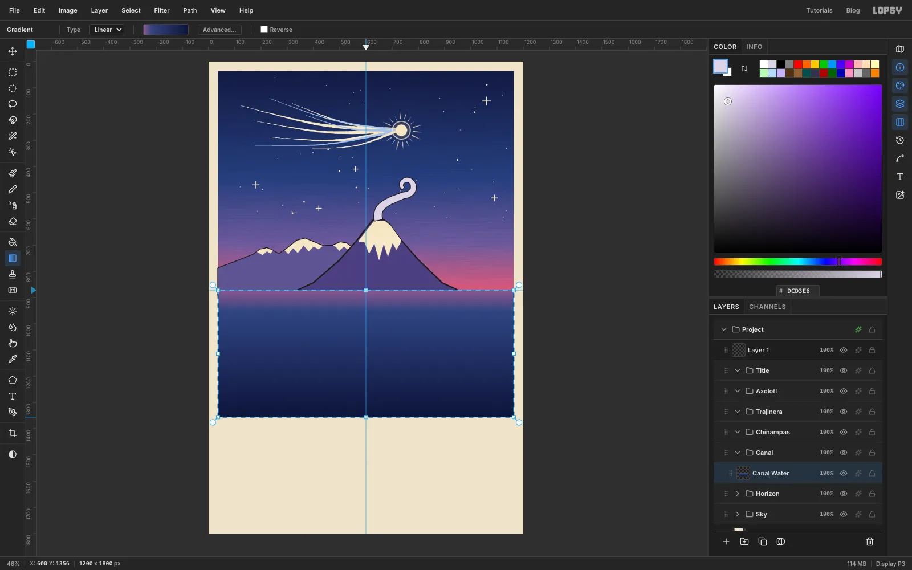

Collapse *Horizon*, click *Canal* and add a layer named *Canal Water*. Select
from `36, 866` to `1164, 1356`.

Set a new **Linear** gradient in the Gradient Editor: `#8A5C8C` at the left
end, `#33437E` at 18% and `#0F1538` at the right end. Drag from the horizon
down to the bottom of the panel. The violet at the top is the sky's rose
glow reflected in the water. Deselect.

## Carve the ripples

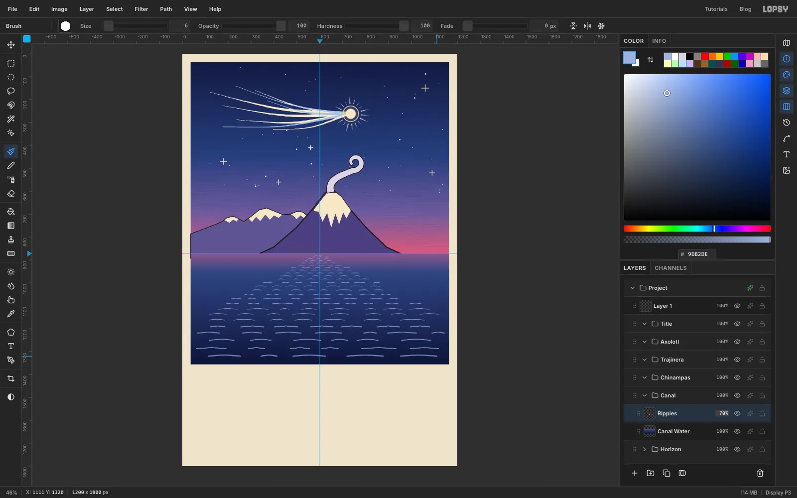

Add a layer named *Ripples* and set the foreground to `#9DB2DE`. Pick the
**Brush**, with **Taper** back at `0`.

Draw rows of short dashes, each with a slight hump in the middle. Near the
horizon, use **Size** `2`, dashes about 15 px long and rows about 7 px
apart. As you work down toward the viewer, raise the size to `6`, make the
dashes up to 140 px long and space the rows up to 35 px apart. That's what
sells the perspective. Leave irregular gaps between the dashes.

Set the layer to **70%**.

## Cut the chinampa banks

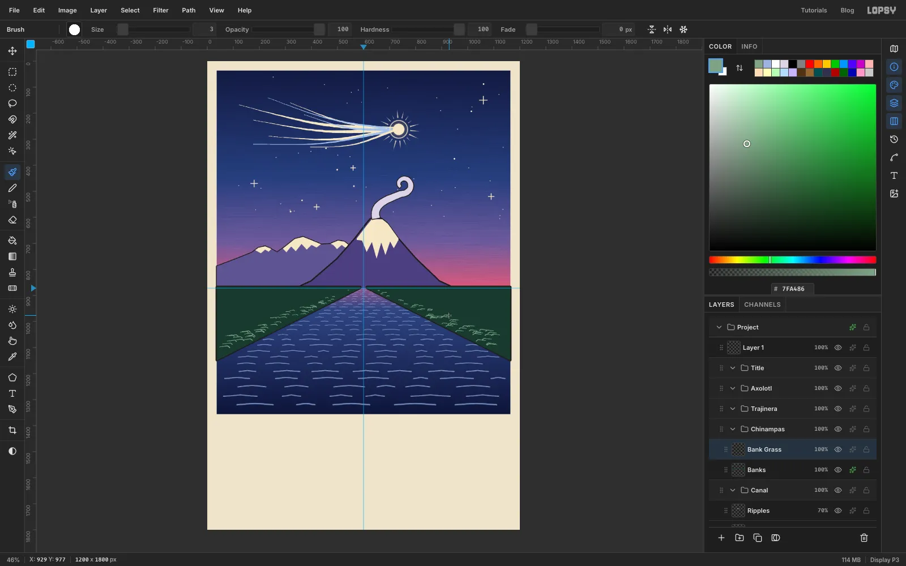

Collapse *Canal*, click *Chinampas* and add a layer named *Banks*. The canal's
edges run from the bottom corners of the panel at `y 1150` to the vanishing
point at `600, 872`.

Lasso the left bank: `36, 866`, `588, 866`, `588, 872`, `36, 1150`. The bank's
top edge sits 6 px above the horizon, and its tip stops short of the centre,
which leaves a sliver of water open at the vanishing point. Fill it with
`#21392F`. Lasso the right bank as its mirror image (`612, 866`,
`1164, 866`, `1164, 1150`, `612, 872`) and fill it too. Deselect and add a
**Stroke** of **Width** `4` in ink.

Add a layer named *Bank Grass*. Set the Brush **Taper** to `60` and the
foreground to `#7FA486`. Flick about 140 short strokes along both bank edges,
each angled up and outward, away from the water and toward the trees. Keep them small (about 6 px, Size `2`) near the
horizon and larger near the viewer (up to 45 px, Size `5`).

## Carve a master ahuejote

The canals of Xochimilco are lined with ahuejotes, tall narrow willows. You'll
carve one by hand and paste the rest.

Add a layer named *Ahuejote*. Lasso a tall spindle whose base sits at
`110, 1106`. Make it about 740 px tall and about 108 px across at its widest,
a third of the way up, with a zigzag edge for the leaves. Fill it with
`#24473A`.

Set the Brush **Size** to `4` and **Taper** to `70`, with the foreground
`#7FA486`. Every 22 px up the crown, draw a short stroke from the middle out
to the right, about 25 px long and angled up at roughly 45°. Where the crown
is wide, add a matching one out to the left. That's about 30 strokes on the
right and 25 on the left.
Then set the foreground to ink, **Size** `6`, click at `110, 1114` and
[[Shift]]-click at `110, 1066` for a little trunk.

Add a **Stroke** of **Width** `4` in ink, then click **Rasterize Layer Style**
in the drawer so the outline is part of the pixels you're about to copy.

## Paste and scale a smaller tree

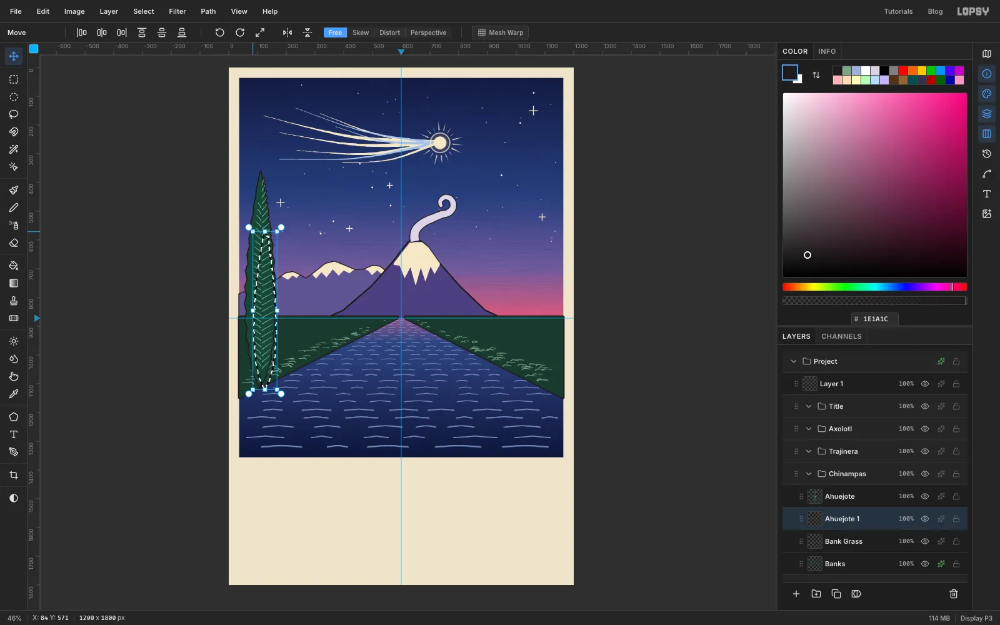

Click *Ahuejote* and choose **Edit → Copy**. Then click *Bank Grass* and
choose **Edit → Paste**. The copy lands in place, right above *Bank Grass*,
so it sits behind the master. That's what you want for trees that are
farther away. The paste comes in selected with the **Move** tool active.
Name the new layer *Ahuejote 1*.

Hold [[Cmd]] and drag the **top-left** handle down and to the right. Cmd keeps
the proportions, and the bottom-right corner stays pinned. Shrink it to
about **72%** of the master, so it's about 545 px tall, then press [[Cmd+D]]
to commit. Drag the tree so its trunk
stands on the bank at `x 236`, just inside the canal edge.

## Finish the left row

Repeat the copy, paste, scale and move for three more trees on the left bank:
**47%** (about 355 px tall) at `x 330`, **28%** (about 210 px) at `x 440` and
**14%** (about 105 px) at `x 526`. The default names (*Ahuejote 2*, *3*…) are
fine. Each time, copy
from *Ahuejote* and paste with *Bank Grass* selected, so every farther tree
slides in behind the nearer ones. Stand each trunk just inside the bank's
edge. The farther the tree, the higher up the bank its trunk sits.

## Plant a different row on the right

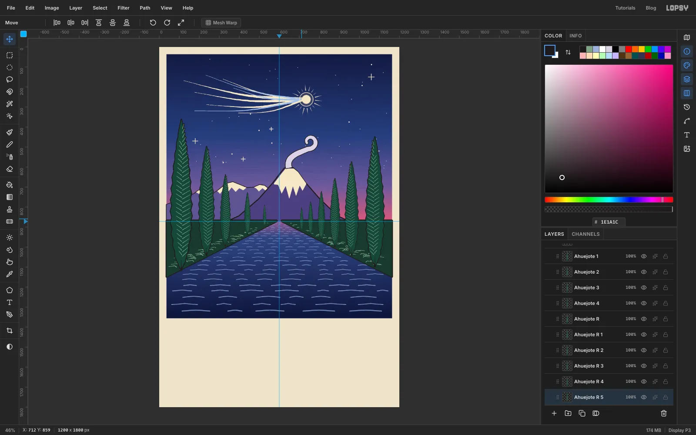

For the right bank, copy *Ahuejote* once more, click *Bank Grass* and paste.
Name it *Ahuejote R*, press [[Cmd+D]] and choose **Image → Flip Horizontal**.
The tree mirrors in place, so the chevrons now lean the other way.
[[Cmd]]-click its thumbnail to select it, [[Cmd]]-drag the **top-right**
handle in until it's about 650 px tall (86% of the master), commit, and drag
it across so its trunk stands at `x 1078` on the right bank.

Copy *Ahuejote R* and paste five copies the same way, again with *Bank Grass*
selected. Their heights, as a share of the original master, are **62%**
(about 470 px, at `x 962`), **45%** (340 px, `x 878`), **32%** (240 px,
`x 810`), **22%** (165 px, `x 756`) and **15%** (115 px, `x 712`). With a
different count and spacing on each side, the scene doesn't look mirrored.

## Block in the trajinera

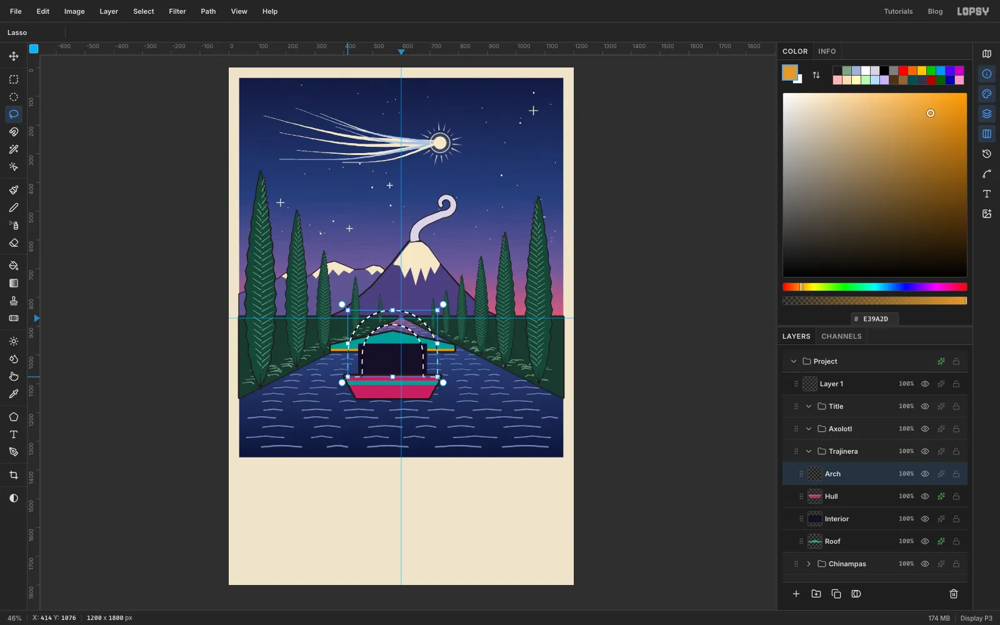

First tidy the trees: click *Ahuejote* and choose **Layer → Merge Down** four
times, then name the result *Left Willows*. Click *Ahuejote R*, merge down
five times and name it *Right Willows*.

The boat is centred at `x 570`, and its waterline is at `y 1150`. Collapse
*Chinampas*, click *Trajinera* and build it from the back to the front:

1. Add a layer named *Roof*. Lasso a low gable from `355, 966` up to
   `570, 918` and down to `785, 966`, then back along `y 986`. Fill it with
   turquoise `#3D9C9A`. With the **Rectangular Marquee**, select `355, 978`
   to `785, 986` and fill a marigold `#E39A2D` trim. Add a **Stroke** of
   **Width** `6` in ink.
2. Add a layer named *Interior*. With the **Rectangular Marquee**, select
   `450, 960` to `690, 1080` and fill it with `#150F26`.
3. Add a layer named *Hull*. Lasso a trapezoid from `402, 1072` and `738, 1072` down to
   `696, 1150` and `444, 1150`, fill it with `#B8325F`, then lasso a band from
   `y 1090` to `1104` across it and fill that turquoise. Add a **Stroke** of
   **Width** `7` in ink, the heaviest outline in the picture, because the boat is
   close.

Then add a layer named *Arch* and lasso the arch the boat is named on. The
outer edge is a half circle of radius 156 around `570, 1000` with legs down
to `y 1076`. The inner edge is a half circle of radius 106 with its own legs.

## Fill the arch

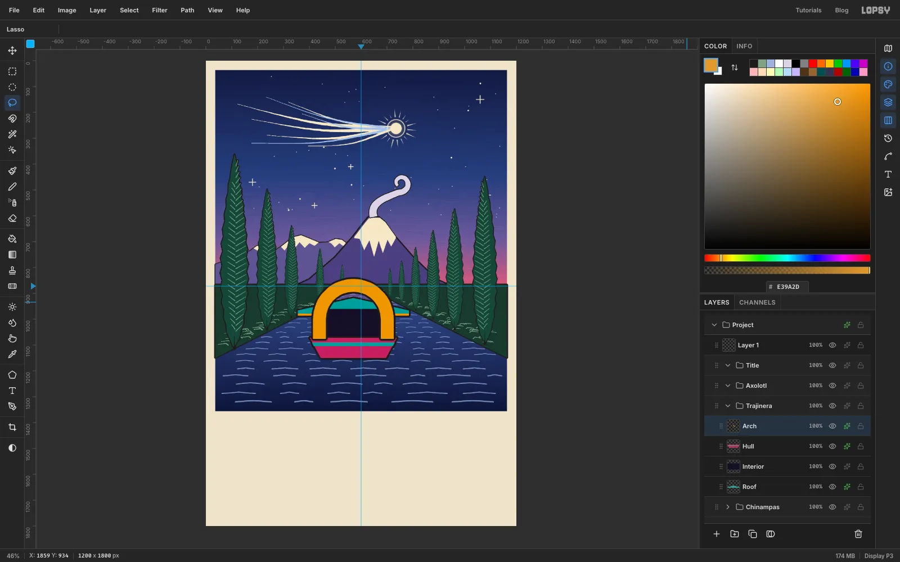

Fill the arch selection with marigold, deselect and give it a **Stroke** of
**Width** `7` in ink.

## Add paper flowers and lanterns

Add a layer named *Flowers*. With the Brush at **Hardness** `100` and
**Taper** `0`, make 11 flowers around the outside of the arch, about 10 px
beyond its edge. For each flower, click six petals of **Size** `13` in a
little ring, then a **Size** `8` marigold dot in the middle. Make the top
one larger. Cycle the petals through rosa `#C2386A`, cream, coral `#E8705A`
and turquoise. Add a **Stroke** of **Width** `2` in ink.

Add a layer named *Lanterns*. The three lanterns are 28 × 36 ovals centred at
`512, 1012`, `570, 976` and `628, 1012`. Pick the **Pencil** at **Size** `2`
with ink as the foreground. For each lantern, click on the inside edge of the
arch straight above it and [[Shift]]-click just above the lantern's top to
draw its string.

Instead of a soft glow, give each lantern two thin carved rings of light,
using `#F6C35C`. For the left lantern, fill a 48 × 56 oval centred on
`512, 1012`, then select a 42 × 50 oval on the same centre and press
[[Delete]]. That leaves a 3 px ring. Do the same with a 62 × 70 oval and a
58 × 66 hole for a thinner outer ring. Repeat for the other two lanterns,
deselect, and finally fill the three lantern ovals themselves.

## Draw an arc with the Pen

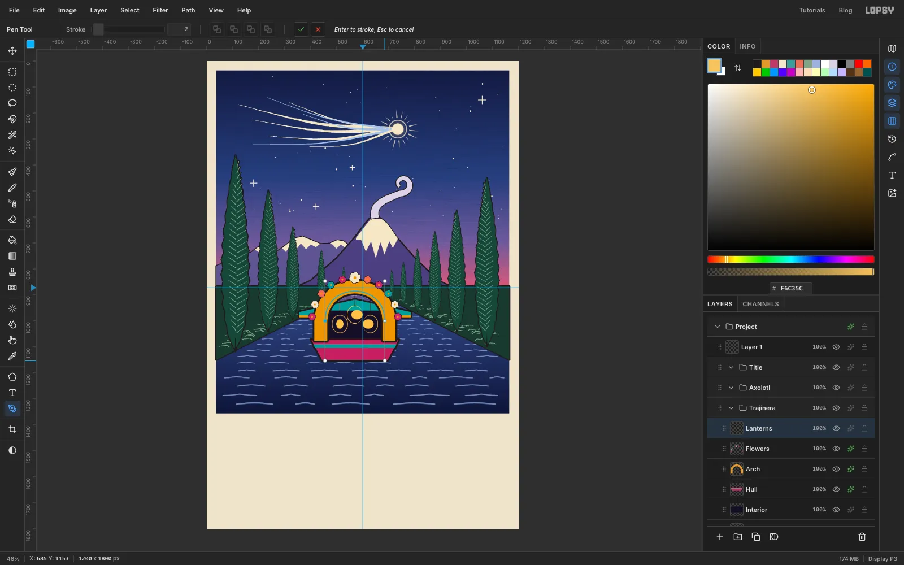

The boat's name will run along the middle of the arch, so draw a path there.
Pick the **Pen** tool:

1. Press at `455, 1000` and drag straight up about 150 px before releasing.
   That pulls out a handle.
2. Press at `685, 1000` and drag straight **down** about 150 px. The handle on
   the other side of the anchor points up, which bends the curve into a half
   circle over the top.
3. Click the **✓ Commit path** button in the options bar.

## Bind the boat's name to the arc

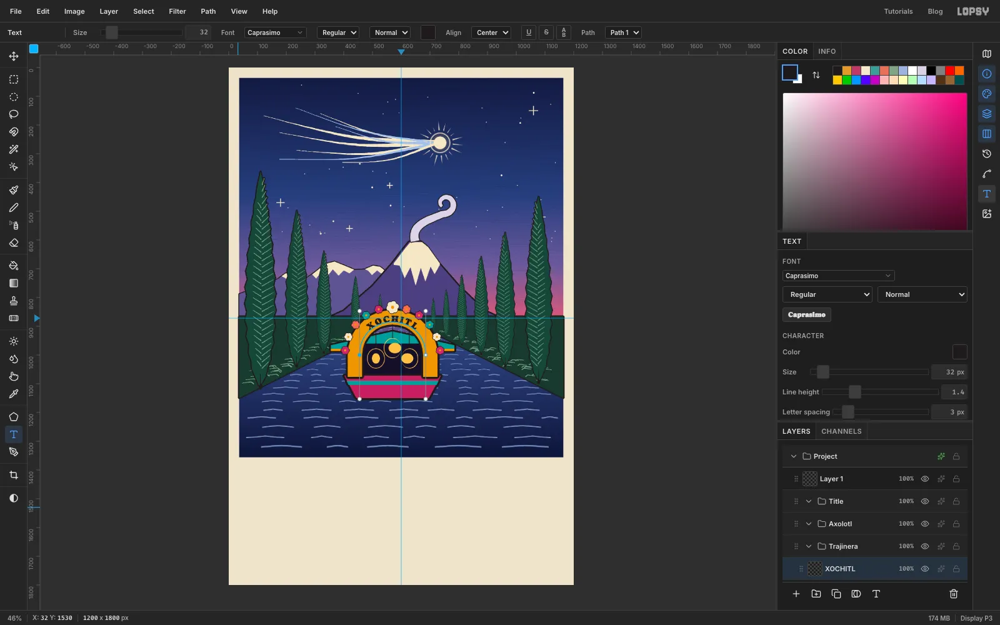

Click *Lanterns* so the text layer is created inside the *Trajinera* group,
right above it. Pick the **Text**
tool, set **Size** `32`, the font **Caprasimo** and the colour ink, then click
in an empty patch of sky and type `XOCHITL`. Click **✓ Commit text**.

In the Text options bar, set **Path** to the arc you just drew and **Align**
to **Center**. Then open the Text panel and set **Letter spacing** to `3`.
The name sits centred on the arch, and the flowers stay clear of it.

## Drop in the axolotl photo

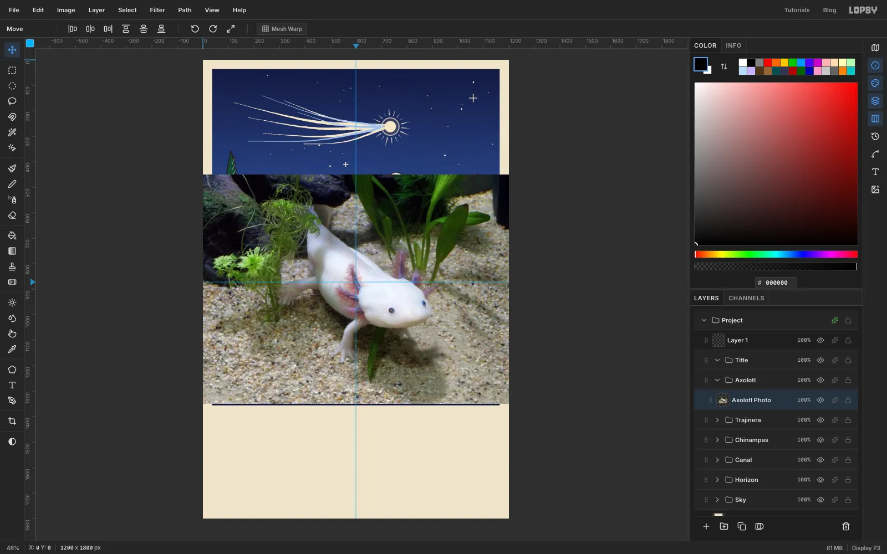

Collapse *Trajinera*, expand *Axolotl* and click it. Drag the axolotl photo
from your desktop onto the canvas. Lopsy scales it to fit the 1200 px width.
Name the layer *Axolotl Photo* and press [[Cmd+D]].

## Cut it out with the Lasso

Trace the axolotl with the **Lasso**: around its tail, the fringed gills on
both sides of the head, the snout, the front leg and the back leg. Leave the
plants and gravel out.

Choose **Select → Inverse**, press [[Delete]] and deselect. Then run
**Filter → Gaussian Blur…** at **Radius** `4`. It looks soft now, but you're
about to throw the detail away, and the blur keeps the shapes from breaking
into specks.

## Threshold a copy into shade shapes

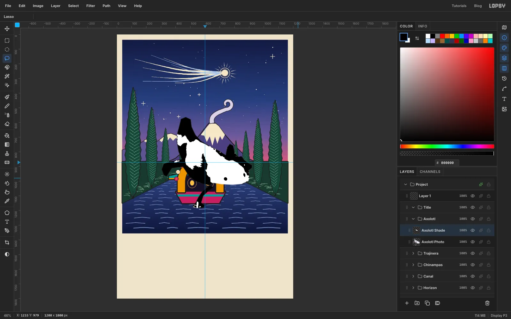

Click the **Duplicate Layer** button at the bottom of the Layers panel and
name the copy *Axolotl Shade*. Choose
**Filter → Desaturate**, then **Filter → Threshold…** with **Level** `164`.
The darker half of the body turns black. Those black shapes are the second
colour block.

## Pick the shade with the Magic Wand

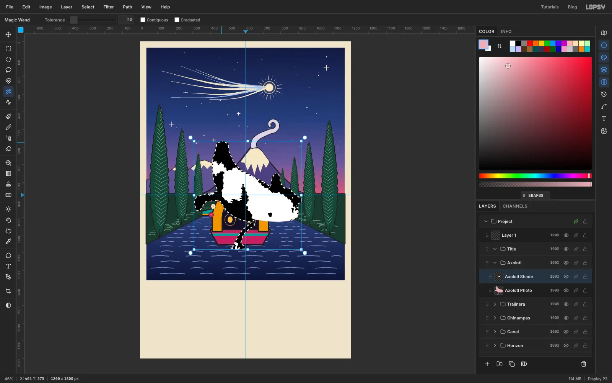

First give the whole silhouette its light colour. Click *Axolotl Photo*,
[[Cmd]]-click its thumbnail to select its outline, fill it with `#EBAFB8` and
deselect.

Now click *Axolotl Shade* and pick the **Magic Wand**. Set **Tolerance** to
`20` and untick **Contiguous**, then click any black area. Every black shape
is selected at once. Click *Axolotl Photo* and fill the selection with the
deeper pink `#D6788E`. Deselect, then delete the *Axolotl Shade* layer.

## Brush the gills and carve the details

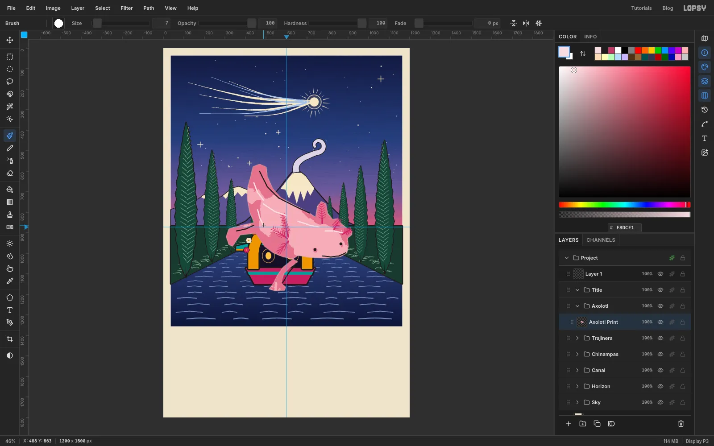

Rename *Axolotl Photo* to *Axolotl Print*. Its gills are feathery fronds, so draw them as
fronds. Set the Brush to **Size** `9`, **Taper** `80` and rosa, and drag three
stalks out from each side of the head. Then switch to **Size** `4` and add
short barbs on both sides of each stalk, like a feather.

Fill two small ink circles of radius `7` for the eyes. With **Size** `6`,
**Taper** `0` and ink, draw the mouth, a line along the spine and a crease on
each leg. Finally switch to `#F8DCE1` at **Size** `7` and gouge five pale
highlights along the back.

## Scale it into the foreground

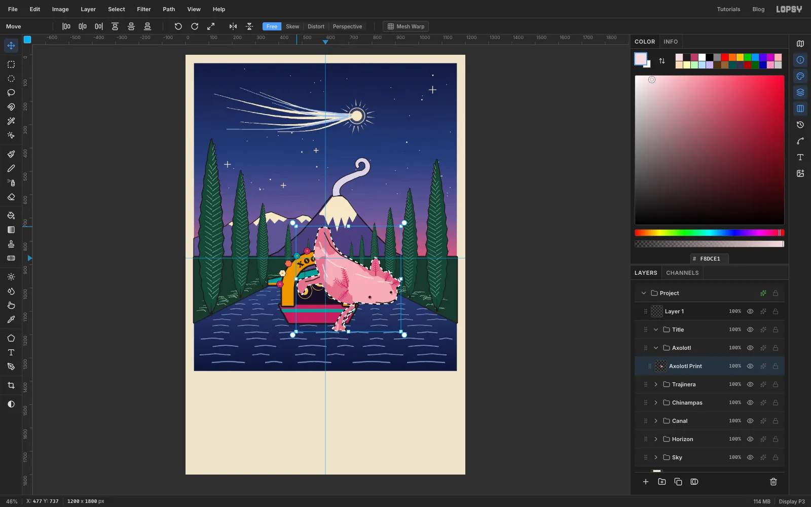

[[Cmd]]-click the *Axolotl Print* thumbnail to select it, and [[Cmd]]-drag the
top-left handle in until it's about 445 px wide (72%). Press [[Cmd+D]], then drag it to the
lower left so its top-left corner is at about `40, 968`. Its tail tucks
against the left willows, and its head faces the boat.

Its feet now hang past the bottom of the panel. Select the panel (`36, 36`
to `1164, 1356`), choose **Select → Shrink…** at `12` (the frame you'll add
later covers those 12 px), then **Select → Inverse**,
press [[Delete]] and deselect. Add a **Stroke** of **Width** `6` in ink.

## Sink it below the waterline

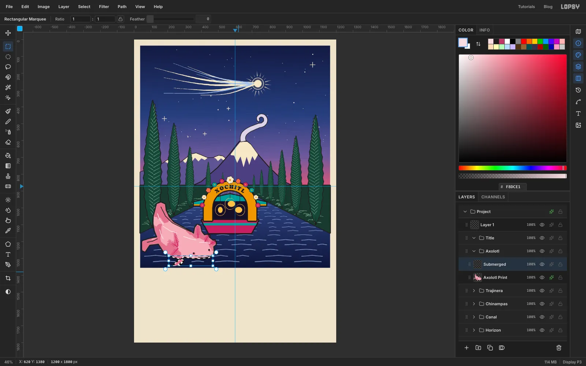

Add a layer named *Submerged*. [[Cmd]]-click the *Axolotl Print* thumbnail,
then pick the **Rectangular Marquee**, hold [[Shift]]+[[Alt]] and drag from
`20, 1284` to well below the bottom of the panel. [[Shift]]+[[Alt]]
*intersects*, so only the part of the axolotl below `y 1284` stays
selected.

Fill it with `#1E2A5E`, deselect and set the layer to **82%**. The belly, feet
and chin now sit under dark water, while the eyes stay above it.

## Run the water over it

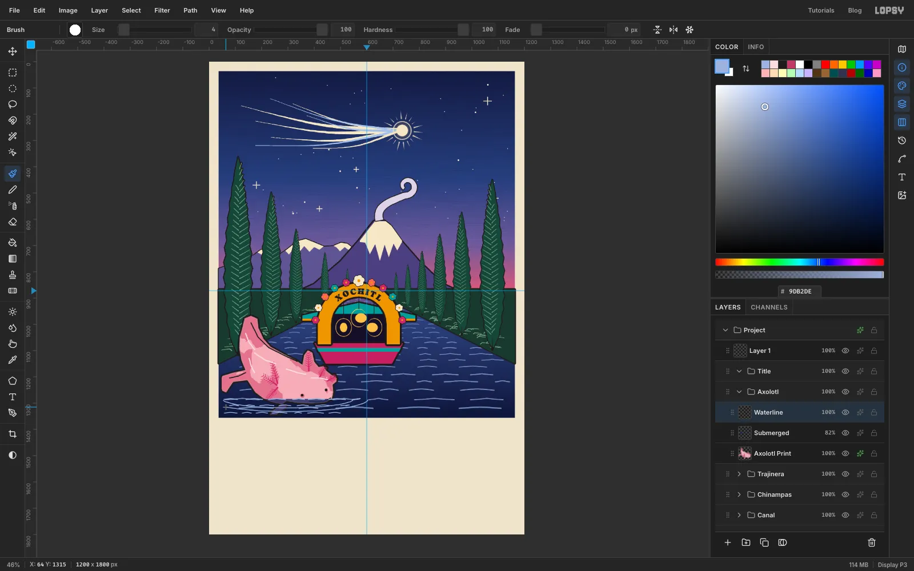

Add a layer named *Waterline* and set the foreground to `#9DB2DE`. With the
Brush at **Taper** `0`, draw rows of dashes across the axolotl and the water
around it at `y 1286` (**Size** `5`), `1310` and `1338` (**Size** `4`).

For ripple rings, draw two arcs at **Size** `4`. Each is the front half of a
flat ellipse centred on `300, 1284`: one about 500 px wide and 34 px deep,
the other about 610 px wide and 48 px deep. They cross over the sunken body.

## Copy the boat for its reflection

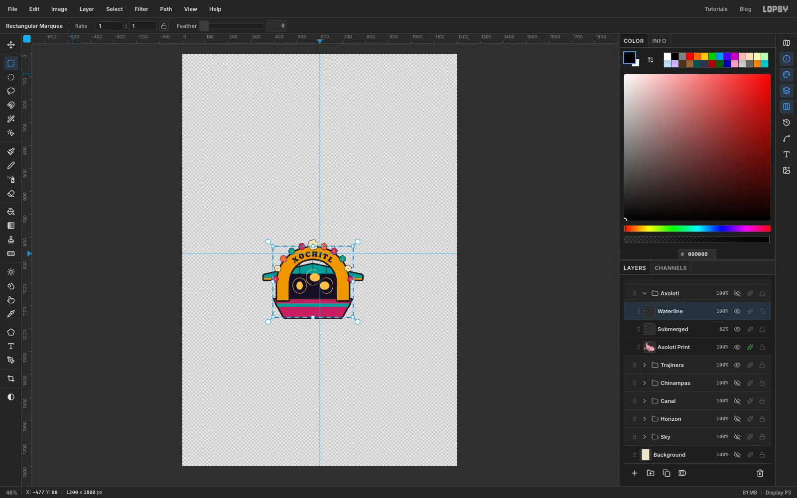

Hide the *Sky*, *Horizon*, *Canal*, *Chinampas* and *Axolotl* groups and the
*Background* layer with their eye icons, so only the boat is showing on a
transparent page. If the cream paper stays visible, it gets copied into the
reflection too. Select from `395, 840` to
`745, 1150` and choose **Edit → Copy Merged**, which copies everything
visible in the selection as one image. Deselect and show the groups again.

## Break the reflection into bands with a mask

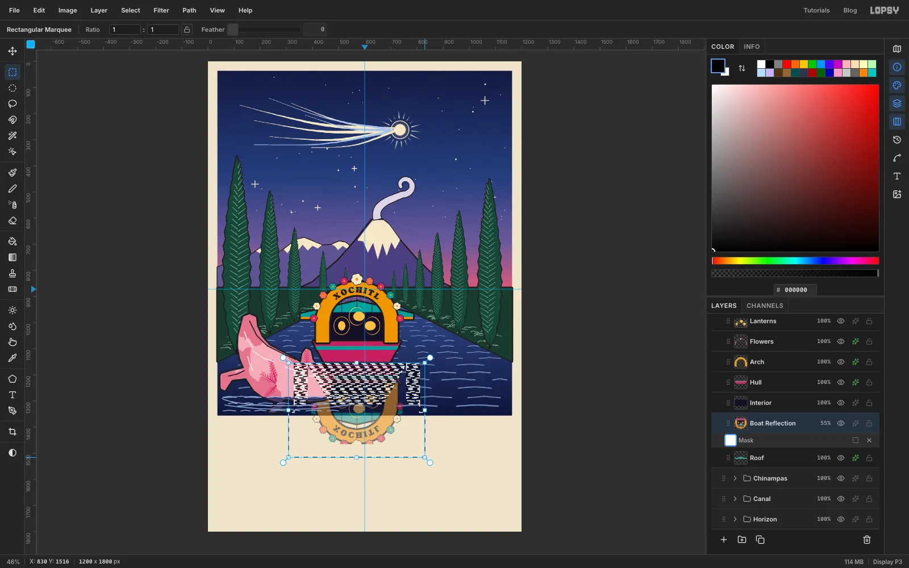

Expand *Trajinera*, click *Roof* and choose **Edit → Paste**, so the
reflection sits behind the boat. Name the layer
*Boat Reflection*, press [[Cmd+D]] and choose **Image → Flip Vertical**. Drag
it down so the upside-down boat hangs from the waterline at `y 1154`. Set
it to **55%**.

A carved reflection is broken into hard bands, not blurred. Click the **Add
Mask** button at the bottom of the Layers panel, then click the new mask
thumbnail on the row to edit the mask.

With the **Rectangular Marquee**, select thin bands across the reflection
from `x 330` to `x 810`. Drag the first from `y 1157` to `1160`. Hold
[[Shift]] and add the next one 11 px lower, and keep going down the
reflection, making each band about half a pixel taller than the last: 20
bands in all, the last one about 13 px tall near `y 1366`.

Still holding [[Shift]], lasso a triangle on each side so the bands narrow
toward the bottom: `380, 1154`, `520, 1400`, `380, 1400` on the left and
`760, 1154`, `760, 1400`, `620, 1400` on the right. Finally Shift-drag a
rectangle over everything below `y 1344`.
Set the foreground to black and fill. Black hides the reflection in the
masked bands. Deselect and click the mask thumbnail again to go back to the
pixels.

## Add the glints

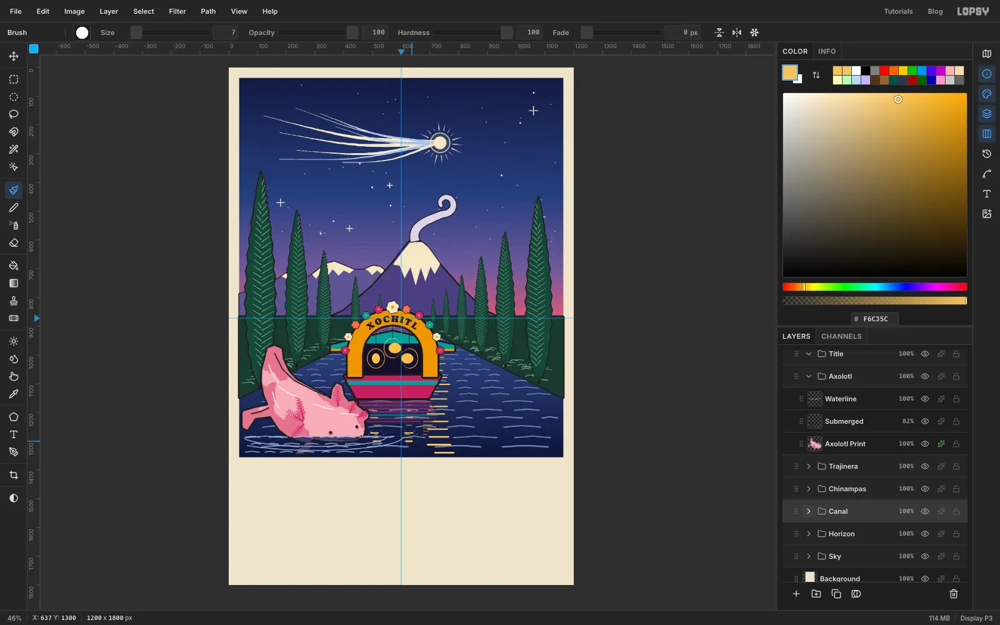

Collapse *Trajinera*, expand *Canal*, click *Ripples* and add a layer named
*Glints*. With the Brush at **Taper** `0`, draw about 18 short horizontal
strokes in `#F2C46A` straight under the comet at `x 735`, from `y 930` down to
`y 1340`. Start at **Size** `3` and about 14 px long, and finish at
**Size** `7` and about 80 px long.

Add six small strokes in `#F6C35C` under each side lantern, at `x 512` and
`x 628`, for the lantern light on the water.

## Frame the picture

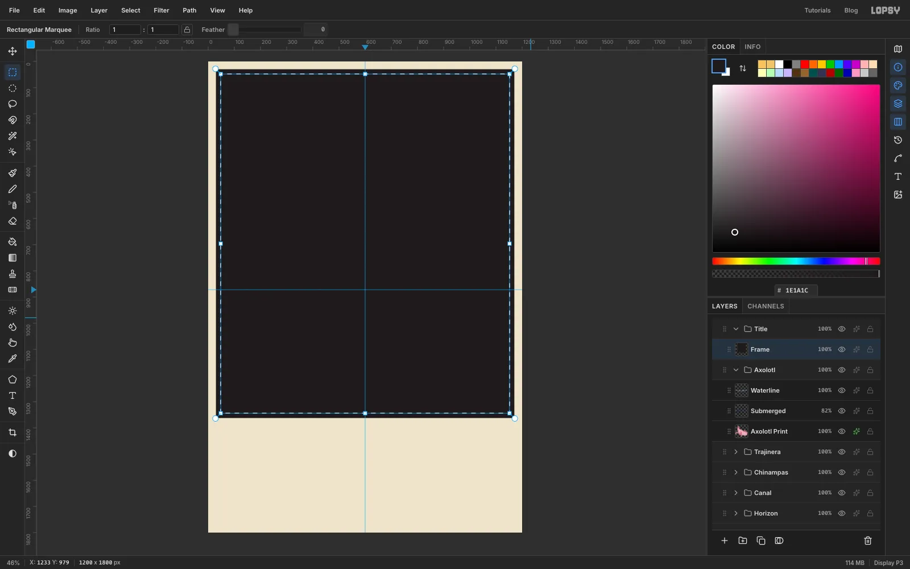

Collapse *Canal*, expand *Title*, click it and add a layer named *Frame*. With
ink as the foreground, select from `30, 30` to `1170, 1362`, 6 px outside the
panel, and fill. Choose **Select → Shrink…** at `18` and press [[Delete]]. You
get an 18 px keyblock frame that also covers any outline poking past the
panel. Deselect.

## Print the title in two plates

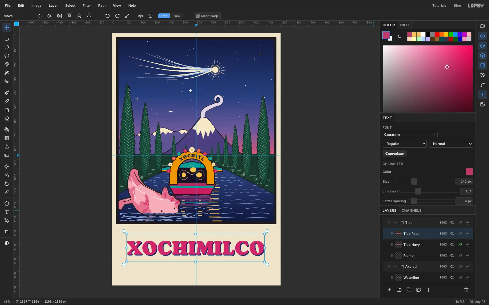

Click *Frame*. Pick the **Text** tool, set **Size** `142`, **Caprasimo** and
rosa `#C2386A`, and check that **Letter spacing** in the Text panel is `0`.
Click in empty sky, type `XOCHIMILCO` and commit. With the **Move** tool and
the arrow keys, centre the word on the `600` guide with its letters around
`y 1537`.

Click **Duplicate Layer** and name the copy *Title Rosa*. Click the original
underneath, turn on **Color Overlay** in its drawer with navy `#1B2A66` and
name it *Title Navy*. Click *Title Rosa* again and nudge it **6** px left and
**6** px up. The navy plate shows along the bottom right edges, like a second
block printed a little off.

## Set the rest of the type

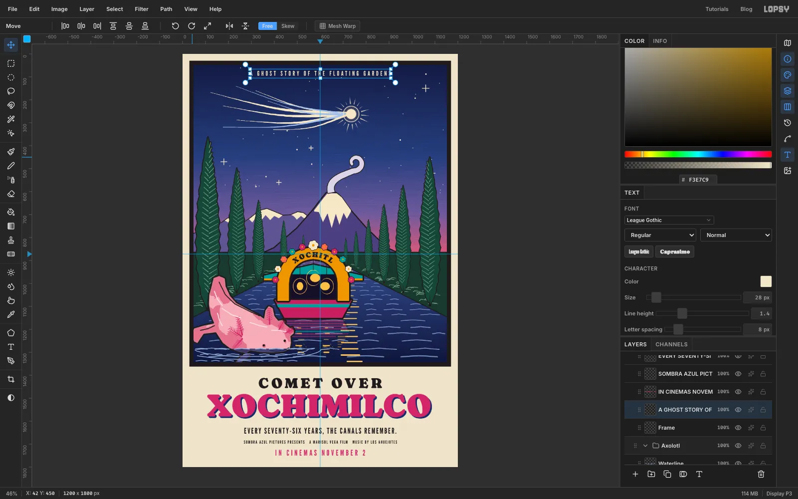

Click *Frame* before each new line, type it in empty sky, commit, then centre
it on the `600` guide with the Move tool and arrow keys. The `y` values are
where the middle of the capitals should sit.

- `COMET OVER`: **Caprasimo** `64`, ink, letter spacing `10`, centred at `y 1433`
- `EVERY SEVENTY-SIX YEARS, THE CANALS REMEMBER.`: **League Gothic** `34`, ink, letter spacing `4`, at `y 1643`
- `SOMBRA AZUL PICTURES PRESENTS   A MARISOL VEGA FILM   MUSIC BY LOS AHUEJOTES` (three spaces between credits): **League Gothic** `19`, ink, letter spacing `3`, at `y 1690`
- `IN CINEMAS NOVEMBER 2`: **League Gothic** `34`, rosa, letter spacing `8`, at `y 1737`
- `A GHOST STORY OF THE FLOATING GARDENS`: **League Gothic** `28`, cream, letter spacing `8`, at `y 84`, inside the top of the frame

Letter spacing carries over from the last text layer you selected, so set it
for every line. The gaps above *COMET OVER* and below the release line come
out about the same, around 55 px, which keeps the block from sinking.

## Add paper fibres, baren mottle, plank grain and ink specks

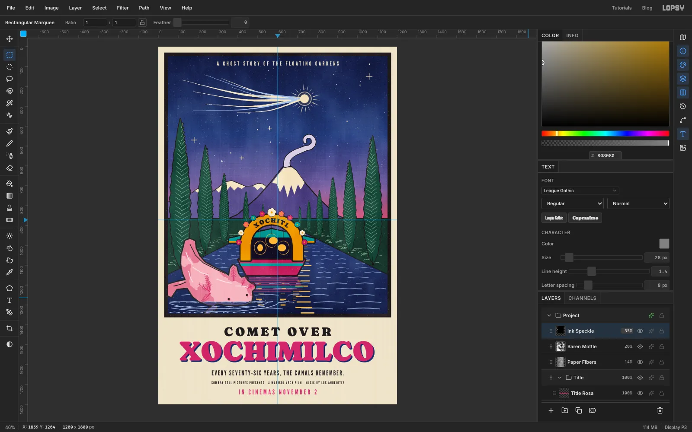

Four texture layers finish the print:

1. **Paper fibres**: click the empty *Layer 1* at the top, name it *Paper
   Fibers*, fill it with `#808080` and run **Filter → Fibers…** with
   **Variance** `24` and **Strength** `40`. Set it to **Overlay** at **14%**.
2. **Baren mottle**: add a layer named *Baren Mottle*, select the panel, fill
   it with grey and run **Filter → Clouds…** at **Scale** `9`. Deselect and
   set it to **Soft Light** at **20%**. It mimics the uneven pressure of a
   printer's baren.
3. **Plank grain**: expand *Axolotl*, click *Waterline* and add a layer named
   *Plank Grain*. Select the panel, fill it with grey, and repeat the sky
   grain: **Add Noise** `100` (Mono, Gaussian), **Motion Blur** angle `0`
   distance `100` and **Brightness/Contrast** with **Contrast** `100`.
   Deselect and set it to **Overlay** at **30%**, so the grain runs across
   every colour block in the picture.
4. **Ink specks**: click *Baren Mottle* and add a layer named *Ink Speckle*.
   Fill it with grey, run **Add Noise** `100` (Mono, Uniform), **Gaussian
   Blur** `1` and **Threshold** at `175`, so only a sprinkle of white flecks
   is left. Select the panel, choose **Select → Inverse** and press
   [[Delete]], so the type stays clean. Set it to **Screen** at **35%**. The
   flecks show up on the dark ink like spots the roller missed.

Choose **File → Save Project** to keep the layers, and **File → Quick Export
PNG** for the finished poster.
