A woodcut is printed from a plank. Everything you want to stay white is cut away, the wood that's left is rolled with ink, and the paper is pressed on top. That's why woodcuts look the way they do:

- big flat areas of solid ink, with detail carved out as white lines
- short, straight hatch marks instead of smooth shading
- a second colour printed from a second block, which never lines up perfectly with the first
- thin scratches where the grain of the wood didn't take the ink

This invitation to a harvest barn dance uses all four. It's 1500 × 2100 px (5 × 7 inches at 300 dpi) and uses two inks on cream paper. Nothing is imported. The fiddle is drawn from scratch, starting with half a body made with the Pen tool.

The tools you'll use:

- the **Pen** tool, **Path to Selection**, copy and paste, and **Flip Horizontal** to mirror half a shape
- the **Lasso**, the two **Marquees** and **Edit → Fill** for flat shapes, with **Select → Shrink…** and **Grow…** for rings and outlines
- [[Shift]]+[[Alt]]-dragging a marquee to **intersect** two selections
- the **Brush** with **Symmetry**, and the **Pencil** with [[Shift]]-click for straight lines
- **Filter → Sunburst…**, **Texture…** and **Threshold…**, including on a **layer mask**
- groups, and the **Move** tool's scale and rotate handles on a whole group
- the **Stroke** layer effect
- live text in **Rye**, **IM Fell English** and **IM Fell English SC**

The palette is one black, one red and the paper:

- Paper `#EDE3CB`
- Black ink `#17130F`
- Barn red `#B5281C`

> **Tip:** On a wide-gamut (Display P3) screen, Lopsy reads typed hex codes as P3 colours, so the red looks a little hotter than it does on an sRGB screen.

> **Note:** Shortcuts are written for a Mac. On Windows use [[Ctrl]] for the keyboard shortcuts and thumbnail clicks. The keep-it-square and keep-proportions drags use the [[Cmd]] / Windows key itself. Positions are given as x, y in document pixels. Read them off the rulers, or watch the X / Y readout in the status bar as you move the pointer. They're there so your result matches the screenshots. A few pixels either way won't hurt.

## Lay down the paper

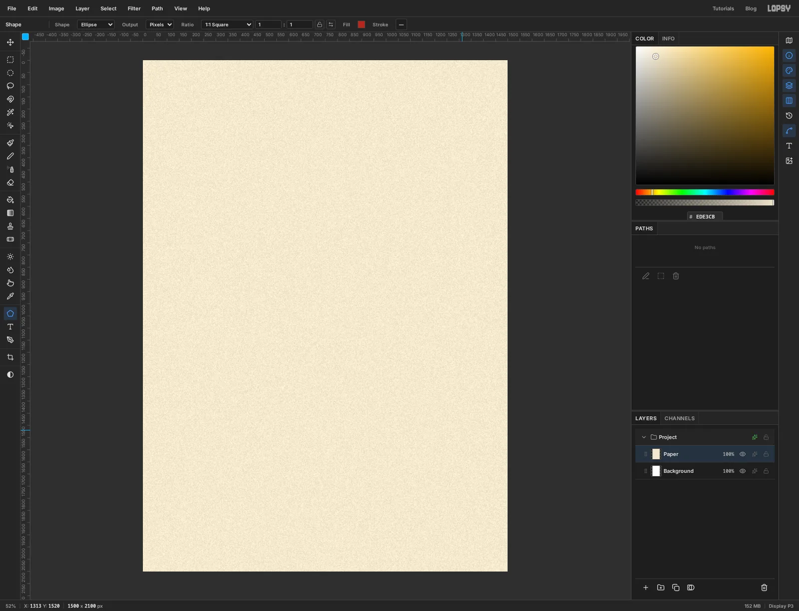

Choose **File → New**, keep the units on **Pixels**, and make the document **1500** wide and **2100** high.

Click *Layer 1*, double-click its name and rename it *Paper*. Set the foreground colour to `#EDE3CB` and choose **Edit → Fill**.

Flat cream looks like a screen, not a sheet of paper. Choose **Filter → Texture…**, set **Type** to **Rough**, **Amount 14**, **Size 4** and **Detail 70**, and click **Apply**. That gives the sheet a soft, fibrous tooth.

## Ink a black block for the sky

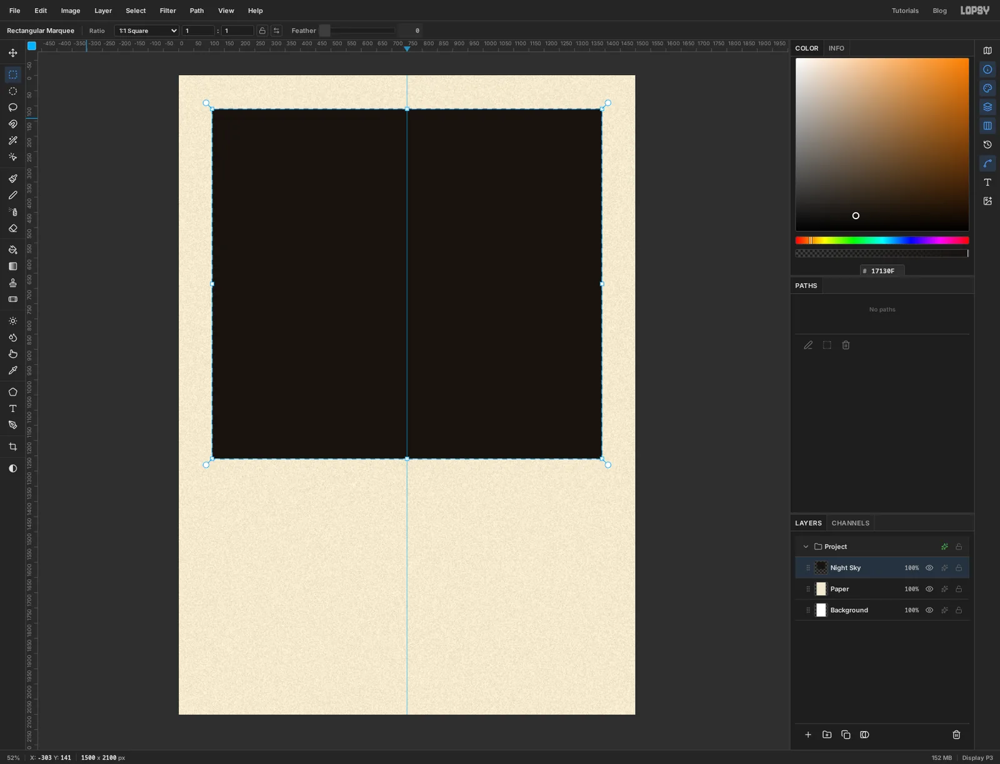

The card is symmetrical, so start with a centre line. Hold [[Cmd]] and click the top ruler near the middle. The guide snaps to exactly half way, at x 750.

Click **Add Layer** and name the layer *Night Sky*. Pick the **Rectangular Marquee** and drag a block that fills the top half of the card, leaving an even margin of about 110 px at the top and sides. Mine runs from **110, 110** to **1390, 1260**. Set the foreground to `#17130F` and choose **Edit → Fill**. Keep the selection.

## Carve the rays with Sunburst

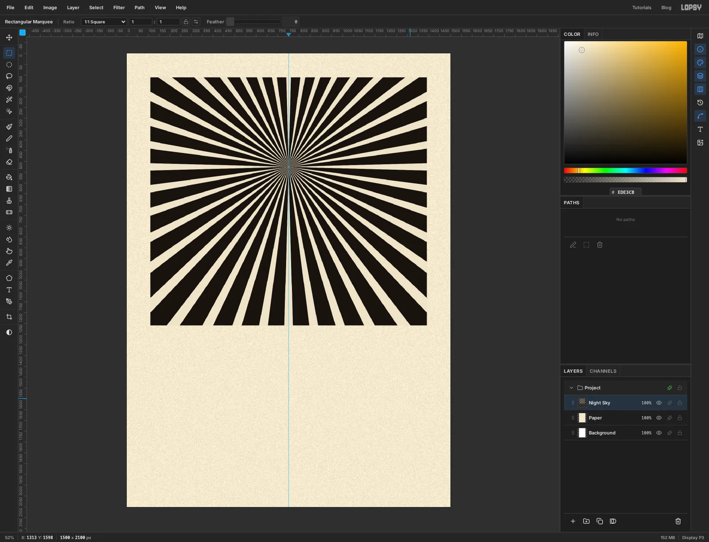

A carver would gouge the rays out of the block so the paper shows through. The Sunburst filter paints rays in the foreground colour, so set the foreground back to the paper colour, `#EDE3CB`.

Choose **Filter → Sunburst…** and set:

- **Rays 40**
- **Width 34**
- **Center Y 25**, so the rays start a quarter of the way down the card, where the moon will go
- **Jitter 30** and **Seed 7**, so the rays aren't all the same length

Click **Apply**. Because the block was still selected, the rays stop at its edges. Deselect with [[Cmd+D]].

## Cut a keyline ring for the moon

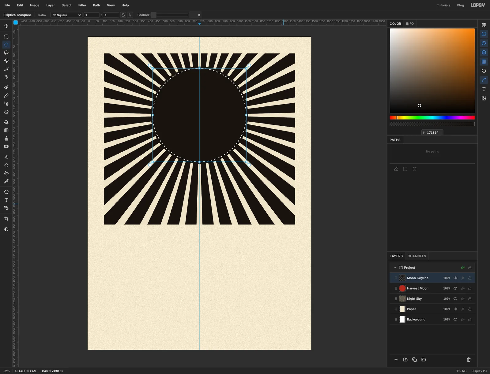

The moon is printed in red from a second block, and the black block carries a ring around it. Do the red first. Add a layer called *Harvest Moon*. Pick the **Elliptical Marquee**, hold [[Cmd]] to keep it round, and drag a circle about 630 px across around the point the rays come from (**750, 525**). Mine runs from **435, 210** to **1065, 840**. Fill it with `#B5281C` and deselect.

Add another layer called *Moon Keyline*. Drag a slightly bigger circle around the same centre, about 650 px across (from **424, 199** to **1076, 851**), and fill it with black `#17130F`. Then choose **Select → Shrink…**, enter **12** and click **Apply**. The selection is now 12 px inside the edge of the black disc, as in the screenshot.

## Knock the red out of register

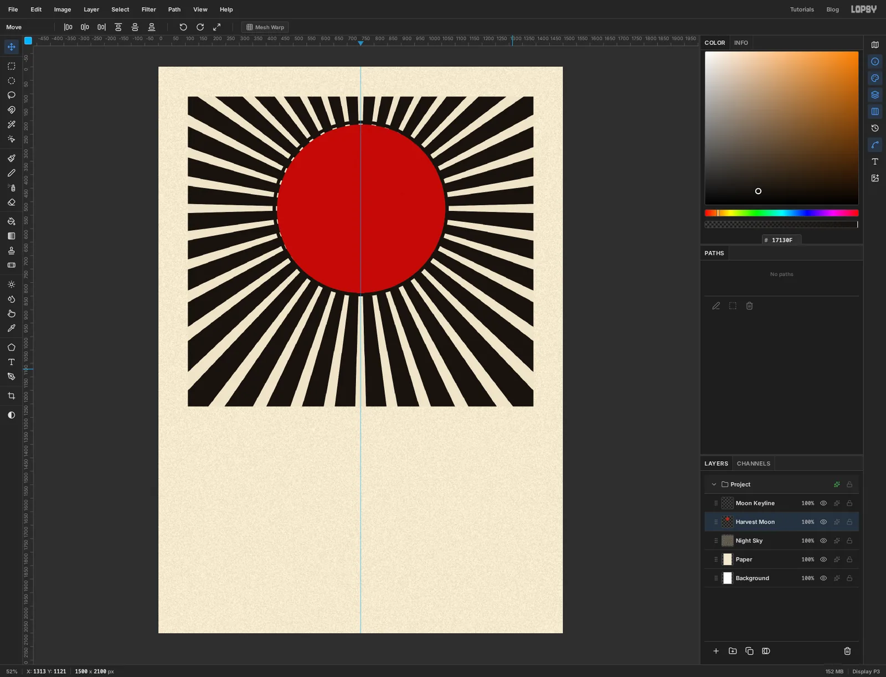

Press [[Delete]] to clear the middle of the black disc. That leaves a 12 px ring. Deselect.

On a real two-block print the colours are never quite lined up. Click *Harvest Moon*, pick the **Move** tool and tap [[→]] five times and [[↓]] four times. The red slides down and to the right under the ring. A thin crescent of bare paper opens at the upper left, and the red tucks under the ring on the other side.

## Draw half a fiddle with the Pen

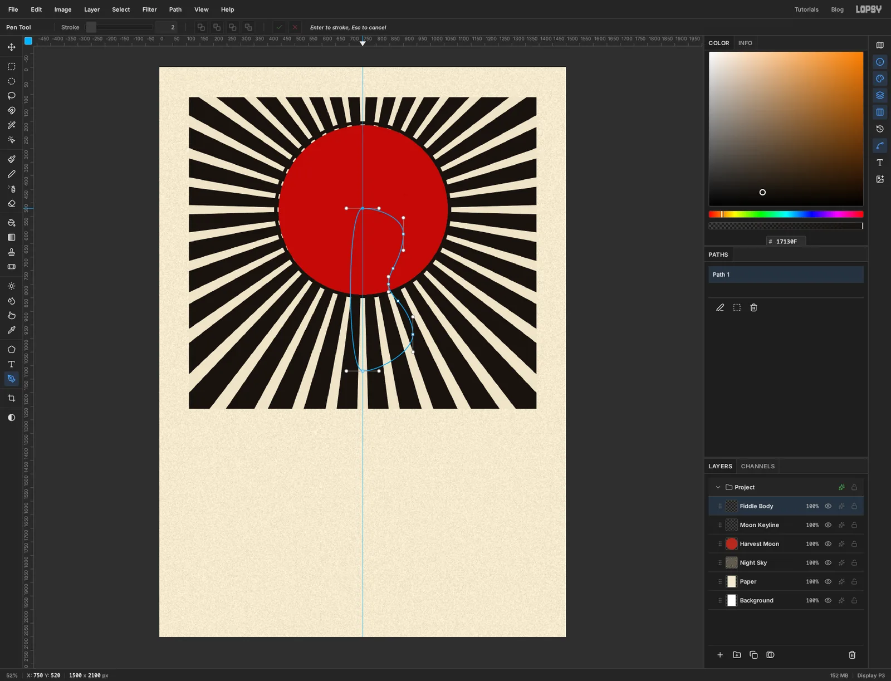

A fiddle is symmetrical, so you only need to draw half of it. Add a layer called *Fiddle Body*, pick the **Pen** tool, and work down the right-hand side of the centre guide. Click to place a corner. Press and drag to place a smooth anchor, pulling the handle in the direction the curve should leave.

1. Press on the guide at **750, 520** and drag right about 60 px. This is the top of the body.
2. Press at **900, 615** and drag straight down 60 px. This is the widest point of the upper bout.
3. Click at **862, 742**. This is a sharp corner where the waist begins.
4. Press at **845, 800** and drag down about 30 px for the narrowest part of the waist.
5. Click at **880, 862** for the lower corner.
6. Press at **935, 985** and drag down 65 px for the widest point of the lower bout.
7. Press on the guide at **750, 1120** and drag left 60 px for the bottom.
8. Click the first anchor again to close the path.

Don't worry about the closing side bulging a little past the guide. It gets covered in the next step.

Open the **Paths** panel and click **Path to Selection**. Set the foreground to `#EDE3CB` and choose **Edit → Fill**. Then click **Delete Path** so the blue outline is out of the way, and deselect.

## Mirror the half to finish the body

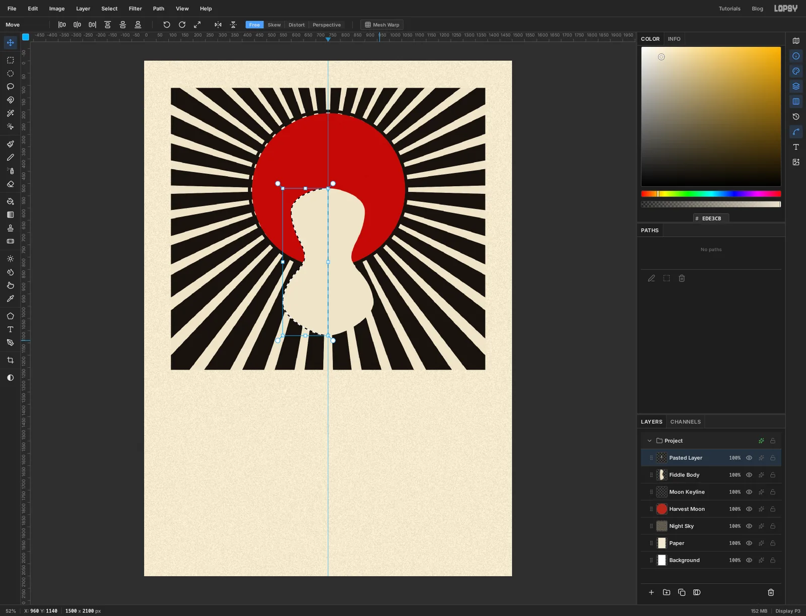

Pick the **Rectangular Marquee** and drag a box around the half body, starting on the centre guide. The edge snaps to the guide, so the box holds only what's to the right of x 750. Press [[Cmd+C]] and then [[Cmd+V]]. The copy arrives on a new layer, exactly on top of the original.

Now flip the copy across the middle of the card. Press [[Cmd+A]] to select the whole canvas, pick the **Move** tool and click **Flip Horizontal** in the options bar. Because the selection is the whole canvas, the flip happens around the canvas centre, which is the guide. The copy lands as a perfect mirror image on the left.

Deselect, then press [[Cmd+E]] to merge the pasted layer down into *Fiddle Body*.

> **Note:** The flip buttons only appear in the Move options bar while there's a selection. If you don't see them, check that [[Cmd+A]] took.

## Inlay the purfling

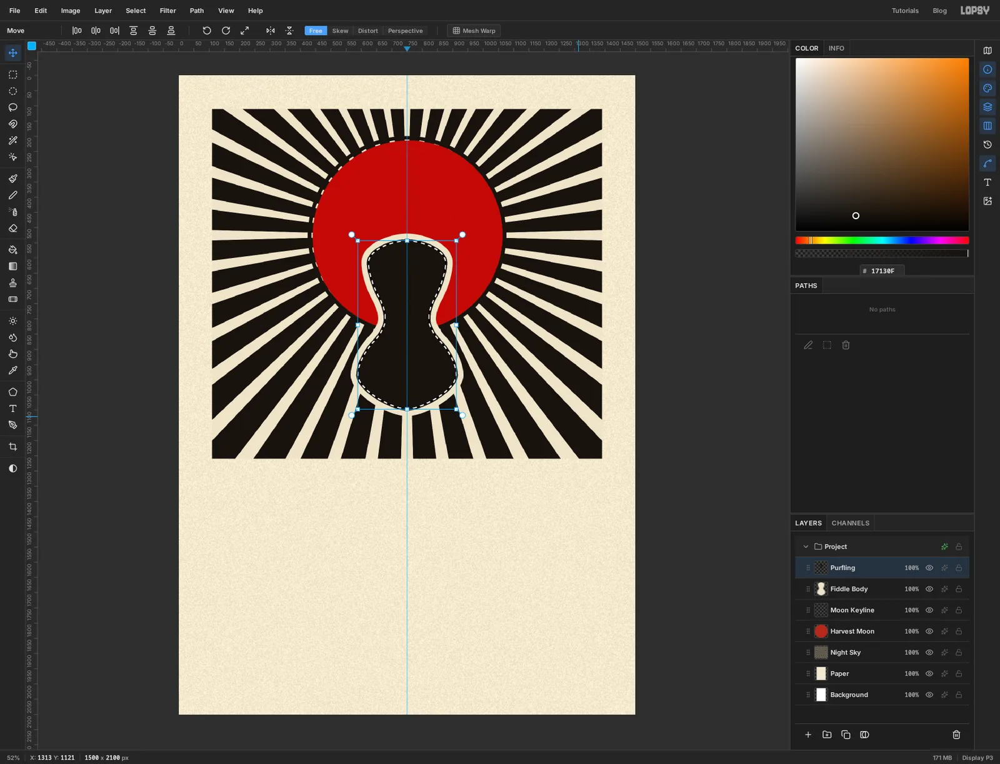

Purfling is the thin dark line that runs just inside the edge of a violin. Hold [[Cmd]] and click the *Fiddle Body* thumbnail in the Layers panel to select the body's shape. Choose **Select → Shrink…** at **18**.

Add a layer called *Purfling* and fill the selection with black `#17130F`. It looks alarming for a moment, as in the screenshot. Choose **Select → Shrink…** again at **5** and press [[Delete]]. What's left is a 5 px line that follows the outline all the way round. Deselect.

## Add the neck, scroll and pegs

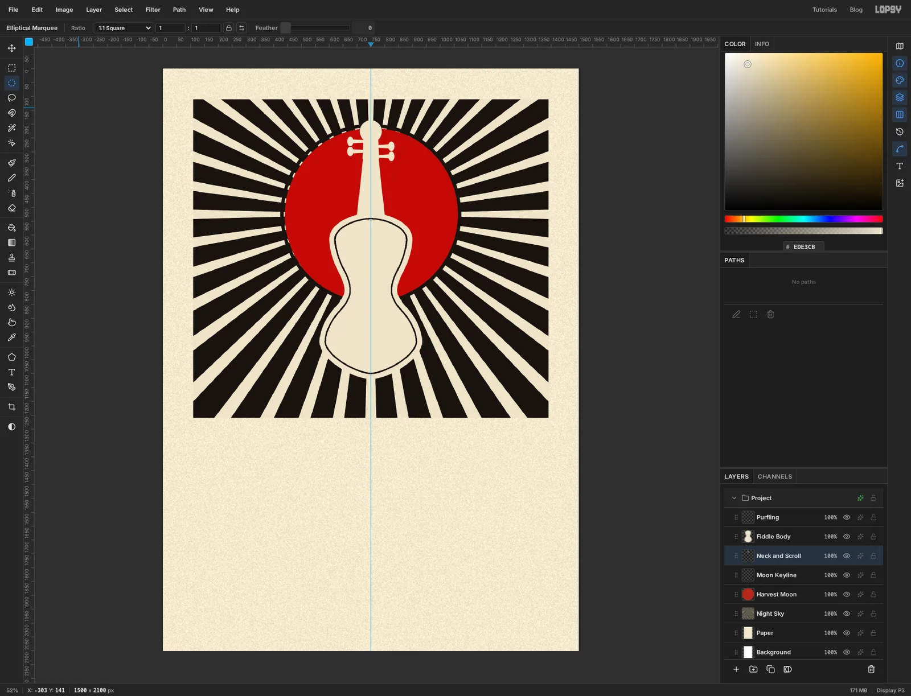

The neck goes behind the body. Click *Moon Keyline*, then **Add Layer** and name the new layer *Neck and Scroll*. It lands just above the moon and below the body.

Set the foreground to `#EDE3CB`. Each part is a selection filled with **Edit → Fill**. For the straight-sided ones, pick the **Lasso** and drag from corner to corner in straight runs, finishing back where you started. Press [[Cmd+D]] after each fill, or the next drag will move the old selection instead of starting a new one.

- **The neck:** a tall, tapering strip centred on the guide. Its corners are **722, 322** and **778, 322** at the top and **800, 530** and **700, 530** at the bottom, where it disappears under the body.
- **The pegbox:** a box about 54 px wide above the neck, from y 236 to y 326.
- **The scroll:** an 80 px circle centred on **750, 226**, sitting on top of the pegbox. Use the **Elliptical Marquee**.
- **Four pegs:** two sticking out to the left at y 262 and y 298, and two to the right at y 280 and y 316. Each is a tapering shaft about 40 px long and 12 px thick, with an upright oval about 22 × 34 px on the end for the grip.

Keep the shapes simple and slightly uneven. A woodcut is carved with a knife, so nothing should look machine-made.

## Fit the black parts

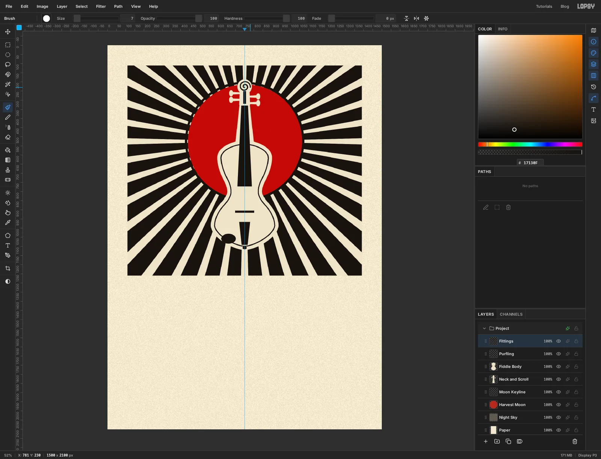

Click *Purfling* and add a layer above it called *Fittings*. Switch the foreground to black `#17130F` and fill these shapes the same way, with the **Lasso** for the tapered ones, the **Rectangular Marquee** for the boxes and the **Elliptical Marquee** for the ovals. Keep them centred on the guide:

- **The fingerboard:** a long strip from just under the pegbox (y 330) down to about y 772, 36 px wide at the top and 80 px wide at the bottom.
- **The pegbox slot:** a 16 px wide rectangle up the middle of the pegbox, from y 250 to y 320.
- **The bridge:** a thin bar about 104 × 12 px across the body at y 904.
- **The tailpiece:** a wedge from y 966 to y 1092 that's 60 px wide at the top and narrows towards the bottom edge.
- **The chinrest:** an oval about 80 × 54 px at the lower left of the body, centred near **662, 1058**.
- **The end button:** a tiny oval where the tailpiece meets the bottom edge.

For the scroll, pick the **Brush**, set **Size 7** and **Hardness 100**, and draw a spiral outwards from the centre of the circle in one stroke, about two turns.

## Paint both f-holes at once

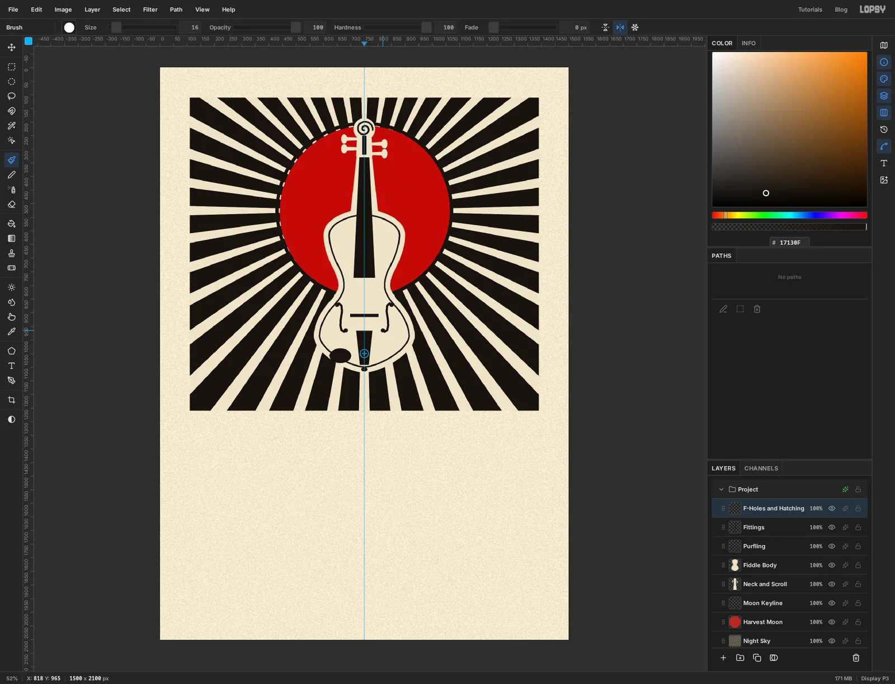

Add a layer called *F-Holes and Hatching*. With the **Brush** still selected, set **Size 9** and click **Symmetry Vertical** in the options bar. A ringed crosshair appears at the canvas centre. Whatever you paint on one side of it is mirrored on the other.

On the right-hand side of the body, level with the bridge, draw a slim S about 100 px tall, starting with a small hook at the top right (around **852, 872**) and finishing with a hook at the bottom left (around **816, 964**). The left f-hole draws itself as you go. Set **Size 16** and click once on each end of the S to give it the round notches of a real f-hole.

## Hatch the shading

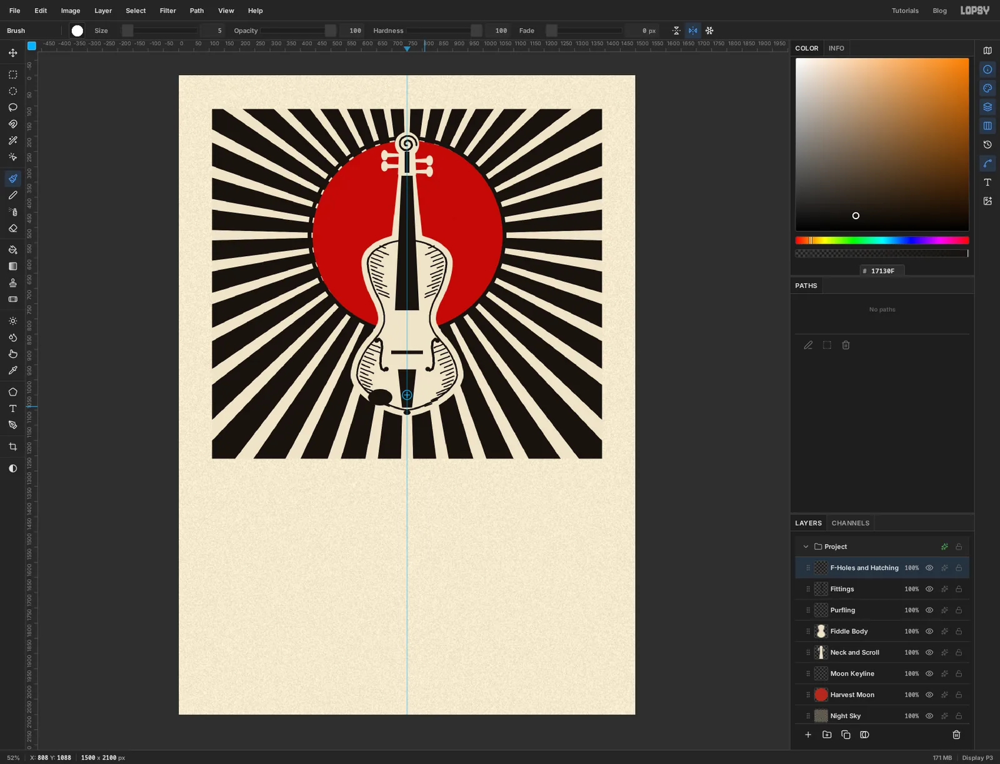

Leave symmetry on and set **Size 5**. Shade the body the way a carver would, with rows of short cuts. Work down the inside of the right-hand edge of the upper bout, then the lower bout. Each mark starts about 12 px inside the purfling line and runs 20 to 40 px towards the middle, tilted slightly downhill. Space them about 13 px apart and vary the lengths. Leave the waist clear.

When you're done, click **Symmetry Vertical** again to turn it off.

## String it

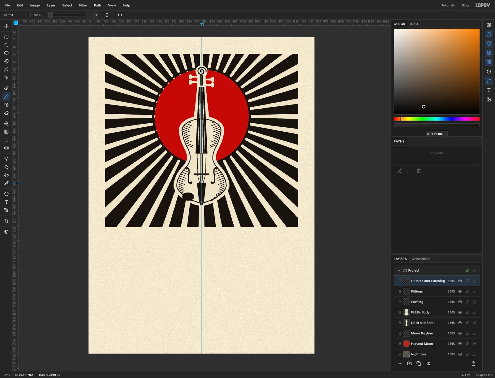

Stay on *F-Holes and Hatching*. Pick the **Pencil** and set **Size 3**. After one click, a [[Shift]]-click draws a straight line from the last point.

Each string is cream where it crosses the black fingerboard and black where it crosses the cream body. For each of the four strings:

1. Set the foreground to `#EDE3CB`. Click at the top of the fingerboard, then [[Shift]]-click at its bottom edge.
2. Set the foreground to `#17130F`. Click the same spot at the bottom of the fingerboard, [[Shift]]-click on the bridge, then [[Shift]]-click on the top of the tailpiece.

The strings start 6 px apart at the top (x 741 to x 759), fan out to about 19 px apart at the bridge (x 722 to x 778), and pinch back in to 8 px apart at the tailpiece.

## Group the fiddle and scale it up

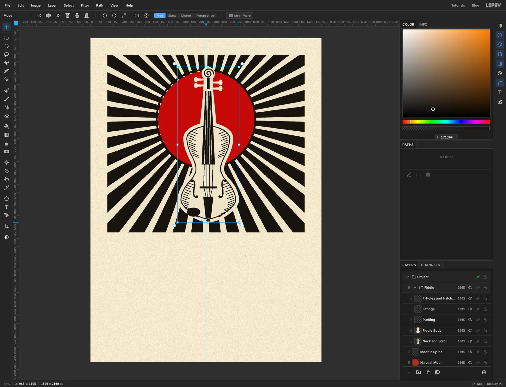

Click *F-Holes and Hatching* at the top of the stack, then [[Shift]]-click *Neck and Scroll* to select all five fiddle layers. Choose **Layer → Group Layers**, double-click the new group's name and call it *Fiddle*.

With the group selected and nothing marquee-selected, pick the **Move** tool. The handles wrap the whole instrument. Hold [[Cmd]] to keep the proportions and drag the bottom-right handle outwards by about 30 px to make the fiddle roughly 8% bigger. Press [[Cmd+D]] to commit.

## Lean it over

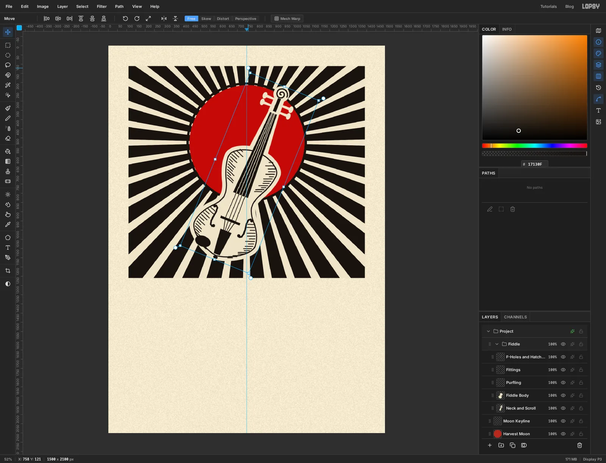

Click the *Fiddle* group again. Move the pointer just outside the top-left corner of the box, where the round rotate handle is, and drag clockwise until the fiddle leans about 22° to the right. All five layers turn together. Press [[Cmd+D]] to commit.

Then drag from the middle of the body to slide the whole group about 45 px right and 20 px down, so the body sits low in the block and the scroll crosses the edge of the moon.

## Cut a black outline around it

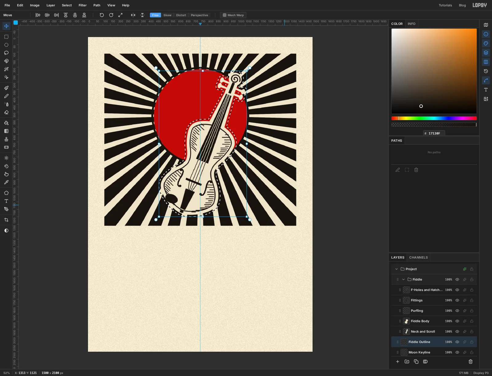

The cream fiddle disappears wherever it crosses a cream ray. On a woodcut, a line of black would be left standing around it. Groups don't take layer effects, so build the outline from a selection.

Click *Moon Keyline* and add a layer called *Fiddle Outline*. It sits under the group. Hold [[Cmd]] and click the *Fiddle Body* thumbnail, then hold [[Cmd+Shift]] and click the *Neck and Scroll* thumbnail to add it. Choose **Select → Grow…** at **12**, fill with black `#17130F` and deselect.

## Raise a hill with two selections

The fiddle needs ground to stand on. Click *Moon Keyline* and add a layer called *Hill*.

Hold [[Cmd]] and click the *Night Sky* thumbnail to select the block. Now switch to the **Elliptical Marquee**, hold [[Shift]]+[[Alt]] and drag a very large, flat ellipse whose top edge crosses the block about 160 px above its bottom edge. Start the drag in the grey area below and to the right of the canvas and finish above and to the left. Mine runs from **1950, 2180** to **-450, 1100**. It's fine for most of it to hang off the edges. Holding both keys keeps only the part where the two selections overlap, which is a low mound with square bottom corners.

Fill it with black `#17130F` and deselect.

## Plough the furrows

Pick the **Brush**, set the foreground to `#EDE3CB`, **Size 5** and **Hardness 100**. Draw three long lines across the hill from one side of the block to the other, each one following the curve of the hilltop and a little lower than the last. Slightly wobbly lines look better here than perfect ones.

## Build the barn

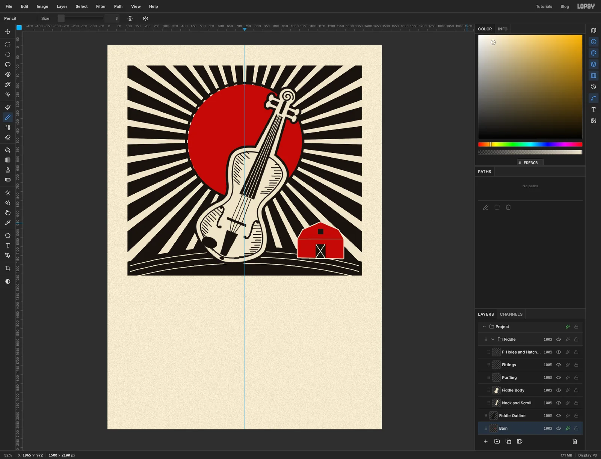

Add a layer called *Barn* above *Hill*. A gambrel roof has two slopes on each side, so the barn's outline has seven corners. With the **Lasso**, drag from corner to corner: up the left wall from **1040, 1160** to the eaves at **1040, 1060**, in to **1068, 1010**, up to the ridge at **1165, 968**, down to **1262, 1010** and **1290, 1060**, down the right wall to **1290, 1166**, and back along the base. The base is sunk slightly into the hill. Fill it with `#B5281C` and deselect.

With the **Rectangular Marquee**, fill a black door about 54 × 76 px in the middle of the wall, reaching the base, and a 30 px black square for the hayloft under the ridge. With the **Pencil** at **Size 3** and the cream foreground, click and [[Shift]]-click to draw an X across the door and a line across the wall at eaves height.

Click the sparkle button on the *Barn* row to open its effects, tick **Stroke**, and set **Width 5** with the stroke colour `#EDE3CB`. The cream line separates the red from the black hill and the rays.

## Lay the bow across the strings

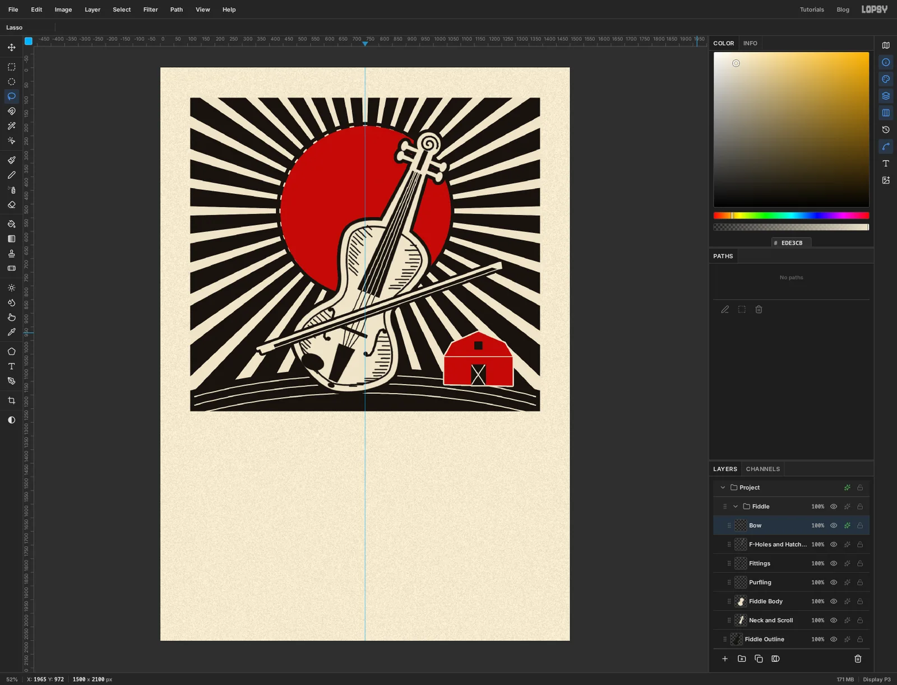

Click *F-Holes and Hatching* inside the *Fiddle* group and add a layer called *Bow*. It lands at the top of the group.

Pick the **Brush** with the cream foreground and **Hardness 100**:

1. **The stick:** set **Size 12**. Click to the lower left of the fiddle, then [[Shift]]-click to the upper right, so the line crosses the strings between the end of the fingerboard and the bridge. Mine is about 940 px long and rises to the right.
2. **The hair:** set **Size 4** and draw a second line parallel to the first, about 18 px below it.
3. **The frog and tip:** with the **Lasso**, fill a small block joining stick and hair at the lower-left end, and a small wedge joining them at the upper-right end.

Open the *Bow* layer's effects, tick **Stroke**, and set **Width 9** in black `#17130F`.

## Rule the double border

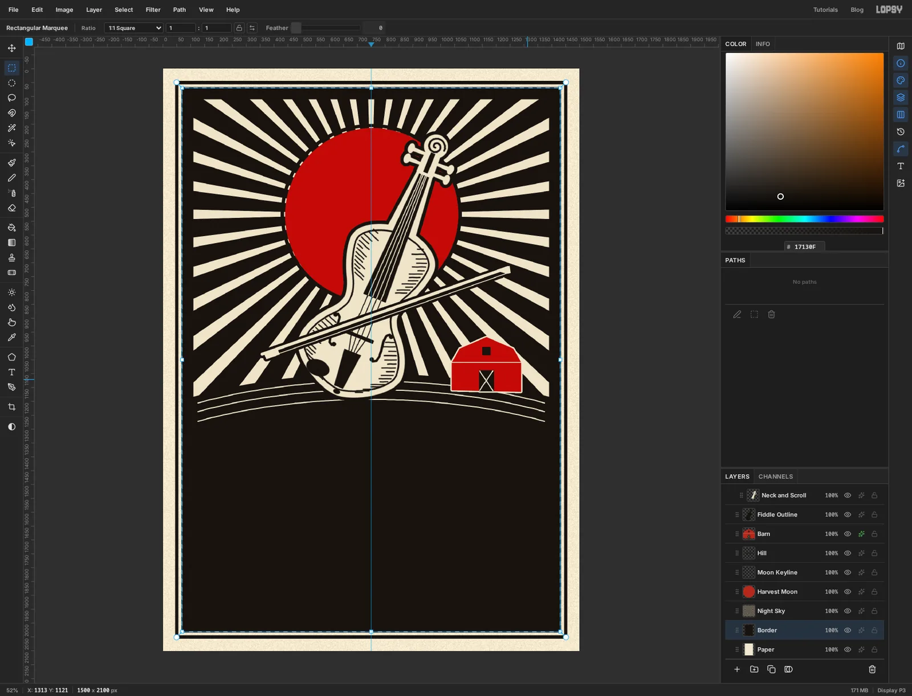

Click *Paper* and add a layer called *Border*. With the **Rectangular Marquee**, drag a box about 44 px in from every edge of the card and fill it with black. The paper around and below the picture goes black for a moment. Then:

1. **Select → Shrink…** at **12**, and press [[Delete]]. That leaves the thick outer line.
2. **Select → Shrink…** at **10**, and fill with black again. This is the moment in the screenshot.
3. **Select → Shrink…** at **3**, and press [[Delete]]. That leaves the thin inner line.

Deselect.

## Hang the ribbon

Click *Fiddle Outline* and add a layer called *Banner*. Starting there keeps the new layer outside the *Fiddle* group. Drag it by the grip at the left of its row to the very top of the Layers panel, above the *Fiddle* group.

With the **Lasso**, draw a wide ribbon that straddles the bottom edge of the black block: about 1040 px wide and 94 px tall, from y 1212 to y 1306, with a V notch cut into each end. Fill it with `#B5281C`. Open its effects, tick **Stroke** and set **Width 7** in black.

## Set the banner line and the title

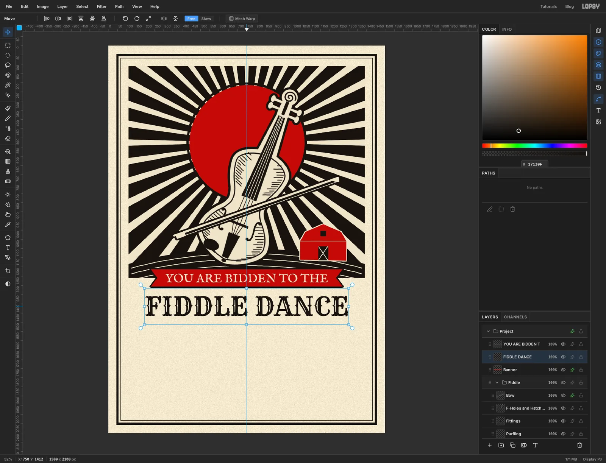

Pick the **Text** tool. For each line, first click the *Banner* layer in the Layers panel. If a text layer is still active, changing the font or size restyles that line instead of setting up the next one. Then choose the font, size and colour, click an empty part of the paper, type, and press [[Tab]] to commit. Then pick the **Move** tool, click **Align center horizontally** in the options bar, and nudge the line up or down with the arrow keys ([[Shift]] moves 10 px at a time).

- **YOU ARE BIDDEN TO THE** in **IM Fell English SC**, size **66**, cream `#EDE3CB`. Seat it in the middle of the ribbon. Check that the gap above the letters matches the gap below, and that the first and last letters stay well clear of the notches.
- **FIDDLE DANCE** in **Rye**, size **140**, black `#17130F`. Put the tops of the letters about 50 px below the ribbon.

## Add the details

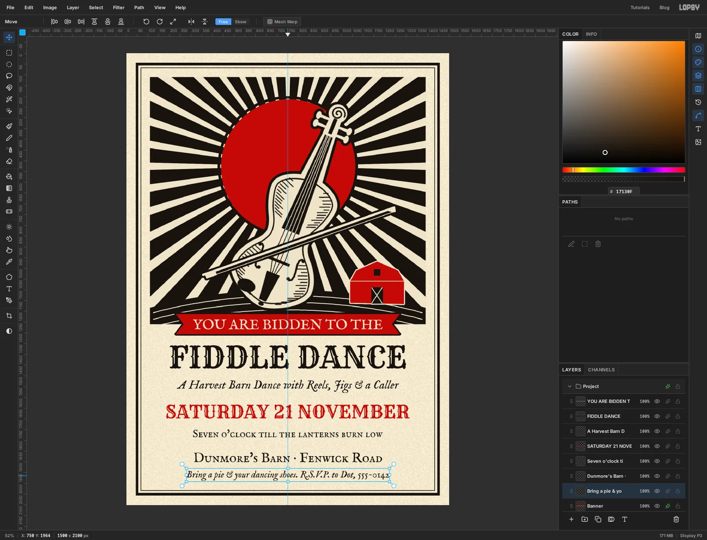

Set the rest the same way, clicking *Banner* before each one and centring each line on the card. Because every line starts from *Banner*, each new text layer lands just above it, under the lines you've already set:

- **A Harvest Barn Dance with Reels, Jigs & a Caller** in **IM Fell English**, **Italic**, size **56**, black
- **SATURDAY 21 NOVEMBER** in **Rye**, size **76**, red `#B5281C`
- **Seven o'clock till the lanterns burn low** in **IM Fell English SC**, size **50**, black
- **Dunmore's Barn · Fenwick Road** in **IM Fell English SC**, size **64**, black
- **Bring a pie & your dancing shoes. R.S.V.P. to Dot, 555-0142** in **IM Fell English**, **Italic**, size **44**, black

Aim for gaps of about 50 px between the title, the subtitle, the date and the time. Leave a wider gap of about 70 px between the time and the venue for a rule. Keep the date narrower than the title so the title stays in charge. The last line has descenders (the p, g and y), so check it sits at least 35 px above the inner border line.

## Print the title's red shadow

Give the title a second colour. Click the subtitle layer, the one directly below *FIDDLE DANCE* in the panel. Hold [[Cmd]] and click the *FIDDLE DANCE* thumbnail to select the letters themselves. Add a layer called *Title Red Offset*. It lands just under the title.

Fill the selection with `#B5281C` and deselect. Nothing seems to change, because the red is hidden exactly behind the black.

## Shift the red and draw the rule

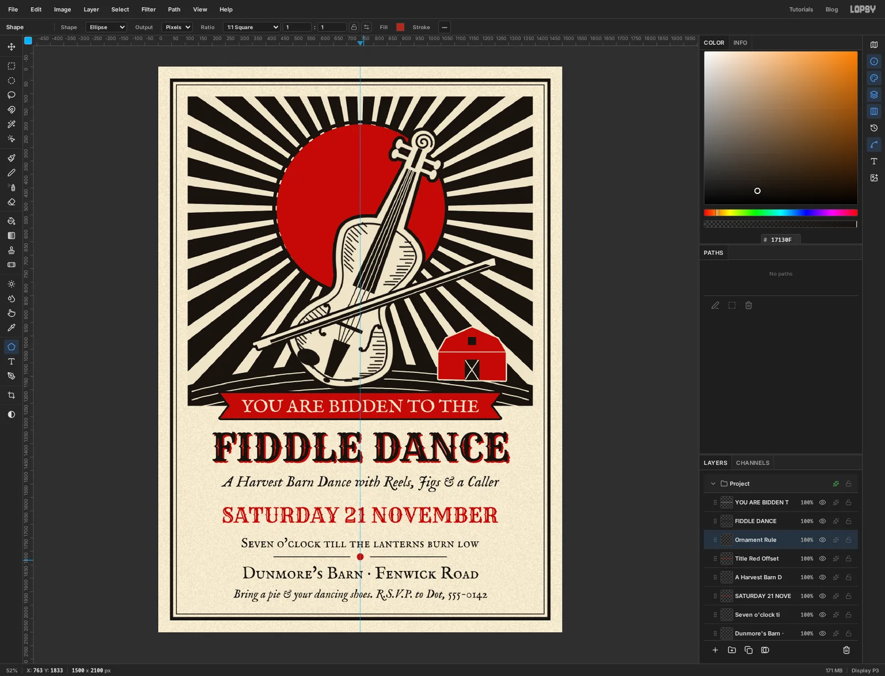

With the **Move** tool, tap [[→]] six times and [[↓]] six times. The red slides out from behind the letters like a second block printed off register.

Add a layer called *Ornament Rule* and stay on it for the rest of this step. With the **Pencil** at **Size 3** in black, draw two short horizontal lines in the gap between the time and the venue: click and [[Shift]]-click from x 430 to x 712, then from x 788 to x 1070, both at y 1820.

Pick the **Shape** tool, set **Shape** to **Ellipse**, click the **Fill** swatch and set it to `#B5281C`. Hold [[Cmd]] and drag a small dot from the centre guide, between the two lines. Shapes grow from their centre, so it lands exactly in the gap.

Last, group the lettering. Click the top text layer, [[Shift]]-click the bottom one, and choose **Layer → Group Layers**. *Title Red Offset* and *Ornament Rule* sit between them, so they go into the group too. Name it *Type*.

## Scratch wood grain into a mask

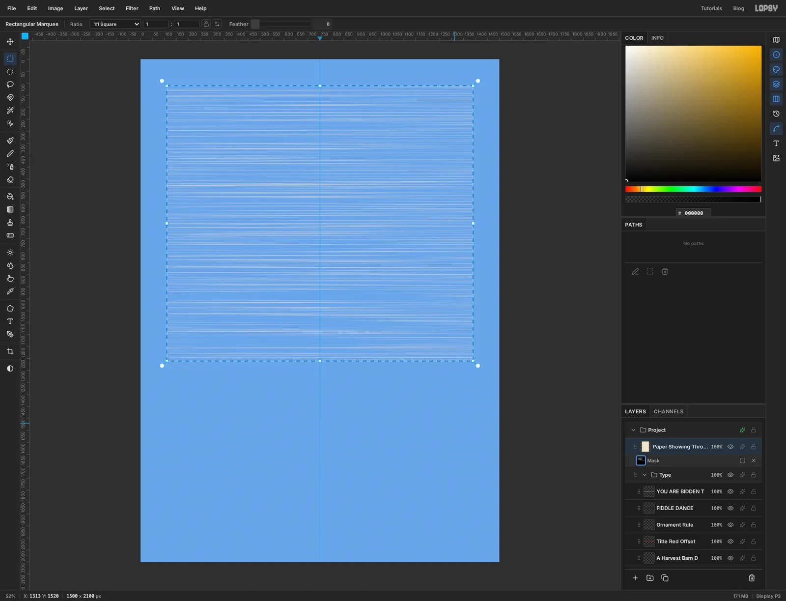

On a real print the grain of the plank leaves thin gaps in the ink. If you made those gaps white, they'd show on the bare paper too, which is wrong. Use a layer of paper colour instead, and let a mask decide where it shows.

1. Add a layer called *Paper Showing Through* and drag it to the top of the panel, above *Type*. Fill it with `#EDE3CB`. The whole card turns cream.
2. Click **Add Mask**. You're now editing the mask, and the canvas shows it as a blue tint.
3. Set the foreground to black `#000000` and choose **Edit → Fill**. The mask is all black, the layer is hidden and the card is back.
4. With the **Rectangular Marquee**, drag over the picture block again, from **110, 110** to **1390, 1260**, so the type stays clean.
5. Choose **Filter → Texture…**. Set **Type** to **Streaks**, **Mode** to **Lighten**, **Amount 100**, **Size 4**, **Detail 50**, **Stretch 20** and **Seed 14**, and click **Apply**.

Filters run on the mask while you're in mask edit mode, so the streaks are drawn into the mask and not into the layer.

## Harden the grain with Threshold

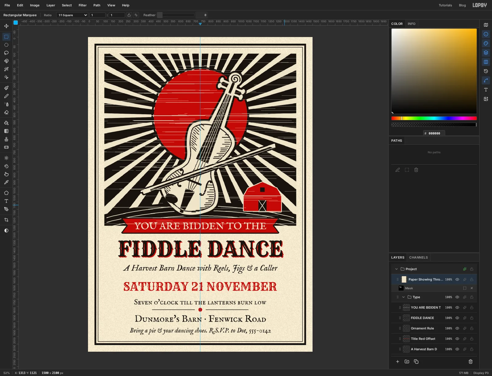

The streaks are soft and grey. Ink doesn't half-print, so make them hard. Choose **Filter → Threshold…**, set **Level 116** and click **Apply**. Only the brightest few streaks survive, as pure white lines in the mask. Deselect, then click the layer's row to leave mask edit mode.

Thin lines of paper now cut across the black and the red, and they're invisible on the cream rays and the fiddle.

> **Tip:** A lower Threshold level lets more grain through. Much below 100 it starts to swallow the picture.

## Clear the grain off the ribbon

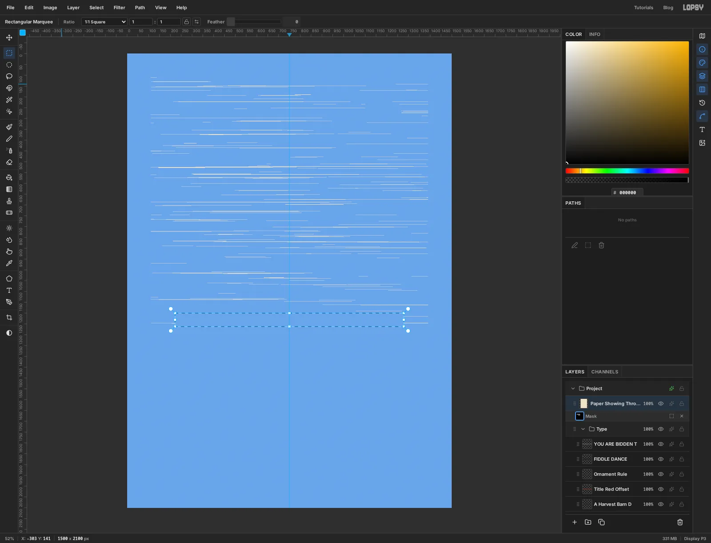

One or two scratches run through the ribbon's lettering and read like a strike-through. Click the mask thumbnail on the *Paper Showing Through* row to edit the mask again. Drag a marquee around the top half of the ribbon, the part that overlaps the picture block, and with black as the foreground choose **Edit → Fill**. Deselect and click the layer row to leave the mask.

That's the invitation. Choose **File → Save Project** to keep the layers, and **File → Quick Export PNG** for a file you can print or send.
