A woodcut is printed from a block of wood. The carver cuts away everything that should stay white, and what's left takes the ink. That gives the look its rules: solid blacks, lines that swell and thin as they follow a form, and pale streaks where the wood grain didn't take the ink. Tattoo artists borrowed the style because it reads from across a room and heals well. A flash sheet puts several ready-to-tattoo designs on one page, each with a number.

In this tutorial you'll make a flash sheet on the theme of Aesop's fable *The Fox and the Grapes*. The fox can't reach the grapes, so he decides they must be sour. The sheet is 1400 × 1800 px.

The centrepiece is a real fox photo turned into a two-block woodcut:

- a rust and cream **colour block** cut from the photo with the **Magic Wand**
- a black **key block** made by multiplying the photo with soft **Sunburst** rays and running **Threshold**, so the gouges fan out from the nose and thicken in the shadows

You'll use:

- **guides**, a dropped reference photo, the **Lasso**, the **Rectangular** and **Elliptical Marquee** with [[Shift]] to add and [[Option]] to subtract, and the Move tool's scale and rotate handles
- the filters **Desaturate**, **Gaussian Blur**, **Sunburst**, **Threshold**, **Fibers** and **Add Noise**
- **Select → Inverse**, **Grow** and **Shrink**, plus [[Cmd]]-click on a thumbnail to load a layer's shape
- the **Brush** with **Radial Symmetry**, the **Pencil**, the **Eraser**, the **Pen** tool and **Path to Selection**
- **Copy**, **Paste**, **Merge Down**, **Group Layers**, a group move, the **Stroke** layer effect, the **Multiply** blend mode and a **layer mask**
- live text in **Pirata One**, **Almendra** and **Almendra SC**, including text bound to a curved path

The palette:

- Paper `#E8DCC0`, cream `#F2E7CD`
- Ink `#1E1A16`
- Fox rust `#A9552F`, ochre `#C49A45`
- Grape `#4A2440`, leaf `#66703A`
- Gouge grey `#808080`, white `#FFFFFF`

> **Tip:** On a wide-gamut (Display P3) screen, Lopsy reads typed hex codes as P3 colours. These codes were chosen as P3 values, a little muted, because P3 makes rust and purple look hot. On an sRGB screen they come out slightly duller.

> **Note:** Shortcuts are written for a Mac. On Windows use [[Ctrl]] wherever it says [[Cmd]], and [[Alt]] for [[Option]].

## Set up the paper and guides

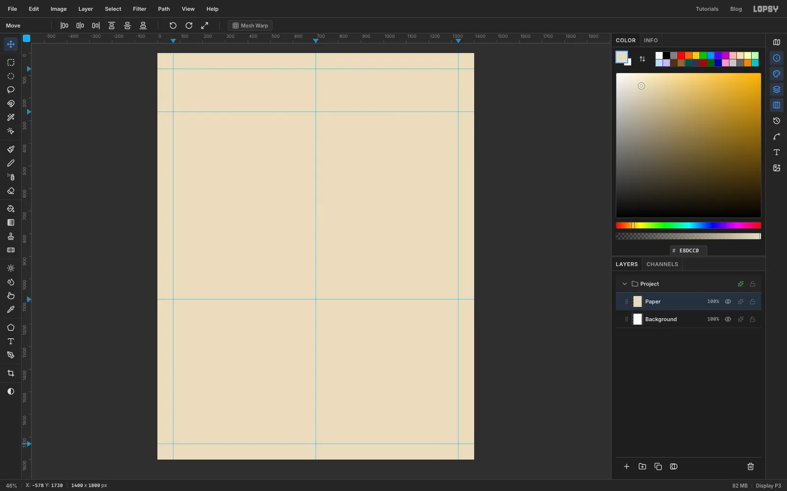

Choose **File → New**, keep the units on **Pixels**, and make the document **1400** wide and **1800** high.

Rename *Layer 1* to *Paper*. Set the foreground colour to `#E8DCC0`, press [[Cmd]]+[[A]] to select all, choose **Edit → Fill**, then press [[Cmd]]+[[D]] to deselect.

Click the top ruler to drop vertical guides at **70**, **700** and **1330**. The outer two are the margins and the middle one is the centre line. Click the left ruler at **70**, **260**, **1090** and **1730**. Those mark the top margin, the bottom of the header, the line between the two rows of designs and the bottom margin.

## Bring in a fox photo

Click **Add Layer** at the bottom of the Layers panel and name it *Fox Color*. It stays empty for now. Later it will hold the fox's flat colours, under the photo.

Animals look wrong when you draw them from memory, so start from a photo. This one is *Vulpes vulpes face* by the U.S. Fish and Wildlife Service, which is in the public domain. Its half-closed eyes are perfect for a fox who has just decided the grapes are sour. Drag the image file onto the canvas. Lopsy drops it on a new layer at the top-left corner. Rename that layer *Fox Photo*.

## Trace the head with the Lasso

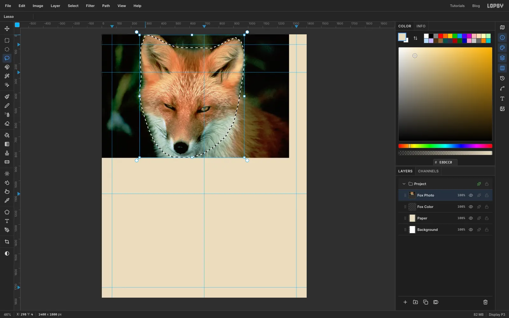

Pick the **Lasso**. Starting at the tip of the left ear, trace round the head:

1. Go down the outside of the cheek.
2. Go round under the chin, just below the nose.
3. Go up the other cheek to the right ear.
4. Come back along the dark crown between the ears.

Leave out the shoulder on the right. Take your time, because this outline becomes the shape of the tattoo.

## Delete the background

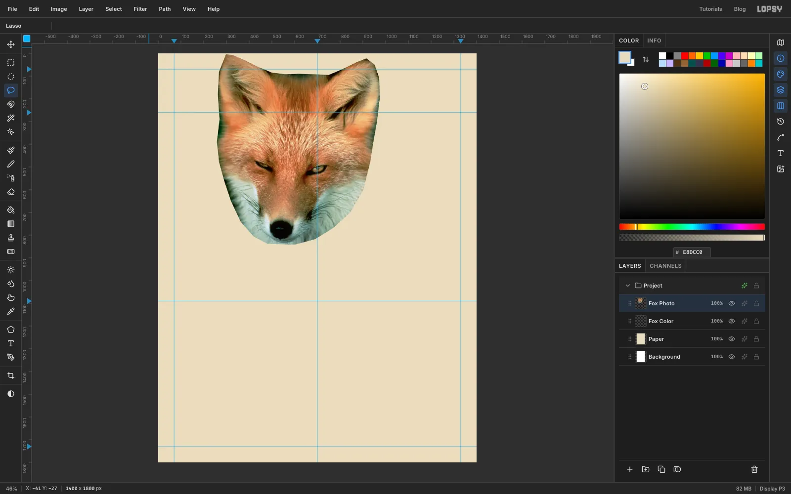

Choose **Select → Inverse**, press [[Delete]], then deselect. Only the head is left.

## Scale the head down

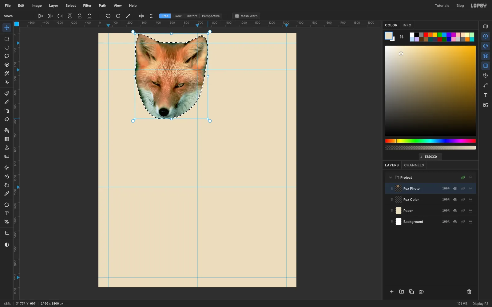

[[Cmd]]-click the *Fox Photo* thumbnail to select the head's shape. Pick the **Move** tool. Hold [[Cmd]] and drag the bottom-right corner handle up and to the left until the head is about **72%** of its size, roughly **515 px** wide. Holding [[Cmd]] keeps the proportions locked.

## Move the head into place

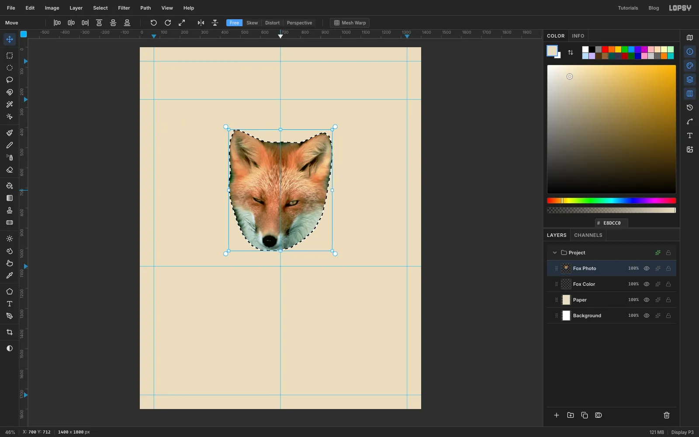

Drag inside the box to move the head so it's centred on the middle guide, with the top of its head at about **y 410**. Press [[Cmd]]+[[D]] to drop it in place.

## Make a soft grey copy for the key block

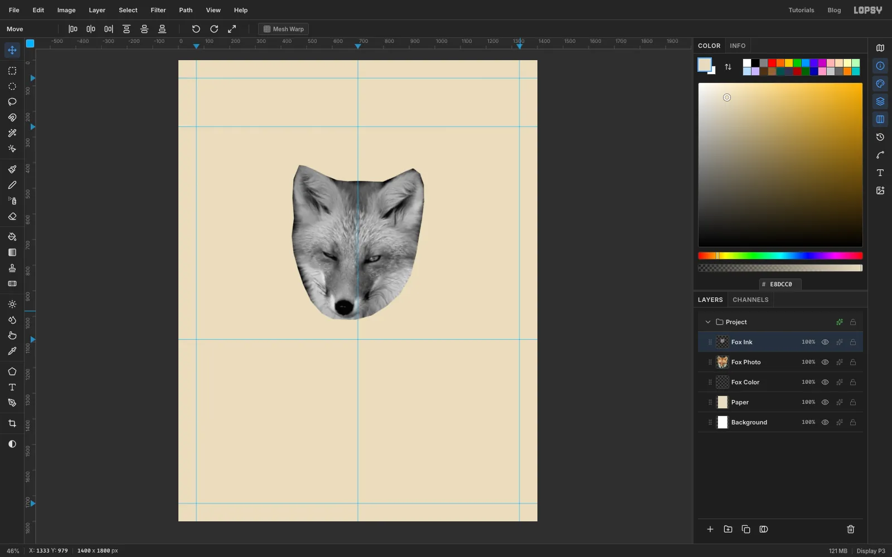

The black block starts as a grey copy of the photo. With *Fox Photo* active, choose **Layer → Duplicate Layer** and rename the copy *Fox Ink*. Check that it sits exactly over the original by toggling *Fox Ink*'s eye icon: nothing should shift. Duplicate can offset the copy 10 px down and right. If it does, press [[Shift]]+[[Up]] and then [[Shift]]+[[Left]] with the **Move** tool to put it back.

Choose **Filter → Desaturate**, then **Filter → Gaussian Blur…** with a **Radius** of **3**. The blur smooths away single hairs. The next steps turn tone into carved lines, and stray hairs would come out as specks.

## Lay down the gouge pattern with Sunburst

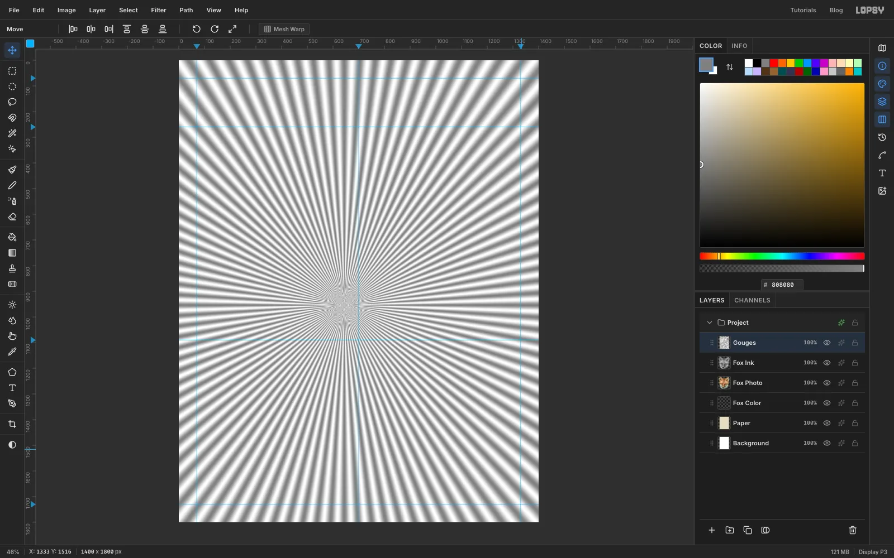

Click **Add Layer** and name it *Gouges*. Set the foreground to white, select all, fill, and deselect.

Set the foreground to `#808080` and choose **Filter → Sunburst…**. Use **Rays 100**, **Width 50** and **Softness 100**. Set **Center X** to **46** and **Center Y** to **53**. These are percentages of the canvas width and height, and they put the centre of the burst on the fox's nose. Click **Apply**. You get soft grey rays on white, darkest down the middle of each ray. These are the gouges, fanning out from the nose the way the fur grows.

## Trim the rays to the head

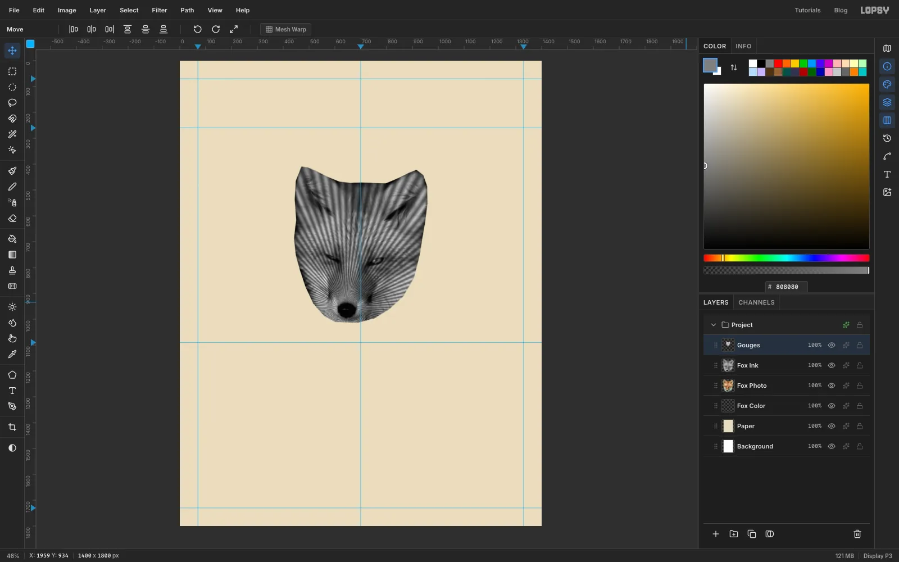

[[Cmd]]-click the *Fox Ink* thumbnail, choose **Select → Inverse** and press [[Delete]] so the rays only cover the head. Deselect. Open the *Gouges* layer's effects with the sparkle button on its row and set **Blend** to **Multiply**.

## Threshold the key block

With *Gouges* active, choose **Layer → Merge Down** to bake it into *Fox Ink*. Then choose **Filter → Threshold…** with **Level 80**.

Every pixel now goes either black or white. Where the photo was dark, the stripes merge into solid black. Where it was light, only the darkest centre of each ray survives as a thin line. That swelling and thinning is what makes it read as cut wood.

Set *Fox Ink*'s **Blend** to **Multiply**. White disappears on Multiply, so only the black lines will print over the colour block.

## Fill the colour block

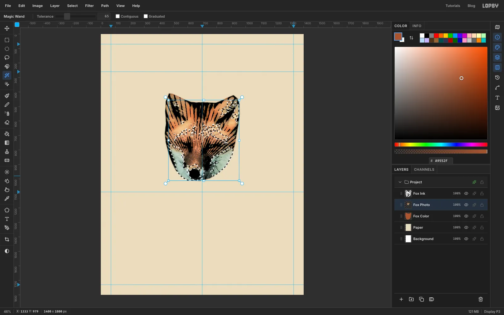

[[Cmd]]-click the *Fox Photo* thumbnail, then click the *Fox Color* row. Set the foreground to `#A9552F` and choose **Edit → Fill**. Deselect. You won't see the rust yet, because the photo is still on top of it.

Now find the white fur. Click *Fox Photo* and run **Gaussian Blur…** with a **Radius** of **8**, so the wand picks up whole patches instead of single hairs. Pick the **Magic Wand**, set **Tolerance 65** and untick **Contiguous**. Click the white fur on the left cheek. Choose **Select → Grow…** with **4**, then **Select → Shrink…** with **3**. Growing and then shrinking closes the little gaps, so the patches come out smooth.

## Add the cream fur

Click *Fox Color*, set the foreground to `#F2E7CD` and fill. Deselect.

The forehead picks up blotchy cream islands that fight the gouges. Set the foreground back to `#A9552F`. Use the **Lasso** to draw round the forehead, from just above the eyes up to the crown and between the ears, and fill it. Deselect.

Hide *Fox Photo* with its eye icon. You now have a two-block print.

## Dome the crown and carve the blotches

The photo crops the head flat between the ears. On *Fox Color*, lasso a shallow dome from the inner edge of one ear to the other, peaking about 50 px above the old crown line. Fill it with `#A9552F`.

Click *Fox Ink*. Pick the **Brush** with **Size 5** and **Hardness 100**, set the foreground to `#1E1A16`, and draw five short strokes down across the dome so the gouges carry on over it.

The upper right of the head has solid black patches from the photo's shadows. Pick the **Eraser** at **Size 6** and drag about eight straight cuts through them. Point each cut along the rays, as if aiming at the nose. Erasing *Fox Ink* lets the rust show through, so the patches turn into carved lines.

## Add the outline and cheek ruffs

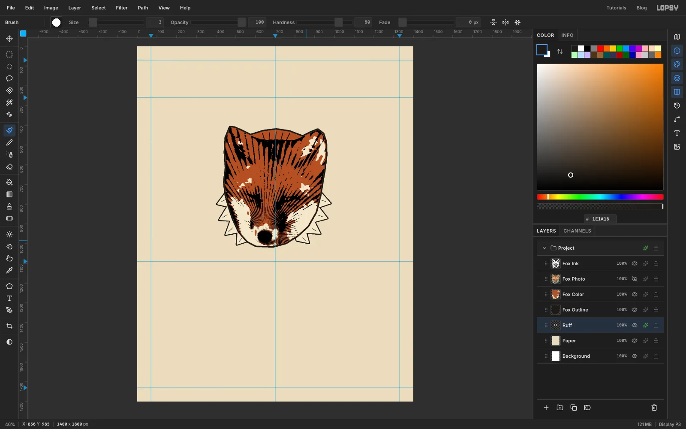

[[Cmd]]-click the *Fox Color* thumbnail and choose **Select → Grow…** with **7**. Click *Paper*, then **Add Layer** and name it *Fox Outline*. New layers go directly above the active one, so this lands under the fox. Fill it with `#1E1A16` and deselect. Every flash design needs a bold outline, and this one follows the head exactly.

Click *Paper* again and add a layer named *Ruff*. With the **Lasso**, draw a zigzag down the outside of the left jaw: four tufts that sweep down and out, from the eye line to the chin. Close the shape back through the inside of the face, which the colour block will hide. Fill it with `#F2E7CD`. Do the same on the right cheek, fill, and deselect.

Open *Ruff*'s effects, enable **Stroke**, set **Width** to **5**, the colour to `#1E1A16`, and **Position** to **outside**. Then take the **Brush** at **Size 3** in `#1E1A16` and draw one short line down the middle of each tuft.

## Finish the ears and eyes

The photo cuts off the tips of the ears, and real red foxes have black ear tips anyway. Click *Fox Ink*, add a layer named *Ear Tips*, and use the **Lasso** to draw a tall triangle on each ear. The base runs from partway down the outer edge to the inner corner, and the point rises about 60 px above the old top. Fill both with `#1E1A16` and deselect. With the **Brush** at **Size 3** in `#F2E7CD`, draw two short cuts down inside each tip.

Add a layer named *Fox Eyes*. At tattoo size the photo's eyes would fill in, so redraw them:

1. Lasso a narrow almond, about 60 × 24 px, over each eye. Tilt each one along the eye's slant and fill it with `#1E1A16`.
2. Lasso a smaller almond inside each and fill it with `#C49A45`.
3. Make a thin upright ellipse in the middle of each eye with the **Elliptical Marquee** and fill it with `#1E1A16`. That's the slit pupil.
4. Add a tiny circle up and to the left of each pupil, filled with `#F2E7CD`, as a glint.

## Hang a ribbon under the chin

The ribbon is about 460 px wide and 60 px tall. It runs from x 470 to x 930, with its top edge just over the fox's chin, and its ends fold back into two swallowtails. Draw the tails first so they sit behind the band.

Click *Fox Eyes* and add a layer named *Banner Tails*. Each tail is about 110 × 64 px, starting about 20 px lower than the band's ends. Pick the **Pen** tool and click five corners for the left tail:

1. top-right, about 30 px inside the band's left end
2. top-left
3. a notch point about 30 px in from the left edge, halfway down
4. bottom-left
5. bottom-right

Click the first anchor to close the path. Open the **Paths** panel, click **Path to Selection**, delete the path, fill the selection with `#F2E7CD` and deselect. Then draw the right tail as a mirror image and convert and fill it the same way.

Add a layer named *Banner*. With the **Pen**:

1. Click the band's top-left corner.
2. Press at the top middle and drag to the right to pull out handles.
3. Click the top-right corner, then the bottom-right corner.
4. Press at the bottom middle and drag to the left.
5. Click the bottom-left corner, then close the path.

The dragged middle anchors make the band sag about 20 px. Convert it to a selection, fill with `#F2E7CD` and deselect.

Now the folds. Click *Banner Tails* again. Lasso a small triangle just under each end of the band, between the band's bottom corner and the tail behind it, and fill it with `#1E1A16`. With the **Brush** at **Size 2** in `#F2E7CD`, draw two short hatch lines in each fold.

Give both *Banner* and *Banner Tails* a **Stroke** effect: **Width 5**, colour `#1E1A16`, **outside**.

## Set the lettering on a curve

Lettering on a sagging ribbon should sag with it. Draw an open **Pen** path along the middle of the band, about a quarter of the band's height below its centre line:

1. Click near the left end.
2. Press in the middle and drag to the right.
3. Click near the right end.
4. Click the ✓ in the options bar to finish the path.

Click *Banner*. Starting text from an ordinary raster layer matters: if a text layer were active, the new settings would restyle it instead. Pick the **Text** tool and set **Almendra SC** at size **50** in `#1E1A16`. Click somewhere empty in the top margin, type **SOUR GRAPES**, and press [[Tab]]. Rename the layer *Banner Text* and set **Letter spacing** to **3** in the Text panel.

With the text layer still active, choose the new path in the options bar's **Path** menu and set **Align** to **Center**. The letters jump onto the curve. Check that they sit with even space above and below inside the band. Then click the path in the **Paths** panel to deselect it and hide its outline.

## Carve a woodcut sun

Click *Banner Text* and add a layer named *Sun*. Set the foreground to `#1E1A16` and open **Filter → Sunburst…**:

- **Rays** 16, **Width** 60, **Taper** 100 and **Length** 9
- **Center X** 18 and **Center Y** 31
- **Jitter** 25 with **Seed** 3

**Center X** and **Center Y** are percentages of the canvas again. **Length** is a percentage of the distance to the farthest corner, so **9** gives spikes about 150 px long. **Taper 100** turns each ray into a straight spike, and **Jitter** shortens some of them at random so the sun looks hand-cut. Apply it. Set the foreground to `#C49A45` and run **Sunburst** again with the same settings, except **Width** 50, **Length** 7 and **Rotation** 11. That tucks shorter ochre spikes between the black ones.

## Add the disc and flames

The sun's centre is at **252, 558**. Pick the **Elliptical Marquee** and click on the canvas without dragging to open its exact-corners dialog. Enter **From 178, 484** **To 326, 632** for a 148 px circle and fill it with `#1E1A16`. Choose **Select → Shrink…** with **7** and fill again with `#C49A45`, which leaves a black rim.

Pick the **Brush** at **Size 7** with **Hardness 100** in `#1E1A16`. In the options bar, turn on **Radial Symmetry** and set **Segments** to **12**. [[Cmd]]-click the centre of the sun to put the symmetry centre there. Then draw one short, slightly curved stroke from near the centre out towards the rim. You get twelve flames from a single stroke. Turn **Radial Symmetry** off again.

Finish the sun with a **44 px** black circle in the middle (**From 230, 536** **To 274, 580**). Then **Shrink** it by **13** and fill the 18 px dot that's left with `#F2E7CD`.

## Cut a crescent moon

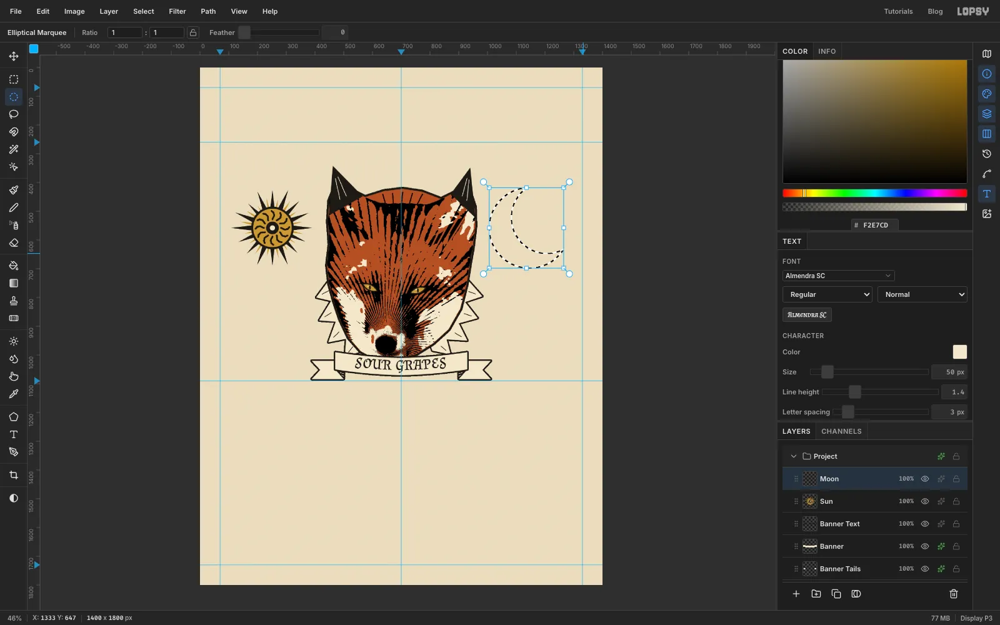

Add a layer named *Moon*. With the **Elliptical Marquee**, drag a circle **280 px** across, level with the sun on the right of the fox. Hold [[Option]] and drag a second circle, about **250 px** across, shifted up and to the right. Holding [[Option]] subtracts it from the selection, leaving a crescent. Fill it with `#1E1A16`.

## Carve the moon

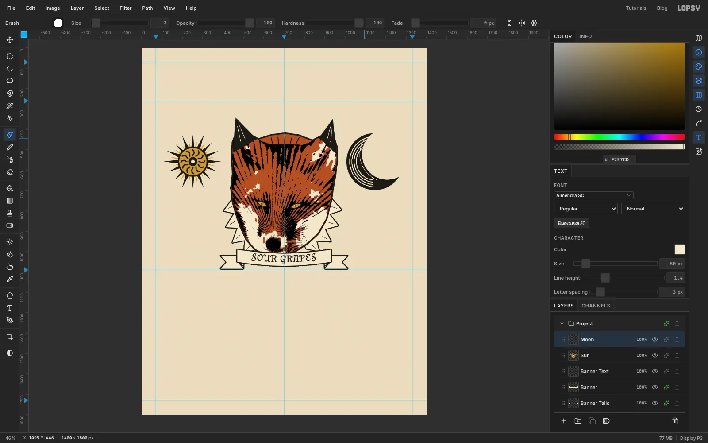

Keep the selection, so the cuts can't spill outside the crescent. Pick the **Brush** at **Size 5** in `#F2E7CD` and draw four long arcs that follow the outer curve, each about 11 px inside the last. Run them round the thick left half of the crescent, from the top horn to the bottom one. Switch to **Size 3** and draw one arc just inside the inner edge, along the same thick part. Deselect.

## Grow the grape vine

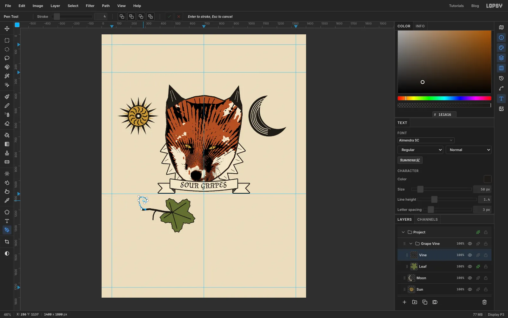

Click *Moon*, then **New Group** at the bottom of the Layers panel, and name the group *Grape Vine*. Layers you add now go inside it.

Add a layer named *Leaf*. Lasso a grape leaf about 240 px across with five pointed lobes and a toothed edge, centred at about **520, 1230**, just under the ribbon's left tail. Point its stem notch back up-left towards where the cane will be. Fill it with `#66703A` and give it a **Stroke** effect: **Width 4**, `#1E1A16`, **outside**.

Add a layer named *Vine*:

1. **Veins:** pick the **Pencil** at **Size 4** in `#1E1A16`. For each of the five veins, click the stem notch, then [[Shift]]-click the tip of a lobe. Shift-click draws a straight line from the last point.
2. **Cane:** switch to the **Brush** at **Size 13** and draw a gently bent cane about 200 px long, from x 280 across to the leaf's notch, at about y 1200.
3. **Stem:** at **Size 8**, draw a short stem dropping from the cane to where the top of the cluster will be.
4. **Tendril:** pick the **Pen**, set **Stroke** to **4** in the options bar, and click and drag a few anchors into a curl that spirals off the left end of the cane. Press [[Enter]] to stroke it.

## Fill the grape cluster

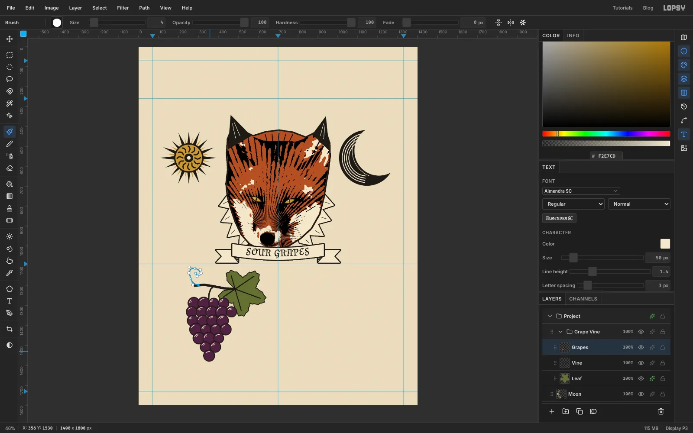

Add a layer named *Grapes*. Build the cluster in rows: four grapes, then five, four, four, three, two and one, each row tucked into the gaps of the one above. Work from the top row down, so lower grapes overlap the ones behind them.

The top row sits about 85 px below the cane, centred under the stem. Rows are about 44 px apart, and the grapes in a row about 50 px apart.

For each grape, deselect, drag a round **Elliptical Marquee**, and fill it with `#1E1A16`. Then choose **Select → Shrink…** with **4** and fill with `#4A2440`. That leaves a black rim. Vary the circles between about 55 and 65 px across so the bunch doesn't look stamped.

Then carve the grapes. Pick the **Brush** in `#F2E7CD`:

- At **Size 4**, draw a short arc just inside each grape's rim on its left side.
- At **Size 3**, add a shorter arc inside most of them.

Start each arc in a slightly different place on each grape, so every berry is cut a little differently.

## Nick the leaf and move the whole vine

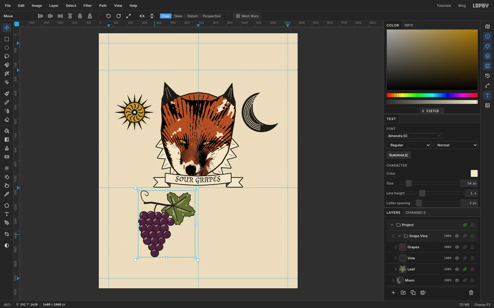

Click *Leaf* and [[Cmd]]-click its thumbnail so your cuts stay inside it. With the **Brush** at **Size 4** in `#F2E7CD`, cut ten short nicks in from the edge, about 20 px long, aimed at the centre. At **Size 3**, draw a pale line alongside each vein. Deselect.

Step back and look at the lower row. The vine sits too far left, and the gap to the goblet you're about to draw would be lopsided. Click the *Grape Vine* group row, pick the **Move** tool and drag the vine **40 px** to the right. The leaf, vine and grapes move together, which is the point of building them in a group.

## Draw a goblet

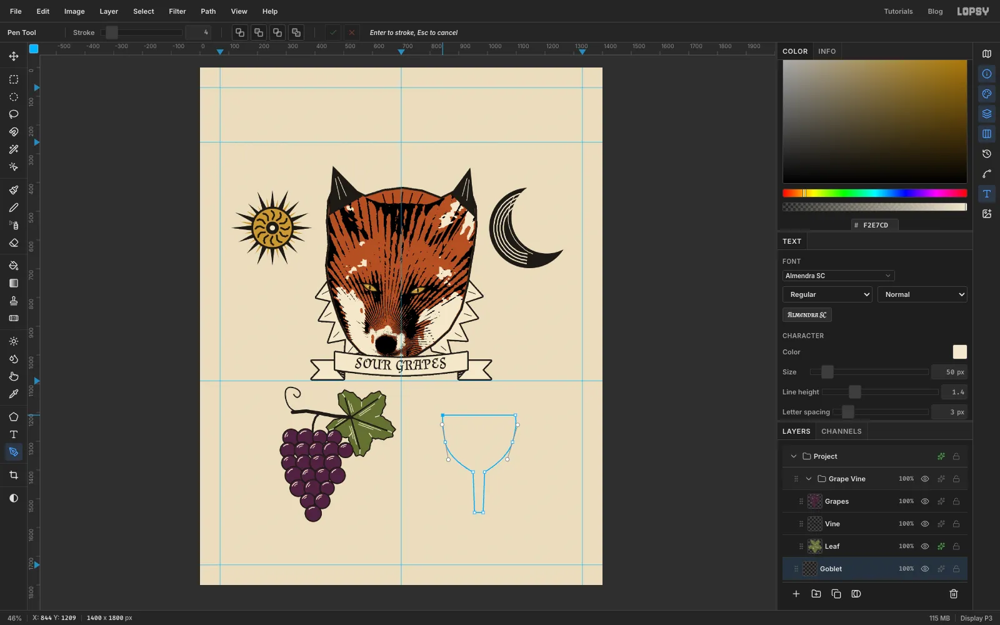

Click *Moon* and add a layer named *Goblet*. The goblet is about 255 px wide at the rim and 350 px tall. Its rim sits at about y 1210, centred on **x 970**, and the stem ends about 340 px lower. With the **Pen**, draw the bowl and stem as one closed path:

1. Click the left end of the rim, then the right end.
2. Press halfway down the right side of the bowl and drag down to curve it.
3. Click the top and bottom of the stem on the right.
4. Click the bottom and top of the stem on the left.
5. Press halfway down the left side of the bowl and drag up.
6. Click the first anchor to close the path.

Convert it with **Path to Selection**, fill it with `#1E1A16` and deselect. Fill an ellipse about **210 × 38 px** under the stem for the foot, and a smaller flat one across the stem for the knot.

## Carve the goblet

[[Cmd]]-click the *Goblet* thumbnail, pick the **Brush** in `#F2E7CD`, and carve:

- **Bowl:** seven lines that curve from the rim down towards the stem. Start at **Size 8** on the lit left side and drop one size per line, so they thin out across the bowl.
- **Right edge:** one thin line along it.
- **Stem:** two short lines down it.
- **Foot:** two arcs along its front.

Deselect.

For the rim, fill an ellipse about **260 × 36 px** across the top in `#1E1A16`. Then fill a slightly smaller one inside it in `#4A2440` for the wine. Add a short cream highlight on the wine.

For a drip down the bowl:

1. Draw a short **Size 15** stroke in `#F2E7CD` down from the rim, and fill a small circle at its end.
2. Draw over it at **Size 9** in `#4A2440`, with a smaller circle. That leaves a cream edge round the purple.

## Spill the grapes

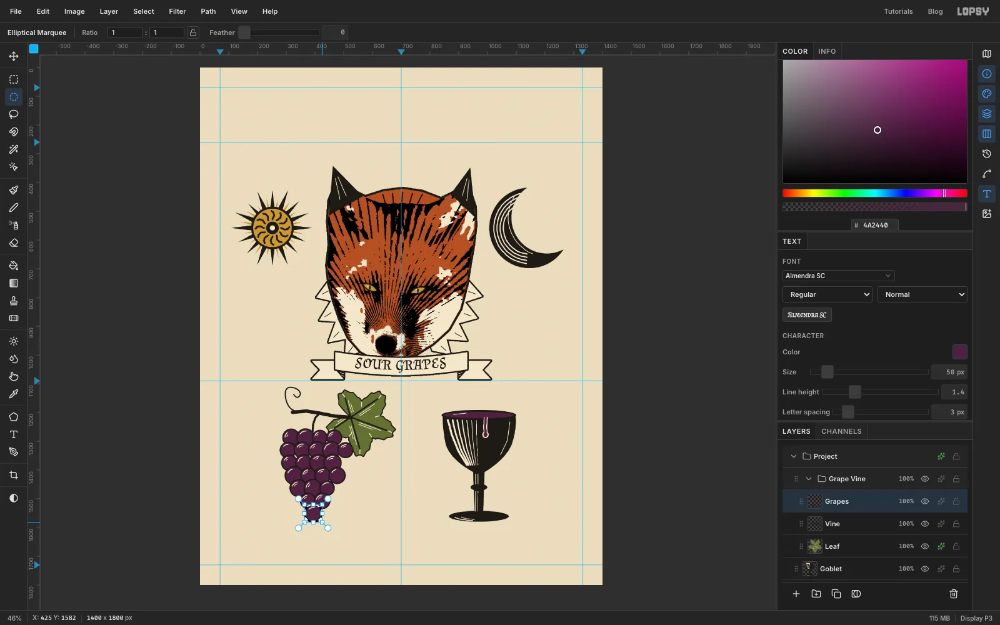

Click *Grapes* and drag an **Elliptical Marquee** round the lowest grape. Press [[Cmd]]+[[C]], click *Goblet*, and press [[Cmd]]+[[V]]. The paste lands on a new layer right where you copied it, already selected. Rename it *Spilled Grape 1*. Drag it with the **Move** tool so it sits on the rim, and deselect.

For the second grape, copy the bottom grape again, click *Spilled Grape 1* and paste. Name it *Spilled Grape 2* and drag it to hang over the right edge of the rim. With the box still active:

1. Hold [[Cmd]] and drag a corner handle in to scale it to about **92%**.
2. Drag just outside a corner to rotate it about **20°** anticlockwise.

## Drop the last grape

Make *Spilled Grape 3* the same way. Scale it to **86%**, rotate it about **30°** clockwise, and drop it in the air beside the goblet, as if it's falling. Deselect.

## Group the pieces

Click *Spilled Grape 3*, [[Shift]]-click *Goblet*, and choose **Layer → Group Layers**. Rename the group *Goblet Piece*. The stacking order stays the same, so the grapes still sit in front of the rim.

Do the same for the fox. Click *Ruff*, the lowest of its layers, then [[Shift]]-click *Banner Text*. Choose **Group Layers** and name it *Fox Piece*. Now each flash design can be moved as one unit.

## Set the title

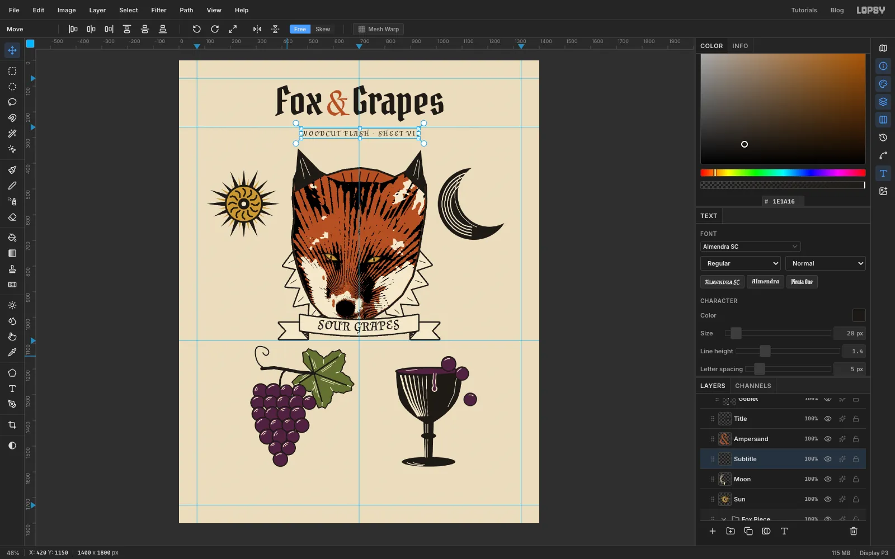

Pirata One is a lovely woodcut-era blackletter, but its ampersand looks like a G. So the title gets a gap, and the & comes from another font.

Click *Moon* so the new text starts at the top level of the stack, outside the groups, and from an ordinary layer rather than a text layer. Pick the **Text** tool with **Pirata One** at size **150** in `#1E1A16`. Click in empty space and type **Fox**, four spaces, then **Grapes**. Press [[Tab]] and rename the layer *Title*. Pick the **Move** tool and use the arrow keys to centre it on the middle guide, with its capitals starting about 100 px from the top edge.

Click *Moon* again, set **Almendra** at size **146** in `#A9552F`, and type **&**. Rename it *Ampersand* and nudge it into the centre of the gap between the words.

Click *Moon* once more and set **Almendra SC** at size **28** in `#1E1A16`. Type **WOODCUT FLASH · SHEET VII**, press [[Tab]] and name it *Subtitle*. Set **Letter spacing** to **5** and centre it under the title, about 30 px below the tail of the p.

## Number the designs and add the moral

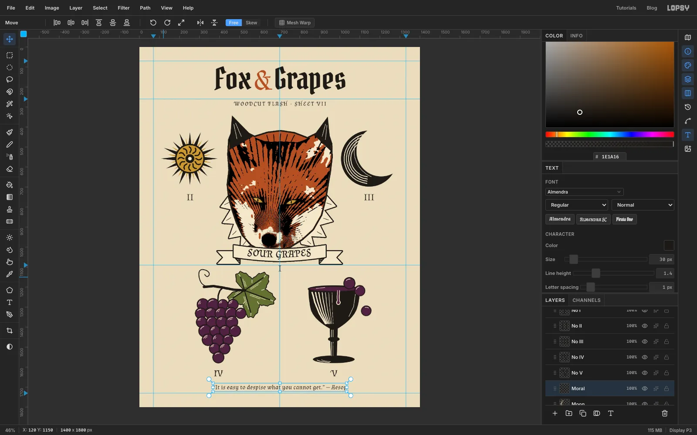

Flash sheets number each design so clients can point at one. With **Almendra SC** at size **46** and **Letter spacing 2**, make five separate text layers, *No I* to *No V*, clicking *Moon* before each one. Centre each numeral under its design, about the same distance below each:

- **II** under the sun and **III** under the moon, on one line.
- **I** just under the ribbon.
- **IV** under the grapes and **V** under the goblet, on one line.

Then set **Almendra** at size **30** with **Letter spacing 1** and type the moral: **“It is easy to despise what you cannot get.” — Aesop**. Centre it on the middle guide, just above the bottom guide.

## Add rules, sparkles and a double border

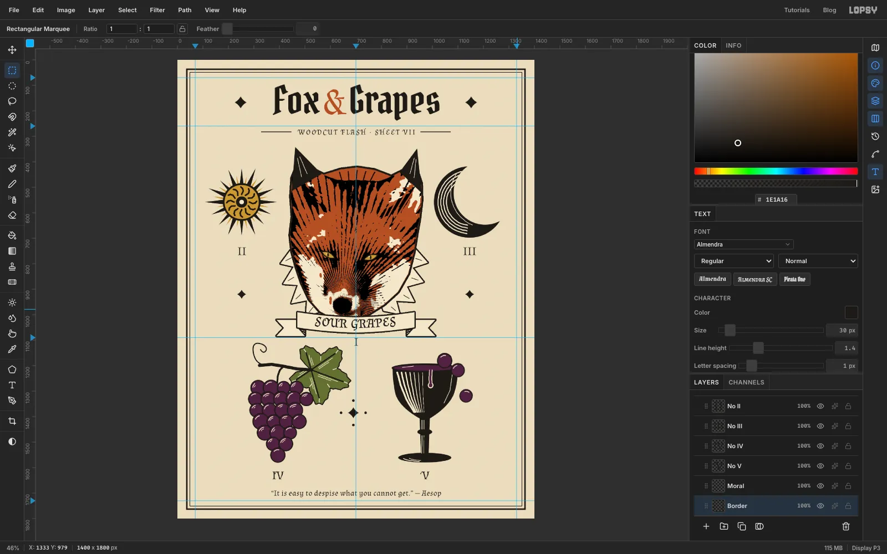

Click *Moon* and add a layer named *Ornaments*. With the **Pencil** at **Size 3** in `#1E1A16`, click a short gap to the left of the subtitle, then [[Shift]]-click about the width of the word WOODCUT further left. Draw a matching rule on the right.

For each four-point sparkle, take the **Pen** and click eight points round a centre. Put four tips about 22 px out, straight up, down, left and right, and four inner points about 6 px out between them. Close the path, convert it with **Path to Selection**, and fill it with `#1E1A16`. Put them:

- one on each side of the title
- one under the sun and one under the moon
- one between the grapes and the goblet, with four small dots round it

Add a layer named *Border*. Click the **Rectangular Marquee** on the canvas without dragging to open its exact-corners dialog. Enter **From 34, 34** and **To 1366, 1766**, then fill with `#1E1A16`. Choose **Select → Shrink…** with **6** and press [[Delete]], which leaves a 6 px frame. Repeat with **From 48, 48** **To 1352, 1752** and a shrink of **2** for the thin inner rule.

## Print the wood grain

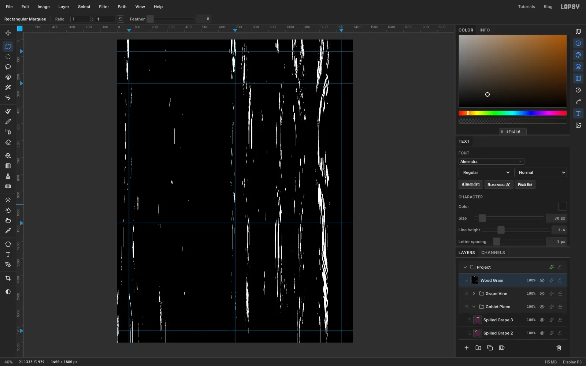

Click *Paper* and run **Filter → Add Noise…** with **Amount 5** and **Mono**, so the paper has a little tooth.

The grain has to print over everything, so it goes at the top of the stack. Collapse the *Grape Vine* group with its arrow, click its row, and **Add Layer** named *Wood Grain*. Adding a layer while a collapsed group is active puts it above the group, not inside it.

Choose **Filter → Fibers…** with **Variance 24** and **Strength 12**. Fibers always paints grey, whatever your colours are. A low Strength makes the fibres wander like real grain. Then run **Threshold…** at **172**. Only the brightest fibres stay white, as broken pale streaks on black.

Pick the **Magic Wand** at **Tolerance 10** with **Contiguous** off, click the black, and press [[Delete]]. [[Cmd]]-click the *Wood Grain* thumbnail, set the foreground to `#E8DCC0`, fill, and deselect. The streaks are now exactly the paper colour. They vanish on bare paper, but show wherever they cross ink, as if the block missed a spot.

## Keep the small type crisp with a mask

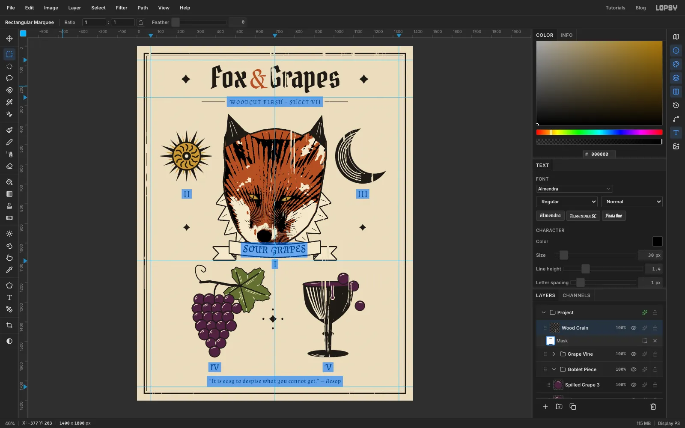

Grain streaks through 28 px letters make them hard to read. With *Wood Grain* active, click **Add Mask**, then click its mask thumbnail to edit the mask. Set the foreground to black. Draw a **Rectangular Marquee** a little larger than the subtitle. Then hold [[Shift]] and drag one round the ribbon lettering, each of the five numerals, and the moral, to add them all. Choose **Edit → Fill** once. Black on the mask hides the grain there. Deselect, and click the layer's own thumbnail to leave mask editing.

Choose **File → Save Project** to keep the layers, then **File → Export…** for a PNG to print or post.
