A *woodcut* is printed from a plank of wood. The carver cuts away
everything that should stay white, rolls ink over what is left, and presses
paper onto it. Colour prints use one block per colour. A black *key block*
carries the outlines and the darkest shapes, and the colour blocks print
underneath it. Real woodcuts give themselves away in three ways. The colour
blocks never line up perfectly with the key (this is called being *off
register*). The grain of the plank shows in flat colour. And big black areas
never take ink evenly, so they print with small pale streaks that run along
the grain.

In this tutorial you'll build a logo for **Mackerel Exchange**, an imaginary
fish auction house on a Cornish quay. It's a round emblem with a leaping
mackerel over a sunrise and a carved sea, sitting on a black banner with
wood type. You'll make each part the way a woodcut printer would. First the
colour blocks, then the key block cut from black, then the print's flaws on
top. The document is 1400 × 1400 px.

Along the way you'll use:

- the **Reference** drawer, to draw a mackerel from an old fisheries engraving
- the **Elliptical** and **Rectangular Marquee**, with [[Shift]] to add and [[Shift+Alt]] to intersect, plus the **Lasso**
- **Select → Grow**, **Shrink** and **Inverse**, and **⌘-click** on layer thumbnails to load a layer as a selection
- the **Fibers**, **Add Noise**, **Motion Blur** and **Threshold** filters
- the **Magic Wand** with **Contiguous** turned off
- the **Brush** with **Taper**, and the **Pencil** with [[Shift]]-click straight lines
- **Copy**, **Paste**, nudging with the arrow keys, stretching with the **Move** tool's handles, and **Merge Down**
- the **Stroke** layer effect and the **Multiply** blend mode
- **Rotate 90° CW**, and rotating a whole group with the rotation handle
- **Show Grid** with **Snap**
- **Text** in Holtwood One SC and Old Standard TT

The palette is a black ink and five block colours on cream paper:

- Paper `#EEE5D1`, ink `#1C1A19`
- Sky ochre `#CF9E45`, sun red `#A9432F`, ribbon fold `#8A2A1C`
- Sea `#2F5163`, fish teal `#3E6B73`
- Belly silver `#DCD6C6`

The mackerel is traced from *Common Mackerel (Scomber scombrus Linnaeus)*,
an engraving from the New York Fish and Game Commission, which is in the
public domain on Wikimedia Commons (FMIB 41856). Any clear side view of a
mackerel will do.

Watch **X** and **Y** in the status bar at the bottom of the window as you
move the pointer. Positions are given in document pixels where things have
to line up. For an exact circle, click once with the **Elliptical Marquee**
without dragging, and a dialog asks for the corners of the box around it.
Freehand shapes only need to be close.

The **Brush** strokes here use **Taper**, which lives only in the brush
presets window. Open it with the round brush tip at the left end of the
options bar and look on its **Shape** tab. The **Fade** slider on the
options bar is a different setting.

## Set up the paper, guides and reference

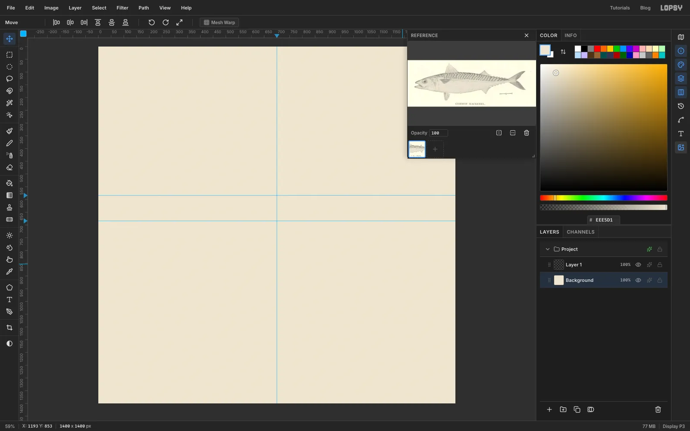

1. Choose **File → New**, set **Width** `1400` and **Height** `1400`, pick a **White** background and click **Create**.
2. Click the top ruler at `x 700` to drop a vertical guide down the middle. Click the left ruler at `y 584` (the centre of the emblem) and at `y 684` (the horizon).
3. Click **Background**, set the foreground colour to the paper colour `#EEE5D1` in the Color panel's hex field, and choose **Edit → Fill**.
4. Choose **Filter → Add Noise…**, set **Amount** `4`, pick **Mono** and **Gaussian**, and click **Apply**. Paper is never perfectly flat, and this just takes the digital sheen off it.
5. Download the mackerel engraving. Click **Reference** in the panel toolbar on the far right, then click the drawer's drop zone and choose the file. The drawer floats over the right edge of the canvas, so you'll be drawing the fish by eye from it rather than tracing over it. Leave it open or close it while you block in the emblem, whichever suits your screen.

## Block in the sky, sun and sea

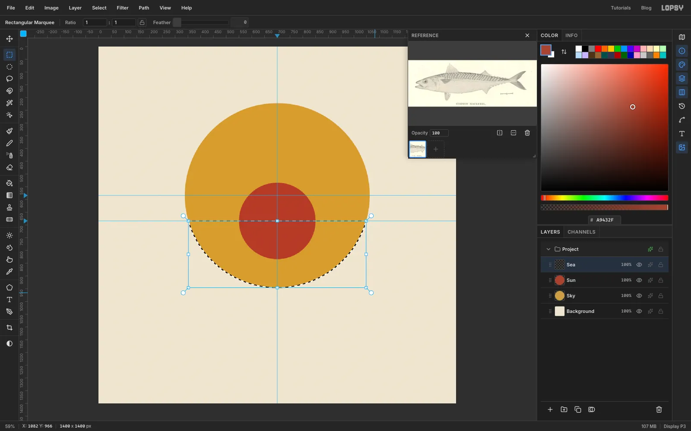

These are the colour blocks. Each one gets its own layer, just as each colour gets its own block of wood.

1. Rename `Layer 1` to `Sky` (double-click its name). With the **Elliptical Marquee**, select a circle centred on the guide crossing at `700, 584` with a radius of `362`, which is the box from `338, 222` to `1062, 946`. Fill it with ochre `#CF9E45`.
2. Add a layer called `Sun`. Select a circle of radius `150` centred on the middle of the horizon guide (`700, 684`) and fill it with red `#A9432F`.
3. Add a layer called `Sea` and select the sky circle again. Then switch to the **Rectangular Marquee**, hold [[Shift+Alt]] and drag a rectangle from the horizon guide on the left down past the bottom of the circle on the right. [[Shift+Alt]] *intersects* the two selections, so only the part of the circle below the horizon stays selected. Fill it with `#2F5163` and press [[⌘+D]].

The sea covers the lower half of the sun, so the sun is half-set on the horizon.

## Render wood grain with Fibers

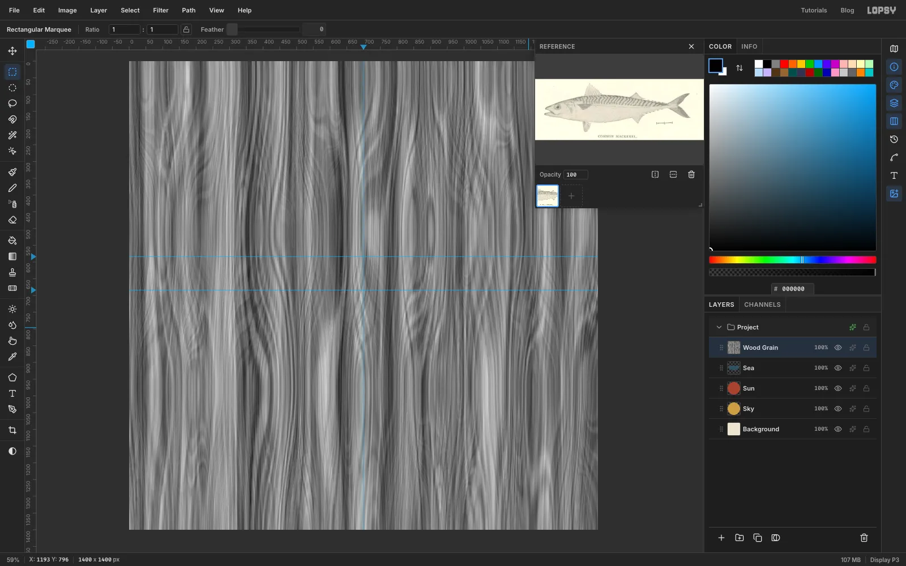

1. Add a layer called `Wood Grain`. Set the foreground colour to black.
2. Choose **Filter → Fibers…**, set **Variance** `30` and **Strength** `24`, and click **Apply**. Fibers fills the layer with long wavy streaks that look a lot like sawn wood, but they run up and down.

## Turn the grain and trim it

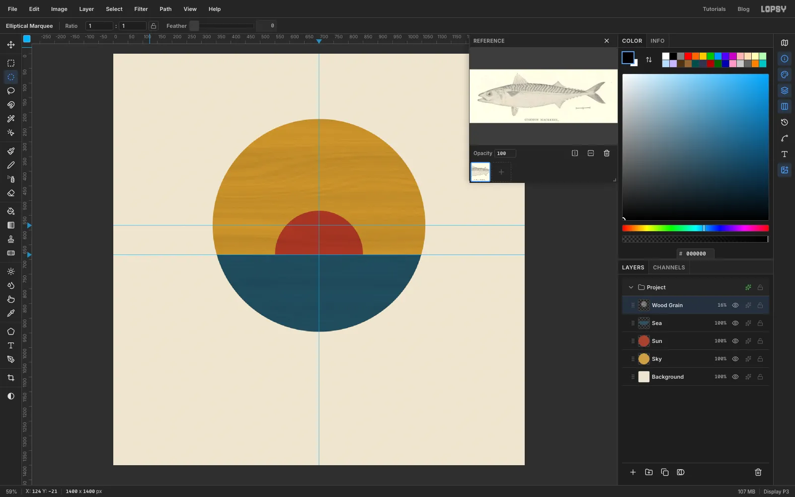

1. Pick the **Move** tool and, with nothing selected, click **Rotate 90° CW** in its options bar. The whole layer turns, so the grain now runs across like the planks of a print block.
2. Open the layer's effects (the ✦ button on its row), set the blend mode to **Multiply**, and close the drawer. Set the layer opacity to `16`%.
3. Select the sky circle again, choose **Select → Inverse**, and press [[Delete]]. The grain now only shows in the colour blocks.

## Cut the ring

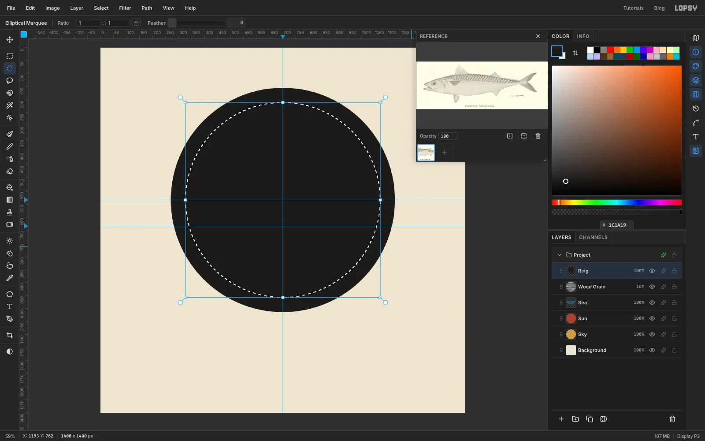

From here on you're making the key block, which prints in black.

1. Add a layer called `Ring`. Select a circle of radius `430` centred on `700, 584` (the box from `270, 154` to `1130, 1014`) and fill it with ink `#1C1A19`.
2. Choose **Select → Shrink…**, enter `56` and click **Apply**. Press [[Delete]]. That leaves a black band 56 px wide, with a narrow strip of paper between it and the sky.

## Carve the sawtooth edge

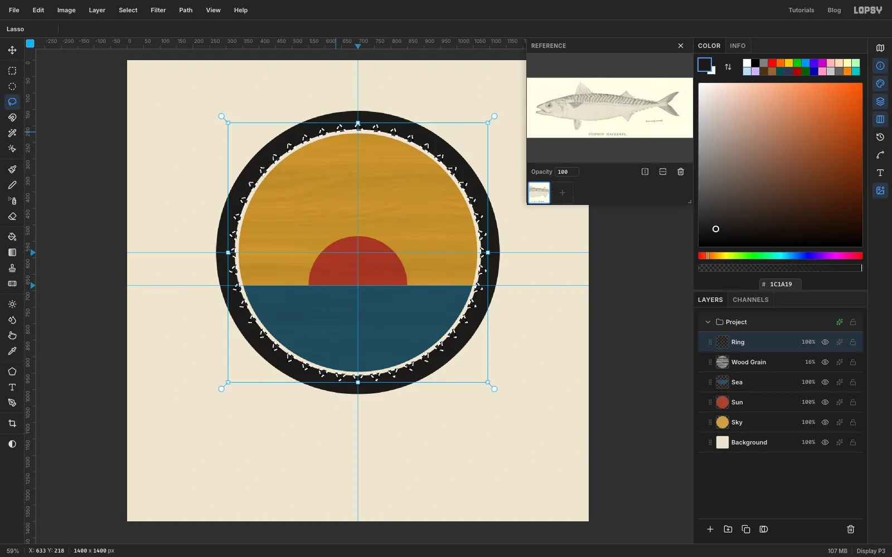

A sawtooth (or *dogtooth*) border is one of the classic cuts on a woodcut frame. You'll cut 44 small triangles into the inner edge of the ring.

1. Pick the **Lasso** and drag a small triangle at 12 o'clock. Its base sits on the paper strip, about 30 px wide, and its point reaches about 22 px into the black.
2. Hold [[Shift]] and lasso the triangles at 3, 6 and 9 o'clock. [[Shift]] adds each one to the selection.
3. Fill each quarter with ten more triangles, evenly spaced, still holding [[Shift]]. They don't have to be perfect, because carved teeth never are.
4. Press [[Delete]], then [[⌘+D]]. The triangles open onto the paper strip, so the ring looks cut with a V-shaped knife.

## Lasso the sun rays

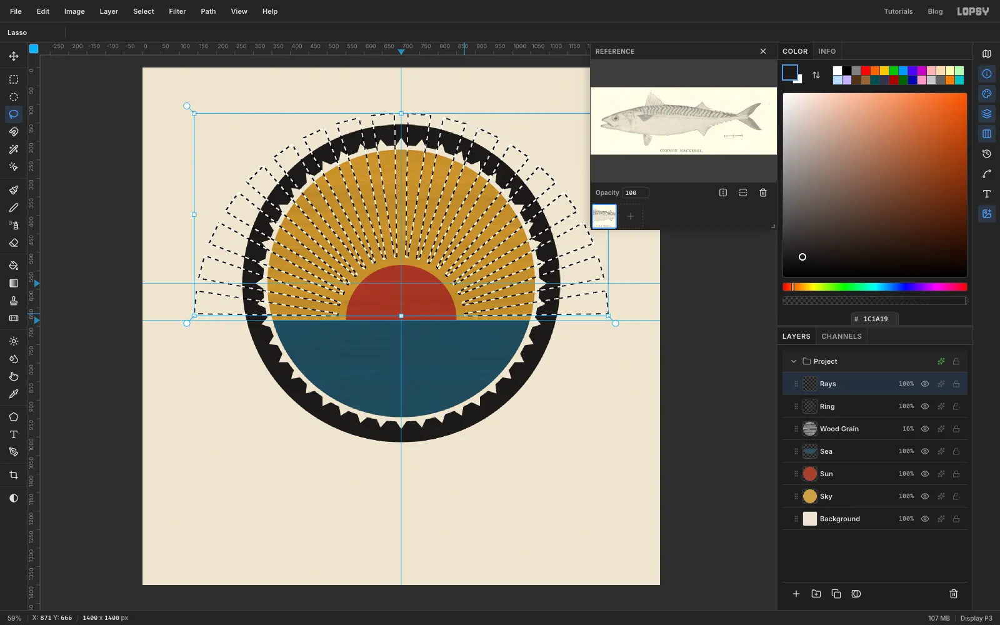

1. Add a layer called `Rays`. With the **Lasso**, drag a long thin wedge pointing straight up from the sun. Start it about 20 px above the sun's edge and run it out past the ring. Keep it narrow at the sun end (about 7 px) and let it widen to about 60 px at the far end.
2. Hold [[Shift]] and add wedges lying almost flat along the horizon on each side. Then fill in each quarter of the sky with seven or eight more, so there are 18 in all. Keep the ochre gaps between them about as wide as the wedges.
3. Fill with ink.

## Trim the rays to the sky

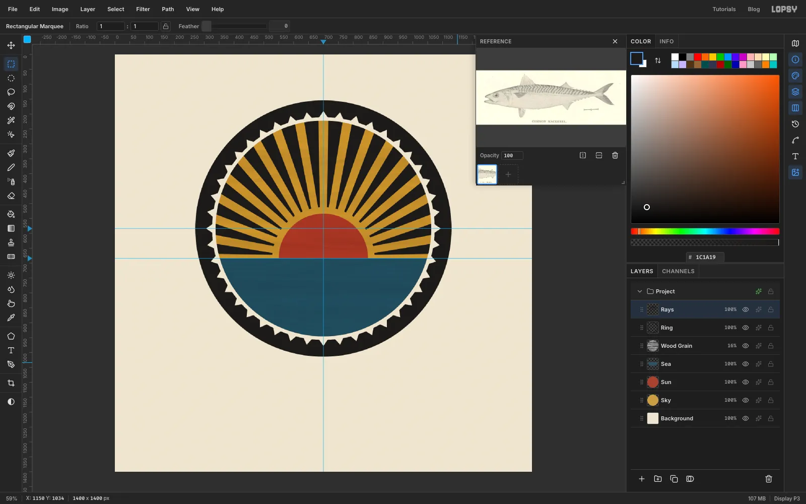

1. Select the sky circle again, choose **Select → Inverse**, and press [[Delete]].
2. Drag a rectangle from the horizon guide down past the bottom of the ring and press [[Delete]], so no ray dips below the sea line. Press [[⌘+D]].

## Carve the first wave

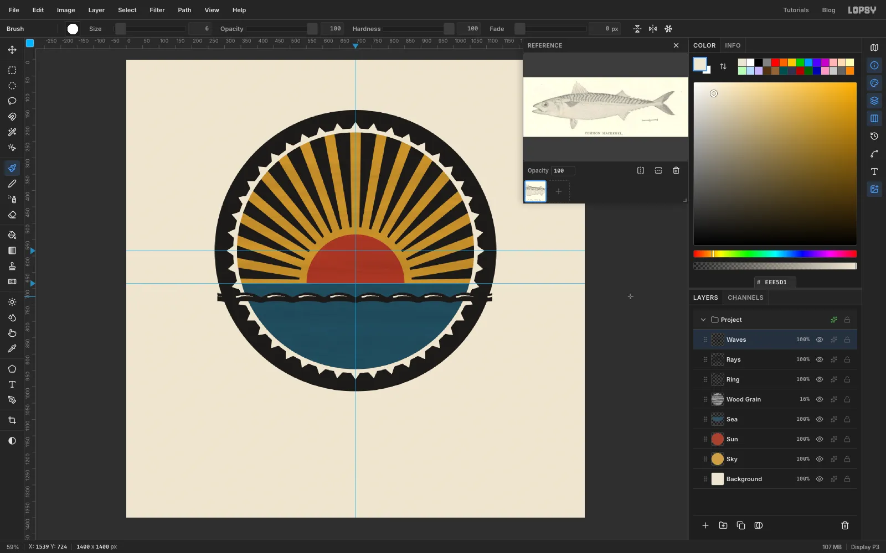

1. Add a layer called `Waves`. With the **Lasso**, draw one scalloped band just under the horizon, running a little past both sides of the circle. Give the top edge a row of humps about 96 px apart and 16 px high, and make the bottom edge a gentler copy of it about 16 px lower. Fill it with ink and press [[⌘+D]].
2. Pick the **Brush**. Open the brush presets window, click **Hard Round**, and set **Size** `6`, **Hardness** `100` and **Taper** `55`. Taper shrinks a stroke to nothing over that many pixels, so each stroke starts fat and ends in a point.
3. Set the colour to paper `#EEE5D1`. On each hump, paint one short stroke from its left shoulder over the crest. These are the gouge cuts that make the black read as water.

## Paste and stretch three more waves

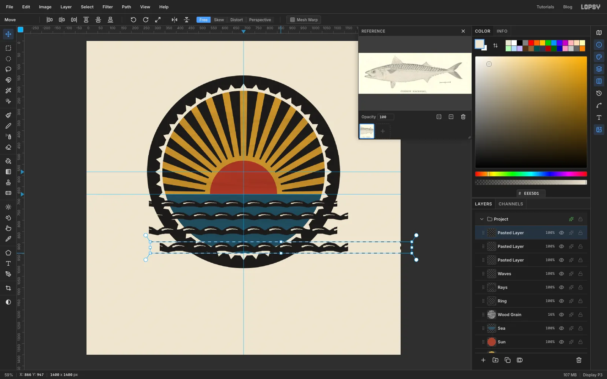

Rows of waves get bigger and further apart as they come towards you. You'll copy the first band, then make each copy a little fatter than the last.

1. **⌘-click** the `Waves` thumbnail to select its pixels, press [[⌘+C]], then [[⌘+D]].
2. Press [[⌘+V]]. The copy lands on a new layer, right on top of the first band. With the **Move** tool, move it about 50 px down and half a hump (about 48 px) to the right, so its humps sit between the humps above. The arrow keys move it 1 px at a time, and [[Shift]] + arrow moves it 10 px.
3. With the **Rectangular Marquee**, drag around the copy, then switch back to **Move**. Drag the handle in the middle of the bottom edge down a few pixels, so the band gets a little fatter. Press [[⌘+D]].
4. Paste twice more. Put each copy lower than the last, with the gap growing each time (I left about 60 px, then about 70 px), and shift every other row half a hump. Stretch each one a bit more than the one above. The bottom band should end up roughly half as fat again as the first.

## Merge and trim the sea

1. Click the top pasted layer and choose **Layer → Merge Down** three times, so all four bands end up on `Waves`.
2. Pick the **Pencil**, **Size** `6`, ink colour. Click on the horizon guide just left of the circle, then [[Shift]]-click just right of it, for a crisp horizon line.
3. Select the sky circle, choose **Select → Inverse**, and press [[Delete]], then [[⌘+D]].

## Draw the body

You'll draw the mackerel level, the way it lies in the engraving, and tilt it at the end. Keep the **Reference** drawer open while you draw (I closed it for the screenshots so it doesn't hide the tail).

1. With `Waves` selected, click **New Group** in the Layers panel and name it `Fish`. Inside it, add three layers: `Halo` (it stays empty for now), `Fins`, then `Body`.
2. On `Body`, lasso the outline of the fish from the engraving: the pointed snout, the long curve of the back to the narrow base of the tail, and the belly back to the snout. Draw it big. The snout pokes about 90 px out of the ring on the left, a little above the top of the sun, and the base of the tail sits just inside the ring on the right. The body is about 190 px deep at its deepest.
3. Fill it with silver `#DCD6C6` and press [[⌘+D]].

## Add the dark back

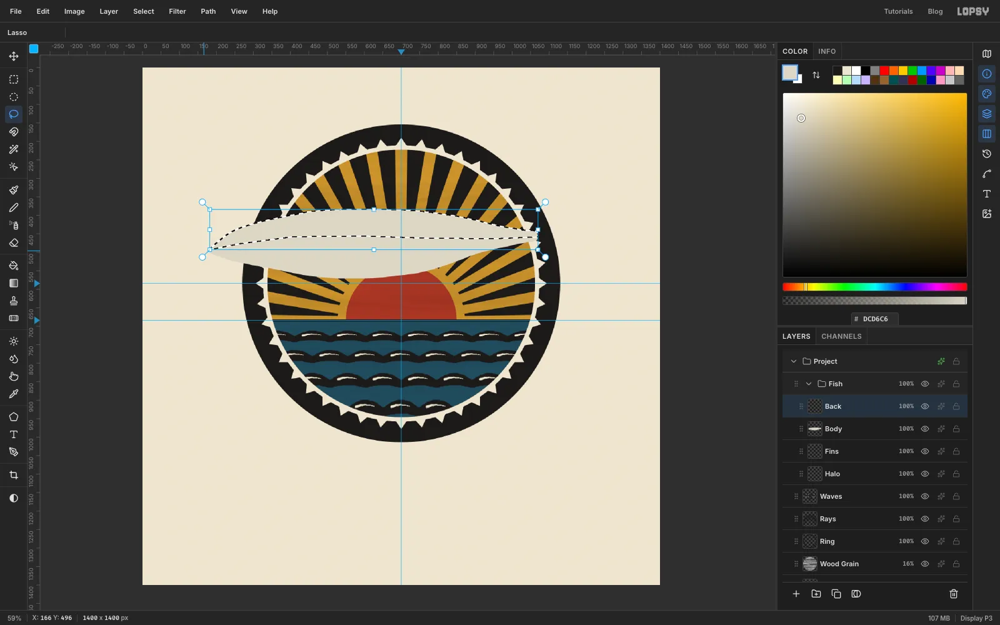

1. Add a layer called `Back`. **⌘-click** the `Body` thumbnail to select the body.
2. Hold [[Shift+Alt]] and lasso a shape that covers everything above the *lateral line*, the wavy line along the side from just under the eye to the tail. The intersection leaves only the top of the body selected.
3. Fill it with teal `#3E6B73` and press [[⌘+D]].

## Block in the fins

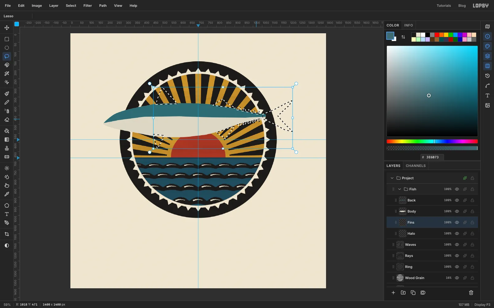

1. Click the `Fins` layer, which sits under `Body`, so every fin can tuck its root behind the body.
2. Lasso the forked tail at the right end, starting inside the body. Then [[Shift]]-lasso the tall triangular front dorsal fin, the small second dorsal fin, the fin under the belly near the tail, the small pelvic fin under the front of the belly, and the five little finlets above and below the narrow part of the body before the tail.
3. Fill with teal `#3E6B73` and press [[⌘+D]]. Open the layer's effects, turn on **Stroke**, set **Width** `6`, and set its colour to the ink `#1C1A19`.

## Cut the key line

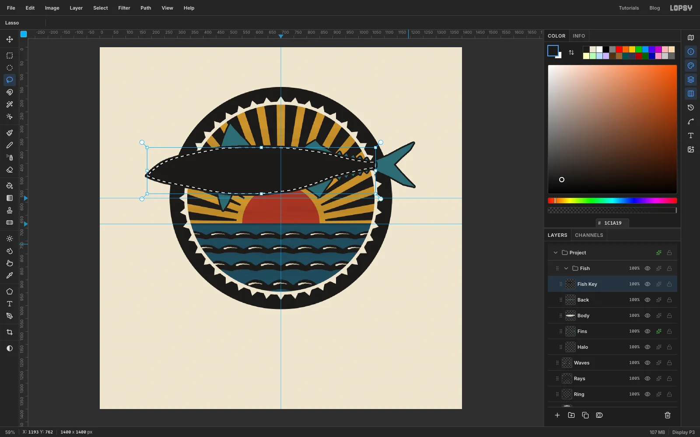

1. Click `Back` and add a layer called `Fish Key` above it. **⌘-click** the `Body` thumbnail, choose **Select → Grow…** `4`, and fill it with ink.
2. **⌘-click** the `Body` thumbnail again, choose **Select → Shrink…** `4`, and press [[Delete]]. That leaves an 8 px black outline that straddles the edge of the body, like the cut line of a key block. Press [[⌘+D]].

## Gouge the tiger stripes

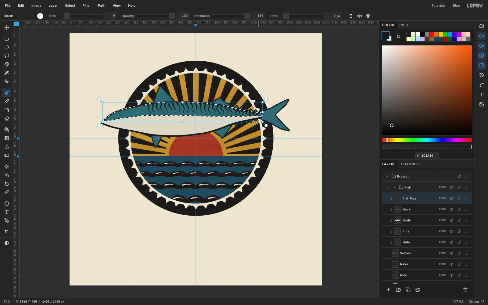

Mackerel have wavy dark bars across the back. Selecting the back first keeps every stroke inside it.

1. **⌘-click** the `Back` thumbnail.
2. Pick the **Brush** (Hard Round) and set **Size** `9` and **Taper** `70` in the presets window, in ink colour. On `Fish Key`, paint two dozen or so wavy bars down the back. Start each one at the spine and let it wriggle down to the lateral line, slanting a little towards the tail, and leave about a bar's width between them. Because of the taper, each bar is fat at the spine and fades to a point.
3. Press [[⌘+D]].

## Add the belly cuts, gill, mouth and eye

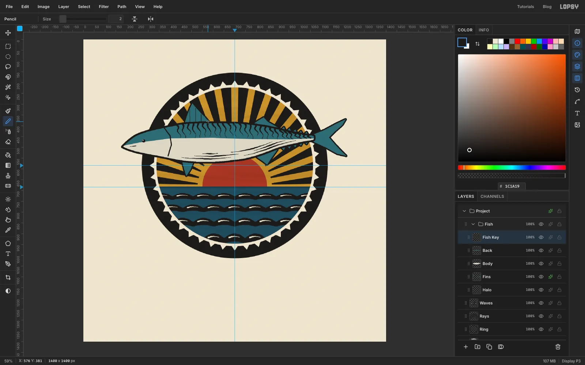

1. **⌘-click** the `Body` thumbnail so the belly cuts stay inside the fish. Set the brush **Size** to `7` and **Taper** to roughly the length of the stroke you're about to paint (about `120` for the longest, less for the short ones).
2. Paint the belly cuts in three loose rows along the lower belly, from below the front fin back towards the tail, with the lowest row closest to the belly line and longest. Paint each cut as two strokes that start at the same middle point and pull outward in opposite directions along the curve of the belly. That way both ends come to a point, the way a V-gouge cut does. Press [[⌘+D]].
3. Set **Taper** to `0` and **Size** to `6`, and paint the curved edge of the gill cover behind the head, from the top edge of the body down to the belly.
4. At **Size** `4` and **Taper** `30`, paint a short line from the corner of the mouth forward towards the snout for the jaw.
5. Set **Taper** back to `0`. At **Size** `16`, click once a third of the way down the head for the eye. Switch to paper colour at **Size** `5` and click its upper left for the glint.
6. Pick the **Pencil**, **Size** `2`, ink colour. For the fin rays, click at the root of the front dorsal fin and [[Shift]]-click on its top edge. Repeat every 10 px or so along the fin.

## Add the side fin, the off-register slip and a paper halo

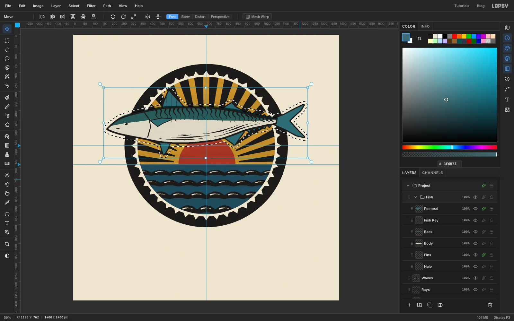

1. Add a layer called `Pectoral` and lasso the pointed side fin just behind the gill. Fill it with teal and give it a **Stroke** of `4` in ink.
2. Click `Back`. With the **Move** tool, nudge it 6 px right and 10 px up with the arrow keys, and set its blend mode to **Multiply**, so it darkens wherever it overlaps, like a second pass of ink. The teal now peeks a few pixels past the black outline along the top of the back, and leaves a sliver of silver above the lateral line, like a colour block that slipped on the press.
3. Click `Sun` and nudge it 4 px right, for the same reason.
4. **⌘-click** the `Fins` thumbnail. Add `Body` and `Pectoral` with [[⌘+Shift]]-click on their thumbnails, so you have the whole fish's silhouette. Choose **Select → Grow…** `18`.
5. Click `Halo`, fill the selection with paper `#EEE5D1`, and press [[⌘+D]]. The halo clears the rays and the ring wherever the fish crosses them, so the fish reads cleanly.

## Tilt the fish

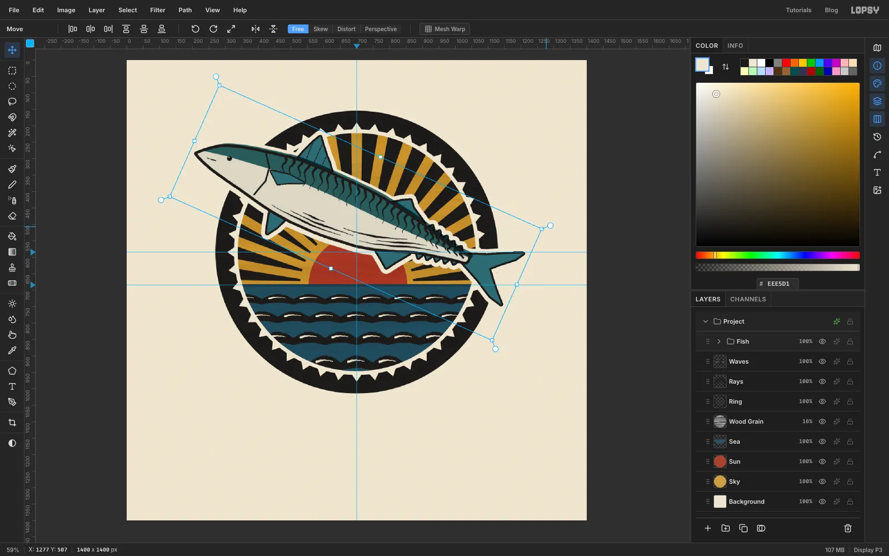

1. Press [[⌘+D]] so nothing is selected. Collapse the `Fish` group (so a click can't land on one of the layers inside it) and click its row. Pick the **Move** tool. The transform box wraps every layer in the group.
2. Drag the round handle just outside the top-right corner of the box clockwise, until the snout pokes out of the ring at the upper left and the tail drops towards the horizon on the right. That's about 24°.
3. Press [[⌘+D]] to apply the rotation. In Lopsy, deselecting is what commits a transform, and [[Enter]] doesn't.

## Cut the ribbon tails

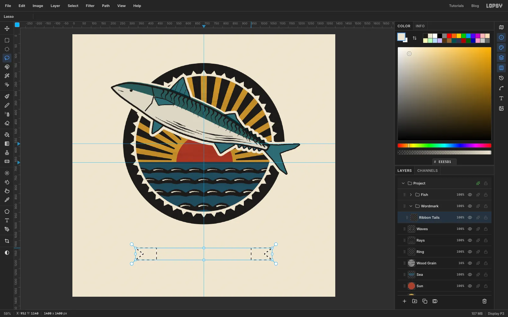

1. Click `Waves`, click **New Group** and name it `Wordmark`. Add a layer called `Ribbon Tails`.
2. With the **Rectangular Marquee**, drag the left tail from `336, 1140` to `448, 1204`. Switch to the **Lasso**, hold [[Alt]] and cut a triangle 42 px deep out of its left end for the swallowtail notch.
3. Switch back to the **Rectangular Marquee**, hold [[Shift]] and drag the right tail from `952, 1140` to `1064, 1204`. Then [[Alt]]-lasso the notch out of its right end.
4. Fill them with red and add a **Stroke** of `3` in ink.
5. Add a layer called `Ribbon Folds`. The front panel comes next, and its bottom edge will run along `y 1188`. Lasso a small triangle just below that line where each tail tucks behind the panel: between `x 412` and `448` on the left, and between `952` and `988` on the right. Fill them with the darker red `#8A2A1C`.
6. Add a layer called `Ribbon`. Drag a rectangle from `412, 1124` to `988, 1188` for the front panel, fill it with red, and give it a **Stroke** of `3` in ink.

## Snap the banner to the grid

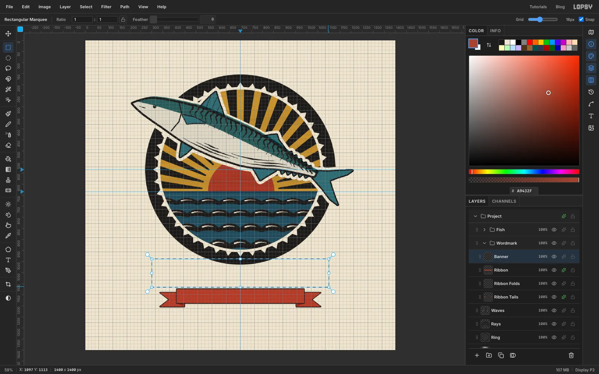

1. Add a layer called `Banner`. Choose **View → Show Grid**, set the grid size to **16** px in the options bar, and make sure **Snap** is ticked.
2. Drag a rectangle from `300, 988` to `1100, 1116`. The grid catches the corners, so the banner is exactly 800 × 128 and centred. Fill it with ink.
3. Choose **Select → Shrink…** `8` and fill with paper. Then **Shrink** `3` more and fill with ink again. That leaves a thin cream rule 8 px inside the edge. Press [[⌘+D]].
4. Give the banner a **Stroke** of `7` in paper colour. It knocks the ring back where the banner crosses it, and keeps a strip of paper between the banner and the ribbon.
5. Choose **View → Show Grid** again to hide the grid.

## Set the wood type

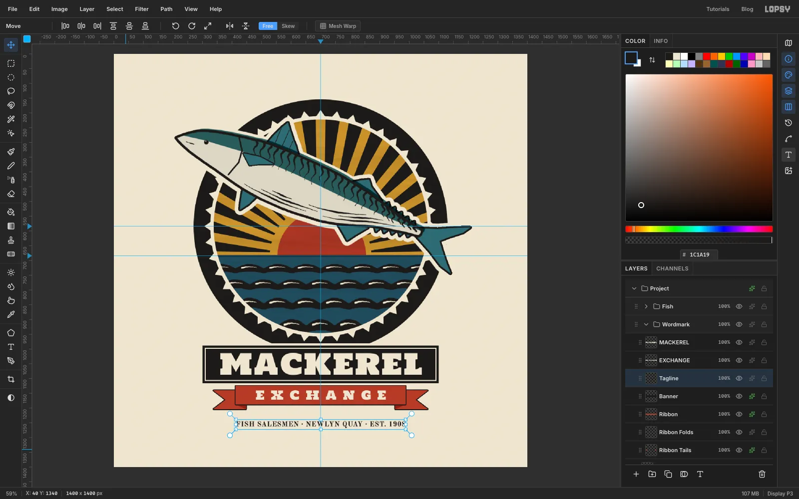

Before starting each line, click `Banner` in the Layers panel. New type then lands above the banner, and the line you just set isn't restyled when you change the font or size for the next one. **Letter spacing** is in the Text panel (the **T** button in the panel toolbar on the far right).

1. Pick the **Text** tool. Choose **Holtwood One SC** at size `97` in paper colour, click in an empty spot below the emblem, type `MACKEREL` and press [[Tab]] to commit it. Set **Letter spacing** to `4`.
2. With the **Move** tool, drag it onto the banner and fine-tune it with the arrow keys. Give it the same space left and right inside the cream rule, and set it a hair above the middle. Capitals look low when they're centred exactly.
3. Click `Banner`. Set `EXCHANGE` in **Holtwood One SC** at size `42`, paper colour, with a wide **Letter spacing** of about `21`. Centre it on the red front panel of the ribbon.
4. Click `Banner`. Set `FISH SALESMEN · NEWLYN QUAY · EST. 1908` in **Old Standard TT**, **Bold**, size `24`, ink colour. Adjust the letter spacing (I used about `1`) until the line is as wide as the ribbon's front panel, and centre it about 40 px below the ribbon tails. Lopsy names text layers after their first few words, so rename this one `Tagline`.

## Make an ink-void texture

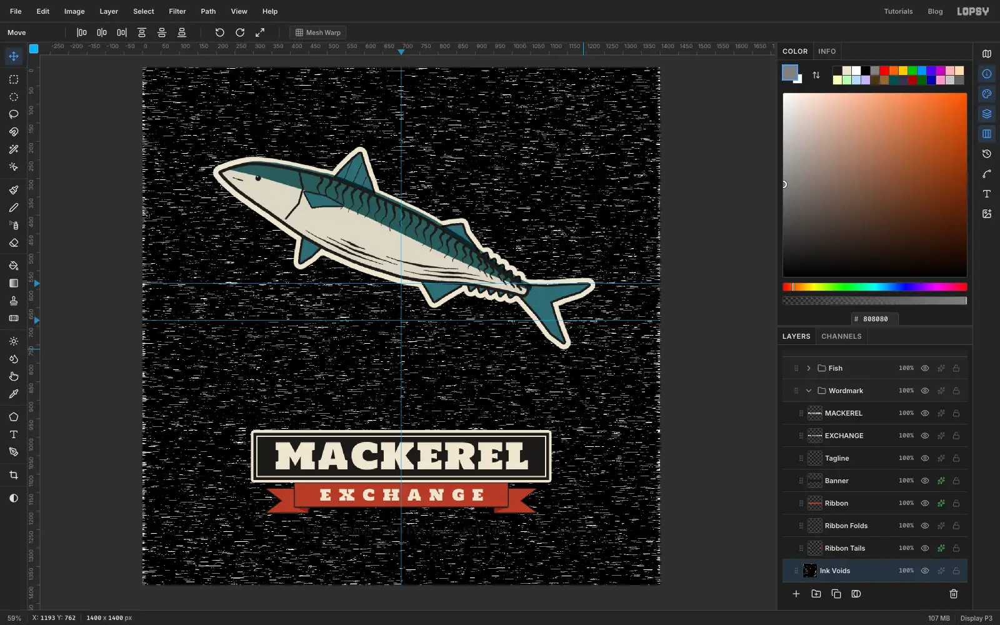

Large black areas on a woodcut never print solid. You'll make a texture of fine horizontal streaks and use it to knock tiny holes out of every black block.

1. Click `Waves` and add a layer called `Ink Voids` above it. Fill it with mid grey `#808080`.
2. Choose **Filter → Add Noise…**, **Amount** `100`, **Mono**. Then **Filter → Motion Blur…**, **Angle** `0`, **Distance** `24`. The noise smears into horizontal streaks along the grain.
3. Choose **Filter → Threshold…** and set **Level** to `138`. Only the brightest streaks stay white, a sparse scatter of short dashes. Raise the level if you get more than that.

## Knock the voids out of every black

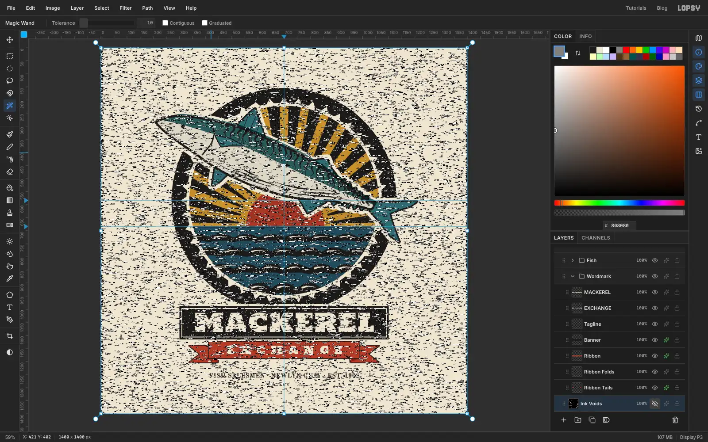

1. Pick the **Magic Wand**. Untick **Contiguous** and set **Tolerance** to `10`. Click any white fleck. Every white fleck on the layer is selected at once.
2. Hide `Ink Voids` with the eye on its row.
3. Click `Ring` and press [[Delete]]. Do the same on `Rays` and `Waves`. Then expand the `Wordmark` and `Fish` groups and do the same on `Banner` and `Fish Key`. Each black block now has the same pale streaks running in the same direction, like ink that didn't quite reach every part of the wood.
4. Press [[⌘+D]] and delete the `Ink Voids` layer.

## Save and export

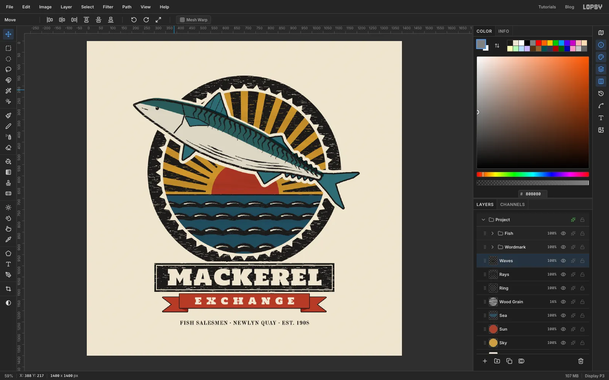

1. Choose **View → Show Guides** to hide the guides.
2. Choose **File → Save Project** to keep the layers, and **File → Quick Export PNG** for the logo.

> **Tip:** At small sizes, use only the emblem and `MACKEREL`. The tagline and the sawtooth become too fine below about 300 px wide.
