Y2K design is the future as people pictured it around 1999: chrome lettering, wide techno type, glossy plastic buttons, wireframe globes and little four-point sparkles. Here you'll use that look on the cover of an invented techno-thriller, **Millennium Insomnia**, about a girl who can't sleep through the last minute of the millennium. The cover is a night scene, so the usual pastel Y2K sky becomes deep violet, with chrome and cyan glowing against it.

Everything is drawn in Lopsy. Along the way you'll use:

- the **Shape** tool with a stroke and no fill to draw a **wireframe globe**, then tilt it with the rotation handle
- an Option-subtracted marquee and a seven-stop gradient for a **liquid-chrome crescent**, with **Pillow Emboss** for relief
- **copy, paste and scale** to repeat a sparkle
- **Chromatic Aberration** on a duplicate of the title for an RGB-split ghost
- **text on a path** that runs all the way round the globe
- an **LCD clock** made from rounded rectangles, with a gloss strip cut by an **intersecting marquee**
- the **Pen** tool and **Path to Selection** for a starburst sticker, rotated as a **group**
- **Copy Merged** and **Radial Blur** for a light burst
- **Define Pattern** scanlines with a **layer mask** that keeps them off the title and moon
- **Vignette** and **Saturation & Vibrance** on the whole document

The document is **1200 × 1800 px**, a 2:3 paperback cover.

The fonts are free Google Fonts:

- **Days One** for INSOMNIA
- **Michroma** for MILLENNIUM, A NOVEL and COMPLIANT
- **Electrolize** for the ring text and the tagline
- **VT323** for the clock digits
- **Zen Dots** for the sticker's Y2K
- **IBM Plex Mono** for the review quote
- **Syncopate** (Bold) for the author name

The palette:

- Night sky `#07081F` → `#171139` → `#33174D`
- Aura lilac `#9A7CF0`, aqua `#4CD6D8`, pink `#E46CC4`, floor glow `#7A4FD0`
- Wireframe `#74E6EE`
- Moon chrome `#FFFFFF` → `#CDD5F0` → `#A7AED6` → `#8E7FC2` → `#B790D6` → `#F4E8FF` → `#FFFFFF`
- Title chrome `#FFFFFF` → `#C3CBEE` → `#262256` → `#C69AE0` → `#FFF4FF`
- MILLENNIUM `#4CD6D8` → `#C9B8FF` → `#E46CC4`
- Clock bezel `#FFFFFF` → `#B9C2E6` → `#2A2660` → `#B790D6` → `#F6EEFF`
- LCD screen `#040A1C`, digits `#7CFFF0`
- Sticker `#E46CC4`, disc `#F27FD0`, sticker ink `#2A0B3A`
- Ring text `#E6DEFF`, quote `#B9AEE8`, tagline `#DCD3FF`
- Author `#F3EFFF`, pill outline `#B9A8F5`, hairline `#8F7BC8`
- Glow colours `#2A2160`, `#1C1A42`, `#FFC8F0`

A few habits make the whole build easier:

- **Exact marquees.** With nothing selected, click once on the canvas with the Rectangular or Elliptical Marquee. A dialog opens where you type the corners (From X/Y, To X/Y). It only opens when nothing is selected, so press [[⌘D]] first.
- **⌘-click a thumbnail** in the Layers panel to select that layer's pixels. That's how gradients stay inside a shape.
- **The sparkle icon** on a layer's row opens its effects drawer. The **Blend** mode lives there too. Click the percentage on a row to change the layer's opacity.
- **New layers appear right above the selected layer.** Click the layer you want to build on before you add the next one.
- **Select a non-text layer before you start new text.** If a text layer is selected, changing the font or size restyles that layer instead.
- **Rename layers as you go** (double-click the name), because later steps refer to them by name.
- **Read the pointer position in the status bar.** The X and Y at the bottom left are in document pixels, so you can drag to a target point.
- **Edit → Fill uses the foreground colour.** Set the colour first, then fill.
- **Gradient stops carry over** from one gradient to the next. In the Gradient Editor, select a stop you don't need and click the trash button to delete it before you set the new colours.
- **Shapes grow from the point you press.** Press at the centre and drag out to a corner. Hold [[⌘]] while dragging to keep a circle round.

## Set up the guides

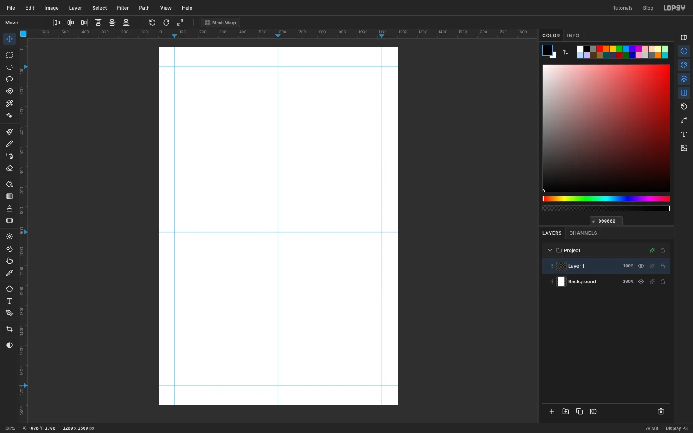

Create a **1200 × 1800** document. Click the top ruler at **80**, **600** and **1120** to drop three vertical guides: the two side margins and the centre line. Click the left ruler at **100**, **930** and **1700** for three horizontal guides: the top margin, the centre of the globe and the bottom margin.

## Paint the midnight sky

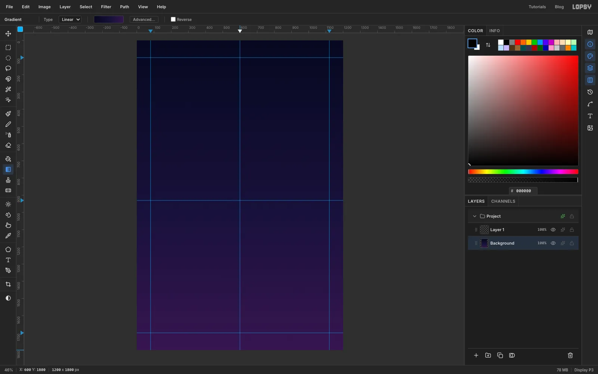

Select **Background** and choose the **Gradient** tool. Set **Type** to **Linear** and click **Advanced…**. Make three stops: `#07081F` on the left, `#171139` at about 55% and `#33174D` on the right. Click a stop to type its hex, and click the bar to add a stop. Drag from the top edge of the canvas straight down to the bottom.

## Drop three colour pools

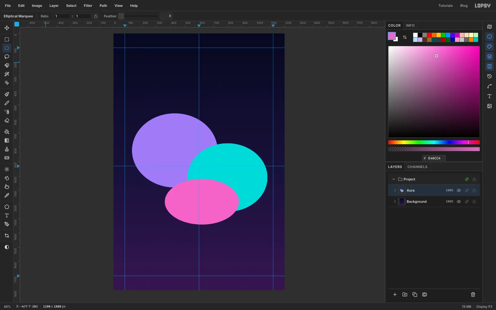

Select **Layer 1** and rename it `Aura`. With the **Elliptical Marquee**, drag a big oval a little up and left of the centre, about 600 px wide and 520 px tall. Set the foreground colour to `#9A7CF0` and choose **Edit → Fill**, then press [[⌘D]]. Fill a second oval of about the same size in `#4CD6D8`, overlapping it down and to the right. Fill a flatter oval, about 520 × 320 px, in `#E46CC4` underneath the two, around the bottom of the centre line.

## Blur them into an aura

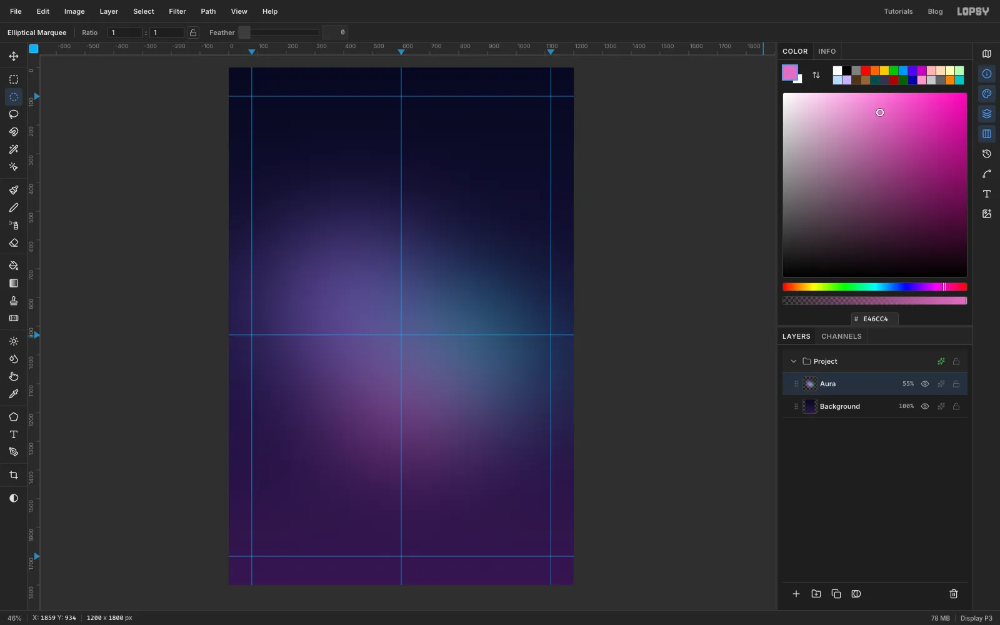

Run **Filter → Gaussian Blur...** with a **Radius** of **160**. Open the effects drawer, set **Blend** to **Screen**, and set the layer's opacity to **55%**. The hard ovals melt into a soft iridescent glow where the globe will go.

## Add smoke and a floor glow

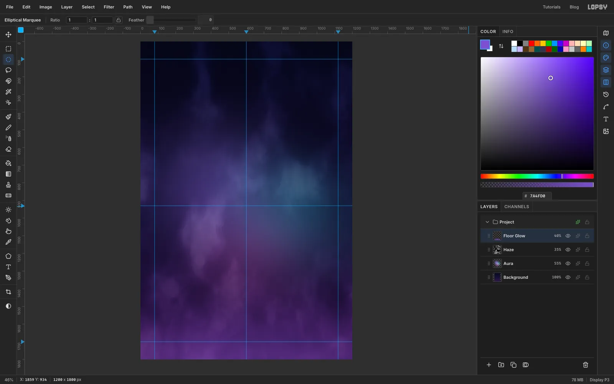

Click **Add Layer** and name it `Haze`. Run **Filter → Smoke...** with **Scale 6** and **Turbulence 60**. Set **Blend** to **Soft Light** and the opacity to **35%**.

Add another layer, `Floor Glow`. Draw an oval about 1280 × 340 px centred on the bottom edge of the canvas, so only its top half is on the page. Fill it with `#7A4FD0`, deselect, blur it by **120** and set it to **Screen** at **40%**. It lifts the bottom of the cover so it doesn't go dead.

## Draw the globe outline

Add a layer called `Globe`. Choose the **Shape** tool and set **Shape** to **Ellipse** and **Output** to **Pixels**. Click the **Fill** swatch and choose **Remove fill**. Click the dash next to **Stroke**, type `#74E6EE` and set **Width** to **3**.

Press at the crossing of the centre guides (600, 930), hold [[⌘]], and drag down and right until the status bar reads about **900, 1230**. That makes a circle about **600 px** across.

## Add meridians and parallels

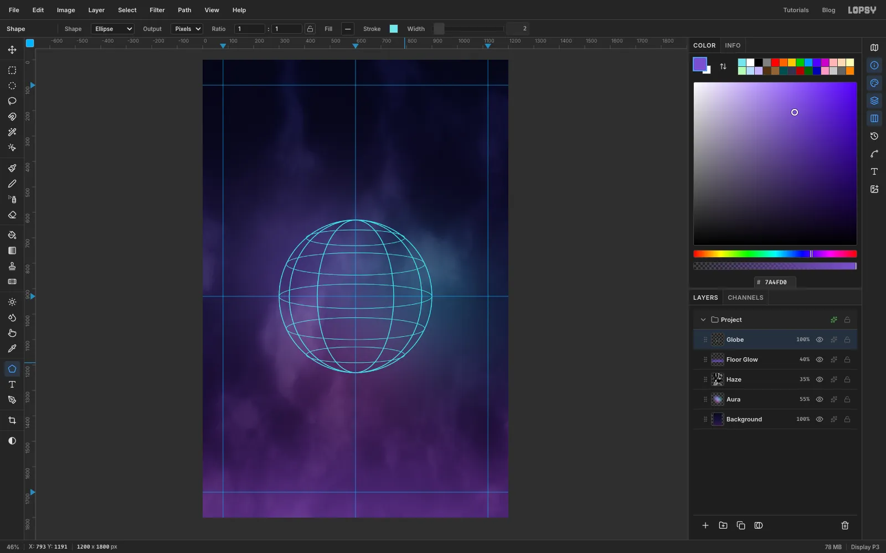

The meridians are ovals as tall as the globe but narrower. Without [[⌘]], press at the same centre point and drag out to the bottom edge of the circle. Make one oval about **520 px** wide (drag to x 860) and another about **300 px** wide (drag to x 750).

Set **Width** to **2** for the parallels. They're flat ovals stacked down the globe. Draw one through the centre as wide as the globe and about 100 px tall. Draw two more about 125 px above and below it, slightly narrower. Draw two near the poles, about 230 px above and below the centre and roughly two-thirds the globe's width. Keep each one about a sixth as tall as it is wide.

## Tilt the globe

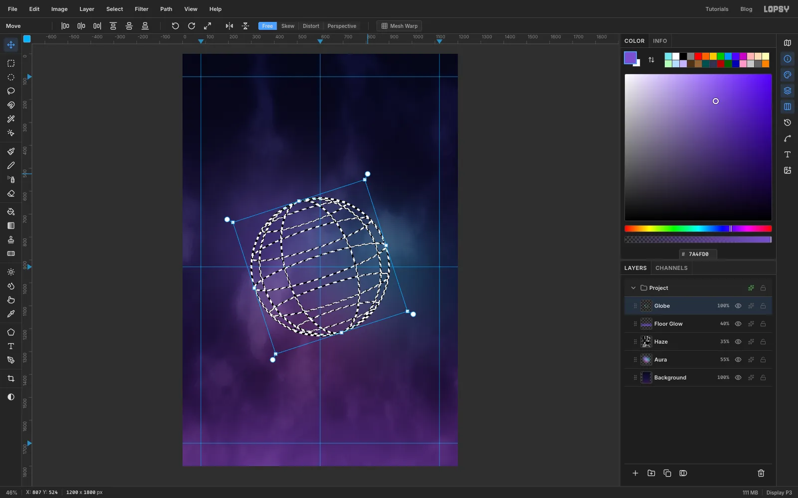

⌘-click the **Globe** thumbnail to select its pixels and switch to the **Move** tool. Drag a rotation handle (the round handles just outside the corners) anticlockwise by about **18°**, so the globe looks tipped on its axis. Press [[⌘D]] to commit.

## Make the globe glow

Open the Globe's effects drawer and turn on **Outer Glow**. Set the colour to `#4CD6D8`, **Size** to **14** and **Opacity** to **70**.

## Cut a crescent

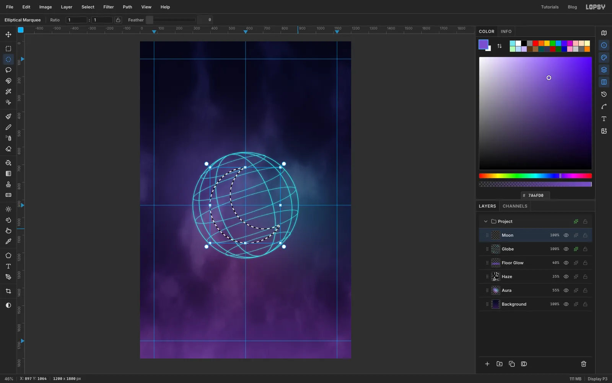

Add a layer called `Moon`. With nothing selected, click the canvas with the **Elliptical Marquee** and type a circle: From **398, 715** To **828, 1145**. That's a 430 px circle on the globe's centre line, set a touch right of centre.

Now hold [[Option]] and drag a second circle a little smaller than the first, shifted about 90 px right and 60 px up, so it bites out the upper right. Holding Option subtracts it, leaving a crescent that opens to the upper right.

## Fill the crescent with chrome

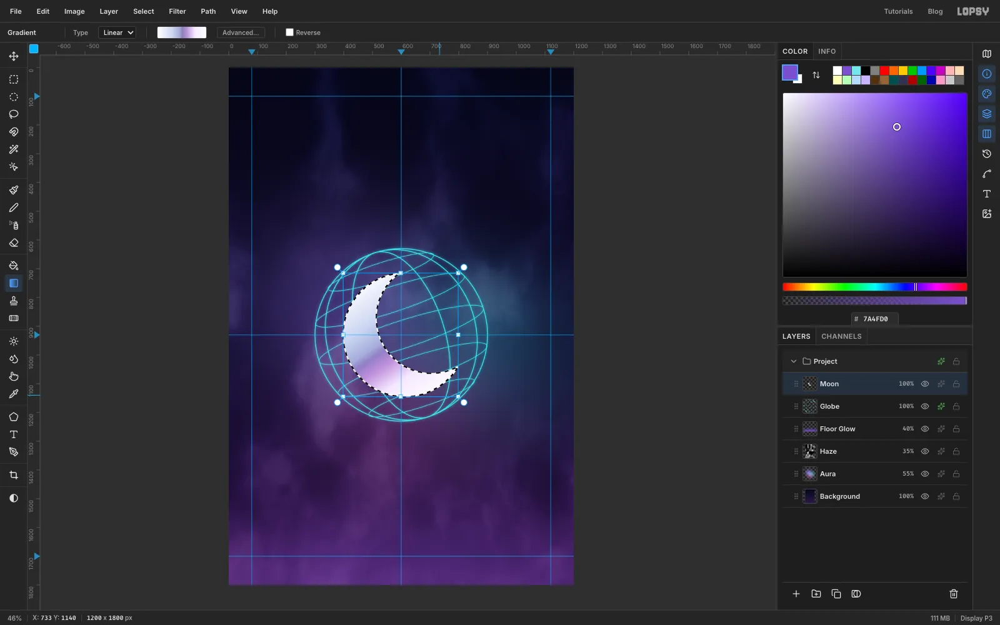

Chrome is a gradient that looks like a reflected sky over a dark horizon. With the **Gradient** tool on **Linear**, open **Advanced…** and set seven stops:

- `#FFFFFF` at 0%
- `#CDD5F0` at 30%
- `#A7AED6` at 45%
- `#8E7FC2` at 51%
- `#B790D6` at 60%
- `#F4E8FF` at 78%
- `#FFFFFF` at 100%

Drag from just above the moon's top-left edge to below its lower tip, a long diagonal slightly steeper than 45°. The dark violet band becomes the moon's horizon reflection. Press [[⌘D]].

## Give the moon depth and a glow

Open the Moon's effects drawer. Turn on **Inner Glow** with `#2A2160`, **Size 22** and **Opacity 65**, which darkens the edges so the crescent looks rounded. Then turn on **Outer Glow** with `#9A7CF0`, **Size 40** and **Opacity 55**.

## Pillow-emboss a grey copy

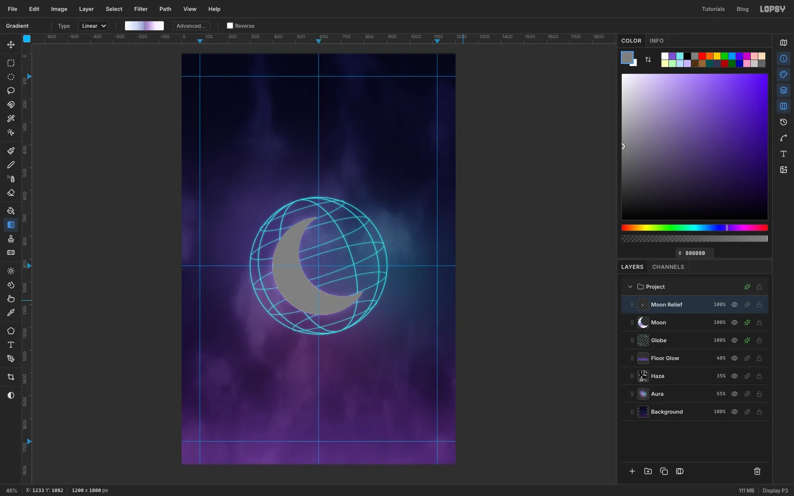

Add a layer called `Moon Relief`. ⌘-click the **Moon** thumbnail, set the foreground colour to `#808080` and choose **Edit → Fill**. Press [[⌘D]].

Run **Filter → Emboss...** with **Angle 135**, **Strength 14** and **Type** set to **Pillow Emboss**. Pillow emboss lights the inside edge, which makes a flat shape look inflated.

## Overlay the relief

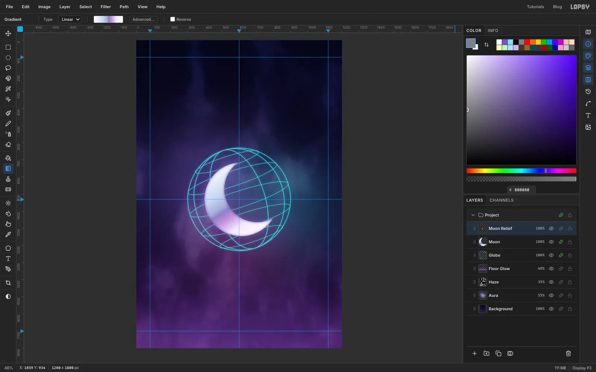

The emboss leaves a little grey outside the crescent. ⌘-click the **Moon** thumbnail again, choose **Select → Inverse** and press [[Delete]], then [[⌘D]]. Set **Moon Relief** to **Overlay**. The grey vanishes, and only the light and shade of the bevel stay on the chrome.

## Add a gloss streak

Add a layer called `Moon Gloss`. With the **Lasso**, draw a thin sliver that follows the outer curve on the upper left, just inside the edge, about 12 px thick in the middle and tapering to points at both ends. Set the foreground to white, fill it and press [[⌘D]].

Blur it by **5** (Gaussian Blur). ⌘-click the **Moon** thumbnail, choose **Select → Inverse** and press [[Delete]] so the gloss can't spill past the edge. Deselect and set the layer to **Screen**.

## Draw the first sparkle

Add a layer called `Sparkles`. Just above and right of the moon's upper tip, lasso a four-point sparkle about 140 px across. Start at the top point and curve inward to the right point, then the bottom, then the left, then back to the top. With white as the foreground, fill it and press [[⌘D]].

## Paste a copy and move it

Draw a marquee around the sparkle, press [[⌘C]] and then [[⌘V]]. The copy pastes in place on a new layer. With the **Move** tool, drag it up and to the left until it sits just outside the globe's top-left edge.

## Scale the copy down

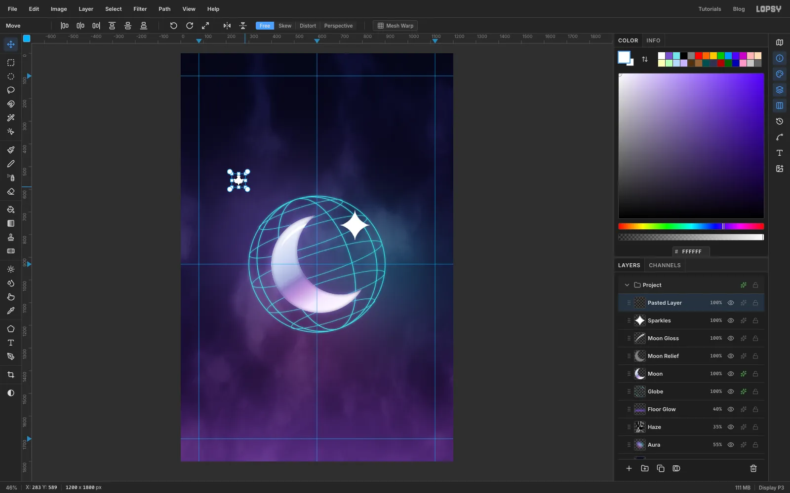

⌘-click the pasted layer's thumbnail so handles appear around it. Hold [[⌘]] to keep the proportions, and drag the bottom-right handle in until the sparkle is a little under half its size, about 60 px across. Press [[⌘D]], then choose **Layer → Merge Down** to put it back on `Sparkles`.

Do the same once more for a copy just outside the globe's right side, below its middle, scaled to about 56 px.

## Scatter the small sparkles

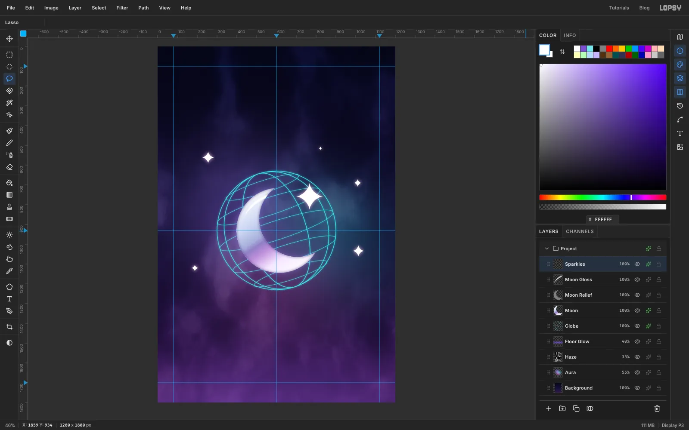

On `Sparkles`, lasso and fill three smaller sparkles: a 36 px one at the lower left, a 40 px one at the upper right, and a tiny one above the globe, to the right of the centre guide. Keep them clear of the ring of text that will circle the globe, about 350 px from its centre.

Turn on **Outer Glow** with `#FFC8F0`, **Size 26** and **Opacity 90**.

## Set INSOMNIA

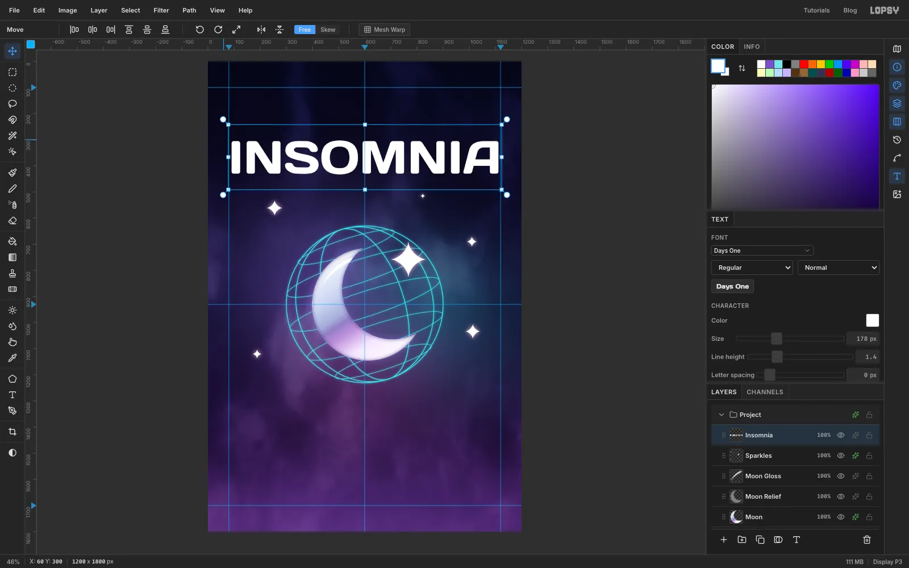

With **Sparkles** selected, choose the **Text** tool. Set the font to **Days One**, the size to **178** and the colour to white. Click in an empty area, type `INSOMNIA` and press [[Tab]]. Rename the layer `Insomnia`.

Switch to the **Move** tool and position the word so it spans just inside the margin guides (about 90 to 1110), centred on the centre guide. Its letters should sit between about y 300 and y 430.

## Make an RGB-split ghost

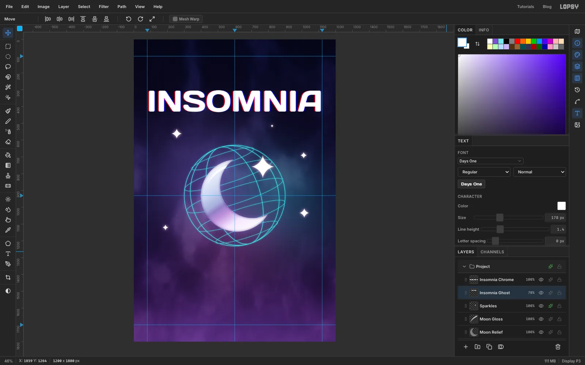

Click **Rasterize Layer** at the bottom of the Layers panel, then **Duplicate Layer**. Rename the copy `Insomnia Chrome`. It should sit exactly over the original; if it's offset, nudge it back with the arrow keys. Rename the original, underneath, to `Insomnia Ghost`.

Select **Insomnia Ghost** and run **Filter → Chromatic Aberration...** with **Amount 6** and **Direction 0**. Set it to **Screen** at **70%**. Only thin red and blue fringes show past the edges of the copy on top.

## Fill the title with chrome

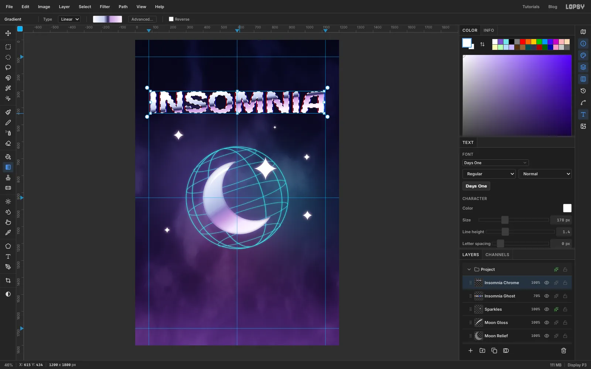

Select **Insomnia Chrome** and ⌘-click its thumbnail. With the **Gradient** tool, open **Advanced…** and delete stops until five are left. Set them to `#FFFFFF` at 0%, `#C3CBEE` at 38%, `#262256` at 52%, `#C69AE0` at 60% and `#FFF4FF` at 100%. Drag from the top of the letters to their bottom, leaning slightly to the right, so the hard dark line runs just below the middle with a slight slant. Press [[⌘D]].

## Glow the title

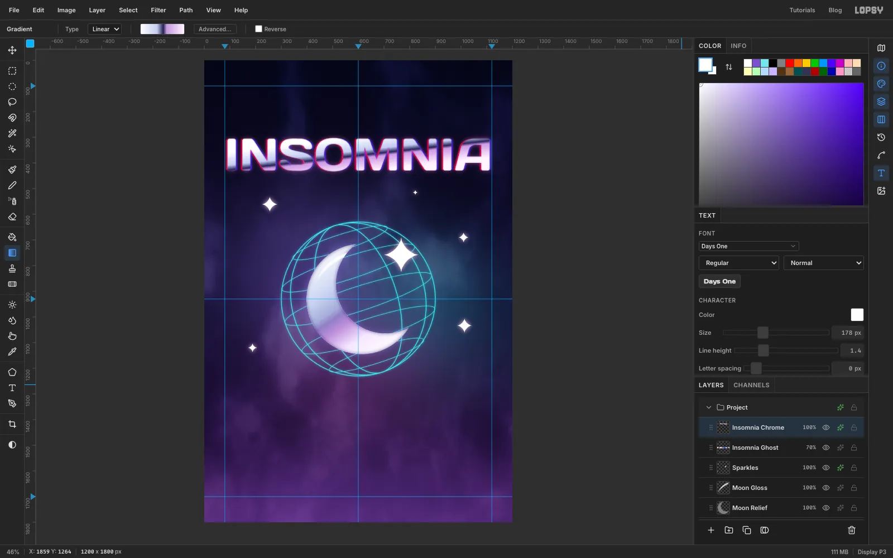

Open its effects drawer. Turn on **Inner Glow** with `#1C1A42`, **Size 6** and **Opacity 60**. Then turn on **Outer Glow** with `#E46CC4`, **Size 26** and **Opacity 60**.

## Add MILLENNIUM above it

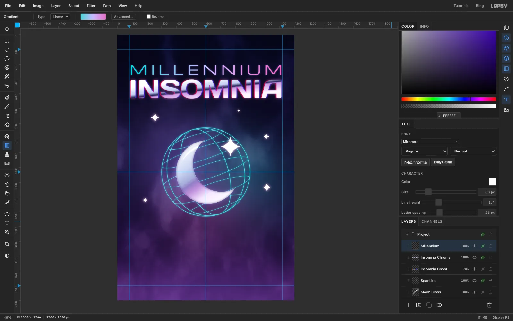

With **Insomnia Chrome** still selected, choose the **Text** tool and set **Michroma** at **88**, white. Type `MILLENNIUM`, press [[Tab]], rename the layer `Millennium` and set **Letter spacing** to **26** in the Text panel. Move it so it spans the same width as INSOMNIA, with its letters from about y 207 to y 273. That leaves a gap of about 30 px above INSOMNIA.

Rasterize it and ⌘-click its thumbnail. Delete stops until three are left and set them to `#4CD6D8` at 0%, `#C9B8FF` at 50% and `#E46CC4` at 100%. Drag from the left end of the word straight across to the right end. Deselect and add an **Outer Glow** of `#9A7CF0`, **Size 16**, **Opacity 45**.

## Draw a circle path for the ring text

Choose the **Shape** tool, keep **Ellipse**, and set **Output** to **Path**. Press at the globe's centre (600, 930), hold [[⌘]] and drag out to make a circle about **692 px** across (a radius of 346). It appears in the Paths panel as `Path 1`.

## Run the text round the globe

Select **Globe**, so the text sits under the moon. Choose the **Text** tool with **Electrolize** at **26** and the colour `#E6DEFF`. Click in an empty area and type `ARE YOU STILL AWAKE?  +  ` five times, with two spaces either side of each plus. Press [[Tab]], rename the layer `Ring Text` and set **Letter spacing** to **4**.

In the Text options bar, set **Path** to **Path 1**. The text wraps round the circle, starting at the top. Check the seam at the top: every plus should have the same space either side. If the end crowds into the start, the text is too long for the circle. Lower **Letter spacing** by 0.5, or draw the circle a few pixels bigger. If the gap at the seam is wider than the others, do the opposite. To redraw, delete `Path 1` in the Paths panel, draw a new circle and pick it under **Path**. When the seam is even, click the path in the Paths panel to deselect it, so its outline stops showing.

## Draw the clock bezel

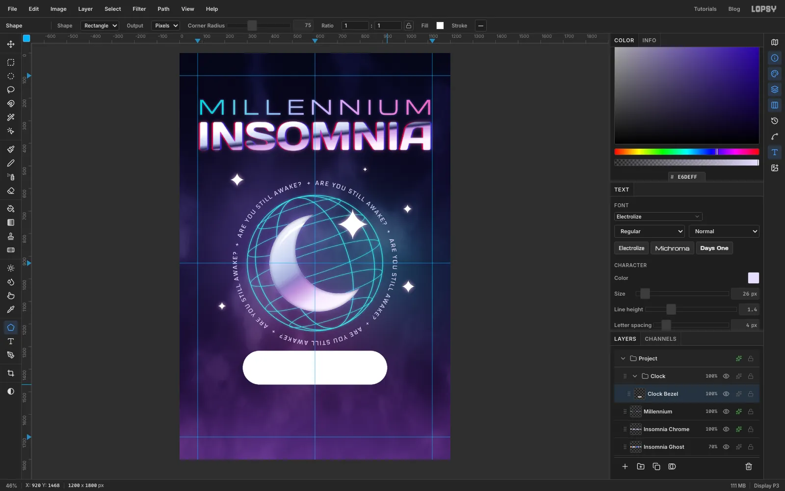

Select **Millennium**, click **New Group** and name it `Clock`. Add a layer inside it called `Clock Bezel`.

With the **Shape** tool, set **Shape** to **Rectangle**, **Output** to **Pixels**, the fill to white, no stroke and **Corner Radius** to **75**. Press on the centre guide where the status bar reads y **1393**, and drag down and right to about **920, 1468**. That makes a pill **640 × 150 px**.

## Chrome the bezel and add the screen

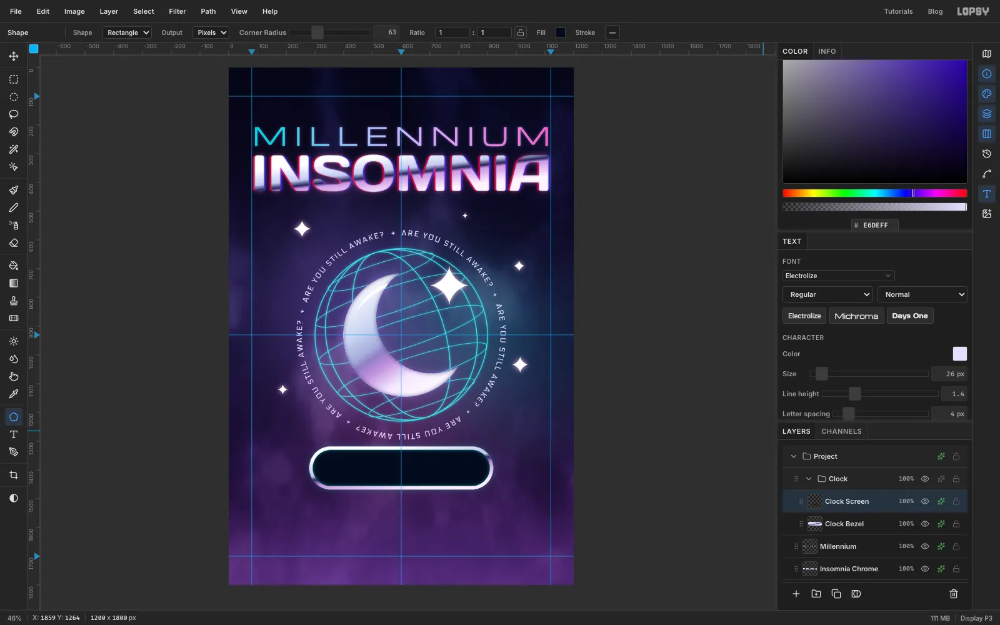

⌘-click the **Clock Bezel** thumbnail and fill it with a vertical chrome gradient of five stops: `#FFFFFF` at 0%, `#B9C2E6` at 42%, `#2A2660` at 50%, `#B790D6` at 62% and `#F6EEFF` at 100%. Drag from the top of the pill to the bottom. Deselect and give it an **Outer Glow** of `#4CD6D8`, **Size 30**, **Opacity 30**.

Add a layer called `Clock Screen`. Draw another rounded rectangle from the same centre, with fill `#040A1C` and **Corner Radius 63**. Press at the same point (600, 1393) and drag to about **908, 1456**, for a **616 × 126 px** screen with a 12 px chrome rim all round. Give it an **Inner Glow** of `#4CD6D8`, **Size 18**, **Opacity 55**.

## Type the time

With **Clock Screen** selected, set the Text tool to **VT323** at **128** with the colour `#7CFFF0`. Type `23:59:59`, press [[Tab]], rename the layer `Digits` and set **Letter spacing** to **6**. Centre the digits in the screen. They should have about the same space above and below, and roughly 90 px either side. Add an **Outer Glow** of `#4CD6D8`, **Size 22**, **Opacity 60**.

## Cut a gloss strip with an intersecting marquee

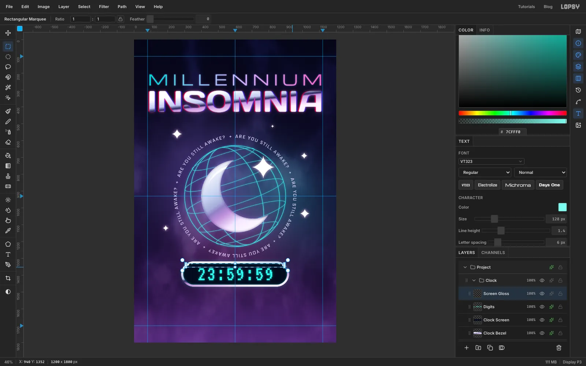

Add a layer called `Screen Gloss`. ⌘-click the **Clock Screen** thumbnail. With the **Rectangular Marquee**, hold [[Shift]] and [[Option]] and drag a rectangle from above the top-left of the pill across to the right, ending just above the tops of the digits. Holding both keys intersects the two shapes, leaving only a rounded strip along the top of the screen.

Fill it with white (set the foreground first), deselect, set it to **Screen** and set the opacity to **16%**. That's the glassy Aqua-button highlight.

## Draw the starburst with the Pen

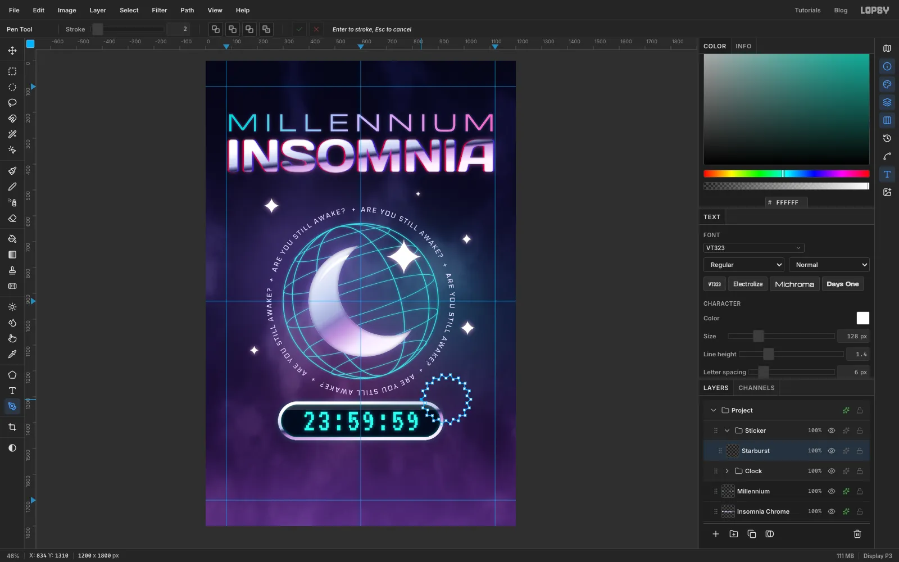

Collapse the **Clock** group, select its row, click **New Group** and name it `Sticker`. Add a layer called `Starburst`.

Choose the **Pen** tool. Centred at about (930, 1310), where the starburst overlaps the right end of the clock, click corner points round in a circle. Alternate between an outer ring about 96 px from the centre and an inner ring about 82 px from it, for 18 points. That's 36 clicks, one every 10°. Zoom in first, and don't worry if it isn't perfect: a slightly uneven edge looks more like a real die-cut sticker. Click the first anchor to close the path.

## Turn the path into a sticker

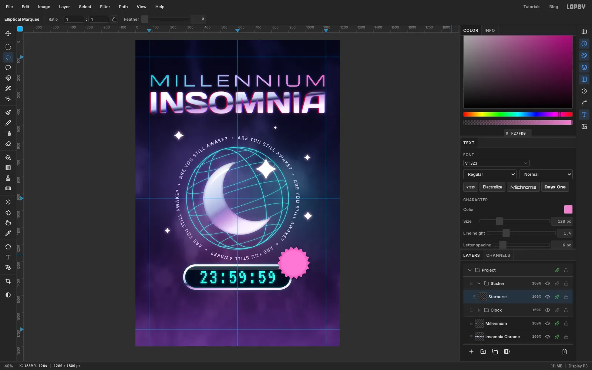

In the **Paths** panel, click **Path to Selection**, then **Delete Path**. Set the foreground to `#E46CC4`, choose **Edit → Fill** and press [[⌘D]]. With the **Elliptical Marquee**, draw a circle about 148 px across on the same centre and fill it with `#F27FD0` for the inner disc.

Turn on **Drop Shadow** with the colour `#12051F`, **Offset X 4**, **Offset Y 7**, **Blur 10** and **Opacity 60**.

## Letter the sticker

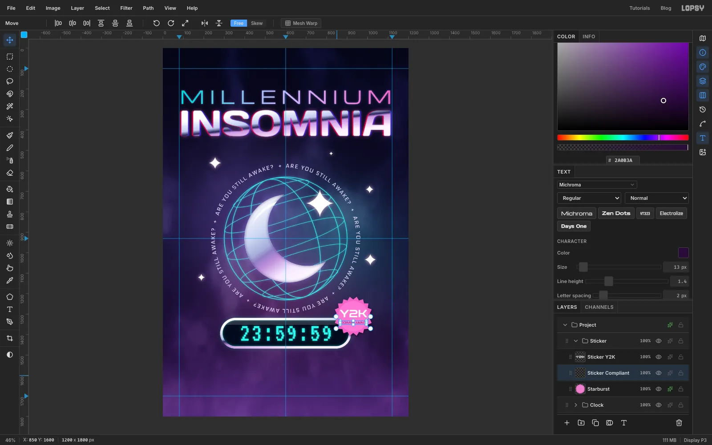

With **Starburst** selected, set the Text tool to **Zen Dots** at **50**, white, type `Y2K` and press [[Tab]]. Set **Letter spacing** to **0** (it remembers the 6 from the clock) and rename the layer `Sticker Y2K`. Centre it slightly above the middle of the disc.

Select **Starburst** again so the next text doesn't restyle Y2K. Set **Michroma** at **13** in `#2A0B3A`, type `COMPLIANT`, press [[Tab]], set **Letter spacing** to **2** and rename it `Sticker Compliant`. Centre it under Y2K, inside the disc.

## Rotate the whole sticker

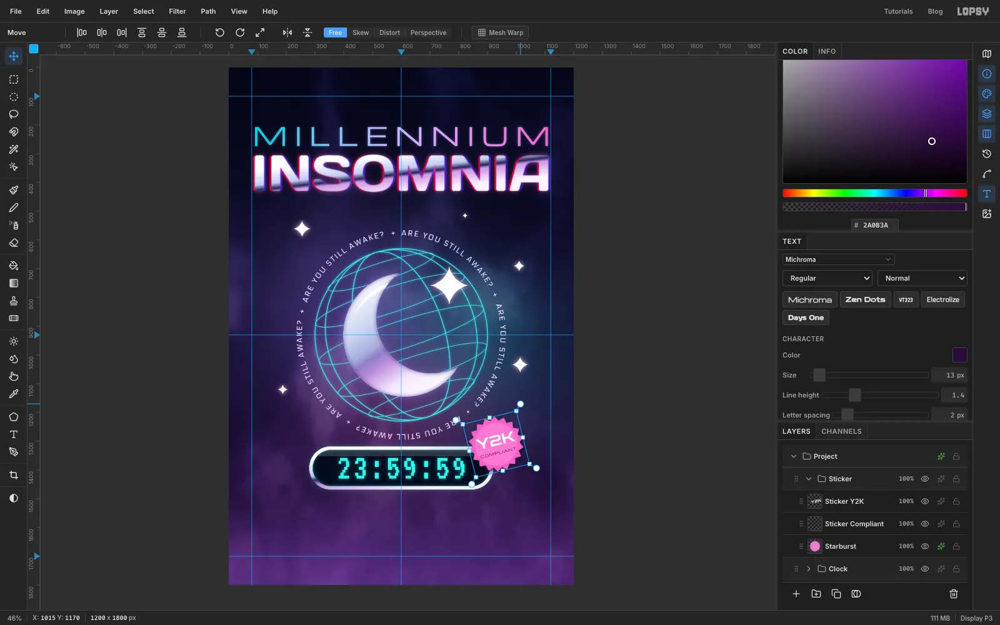

Click the **Sticker** group's row and press [[⌘D]]. With the **Move** tool, drag a rotation handle anticlockwise by about **14°**. Everything in the group, text included, turns together. Press [[Escape]] to commit it. Escape drops the Move tool's transform into the layers, just like [[⌘D]].

## Add the A NOVEL pill

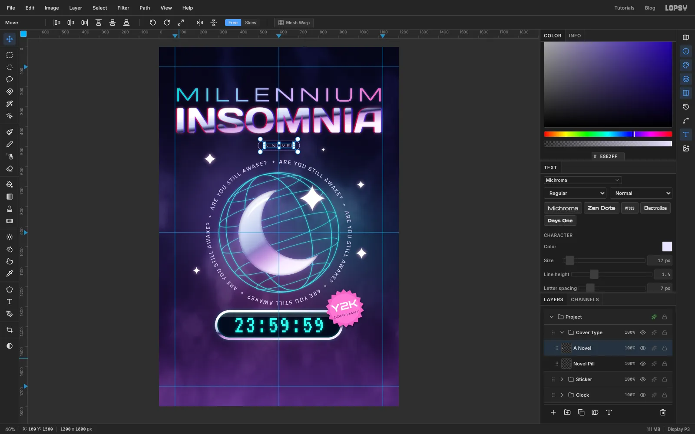

Collapse **Sticker**, select its row, click **New Group** and name it `Cover Type`. Add a layer called `Novel Pill`.

With the **Shape** tool on **Rectangle**, remove the fill, set the stroke to `#B9A8F5`, **Width 2** and **Corner Radius 23**. Press on the centre guide at about y **494** and drag out to a **208 × 46** pill.

Type `A NOVEL` in **Michroma** at **17**, `#E8E2FF`, with **Letter spacing 7**. Press [[Tab]] and rename it `A Novel`. Centre it in the pill so the gap is equal on the left and the right.

## Set the quote, tagline and author

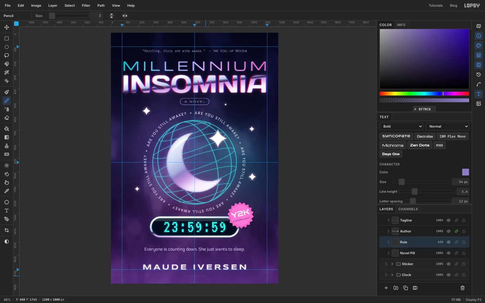

Select **Novel Pill** before each new piece of text, and rename each layer after you press [[Tab]] (`Review Quote`, `Tagline`, `Author`):

- **Review quote:** `“Dazzling, dizzy and wide awake.”  — THE DIAL-UP REVIEW` in **IBM Plex Mono** at **21**, `#B9AEE8`, **Letter spacing 1**, centred just below the top guide (around y 132).
- **Tagline:** `Everyone is counting down. She just wants to sleep.` in **Electrolize** at **31**, `#DCD3FF`, **Letter spacing 0**, centred about 70 px below the clock.
- **Author:** choose **Syncopate** and set **Font weight** to **Bold** before typing `MAUDE IVERSEN` at **54**, `#F3EFFF`, **Letter spacing 12**. Centre it around y 1680 and add an **Outer Glow** of `#9A7CF0`, **Size 18**, **Opacity 50**.

For the hairline, add a layer called `Rule`. Pick the **Pencil** at **Size 2** with `#8F7BC8`. Click about 80 px left of the centre guide, a little under the name (y 1745), then hold [[Shift]] and click the same distance right of the guide to draw a straight line about 160 px long. Set the layer to **45%**.

## Group the title and nudge it

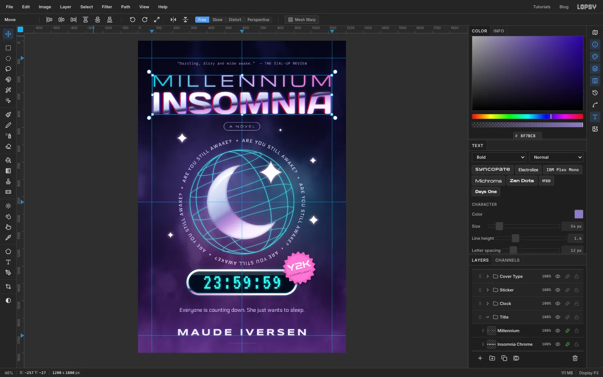

Click **Insomnia Ghost**, then Shift-click **Millennium** to select all three title layers. Choose **Layer → Group Layers** and name the group `Title`. With the group selected and the **Move** tool active, press [[↑]] eight times. The title moves up 8 px as one piece, which evens the space above and below it.

## Add a light burst

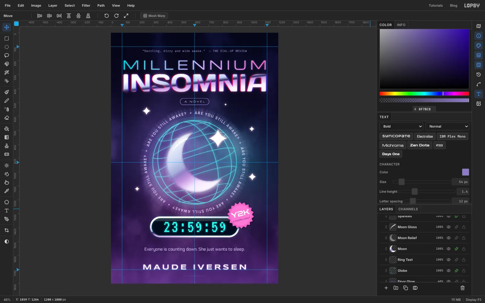

Select **Sparkles**. With the Elliptical Marquee, click once and type a circle round the globe: From **240, 570** To **960, 1290**. Choose **Edit → Copy Merged**, then **Edit → Paste**. Rename the new layer `Light Burst` and press [[⌘D]].

Run **Filter → Radial Blur...** with **Amount 45**. Radial Blur zooms out from the canvas centre, which is almost exactly the globe's centre. Set it to **Screen** at **45%**. The burst also lays a faint copy of the wireframe over the moon. ⌘-click the **Moon** thumbnail and press [[Delete]] to clear it from there, then [[⌘D]].

## Make CRT scanlines

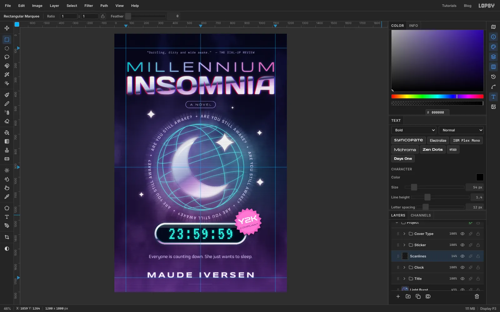

Collapse **Clock**, select its row and click **Add Layer**. The new layer lands above the clock but below the sticker and the cover type, so those stay crisp. Name it `Scanlines`.

Make a tiny tile with exact marquees. Select From **0, 0** To **4, 2**, set the foreground to black and fill it. Select From **0, 0** To **4, 4** and choose **Edit → Define Pattern**. Press [[Delete]] and [[⌘D]], then choose **Edit → Fill with Pattern...** and click **Apply**. The 2 px black, 2 px clear tile repeats into lines. Set the layer to **Multiply** at **14%**.

## Mask the scanlines off the title and moon

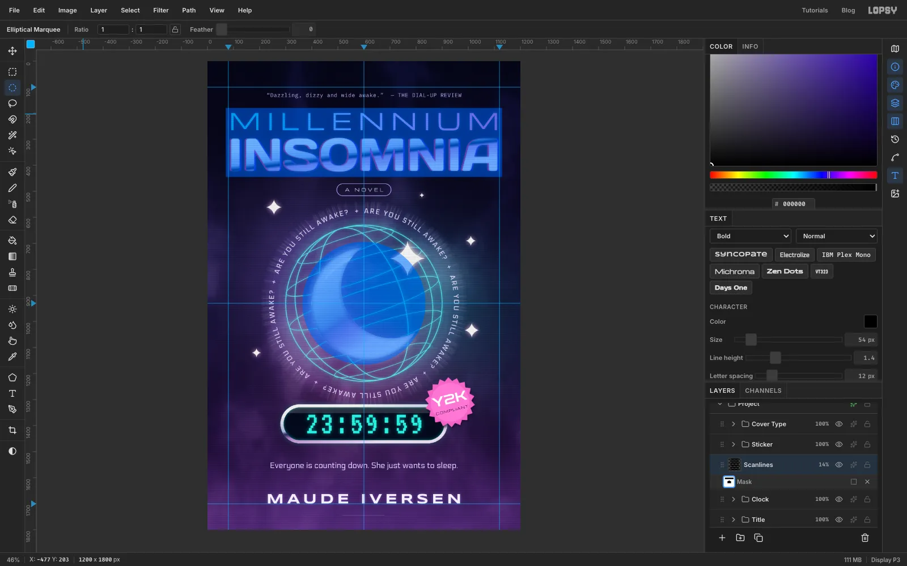

The lines stripe the chrome too hard, so mask them off the shiny parts. Click **Add Mask**, then click the mask thumbnail to edit it. With black as the foreground:

1. Select From **70, 180** To **1130, 445** with the Rectangular Marquee and choose **Edit → Fill**. That covers the title.
2. Select a circle From **364, 694** To **836, 1166** with the Elliptical Marquee and fill it. That covers the moon.

Press [[⌘D]] and click the **Scanlines** name to leave mask editing.

## Grade the whole cover

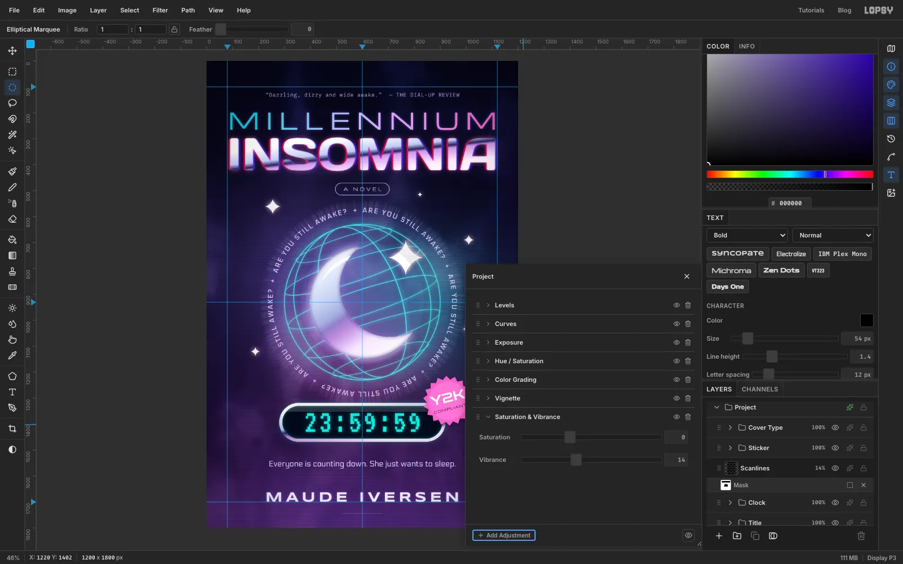

Click the sparkle icon on the **Project** row to open its adjustments. A new document already has five neutral nodes (Levels, Curves, Exposure, Hue / Saturation and Color Grading); leave those alone. Click **Add Adjustment → Vignette** and set **Vignette** to **34**. Then click **Add Adjustment → Saturation & Vibrance** and set **Vibrance** to **14**. The corners darken and the cyan and pink lift a little.

Turn off **View → Show Guides** and export with **File → Quick Export PNG**.
