In 1995 about 16 million people were online. Ten years later it was over a billion. In this tutorial you'll turn those numbers into a 2000 × 2800 px poster in the style of the time they describe: glass bubbles, chrome type, lime gel and pixel fonts. It's called **Online Lives**.

It's also a real chart, so the bubbles can't be any size you like. A bubble's **area** shows the number of people. To get that, each radius is 10 × the square root of the users in millions. Here are the numbers, with the diameter of each bubble and where its centre goes on the canvas. You'll come back to this list a few times.

- 1995: 16 million, 80 px across, centre at 135, 1805
- 1996: 36 million, 120 px, centre at 265, 1745
- 1997: 70 million, 168 px, centre at 425, 1775
- 1998: 147 million, 242 px, centre at 650, 1750
- 1999: 248 million, 314 px, centre at 950, 1760
- 2000: 361 million, 380 px, centre at 1312, 1720
- 2001: 513 million, 452 px, centre at 1712, 1490
- 2002: 587 million, 484 px, centre at 1240, 1240
- 2003: 719 million, 536 px, centre at 670, 1200
- 2004: 817 million, 572 px, centre at 450, 620
- 2005: 1,018 million, 638 px, centre at 1500, 440

The figures come from the table compiled by Internet World Stats, which credits IDC, the Computer Industry Almanac and Nua Ltd. for the early years. They're December figures, except for August 2001 and September 2002, and the poster says so in its footer.

You'll use the **Gradient** tool with transparent stops, the **Shape** tool's exact-size dialog, the marquee's exact-corners dialog, the **Pen**, the **Magic Wand**, **Fill with Pattern**, **Sunburst**, **Bloom**, **Hue/Saturation**, layer effects, groups, and scaling and rotating with the **Move** tool.

The fonts are free Google Fonts, all available in Lopsy's font picker: **Michroma** for numbers and the title, **Silkscreen** for pixel labels, and **Share Tech Mono** for the notes.

The palette:

- Sky `#050A3E` → `#0B23A8` → `#1457E0` → `#27BDEB`
- Glass `#BDFBFF` → `#53D8FF` → `#1FA8F5` → `#6CE4FF` → `#E8FFFF`
- Lime `#C6FF2E`, pale lime `#E9FF9A`
- Gel pill `#F4FF9C` → `#C6FF2E` → `#7DD400`
- Ice `#BFF6FF`, rays `#6FE9FF`, halo `#7DEBFF`
- Chrome `#FFFFFF` → `#D6E8FF` → `#6A8FDA` → `#0C1A5E` → `#FFF4D6` → `#F6C88F` → `#7B5FA8` → `#27358E` → `#CFEFFF`
- Ink `#071238`, outline `#06104A`, shadow `#03103A`, footer `#050A3E`

> **Tip:** Positions are written as `x, y` in document pixels. The status bar at the bottom of the window shows the cursor's position, so you can hover to find a spot. Key names use Mac keys. On Windows and Linux, use Ctrl for Cmd. A position that's a few pixels off won't show. The bubble sizes are the data, so take more care with those.

## Paint the sky

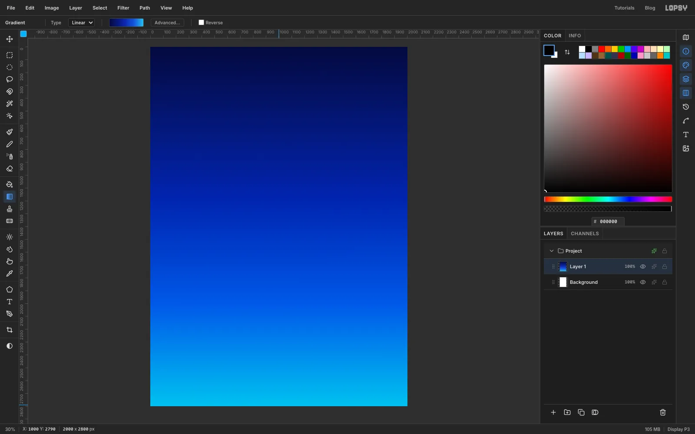

Open [Lopsy](/). In the **New Document** dialog, set **Width** to `2000` and **Height** to `2800` and click **Create**. The document starts with a white `Background` and an empty `Layer 1`, and `Layer 1` is selected.

1. Pick the **Gradient** tool in the toolbox. It has no keyboard shortcut. Set **Type** to **Linear** and click **Advanced…**.
2. Click the handle row to add stops, then click each handle and type its colour into the hex field. Use `#050A3E` at the far left, `#0B23A8` at 42%, `#1457E0` at 72% and `#27BDEB` at the far right. The readout shows each stop's position, and you can drag a handle to adjust it. Click **Done**.
3. Drag straight down the canvas from the top edge to the bottom edge.

## Draw one plus mark

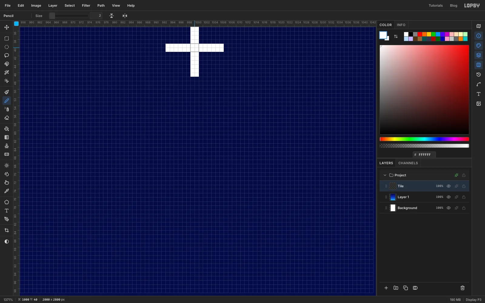

Y2K posters love a technical-looking grid. You'll draw one mark, then repeat it.

1. Click **Add Layer** in the Layers panel, double-click the new layer's name and rename it `Tile`.
2. In the **Color** panel, type `FFFFFF` into the hex field.
3. Press [[N]] for the **Pencil** and set **Size** to `2`.
4. Zoom in near the top centre of the canvas with [[Cmd]] and the scroll wheel. Click at `1000, 34`, then hold [[Shift]] and click at `1000, 46` to draw a short vertical line.
5. Click at `994, 40`, then [[Shift]]-click at `1006, 40` for the horizontal line.

Choose **View → Fit to Screen** when you're done.

## Turn it into a grid

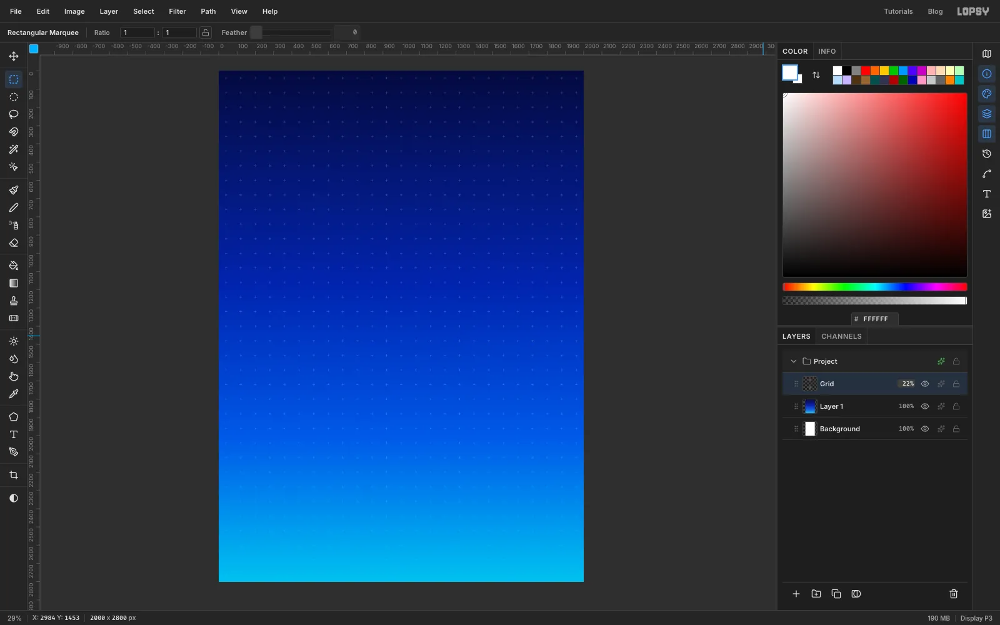

1. Press [[M]] for the **Rectangular Marquee**. Click once on the canvas without dragging, and a dialog asks for exact corners. Enter **From** `960, 0` and **To** `1040, 80`, then click **Select**. The plus sits in the middle of that 80 px square.
2. Choose **Edit → Define Pattern**, then press [[Cmd+D]] to deselect.
3. Click **Delete Layer** to remove `Tile`. The pattern stays.
4. Add a layer named `Grid` and choose **Edit → Fill with Pattern…**. Pick your pattern and click **Apply**.
5. Click the layer's effects button to open **Layer Effects**, and set **Blend** to **Screen**. Close the drawer.
6. Click the `100%` on the layer's row and drag the slider down to `22`. Close it by clicking the `22%` again.

## Add soft rays from the Earth's spot

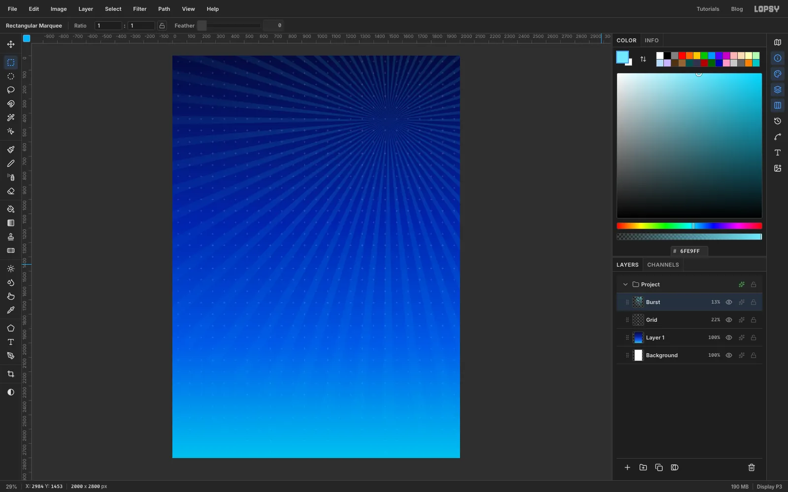

Add a layer named `Burst` and set the foreground to `#6FE9FF`. Choose **Filter → Sunburst…** and use these settings:

- **Rays** `60`, **Length** `75`, **Width** `38`, **Fade** `80`
- **Center X** `75` and **Center Y** `16`, which is the spot for the 2005 bubble

Click **Apply**. Set the layer's **Blend** to **Screen** and its opacity to `13`. The rays should be a texture you notice second, not a pattern that fights the labels.

## Draw two orbit rings

Add a layer named `Rings` and press [[U]] for the **Shape** tool. In the options bar:

1. Set **Shape** to **Ellipse** and **Output** to **Pixels**.
2. Click the **Fill** swatch and click **Remove fill**.
3. Click the dash next to **Stroke**, and type `BFF6FF` in the hex field. Click the bar at the very bottom of the window to close the popover. Clicking the canvas would draw a shape.
4. Set **Width** to `3`.

Now click once at `1500, 440` without dragging. The **Shape Size** dialog opens. Enter `690` for both **Width** and **Height** and click **Create**. A shape made this way is centred on your click. Click the same spot again and make another at `770`.

Set the layer's opacity to `30`. These rings are only decoration, so keep them faint. If they're strong, the 2005 bubble looks bigger than its number.

## Link the years with a thread

Add a layer named `Thread` and set the foreground to `#C6FF2E`.

1. Press [[P]] for the **Pen** and set **Stroke** to `8`.
2. Click once on each year's centre, in order from 1995 to 2005, using the list at the top. Plain clicks make straight segments, and straight lines through the centres keep every link aimed properly.
3. Press [[Enter]]. The path is stroked in lime.
4. Open the **Paths** panel from the icons on the far right, click **Delete Path**, and close the panel. You don't need the path any more.

## Mark every bubble's true size

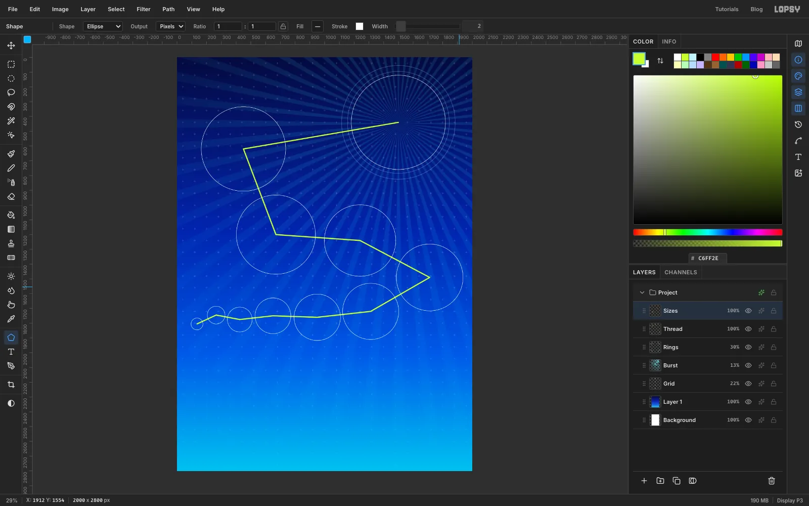

These circles are your plan. Every bubble you make later gets scaled to fit one of them.

1. Add a layer named `Sizes` and press [[U]].
2. Click the **Stroke** swatch, type `FFFFFF`, and click the bar at the bottom of the window. Set **Width** to `2`. **Fill** should still be off.
3. For each year, click its centre once, and enter its diameter for both **Width** and **Height** in the dialog.

## Bring in the Earth

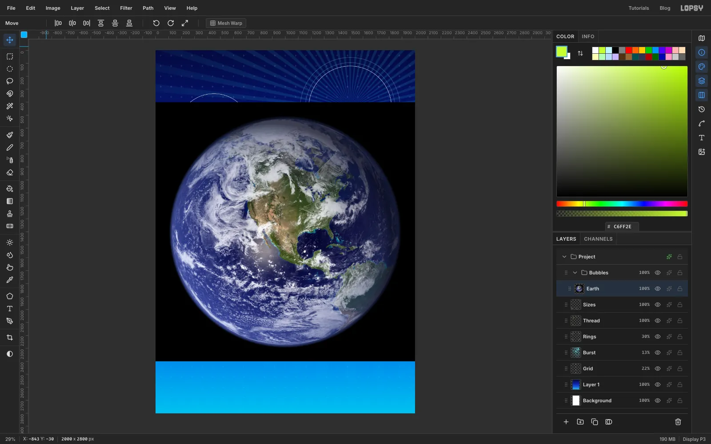

With `Sizes` selected, click **New Group** and name the group `Bubbles`. Keep the group selected so that what you add next lands inside it.

Download the [2002 NASA Earth photo](https://commons.wikimedia.org/wiki/File:NASA_Earth_America_2002.jpg) from Wikimedia Commons. It's public domain and 2048 px square. Drag the file onto the canvas. It's scaled to the width of the document and arrives selected, so press [[Cmd+D]], then rename the layer `Earth`.

## Cut out the globe

The photo's black square has to go.

1. Click the **Elliptical Marquee** in the toolbox, and click once on the canvas. Enter **From** `124, 537` and **To** `1864, 2277`, and click **Select**. That's a circle just inside the globe's dark edge.
2. Choose **Select → Inverse**, then press [[Delete]].
3. Press [[Cmd+D]].

Cutting slightly inside the edge removes the fuzzy dark rim, which would otherwise show as a dirty line against the glass.

## Shrink the Earth into place

Scale first, then move.

1. Press [[M]], click once on the canvas, and select **From** `122, 535` to **To** `1866, 2279`, which is just outside the globe.
2. Press [[V]] for the **Move** tool. Hold [[Cmd]] to keep the proportions, and drag the bottom-right corner handle up and to the left until the globe is just smaller than the 2005 guide, about 596 px wide. The guide is 638 px, so you'll see a gap of about 20 px on each side once it's in place.
3. Press [[Cmd+D]] to finish the scale.
4. Drag the globe until it's centred in the 2005 guide, with an even gap all round.

## Blow the glass

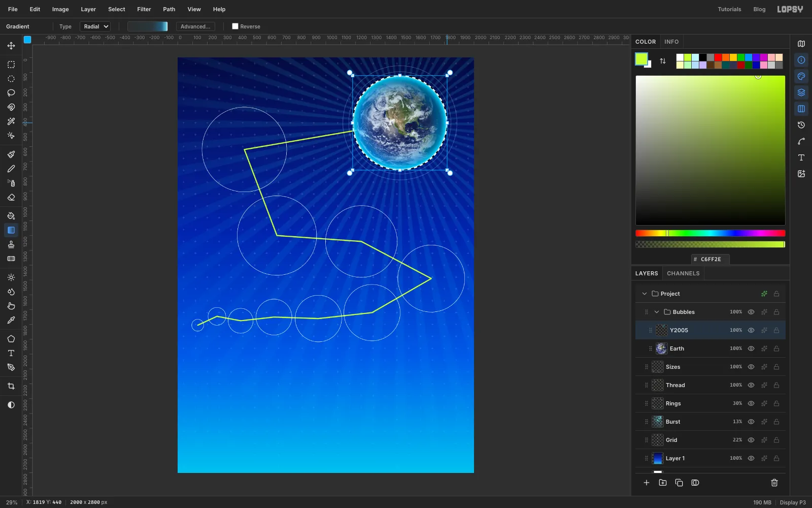

All the bubbles start from this one. Add a layer named `Y2005` above `Earth`.

1. Click the **Elliptical Marquee**, click once on the canvas, and select **From** `1181, 121` to **To** `1819, 759`. That matches the 2005 guide.
2. Pick the **Gradient** tool, set **Type** to **Radial** and click **Advanced…**. Make five stops. The percentage is the stop's place on the bar, and the opacity is set by eye with the checkered bar under the colour square. It has no readout, so close is good enough:
   - `#BDFBFF` at 0%, barely visible
   - `#53D8FF` at 62%, about a tenth
   - `#1FA8F5` at 85%, a bit under half
   - `#6CE4FF` at 97%, about 85%
   - `#E8FFFF` at 100%, full opacity
3. Drag from the bubble's centre to its right edge, then let go.

> **Tip:** Stops keep their settings between uses, including opacity, and typing a new hex doesn't reset it. From here on, whenever a stop has no opacity listed, drag its checkered bar fully to the right. To remove a stop, select it and click **Delete**.

Real glass is nearly invisible in the middle and dense at the edge, because you look through more of it there. That's all this gradient does, and it's why the Earth shows through clearly.

## Select a crescent for the bounced light

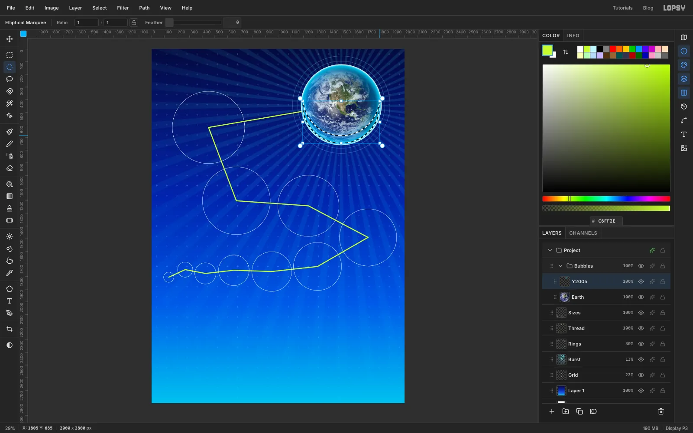

Light that enters a glass ball collects along the side away from the source. That shape is a crescent.

1. Press [[Cmd+D]], click the **Elliptical Marquee**, click once on the canvas, and select **From** `1195, 135` to **To** `1805, 745`.
2. Hold [[Alt]] and drag out a circle of about the same size, about 60 px higher than the first. You can't type corners for this one, so go by eye. It needs to run from around `1195, 75` to `1805, 685`. Alt subtracts it, which leaves a crescent along the bottom.
3. Choose **Select → Feather…**, enter `10` and click **Apply**.

## Fill the crescent

Pick the **Gradient** tool, set **Type** to **Linear** and click **Advanced…**. Delete the extra stops until two are left: `#FFFFFF` at about 85% opacity on the left, and `#7DF2FF` at about 15% on the right. Click **Done**.

Drag from the very bottom of the bubble straight up, about a quarter of the way to the top.

## Add the gloss cap

This oval is the look of a window reflected in the glass, and it's what makes the bubble read as Y2K.

1. Click the **Elliptical Marquee**, press [[Cmd+D]], click once on the canvas, and select **From** `1268, 140` to **To** `1732, 412`.
2. Choose **Select → Feather…**, enter `3` and click **Apply**.
3. Pick the **Gradient** tool, still **Linear**, and make two stops, both `#FFFFFF`: nearly opaque on the left and barely visible on the right.
4. Drag from the top of the oval straight down to its bottom.
5. Press [[Cmd+D]].

## Give it a halo

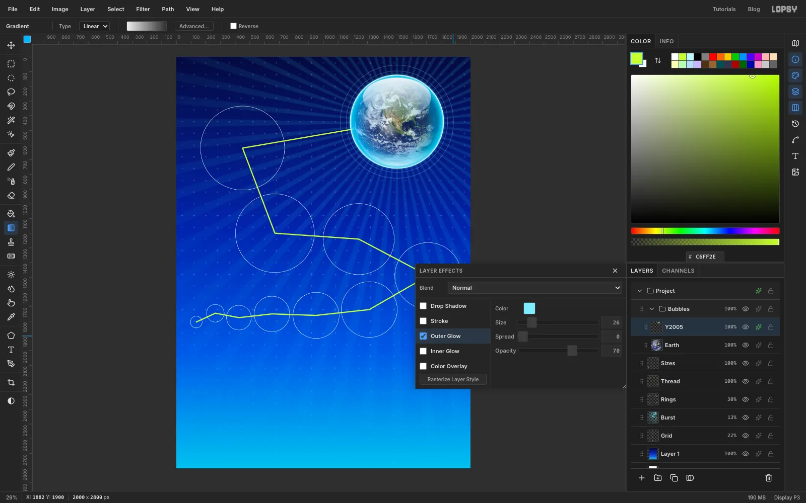

Click the layer's effects button. Tick **Outer Glow**, click its name to see its settings, and enter **Size** `26`, **Spread** `0` and **Opacity** `70`, with the colour `#7DEBFF`.

Then click **Rasterize Layer Style**. That bakes the glow into the pixels, so it shrinks along with each copy later. A live glow would stay 26 px on a bubble a tenth of the size, and the small ones would look radioactive. Close the drawer.

## Look at it up close

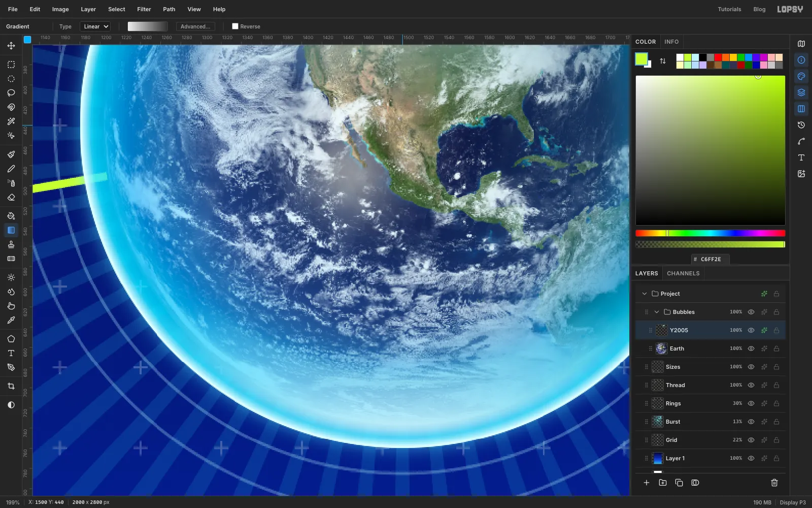

Zoom in with [[Cmd]] and the scroll wheel, and check three things: the rim is brightest at the very edge, the Earth is clear through the middle, and the gloss fades before it reaches the centre. If the gloss is too strong, undo back to it and lower its top stop. Everything after this is copies, so fix it now. Choose **View → Fit to Screen** to go back.

## Make the first copy

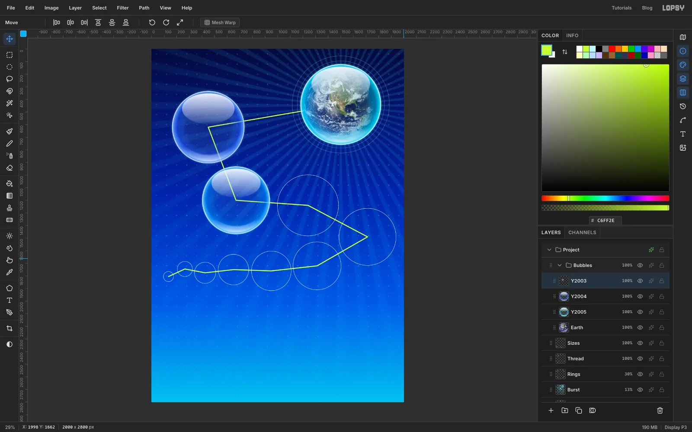

Each year is a copy of the one after it, scaled down. Do 2004 slowly, and the rest follow the same pattern.

1. Select `Y2005`, press [[V]] and click **Duplicate Layer**. Rename the copy `Y2004`, and click its row so it's the only layer selected.
2. Press [[M]] and drag a marquee around the bubble and its glow. There's nothing else on this layer, so leave plenty of room.
3. Press [[V]], hold [[Cmd]], and drag the bottom-right corner handle inward. Zoom in if you need to, and stop when the bubble is the same width as the 2004 guide. You'll drag it over the guide next, so judge the width against the list: 572 px.
4. Press [[Cmd+D]], then drag the bubble onto its guide. Use the arrow keys for the last few pixels, and if its rim doesn't match the ring, undo and scale again.
5. Choose **Filter → Hue/Saturation…**, set **Hue** to `28` and click **Apply**.

Make `Y2003` the same way, duplicating `Y2004`, with a **Hue** of `-14`.

## Make the other eight bubbles

Repeat that for each year, working backward, and always duplicate the year you just made. Each marquee just needs to take in the whole bubble and its glow. Zoom in for the small ones, because the handles are nearly as big as the 1995 bubble at fit zoom.

The hue is relative, because each copy starts from the last one's colour. Use these:

- `Y2002`: `-14`
- `Y2001`: `-16`
- `Y2000`: `-16`
- `Y1999`: `-18`
- `Y1998`: `-18`
- `Y1997`: `-17`
- `Y1996`: `-15`
- `Y1995`: `-15`

The colour now tells you about time too, drifting from green through aqua to blue as the years pass. The Earth's own bubble stays as it is.

## Clear the thread out of the bubbles

The thread runs right through every bubble, and it would sit behind the numbers. Your guides make it easy to cut.

1. Click the `Sizes` layer and press [[Cmd+D]]. Press [[W]] for the **Magic Wand** and make sure **Contiguous** is ticked.
2. Click inside the 1995 guide, then hold [[Shift]] and click inside each of the others. The white rings stop the selection from spreading.
3. Click the `Thread` layer, press [[Delete]], and press [[Cmd+D]].

## Add arrowheads

From 2000 on, the chart doubles back, so readers need to be told which way time runs. Stay on `Thread`.

1. Press [[P]]. **Stroke** should still be `8` and the foreground lime.
2. Zoom in on the gap between the 2000 and 2001 bubbles. Click three times to make a small `>` shape that points toward 2001, with arms about 16 px long. Press [[Enter]] to stroke it.
3. Open **Paths**, click **Delete Path**, and close the panel. Otherwise your next click could edit this path.

Do the same on the links from 2001 to 2002, 2002 to 2003 and 2003 to 2004, keeping each one clear of the rims. Make a slightly bigger one partway along the long link from 2004 to 2005, and a tiny one between 1995 and 1996. The other links in the bottom row are too short to fit an arrow, and that row already reads left to right.

## Light the thread and hide the guides

With `Thread` still selected, open **Layer Effects**, tick **Outer Glow**, and use **Size** `16`, **Spread** `0`, **Opacity** `80`, with the colour `#C6FF2E`. Close the drawer.

Click the eye on the `Sizes` row to hide it. Keep the layer. If you ever need to check the numbers again, it's one click away.

## Label the big bubbles

Click the `Bubbles` group's row to select it, then click its arrow to collapse it. With a collapsed group selected, new things land above it. Click **New Group**, name it `Labels`, and add a layer inside it named `Leaders`.

> **Tip:** Changing the font or size with a text layer selected restyles that layer. Click `Leaders` before you set up each new piece of text, and the new text will stack just above it.

For each bubble from 1998 to 2004, make two pieces of text. Press [[T]], set **Align** to **Center** in the options bar, and click at the bubble's centre `x` so the text centres on your click.

- **Year:** **Silkscreen**, weight Regular, colour `#E9FF9A`, just below the bubble's centre
- **Number:** **Michroma**, colour white, below the year, such as `817M`

Commit each one with [[Tab]]. Sizes for each bubble, as year / number:

- 1998: `24` / `42`
- 1999: `30` / `60`
- 2000: `34` / `72`
- 2001: `40` / `86`
- 2002: `42` / `92`
- 2003: `46` / `102`
- 2004: `50` / `110`

Press [[V]] and use the arrow keys to adjust each one so the pair sits in the clear glass under the gloss, with the year close above its number. The screenshots show these layers renamed to `yr 2004`, `val 2004` and so on. That's optional, but it keeps a long list readable.

On each label, open **Layer Effects** and add a **Drop Shadow**: **Offset X** `0`, **Offset Y** `3`, **Blur** `8`, **Opacity** `75`, colour `#03103A`. It stops white type from dissolving where it crosses a bright rim.

## Label the small bubbles

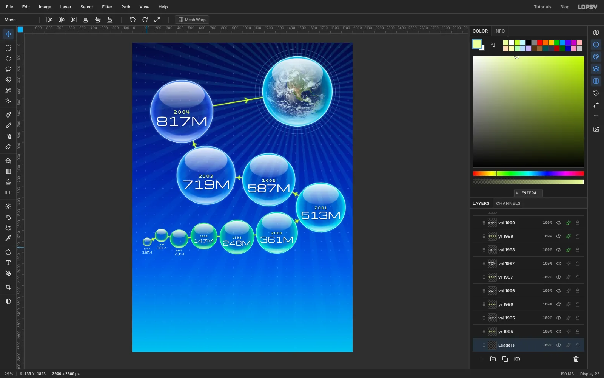

The bubbles for 1995, 1996 and 1997 are too small to hold text, so their labels go below them. Use size `28` Michroma in white for the number and size `20` Silkscreen in `#E9FF9A` for the year, both centred. Click below each bubble, on its centre `x`.

Make the number first, about 60 px under the bubble, and the year second, just under the bubble. Clicking within a few pixels of existing text edits that text, so working upward keeps you clear of it. Then nudge the pair with the arrow keys so the year sits about 22 px under the bubble and the number about 54 px under it. Click `Leaders` before you start each new piece of text.

## Make the pill

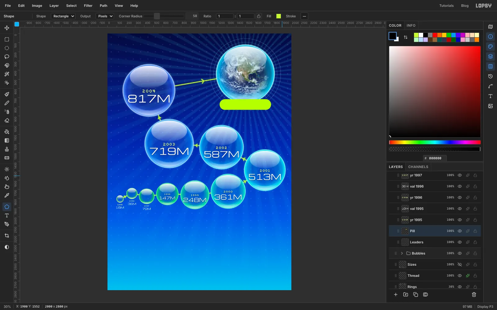

The 2005 number gets a gel button of its own, because the Earth fills that bubble.

1. Click `Leaders`, and add a layer named `Pill`.
2. Press [[U]], and set **Shape** to **Rectangle** and **Corner Radius** to `58`.
3. Click the **Fill** dash and enter `C6FF2E`. Click the **Stroke** swatch and click **Remove stroke**. Click the bar at the bottom of the window.
4. Click once at `1500, 775`. Enter **Width** `560` and **Height** `116`.

The pill overlaps the bubble's rim by about 40 px on purpose. If two curves only just touch, the eye keeps snagging on the spot.

## Turn the pill into gel

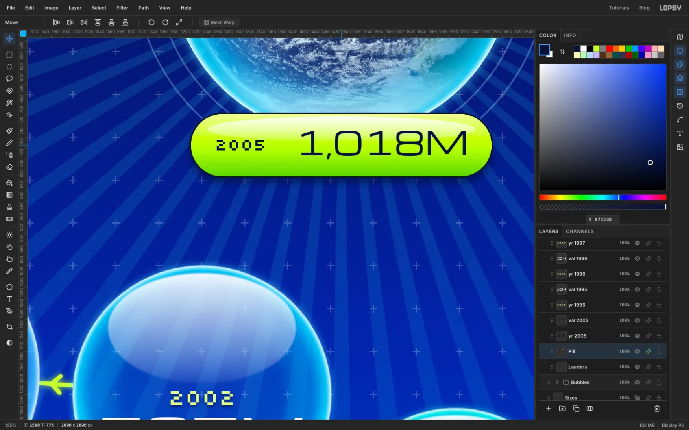

1. Hold [[Cmd]] and click the `Pill` thumbnail to select its shape.
2. Make a linear gradient with three full-opacity stops, `#F4FF9C`, `#C6FF2E` in the middle and `#7DD400`, and drag from the pill's top to its bottom.
3. Click the **Elliptical Marquee**, press [[Cmd+D]], click once on the canvas and select **From** `1250, 721` to **To** `1750, 769`. Make a linear gradient with two `#FFFFFF` stops, about 85% opacity on the left and barely visible on the right, and drag straight down through the oval. Press [[Cmd+D]].
4. In **Layer Effects**, add a **Stroke** with **Width** `3` and colour `#071238`, and a **Drop Shadow** with **Offset Y** `10`, **Blur** `18`, **Opacity** `60`, colour `#03103A`.

With `Pill` selected, press [[T]], set the font to Michroma at `60` and the colour to `#071238`, and click near `1590, 735`. Type `1,018M` and press [[Tab]]. Click `Pill` again, set Silkscreen at `32`, and click near `1310, 755`, well to the left of the number. Type `2005` and press [[Tab]]. Press [[V]], and use the arrow keys to nudge them so each sits 48 px in from its end of the pill, centred top to bottom.

## Add the history notes

Notes give readers a reason to look longer. Each one has a date in Silkscreen at `28` in `#C6FF2E`, and text in Share Tech Mono at `36` in white, with **Align** set back to **Left**. Make the text first, about 40 px below the spot listed, and then the date on the spot itself, clicking `Leaders` before each one. To start a second line, press [[Enter]].

- `FEB 2005`, *youtube.com / registered*, left of the Earth, around `760, 312`
- `FEB 2004`, *Facebook / launches*, above and left of the 2004 bubble, around `87, 268`
- `AUG 1995`, *Windows 95 / ships*, above the 1995 bubble, around `87, 1540`
- `SEP 1998`, *Google is / founded*, above the 1998 bubble, around `490, 1488`
- `JAN 1 2000`, *The Y2K bug: / nothing broke*, above the 1999 bubble, around `830, 1437`

Click `Leaders`, set the foreground to white, press [[N]] and set **Size** to `3`. Draw a short line from each note to its bubble: click one end, then [[Shift]]-click the other. Keep every leader either level or vertical, and leave a clear gap between it and the text. A slightly slanted line looks like a mistake.

## Add the heading, legend and bars

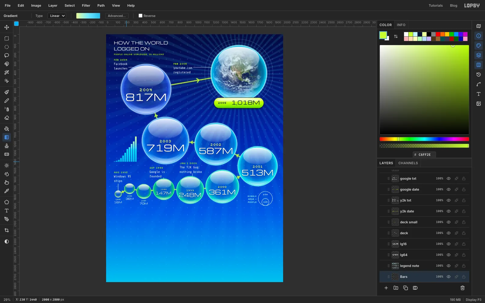

**Heading.** With **Align** on **Left**, click at `87, 60` and type `HOW THE WORLD` and `LOGGED ON` on two lines, in Michroma at `48` in white. Below it, make `PEOPLE ONLINE WORLDWIDE, IN MILLIONS` in Silkscreen at `24` in lime, at `87, 208`.

**Legend.** A chart that codes by area needs a key at the same scale. Click `Leaders`, press [[U]], and set **Shape** to **Ellipse**, with no fill and a white **Stroke** at **Width** `3`. Click at `1800, 1856` and make a `160` circle, then click at `1800, 1896` and make an `80` circle. They rest on the same base. Label them `64M` and `16M` in Silkscreen at `22`, centred, and add `BUBBLE`, `AREA =`, `PEOPLE` on three lines at the left in `#BFF6FF`, right-aligned at `1700, 1812`.

**Bars.** People compare lengths better than areas, so put the same numbers in the empty field on the left. Click `Leaders` and add a layer named `Bars`, with the foreground set to `#C6FF2E`. Each bar is 18 px wide, the first starts at `x = 87`, each starts 24 px after the last, and all end at `y = 1440`. For each bar, press [[M]], press [[Cmd+D]], click once on the canvas and type its corners, then choose **Edit → Fill**. The heights, from 1995 to 2005, are `4`, `10`, `20`, `41`, `69`, `101`, `144`, `164`, `201`, `229` and `285` px.

Press [[Cmd+D]], [[Cmd]]-click the `Bars` thumbnail, make a linear gradient of `#E9FF9A`, `#6FE9FF` and `#27BDEB` at full opacity, and drag from the top of the tallest bar straight down to the base. Press [[Cmd+D]].

## Label the bars

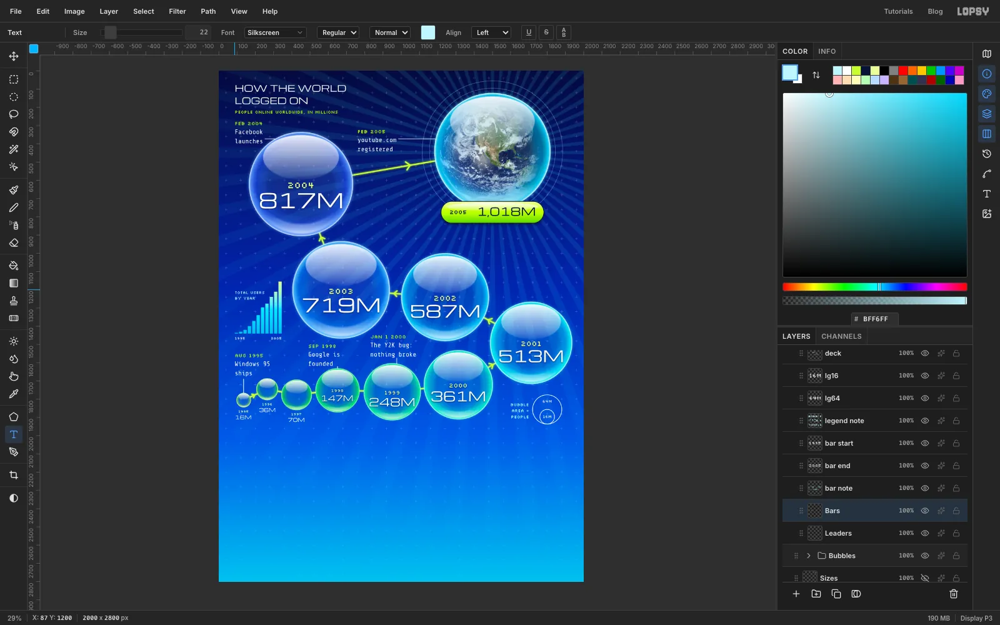

Click `Bars` before each one, and use Silkscreen:

- `1995` at size `20` in white, left-aligned at `87, 1452`
- `2005` at size `20` in white, right-aligned at `345, 1452`
- `TOTAL USERS` and `BY YEAR` on two lines, at size `22` in `#BFF6FF`, left-aligned at `87, 1200`, in the space above the short bars

That's the whole chart. Everything from here is the title.

## Set the title

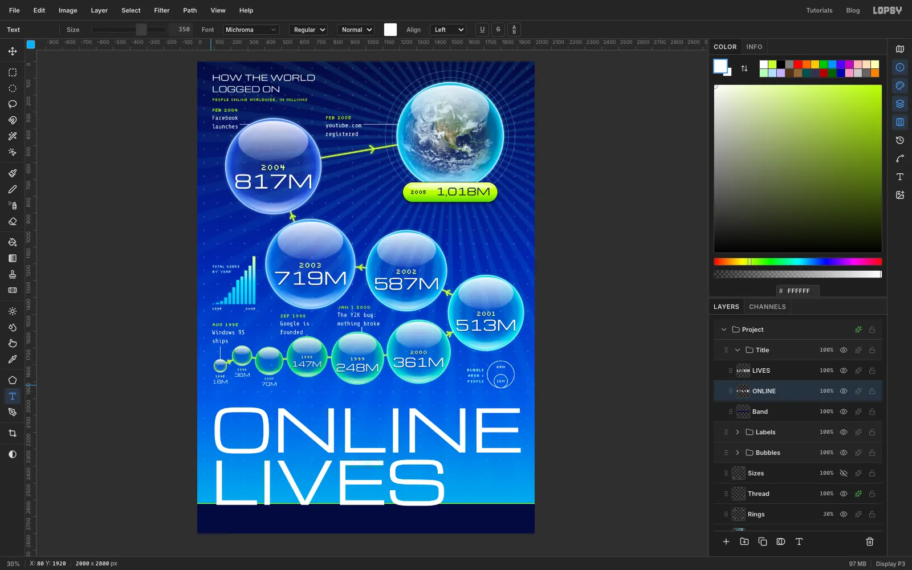

Click the `Labels` group's row, then click its arrow to collapse it. Click **New Group**, name it `Title`, and add a layer named `Band`.

1. Set the foreground to `#050A3E`. Press [[M]], click once on the canvas and select **From** `0, 2622` to **To** `2000, 2800`. Choose **Edit → Fill**, then press [[Cmd+D]].
2. Set the foreground to `#C6FF2E`. Press [[N]], set **Size** to `4`, click at the band's top-left corner and [[Shift]]-click its top-right.
3. Press [[T]], set **Align** to **Left**, the font to Michroma, **Size** to `350`, and the colour to white. Click at `80, 2230`, type `LIVES` and press [[Tab]].
4. Click `Band`, press [[T]], click at `80, 1920`, type `ONLINE` and press [[Tab]]. Doing the lower word first stops this click from landing in the first word's text box.

Press [[V]]. Drag `ONLINE` so it's centred across the canvas, with its letters running from about `y = 1980` to `y = 2230`. Hold [[Shift]] with the arrow keys for 10 px nudges. Click the `LIVES` row and move it so its left edge lines up with the left edge of `ONLINE`, with a gap of about 40 px between them.

## Select the letters for chrome

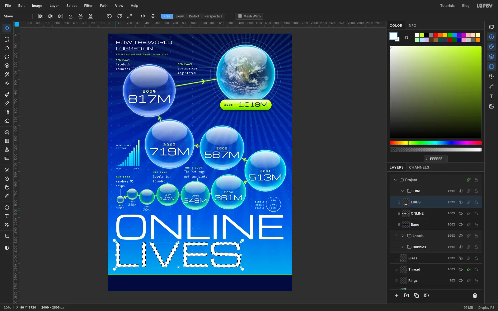

Chrome is mostly a very hard reflection line, and you paint it straight onto the letters.

1. Click the `LIVES` layer, then click **Rasterize Layer**, the **T** icon at the bottom of the Layers panel.
2. Hold [[Cmd]] and click its thumbnail. Each letter gets marching ants, so the gradient can't go outside them.

## Pour the chrome

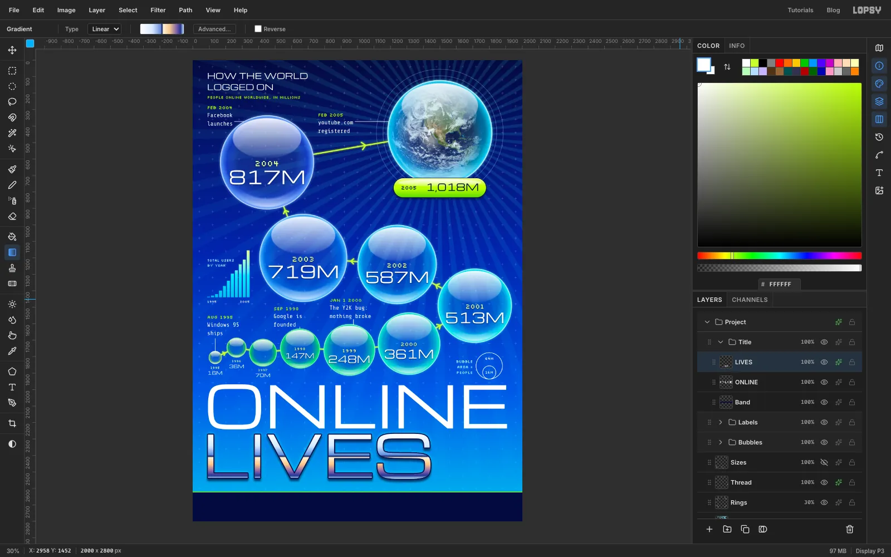

Pick the **Gradient** tool, set **Type** to **Linear** and click **Advanced…**. Make these stops, all at full opacity:

- `#FFFFFF` at 0%
- `#D6E8FF` at 28%
- `#6A8FDA` at 47%
- `#0C1A5E` at 50%, the dark horizon
- `#FFF4D6` at 53%, right after the horizon
- `#F6C88F` at 68%
- `#7B5FA8` at 84%
- `#27358E` at 93%
- `#CFEFFF` at 100%

Drag from the top of the letters straight down to their bottom, then press [[Cmd+D]]. The top half reflects a blue sky and the lower half reflects warm ground, and the jump between them is what reads as metal.

Open **Layer Effects** and add:

- **Stroke**: **Width** `6`, colour `#06104A`
- **Outer Glow**: **Size** `34`, **Spread** `0`, **Opacity** `70`, colour `#8BEFFF`
- **Drop Shadow**: **Offset Y** `14`, **Blur** `16`, **Opacity** `70`, colour `#03103A`

## Chrome the second word

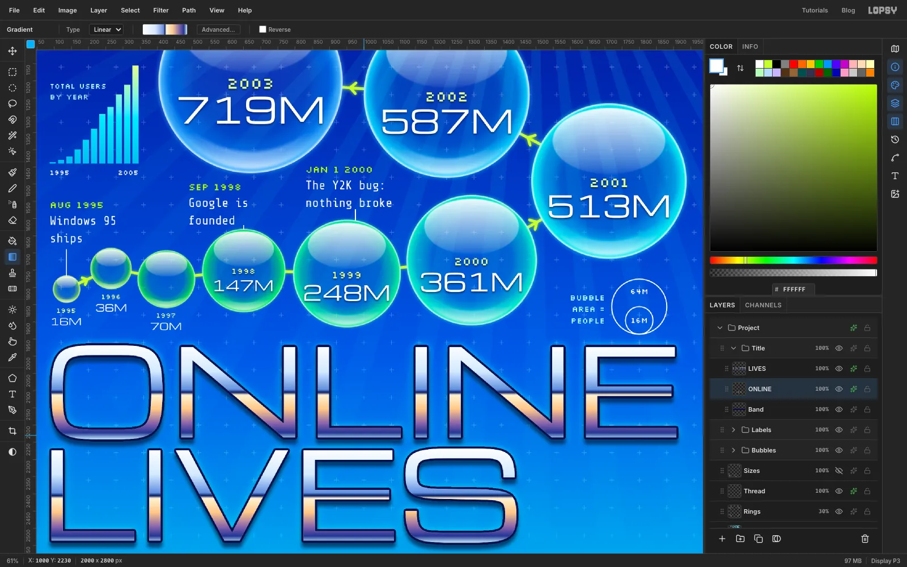

Do the same for `ONLINE`: click its layer, rasterize it, [[Cmd]]-click its thumbnail, and drag the same gradient from the top of its letters to their bottom. The Gradient tool keeps your stops, so you won't need to retype them. Press [[Cmd+D]] and add the same three effects.

Zoom in and check that the horizon line runs straight through all the letters at one height. If a letter looks off, the drag probably wasn't straight, so undo and drag again.

## Add the supporting text

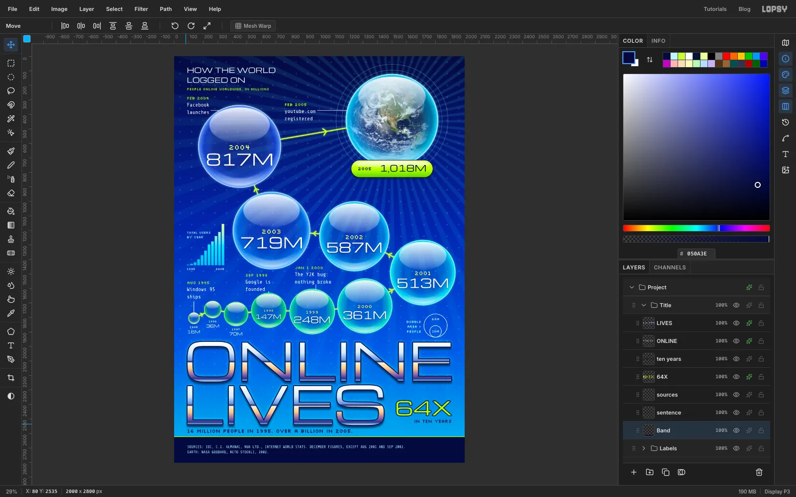

Click `Band` before each of these, so they stack under the title and don't restyle it.

- `64X` in Michroma at `130`, colour `#C6FF2E`, with a **Stroke** of **Width** `5` in `#06104A`. Lime on bright blue is too weak on its own. Line its right edge up with the right edge of `ONLINE`, and place it around `y = 2426`.
- `IN TEN YEARS` in Silkscreen at `32`, colour `#050A3E`, under `64X` with the same right edge.
- Two lines, `SOURCES: IDC, C.I. ALMANAC, NUA LTD., INTERNET WORLD STATS. DECEMBER FIGURES, EXCEPT AUG 2001 AND SEP 2002.` and `EARTH: NASA GODDARD, RETO STOCKLI, 2002.`, in Share Tech Mono at `26`, colour `#BFF6FF`. Line up its left edge with `ONLINE` and centre it top to bottom in the band.
- `16 MILLION PEOPLE IN 1995. OVER A BILLION IN 2005.` in Silkscreen at `36`, colour `#050A3E`, with its left edge on `ONLINE`, centred at about `y = 2583`.

Dark text is the right call for the lower right. White on that bright aqua looks fine at first glance, but it's hard to read at a distance.

## Draw a sparkle

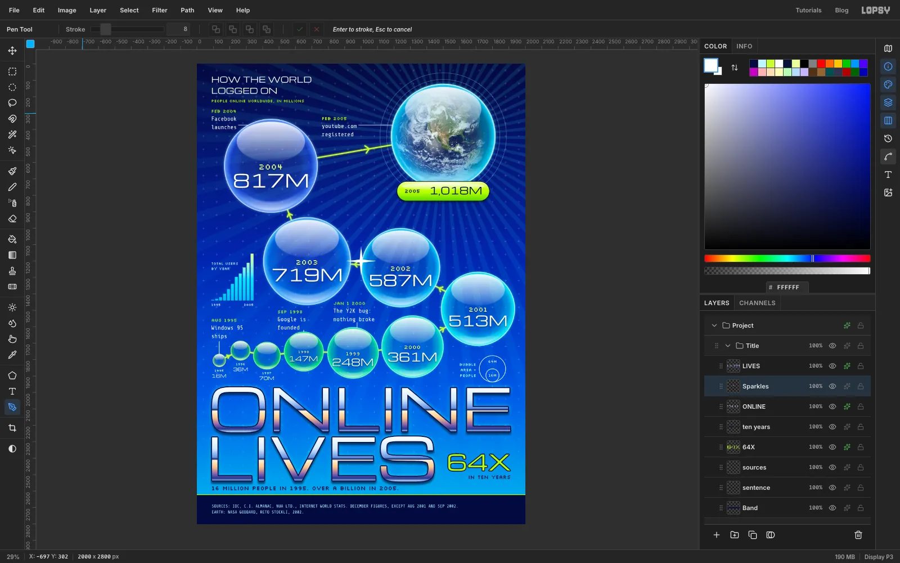

Click `ONLINE` and add a layer named `Sparkles`, then set the foreground to white. Zoom in around `1000, 1200`, press [[P]], and make a thin four-pointed star about 180 px tall. There are eight clicks: top point, then a point just up and right of the centre, right point, just down and right of the centre, bottom point, just down and left, left point, just up and left. Keep those inside points close to the centre, about 9 px away on each axis. Click the first point again to close the path, and go back to **Fit to Screen**.

Open **Paths**, click **Path to Selection**, and close the panel. Choose **Edit → Fill** and press [[Cmd+D]]. Open **Paths** again and click **Delete Path**.

## Place the sparkles

You'll paste five copies of that star and scale each one.

1. Press [[M]] and drag a marquee around the star. Press [[Cmd+C]], then [[Cmd+V]]. The paste lands in place on its own layer, already selected, with the **Move** tool active.
2. Hold [[Cmd]] and drag a corner handle until it's the size you want. Press [[Cmd+D]].
3. Drag it to its spot, then choose **Layer → Merge Down** to merge it into `Sparkles`. Click `Sparkles` again before the next copy.

Use these spots and widths. The first goes over the Earth's top right, the second on the top-left corner of the O, the third in the 2004 gloss, the fourth on the top corner of the X in `64X`, and the last beside the 2001 bubble:

- `1700, 205`, 148 px
- `122, 2012`, 120 px
- `600, 430`, 80 px
- `1906, 2378`, 92 px
- `1885, 1235`, 60 px

The big one over the Earth deserves a small turn so the stars don't all look stamped. Before merging it, press [[M]] and draw a marquee around it, press [[V]], and drag from the round rotation handle just outside a corner by about 14°. Press [[Cmd+D]].

## Make them shine

Delete the original star: click `Sparkles`, press [[M]], drag a marquee around the star in the middle of the poster, and press [[Delete]], then [[Cmd+D]].

Choose **Filter → Bloom…**, and set **Threshold** `40`, **Radius** `24` and **Intensity** `150`. Click **Apply**. The star's tips spread into light, which gives you that lens-flare look without any painting.

## Save and export

Press [[Cmd+D]] if anything's still selected. Choose **File → Save Project** to keep your layers, and **File → Quick Export PNG** for the image.

Before you call it done, read your chart like a stranger would. Start at 1995, follow the arrows, and check every number against the list at the top. It's a poster, but it's also a claim about the world, and the figures have to be right.
