Zines are cheap, self-published magazines, photocopied in someone's bedroom and passed around by hand. Their look comes straight from how they're made. Headlines are letters cut out of magazines and glued down ransom-note style. Photos are pushed through a copier until they turn into hard black and white. There are bits of tape, typewriter captions, and the grey speckle a tired copier leaves on every page. Risograph printers added a second and third ink, usually a fluorescent pink and a mint, printed slightly out of line with the black.

In this tutorial you'll use that language to present an app. *Guerrilla Knitting* is an imaginary app for yarn-bombing crews, the people who wrap trees, lampposts and bike racks in knitting overnight. The board is 2400 × 1600 px and holds:

- a ransom-note title
- a three-colour risograph treatment of a real yarn-bombed tree
- three phones taped down: a map of bare lampposts, a knitting pattern with a stitch counter, and a crew list for the night of the drop
- a marker tagline, a ball of yarn whose thread runs behind a phone, captions and a cut line

You'll need two photos from Wikimedia Commons. Both are marked **CC0**, so you can use them freely:

- **Yarn bombing en Cornellá de Llobregat.JPG**, a tree whose trunk is wrapped in orange, red, yellow and blue knitting. Download the 1280 px wide version.
- **Yarn-Bombed-Tree-Ulverstone-20160307-005.jpg**, a tree wrapped in crocheted granny squares. Again, the 1280 px version.

The tools you'll use:

- **Add Noise**, **Fibers**, **Threshold**, **Brightness/Contrast**, **Halftone**, **Desaturate** and **Gaussian Blur**
- the **Lasso** (including [[Alt]] to subtract and [[Shift]] to add), the **Rectangular** and **Elliptical Marquee** with their exact-size dialogs, and **Select → Feather / Inverse**
- **Copy** and **paste in place**, and [[Cmd]]-click on a layer thumbnail to load its shape as a selection
- the **Shape** tool's click-to-size dialog, with corner radius, fill and stroke
- **Define Pattern** and **Fill with Pattern**
- the **Brush**, **Pencil**, **Eraser** and **Burn** tools, and [[Shift]]-click for straight lines
- live text in thirteen Google fonts
- groups that you scale and rotate as one piece with the **Move** tool's handles
- layer effects: **Drop Shadow**, **Stroke** and **Color Overlay**, plus the **Multiply** and **Screen** blend modes

The palette is copier paper, toner and two riso inks:

- Paper `#ECE7DC`, scrap white `#F7F5EF`, phone screen `#F3EFE6`
- Toner black `#1C1B1D`
- Fluorescent pink `#F2489B`, dark yarn pink `#A81E62`
- Mint `#5CCBB0`
- Kraft tape `#D6C49A`, newsprint grey `#D5D0C5`

> **Tip:** On a wide-gamut (Display P3) screen, Lopsy reads typed hex codes as P3 colours, so the pink and mint come out a little hotter than on an sRGB screen. That suits fluorescent riso ink, so the codes are the same either way.

> **Note:** Shortcuts are written for a Mac. On Windows use [[Ctrl]] wherever it says [[Cmd]].

## Paint the copier paper

Choose **File → New**, keep the units on **Pixels**, and make the document **2400** wide and **1600** high with a white background.

Click the empty *Layer 1*, rename it *Paper*, set the foreground to paper `#ECE7DC` and choose **Edit → Fill**. Then choose **Filter → Add Noise…**, pick **Mono** and **Gaussian**, set **Amount** to **12** and click **Apply**. It's a faint tooth, but it stops the board looking like flat screen colour.

## Add copier drum streaks

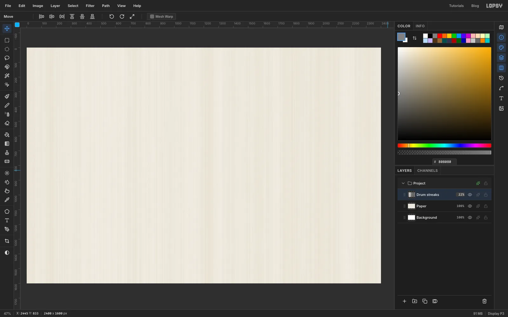

Copiers leave thin vertical stripes where the drum is worn. Click **Add Layer** and name the layer *Drum streaks*. Fill it with mid-grey `#808080`, then choose **Filter → Fibers…** and set **Variance** to **40** and **Strength** to **64**. A high Strength makes the fibres run straight down.

Choose **Filter → Desaturate**, then **Filter → Brightness/Contrast…** with **Contrast** at **60**. Open the layer's effects with the sparkle button on its row, set the **Blend** to **Overlay**, and close the drawer. Finally click the layer's opacity and set it to **22%**. On Overlay, mid-grey disappears, so only the light and dark streaks show.

## Darken the edges like a copier lid

Add a layer called *Copier edge*. Pick the **Gradient** tool, set **Type** to **Radial**, and click **Advanced…** to open the editor. Make three stops, all `#6F6A60`:

- at the left end, opacity **0%**
- at **60%** along, opacity **0%**
- at the right end, opacity **100%**

Click **Done**, then drag from the centre of the board out to the bottom-right corner. Set the layer to **Multiply** at **55%**.

Then switch the gradient to **Linear** with two stops in `#4A463F`, solid on the left and transparent on the right. Drag a short gradient, about 70 px, in from the left edge. It's the dark band you get when the copier lid doesn't quite close.

## Set guides for the layout

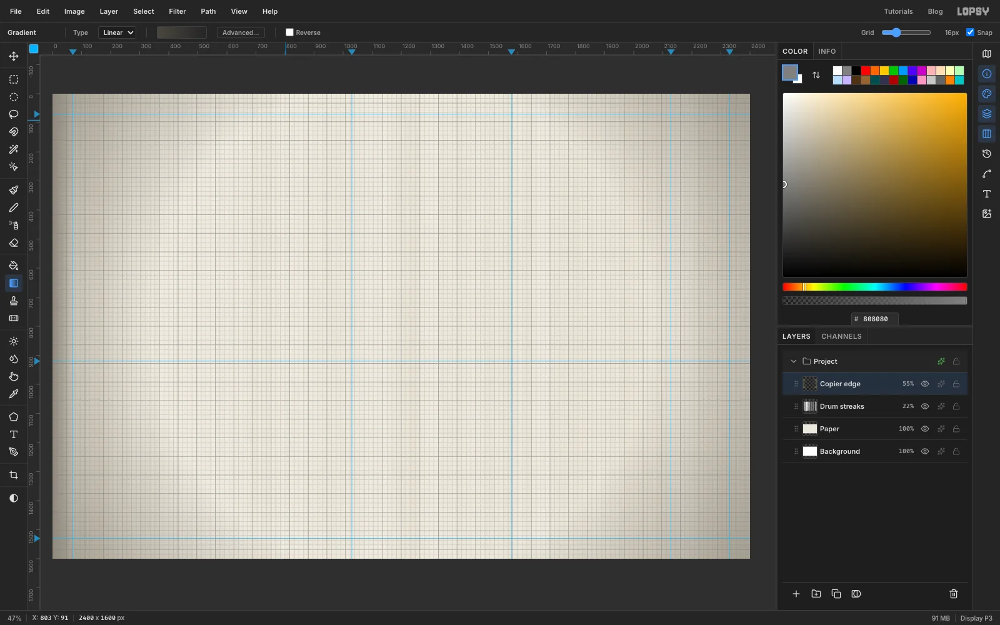

Click the top ruler to drop vertical guides and the left ruler for horizontal ones:

- vertical guides at **70** and **2330** for the margins, and at **1030**, **1579** and **2128** for the centre lines of the three phones
- horizontal guides at **70** and **1530**, and one at **920** for the middle of the phones

Choose **View → Show Grid** to check the spacing. Turn it off again once you're happy.

## Paste the tree and scale it down

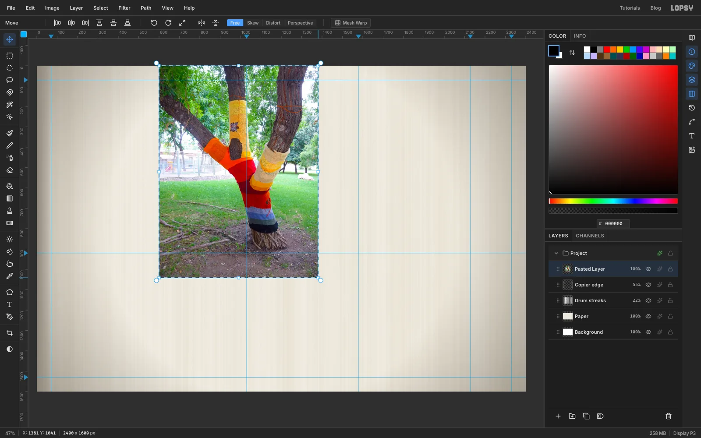

Open the Cornellá photo in your browser or Preview, copy it, and press [[Cmd+V]] in Lopsy. A pasted image bigger than the canvas is shrunk to fit and arrives already selected, with the **Move** tool active.

Hold [[Cmd]] and drag the bottom-right handle up and to the left until the photo is about **780 px** wide. [[Cmd]] keeps the proportions. Press [[Cmd+D]] to commit the scale, and rename the layer *Tree photo*.

## Move the photo into the left column

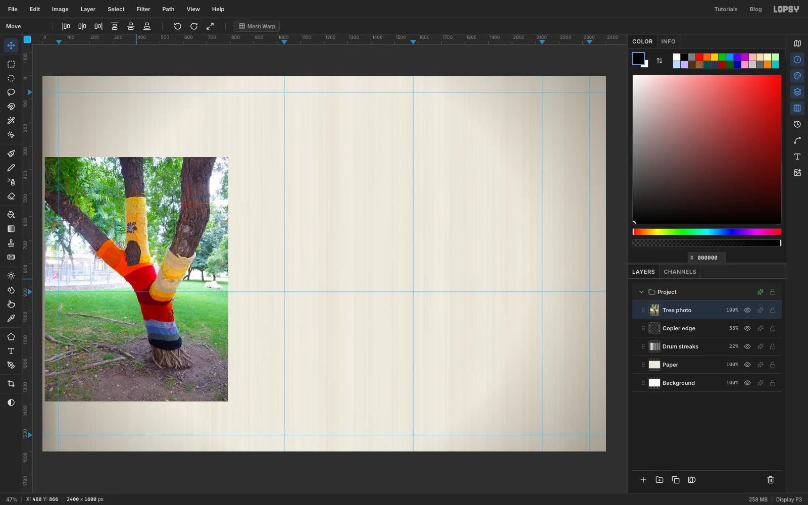

Drag the photo into the left column. Put the knitted trunk roughly in the middle of the column, from just under the title area at about y 480 down to about y 1350. The photo is bigger than the space, and that's fine: you'll tear the edges off in the next step.

Use the arrow keys for the last few pixels. Each press moves the layer 1 px, and [[Shift]] makes it 10 px.

## Tear the photo out with the Lasso

Pick the **Lasso**. Draw a rough rectangle inside the photo, about 610 px wide and 870 px tall, with its top just under the title area and its left edge on the margin guide. Wobble your hand every couple of centimetres so the edge looks torn rather than cut, and tilt the rectangle a degree or so.

## Copy the torn piece onto its own layer

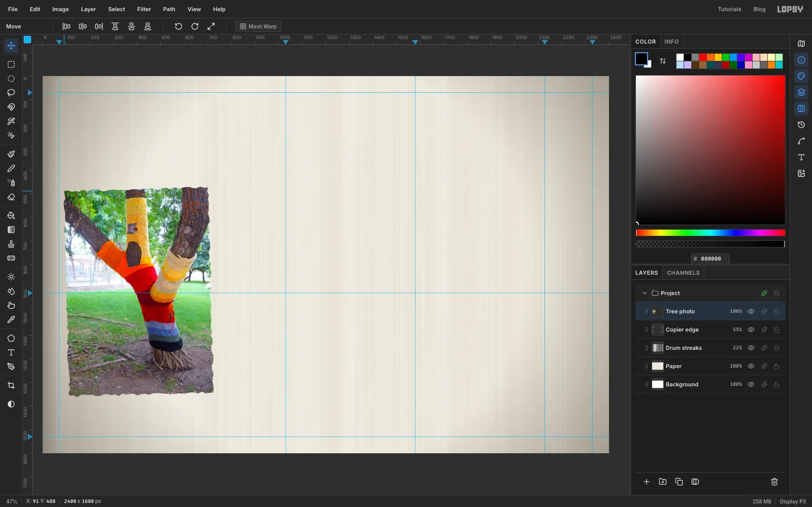

With the torn selection still active, press [[Cmd+C]] and then [[Cmd+V]]. Lopsy pastes content copied inside the app back in place, so the scrap lands exactly where it was, on a new layer.

Delete the old, full *Tree photo* layer and rename the new one *Tree photo*. Why not just invert and delete? An inverted selection stops at the canvas edge, so pixels hanging off the canvas would survive. The filters later on would turn them into stray dots along the border. A copy only holds what you selected.

## Print the black toner plate

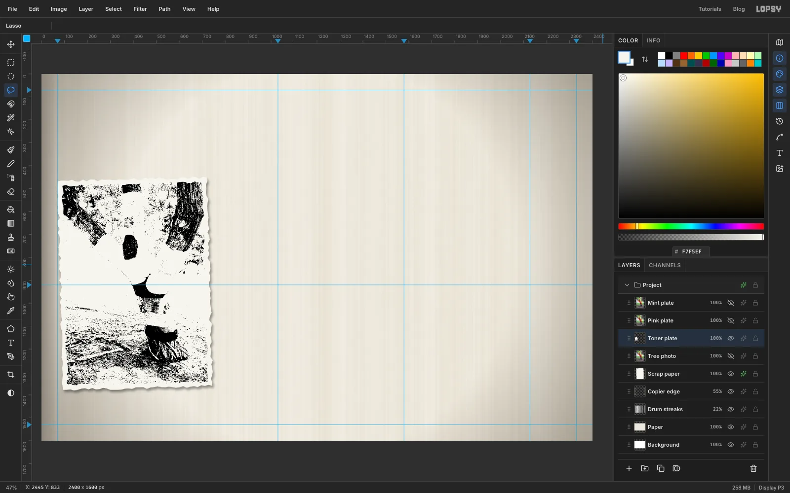

**White backing.** Click *Copier edge* and add a layer called *Scrap paper* (it must sit under the photo). Lasso a torn rectangle about **20 px** bigger than the photo on every side. Fill it with `#F7F5EF`, then deselect. Add a **Drop Shadow**: **Offset X 6**, **Offset Y 10**, **Blur 16**, **Opacity 40**.

**Plates.** Click *Tree photo* and choose **Layer → Duplicate Layer** three times. Name them from the top down: *Mint plate*, *Pink plate*, *Toner plate*. The order doesn't matter much, because every plate ends up on Multiply. Hide *Tree photo*, *Mint plate* and *Pink plate* with their eye icons, so you only see the plate you're working on.

**Toner.** On *Toner plate*, choose **Filter → Desaturate**, then **Brightness/Contrast…** with **Contrast 30**.

Next, brighten the knitting a little so only its darkest stitches print black:

1. Lasso around the knitted sleeves.
2. Hold [[Alt]] and lasso the bare patch of bark inside the yellow sleeve to take it out.
3. Run **Brightness/Contrast…** with **Brightness 12**.

Deselect, run **Filter → Threshold…** at **78**, and set the layer to **Multiply**. Everything below level 78 turns solid black, and everything above disappears into the paper.

## Select just the knitting

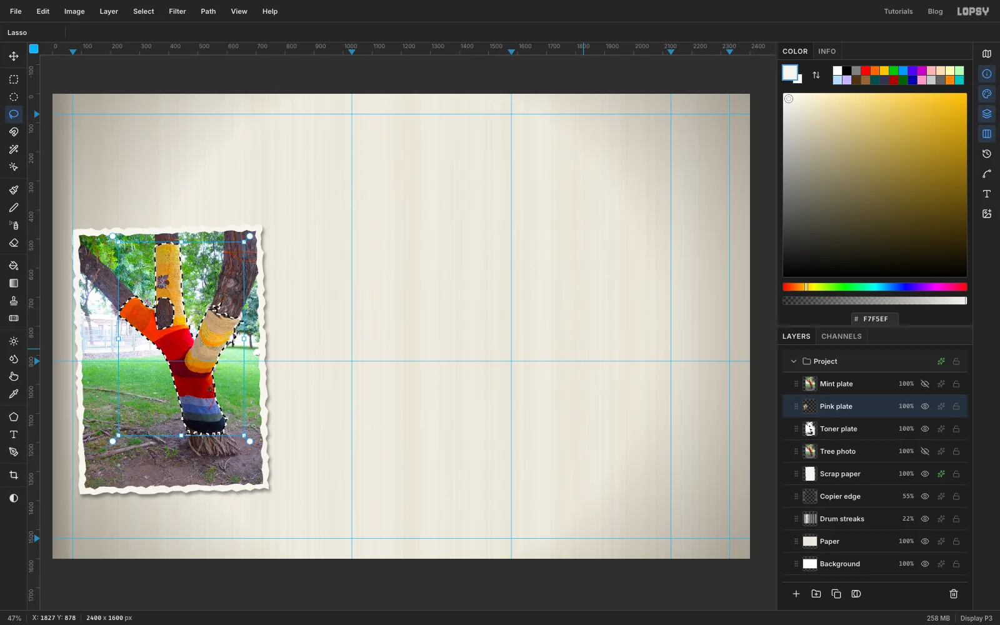

Show *Pink plate* and click its row. Zoom in and use the **Lasso** to trace the outline of all the knitted sleeves in one go: the yellow sleeve up the middle, the orange arm on the left, the red-to-navy trunk, and the cream-and-yellow sleeve on the right. Follow the real edges closely and take your time. This outline is what makes the pink look printed rather than pasted on.

Then hold [[Alt]] and lasso around the bark showing through the hole in the yellow sleeve, following its rough edge. Finish with **Select → Feather…** at **1 px**, which softens the cut without blurring it.

## Halftone the pink plate

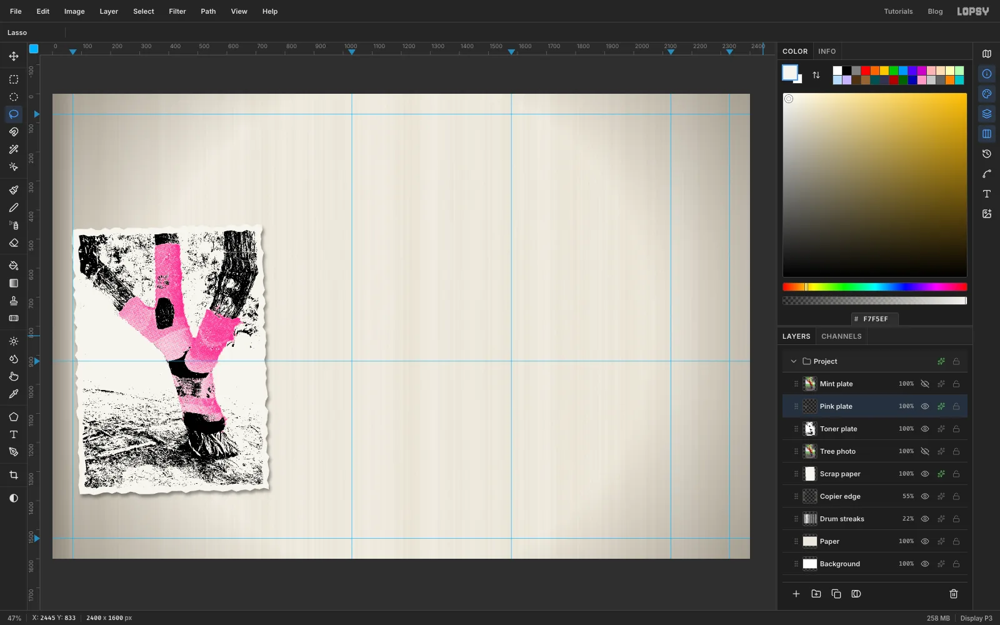

Choose **Select → Inverse** and press [[Delete]], so only the knitting is left on *Pink plate*. Deselect.

Run **Filter → Desaturate**, then **Filter → Invert**. Inverting means the brightest yarn turns darkest and so gets the biggest dots. Choose **Filter → Halftone…**: **Dot Size 7**, **Density 1.8**, **Angle 75**, **Softness 0.5**.

Add a **Color Overlay** in pink `#F2489B` and set the layer to **Multiply**.

## Halftone the mint plate

Show *Mint plate* and click it. Lasso the knitting again exactly as before: the sleeves, then [[Alt]] around the bark hole, then **Feather** 1 px. (You can't [[Cmd]]-click the pink plate for this, because it's only dots now.) Press [[Delete]] so the mint stays out of the pink areas. Deselect.

Then:

1. **Filter → Desaturate**.
2. **Brightness/Contrast…** with **Contrast 22**.
3. **Halftone…** with **Dot Size 11** and **Angle 15**. Use a different angle from the pink so the two screens don't fight.
4. Add a **Color Overlay** in mint `#5CCBB0` and set the layer to **Multiply**.

## Knock the plates out of register

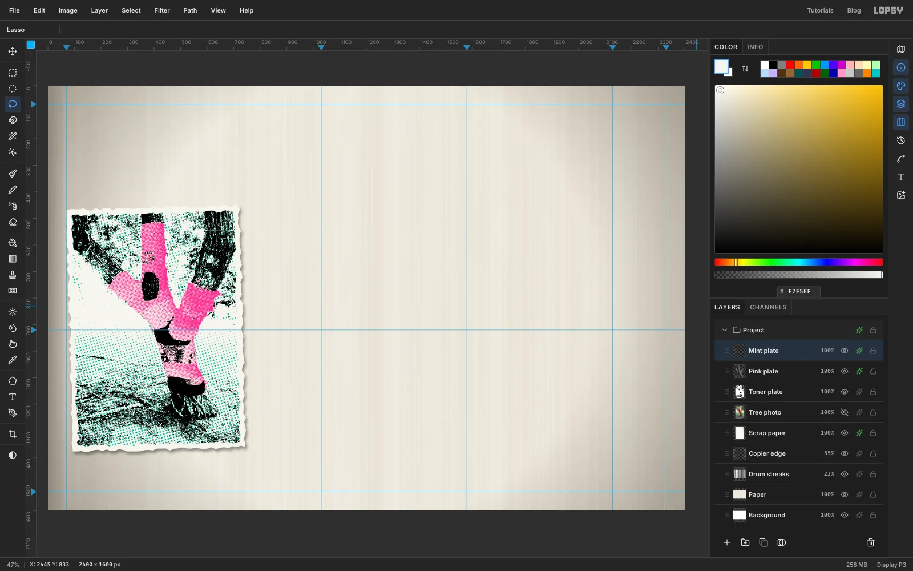

Real risograph plates never line up perfectly. Click *Pink plate* and, with the **Move** tool, nudge it **6 px left** and **4 px down** with the arrow keys. Then nudge *Mint plate* **6 px right** and **4 px up**.

The tree is finished. You won't touch these layers again until a little edge-ageing at the very end.

## Type the ransom-note letters

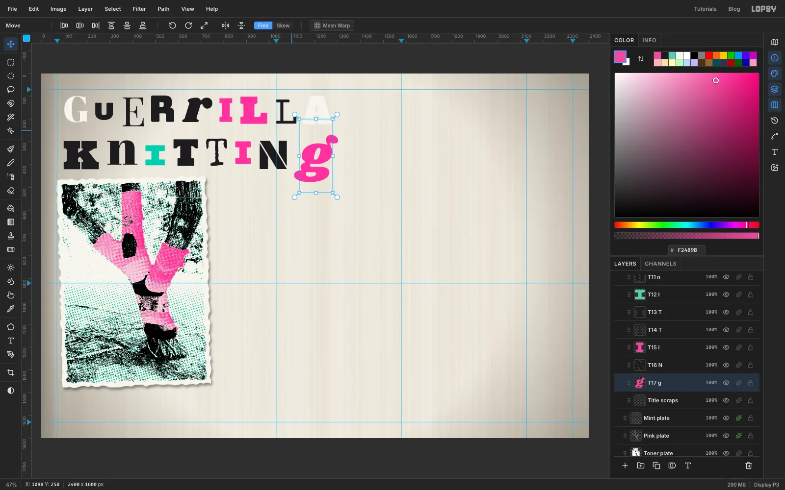

Click *Mint plate* and click **New Group** (the folder button). Name the group *Title*, then add a layer inside it called *Title scraps*. The letters go on top of the scraps, but you'll type them first so you can size the scraps to fit.

Every letter is its own text layer in a different font. Before each one, click the *Title scraps* row so the Text tool's settings don't restyle the letter you just made. Then pick the font, size and colour, click with the **Text** tool, type the letter, and press [[Tab]] to commit.

Work left to right in two rows, leaving a gap of about 30 px after each letter.

- **Row 1** (centred about y 160): `G` Abril Fatface 176 in white; `U` Rubik Mono One 130; `E` Playfair Display SC 167; `R` Bungee 151; `r` Shrikhand 178; `I` Black Ops One 162 in pink; `L` Ultra 151 in pink; `L` Courier Prime 178; `A` Alfa Slab One 159 in white
- **Row 2** (centred about y 350): `K` Ultra 167; `n` Abril Fatface 202; `I` Rubik Mono One 148 in mint; `T` Holtwood One SC 140; `T` Special Elite 189; `I` Bungee 167 in pink; `N` Black Ops One 167; `g` Shrikhand 202 in pink

Unless a colour is given, a letter is toner black `#1C1B1D`. The sizes already vary from letter to letter. Let some letters sit a little high or low too, nudging them with the arrow keys. A ransom note never sits on one baseline.

> **Tip:** With the Text tool, a click within a few pixels of an existing letter edits that letter instead of starting a new one. Click clear of the previous letter, then nudge the new one into place.

## Cut a paper scrap for each letter

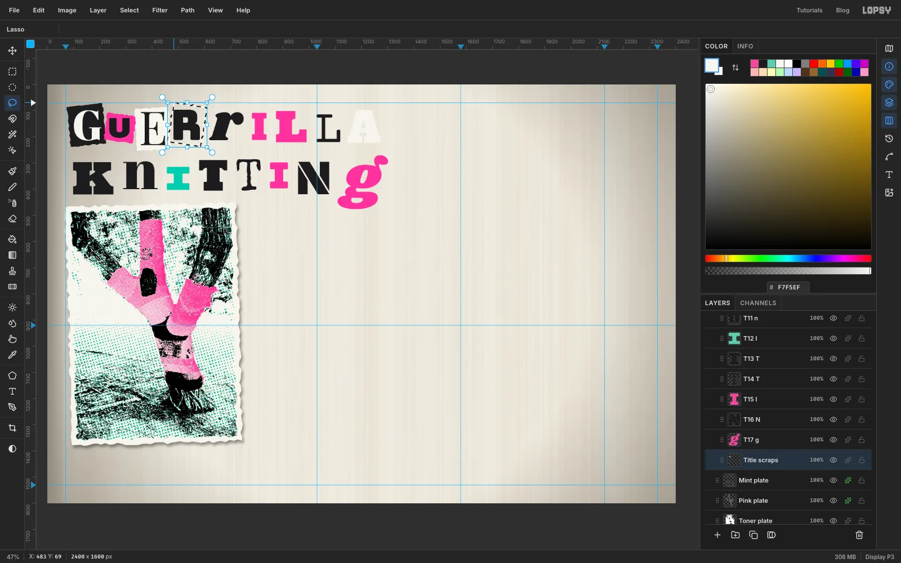

Click *Title scraps*. For each letter, lasso a small torn rectangle around it, about 12–20 px clear of the letter on each side. Tilt each one by its own angle, anywhere between about 4° and 9° either way, and fill it with its paper colour:

- black behind the G, the Black Ops One I, the Rubik Mono I and the g
- pink behind U, A and the Holtwood T
- mint behind R and K
- white behind E, L, n and the Bungee I
- kraft behind r and N
- newsprint grey behind the Courier L and the Special Elite T

## Give the scraps texture and a shadow

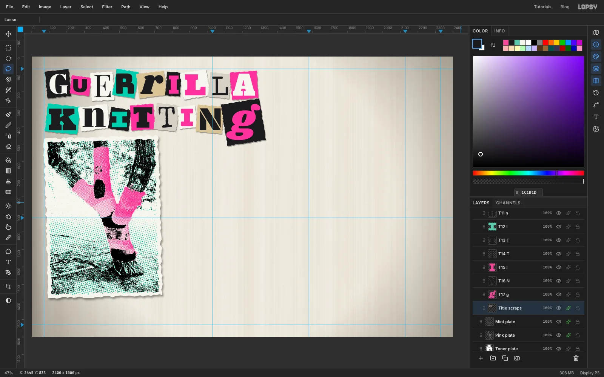

Deselect, then on *Title scraps* run **Add Noise…** at **16**, **Mono**, **Gaussian**. It gives the flat colour a printed grain. Add a **Drop Shadow**: **Offset X 3**, **Offset Y 5**, **Blur 4**, **Opacity 35**. Every scrap now lifts off the paper by the same amount.

## Tilt a few letters

Pick five letters to tilt with their scraps: the U, the r, the n, the Holtwood T and the Bungee I. Click a letter's row, choose the **Move** tool, and drag the round handle just outside its top-right corner around a few degrees, the same way as its scrap. Press [[Cmd+D]] to commit.

The letters stay live text, so you can still fix a typo later. Collapse the *Title* group when you're done.

## Build the first phone frame

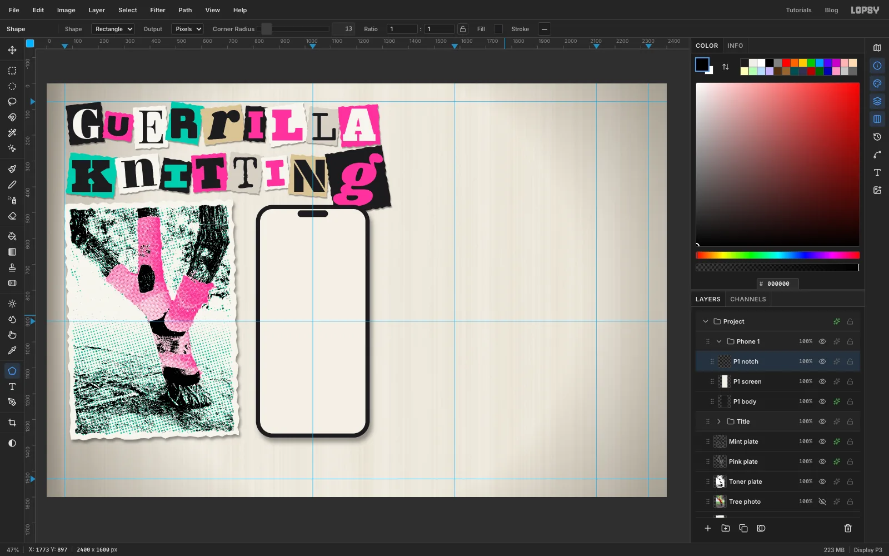

With *Title* collapsed and selected, click **New Group** and name it *Phone 1*. Layers you add now go inside it.

**Body.** Add a layer *P1 body*. Pick the **Shape** tool, set **Shape** to **Rectangle**, **Corner Radius 64**, fill `#1C1B1D` and no stroke. Click once on the first phone's centre line at y 920, without dragging. The **Shape Size** dialog opens: enter **440 × 900** and click **Create**. The shape is centred on your click.

Run **Add Noise…** at **22** on the body, so the black looks like toner rather than ink. Add a **Drop Shadow**: **Offset X 10**, **Offset Y 18**, **Blur 26**, **Opacity 38**.

**Screen and notch.** Add *P1 screen*, set the radius to **48** and the fill to `#F3EFE6`, and click the same centre point at **408 × 868**. Add *P1 notch*: a **118 × 26** black pill with radius **13**, near the top of the screen.

## Draw the map with the Brush inside a marquee

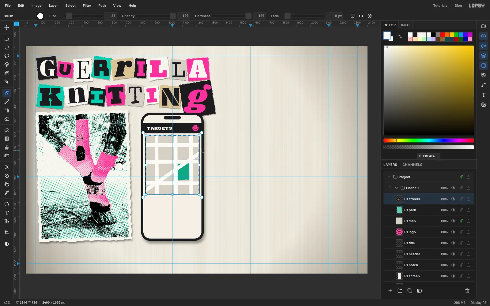

**Header.** Add *P1 header*. Use the **Rectangular Marquee** to select a 72 px bar across the top of the screen, just under the notch, and fill it black. Run **Add Noise…** at 22 again. Type `TARGETS` in **Rubik Mono One 30** in `#F7F5EF` on the left of the bar.

For the logo, add *P1 logo*, fill a small pink circle at the right of the bar, [[Cmd]]-click its thumbnail, and draw three curved strokes across it with a 3 px black **Brush** to make a ball of yarn.

**Map.** Add *P1 map*. Select a block under the header the full width of the screen, minus 16 px each side, and about 420 px tall. Fill it with newsprint `#D5D0C5`. Add **Add Noise…** at **18**, and a **Stroke** of **3** in black.

**Park.** Add *P1 park* and lasso a slightly ragged patch about 85 × 115 px, a little right of the map's centre. The streets you paint next run along its edges. Fill it mint, deselect, and set the layer to **Multiply**.

**Streets.** Add *P1 streets*. Select the map block again, just inside its edge. Pick the **Brush** at **Size 26**, **Hardness 100**, in `#FBFAF6`. For each street, click where it starts and [[Shift]]-click where it ends. Draw three across, three down and one diagonal. Start and end each street past the edge of the map: the marquee clips them.

Deselect and give the streets a **Stroke** of **2** in black.

## Drop pins on the map

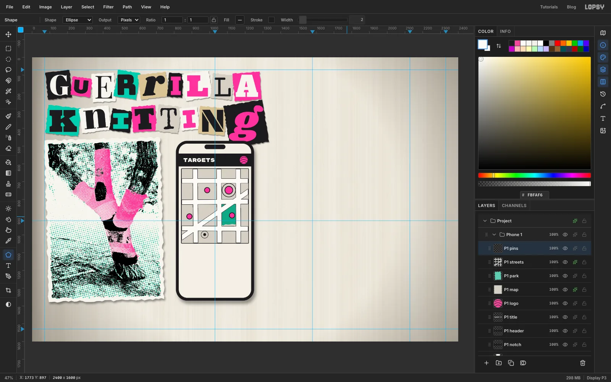

Add *P1 pins*. Set the **Shape** tool to **Ellipse** with a pink fill and a **4 px** black stroke. Click-to-size three **30 px** pins on street corners and one bigger **44 px** target. Then switch the fill off and click a **76 px** ring centred on the target pin.

For the "you are here" marker, make a **16 px** black dot near the bottom-left of the map and a **40 px** ring around it (fill off, 2 px stroke).

## Add the card and its button

**Card and button.** Add *P1 card*. With the **Shape** tool, click-to-size a white **376 × 200** rectangle, radius **16**, with a **4 px** black stroke, under the map. On a new layer *P1 button*, make a pink **200 × 54** pill, radius **28**, with a **3 px** stroke. Give it a hard **Drop Shadow**: **Offset X 5**, **Offset Y 5**, **Blur 1**, **Opacity 100**, in black.

**Tab bar.** On *P1 card*, draw a 3 px **Pencil** rule across the bottom of the screen (click, then [[Shift]]-click).

**Text.** Create the text from the bottom of the screen upwards, so you never click inside a line you've already typed. As with the title, click *P1 button* before you set up each line:

- the tabs `MAP` (pink), `KNIT` and `CREW` in **Rubik Mono One 17**, spaced evenly under the rule
- `3 more →` in **Special Elite 19**, to the right of the button
- `CLAIM IT` in **Rubik Mono One 19**, centred on the button
- `140 m · 4th & Elm · no cameras` in **Special Elite 18**, between the card title and the button
- `BARE LAMPPOST #12` in **Anton 34**, at the top left of the card
- the street names `ELM ST` and `4TH AVE` in **Special Elite 15**, each centred on a white street, and `you` in **Special Elite 14**, just right of the marker

Finally, underline the pink `MAP` tab with a 4 px pink pencil line.

## Scale the phone and tilt it

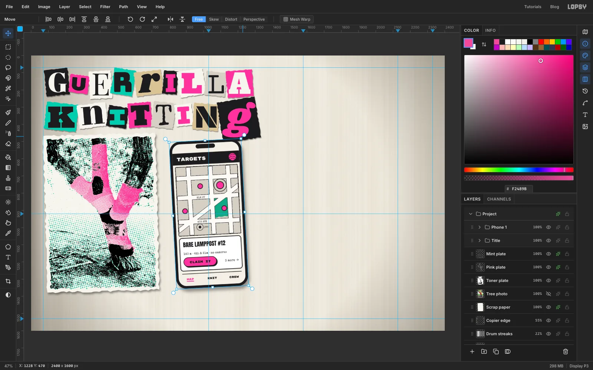

Collapse *Phone 1* and click its row. Make sure nothing is selected ([[Cmd+D]]), then pick the **Move** tool. The handles now frame the whole group.

1. Hold [[Cmd]] and drag the bottom-right handle in about 5% to scale the whole phone, text and all, to **95%**. Press [[Cmd+D]].
2. Nudge the group back so it's centred on its guide.
3. Drag the top-right rotate handle **3°** counter-clockwise, and press [[Cmd+D]].

## Crop a photo for the pattern screen

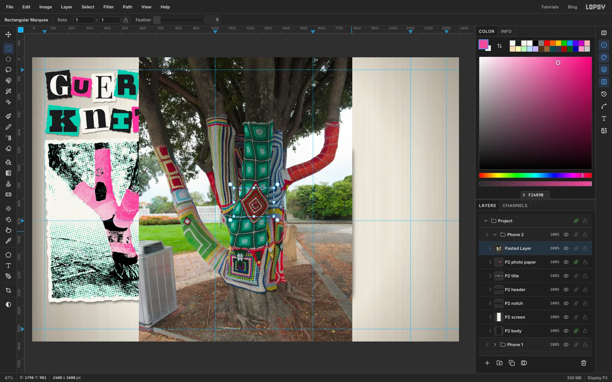

**Frame.** Collapse *Phone 1* and keep its row selected, so the next group is a sibling, not a child. Click **New Group**, name it *Phone 2*, and build the frame the same way as phone 1 on the middle guide, with a black header reading `PATTERN 07`. Draw the 3 px **Pencil** tab-bar rule near the bottom of the screen as well.

**Window.** Add *P2 photo paper* and select a window 376 × 270 px under the header. Fill it pink and give it a black **Stroke** of **3**.

**Photo.** Paste the Ulverstone granny-square photo. Draw a marquee tightly around the red crocheted diamond on the trunk, with a few green squares around it. Keep the marquee the same shape as the window: click once with the **Rectangular Marquee** and enter a box about 240 × 172 px around the diamond. Press [[Cmd+C]], then [[Cmd+V]] to paste just that crop in place. Delete the full photo layer and rename the crop *P2 photo*.

## Scale the crop to fit the window

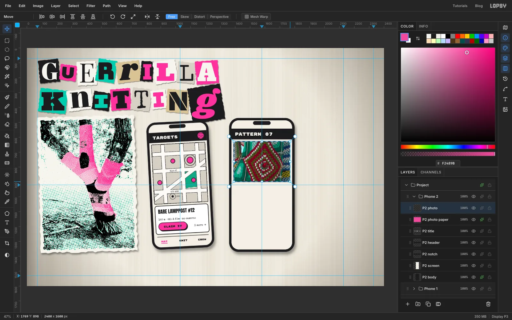

Drag the crop so its top-left corner sits on the window's top-left corner. [[Cmd]]-click its thumbnail to select it. Then, with the **Move** tool, hold [[Cmd]] and drag the bottom-right handle out until the crop just covers the window. Press [[Cmd+D]].

Select the window rectangle again, choose **Select → Inverse**, and press [[Delete]] to trim any overhang. Deselect.

## Halftone the pattern photo

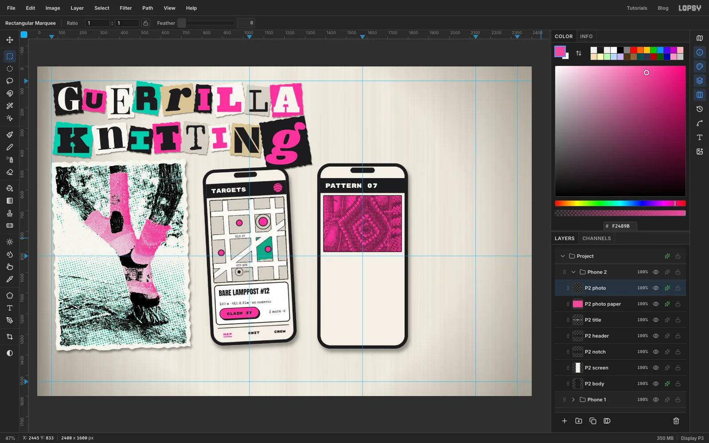

Don't Desaturate this one. Lopsy's Desaturate turns every strong hue into the same mid-grey, so the red diamond and the green squares would vanish into each other. Instead:

1. Run **Brightness/Contrast…** with **Brightness 12** and **Contrast 45**.
2. Run **Halftone…** with **Dot Size 5**, **Angle 45** and **Softness 0.4**. Halftone reads the brightness of the colour photo directly.
3. Add a black **Color Overlay** and set the layer to **Multiply**.

The pink paper shows through the gaps between the dots.

## Draw a knit stitch and define it as a pattern

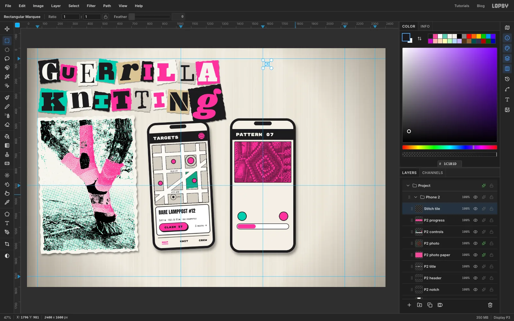

**Controls.** Add *P2 controls*. Click-to-size:

- a **58 px** mint circle with a 4 px black stroke on the left of the screen, about 230 px above its bottom edge, for minus
- a matching pink one on the right, for plus
- a white **348 × 36** pill about 70 px below them, centred, with a 3 px black stroke and radius 18, for the progress bar

Then add a layer *P2 progress* and click-to-size a pink **122 × 28** pill, radius **14**, at the left end of the bar. That's 14 rows out of 40.

**Stitch tile.** Add a temporary layer and zoom in on the empty strip above the middle phone. Use the **Pencil** at **Size 3** to draw one knit stitch, a small V about 10 px wide and 9 px deep. Click its top-left point, [[Shift]]-click the bottom point, then [[Shift]]-click the top-right point.

Click once with the **Rectangular Marquee** and enter a **16 × 14** box around the V, so the stitch has a little air on every side. Choose **Edit → Define Pattern**. Then delete the temporary layer.

## Fill the progress bar with stitches

[[Cmd]]-click the *P2 progress* thumbnail to select it. Choose **Edit → Fill with Pattern…**, pick your stitch, and click **Apply**. The pattern tiles across the selection, so the bar fills with rows of knitting.

## Finish the pattern screen

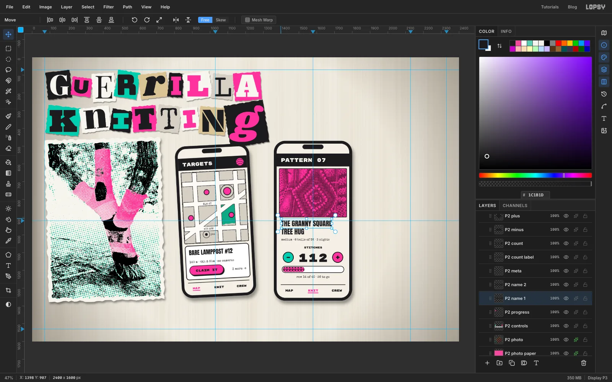

Add the text from the bottom up:

1. The tabs, with `KNIT` pink and underlined this time.
2. `row 14 of 40 · 26 to go` in **Special Elite 17**.
3. `+` and `–` in **Rubik Mono One 34**, centred on their buttons.
4. `112` in **Rubik Mono One 66**, centred between the buttons.
5. `STITCHES` in **Rubik Mono One 15**.
6. `medium · 6 balls of DK · 3 nights` in **Special Elite 17**.
7. The title in **Anton 38**, as two separate layers so the leading stays tight: `TREE HUG` first, then `THE GRANNY SQUARE` above it.

Scale the *Phone 2* group to 95% and tilt it **2° clockwise**, as you did for phone 1.

## Lay out the crew list

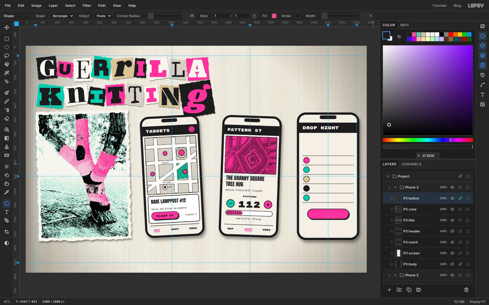

Collapse *Phone 2*, keep it selected, and make *Phone 3* the same way on the right-hand guide, with a header reading `DROP NIGHT` and the tab-bar rule.

**Rows.** Add *P3 crew*. Click-to-size five **42 px** avatar circles down the left of the screen, the first about 195 px below the header and each 66 px below the last, filled pink, mint, kraft, black and mint, each with a 3 px black stroke. Draw a 2 px **Pencil** rule between the rows, plus one above and one below the list.

**Button.** Add *P3 button*: a pink **290 × 70** pill with a 4 px stroke and the same hard black shadow as `CLAIM IT`.

## Type the crew and make a stamp off to the side

**Text.** Create the text from the bottom up again:

1. The tabs, with `CREW` pink and underlined.
2. `5 knitters · 0 permission` in **Special Elite 19**, and `I'M IN` in **Rubik Mono One 32** on the button.
3. For each crew row, the status tag, then the handle. The tags are **Rubik Mono One 20**, right-aligned about 25 px in from the screen's right edge and sitting on the handle's baseline: pink `IN`, or black `MAYBE` for sock_bloc. The handles are **Courier Prime 22**: `@purl_jam`, `@cast_off_carla`, `@sock_bloc`, `@needle_nan` and `@yarn_ghost`.
4. The two-line note `under the 4th st bridge.` / `bring scissors. wear black.` in **Special Elite 19**, just above the list. Rename its layer *P3 where*.

**Stamp.** The stamp will sit on top of the crew list, so build it somewhere empty first, where your clicks can't land in the existing text.

Click the *P3 where* row (the note), click **New Group** and name it *P3 stamp*. Inside it, add a layer and click-to-size a **270 × 62** rectangle in the empty space above the phones: radius **10**, no fill, a **5 px** pink stroke. Type `TOP SECRET-ISH` in **Black Ops One 26** in pink, centred in the box.

## Drag the stamp on and turn it

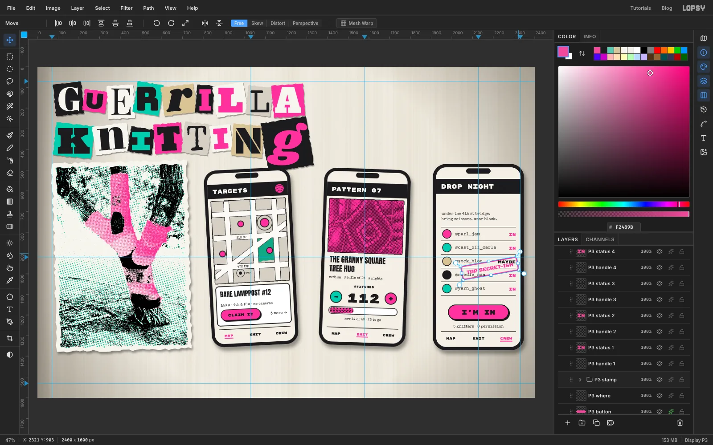

Collapse *P3 stamp*, click its row and deselect. With the **Move** tool, drag the stamp down onto the crew list, centred across the `@sock_bloc` and `@needle_nan` rows. Rotate it **10°** counter-clockwise with the rotate handle and press [[Cmd+D]].

Set the group's blend to **Multiply** at **85%**, so the rows show through the ink like a real stamp.

## Add the time and tilt the last phone

Type `TUE 02:00` in **Rubik Mono One 44** at the top of the screen, above the two-line note.

Scale *Phone 3* to 95% and tilt it **2.5°** counter-clockwise. The three phones now lean different ways, like they were stuck down by hand.

## Write the tagline in marker

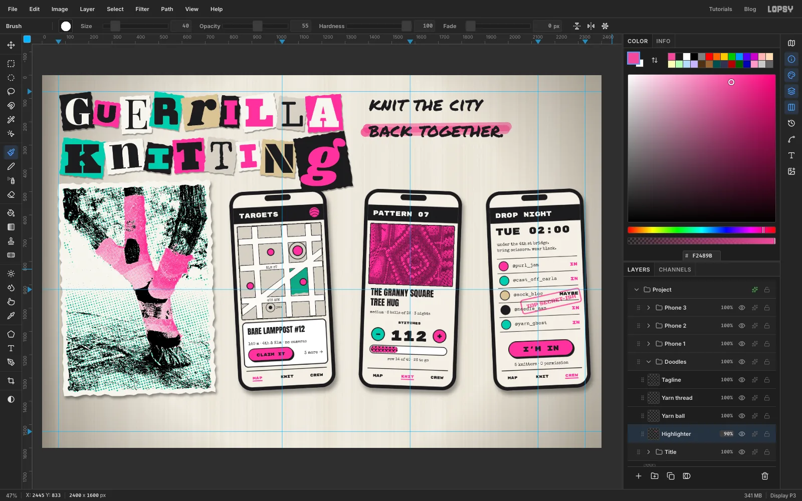

Click the collapsed *Title* group and make a new group called *Doodles*. Because the phone groups are above it, anything inside *Doodles* sits behind the phones. Add three layers inside it: *Highlighter*, *Yarn ball* and *Yarn thread*.

**Tagline.** Type `knit the city` and `back together.` (press [[Enter]] between them) in **Permanent Marker 80**, black, at the top right of the board. Start it about 100 px right of the title's last letter, just under the top margin guide.

**Highlighter.** Click *Highlighter* and set the **Brush** to **Size 40**, **Hardness 100**, **Opacity 55**, in pink. Draw two straight passes along the second line, using click and [[Shift]]-click, the second a few pixels higher than the first. Where they overlap the ink doubles up, like a chisel marker. Set the layer to **Multiply** at **90%**.

## Wind a ball of yarn

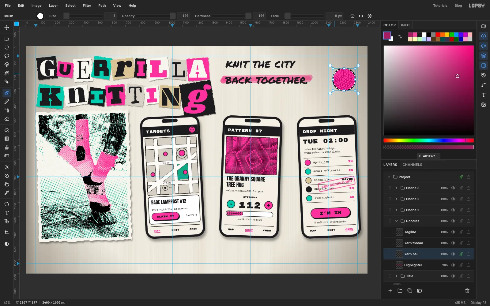

On *Yarn ball*, select a **156 px** circle with the **Elliptical Marquee**, top right next to the tagline, and fill it pink. Give it a black **Stroke** of **5**.

[[Cmd]]-click the thumbnail so your strokes stay on the ball. Then set the **Brush** to **Size 3**, **Hardness 100**, in dark pink `#A81E62`. Draw three bands of wraps, each a set of nine gently curved strokes running parallel across the ball:

1. one band tilted up to the right, at about 30°
2. one crossing it, tilted the other way at about 45°
3. a short band running almost vertically

Curve each strand the same way, as if it's wrapping around the front of a sphere. Then deselect.

## Run the thread behind a phone

On *Yarn thread*, set the **Brush** to **Size 7** in pink. Draw one long stroke:

- leave the ball at its lower left
- loop down behind the middle phone's top-right corner
- carry on behind the phone
- come out of its left side, low down
- drape down the gap between phones 1 and 2

Because the thread is in *Doodles*, below the phones, the middle stretch hides behind the phone on its own.

End it about 120 px above the bottom margin guide, where the captions will go. Switch to **Size 3** and draw three short strands splitting off the end for a frayed tail. Give the thread a black **Stroke** of **2**.

## Tape everything down

Click *Phone 3*, the top group in the stack, and add a layer called *Tape*. Lasso a torn strip about **170 × 48** across the top of each phone, hold [[Shift]] to add the next, and do the same for two **150 × 44** strips across the photo's top corners at steep angles.

Fill the whole selection with kraft `#D6C49A` and deselect. Add **Add Noise…** at **14**, set the layer to **50%**, and give it a **Drop Shadow**: **Offset X 3**, **Offset Y 5**, **Blur 6**, **Opacity 60**.

## Add the captions, cut line and label

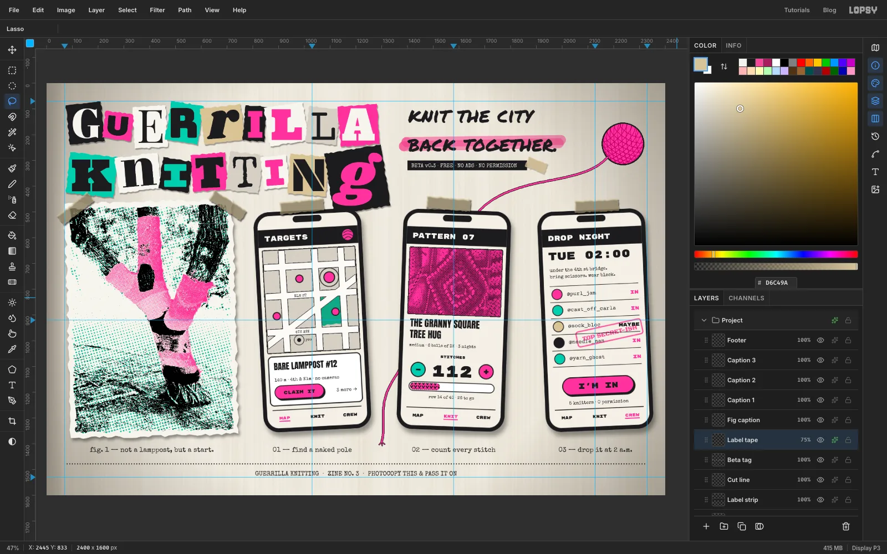

**Cut line.** Add a *Cut line* layer. Open the brush presets and set **Spacing** to **200**, then, in black at **Size 5**, click on the left margin guide about 50 px above the bottom guide and [[Shift]]-click level with it on the right margin guide. The big spacing turns the stroke into a dotted line. Set the spacing back to **25** afterwards.

**Captions.** Type these in **Special Elite 26**, centred on one baseline under the photo and each phone:

- `fig. 1 — not a lamppost, but a start.`
- `01 — find a naked pole`
- `02 — count every stitch`
- `03 — drop it at 2 a.m.`

Under the cut line, centre the footer `GUERRILLA KNITTING · ZINE NO. 3 · PHOTOCOPY THIS & PASS IT ON` in **Special Elite 24**.

**Label.** Type `BETA v0.3 · FREE · NO ADS · NO PERMISSION` in **Special Elite 20** in `#F7F5EF`, under the tagline and lined up with its left edge. On a layer below the text, fill a black strip behind it with 16 px of padding on the left and 40 px on the right. Run **Add Noise…** at 22 on the strip. Then, on a layer above the text, lasso a small torn scrap over the strip's right end, clear of the text. Fill it kraft and set it to **75%** with the same shadow as the other tape.

## Photocopy the whole board

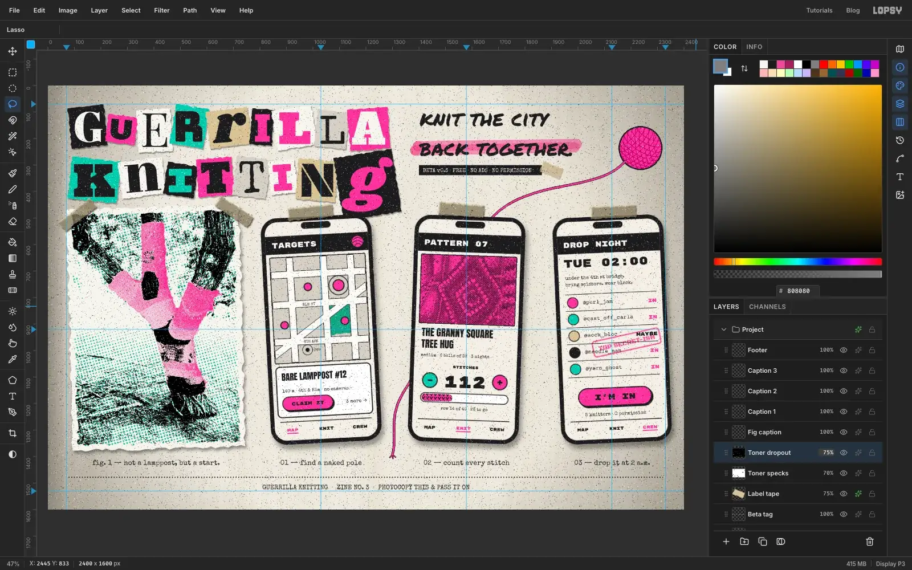

Make two layers at the very top of the stack.

**Toner specks.** Fill a layer with mid-grey `#808080`. Run **Add Noise…** at **100**, **Mono**, **Uniform**, then **Gaussian Blur…** at **2**, then **Threshold…** at **103**. Set it to **Multiply** at **70%**.

Start from mid-grey, not white. Add Noise only moves pixels about 50 levels either way, so on white the threshold would never catch anything. The blur clumps the specks into 1–4 px blots, like real toner.

**Toner dropout.** Do the same on a second layer, but threshold at **153** and set it to **Screen** at **75%**. White specks disappear on paper but show up in the black bezels, headers and scraps, where a copier drops out.

## Wear the stamp and age the photo edge

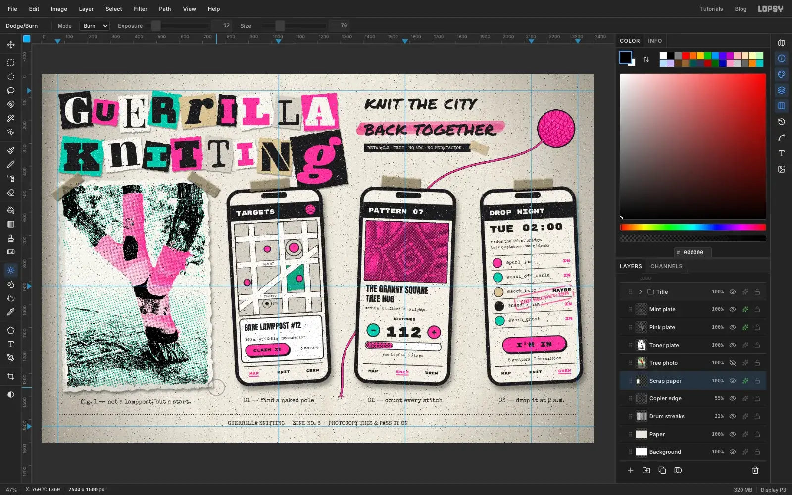

**Stamp.** Expand *Phone 3* and *P3 stamp*, and click the stamp's rectangle layer. Pick the **Eraser** at **Size 18**, **Opacity 60**, and drag five or six short strokes across the border. A rubber stamp never inks evenly.

**Photo edge.** Click *Scrap paper*, pick the **Burn** tool at **Exposure 12**, **Size 70**, and run it down the left edge and along the bottom of the white backing. Old photocopies go grubby at the edges first.

Save with **File → Save Project**, then **File → Quick Export PNG**.

> **Tip:** Check the phone text at 100% zoom before you export. The board should feel rough from across the room, but the app still has to read as a real interface up close.
