In Iceland, Christmas comes with a monster. The **Yule Cat** (*Jólakötturinn*) is a giant black cat that prowls the snowy farms on Christmas Eve. It eats anyone who didn't get a new piece of clothing for Christmas. That makes a new pair of socks a matter of life and death.

This card tells the legend the way a punk zine would. Zines are cheap, self-published booklets made with scissors, glue and a photocopier. The look comes straight from the process:

- headlines built from letters cut out of magazines, ransom-note style
- photos copied until they go hard black and white
- typewritten captions on scraps of paper, held down with tape
- the speckle and dark edges a tired copier leaves on every page

The card is 1500 × 2100 px (a 5 × 7 inch shape) and holds a ransom-note title, a torn red night sky, a photocopied cat looming over a paper village, falling snow, and a strip of notes along the bottom.

You'll need one photo from Wikimedia Commons: **Black cat portraits.jpg** by Dmitry Makeev, licensed **CC BY-SA 4.0**. It shows a black kitten stalking towards the camera on a white table. Download the 1280 px version. If you share or sell the finished card, credit the photographer and keep the same licence.

The tools you'll use:

- the **Lasso**, **Magic Wand**, and the **Rectangular** and **Elliptical Marquee** with their exact-size dialogs
- **Select → Grow / Feather / Inverse**, and [[Cmd]]-click on a layer thumbnail to load its shape as a selection
- **Copy**, **paste in place**, **Flip Horizontal**, and the **Move** tool's scale and rotate handles
- **Desaturate**, **Brightness/Contrast**, **Threshold**, **Halftone**, **Add Noise** and **Gaussian Blur**
- the **Gradient**, **Brush**, **Spray** and **Eraser** tools, and the Brush's **Radial Symmetry**
- live text in nine Google fonts, including rotating live text
- groups, **Merge Down**, and the **Multiply** blend mode
- layer effects: **Drop Shadow**, **Stroke** and **Outer Glow**

The palette is copier paper, toner and two spot colours:

- Paper `#EDE8DD`, scrap white `#F8F5EE`, card white `#FFFFFF`, snow `#FAF8F3`, label ink `#F2EFE6`
- Toner black `#1B1919`
- Spot red `#B54134`
- Mustard `#D8AB49`, eye glow `#F2C14E`
- Tape `#E6DCBF`, shadow brown `#2A0E0A`

> **Tip:** On a wide-gamut (Display P3) screen, Lopsy reads typed hex codes as P3 colours. These codes were picked as P3 values, so they match the finished card. On an sRGB screen they come out a touch duller.

> **Note:** Shortcuts are written for a Mac. On Windows use [[Ctrl]] wherever it says [[Cmd]].

## Set up the card and tear out the night sky

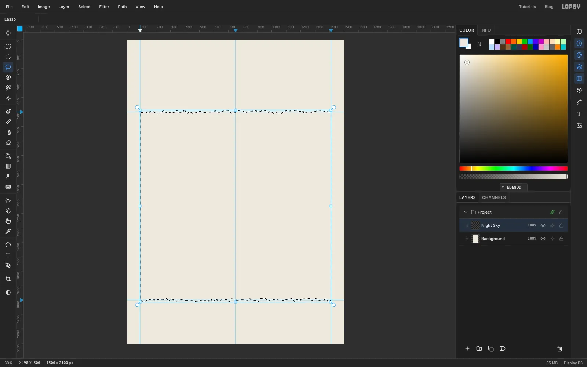

Choose **File → New**, keep the units on **Pixels**, and make the document **1500** wide and **2100** high.

Click the top ruler to drop vertical guides at **90**, **750** and **1410**. Click the left ruler for horizontal guides at **500** and **1800**. The outer guides mark the edges of the night-sky panel. The centre guide helps you balance the layout.

Click *Background*, set the foreground to paper `#EDE8DD` and choose **Edit → Fill**. Click *Layer 1* and rename it *Night Sky*.

Pick the **Lasso** and draw the panel inside the guides. Run straight down the side guides, but wobble your hand along the top and bottom in small, sharp zig-zags so those edges look torn, not cut.

## Fill the torn panel red

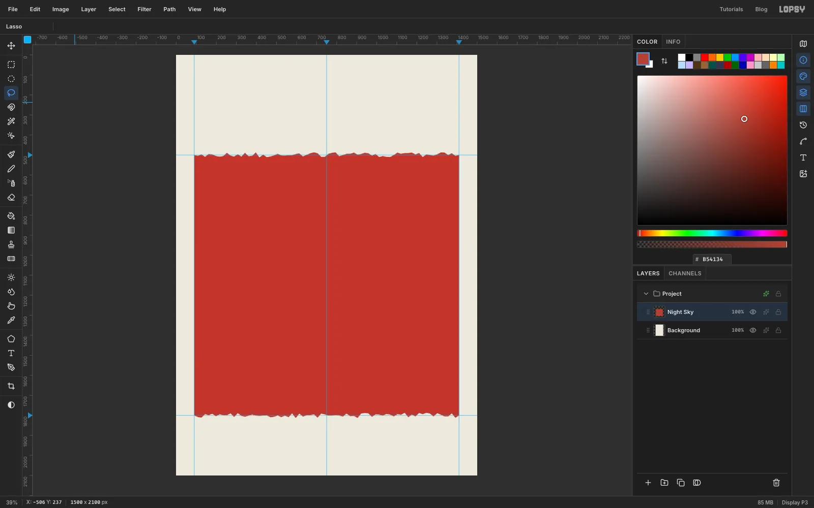

Set the foreground to spot red `#B54134`, choose **Edit → Fill**, then press [[Cmd+D]] to deselect.

## Screen the sky with halftone dots

Click **Add Layer** and name the layer *Sky Dots*. [[Cmd]]-click the *Night Sky* thumbnail to load the panel as a selection.

Pick the **Gradient** tool, set it to **Linear**, and make a black-to-white gradient in **Advanced…** (`#000000` at the left end, `#FFFFFF` at the right). Drag from the top edge of the panel straight down to about y 1700. Deselect.

Choose **Filter → Halftone…** with **Dot Size 18**, **Angle 45** and **Softness 1**. The dark top turns into big dots and the light bottom into tiny ones.

Cells along the torn edge throw dots past it. To trim them, [[Cmd]]-click the *Night Sky* thumbnail again, choose **Select → Inverse**, press [[Delete]], and deselect. Open the layer's effects with the sparkle button on its row, set the blend mode to **Multiply**, close the drawer, and set the layer's opacity to **45%**. The sky now darkens towards the top like a cheap screen print.

## Mark out the moon

Add a layer called *Moon*. Pick the **Elliptical Marquee** and click once on the canvas without dragging. The exact-size dialog opens. Set **From** to **145, 575** and **To** to **515, 945** for a 370 px circle, and press [[Enter]]. Fill it with paper `#EDE8DD` and deselect.

## Shade the moon and lay down the snowy ground

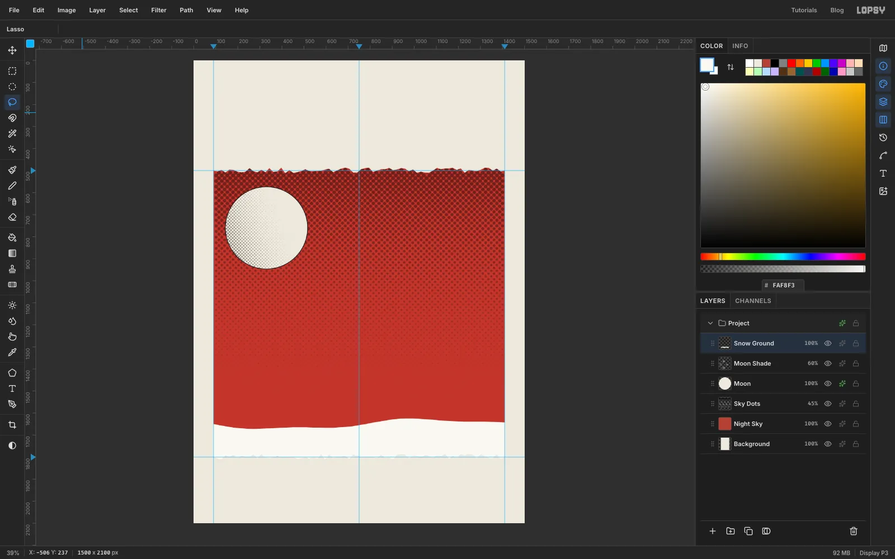

A flat paper-coloured disc reads as a hole punched in the sky, so give the moon a body:

1. Add a **Stroke** effect to *Moon*: **Width 3** in toner black `#1B1919`.
2. Add a layer called *Moon Shade* and [[Cmd]]-click the *Moon* thumbnail.
3. Drag a white-to-`#3A3A3A` linear gradient from the moon's right side across to its lower left, then deselect.
4. Run **Halftone…** at **Dot Size 10**, then trim the dots back to the moon the same way you trimmed the sky: [[Cmd]]-click *Moon*, **Select → Inverse**, [[Delete]].
5. Set *Moon Shade* to **Multiply** at **60%**.

Now add a layer called *Snow Ground*. With the **Lasso**, draw a gently rolling line across the panel at about y 1650. Then follow the panel's torn bottom edge back to where you started. Fill it with snow `#FAF8F3`. The snow is slightly whiter than the paper, so the torn bottom still shows.

## Paste the cat photo and scale it down

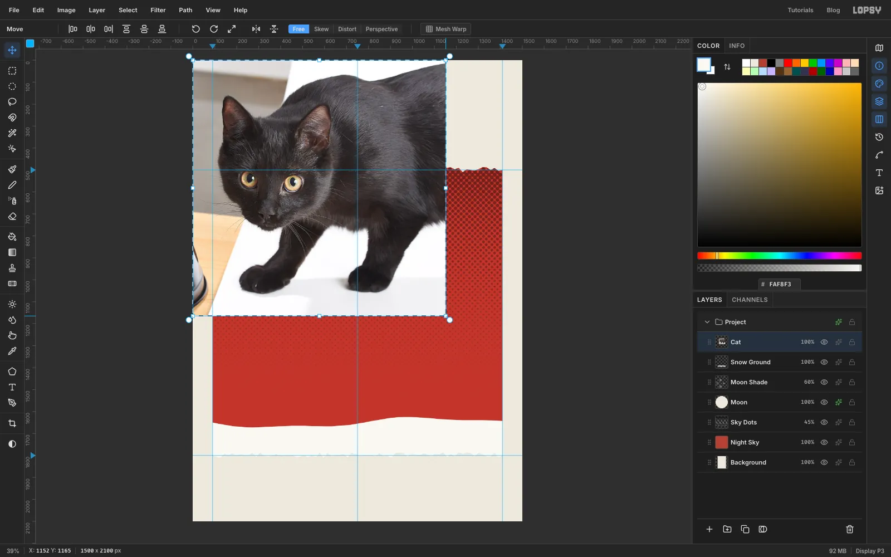

Open the cat photo in your browser or Preview, copy it, click *Snow Ground* in Lopsy, and press [[Cmd+V]]. The photo fits on the canvas, so it lands at the top-left corner at full size, already selected, with the **Move** tool active. Double-click the new layer's name and rename it *Cat*.

Hold [[Cmd]] and drag the bottom-right handle up and to the left until the photo is about **1150 px** wide (90%). [[Cmd]] keeps the proportions. Press [[Cmd+D]] to commit the scale.

## Move the cat onto the panel

Drag the photo down and to the right. Its right edge should meet the panel's right guide, and the cat's front paws should sit just above the snow line, at about y 1650.

The cat's back now pokes up near the top of the panel, and its body runs off the right edge. That's the point: a cat too big for the picture.

## Knock out the backdrop with the Magic Wand

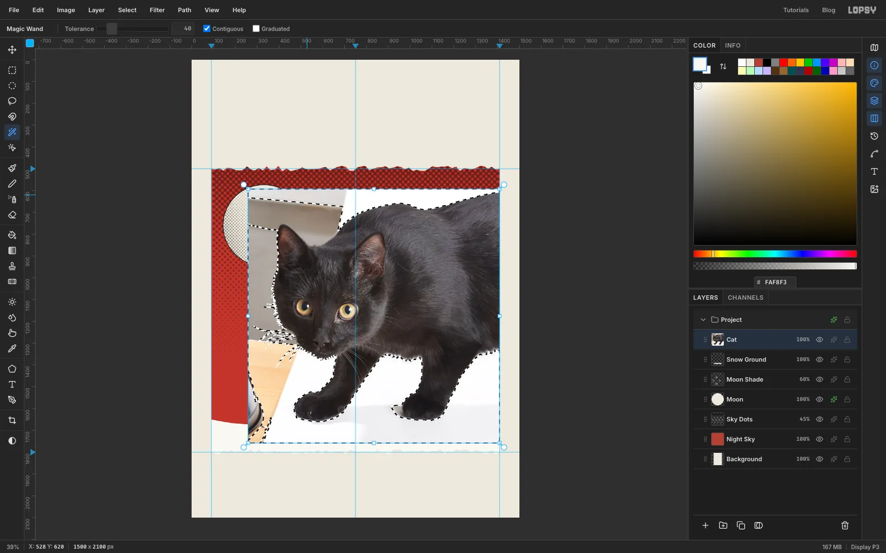

Pick the **Magic Wand**, keep **Contiguous** on, and set **Tolerance** to **40**. Click the white table in front of the cat. Then hold [[Shift]] and click each other part of the backdrop to add it:

- the white wall above the cat's back
- the white patch to the right of its tail end
- the grey wall on the left
- the wooden table corner at the bottom left
- the white strip along the very top

Press [[Delete]] and deselect.

## Lasso away the leftovers

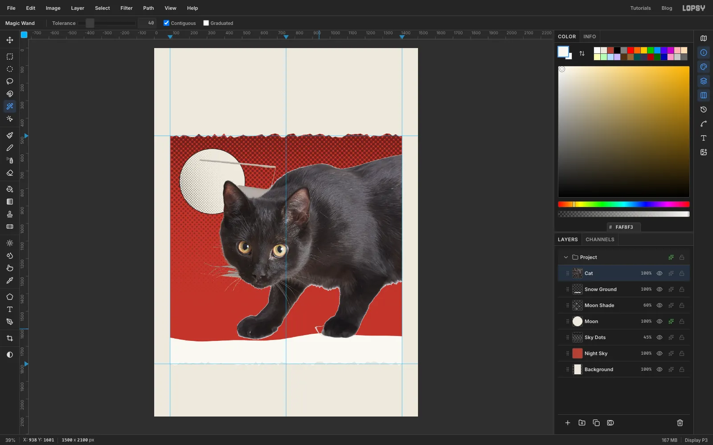

A few bits of backdrop are left:

1. With the **Lasso**, draw around the steel cup and the corner of table at the bottom left, press [[Delete]], and deselect.
2. Pick the **Magic Wand** again (**Tolerance 40**). Click the grey wall strip behind the ears, [[Shift]]-click the grey shadow under the right front paw, press [[Delete]], and deselect.

A thin pale line from the top edge of the wall still crosses the moon. Leave it for now: after the next step it turns pure white and is easy to lasso away.

## Photocopy the cat

Choose **Filter → Desaturate**, then **Filter → Brightness/Contrast…** with **Brightness 10** and **Contrast 60**. Finish with **Filter → Threshold…** at **100**.

Threshold leaves only two tones, just like a copier pushed too dark. Most of the black cat stays solid, and the sheen on its fur breaks into white scratches. If the shoulder turns into a grey haze of specks, raise the level a few steps.

## Clean the edges and tear the cat's back off

Threshold turns the leftover backdrop fringe into hard white lines. Before you give the cat a border, clean up three spots with the **Lasso** and [[Delete]]:

1. The white line above the head, across the moon. Stay well clear of the ears.
2. The small white sliver just left of the right front paw.
3. The whiskers that stick out past the left cheek. A grown border would turn them into fingers.

The photo ends in a straight line at the panel edge, which looks cut by a machine. Lasso a torn, zig-zag line from top to bottom about 30 px inside the panel's right edge, include everything to the right of it, and press [[Delete]].

## Grow a paper border around the cat

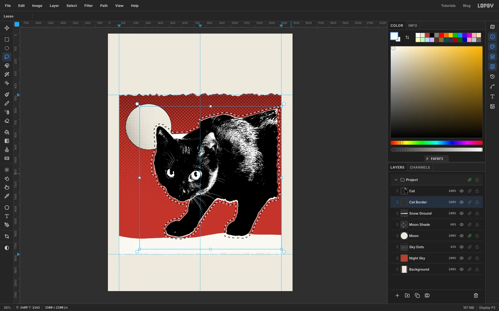

Click *Snow Ground* and add a layer called *Cat Border*, so it sits under *Cat*. [[Cmd]]-click the *Cat* thumbnail to load its outline, then choose **Select → Grow…** and enter **14**.

## Fill the border and print the cat on Multiply

Fill the grown selection with paper `#EDE8DD` and deselect. Give *Cat Border* a **Drop Shadow** with **Offset X 6**, **Offset Y 8**, **Blur 10** and **Opacity 45**, in shadow brown `#2A0E0A`.

Then click *Cat* and set its blend mode to **Multiply**. The white highlights now take on the colour of the paper underneath, so the cat looks printed on the cut-out rather than pasted over it.

## Paint glowing mustard eyes

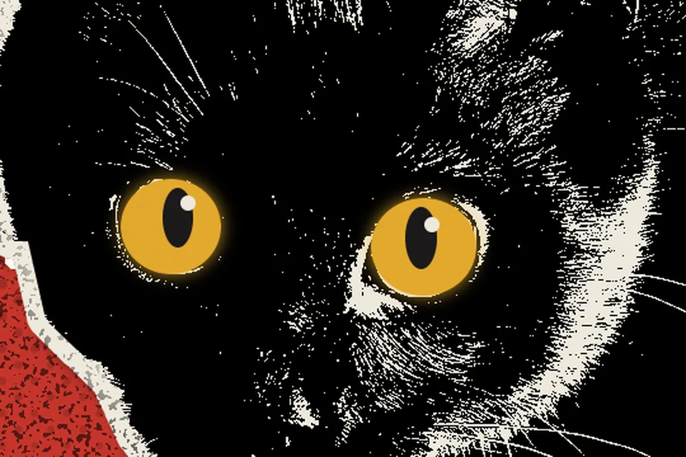

Threshold turned the eyes into white rings, so repaint them as a spot-colour layer. Add a layer called *Eyes* above *Cat*. Each shape below is an **Elliptical Marquee** made with the exact-size dialog (click without dragging, type **From** and **To**), then **Edit → Fill**:

- **Irises** in mustard `#D8AB49`: from **475, 1101** to **554, 1176**, and from **672, 1116** to **755, 1193**. If your photo sits a little differently, drag the ellipses over the irises by eye instead.
- **Pupils** in toner black `#1B1919`, tall and narrow like a cat's at night: from **508, 1108** to **532, 1155**, and from **699, 1123** to **724, 1172**.
- **Catchlights** in paper `#EDE8DD`, 12 px circles at the top right of each pupil: from **522, 1114** to **534, 1126**, and from **714, 1131** to **726, 1143**.

Deselect and add an **Outer Glow** with **Size 18**, **Spread 10** and **Opacity 70** in `#F2C14E`.

## Cut out the first house

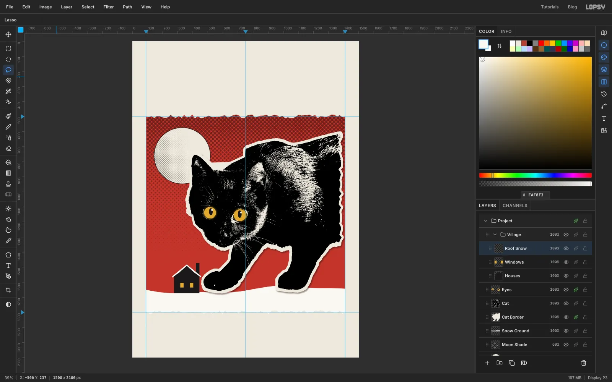

Click *Eyes* and click **New Group**. Name the group *Village*, then add three layers inside it, from the bottom up: *Houses*, *Windows* and *Roof Snow*.

On *Houses*, lasso a gabled house with a chimney. Drag slowly in straight runs from corner to corner; at this size small wobbles read as cut paper, which suits the look.

- a wall about 170 px wide and 110 px tall, standing on the snow at y 1672
- a roof about 80 px high that overhangs the walls by about 12 px on each side
- a narrow chimney on the right slope

Fill it with toner black. On *Windows*, fill two small rectangles, about 22 × 30 px, in mustard. On *Roof Snow*, lasso a thin cap along each roof slope, slightly thicker in the middle, and fill it with snow.

## Finish the village

Repeat the recipe for the rest of the village:

- **A tall, narrow house** on the left margin, about 120 px wide with a 175 px wall, a steep roof and four windows.
- **A church** at the right, with its tower about 30 px in from the panel edge: a 64 px tower about 250 px tall with a pointed spire, a lower nave of about 150 px with a sloping roof, and tall arched windows (rectangles are fine).
- **A Christmas tree** between the cat's paws, about 210 px tall: four stacked triangular tiers on a short trunk.

Keep all the shapes on *Houses*, all the windows on *Windows* and the snow caps on *Roof Snow*.

## Copy the chimney house and flip it

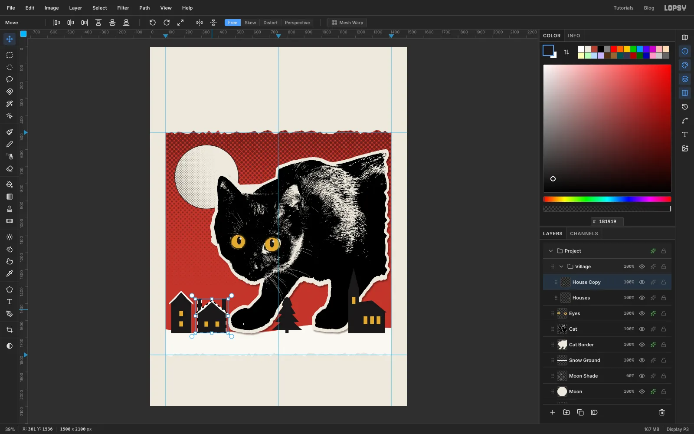

Click *Roof Snow* and choose **Layer → Merge Down** twice, so the snow and windows join the houses. Rename the result *Houses*.

Draw a **Rectangular Marquee** around the chimney house, press [[Cmd+C]], then [[Cmd+V]]. Lopsy pastes in place, so the copy sits exactly on top of the original on a new layer. Rename it *House Copy*. With the **Move** tool active, click **Flip Horizontal** in the options bar, then deselect.

## Shrink the copy and move it between the paws

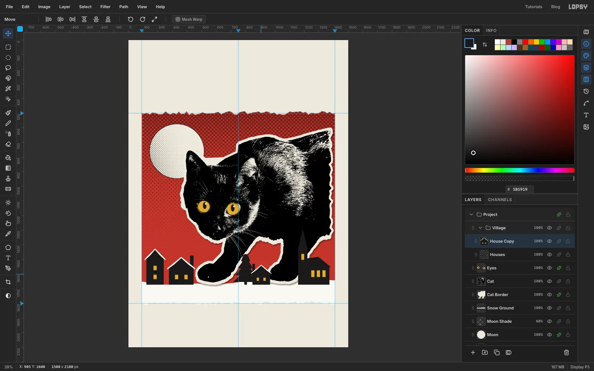

Press [[Cmd+D]] to commit the flip. Pick the **Rectangular Marquee**, draw a box just around the flipped house, and switch back to the **Move** tool so its handles appear. Hold [[Cmd]] and drag the top-right handle down and to the left until the house is about **72%** of its size, then press [[Cmd+D]].

Drag the copy right, to just past the Christmas tree, keeping its base on the snow line. If it isn't level, nudge it with the arrow keys. Each press moves 1 px, and [[Shift]] makes it 10 px.

## Outline the village and bank up the snow

Choose **Layer → Merge Down** to fold *House Copy* into *Houses*. Add a **Stroke** of **Width 6** in paper `#EDE8DD`. The houses stand in front of the black cat, and without an outline they melt into it.

Add a layer called *Snow Drift*. Lasso a wavy band across the panel that covers the bottoms of the houses, from about y 1664 down to y 1712, and fill it with snow. Now the houses look planted in a drift instead of sitting on a line.

## Spray falling snow inside the panel

Add a layer called *Snowfall* above *Snow Drift*. [[Cmd]]-click the *Night Sky* thumbnail so the snow stays inside the panel.

Pick the **Spray** tool and set **Size 300**, **Density 3**, **Opacity 100** and **Softness 0**. Size is the width of the spray cloud. The dots it drops range from about 3 to 18 px, which is right for snowflakes seen from a distance. Set the foreground to snow and drag six or seven slow horizontal passes across the panel, from top to bottom. Deselect.

Spray dots vary in opacity, and the faint ones look grey. To make them all solid, pick the **Magic Wand**, untick **Contiguous**, set **Tolerance 12**, and click an empty part of the layer. Choose **Select → Inverse**, **Edit → Fill** with snow, and deselect. Turn **Contiguous** back on.

## Keep the snow off the cat

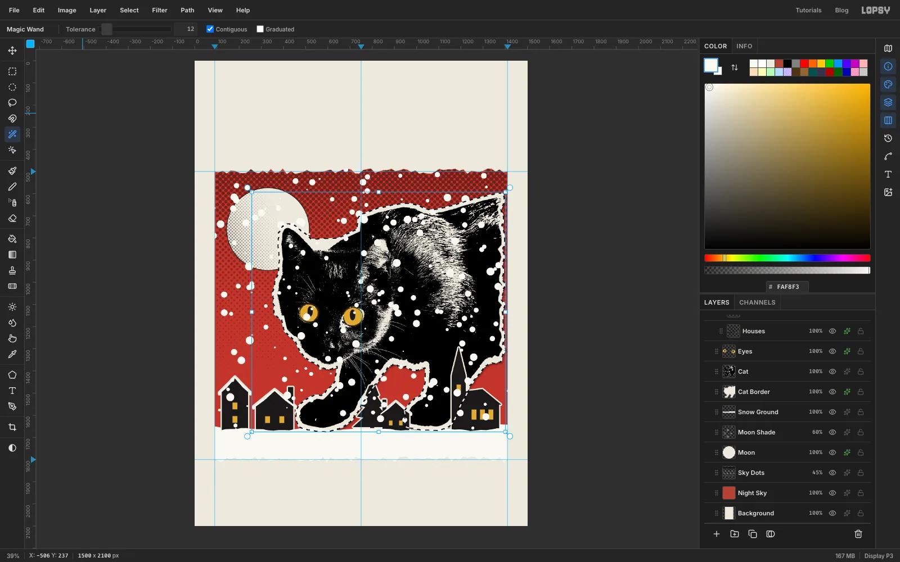

White dots on a black cat read as spots, not snow. With *Snowfall* still active, [[Cmd]]-click the *Cat Border* thumbnail (the border covers the whole cat), press [[Delete]], and deselect. Do the same with the *Houses* thumbnail so no flakes cover the windows.

## Doodle snowflakes with Radial Symmetry

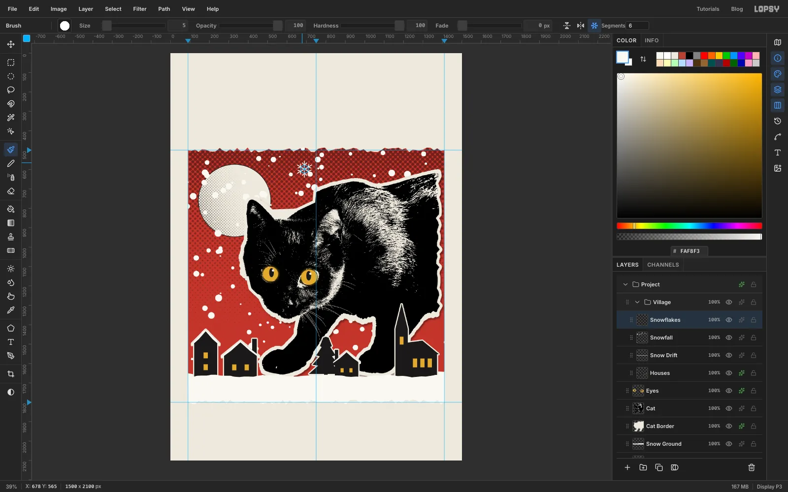

Add a layer called *Snowflakes*. Pick the **Brush**, open the brush settings, and set **Size 5**, **Spacing 10** and **Hardness 100**, with no scatter or jitter. Click the snowflake button (**Radial Symmetry**) in the options bar and set **Segments** to **6**.

For each flake:

1. [[Cmd]]-click where you want its centre. With symmetry on, this moves the symmetry centre instead of painting.
2. Drag one arm straight up from the centre, 35–50 px long.
3. Halfway along that arm, draw a short branch up and to the right, then another up and to the left.

Every stroke repeats six times around the centre. Make four flakes in the empty sky: one above the moon, one above the cat's back, and two down the left side. Keep them clear of the roofs. Click **Radial Symmetry** again to turn it off.

## Cut the first ransom-note letter

Collapse the *Village* group, click it, and click **New Group**. Name the new group *Title*.

Each letter of YULE CAT is a card of coloured paper with one big letter on it. For the first one:

1. Add a layer called *Card Y* and use the **Rectangular Marquee**'s exact-size dialog to make a card from **108, 118** to **300, 330**.
2. Fill it with card white `#FFFFFF` and deselect.
3. Pick the **Text** tool, choose **Abril Fatface**, set **Size 190**, and set the foreground to toner black.
4. Click on the card, type `Y`, and press [[Tab]] to commit.
5. Switch to the **Move** tool and nudge the letter with the arrow keys until it's centred on the card. (The text layer is named after the letter. It merges away in the next step, so don't worry about its name.)

## Merge the letter down and tilt the card

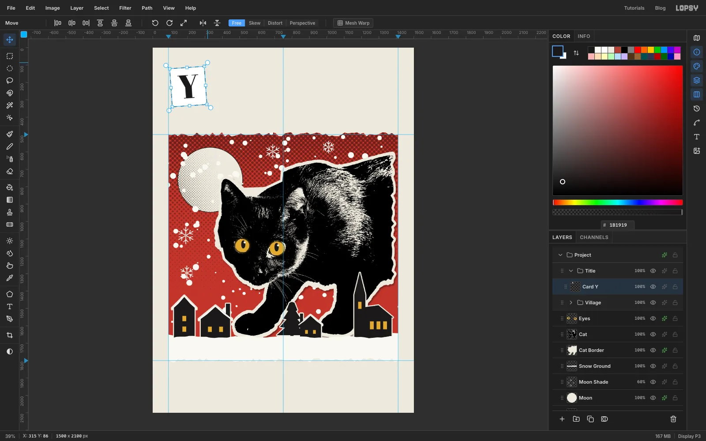

Choose **Layer → Merge Down** so the letter and card become one piece of paper. Draw a marquee a few pixels bigger than the card. With the **Move** tool, drag the small round rotate handle just outside the top-right corner until the card tilts about **4°** to the left. Press [[Cmd+D]] to commit.

## Spell out YULE CAT

Make the other six cards the same way. The card you just tilted is still the active layer, so each **Add Layer** puts the next card right above it. For every card:

1. **Add Layer**, then a **Rectangular Marquee** from the corners below, filled with the card colour.
2. The **Text** tool with the font, size and letter colour below. Click on the card, type the letter, press [[Tab]].
3. Centre the letter with the **Move** tool's arrow-key nudges, **Merge Down**, then marquee the card and tilt it with the rotate handle. Press [[Cmd+D]].

YULE runs left to right at the top. CAT sits lower and ends at the panel's right edge:

- **U**: **Bungee 150**, snow letter on a red card, from 318, 132 to 506, 322. Tilt 3° right.
- **L**: **Alfa Slab One 170**, mustard letter on a toner-black card, from 522, 110 to 694, 318. Tilt 2° left.
- **E**: **Shrikhand 170**, black letter on a mustard card, from 712, 136 to 900, 330. Tilt 5° right.
- **C**: **Ultra 160**, snow letter on a black card, from 802, 296 to 1012, 500. Tilt 5° left.
- **A**: **Rubik Mono One 150**, red letter on a white card, from 1026, 284 to 1212, 488. Tilt 2° right.
- **T**: **DM Serif Display 200**, black letter on a red card, from 1228, 300 to 1402, 506. Tilt 3° left.

The tilts alternate in direction and stay small. Ransom-note type looks chaotic, but the best examples are carefully balanced: every letter has about the same visual weight, and nothing tips over.

## Add "beware the" and the Icelandic name

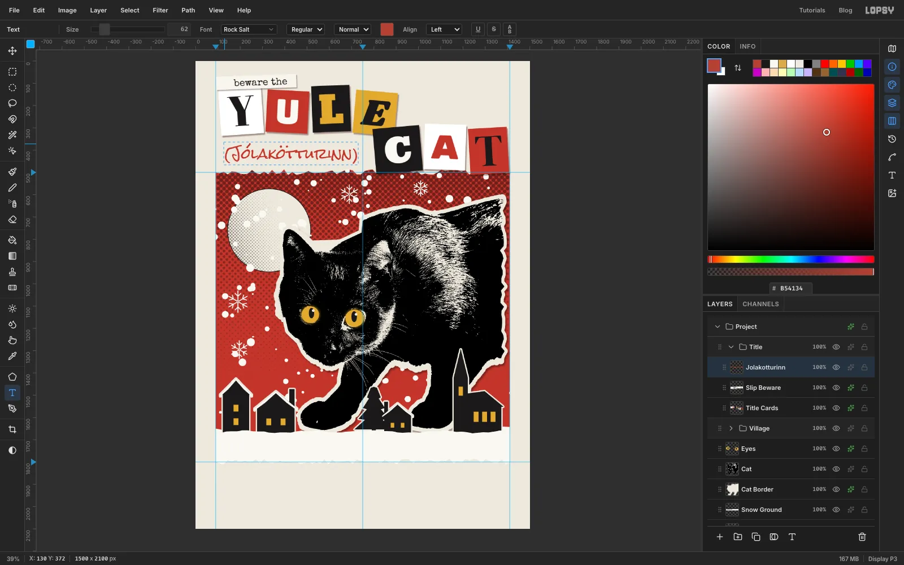

Click *Card T* and choose **Layer → Merge Down** six times, so all seven cards become one layer. Rename it *Title Cards* and give it a **Drop Shadow**: **Offset X 5**, **Offset Y 7**, **Blur 6**, **Opacity 40**, in shadow brown.

**Slip.** Add a layer called *Slip Beware*, fill a white `#F8F5EE` rectangle from **92, 64** to **452, 124**, and type `beware the` on it in **Special Elite 44**, toner black. Centre it with arrow-key nudges, **Merge Down**, tilt the slip **2°** to the left, and give it a small **Drop Shadow**: **Offset X 4**, **Offset Y 5**, **Blur 5**, **Opacity 35**. The slip slightly overlaps the top of the Y card, as if it was glued on last.

**Scrawl.** In the empty paper under YULE, type `(Jólakötturinn)` in **Rock Salt 62**, spot red. Rock Salt's lowercase is drawn as small capitals, so it reads like a quick marker note. Type the accented letters with your keyboard's accent keys, or copy the word from this page and paste it.

## Tilt the marker scrawl as live text

With the scrawl's text layer active, pick the **Move** tool. Handles appear around the text without any selection. Drag the rotate handle at the top right about **5°** counter-clockwise. The text stays live, so you can still fix a typo after rotating it.

## Tape the title down

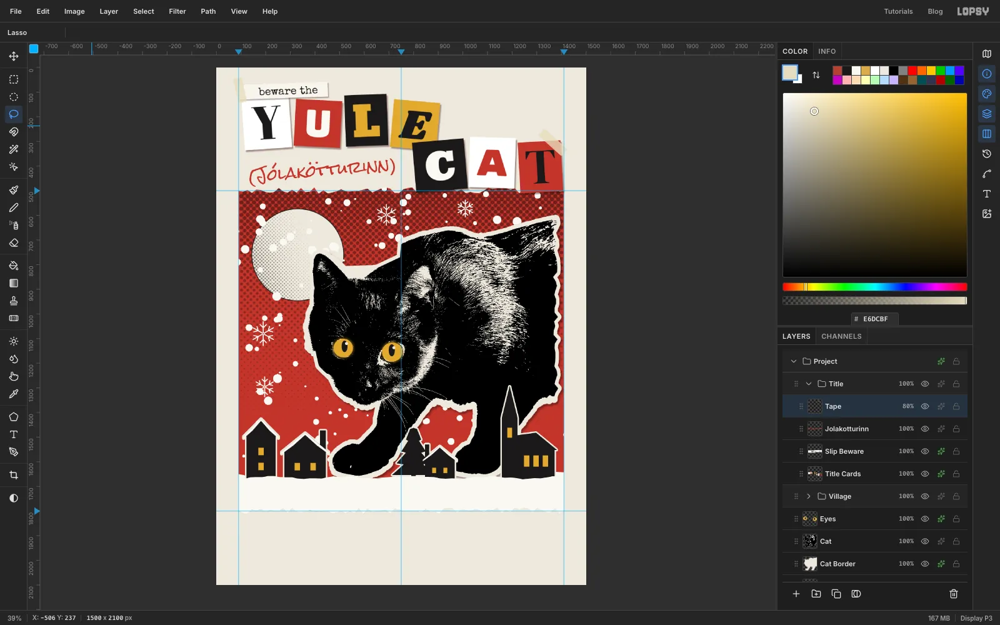

Add a layer called *Tape*. With the **Lasso**, draw two short strips about 100 × 35 px, each turned at an angle, with zig-zag ends where the tape was torn off the roll:

- one across the left end of the "beware the" slip, clear of the letters
- one over the top-right corner of the T card

Fill them with tape `#E6DCBF` and set the layer to **80%** opacity, so a little of what's underneath shows through.

## Type the legend on a story slip

**Lift the panel.** Before the notes go on, give the red panel the same paper lift as everything else. Click *Night Sky* and add a **Drop Shadow** with **Offset X 4**, **Offset Y 6**, **Blur 8** and **Opacity 35** in shadow brown, then do the same on *Snow Ground*. You'll see it under the panel's torn bottom edge.

**Slip.** Collapse *Title*, click it, and click **New Group**. Name the group *Notes*. Add a layer called *Story Slip* and fill a white `#F8F5EE` rectangle from **112, 1730** to **812, 2006**. It overlaps the bottom of the snowfield slightly. In **Special Elite 34**, toner black, type these four lines, pressing [[Enter]] after each of the first three:

- `The Yule Cat of Iceland prowls`
- `on Christmas Eve and eats anyone`
- `who got no new clothes.`
- `Wear your new socks!`

Centre the block on the slip with arrow-key nudges, then nudge it about 8 px higher to make room for an underline. **Merge Down**, tilt the slip **1.5°** to the left, and give it a **Drop Shadow** with **Offset X 4**, **Offset Y 6**, **Blur 6** and **Opacity 38**.

## Punch out a label-maker greeting

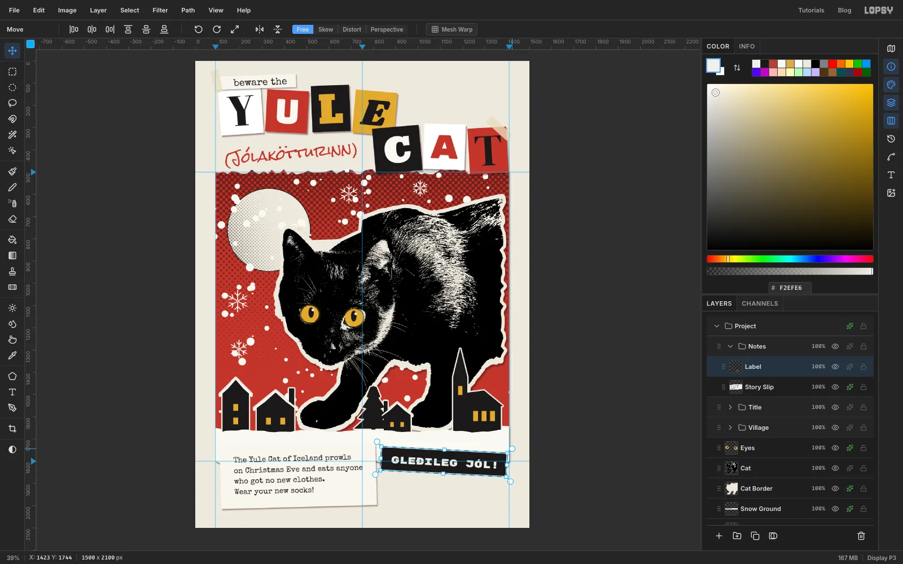

*Gleðileg jól* is Icelandic for Merry Christmas. Add a layer called *Label* and fill a toner-black strip from **836, 1752** to **1396, 1852**. It straddles the bottom edge of the panel, so it looks stuck across both papers.

Type `GLEÐILEG JÓL!` in **Rubik Mono One 44** in off-white `#F2EFE6`. If your keyboard doesn't have Ð, copy it from this page and paste it into the text. Centre the text on the strip, **Merge Down**, tilt it **3°** to the right, and add a tight **Drop Shadow**: **Offset X 3**, **Offset Y 5**, **Blur 4**, **Opacity 45**.

## Underline, tape and sign the card

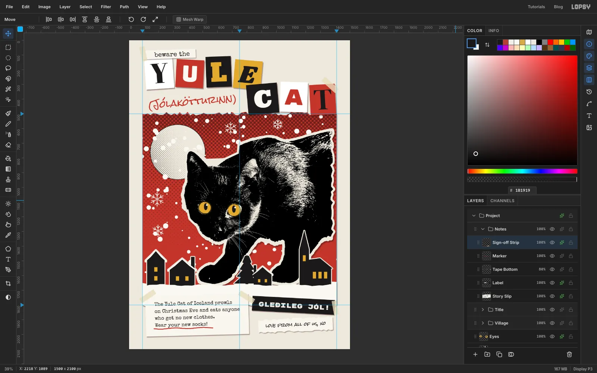

**Tape.** Add a layer called *Tape Bottom* and lasso three more torn strips in tape colour: one on each top corner of the story slip, and one over the right end of the label. Set the layer to **80%**.

**Underline.** Add a layer called *Marker*. Pick the **Brush**, **Size 7**, **Hardness 90**, in spot red, and drag a slightly wobbly line under "Wear your new socks!". Let it drift up a touch at the end, the way a hand does.

**Sign-off.** Add a layer called *Sign-off Strip*. Lasso a torn-edged strip under the label, from about x 878 to 1384 and y 1892 to 1978, and fill it with white `#F8F5EE`. Type `love from all of us, xo` in **Rock Salt 30**, toner black, centred on the strip. **Merge Down**, tilt it **2.5°** to the left, and give it the same small shadow as the slip.

## Print toner specks

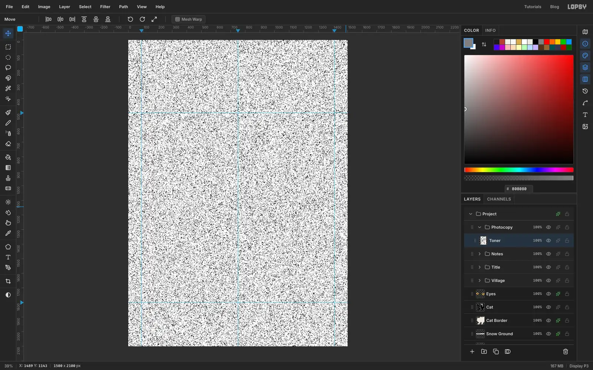

Collapse *Notes*, click it, and make one more group called *Photocopy*. Add a layer called *Toner* and fill it with mid-grey `#808080`. Then run:

1. **Filter → Add Noise…** at **Amount 100**, **Mono**
2. **Filter → Gaussian Blur…** at **3**
3. **Filter → Threshold…** at **120**

Start from mid-grey, not white. Add Noise only moves pixels about 50 levels either way, so on white nothing would ever get dark enough to catch. The blur clumps the noise, so the threshold leaves irregular blots instead of single-pixel salt.

## Wear the toner away in the middle

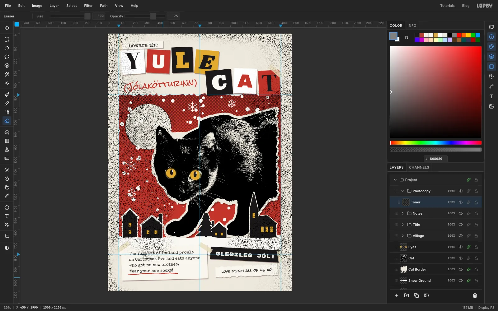

Pick the **Magic Wand**, untick **Contiguous**, set **Tolerance 10**, click a white pixel on *Toner*, press [[Delete]], and deselect. Turn **Contiguous** back on.

Even speckle everywhere looks like a digital filter. A real copy gets dirtier towards the edges. Pick the **Eraser** at **Size 520** and **Opacity 75**. Drag a loose zig-zag down the middle of the card, one straight pass from top to bottom, one sweep across the title and one across the bottom notes. Drop the **Size** to **300** and wipe the left end of the story slip too, so no specks blot the first letters of the lines. Then set *Toner* to **Multiply** at **55%**.

## Add the copier edge, a scanner streak and paper grain

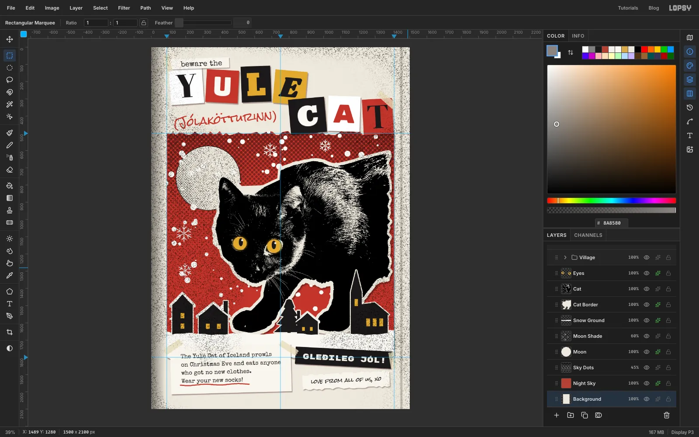

**Copier edge.** Add a layer called *Copier Edge*. Marquee a strip from **0, 0** to **80, 2100** down the left edge. Drag a linear gradient from `#3A3633` at the left edge to white at the right edge of the strip, then deselect. Set it to **Multiply** at **60%**. It's the shadow you get when the copier lid doesn't quite close.

**Scanner streak.** Add a layer called *Scan Streak*. Marquee a 12 px strip from **1446, 0** to **1458, 2100**, choose **Select → Feather…** at **5**, fill it with `#8A8580`, and deselect. Set it to **Multiply** at **45%**. Keep it in the margin, away from the art; a hard streak through the cat looks like a rendering bug.

**Paper grain.** Click *Background* and run **Add Noise…** at **Amount 6**, **Mono**.

Save with **File → Save Project**, then **File → Quick Export PNG**.

> **Tip:** Look at the card at 100% before you export. The eyes and the title should be the first things you see, and none of the type should touch the edge of its slip.
